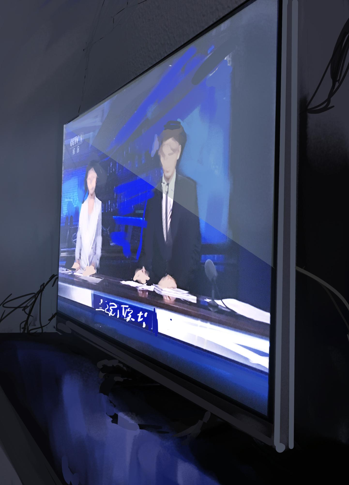
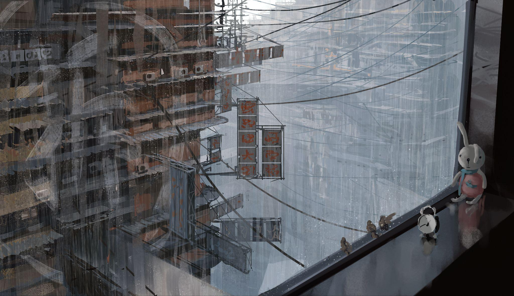
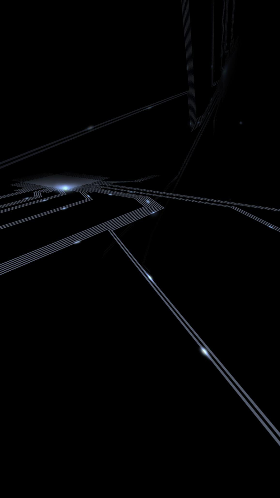

# CloudInsect - Chapter 0: Prologue

*Original Title: 第零章 楔子*

---

> [NEWS]“Xinhua reports that, according to observations by the ‘Tiangong-2’ satellite, CloudInsect No. 9, codenamed ‘Gemini,’ is expected to reach Shashi, a coastal city in the south of the country, in one month.”

> [NEWS]“Due to the effects of the CloudInsect field, electronic devices will stop working across most of the city. For the several weeks that the CloudInsect takes to pass through the city, the power grid will be shut down as a protective measure. Residents are advised to prepare emergency supplies.”

> [Message Inbox]“Mahina, are you okay?”

> [Message Inbox]“I got into graduate school at Berkeley! My parents are here too, and we’re all planning to immigrate together...”

> [NEWS]“Residents within the CloudInsect’s projected resting zones are asked to cooperate with the relevant authorities and relocate in advance, minimizing losses to personal property.”

> [NEWS]“According to experts, the CloudInsect passing through Shashi is the ninth known worldwide, codenamed ‘Gemini.’ Its origin—and whether it is mechanical or biological—remains disputed. The prevailing view is that the twelve CloudInsects are probes left behind by an advanced extraterrestrial civilization that visited Earth in prehistoric times.”

> [Message Inbox]“It’s just… my parents… they don’t approve of us…”

> [Message Inbox]“I’m sorry… Mahina…”

> [Message Inbox]“Let’s… break up.”

> [NEWS]“Experts have also stated that the CloudInsect field isn’t just typical electromagnetic interference; within its range, the laws of electromagnetism undergo fundamental changes. Planck's constant ceases to be constant, and Maxwell's equations no longer hold. The scientific community remains unable to explain this phenomenon.”

> [NEWS]“Dr. Mo of the Chinese Academy of Sciences devoted his life to studying the footprints of CloudInsects. Comparing footprints from different eras, he found strong evidence that the mass of every CloudInsect is steadily decreasing. He therefore proposed that the energy sustaining their millennia of travel across Earth comes from the annihilation of matter and antimatter within their bodies.”

> [Message Inbox]“I heard there’s a CloudInsect passing through your area. Take care of yourself…”

> [NEWS]“For thousands of years, humanity has never stopped wondering about or investigating CloudInsects. Yet even today, despite highly advanced science and technology, the CloudInsect field continues to make their study extraordinarily difficult.”

