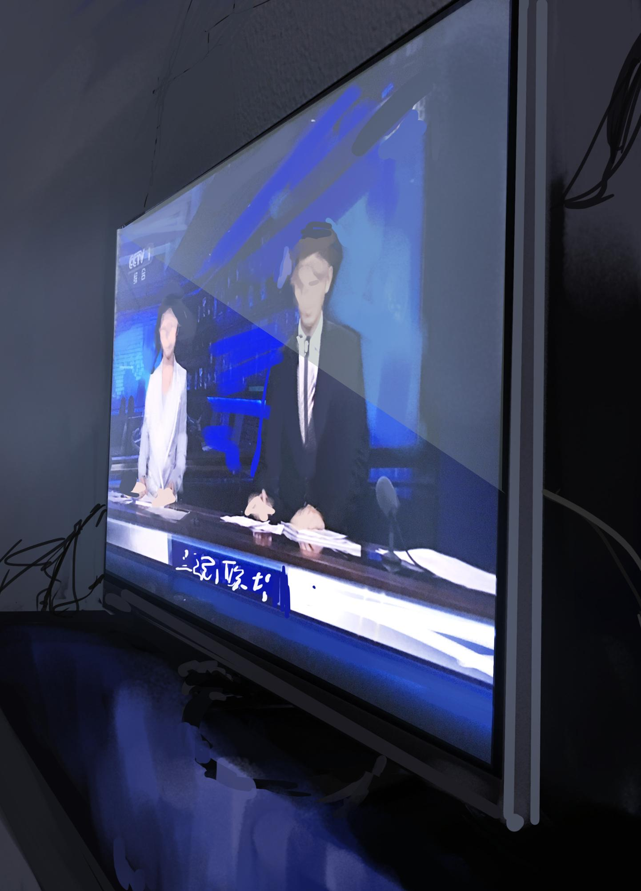
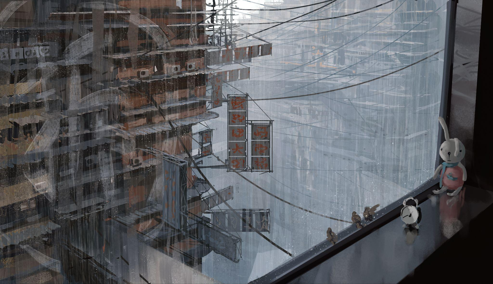
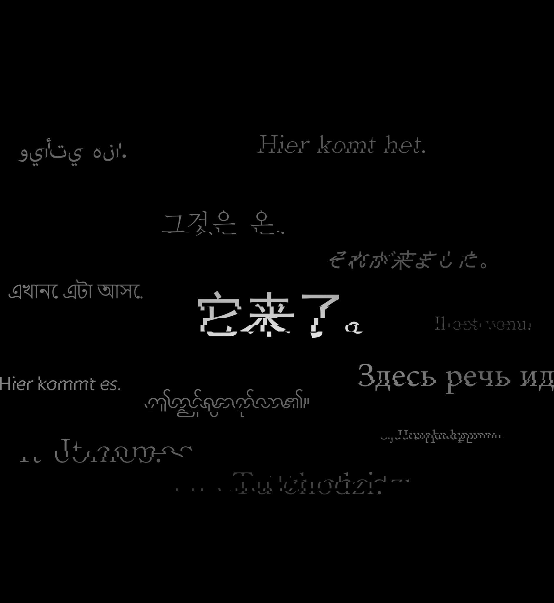

# Vân Trùng - Chương 0: Mở đầu

---

[Bản tin thời sự] "Bản tin Tân Hoa Xã: Theo quan sát từ vệ tinh 'Thiên Cung 2', Vân Trùng số 9 mang mật danh 'Song Tử' dự kiến sẽ tiến vào thành phố duyên hải miền Nam - Sa Khê sau một tháng nữa."

[Bản tin thời sự] "Do ảnh hưởng của trường Vân Trùng, hầu hết các thiết bị điện tử trên toàn thành phố khi đó sẽ ngừng hoạt động. Trong suốt vài tuần Vân Trùng đi qua thành phố, mạng lưới điện toàn thị sẽ bị ngắt để bảo vệ. Kính đề nghị người dân chủ động tích trữ nhu yếu phẩm khẩn cấp."

[Hộp thư thoại] "Nguyệt Nha Nhi, em vẫn ổn chứ?"

[Hộp thư thoại] "Anh đỗ cao học ở Berkeley rồi. Bố mẹ anh cũng đã sang đây, cả nhà chuẩn bị cùng định cư luôn..."

[Bản tin thời sự] "Các cư dân sinh sống trong phạm vi các điểm dừng chân dự kiến của Vân Trùng xin vui lòng phối hợp với cơ quan chức năng để sơ tán trước, nhằm giảm thiểu tối đa thiệt hại về tài sản."

[Bản tin thời sự] "Theo các chuyên gia, thực thể đi qua thành phố Sa Khê lần này là Vân Trùng số 9 trên thế giới, định danh là 'Song Tử'. Hiện nay giới khoa học vẫn còn nhiều tranh cãi về nguồn gốc cũng như bản chất của Vân Trùng là máy móc cơ khí hay sinh vật sống. Quan điểm chủ lưu cho rằng 12 cá thể Vân Trùng này là những thiết bị thăm dò do một siêu nền văn minh ngoài Trái Đất để lại khi ghé thăm địa cầu từ thời tiền sử."

[Hộp thư thoại] "Chỉ là chuyện kia... bố mẹ anh... không đồng ý chuyện hai đứa mình..."

[Hộp thư thoại] "Anh xin lỗi... Nguyệt Nha Nhi..."

[Hộp thư thoại] "Chúng mình... chia tay đi..."

[Bản tin thời sự] "Các chuyên gia cũng cho biết thêm, trường Vân Trùng không đơn thuần là nhiễu loạn điện từ thông thường, mà ngay trong phạm vi ảnh hưởng của nó, các quy luật vật lý điện từ đều sẽ bị biến đổi dị thường. Bên trong trường Vân Trùng, hằng số Planck không còn là hằng số, và hệ phương trình Maxwell cũng không còn chuẩn xác. Giới khoa học cho đến nay vẫn chưa thể giải thích hiện tượng này."

[Bản tin thời sự] "Tiến sĩ Mạc thuộc Viện Khoa học Trung Quốc, người dành cả đời nghiên cứu dấu chân Vân Trùng, chỉ ra rằng qua quan sát dấu vết của Vân Trùng ở các thời đại khác nhau, đã có đủ bằng chứng chứng minh khối lượng của tất cả Vân Trùng đều đang suy giảm đều đặn. Từ đó ông đưa ra giả thuyết rằng nguồn năng lượng duy trì bước chân ngàn năm của Vân Trùng trên Trái Đất bắt nguồn từ sự hủy cặp giữa vật chất và phản vật chất bên trong cơ thể chúng."

[Hộp thư thoại] "Nghe nói chỗ em sắp có Vân Trùng đi qua, hãy tự chăm sóc tốt cho bản thân nhé..."

[Bản tin thời sự] "Dù hàng ngàn năm qua trí tò mò và khát vọng khám phá Vân Trùng của nhân loại chưa từng ngơi nghỉ, song ngay cả ở thời đại khoa học kỹ thuật phát triển tột bậc ngày nay, sự tồn tại của trường Vân Trùng vẫn khiến việc nghiên cứu của con người vô cùng gian nan trắc trở."

