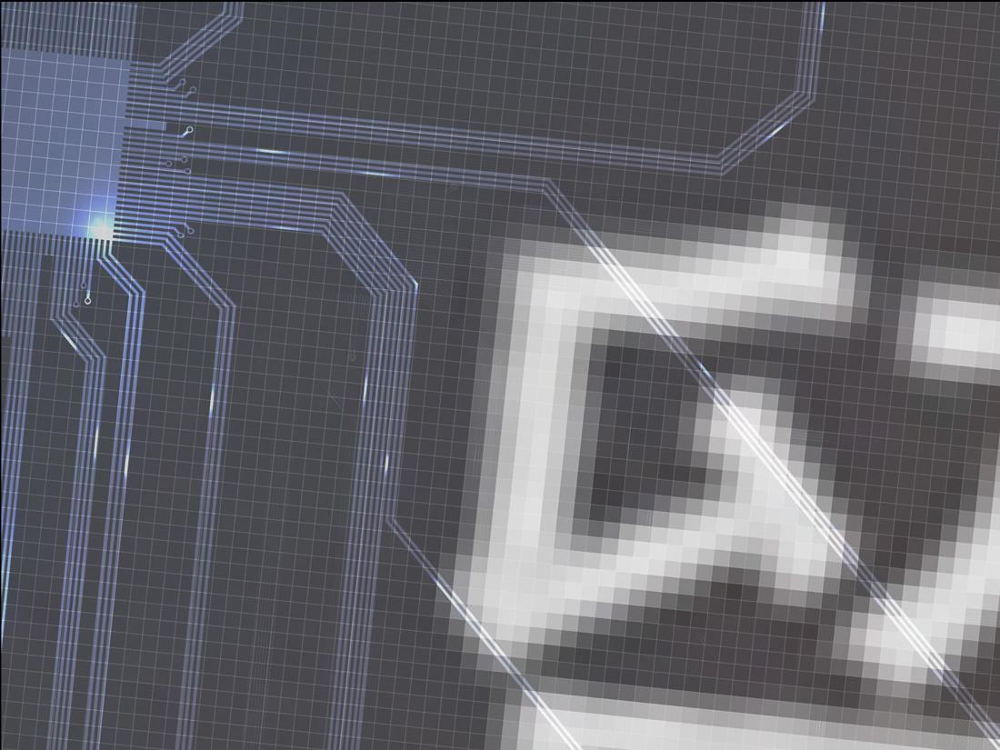
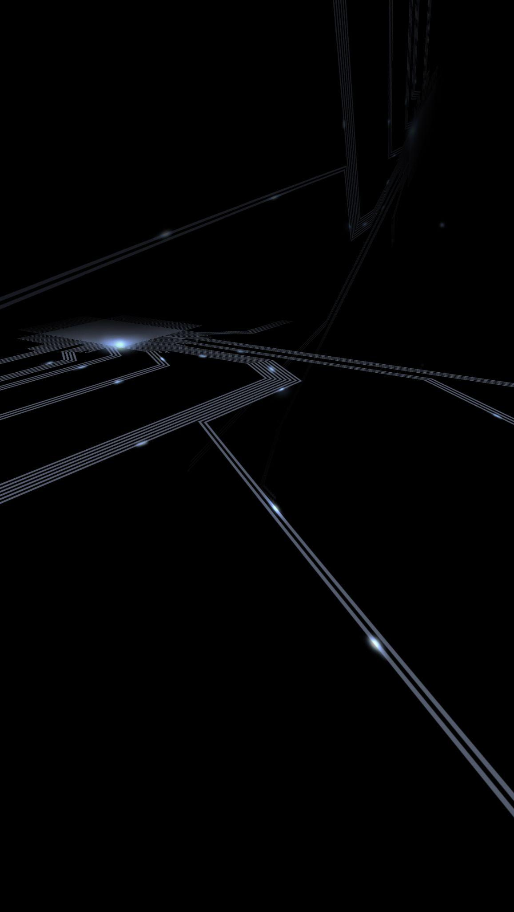

# Vân Trùng - Chương 0: Mở đầu

---

* **Chữ trong ảnh:** Góc trái màn hình tivi có dòng chữ mờ **"CCTV 1 综合"** (Kênh Tổng hợp CCTV 1).
* **Lời thoại / Nội dung phát ra:**
  > **[Tin tức]** "Theo tin từ Tân Hoa Xã, dựa trên dữ liệu quan sát của vệ tinh 'Thiên Cung 2', con Vân Trùng số 9 mang mã danh 'Song Tử' dự kiến sẽ tiến vào thành phố ven biển phía nam nước ta – thành phố Sa Khê – trong một tháng tới."
  > 
  > **[Tin tức]** "Do ảnh hưởng từ trường lực của Vân Trùng, khi đó phần lớn các thiết bị điện tử trong toàn thành phố sẽ ngừng hoạt động. Trong vài tuần Vân Trùng đi qua, mạng lưới điện toàn thành phố sẽ được ngắt để bảo vệ, đề nghị người dân chuẩn bị sẵn nhu yếu phẩm dự phòng."

---

* **Chữ trong ảnh:**
  * Trung tâm màn hình: **"未知号码"** (Số không xác định).
  * Ngay bên dưới: **"留言信箱"** (Hộp thư thoại).
* **Lời thoại / Nội dung phát ra:**
  > **[Hộp thư thoại]** "Nguyệt Nha Nhi, em khỏe không?"
  > 
  > **[Hộp thư thoại]** "Anh thi đỗ cao học ở Berkeley rồi, bố mẹ anh cũng đã qua đây, nhà anh chuẩn bị định cư luôn bên này..."

---

* **Chữ trong ảnh:** Các biển hiệu neon rỉ sét treo ngoài trời mưa mờ ảo (một số chữ lờ mờ như **"特价"** - Giá đặc biệt).
* **Lời thoại / Nội dung phát ra:**
  > **[Tin tức]** "Cư dân sống trong phạm vi các điểm dừng chân của Vân Trùng vui lòng phối hợp với các cơ quan chức năng để tiến hành di dời từ sớm, nhằm giảm thiểu tối đa thiệt hại về tài sản cá nhân."
  > 
  > **[Tin tức]** "Theo các chuyên gia, con Vân Trùng đi qua thành phố Sa Khê nước ta lần này là Vân Trùng số 9 trên thế giới, mã danh 'Song Tử'. Hiện tại, giới khoa học vẫn còn tranh cãi về nguồn gốc của Vân Trùng cũng như việc chúng rốt cuộc là máy móc hay sinh vật. Quan điểm chính thống cho rằng 12 con Vân Trùng này là những thiết bị thăm dò do một siêu văn minh ngoài hành tinh để lại khi viếng thăm Trái Đất vào thời tiền sử."

---

* **Lời thoại / Nội dung phát ra:**
  > **[Hộp thư thoại]** "Chỉ là... bố mẹ anh... không đồng ý chuyện của chúng mình..."
  > 
  > **[Hộp thư thoại]** "Anh xin lỗi... Nguyệt Nha Nhi..."

---

* **Lời thoại / Nội dung phát ra:** *(Không có lời thoại)*

---

* **Lời thoại / Nội dung phát ra:**
  > **[Hộp thư thoại]** "Chúng ta... chia tay đi..."
  > 
  > **[Tin tức]** "Các chuyên gia cũng cho biết, trường lực của Vân Trùng không chỉ là nhiễu sóng điện từ thông thường, mà trong phạm vi ảnh hưởng của nó, các quy luật vật lý điện từ sẽ bị biến đổi. Bên trong trường lực Vân Trùng, hằng số Planck sẽ không còn là hằng số, và hệ phương trình Maxwell cũng không còn đúng nữa. Giới khoa học cho đến nay vẫn chưa thể giải thích được hiện tượng này."
  > 
  > **[Tin tức]** "Tiến sĩ Mạc thuộc Viện Hàn lâm Khoa học Trung Quốc đã dành cả đời để nghiên cứu dấu vết của Vân Trùng. Ông chỉ ra rằng, qua việc quan sát dấu chân Vân Trùng từ nhiều thời đại khác nhau, có đủ bằng chứng cho thấy khối lượng của tất cả các Vân Trùng đều đang giảm dần một cách ổn định. Từ đó, ông suy đoán rằng nguồn năng lượng giúp Vân Trùng di chuyển trên Trái Đất suốt hàng ngàn năm qua bắt nguồn từ sự triệt tiêu lẫn nhau (annihilation) giữa phản vật chất và vật chất bên trong cơ thể chúng."

---

* **Chữ trong ảnh:** Giao diện vẫn hiển thị **"未知号码"** (Số không xác định) / **"留言信箱"** (Hộp thư thoại).
* **Lời thoại / Nội dung phát ra:**
  > **[Hộp thư thoại]** "Nghe nói chỗ em sắp có Vân Trùng đi qua, hãy tự chăm sóc tốt cho bản thân nhé..."

---

* **Chữ trong ảnh:** Các điểm ảnh cấu tạo nên chữ **"未知号码"** (Số không xác định) và **"留言信箱"** (Hộp thư thoại) bị vỡ nét do từ trường lực phá hủy.
* **Lời thoại / Nội dung phát ra:** *(Không có lời thoại)*

---

* **Lời thoại / Nội dung phát ra:**
  > **[Tin tức]** "Mặc dù hàng ngàn năm qua, sự tò mò và khao khát khám phá Vân Trùng của nhân loại chưa bao giờ dừng lại, nhưng ngay cả ở thời đại khoa học kỹ thuật phát triển cao độ như ngày nay, do sự tồn tại của trường lực Vân Trùng, việc nghiên cứu về chúng vẫn vô cùng gian nan và đầy trắc trở."

---

* **Lời thoại / Nội dung phát ra:** *(Sự im lặng tuyệt đối)*

---

* **Chữ trong ảnh (Dịch toàn bộ):**
  * Dòng chữ lớn trung tâm (Tiếng Trung): **它来了。 (Nó đến rồi.)**
  * Góc trên trái (Tiếng Ả Rập): **إنه يأتي** (Nó đang đến)
  * Góc trên phải (Tiếng Hà Lan): **Hier komt het.** (Nó đến đây rồi)
  * Giữa trên (Tiếng Hàn): **그것은 온...** (Nó đã đến...)
  * Giữa phải (Tiếng Nhật): **それが来ました。** (Nó đã tới rồi.)
  * Giữa trái (Tiếng Bengali): **এখানে এটা আসে** (Nó đến đây)
  * Giữa phải (Tiếng Pháp): **Il est venu !** (Nó đã tới!)
  * Góc dưới trái (Tiếng Đức): **Hier kommt es.** (Nó đang tới đây)
  * Góc dưới phải (Tiếng Nga): **Здесь речь ид... / Здесь оно** (Nó ở đây...)
  * Dưới cùng (Tiếng Ba Lan): **...Nadchodzi...** (Đang kéo đến...)
* **Lời thoại / Nội dung phát ra:** *(Không có lời thoại)*
