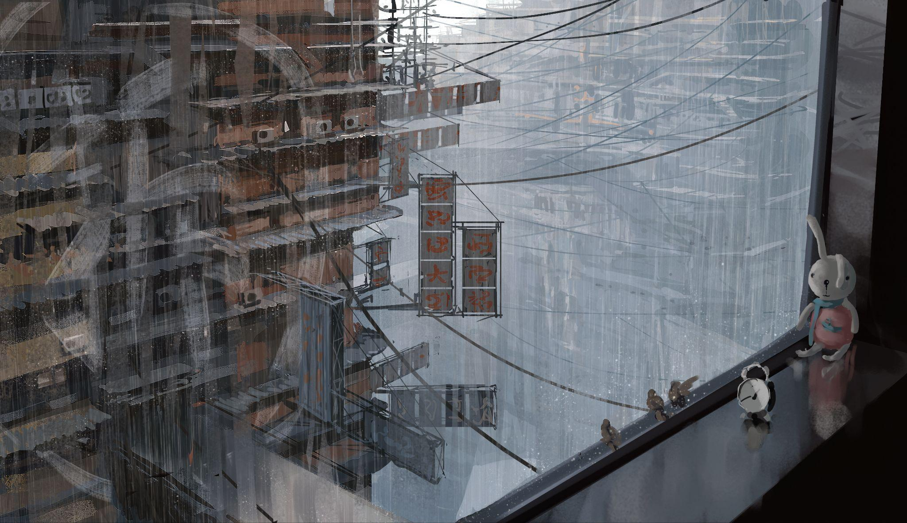
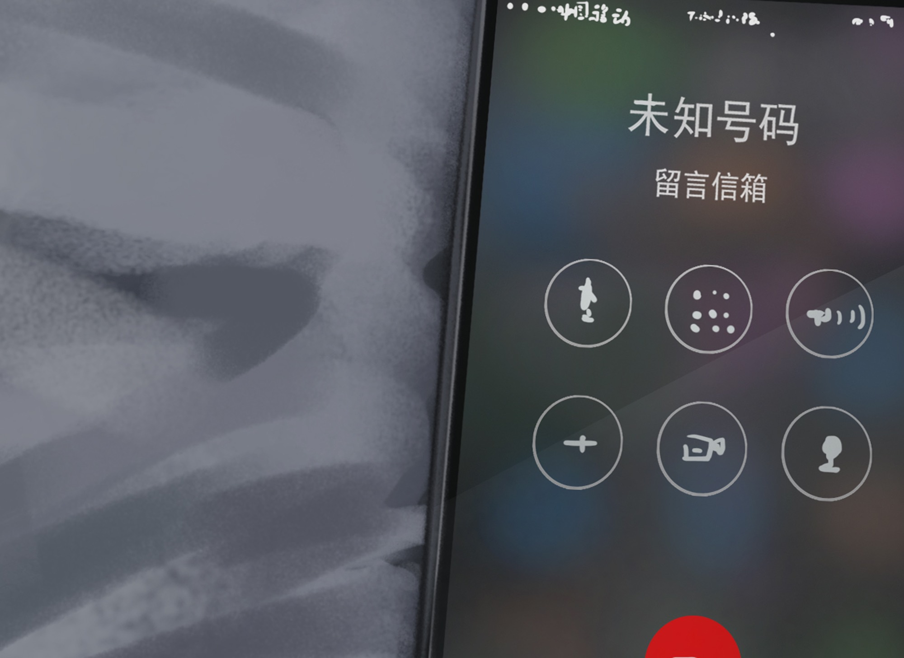
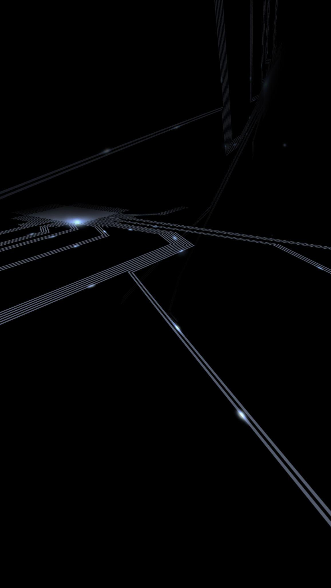
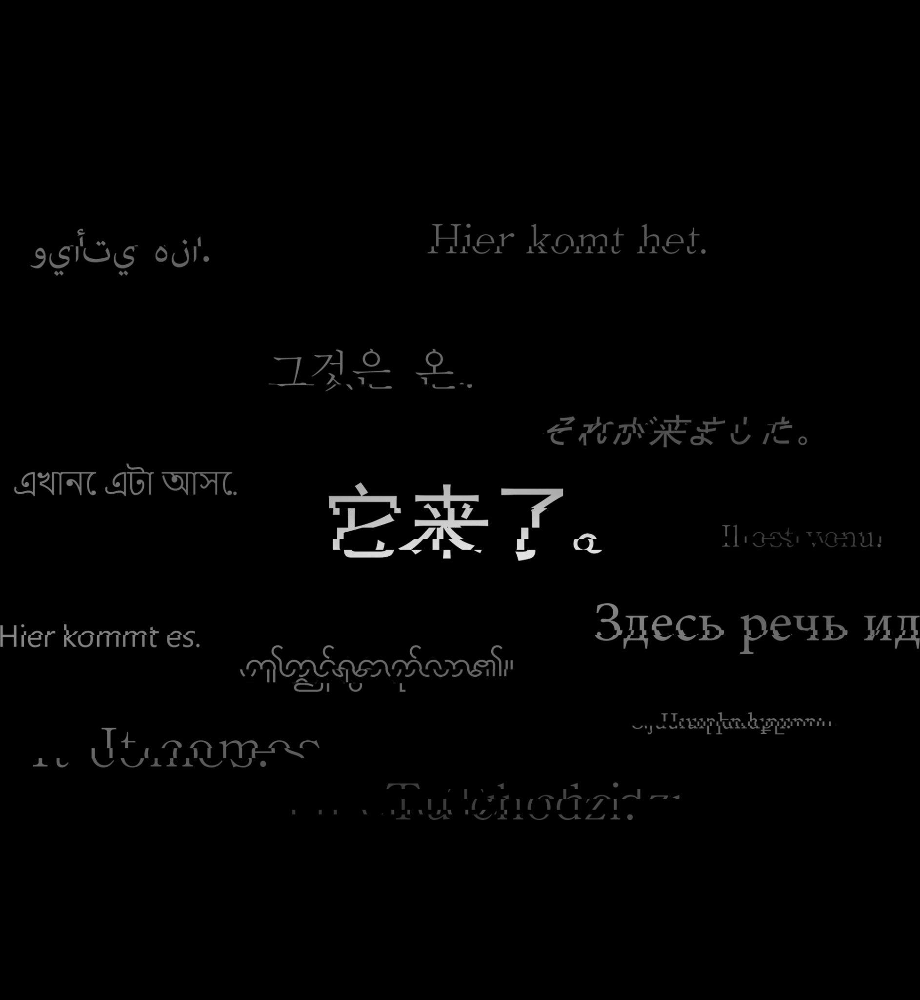

# Vân Trùng / CloudInsect - Chương 0: Mở đầu (第零章 楔子)

---

**VI**: [Bản tin thời sự] "Bản tin Tân Hoa Xã: Theo quan sát từ vệ tinh 'Thiên Cung 2', Vân Trùng số 9 mang mật danh 'Song Tử' dự kiến sẽ tiến vào thành phố duyên hải miền Nam - Sa Khê sau một tháng nữa."

**ZH**: [新闻]“新华社消息，据“天宫二号”卫星的观测，九号云虫“双子”预计将于一个月后抵达我国南部沿海城市沙溪市。”

**EN**: [NEWS]“Xinhua reports that, according to observations by the ‘Tiangong-2’ satellite, CloudInsect No. 9, codenamed ‘Gemini,’ is expected to reach Shashi, a coastal city in the south of the country, in one month.”

**VI**: [Bản tin thời sự] "Do ảnh hưởng của trường Vân Trùng, hầu hết các thiết bị điện tử trên toàn thành phố khi đó sẽ ngừng hoạt động. Trong suốt vài tuần Vân Trùng đi qua thành phố, mạng lưới điện toàn thị sẽ bị ngắt để bảo vệ. Kính đề nghị người dân chủ động tích trữ nhu yếu phẩm khẩn cấp."

**ZH**: [新闻]“由于云虫场的影响，届时全市大部分地区内电子设备将无法运行。在云虫途经整座城市的数个星期内，全市电网将做保护性关闭，请市民做好应急物资储备。”

**EN**: [NEWS]“Due to the effects of the CloudInsect field, electronic devices will stop working across most of the city. For the several weeks that the CloudInsect takes to pass through the city, the power grid will be shut down as a protective measure. Residents are advised to prepare emergency supplies.”

**VI**: [Hộp thư thoại] "Nguyệt Nha Nhi, em vẫn ổn chứ?"

**ZH**: [留言信箱]“月牙儿，你还好吗？”

**EN**: [Message Inbox]“Mahina, are you okay?”

**VI**: [Hộp thư thoại] "Anh đỗ cao học ở Berkeley rồi. Bố mẹ anh cũng đã sang đây, cả nhà chuẩn bị cùng định cư luôn..."

**ZH**: [留言信箱]“我考上伯克利的研究生了，我父母也来了，我们准备一起移民了...”

**EN**: [Message Inbox]“I got into graduate school at Berkeley! My parents are here too, and we’re all planning to immigrate together...”

**VI**: [Bản tin thời sự] "Các cư dân sinh sống trong phạm vi các điểm dừng chân dự kiến của Vân Trùng xin vui lòng phối hợp với cơ quan chức năng để sơ tán trước, nhằm giảm thiểu tối đa thiệt hại về tài sản."

**ZH**: [新闻]“居住于云虫各落脚点范围内的居民请配合政府有关部门提前做好搬迁工作，将个人财产损失降到最低。”

**EN**: [NEWS]“Residents within the CloudInsect’s projected resting zones are asked to cooperate with the relevant authorities and relocate in advance, minimizing losses to personal property.”

**VI**: [Bản tin thời sự] "Theo các chuyên gia, thực thể đi qua thành phố Sa Khê lần này là Vân Trùng số 9 trên thế giới, định danh là 'Song Tử'. Hiện nay giới khoa học vẫn còn nhiều tranh cãi về nguồn gốc cũng như bản chất của Vân Trùng là máy móc cơ khí hay sinh vật sống. Quan điểm chủ lưu cho rằng 12 cá thể Vân Trùng này là những thiết bị thăm dò do một siêu nền văn minh ngoài Trái Đất để lại khi ghé thăm địa cầu từ thời tiền sử."

**ZH**: [新闻]“据专家介绍，此次途经我国沙溪市的云虫为世界第九号云虫，代号“双子”。目前科学界对云虫的来历及其究竟属于机械还是生物的论点依旧有争议。主流的看法认为这十二只云虫是地外超级文明在史前造访地球时留下的探测器。”

**EN**: [NEWS]“According to experts, the CloudInsect passing through Shashi is the ninth known worldwide, codenamed ‘Gemini.’ Its origin—and whether it is mechanical or biological—remains disputed. The prevailing view is that the twelve CloudInsects are probes left behind by an advanced extraterrestrial civilization that visited Earth in prehistoric times.”

**VI**: [Hộp thư thoại] "Chỉ là chuyện kia... bố mẹ anh... không đồng ý chuyện hai đứa mình..."

**ZH**: [留言信箱]“只是那个……我父母……不同意我们……”

**EN**: [Message Inbox]“It’s just… my parents… they don’t approve of us…”

**VI**: [Hộp thư thoại] "Anh xin lỗi... Nguyệt Nha Nhi..."

**ZH**: [留言信箱]“对不起……月牙儿……”

**EN**: [Message Inbox]“I’m sorry… Mahina…”

**VI**: [Hộp thư thoại] "Chúng mình... chia tay đi..."

**ZH**: [留言信箱]“我们……分手吧……”

**EN**: [Message Inbox]“Let’s… break up.”

**VI**: [Bản tin thời sự] "Các chuyên gia cũng cho biết thêm, trường Vân Trùng không đơn thuần là nhiễu loạn điện từ thông thường, mà ngay trong phạm vi ảnh hưởng của nó, các quy luật vật lý điện từ đều sẽ bị biến đổi dị thường. Bên trong trường Vân Trùng, hằng số Planck không còn là hằng số, và hệ phương trình Maxwell cũng không còn chuẩn xác. Giới khoa học cho đến nay vẫn chưa thể giải thích hiện tượng này."

**ZH**: [新闻]“专家还称，云虫场并非普通的电磁干扰，而是在其影响范围之内，电磁物理规律会发生异变。在云虫场内，普朗克常量将不再是常数，麦克斯韦方程组也不再成立。科学界至今依然无法解释这个现象。”

**EN**: [NEWS]“Experts have also stated that the CloudInsect field isn’t just typical electromagnetic interference; within its range, the laws of electromagnetism undergo fundamental changes. Planck's constant ceases to be constant, and Maxwell's equations no longer hold. The scientific community remains unable to explain this phenomenon.”

**VI**: [Bản tin thời sự] "Tiến sĩ Mạc thuộc Viện Khoa học Trung Quốc, người dành cả đời nghiên cứu dấu chân Vân Trùng, chỉ ra rằng qua quan sát dấu vết của Vân Trùng ở các thời đại khác nhau, đã có đủ bằng chứng chứng minh khối lượng của tất cả Vân Trùng đều đang suy giảm đều đặn. Từ đó ông đưa ra giả thuyết rằng nguồn năng lượng duy trì bước chân ngàn năm của Vân Trùng trên Trái Đất bắt nguồn từ sự hủy cặp giữa vật chất và phản vật chất bên trong cơ thể chúng."

**ZH**: [新闻]“中科院的莫博士一生致力于云虫足迹的研究。他指出，经过对不同时代的云虫足迹的观测，已有充分证据表明所有云虫的质量都在稳定的下降。他由此推测云虫在地球上行走数千年的能量来源于其体内的反物质与正物质的湮灭。”

**EN**: [NEWS]“Dr. Mo of the Chinese Academy of Sciences devoted his life to studying the footprints of CloudInsects. Comparing footprints from different eras, he found strong evidence that the mass of every CloudInsect is steadily decreasing. He therefore proposed that the energy sustaining their millennia of travel across Earth comes from the annihilation of matter and antimatter within their bodies.”

**VI**: [Hộp thư thoại] "Nghe nói chỗ em sắp có Vân Trùng đi qua, hãy tự chăm sóc tốt cho bản thân nhé..."

**ZH**: [留言信箱]“听说你们那边有云虫要经过，照顾好自己……”

**EN**: [Message Inbox]“I heard there’s a CloudInsect passing through your area. Take care of yourself…”

**VI**: [Bản tin thời sự] "Dù hàng ngàn năm qua trí tò mò và khát vọng khám phá Vân Trùng của nhân loại chưa từng ngơi nghỉ, song ngay cả ở thời đại khoa học kỹ thuật phát triển tột bậc ngày nay, sự tồn tại của trường Vân Trùng vẫn khiến việc nghiên cứu của con người vô cùng gian nan trắc trở."

**ZH**: [新闻]“虽然千百年来人类对云虫的好奇与探索从未止步过，但即使到了科学技术高度发达的今天，由于云虫场的存在，人类对云虫的研究依旧举步维艰。”

**EN**: [NEWS]“For thousands of years, humanity has never stopped wondering about or investigating CloudInsects. Yet even today, despite highly advanced science and technology, the CloudInsect field continues to make their study extraordinarily difficult.”

