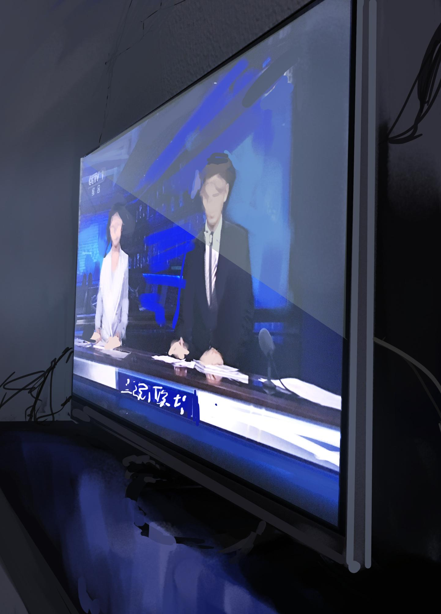
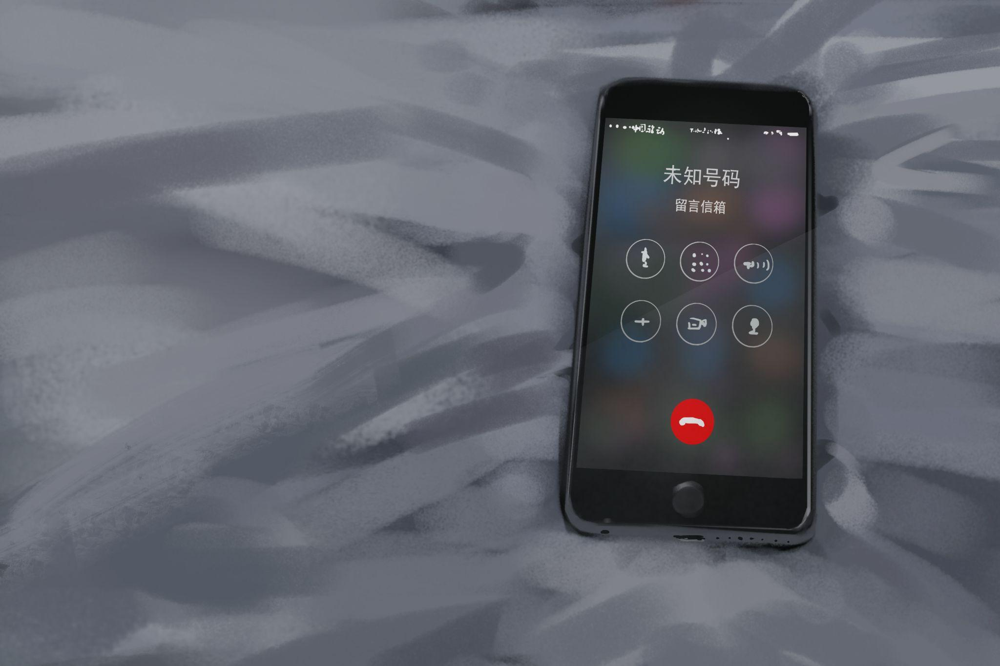
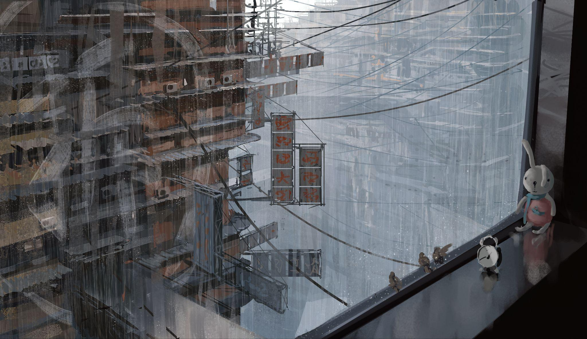
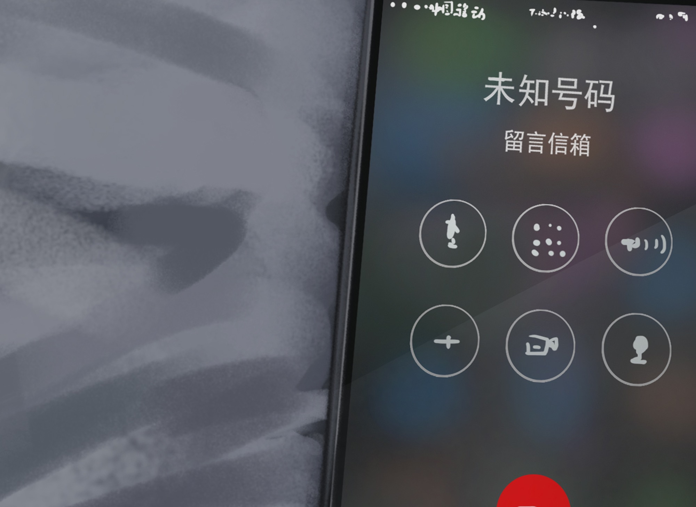
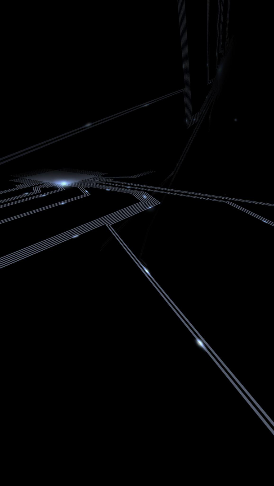

# 云虫 - 第零章 楔子

---

> [新闻]“新华社消息，据“天宫二号”卫星的观测，九号云虫“双子”预计将于一个月后抵达我国南部沿海城市沙溪市。”

> [新闻]“由于云虫场的影响，届时全市大部分地区内电子设备将无法运行。在云虫途经整座城市的数个星期内，全市电网将做保护性关闭，请市民做好应急物资储备。”

> [留言信箱]“月牙儿，你还好吗？”

> [留言信箱]“我考上伯克利的研究生了，我父母也来了，我们准备一起移民了...”

> [新闻]“居住于云虫各落脚点范围内的居民请配合政府有关部门提前做好搬迁工作，将个人财产损失降到最低。”

> [新闻]“据专家介绍，此次途经我国沙溪市的云虫为世界第九号云虫，代号“双子”。目前科学界对云虫的来历及其究竟属于机械还是生物的论点依旧有争议。主流的看法认为这十二只云虫是地外超级文明在史前造访地球时留下的探测器。”

> [留言信箱]“只是那个……我父母……不同意我们……”

> [留言信箱]“对不起……月牙儿……”

> [留言信箱]“我们……分手吧……”

> [新闻]“专家还称，云虫场并非普通的电磁干扰，而是在其影响范围之内，电磁物理规律会发生异变。在云虫场内，普朗克常量将不再是常数，麦克斯韦方程组也不再成立。科学界至今依然无法解释这个现象。”

> [新闻]“中科院的莫博士一生致力于云虫足迹的研究。他指出，经过对不同时代的云虫足迹的观测，已有充分证据表明所有云虫的质量都在稳定的下降。他由此推测云虫在地球上行走数千年的能量来源于其体内的反物质与正物质的湮灭。”

> [留言信箱]“听说你们那边有云虫要经过，照顾好自己……”

> [新闻]“虽然千百年来人类对云虫的好奇与探索从未止步过，但即使到了科学技术高度发达的今天，由于云虫场的存在，人类对云虫的研究依旧举步维艰。”

