# CloudInsect - Chapter 1: Xiyang

*Original Title: 第一章 希扬*

---

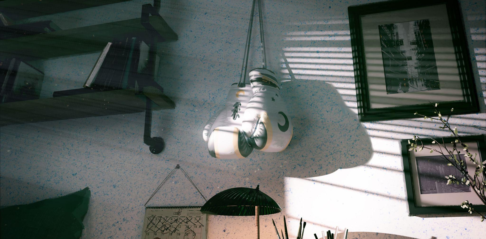

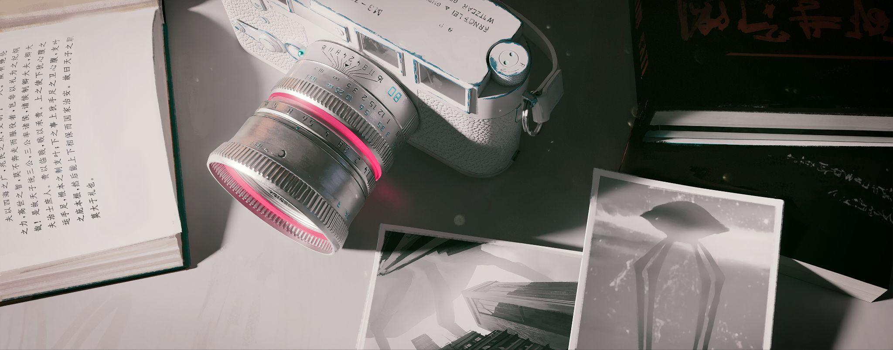

> [Book]Chronicle of Eras: Spring and Autumn

> [Film Camera]

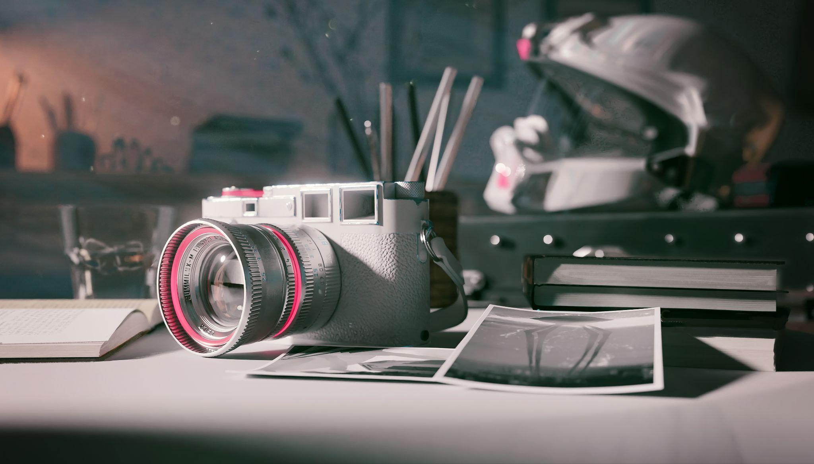

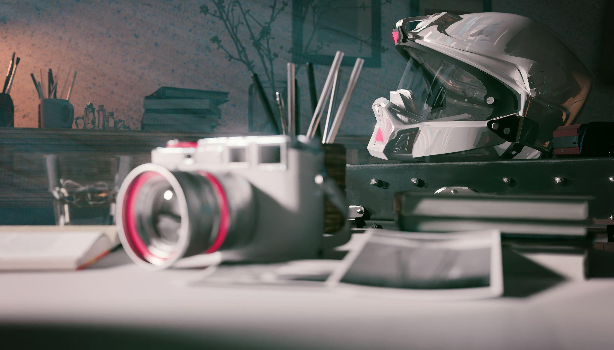

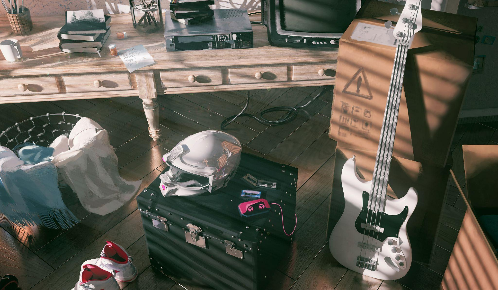

> [Book]The Roman Empire

> [Book]Violin Sheet Music

> [Book]A Brief History of World Civilizations

> [Medicine Bottle]Escitalopram (Antidepressant)

> [Diagnosis Report]Name: Mahina

> [Diagnosis Report]Gender: Female

> [Diagnosis Report]Age: 19

> [Diagnosis Report]Department: Outpatient Psychiatry

> [Diagnosis Report]Diagnosis: Chronic Moderate Depression

> [Diagnosis Report]Recommendations: Take antidepressant medication as prescribed for the long term

> Knock, knock, knock

> “Coming! Just a moment.”

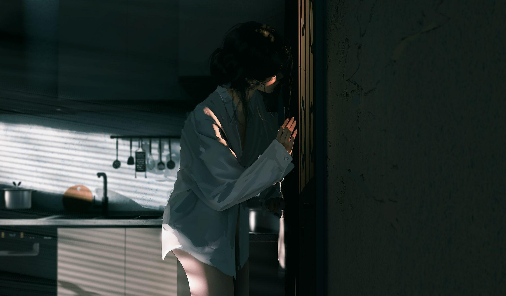

> “Uncle Li, what’s up?”

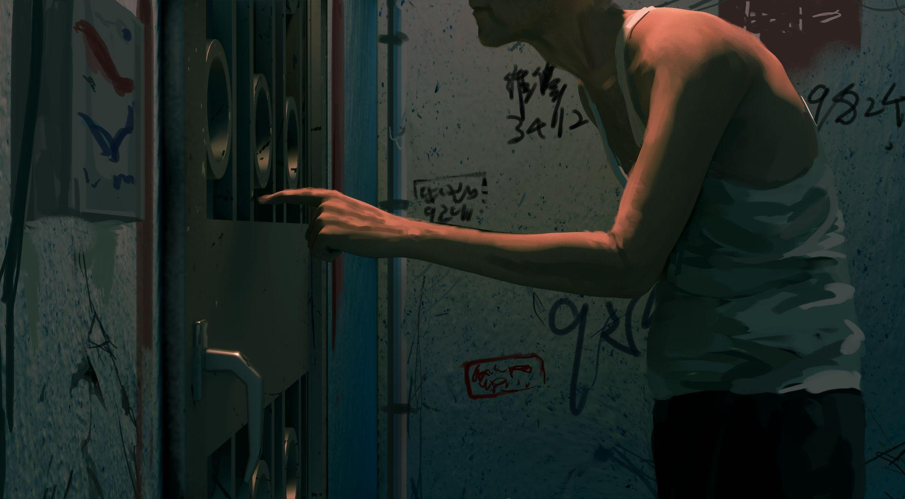

> “Mahina, you still haven’t moved out? Do you realize what day it is?”

> “Uncle Li, can I have a few more days? I have a lot of stuff to pack, and finding a place to rent outside isn’t quick…”

> “No, no! I gave you plenty of notice! I’m not the one driving you out—this area is close to a CloudInsect resting site, and the government requires everyone to evacuate by the deadline. Officials have already come by twice to press the issue. You know there’s a fine if you’re late!”

> “Uncle Li, the government’s deadline hasn’t even arrived yet! Even if there is a fine, the tenant pays it, not you—I think you’re afraid they’ll discover that illegal awning you built on the roof!”

> “You’re talking nonsense! There’s nothing illegal about that shelter! I’ve had it up for over ten years! Tell them to come and check, I dare them! Hmph… Anyway, you have to move out by tomorrow night, or I’ll cut off your water and electricity!”

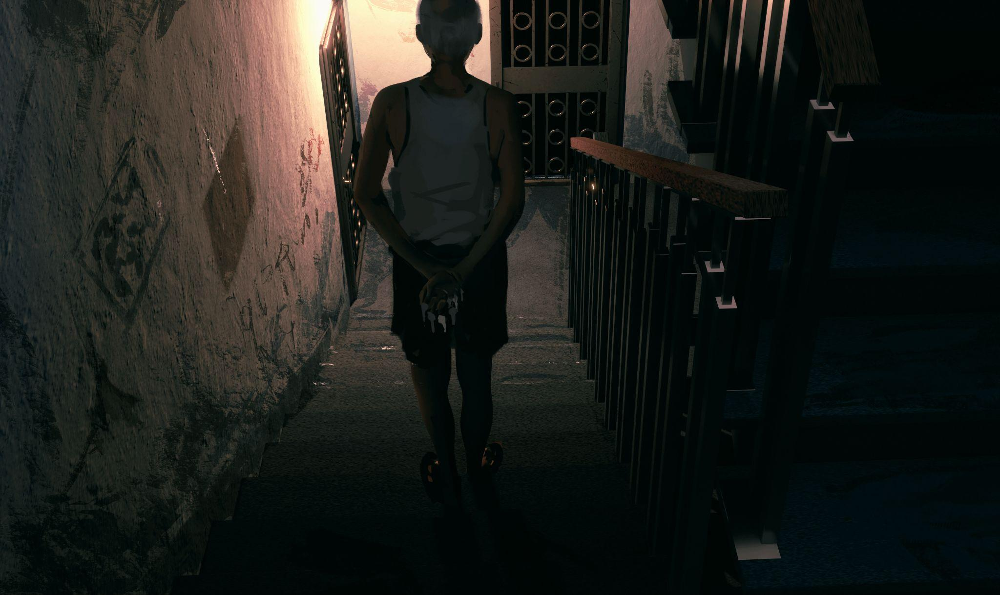

> “Hmph… College students these days—no respect at all!”

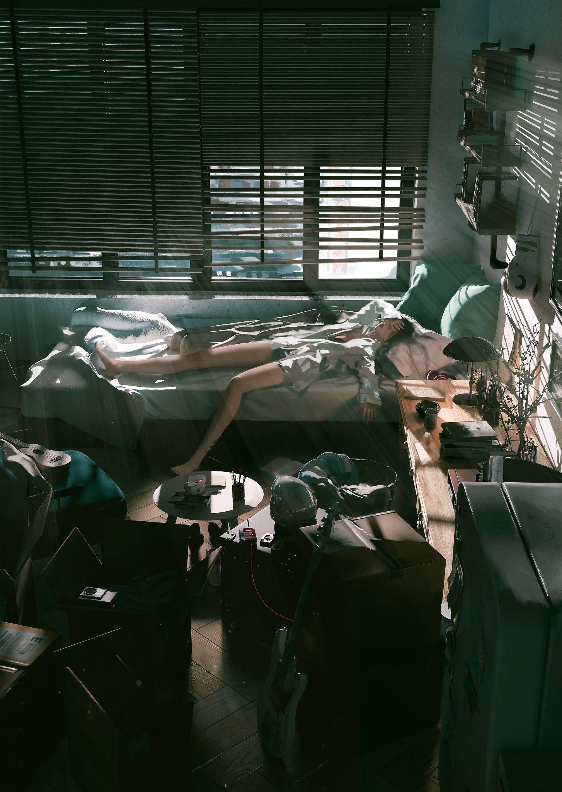

> “Ugh, what a pain—”

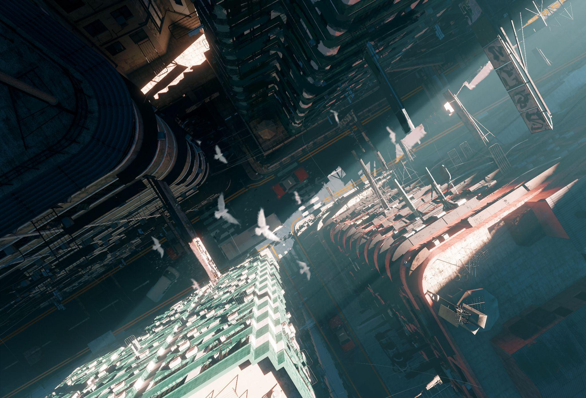

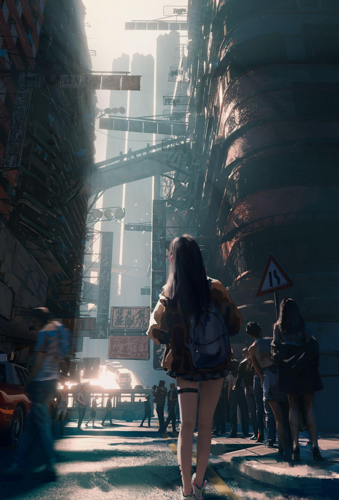

> [Bank Staff]“Ma’am, your card has exceeded the withdrawal limit today, so you can’t take out any cash. It’s not a problem with the machine.”

> [Customer]“Can’t take it out? Why can’t I access my own money! With the CloudInsect coming through, if the power goes out at your bank, won’t my hundreds of thousands be lost? Everything’s electronic now; it’s not safe at all!”

> [Bank Staff]“It won’t be a problem, ma’am. We’re just suspending electronic services for a few weeks while CloudInsect passes through. Everything will return to normal afterwards, and your money won’t be lost.”

> [Customer]“Can the person at the front hurry up? There’s a huge line behind you!”

> [Advertisement]“Miss, how about an apartment in the South Bridge District? Special prices during the CloudInsect period—owners are eager to sell!”

> [Religious Announcement]“Do not let the chaotic scenes blind your eyes. The CloudInsect is the messenger of our Heavenly Mother, descending here to judge all beings. Let us devote ourselves to prayer, seeking the protection of the Heavenly Mother! The CloudInsect Church welcomes you to join us!”

> [Vendor]“Special price on candles and glow sticks, 20 bucks a dozen! Limited stock—prices go up tomorrow!”

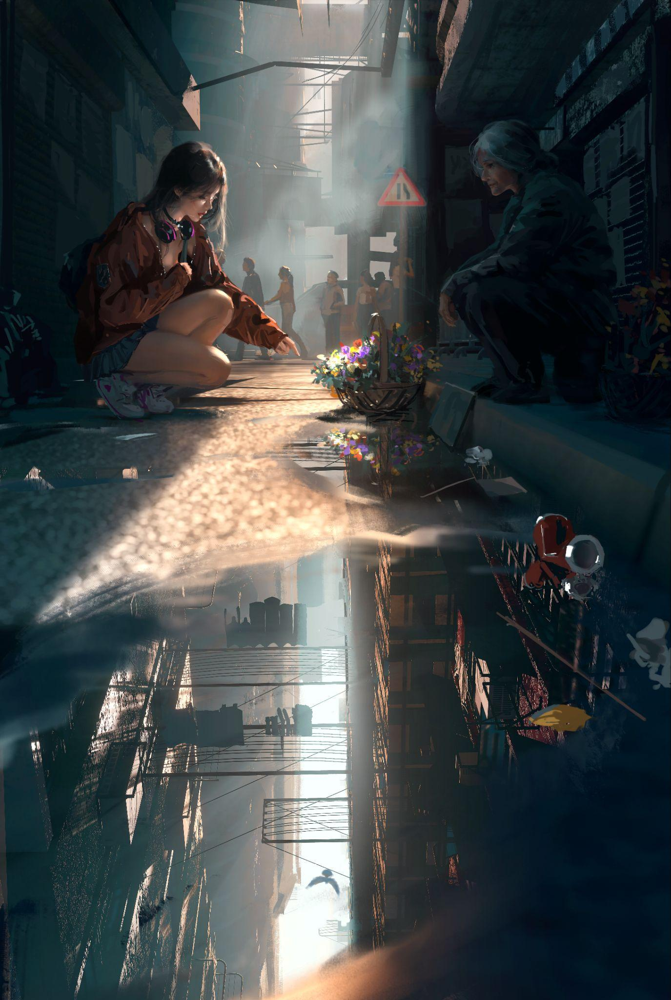

> “Ma’am, how much are these flowers?”

> “Fifty cents each. If you like them, just take a few. We probably won’t sell them all today anyway. Everyone’s busy stocking up on salt and candles. You should hurry over to the supermarket across the street and get some before they run out.”

> “Why are people stocking up on salt?”

> “I don’t know either. Everyone’s just grabbing it. It must be for something important.”

> “Ma’am, I’ll buy all of these flowers.”

> “Huh? All of them?”

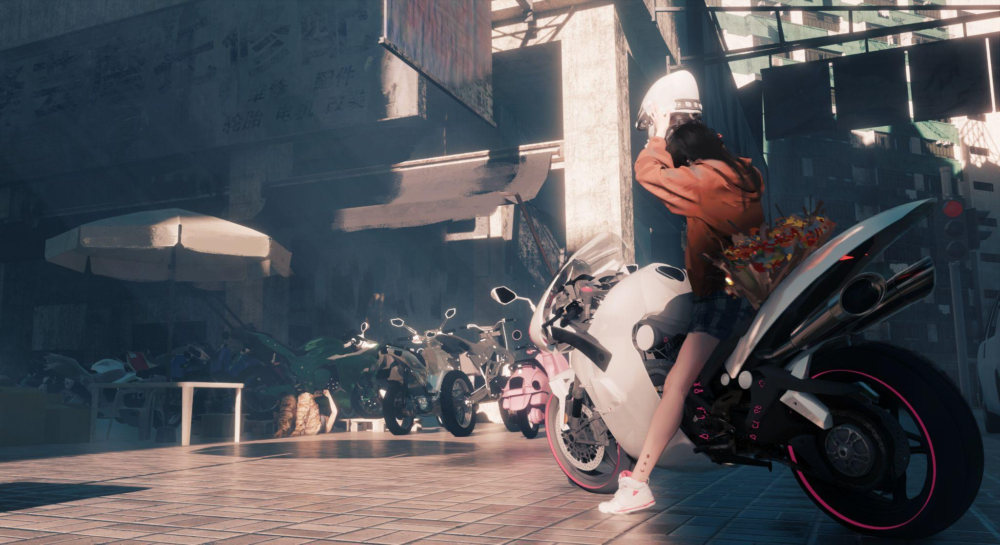

> [Shop]Fengyun Motorcycle Repair Shop

> “Hey, Aunt Yun!”

> “Oh, Mahina! You’ve been missing in action lately—haven’t been picking up your phone!”

> “Have you been busy with a lot of orders, Aunt Yun? So many motorcycles here!”

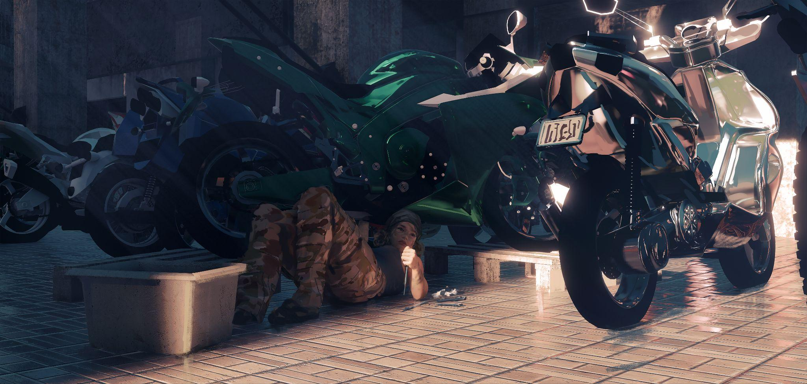

> “Yes. Once the CloudInsect arrives, none of these bikes with electronic instrument panels can be driven. Everyone is bringing them in to switch to mechanical gauges, and the headlights have to be converted too. These past few days have nearly broken my back.Does your bike need work as well? I can do yours first.”

> “No need, don’t you remember I have a license for the CloudInsect zone? My bike is all mechanical to begin with. I don’t like those electronic things.”

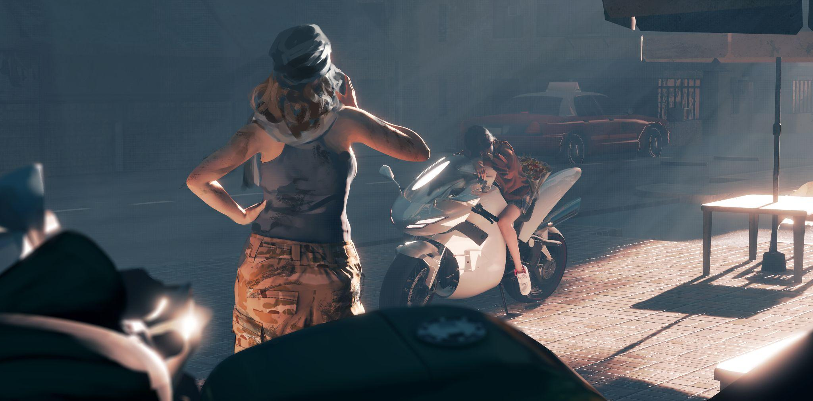

> “Hey, Mahina, Boss Wang from the Ghostblade Bar has called several times looking for you to perform. He said he couldn’t get through to you—did you block him?”

> “Yeah, I don’t want to go to that kind of place anymore.”

> “Oh, come on, Mahina! It’s a legitimate bar. Boss Wang is a good guy; he even said he’d increase your pay and provide a personal bodyguard. After your last few performances, so many customers couldn’t stop talking about you. Boss Wang is waiting for you to come back and help him out! You have such a natural talent for singing, and you’ve got that cute look. You could easily make as much in one night as I do in a month. I’m just a rough worker; I really envy you… Hey? What happened to your face? I told you to stop doing those risky sports!”

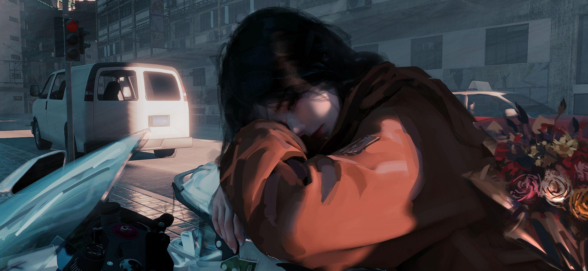

> “Aunt Yun, please stop. It’s not that I have a problem with Boss Wang or his bar. It’s just… I don’t know why, but the more lively the place is, the lonelier and more depressed I feel.”

> “What’s wrong, Mahina? Is it those classmates of yours gossiping behind your back again?”

> “Aunt Yun, I actually came here just to see you.”

> “What’s there to see? I’m covered in grease…”

> “Thank you for taking care of me all these years, Aunt Yun.”

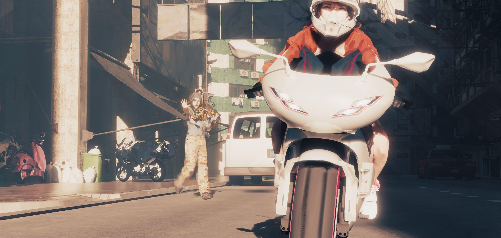

> “Hey? Mahina, are these flowers for me? Wait a second! Mahina! What do you mean by that? Mahina! Come back here!”

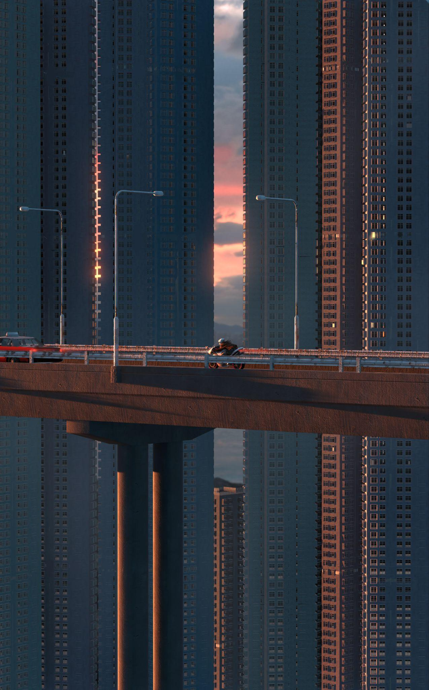

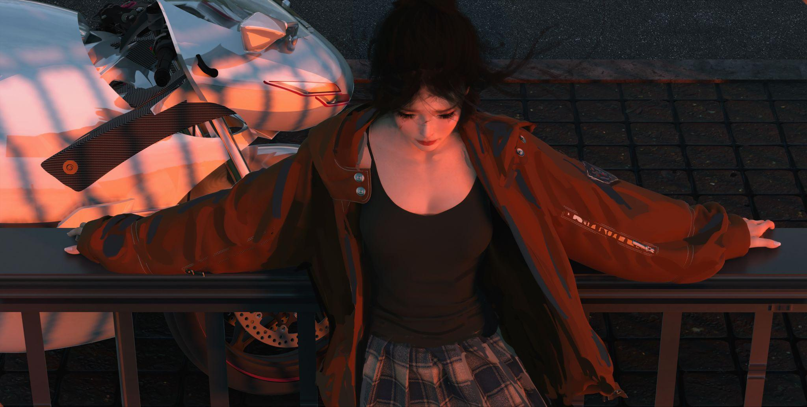

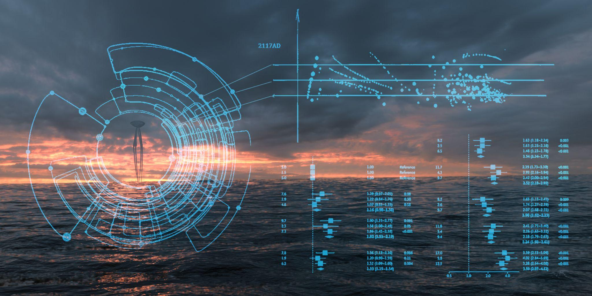

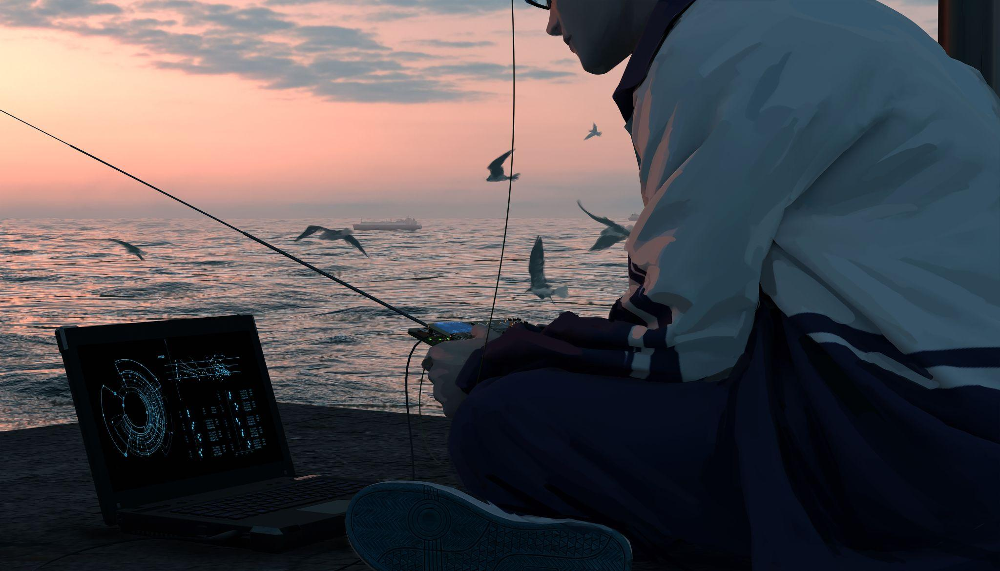

> “You know, drowning at sea is the most undignified way to die. The water is bone-cold, like knives against your skin; the whole ordeal is no better than death by a thousand cuts. By the time you wash ashore, your body will have swollen to twice its size and even your eyes may be gone. Your own mother wouldn’t recognize you—”

> “Huh? Who said anything about jumping into the sea? Are you out of your mind? Who even are you?A high school kid? Shouldn’t you be studying for the college entrance exam instead of hanging around here?”

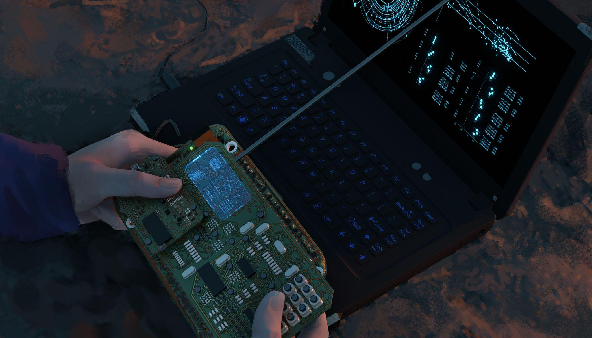

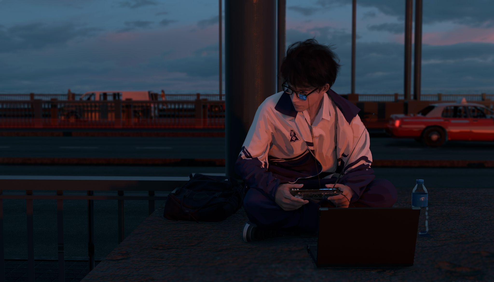

> “I don’t need to take the college entrance exam; I’ve already been admitted to Peking University’s Physics Department. And I’m not just playing around—I’m helping Professor Bai’s team measure critical data about the CloudInsect field.”

> “Ugh… I can’t stand people like you who act all high and mighty…”

> “Mahina? That’s an unusual name. I’m Suvan. The characters mean ‘hope’ and ‘set sail.’”

> “Suvan? Pfft—what an old-fashioned name. Why not call yourself ‘Sunset’? It would suit you perfectly!So you’re from Dongjiang Province too? Then I guess we’re almost from the same hometown.”

> “Yeah, I’m from a rural area in Dongjiang Province. I’ve been studying in Shashi for three years now. What about you?”

> “I came here for university two years ago. You came to a key high school all by yourself in a different city since middle school, and now you’re headed to Peking University. Your family must be really proud of you.”

> “You don’t understand. Excessive expectations are a blade that can kill.”

> “You really don’t know how to appreciate what you have.”

> “That’s why no one can ever truly feel another person’s pain. Having someone listen is already a blessing.My family doesn’t have much, and I rely on support from the village to study away from home. Everyone calls me the pride of the village, but the pressure is enormous. Peking University gave me a full scholarship, yet I still have to save for my living expenses in Beijing. I’m collecting data for Professor Bai to earn some extra money, and the work is painfully dull. Travel home keeps getting more expensive; I couldn’t even go back for New Year last year. What about you? How often do you visit your parents?”

> “Home… I haven’t had anything I could call that for a long time. My parents divorced when I was little. They each started another family and had more children, and I became the unwanted one. I was passed from one relative’s home to another. My only contact with my parents was the living allowance they sent each month.The day I got into Shashi University may have been the happiest day of my life. I was sick of living under other people’s roofs. Now I only want to support myself—work at a fast-food restaurant, hand out flyers, sing in bars. I’ll do anything, as long as I no longer have to take my parents’ money or live at my relatives’ mercy.”

> “Where did you say you sang before?”

> “Hey, kid, don’t ask so many questions.”

> Wooo—

> Wooo—

> “Listen. That’s the CloudInsect’s call.”

> “The CloudInsect’s call.”

> “Like a low chant.”

> “It’s a sigh.”

> “A sigh? Why?”

> “I don’t know, but I can tell—it’s its sigh.”

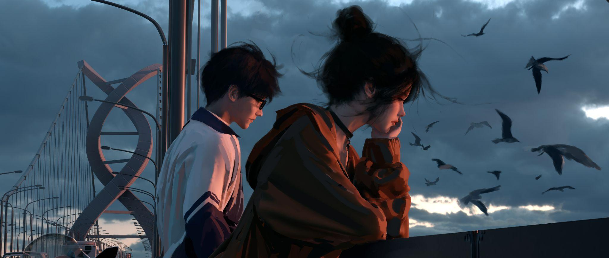

> “It arrives, and I feel like the whole world is in chaos. With so many brilliant students, scholars, and professors, what progress have you made? What data are you measuring?”

> “The CloudInsect field has confounded humanity for thousands of years. Progress was never going to come easily.Last year, Professor Wei of Peking University’s Mathematics Department proposed that changes in physical constants within the CloudInsect field vary with distance from its center. He even derived an analytical relationship between those constants and distance—the CloudInsect field equation—which caused a sensation in academia.Much of the existing data fits the equation, but there are still many bad data points we cannot explain. My advisor, Professor Bai, is working to verify the legendary Professor Wei’s CloudInsect field equation, and that requires an enormous amount of data. I’m measuring the anomalous values in the outer region near the field boundary. Once we enter the field itself, the instruments will fail and the data will be much harder to collect. Progress is painfully slow.”

> “If the equation is validated, what will happen next?”

> “It would only be the first step in a journey of ten thousand miles. But at least the equation would let us redesign instruments for use at different distances from a CloudInsect and slowly pry open Pandora’s box.The prevailing view is that CloudInsects are machines, not living organisms. But their makers must belong to a civilization far beyond ours. Room-temperature superconductivity, controlled nuclear fusion, dark-matter annihilation, gravitational-wave energy transmission—all are believed to exist inside a CloudInsect. Revealing even the tip of that iceberg would be enough to carry human civilization a great step forward.”

> “Really? Would the first people to master those technologies share them with everyone else? Or would they turn them into weapons for one group to exploit and suppress another?Suvan, have you ever wondered whether technological progress is making humanity more civilized—or more barbaric?”

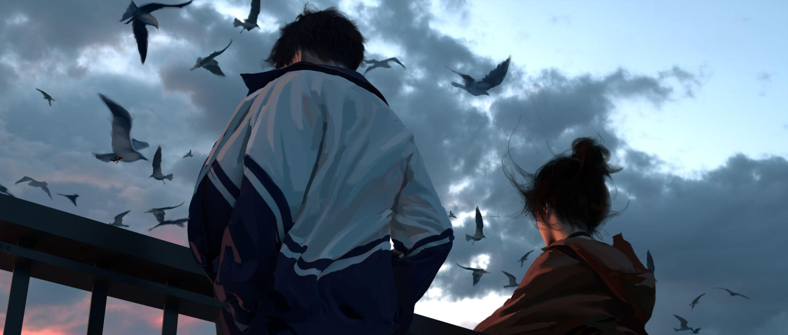

> “Sounds like you’re feeling pretty nihilistic. You weren’t actually thinking about jumping, were you?”

> “Don’t worry, there’s still so much delicious food I haven’t tried, so many beautiful clothes I haven’t worn, and countless fun places I haven’t visited. I wouldn’t want to miss out on life. Life is long, and I’ll surely run into a few jerks along the way. I love life; I just don’t like this world—it’s dull and noisy.”

> “I’ve thought about your question too. But the desire for exploration and curiosity about the unknown are etched into our DNA. Even if the CloudInsect is truly a Pandora’s box, when it’s presented to us, I don’t think anyone could resist opening it.”

> “I’m curious too, but not about those technologies and equations. I’m curious about why, if the CloudInsect is indeed a being far beyond human civilization, it would set up a barrier to block our research.”

> “Why do you think that is?”

> “Maybe we’re flattering ourselves. We can’t understand a CloudInsect’s purpose, just as insects can’t understand ours.”

> “Maybe. The CloudInsect has existed for tens of thousands of years; we’re the pathetic, lower beings.”

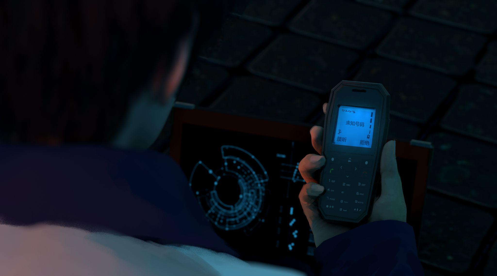

> “There's clearly no signal on this bridge. How did I get a call with no number…? The CloudInsect field is already affecting electromagnetic signals.”

> “What kind of ancient phone are you using? It really suits your name.”

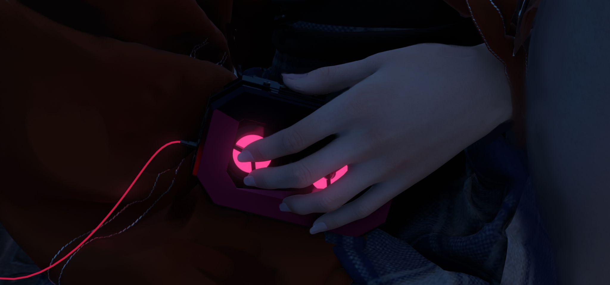

> “You’re no better. Your cassette player looks as if it was unearthed no later than my phone. What century are we in, and you’re still listening to tapes?”

> “Maybe, at our core, we’re kindred spirits.”

> “Kindred spirits with different circumstances.”

> “Yeah.”

> “Then I bet the song my kindred spirit is listening to must be from the last century.”

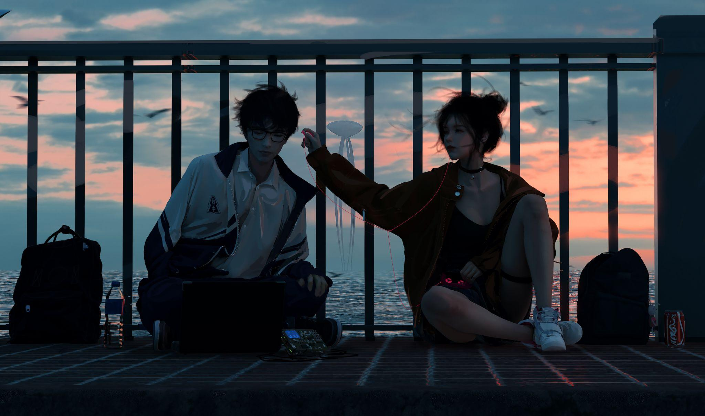

> “Here you go.”

> [Lyrics]“Afraid the tragedy will happen again,

> [Lyrics]My fate, my fate—

> [Lyrics]The more beautiful a thing, the less I am allowed to touch it.”

> “Definitely an old song.”

> “Yeah, I love the sound from that era.Back then, my parents were still together.”

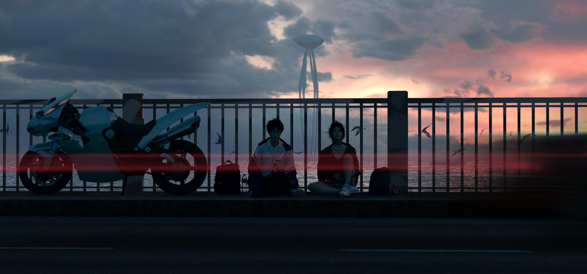

> [Lyrics]“I have a premonition of everything,

> [Lyrics]Then I can't open my eyes to see fate arrive,

> [Lyrics]And the sky once again surges with dark clouds.”

> — Faye Wong, “Undercurrent” (1997)

> Some songs feel warm just from the intro.

> Some people bring joy just by meeting them.

