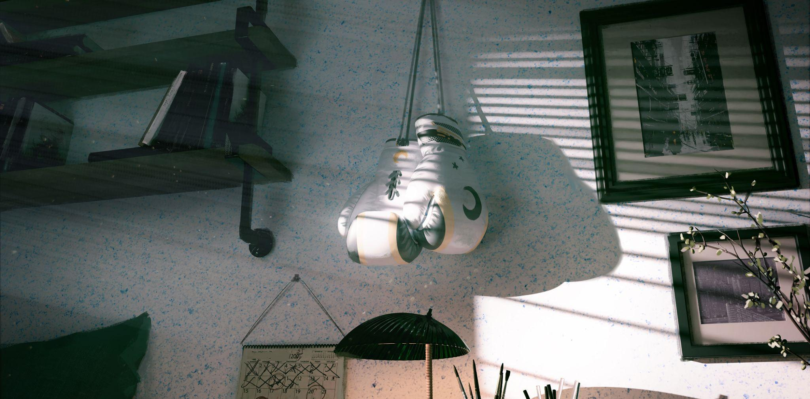
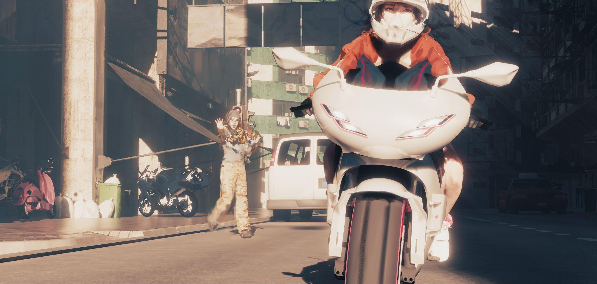
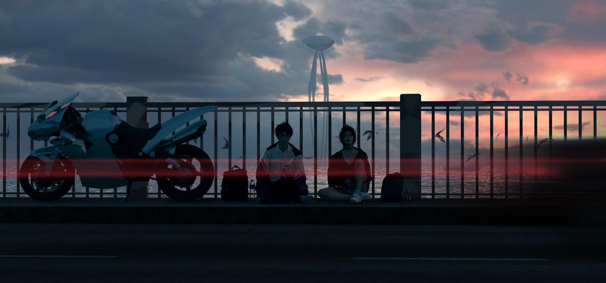

# Vân Trùng - Chương 1: Hi Dương

---

---

* **Chữ trong ảnh:**
  * Gáy sách: **Đoạn Đại Sử: Thời Xuân Thu** (*断代史：春秋*)
  * Máy ảnh cơ dùng phim (Film SLR Camera)

---

---

---

* **Chữ trong ảnh:**
  * Gáy sách: **Đế quốc La Mã** (*罗马帝国*)
  * Tập nhạc phổ: **Bản phổ độc tấu vĩ cầm** (*小提琴谱*)
  * Tựa sách: **Lược sử văn minh thế giới** (*世界文明简史*)

---

* **Chữ trong ảnh:**
  * Lọ thuốc: **Escitalopram** (Thuốc chống trầm cảm).
  * Phiếu chẩn đoán y khoa (Bệnh viện Sa Khê):
    * Họ và tên: **Nguyệt Nha Nhi**
    * Giới tính: **Nữ** | Tuổi: **19**
    * Khoa khám: **Phòng khám ngoại trú Khoa Tâm thần**
    * Kết quả chẩn đoán: **Trầm cảm mức độ vừa kéo dài (mãn tính)**
    * Chỉ định điều trị: **Uống thuốc chống trầm cảm dài hạn theo đúng phác đồ y khoa**

---

---

* **Lời thoại / Nội dung phát ra:**
  > *(Cộc, cộc, cộc!)*
  > 
  > **[Nguyệt Nha Nhi]** "Tới ngay đây, đợi cháu một chút!"

---

* **Lời thoại / Nội dung phát ra:**
  > **[Nguyệt Nha Nhi]** "Bác Lý ạ, có chuyện gì thế bác?"

---

* **Lời thoại / Nội dung phát ra:**
  > **[Bác Lý]** "Nguyệt Nha Nhi, sao vẫn chưa dọn đi hả cháu, hôm nay là ngày mấy rồi!"
  > 
  > **[Nguyệt Nha Nhi]** "Bác Lý, cho cháu lùi lại thêm mấy hôm được không? Đồ đạc của cháu nhiều quá, thu dọn đóng thùng mất nhiều thời gian lắm. Vả lại bây giờ đi tìm phòng trọ bên ngoài đâu có nhanh thế được..."
  > 
  > **[Bác Lý]** "Không được, không được đâu! Đã báo trước cho cháu bao nhiêu ngày rồi! Không phải bác đuổi cháu đi, mà khu này nằm sát ngay điểm dừng chân của Vân Trùng, chính quyền yêu cầu tất cả mọi người phải sơ tán trước đúng hạn. Hai hôm nay đã có người xuống đôn đốc rồi đấy, chậm trễ là bị phạt tiền, cháu có biết không hả!"
  > 
  > **[Nguyệt Nha Nhi]** "Bác Lý ơi, vẫn còn chưa đến hạn chót chính quyền yêu cầu mà. Với lại phạt tiền thì cũng phạt người thuê trọ, sao phạt tới đầu bác được — Cháu thấy hình như bác chỉ sợ người ta đến kiểm tra rồi phát hiện cái lán lợp tôn cơi nới trái phép trên sân thượng của bác thì có?"

---

* **Lời thoại / Nội dung phát ra:**
  > **[Bác Lý]** "Cô đừng có nói bừa! Vi phạm xây dựng chỗ nào hả! Cái lán đó tôi dựng hơn chục năm nay rồi! Cô cứ gọi họ đến mà kiểm tra, đến mà kiểm tra! Hừ hừ... Tóm lại trước tối mai cô phải dọn đi hết cho tôi, bằng không tôi cắt điện cắt nước đấy!"

---

* **Lời thoại / Nội dung phát ra:**
  > **[Bác Lý]** "Hừ... Sinh viên đại học bây giờ, chẳng ra thể thống gì cả!"

---

---

* **Lời thoại / Nội dung phát ra:**
  > **[Nguyệt Nha Nhi]** "Haizz, phiền phức thật đấy chứ——"

---

---

* **Lời thoại / Nội dung phát ra:**
  > **[Giao dịch viên ngân hàng]** "Bác ơi, hôm nay thẻ của bác đã vượt hạn mức rút tiền trong ngày rồi nên không rút thêm được nữa ạ, không phải do cây ATM bị lỗi đâu bác."
  > 
  > **[Người dân]** "Không rút được là thế nào? Tiền của tôi sao tôi lại không rút được! Vân Trùng ập tới một cái, ngân hàng các người cắt điện, thì mấy trăm ngàn tệ này của tôi chẳng phải bốc hơi hết hay sao! Thời buổi này cái gì cũng điện tử với số hóa, chẳng an toàn chút nào!"
  > 
  > **[Giao dịch viên]** "Không có chuyện đó đâu bác ơi, chỉ là trong mấy tuần Vân Trùng đi qua thì tạm dừng giao dịch điện tử thôi ạ, sau đó mọi thứ sẽ trở lại bình thường, tiền của bác không mất đi đâu được đâu."
  > 
  > **[Người xếp hàng phía sau]** "Người đằng trước rút tiền nhanh lên giùm cái được không? Phía sau đang xếp hàng dài cả cây số rồi này!"

---

* **Lời thoại / Nội dung phát ra:**
  > **[Môi giới nhà đất]** "Cô em ơi, tìm hiểu căn hộ khu Kiều Nam chút đi? Giá sốc mùa Vân Trùng, chủ nhà cần bán gấp để di tản đây!"
  > 
  > **[Truyền giáo giáo phái Vân Trùng]** "Chớ để cảnh tượng ồn ào hỗn loạn che mờ mắt! Vân Trùng chính là sứ giả của Thiên Mẫu giáng trần để phán xét chúng sinh. Hãy thành tâm cầu nguyện để nhận sự che chở của Người! Giáo hội Vân Trùng hoan nghênh quý vị gia nhập!"
  > 
  > **[Tiểu thương bán rong]** "Nến đại hạ giá và que phát quang đây! Hai mươi tệ một lốc, số lượng có hạn, ngày mai tăng giá đấy nhé!"

---

* **Lời thoại / Nội dung phát ra:**
  > **[Nguyệt Nha Nhi]** "Bà ơi, hoa này bán thế nào ạ?"
  > 
  > **[Bà cụ bán hoa]** "Năm hào một cành cháu à. Nếu cháu thích thì cứ lấy vài cành đi, đằng nào hôm nay bà cũng chẳng bán hết được. Mọi người ai cũng đang cuống cuồng tích trữ muối với nến, cháu ơi, mau sang siêu thị đối diện mua ít đồ đi thôi, bán hết là phải đợi đến ngày mai đấy."
  > 
  > **[Nguyệt Nha Nhi]** "Sao mọi người lại phải tích trữ muối hả bà?"
  > 
  > **[Bà cụ bán hoa]** "Bà cũng chẳng biết nữa, thấy người ta tranh nhau mua thì chắc là có ích đấy cháu."
  > 
  > **[Nguyệt Nha Nhi]** "Bà ơi, chỗ hoa này... bà bán hết lại cho cháu nhé."
  > 
  > **[Bà cụ bán hoa]** "Hả? Cháu mua... tất cả luôn sao?"

---

---

* **Chữ trong ảnh:** Biển hiệu tiệm sửa chữa: **Sửa chữa & Phụ tùng xe máy Phong Vân** (*峰芸摩托修配*).
* **Lời thoại / Nội dung phát ra:**
  > **[Nguyệt Nha Nhi]** "Chị Vân!"
  > 
  > **[Chị Vân]** "Ôi chao, Nguyệt Nha Nhi! Dạo này trốn đi đâu thế em? Gọi điện cũng chẳng thèm nghe máy!"
  > 
  > **[Nguyệt Nha Nhi]** "Dạo này tiệm nhiều việc lắm hả chị, sao lắm xe thế này?"

---

* **Lời thoại / Nội dung phát ra:**
  > **[Chị Vân]** "Ừ, Vân Trùng chuẩn bị tới, mấy cái xe đồng hồ điện tử này hết đường chạy, lũ lượt kéo nhau đến độ lại đồng hồ cơ, đèn xe cũng phải thay thành đèn cơ hết. Mấy ngày nay làm chị muốn gãy cả cái lưng già này luôn rồi. Xe của em có cần độ lại không? Chị làm trước cho em nhé."
  > 
  > **[Nguyệt Nha Nhi]** "Dạ không cần đâu chị, chị quên là em có bằng lái xe đặc chủng trong trường Vân Trùng rồi sao, xe của em vốn dĩ toàn bộ đều là máy móc cơ khí thuần túy. Em chẳng thích mấy thứ đồ điện tử đâu."

---

* **Lời thoại / Nội dung phát ra:**
  > **[Chị Vân]** "À mà này Nguyệt Nha Nhi, ông chủ Vương bên quán bar Đao Hồn gọi điện mấy lần tìm em tới hát đấy, bảo là không liên lạc được với em, có phải em chặn số người ta rồi không?"
  > 
  > **[Nguyệt Nha Nhi]** "Vâng, em không muốn đến những chỗ như thế nữa."
  > 
  > **[Chị Vân]** "Ối cái con bé ngốc này, người ta là quán bar làm ăn đàng hoàng, ông chủ Vương đối xử cũng rất tử tế, còn bảo sẽ tăng thêm thù lao bao nhiêu bao nhiêu nữa, lại bố trí cả vệ sĩ riêng cho em. Mấy lần trước em hát xong, bao nhiêu khách cứ nhớ thương em mãi không quên, ông chủ Vương đang đợi em về gánh sàn diễn cho quán đấy. Em nói xem, trời ban cho em cái giọng hát hay như thế, lại có khuôn mặt xinh đẹp hút hồn người ta, ông trời thương cho bát cơm ngon, hát một tối bằng chị cày cuốc cả tháng trời. Kẻ chỉ biết làm việc chân tay nặng nhọc như chị muốn ghen tị còn chẳng được... Ơ kìa? Sao mặt mũi lại dính bẩn lem nhem thế này rồi, đã bảo đừng có đi chơi mấy cái trò thể thao nguy hiểm ấy nữa mà."

---

* **Lời thoại / Nội dung phát ra:**
  > **[Nguyệt Nha Nhi]** "Chị Vân đừng nói nữa mà, em không có ý gì với ông chủ Vương đâu, quán của ông ấy cũng chẳng có vấn đề gì cả. Chỉ là... em cũng không hiểu vì sao, càng ở những nơi náo nhiệt đông đúc, em lại càng cảm thấy cô đơn và chán nản."
  > 
  > **[Chị Vân]** "Có chuyện gì thế Nguyệt Nha Nhi? Có phải mấy đứa bạn cùng phòng lại nói ra nói vào sau lưng em không?"
  > 
  > **[Nguyệt Nha Nhi]** "Chị Vân, lần này em đến thật ra chỉ là muốn ghé thăm chị thôi."
  > 
  > **[Chị Vân]** "Chị thì có gì để thăm chứ, người ngợm lem luốc dầu mỡ thế này..."
  > 
  > **[Nguyệt Nha Nhi]** "Cảm ơn chị suốt mấy năm qua đã luôn chăm sóc cho em, chị Vân."

---

* **Lời thoại / Nội dung phát ra:**
  > **[Chị Vân]** "Ơ? Nguyệt Nha Nhi, bó hoa này tặng chị à? Đợi đã! Nguyệt Nha Nhi! Em nói thế là có ý gì hả? Nguyệt Nha Nhi! Quay lại đây cho chị!"

---

---

---

---

---

---

---

---

---

---

* **Lời thoại / Nội dung phát ra:**
  > **[Hi Dương]** "Cô có biết không, nhảy xuống biển là cách chết kém thể diện nhất đấy. Nước biển lạnh buốt thấu xương như ngàn mũi dao, toàn bộ quá trình đau đớn không khác gì bị lăng trì. Đến khi cô bị sóng đánh dạt vào bờ, thi thể sẽ trương phềnh to gấp đôi, hai tròng mắt bị cuốn trôi mất, đến cả mẹ ruột cô cũng chẳng nhận ra nổi đâu——"

---

* **Lời thoại / Nội dung phát ra:**
  > **[Nguyệt Nha Nhi]** "Hả? Ai thèm nhảy biển chứ? Cậu bị thần kinh à, cậu là ai hả! Học sinh cấp ba à? Thằng nhóc học sinh cấp ba không lo ôn thi đại học, ra đây nghịch ngợm cái gì thế hả?"

---

---

* **Lời thoại / Nội dung phát ra:**
  > **[Hi Dương]** "Tôi không cần thi đại học, tôi đã được tuyển thẳng vào Khoa Vật lý Đại học Bắc Kinh rồi. Với lại tôi cũng chẳng chơi bời gì ở đây cả, tôi đang hỗ trợ nhóm nghiên cứu của Giáo sư Bạch trường Bắc Đại đo đạc dữ liệu tới hạn của trường Vân Trùng."
  > 
  > **[Nguyệt Nha Nhi]** "Xì... ghét nhất mấy kẻ thích ra vẻ như cậu..."

---

* **Lời thoại / Nội dung phát ra:**
  > **[Hi Dương]** "Nguyệt Nha Nhi? Tên thật đặc biệt. Tôi tên là Hi Dương, 'Hi' trong hy vọng, 'Dương' trong giương buồm ra khơi."
  > 
  > **[Nguyệt Nha Nhi]** "Hi Dương? Phụt... ha ha ha, cái tên nghe già dặn thế, sao cậu không gọi luôn là Tịch Dương Hồng (Nắng Chiều Hoàng Hôn) đi! Hợp cảnh biết bao! Vậy ra cậu cũng từ tỉnh Đông Giang tới à? Thế thì chúng mình cũng coi như nửa đồng hương rồi."
  > 
  > **[Hi Dương]** "Ừ, nhà tôi ở vùng nông thôn tỉnh Đông Giang, lên thành phố Sa Khê học cấp ba, năm nay là năm thứ ba rồi. Còn cô?"
  > 
  > **[Nguyệt Nha Nhi]** "Tôi lên đây học đại học mới tới, được hai năm rồi. Cậu học cấp ba đã một mình đến trường trọng điểm nơi đất khách quê người, lại còn được tuyển thẳng Bắc Đại nữa. Gia đình cậu chắc hẳn tự hào về cậu lắm nhỉ."
  > 
  > **[Hi Dương]** "Cô không biết đâu, sự kỳ vọng quá mức đôi khi chính là thanh gươm sắc bén đẩy người ta vào chỗ chết."
  > 
  > **[Nguyệt Nha Nhi]** "Đúng là sướng mà không biết đường sướng."
  > 
  > **[Hi Dương]** "Bởi vậy mới nói, trên đời này làm gì có sự đồng cảm tuyệt đối, có người chịu lắng nghe mình đã là vạn hạnh rồi. Gia cảnh tôi không khá giả, lên thành phố học là nhờ dân làng gom góp hỗ trợ. Người ta bảo tôi là niềm tự hào của cả làng, nhưng áp lực kinh khủng lắm. Bắc Đại tuy có cấp học bổng toàn phần, nhưng sau này lên Bắc Kinh sinh hoạt phí vẫn phải tự tích cóp. Nhận đo dữ liệu cho Giáo sư Bạch thật ra cũng chỉ để kiếm thêm chút tiền phụ thu, công việc này khô khan nhàm chán vô cùng. Tiền vé tàu xe về quê ngày càng đắt đỏ, tết năm ngoái tôi còn chẳng dám về nhà. Còn cô thì sao, bao lâu cô về thăm bố mẹ một lần?"
  > 
  > **[Nguyệt Nha Nhi]** "Nhà à... Từ lâu lắm rồi tôi đã không còn khái niệm đó nữa. Từ lúc tôi còn rất nhỏ bố mẹ đã ly hôn, sau đó họ đều có gia đình mới, có những đứa con riêng, tôi trở thành người thừa thãi nhất. Tôi lưu lạc sống nhờ hết nhà người họ hàng này đến người họ hàng khác. Mối liên hệ duy nhất với bố mẹ chỉ là khoản sinh hoạt phí gửi đều đặn hàng tháng. Ngày thi đỗ vào Đại học Sa Khê có lẽ là ngày vui vẻ nhất trong cuộc đời tôi, tôi đã quá chán ngấy cảnh ăn nhờ ở đậu, nhìn mặt người khác mà sống rồi. Bây giờ tôi chỉ muốn tự lực cánh sinh, đi làm thêm ở tiệm đồ ăn nhanh, ra đường phát tờ rơi, tới quán bar hát rong... Miễn là không phải ngửa tay xin tiền bố mẹ, không phải nhìn sắc mặt họ hàng, việc gì tôi cũng làm."
  > 
  > **[Hi Dương]** "Cô vừa bảo đi hát ở đâu cơ?"
  > 
  > **[Nguyệt Nha Nhi]** "Nhóc con, đừng hỏi nhiều."
  > 
  > *(Uuuu... Uuuu...)*

---

* **Lời thoại / Nội dung phát ra:**
  > **[Nguyệt Nha Nhi]** "Nghe kìa, là tiếng trùng minh kêu đấy."
  > 
  > **[Hi Dương]** "Là tiếng trùng minh."
  > 
  > **[Nguyệt Nha Nhi]** "Giống như tiếng trầm ngâm."
  > 
  > **[Hi Dương]** "Là tiếng thở dài."
  > 
  > **[Nguyệt Nha Nhi]** "Thở dài ư? Tại sao lại thở dài?"
  > 
  > **[Hi Dương]** "Tôi không biết, nhưng tôi có thể nghe ra được, đó chính là tiếng thở dài của nó."

---

* **Lời thoại / Nội dung phát ra:**
  > **[Nguyệt Nha Nhi]** "Nó vừa tới một cái, tôi cảm thấy cả thế giới này đều đảo lộn hỗn loạn. Bao nhiêu sinh viên ưu tú, học giả, giáo sư tài giỏi như các cậu rốt cuộc đã nghiên cứu ra tiến triển gì chưa? Những số liệu cậu đang đo đạc này là gì thế?"
  > 
  > **[Hi Dương]** "Trường lực Vân Trùng đã làm khó nhân loại suốt hàng ngàn năm qua, đâu dễ dàng đạt được đột phá như vậy. Năm ngoái, Giáo sư Vi thuộc Khoa Toán Đại học Bắc Kinh đã đưa ra một giả thuyết: các hằng số vật lý bị biến đổi bên trong trường Vân Trùng phụ thuộc vào khoảng cách tới tâm của Vân Trùng, ông ấy thậm chí đã đưa ra hệ phương trình giải tích giữa hằng số biến dị và khoảng cách — gọi là Hệ phương trình trường Vân Trùng, gây chấn động toàn bộ giới học thuật. Hiện tại có rất nhiều dữ liệu khớp với phương trình này, nhưng cũng có không ít điểm dị thường (bad points) chưa thể giải thích được. Người hướng dẫn của tôi, Giáo sư Bạch, đang dốc toàn lực để kiểm chứng hệ phương trình của 'Vi Thần', nên cần lượng dữ liệu khổng lồ. Số liệu tôi đang đo lúc này là phần biến dị ở rìa ranh giới ngoài cùng của trường Vân Trùng. Đợi đến khi thực sự tiến sâu vào lõi trường lực, máy móc thiết bị tê liệt hết thì việc đo đạc gần như bế tắc, cơ hội tiến triển thực sự rất mong manh."
  > 
  > **[Nguyệt Nha Nhi]** "Nếu thực sự kiểm chứng được hệ phương trình đó, thì sau này sẽ ra sao?"
  > 
  > **[Hi Dương]** "Thì cũng mới chỉ là bước đi đầu tiên trong cuộc vạn lý trường chinh thôi. Nhưng ít nhất chúng ta có thể dựa vào phương trình đó để tái thiết kế các loại dụng cụ thí nghiệm, vận hành ở các khoảng cách khác nhau tới Vân Trùng, từng bước mở chiếc hộp Pandora này ra. Quan điểm chủ lưu trong giới khoa học cho rằng Vân Trùng không phải là sinh vật sống, mà là một cỗ máy cơ khí. Thế nhưng nền văn minh chế tạo ra nó chắc chắn vượt xa nhân loại chúng ta hàng triệu năm. Siêu dẫn nhiệt độ phòng, phản ứng nhiệt hạch có thể kiểm soát, sự triệt tiêu vật chất tối, truyền tải năng lượng bằng sóng hấp dẫn... đều được suy đoán là tồn tại bên trong cơ thể Vân Trùng. Chỉ cần hé lộ được một góc nhỏ của tảng băng chìm ấy, cũng đủ để đẩy nền văn minh nhân loại tiến lên một bước dài phi thường."
  > 
  > **[Nguyệt Nha Nhi]** "Vậy sao? Liệu những kẻ đầu tiên nắm giữ được các công nghệ ấy có chịu chia sẻ cho người khác không? Hay nó sẽ chỉ trở thành vũ khí để một nhóm người thu hoạch và đàn áp những nhóm người khác? Này Hi Dương, cậu có từng nghĩ rằng, sự phát triển của khoa học kỹ thuật hiện nay rốt cuộc là đang khiến con người trở nên văn minh hơn, hay dã man hơn không?"

---

* **Lời thoại / Nội dung phát ra:**
  > **[Hi Dương]** "Cảm giác cô rất chán đời đấy nhé, vừa nãy không phải cô định nhảy thật đấy chứ?"
  > 
  > **[Nguyệt Nha Nhi]** "Cậu yên tâm đi, đời này còn bao nhiêu món ngon tôi chưa được ăn, bao nhiêu bộ quần áo đẹp tôi chưa được mặc, bao nhiêu danh lam thắng cảnh tôi chưa từng đặt chân tới, tôi còn lâu mới chịu chết nhé. Cuộc đời dài đằng đẵng như thế, kiểu gì chẳng va phải vài tên khốn nạn. Tôi yêu cuộc sống này, chỉ là không thích thế giới xô bồ, nhạt nhẽo và ồn ã này mà thôi."
  > 
  > **[Hi Dương]** "Câu hỏi của cô tôi cũng từng trăn trở rồi. Nhưng khát khao khám phá những điều chưa biết và sự tò mò đã được khắc sâu vào trong chuỗi xoắn DNA của loài người. Dẫu cho Vân Trùng thực sự là chiếc hộp tai ương Pandora, thì khi nó được đặt ngay trước mắt, cũng chẳng một ai có thể cưỡng lại việc mở nó ra."
  > 
  > **[Nguyệt Nha Nhi]** "Tôi cũng tò mò, nhưng không phải về công nghệ hay mấy phương trình toán học khô khan đó. Điều tôi thắc mắc là, nếu Vân Trùng thực sự là thực thể của nền văn minh cao cấp vượt trội hơn nhân loại như cậu nói, vậy tại sao nó lại phải dựng lên một bức màn chắn bao quanh mình để ngăn cản con người nghiên cứu nó?"
  > 
  > **[Hi Dương]** "Theo cô thì tại sao?"
  > 
  > **[Nguyệt Nha Nhi]** "Có lẽ do loài người chúng ta tự mình đa tình thôi. Chúng ta chẳng thể nào hiểu được mục đích của Vân Trùng, cũng giống như lũ sâu bọ dưới đất chẳng bao giờ hiểu được con người."
  > 
  > **[Hi Dương]** "Có lẽ vậy. Vân Trùng đã tồn tại hàng vạn năm rồi, chúng ta mới chính là giống loài hạ đẳng đáng thương."

---

* **Lời thoại / Nội dung phát ra:**
  > **[Hi Dương]** "Trên cây cầu này rõ ràng không có sóng, sao lại nhận được cuộc gọi thế này, lại còn không hiện số... Trường lực Vân Trùng quả nhiên đã bắt đầu bóp méo tín hiệu điện từ rồi."
  > 
  > **[Nguyệt Nha Nhi]** "Cậu dùng cái điện thoại từ triều đại nào thế kia, trông cổ lỗ sĩ y hệt như cái tên của cậu vậy."

---

* **Lời thoại / Nội dung phát ra:**
  > **[Hi Dương]** "Cô thì hơn gì tôi chứ, cái máy Walkman cầm tay của cô niên đại khai quật chắc cũng chẳng muộn hơn điện thoại của tôi đâu. Thời buổi nào rồi mà còn nghe nhạc bằng băng cassette?"
  > 
  > **[Nguyệt Nha Nhi]** "Có lẽ, về bản chất chúng ta là cùng một loại người đấy."
  > 
  > **[Hi Dương]** "Những con người cùng loại nhưng bị số phận đặt vào những hoàn cảnh khác nhau."
  > 
  > **[Nguyệt Nha Nhi]** "Ừ."
  > 
  > **[Hi Dương]** "Thế thì tôi đoán, bài hát mà 'người cùng loại' với tôi đang nghe lúc này chắc chắn là từ thế kỷ trước rồi."

---

* **Lời thoại / Nội dung phát ra:**
  > **[Nguyệt Nha Nhi]** "Cho cậu này."

---

* **Lời thoại / Lời bài hát:**
  > **[Giai điệu vang lên từ tai nghe]**
  > *"Sợ bi kịch lại tái diễn*
  > *Vận mệnh của tôi hỡi*
  > *Thứ càng xinh đẹp tuyệt trần, tôi lại càng không dám chạm tới..."*
  > 
  > **[Hi Dương]** "Quả nhiên là một bài hát xưa cũ."
  > 
  > **[Nguyệt Nha Nhi]** "Ừ, tôi thích thanh âm của những năm tháng ấy. Khi đó... bố mẹ tôi vẫn còn ở bên nhau."

---

* **Lời thoại / Lời bài hát:**
  > **[Giai điệu vang lên từ tai nghe]**
  > *"Chuyện gì tôi cũng có linh cảm trước*
  > *Để rồi chẳng dám mở mắt nhìn định mệnh ghé thăm*
  > *Và rồi bầu trời kia lại cuồn cuộn mây mù giăng lối..."*
  > 
  > *(— Vương Phi: Ca khúc "Ám Dũng" (1997))*

---

* **Lời tự sự:**
  > *"Có những bài ca, chỉ nghe khúc dạo đầu đã thấy cõi lòng ấm áp,*
  > *Có những con người, chỉ cần gặp gỡ thôi cũng đủ khiến ta mỉm cười."*
