# Vân Trùng - Chương 1: Hi Dương

---

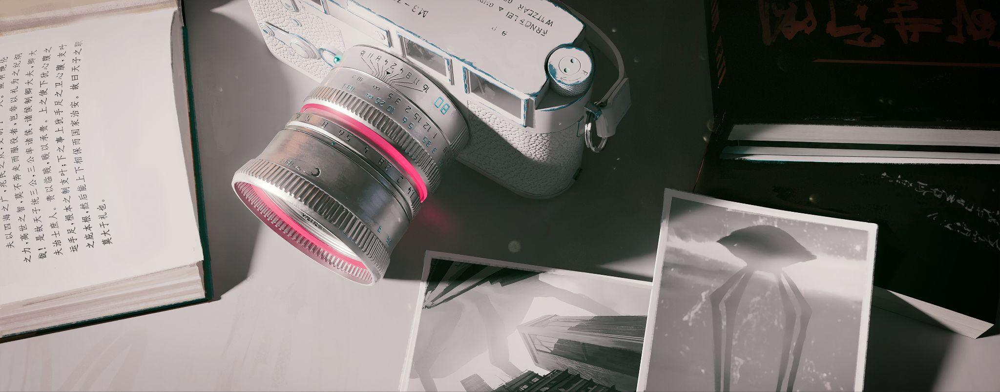

[Sách] Đoạn Đại Sử: Thời Xuân Thu

[Máy ảnh cơ film]

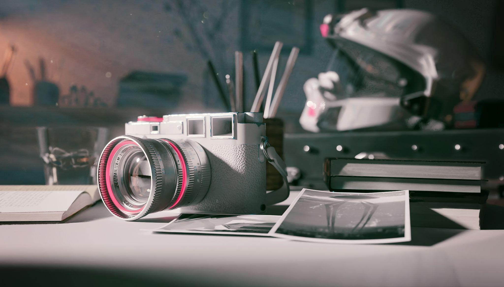

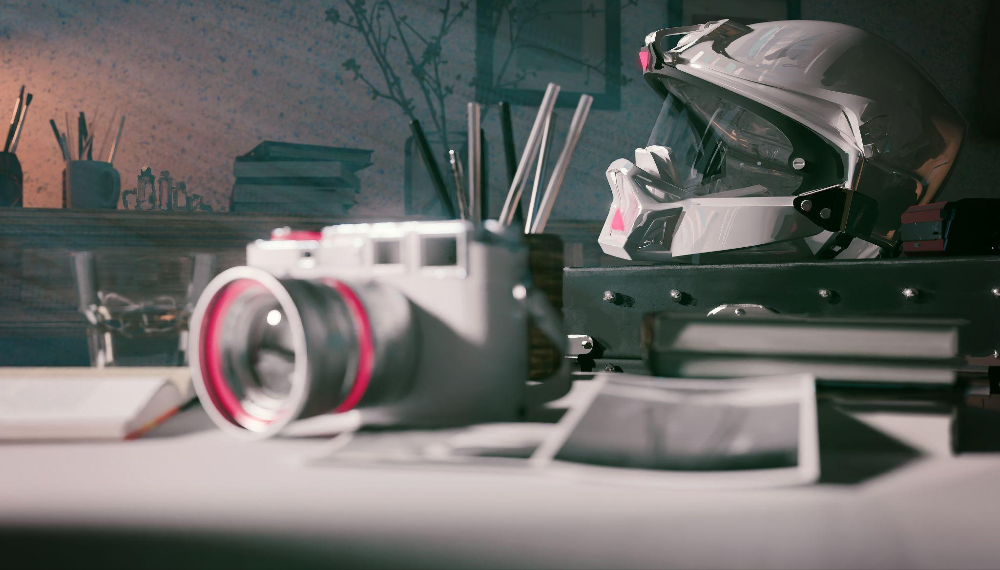

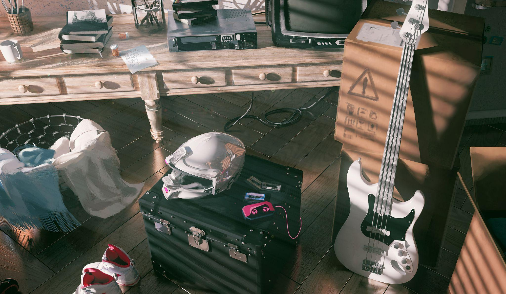

[Sách] Đế quốc La Mã

[Sách] Bản phổ nhạc cho đàn vĩ cầm

[Sách] Lược sử văn minh thế giới

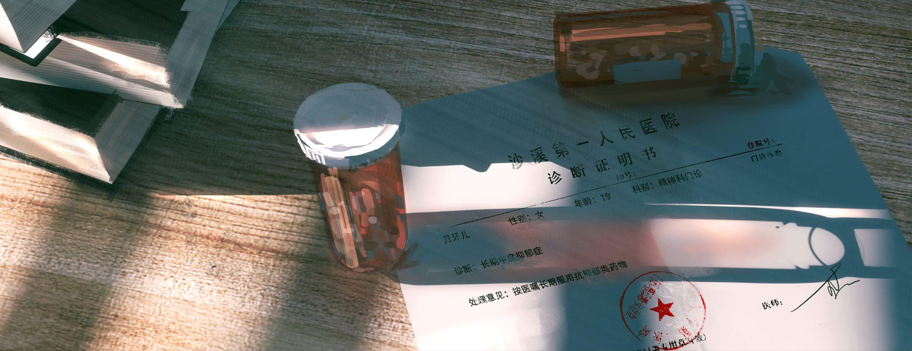

[Lọ thuốc] Escitalopram (Thuốc điều trị trầm cảm)

[Bệnh án] Họ tên: Nguyệt Nha Nhi

[Bệnh án] Giới tính: Nữ

[Bệnh án] Tuổi: 19

[Bệnh án] Chuyên khoa: Phòng khám tâm thần ngoại trú

[Bệnh án] Chẩn đoán: Trầm cảm mức độ vừa mãn tính

[Bệnh án] Chỉ định điều trị: Uống thuốc chống trầm cảm dài hạn theo đúng phác đồ của bác sĩ

Cộc, cộc, cộc!

“Đến ngay đây ạ, bác đợi một chút!”

“Bác Lý đấy à, có chuyện gì thế bác?”

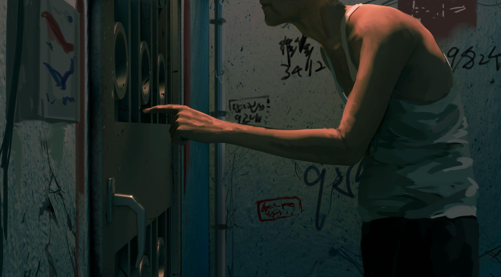

“Nguyệt Nha Nhi, sao cháu vẫn chưa dọn đi hả? Cháu có biết hôm nay là ngày mười mấy rồi không!”

“Bác Lý ơi, cho cháu lùi lại mấy hôm được không bác? Đồ đạc của cháu nhiều quá, đóng gói mất bao nhiêu thời gian. Với lại dạo này tìm phòng trọ bên ngoài đâu có nhanh thế được...”

“Không được, tuyệt đối không được! Bác đã báo trước cho cháu bao nhiêu ngày rồi! Không phải bác nhẫn tâm đuổi cháu đi, mà khu vực này nằm sát ngay điểm dừng chân của Vân Trùng, chính quyền yêu cầu tất cả mọi người phải sơ tán đúng hạn. Hai hôm nay cán bộ đã đến giục mấy lần rồi, trễ hạn là bị phạt tiền đấy cháu có biết không!”

“Bác Lý ơi, giờ vẫn chưa tới hạn chót của chính quyền mà, với lại nếu phạt thì phạt người thuê nhà chứ có phạt vào đầu bác đâu — Cháu thấy hình như bác sợ người ta kiểm tra phát hiện ra cái mái che lấn chiếm bác tự dựng trên sân thượng thì đúng hơn?”

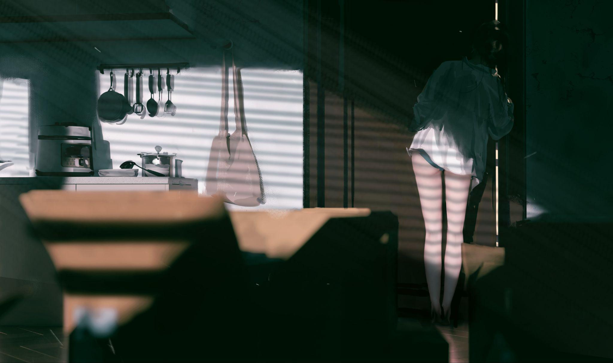

“Cháu đừng có nói bừa! Vi phạm chỗ nào hả! Cái chòi đó bác dựng hơn mười năm nay rồi! Cháu cứ bảo họ đến kiểm tra đi, đến mà kiểm tra! Hừ hừ... Dù sao thì trước tối mai cháu bắt buộc phải dọn đi, nếu không bác sẽ cắt điện cắt nước đấy!”

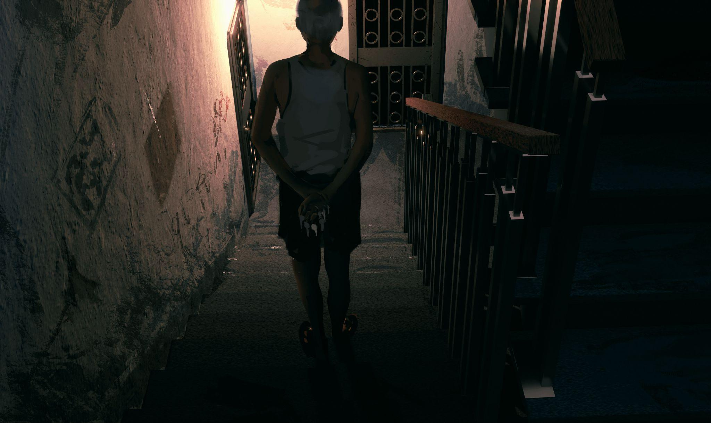

“Hừ... Sinh viên đại học thời nay, thật chẳng ra làm sao cả!”

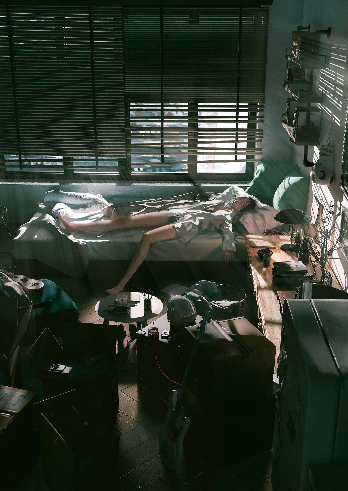

“Haizz, bực mình thật đấy chứ —”

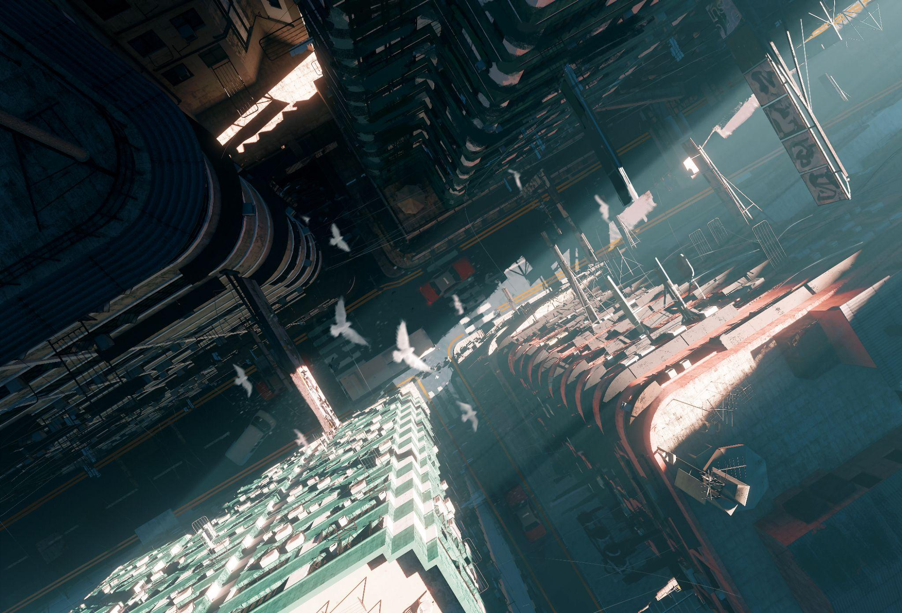

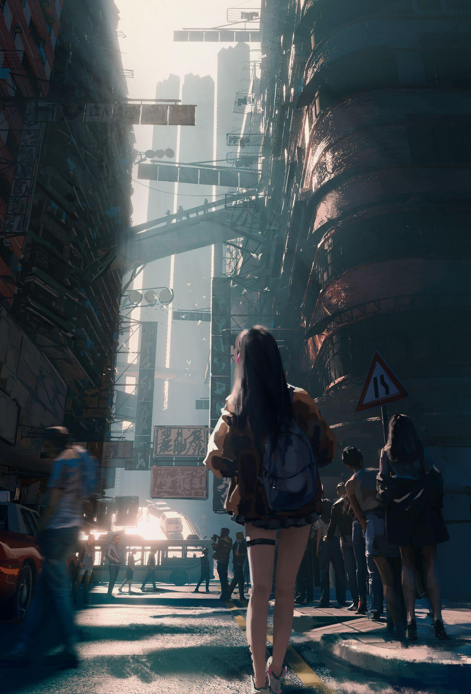

[Giao dịch viên] “Bác ơi, thẻ này của bác hôm nay đã vượt quá hạn mức rút tiền trong ngày rồi nên không rút thêm được nữa ạ, không phải do máy ATM bị lỗi đâu bác.”

[Người dân] “Không rút được là sao? Tiền của chính tôi tại sao lại không cho rút! Con Vân Trùng kia mà tới đây, ngân hàng các người bị cúp điện, thế chẳng phải mấy trăm ngàn tệ của tôi coi như mất trắng à! Thời buổi này cái gì cũng điện tử với số hóa, chẳng an toàn một chút nào cả!”

[Giao dịch viên] “Không có chuyện đó đâu bác ơi, ngân hàng chỉ tạm ngưng dịch vụ điện tử trong vài tuần Vân Trùng đi qua thôi ạ, sau đó mọi thứ sẽ hoạt động bình thường trở lại, tiền của bác tuyệt đối không mất được đâu ạ.”

[Người dân xếp hàng] “Người rút tiền phía trước làm nhanh giùm cái được không? Đằng sau còn cả hàng dài đang đợi đây này!”

[Môi giới nhà đất] “Cô em ơi, tìm hiểu thử căn hộ ở khu Kiều Nam nhé? Giá ưu đãi đặc biệt trong mùa Vân Trùng, chủ nhà đang cần bán gấp đi lánh nạn đây!”

[Tuyên truyền tôn giáo] “Chớ để cảnh tượng hỗn loạn trước mắt che mờ tâm trí! Vân Trùng chính là sứ giả của Thiên Mẫu giáng trần để phán xét thế gian. Hãy cùng nhau thành tâm cầu nguyện để nhận được sự che chở của Thiên Mẫu! Giáo hội Vân Trùng luôn rộng cửa đón chào các bạn!”

[Tiểu thương] “Nến thắp và que phát quang đại hạ giá đây, 20 tệ một tá, số lượng có hạn, ngày mai là tăng giá đấy nhé!”

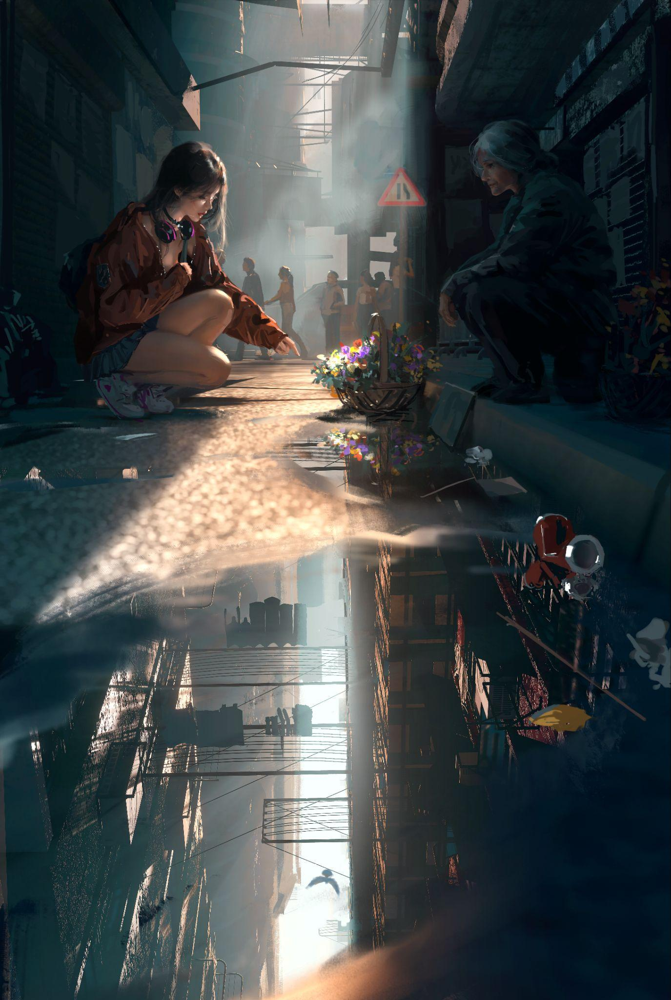

“Bà ơi, hoa này bán thế nào ạ?”

“Năm hào một cành thôi cháu, nếu cháu thích thì lấy mấy cành đi, đằng nào hôm nay chắc cũng chẳng bán hết được. Ai nấy đều đang đổ xô đi gom muối với nến, cháu gái à, cháu mau sang siêu thị bên kia đường mà mua chút đồ dự trữ đi, hết hàng là phải đợi đến ngày mai đấy.”

“Sao mọi người lại phải tích trữ muối vậy bà?”

“Bà cũng chẳng rõ nữa, thấy người ta tranh nhau mua thì chắc là có ích gì đó thôi.”

“Bà ơi, chỗ hoa này... cháu mua hết nhé.”

“Hả? Cháu mua tất cả chỗ này sao?”

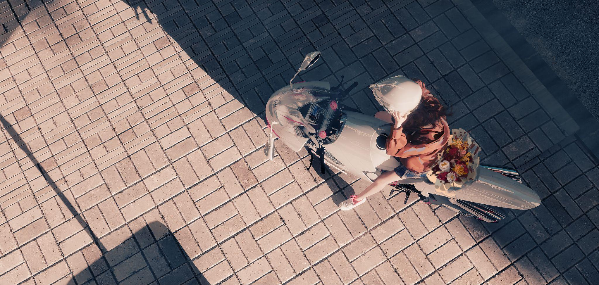

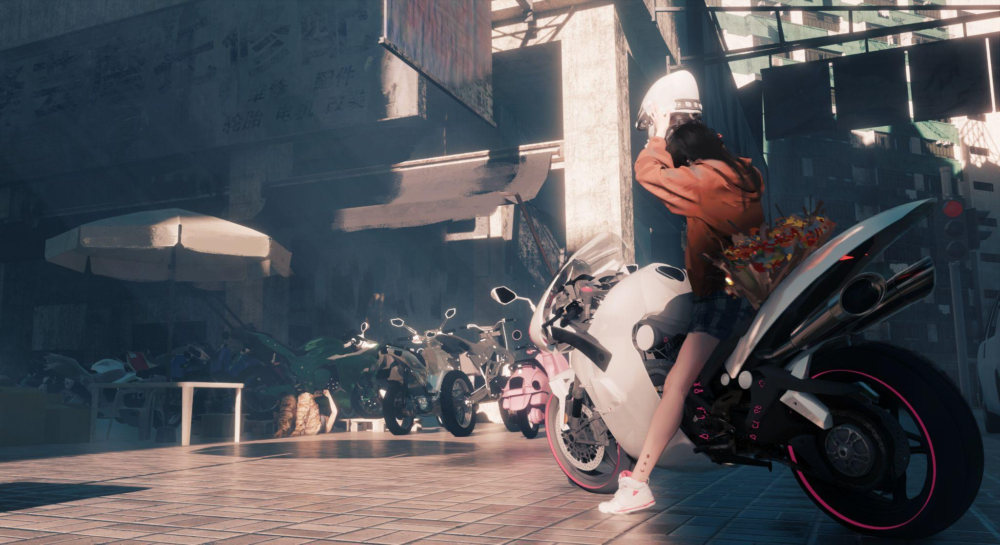

[Biển hiệu] Tiệm sửa chữa và phụ tùng mô tô Phong Vân

“Chị Vân ơi!”

“Ối chà, Nguyệt Nha Nhi! Dạo này cô nương lặn mất tăm đi đâu thế hả? Gọi điện thoại cũng không thèm nghe máy!”

“Dạo này tiệm đông khách lắm hả chị Vân, sao nhiều xe thế này?”

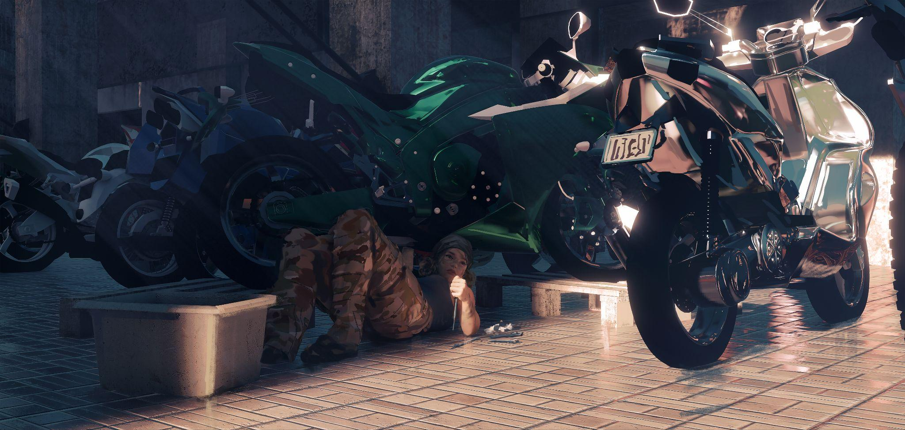

“Đúng thế đấy, Vân Trùng sắp tới rồi, mấy cái xe đồng hồ điện tử này đều không chạy được trên đường nữa, người ta kéo nhau đến đổi sang cụm đồng hồ cơ học, đèn xe cũng phải độ lại, mấy hôm nay làm mòn cả cái lưng già của chị rồi. Xe của em có cần độ lại không? Chị ưu tiên làm trước cho em nhé.”

“Dạ thôi khỏi chị, chị quên là em có bằng lái trong vùng trường Vân Trùng rồi sao, xe của em vốn dĩ đã là cơ học hoàn toàn rồi mà. Em không thích mấy thứ đồ điện tử.”

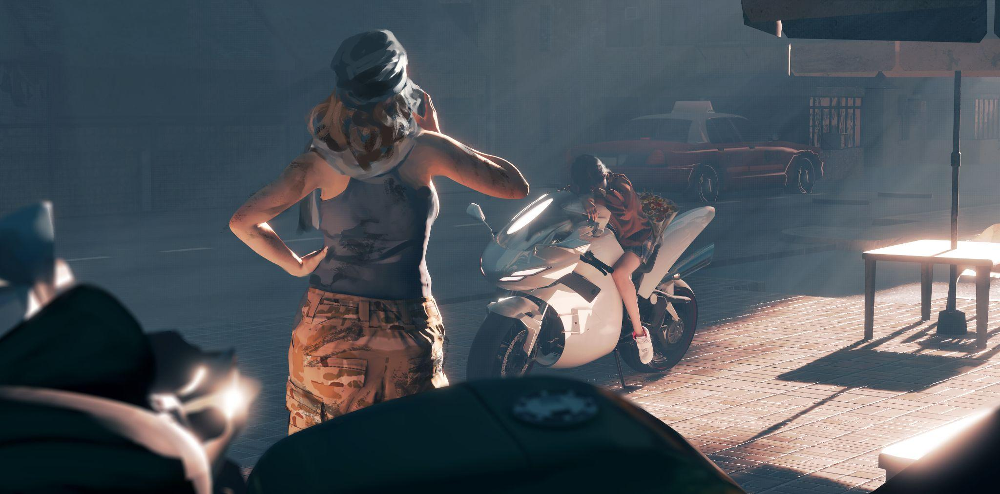

“À phải rồi Nguyệt Nha Nhi, anh Vương chủ quán bar Đao Hồn gọi điện mấy lần tìm em đến hát đấy, bảo là không liên lạc được với em, có phải em chặn số người ta rồi không?”

“Dạ vâng, em không muốn đến những chỗ như thế nữa.”

“Trời đất ơi cái con bé ngốc này, quán bar của người ta là đàng hoàng chính quy, anh Vương sống cũng rất có tình có nghĩa, bảo sẽ tăng thù lao thêm bao nhiêu là tiền, lại còn bố trí vệ sĩ riêng cho em nữa. Mấy lần trước em hát xong, bao nhiêu khách cứ nhớ mãi không quên, anh Vương đang đợi em quay lại để giữ khách cho quán đấy. Chị nói cho mà nghe, trời phú cho em chất giọng hay ngút ngàn, mặt mũi lại xinh xắn ưa nhìn thế kia, đúng là được tổ nghề đãi cơm, em đi hát một đêm bằng chị còng lưng cả tháng trời, ngữ thô kệch chỉ biết lao động chân tay như chị có nằm mơ cũng chẳng dám bì... Ơ kìa? Sao mặt mày lại trầy xước thế kia, đã bảo em đừng có chơi mấy cái môn thể thao nguy hiểm ấy nữa rồi cơ mà!”

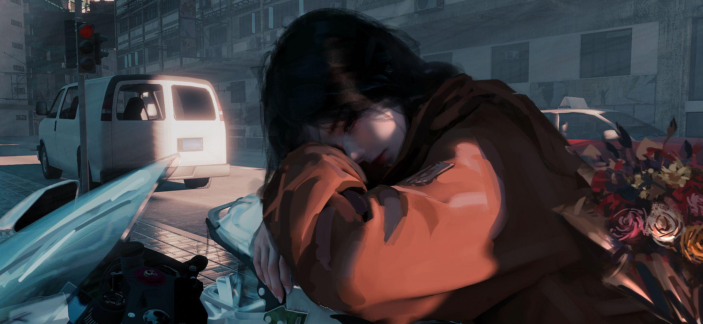

“Chị Vân đừng nói nữa mà, không phải em ghét bỏ gì anh Vương đâu, quán bar cũng chẳng có vấn đề gì cả. Chỉ là... em cũng không hiểu tại sao, càng ở những nơi náo nhiệt đông đúc, em lại càng cảm thấy cô đơn và trống rỗng.”

“Sao thế hả Nguyệt Nha Nhi? Có phải mấy đứa bạn cùng lớp lại nói ra nói vào sau lưng em không?”

“Chị Vân, thật ra hôm nay em đến là muốn ghé thăm chị thôi.”

“Chị thì có gì mà thăm nom, người ngợm lem luốc toàn dầu với mỡ...”

“Cảm ơn chị suốt mấy năm qua đã luôn quan tâm và chăm sóc em, chị Vân nhé.”

“Ơ kìa? Nguyệt Nha Nhi, hoa này là cho chị đấy à? Khoan đã! Nguyệt Nha Nhi! Em nói thế là có ý gì hả? Nguyệt Nha Nhi! Em quay lại đây cho chị!”

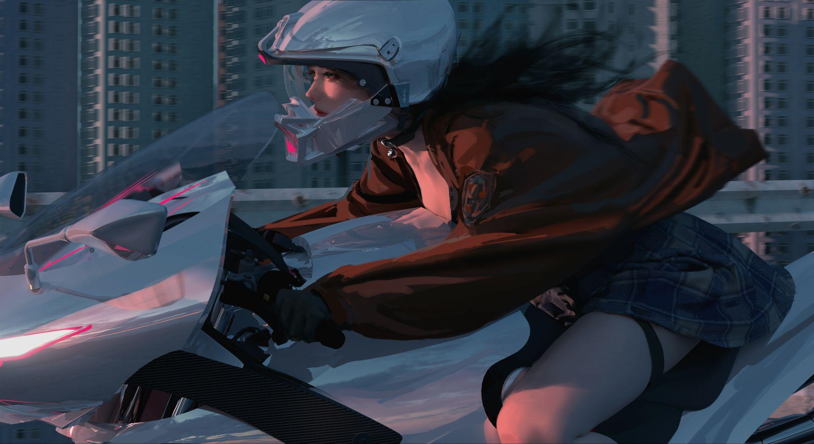

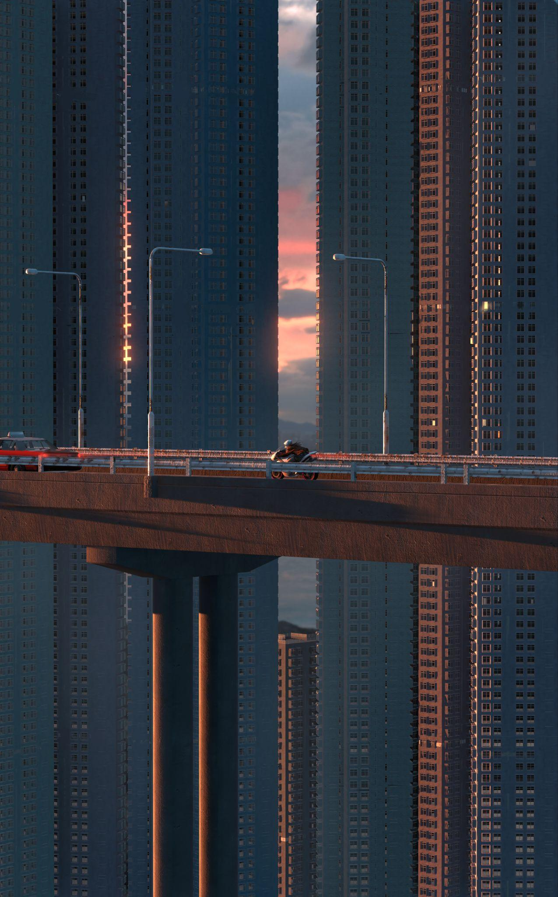

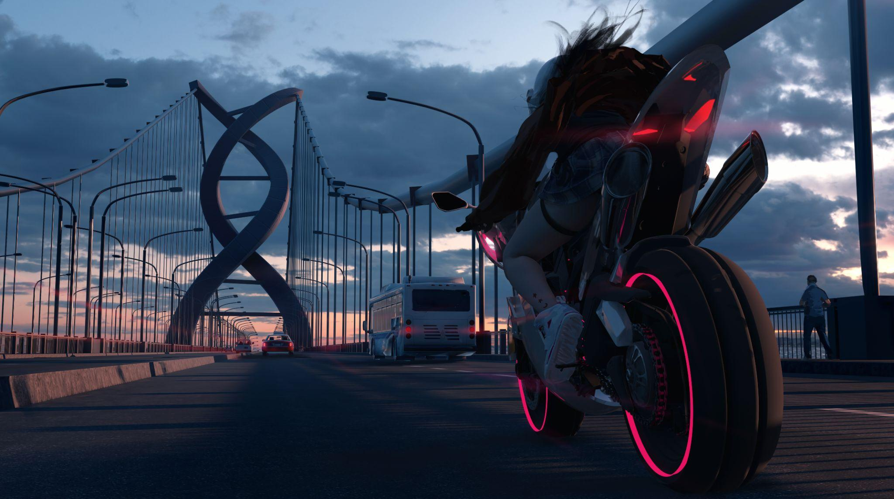

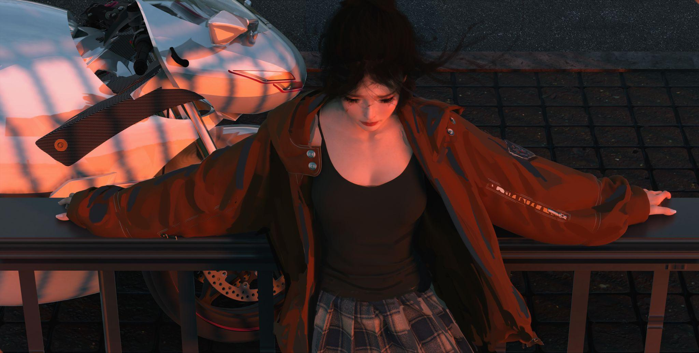

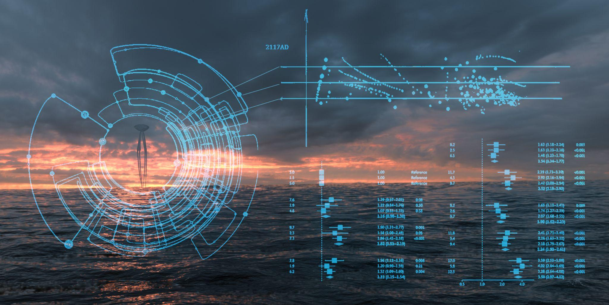

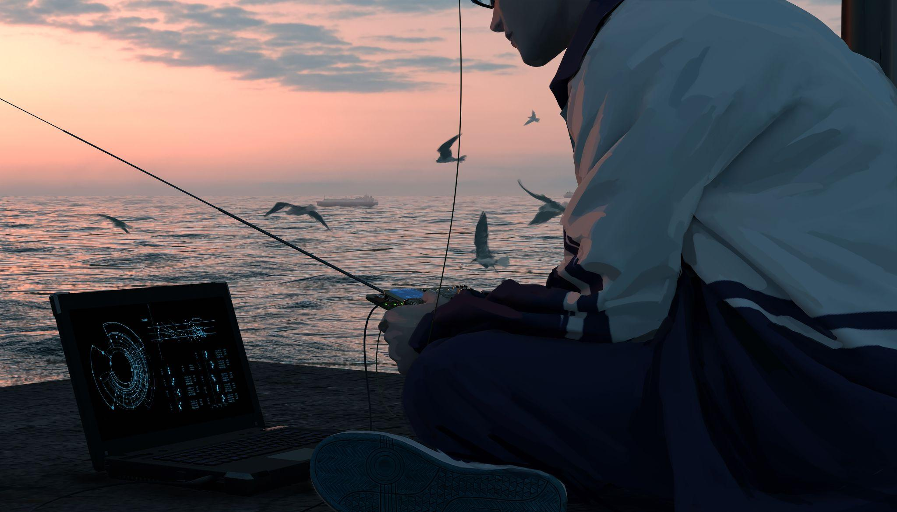

“Cậu có biết không, nhảy xuống biển là cách chết mất thể diện nhất đấy. Nước biển lạnh buốt thấu xương như dao cứa, cả quá trình đau đớn chẳng khác nào bị lăng trì. Đến khi thi thể bị sóng đánh dạt vào bờ thì đã trương phềnh to gấp đôi, con ngươi trôi mất tiêu rồi, ngay cả mẹ ruột cậu cũng chẳng nhận ra nổi đâu—”

“Hả? Ai thèm nhảy biển chứ? Cậu bị thần kinh à, cậu là ai đấy hả! Học sinh cấp ba à? Nhóc con cấp ba không lo mà ôn thi đại học đi, chạy ra đây nghịch ngợm cái gì?”

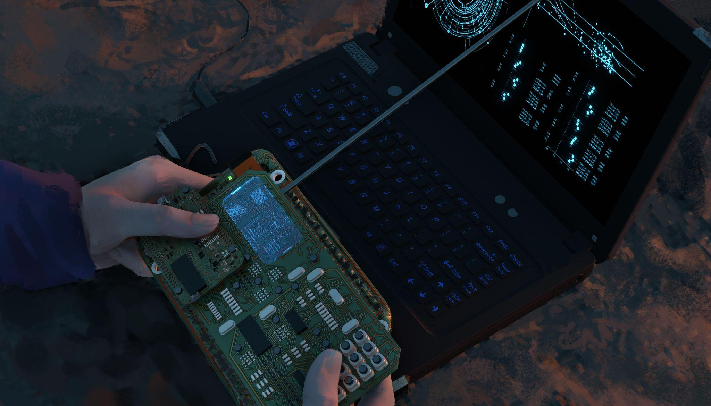

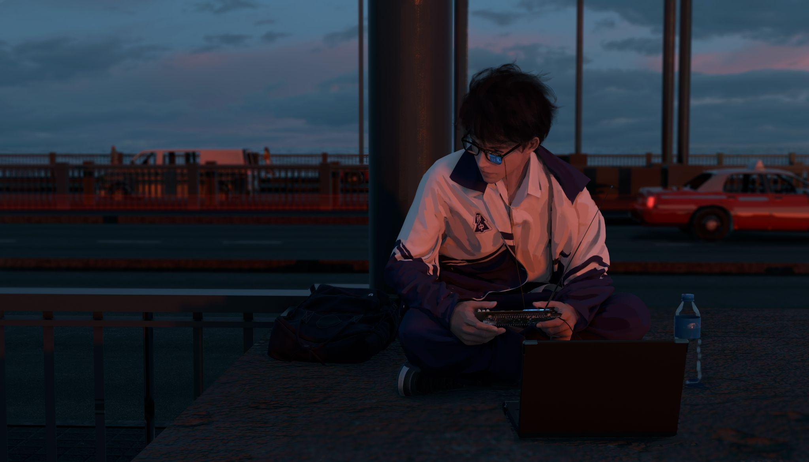

“Tôi không cần thi đại học, đã được tuyển thẳng vào Viện Vật lý Đại học Bắc Kinh rồi. Với lại tôi cũng không rảnh rỗi ra đây chơi, tôi đang giúp đội ngũ của Giáo sư Bạch ở Bắc Đại đo đạc số liệu tới hạn của trường Vân Trùng.”

“Xì... Ghét nhất cái ngữ làm màu như mấy người...”

“Nguyệt Nha Nhi? Tên nghe đặc biệt thật đấy, tôi tên là Hi Dương. 'Hi' trong hy vọng, 'Dương' trong giương buồm ra khơi.”

“Hi Dương? Phụt... ha ha ha, cái tên nghe cổ lỗ sĩ thế! Sao cậu không đặt tên là Tịch Dương Hồng (Nắng Chiều Rực Rỡ) luôn đi cho hợp cảnh! Cậu cũng từ tỉnh Đông Giang tới đây à? Thế thì chúng mình cũng coi như nửa người đồng hương rồi đấy.”

“Ừ, quê tôi ở vùng nông thôn tỉnh Đông Giang, lên Sa Khê học cấp ba, năm nay là năm thứ ba rồi. Còn cậu?”

“Lên đại học tôi mới tới đây, được hai năm rồi. Cậu học cấp hai đã một thân một mình lên thành phố học trường chuyên, giờ lại còn được tuyển thẳng vào Bắc Đại. Gia đình cậu chắc hẳn tự hào về cậu lắm nhỉ.”

“Cậu không hiểu đâu, kỳ vọng quá mức của người khác đôi khi chính là lưỡi dao đoạt mạng đấy.”

“Đúng là sướng mà không biết đường sướng.”

“Thế nên người ta mới bảo trên đời này làm gì có chuyện ai thấu cảm trọn vẹn cho ai, có người chịu lắng nghe mình nói đã là điều may mắn lắm rồi. Gia cảnh nhà tôi không khá giả, đi học xa nhà đều nhờ làng xóm gom góp cưu mang. Miệng người ta bảo là niềm tự hào của cả làng, nhưng áp lực kinh khủng lắm. Bắc Đại tuy cấp học bổng toàn phần cho tôi, nhưng sinh hoạt phí sau này ra Bắc Kinh vẫn phải tự mình tích cóp. Đo số liệu cho Giáo sư Bạch thật ra cũng chỉ là kiếm thêm chút đỉnh trang trải, công việc này nhàm chán vô cùng. Vé xe về quê thì ngày một đắt đỏ, Tết năm ngoái tôi còn chẳng dám về nhà. Còn cậu, bao lâu cậu về thăm bố mẹ một lần?”

“Gia đình... Đã lâu lắm rồi tôi không còn khái niệm về hai chữ đó nữa. Từ hồi tôi còn rất nhỏ bố mẹ đã ly hôn rồi. Sau đó họ đều có gia đình mới, sinh thêm con cái, tôi nghiễm nhiên trở thành kẻ thừa thãi nhất. Tôi từng phải sống nhờ, chuyển qua chuyển lại nhà mấy người họ hàng. Mối liên hệ với bố mẹ cũng chỉ gói gọn trong khoản tiền sinh hoạt họ gửi hàng tháng. Cái ngày nhận giấy báo trúng tuyển Đại học Sa Khê có lẽ là ngày tôi hạnh phúc nhất trong đời, tôi chịu đủ cảnh ăn nhờ ở đậu, nhìn sắc mặt người khác mà sống rồi. Bây giờ tôi chỉ muốn tự lực cánh sinh, đi làm thêm ở tiệm đồ ăn nhanh, đi phát tờ rơi ngoài đường, đi hát ở quán bar... Miễn là không phải tiêu tiền của bố mẹ, không phải trông mặt họ hàng, việc gì tôi cũng làm hết.”

“Cậu vừa bảo đi hát ở đâu cơ?”

“Nhóc con, đừng có hỏi nhiều chuyện người lớn.”

U u u ——

U u u ——

“Nghe kìa, là tiếng trùng ngâm đấy.”

“Là tiếng trùng ngâm.”

“Nghe như tiếng trầm ngâm vậy.”

“Là tiếng thở dài.”

“Thở dài ư? Sao lại thế?”

“Tôi không biết, nhưng tôi có thể nghe ra được, đó chính là tiếng thở dài của nó.”

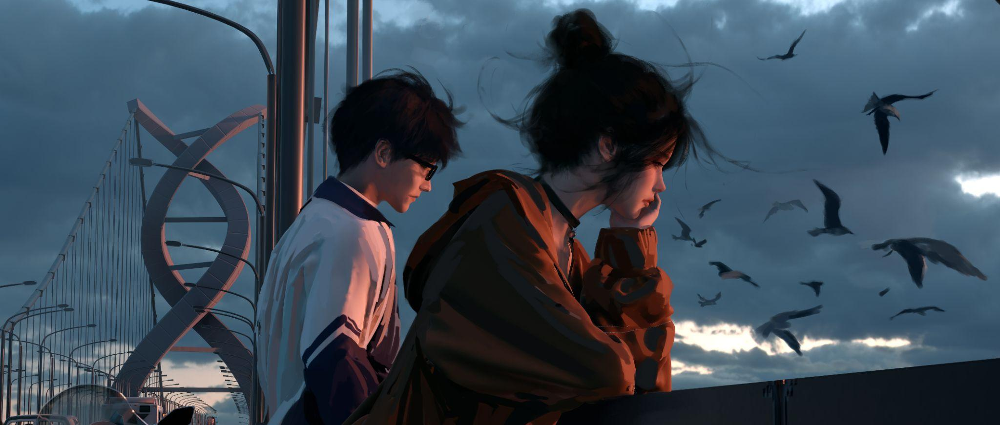

“Nó vừa tới là tôi cảm thấy cả thế giới này đều đảo lộn, loạn cào cào hết cả lên. Những sinh viên tài ba, các học giả, giáo sư kiệt xuất như các cậu đã nghiên cứu ra được tiến triển gì chưa? Cậu đang đo đạc những số liệu gì thế?”

“Trường Vân Trùng đã làm nhân loại đau đầu bế tắc suốt hàng ngàn năm qua, đâu phải dễ dàng đạt được tiến triển. Năm ngoái, Giáo sư Vi bên Khoa Toán của Bắc Đại đã đưa ra một giả thuyết, cho rằng sự biến đổi của các hằng số vật lý trong trường Vân Trùng thay đổi tùy theo khoảng cách tính từ tâm Vân Trùng, thậm chí ông còn lập ra một biểu thức giải tích giữa hằng số dị biến và khoảng cách — tức là Phương trình trường Vân Trùng, gây chấn động cả giới học thuật. Hiện tại nhiều dữ liệu đo được khá khớp với phương trình này, nhưng vẫn còn rất nhiều điểm dị thường chưa thể giải thích nổi. Giáo sư Bạch, người hướng dẫn của tôi, đang dốc sức kiểm chứng phương trình trường Vân Trùng của 'Vi Thần', việc này đòi hỏi lượng dữ liệu khổng lồ. Chỗ tôi đang đo đạc chính là số liệu dị biến ở vùng rìa ngoài tiếp giáp ranh giới trường Vân Trùng. Đợi đến khi thực sự tiến sâu vào trong trường lực, các thiết bị điện tử đều tê liệt thì dữ liệu sẽ cực kỳ khó thu thập, tiến triển quả thực vô cùng mong manh.”

“Nếu phương trình đó được chứng minh là đúng thật, thì sau đó sẽ ra sao?”

“Thì cũng mới chỉ là bước đi đầu tiên trong cuộc trường chinh vạn dặm thôi, nhưng ít nhất chúng ta có thể dựa vào phương trình để tái thiết kế các loại thiết bị thí nghiệm, ứng dụng ở các cự ly khác nhau so với Vân Trùng, từng bước mở chiếc hộp Pandora này ra. Quan điểm chủ lưu trong giới khoa học cho rằng Vân Trùng không phải sinh vật sống, mà chỉ là một cỗ máy cơ khí. Nhưng nền văn minh tạo ra nó chắc chắn vượt xa nhân loại chúng ta hàng triệu bậc. Siêu dẫn nhiệt độ phòng, phản ứng nhiệt hạch có thể kiểm soát, sự hủy diệt vật chất tối, truyền năng lượng bằng sóng hấp dẫn... Tất cả đều được suy đoán là đang tồn tại bên trong Vân Trùng. Chỉ cần hé mở được một góc của tảng băng chìm ấy thôi, cũng đủ để đẩy nền văn minh nhân loại tiến lên một bước dài.”

“Thế sao? Những kẻ đầu tiên nắm giữ được công nghệ đó liệu có chịu chia sẻ cho người khác không? Hay nó sẽ chỉ trở thành thứ vũ khí để một nhóm người đi bóc lột và đàn áp một nhóm người khác? Hi Dương, đã bao giờ cậu tự hỏi, sự phát triển của khoa học công nghệ hiện nay rốt cuộc đang khiến nhân loại trở nên văn minh hơn, hay ngày càng dã man hơn không?”

“Cảm giác cậu chán đời ghê gớm nhỉ, ban nãy không phải cậu muốn nhảy thật đấy chứ?”

“Cậu yên tâm đi, trên đời này còn bao nhiêu món ngon tôi chưa được ăn, bao nhiêu quần áo đẹp tôi chưa được mặc, bao nhiêu nơi vui vẻ tôi chưa từng đặt chân tới, tôi còn lâu mới chịu chết nhé. Cuộc đời dài như thế, kiểu gì chẳng gặp phải vài kẻ khốn nạn. Tôi yêu cuộc sống này lắm, chỉ là tôi không thích thế giới xô bồ, vô vị và ồn ào này thôi.”

“Thắc mắc của cậu tôi cũng từng nghĩ qua rồi. Nhưng khát vọng khám phá và trí tò mò trước những điều chưa biết vốn đã được khắc sâu vào chuỗi xoắn DNA của nhân loại rồi. Cho dù Vân Trùng thực sự là chiếc hộp tai họa Pandora đi chăng nữa, thì khi nó bày ra ngay trước mắt, tôi tin chẳng có ai có thể cưỡng lại được sự thôi thúc muốn mở nó ra đâu.”

“Tôi cũng tò mò, nhưng không phải tò mò về mấy thứ công nghệ hay phương trình cao siêu kia. Tôi tò mò là nếu Vân Trùng thực sự là thực thể vượt xa nền văn minh nhân loại như lời cậu nói, thì tại sao nó lại phải dựng lên một cái lồng chụp để chắn mình lại, ngăn cản con người nghiên cứu nó làm gì?”

“Thế cậu nghĩ lý do là vì sao?”

“Có khi là do con người chúng ta tự mình đa tình thôi. Chúng ta chẳng thể nào hiểu nổi mục đích của Vân Trùng, cũng giống như lũ sâu bọ chẳng bao giờ hiểu được suy nghĩ của con người vậy.”

“Có lẽ là thế thật. Vân Trùng đã tồn tại hàng vạn năm nay rồi, chúng ta mới chính là giống loài hạ đẳng đáng thương.”

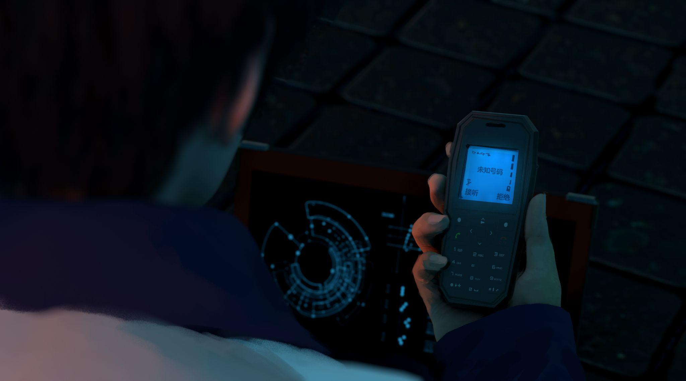

“Rõ ràng trên cầu này làm gì có sóng, sao lại có cuộc gọi đến thế này, mà còn không hiện số nữa chứ... Trường Vân Trùng đã bắt đầu tác động làm nhiễu sóng điện từ rồi.”

“Cậu dùng cái điện thoại từ thời cổ đại nào thế kia, cơ mà nhìn lại thấy hợp với cái tên của cậu ra phết đấy.”

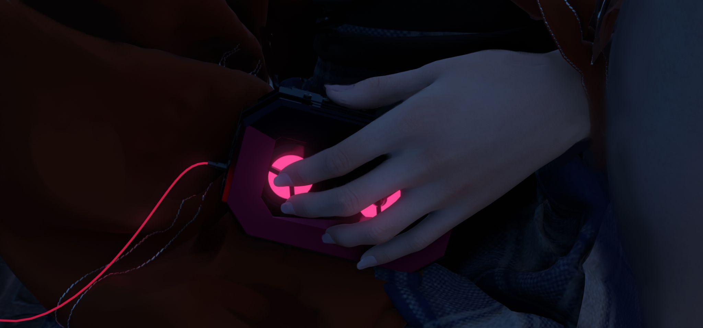

“Cậu cũng có hơn gì tôi đâu, cái máy cát-xét nghe nhạc của cậu chắc thời điểm khai quật cũng chẳng muộn hơn cái điện thoại của tôi là mấy đâu nhỉ. Thời buổi nào rồi mà cậu vẫn còn nghe băng cát-xét thế?”

“Có lẽ, về bản chất chúng ta là cùng một kiểu người đấy.”

“Là cùng một kiểu người nhưng bị đặt vào những hoàn cảnh sống khác nhau.”

“Ừm.”

“Thế thì tôi đoán, bài hát mà 'người cùng hội cùng thuyền' với tôi đang nghe lúc này, chắc chắn là bài từ thế kỷ trước rồi.”

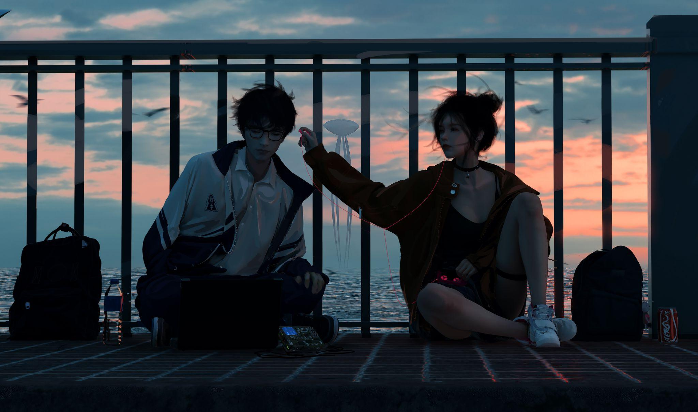

“Này, nghe đi.”

[Lời bài hát] “Sợ rằng bi kịch sẽ lại tái diễn,

[Lời bài hát] Số mệnh của tôi ơi, số mệnh...

[Lời bài hát] Càng là thứ đẹp đẽ, tôi lại càng không thể chạm vào.”

“Quả nhiên là một bài hát xưa thật đấy.”

“Ừm, tôi thích giai điệu mộc mạc của thời kỳ đó. Khi ấy, bố mẹ tôi vẫn còn ở bên nhau.”

[Lời bài hát] “Điều gì tôi cũng đều có linh cảm trước,

[Lời bài hát] Rồi chẳng dám mở mắt nhìn định mệnh giáng lâm,

[Lời bài hát] Rồi trên bầu trời, từng tầng mây đen lại cuồn cuộn dâng trào...”

—— Vương Phi, ca khúc "Ám Dũng" (1997)

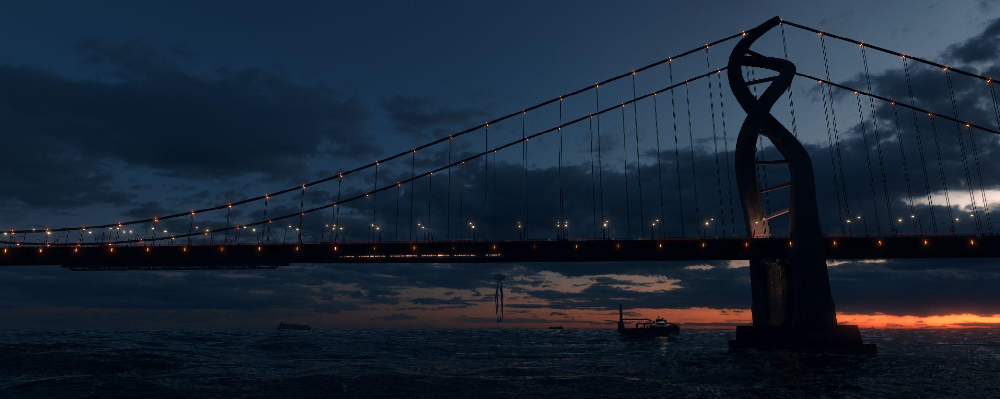

Có những khúc ca, chỉ nghe khúc dạo đầu đã thấy ấm áp.

Có những người, chỉ cần được gặp gỡ đã thấy ngập tràn niềm vui.
