# Vân Trùng / CloudInsect - Chương 1: Hi Dương (第一章 希扬)

---

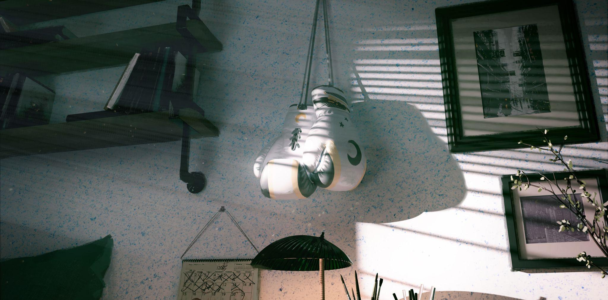

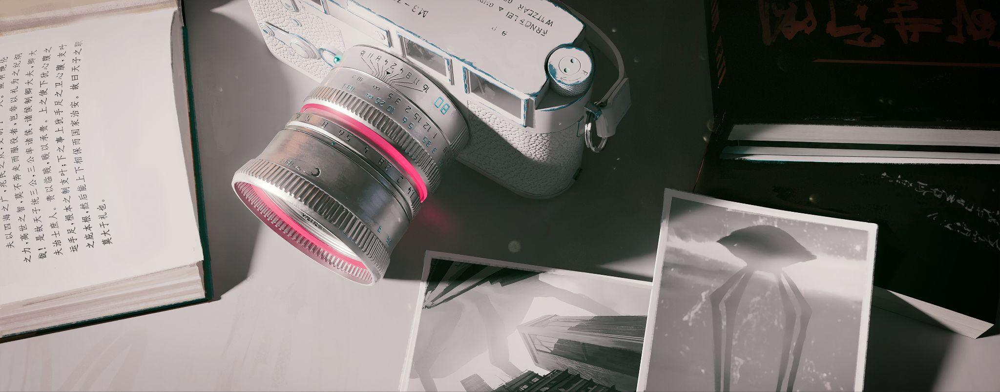

**VI**: [Sách] Đoạn Đại Sử: Thời Xuân Thu

**ZH**: [书籍]断代史：春秋

**EN**: [Book]Chronicle of Eras: Spring and Autumn

**VI**: [Máy ảnh cơ film]

**ZH**: [胶片相机]

**EN**: [Film Camera]

**VI**: [Sách] Đế quốc La Mã

**ZH**: [书籍]罗马帝国

**EN**: [Book]The Roman Empire

**VI**: [Sách] Bản phổ nhạc cho đàn vĩ cầm

**ZH**: [书籍]小提琴谱

**EN**: [Book]Violin Sheet Music

**VI**: [Sách] Lược sử văn minh thế giới

**ZH**: [书籍]世界文明简史

**EN**: [Book]A Brief History of World Civilizations

**VI**: [Lọ thuốc] Escitalopram (Thuốc điều trị trầm cảm)

**ZH**: [药瓶]艾司西酞普兰(抗抑郁药物)

**EN**: [Medicine Bottle]Escitalopram (Antidepressant)

**VI**: [Bệnh án] Họ tên: Nguyệt Nha Nhi

**ZH**: [诊断书]姓名：月牙儿

**EN**: [Diagnosis Report]Name: Mahina

**VI**: [Bệnh án] Giới tính: Nữ

**ZH**: [诊断书]性别：女

**EN**: [Diagnosis Report]Gender: Female

**VI**: [Bệnh án] Tuổi: 19

**ZH**: [诊断书]年龄：19

**EN**: [Diagnosis Report]Age: 19

**VI**: [Bệnh án] Chuyên khoa: Phòng khám tâm thần ngoại trú

**ZH**: [诊断书]科别：精神科门诊

**EN**: [Diagnosis Report]Department: Outpatient Psychiatry

**VI**: [Bệnh án] Chẩn đoán: Trầm cảm mức độ vừa mãn tính

**ZH**: [诊断书]诊断：长期中度抑郁症

**EN**: [Diagnosis Report]Diagnosis: Chronic Moderate Depression

**VI**: [Bệnh án] Chỉ định điều trị: Uống thuốc chống trầm cảm dài hạn theo đúng phác đồ của bác sĩ

**ZH**: [诊断书]处理意见：按医嘱长期服用抗抑郁类药物

**EN**: [Diagnosis Report]Recommendations: Take antidepressant medication as prescribed for the long term

**VI**: Cộc, cộc, cộc!

**ZH**: 咚咚咚

**EN**: Knock, knock, knock

**VI**: “Đến ngay đây ạ, bác đợi một chút!”

**ZH**: “来了，稍等。”

**EN**: “Coming! Just a moment.”

**VI**: “Bác Lý đấy à, có chuyện gì thế bác?”

**ZH**: “李伯啊，什么事？”

**EN**: “Uncle Li, what’s up?”

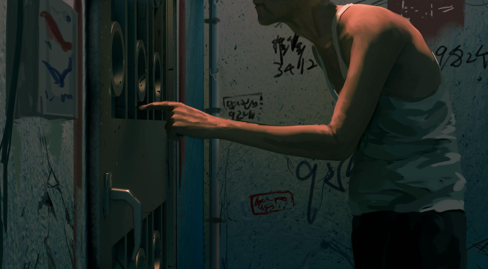

**VI**: “Nguyệt Nha Nhi, sao cháu vẫn chưa dọn đi hả? Cháu có biết hôm nay là ngày mười mấy rồi không!”

**ZH**: “月牙儿，还没搬走啊，这都几号了！”

**EN**: “Mahina, you still haven’t moved out? Do you realize what day it is?”

**VI**: “Bác Lý ơi, cho cháu lùi lại mấy hôm được không bác? Đồ đạc của cháu nhiều quá, đóng gói mất bao nhiêu thời gian. Với lại dạo này tìm phòng trọ bên ngoài đâu có nhanh thế được...”

**ZH**: “李伯，再迟几天行么？我东西多，打包需要不少时间。而且现在外面找房子租也没那么快……”

**EN**: “Uncle Li, can I have a few more days? I have a lot of stuff to pack, and finding a place to rent outside isn’t quick…”

**VI**: “Không được, tuyệt đối không được! Bác đã báo trước cho cháu bao nhiêu ngày rồi! Không phải bác nhẫn tâm đuổi cháu đi, mà khu vực này nằm sát ngay điểm dừng chân của Vân Trùng, chính quyền yêu cầu tất cả mọi người phải sơ tán đúng hạn. Hai hôm nay cán bộ đã đến giục mấy lần rồi, trễ hạn là bị phạt tiền đấy cháu có biết không!”

**ZH**: “不行不行！都提早那么多天通知你了！不是我赶你走，这片区域靠近云虫落脚点，政府要求所有人都按时提前撤离的，这两天已经有人来催了，迟了要交罚款的你知不知道！”

**EN**: “No, no! I gave you plenty of notice! I’m not the one driving you out—this area is close to a CloudInsect resting site, and the government requires everyone to evacuate by the deadline. Officials have already come by twice to press the issue. You know there’s a fine if you’re late!”

**VI**: “Bác Lý ơi, giờ vẫn chưa tới hạn chót của chính quyền mà, với lại nếu phạt thì phạt người thuê nhà chứ có phạt vào đầu bác đâu — Cháu thấy hình như bác sợ người ta kiểm tra phát hiện ra cái mái che lấn chiếm bác tự dựng trên sân thượng thì đúng hơn?”

**ZH**: “李伯，这也还没到政府要求的期限啊，就算罚款也是罚租客，罚不到您头上—— 我看您是怕顶层搭的违建凉棚被查到吧？”

**EN**: “Uncle Li, the government’s deadline hasn’t even arrived yet! Even if there is a fine, the tenant pays it, not you—I think you’re afraid they’ll discover that illegal awning you built on the roof!”

**VI**: “Cháu đừng có nói bừa! Vi phạm chỗ nào hả! Cái chòi đó bác dựng hơn mười năm nay rồi! Cháu cứ bảo họ đến kiểm tra đi, đến mà kiểm tra! Hừ hừ... Dù sao thì trước tối mai cháu bắt buộc phải dọn đi, nếu không bác sẽ cắt điện cắt nước đấy!”

**ZH**: “你瞎讲！哪里有违建！我那棚都搭了十几年了！你叫他们来查，来查！哼哼……反正你明晚前必须搬走，不然我就给你断水断电！”

**EN**: “You’re talking nonsense! There’s nothing illegal about that shelter! I’ve had it up for over ten years! Tell them to come and check, I dare them! Hmph… Anyway, you have to move out by tomorrow night, or I’ll cut off your water and electricity!”

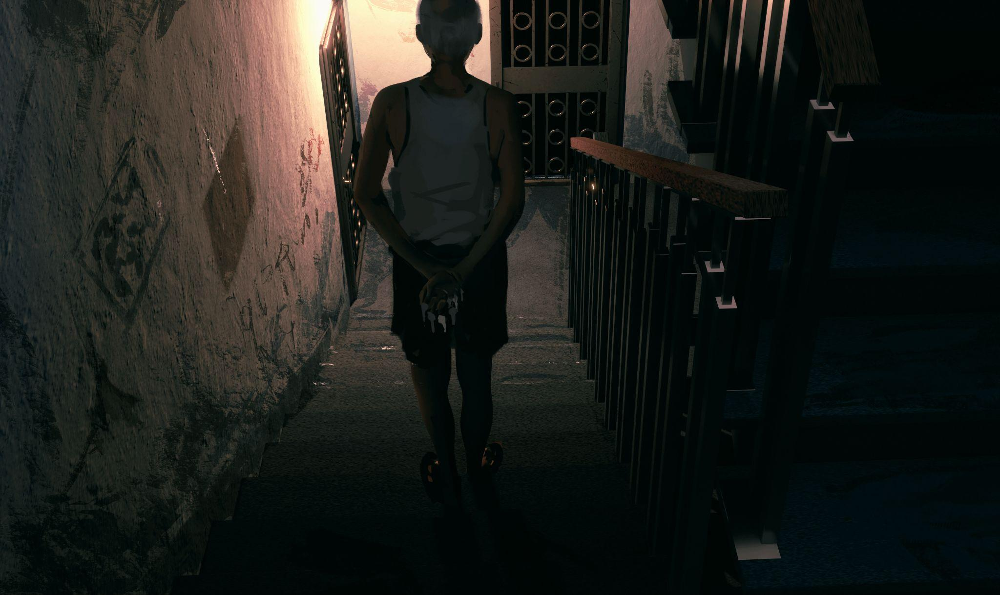

**VI**: “Hừ... Sinh viên đại học thời nay, thật chẳng ra làm sao cả!”

**ZH**: “哼……现在的大学生，不像话！”

**EN**: “Hmph… College students these days—no respect at all!”

**VI**: “Haizz, bực mình thật đấy chứ —”

**ZH**: “唉，好烦啊——”

**EN**: “Ugh, what a pain—”

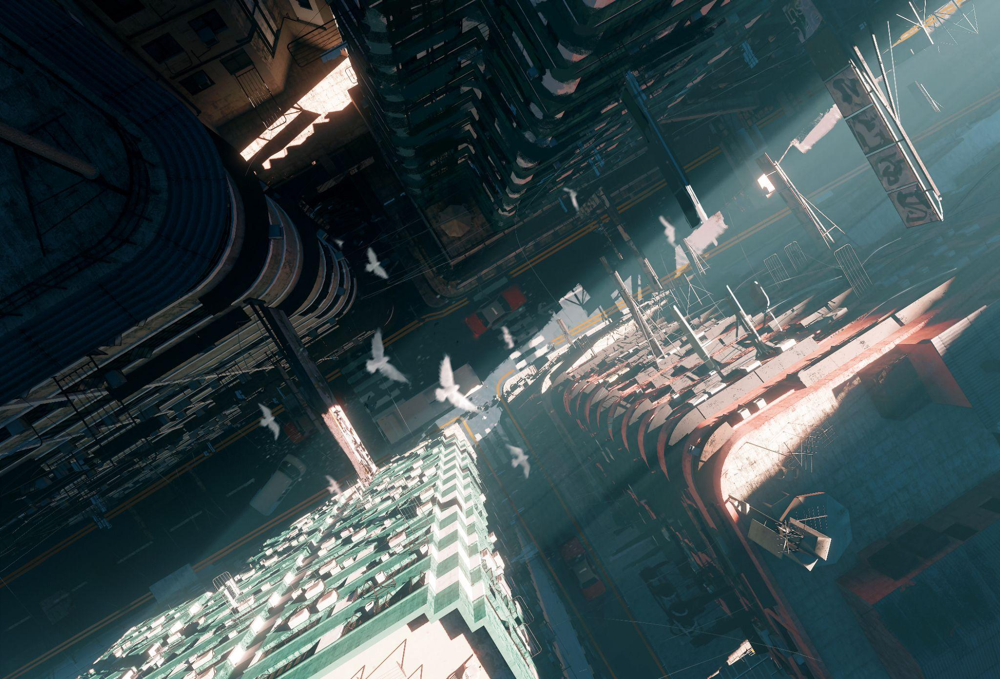

**VI**: [Giao dịch viên] “Bác ơi, thẻ này của bác hôm nay đã vượt quá hạn mức rút tiền trong ngày rồi nên không rút thêm được nữa ạ, không phải do máy ATM bị lỗi đâu bác.”

**ZH**: [职员]阿姨，您这卡今天已经超过取款限额了，所以取不出来，不是机器的问题。

**EN**: [Bank Staff]“Ma’am, your card has exceeded the withdrawal limit today, so you can’t take out any cash. It’s not a problem with the machine.”

**VI**: [Người dân] “Không rút được là sao? Tiền của chính tôi tại sao lại không cho rút! Con Vân Trùng kia mà tới đây, ngân hàng các người bị cúp điện, thế chẳng phải mấy trăm ngàn tệ của tôi coi như mất trắng à! Thời buổi này cái gì cũng điện tử với số hóa, chẳng an toàn một chút nào cả!”

**ZH**: [民众]取不出来？我自己的钱为什么取不出来！这云虫一来，你们银行电一断，我这几十万不就全没了！现在什么都是电子的，一点都不安全！

**EN**: [Customer]“Can’t take it out? Why can’t I access my own money! With the CloudInsect coming through, if the power goes out at your bank, won’t my hundreds of thousands be lost? Everything’s electronic now; it’s not safe at all!”

**VI**: [Giao dịch viên] “Không có chuyện đó đâu bác ơi, ngân hàng chỉ tạm ngưng dịch vụ điện tử trong vài tuần Vân Trùng đi qua thôi ạ, sau đó mọi thứ sẽ hoạt động bình thường trở lại, tiền của bác tuyệt đối không mất được đâu ạ.”

**ZH**: [职员]不会的阿姨，只是云虫经过的这几个星期暂停电子业务而已，之后就会恢复正常的，您的钱也不会丢。

**EN**: [Bank Staff]“It won’t be a problem, ma’am. We’re just suspending electronic services for a few weeks while CloudInsect passes through. Everything will return to normal afterwards, and your money won’t be lost.”

**VI**: [Người dân xếp hàng] “Người rút tiền phía trước làm nhanh giùm cái được không? Đằng sau còn cả hàng dài đang đợi đây này!”

**ZH**: [民众]前面取钱的能快点吗？后面排了那么长的队了！

**EN**: [Customer]“Can the person at the front hurry up? There’s a huge line behind you!”

**VI**: [Môi giới nhà đất] “Cô em ơi, tìm hiểu thử căn hộ ở khu Kiều Nam nhé? Giá ưu đãi đặc biệt trong mùa Vân Trùng, chủ nhà đang cần bán gấp đi lánh nạn đây!”

**ZH**: [商业]小姐，桥南区的公寓了解一下？云虫期特价，业主急走！

**EN**: [Advertisement]“Miss, how about an apartment in the South Bridge District? Special prices during the CloudInsect period—owners are eager to sell!”

**VI**: [Tuyên truyền tôn giáo] “Chớ để cảnh tượng hỗn loạn trước mắt che mờ tâm trí! Vân Trùng chính là sứ giả của Thiên Mẫu giáng trần để phán xét thế gian. Hãy cùng nhau thành tâm cầu nguyện để nhận được sự che chở của Thiên Mẫu! Giáo hội Vân Trùng luôn rộng cửa đón chào các bạn!”

**ZH**: [宗教]不要被嘈杂之景蒙蔽双眼，云虫乃我们天母的使者，降临至此，审判众生。让我们潜心祈祷，寻求天母的庇护！云虫教会欢迎您的加入！

**EN**: [Religious Announcement]“Do not let the chaotic scenes blind your eyes. The CloudInsect is the messenger of our Heavenly Mother, descending here to judge all beings. Let us devote ourselves to prayer, seeking the protection of the Heavenly Mother! The CloudInsect Church welcomes you to join us!”

**VI**: [Tiểu thương] “Nến thắp và que phát quang đại hạ giá đây, 20 tệ một tá, số lượng có hạn, ngày mai là tăng giá đấy nhé!”

**ZH**: [商贩]特价蜡烛和冷光棒，20块一打，数量有限，明天加价！

**EN**: [Vendor]“Special price on candles and glow sticks, 20 bucks a dozen! Limited stock—prices go up tomorrow!”

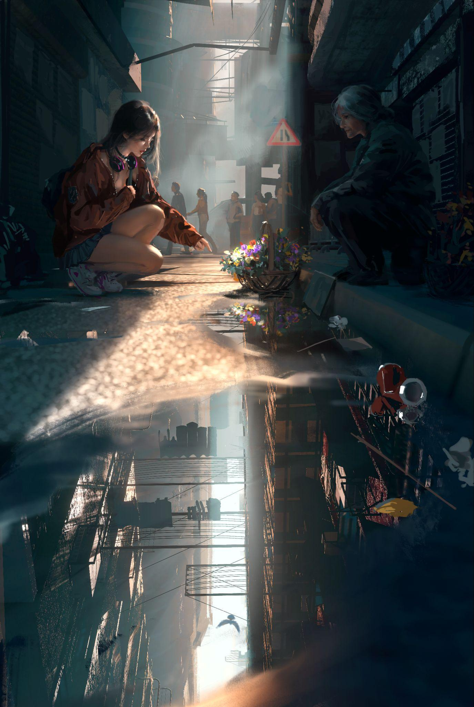

**VI**: “Bà ơi, hoa này bán thế nào ạ?”

**ZH**: “阿婆，这花怎么卖？”

**EN**: “Ma’am, how much are these flowers?”

**VI**: “Năm hào một cành thôi cháu, nếu cháu thích thì lấy mấy cành đi, đằng nào hôm nay chắc cũng chẳng bán hết được. Ai nấy đều đang đổ xô đi gom muối với nến, cháu gái à, cháu mau sang siêu thị bên kia đường mà mua chút đồ dự trữ đi, hết hàng là phải đợi đến ngày mai đấy.”

**ZH**: “5毛钱一支，你要喜欢的话就拿几枝走吧，反正今天也卖不完了。大家都忙着屯盐和蜡烛，孩子，你还是赶紧去对面超市买些吧，卖完了得等明天了。”

**EN**: “Fifty cents each. If you like them, just take a few. We probably won’t sell them all today anyway. Everyone’s busy stocking up on salt and candles. You should hurry over to the supermarket across the street and get some before they run out.”

**VI**: “Sao mọi người lại phải tích trữ muối vậy bà?”

**ZH**: “为什么要屯盐？”

**EN**: “Why are people stocking up on salt?”

**VI**: “Bà cũng chẳng rõ nữa, thấy người ta tranh nhau mua thì chắc là có ích gì đó thôi.”

**ZH**: “我也不知道，大家都在抢，应该是有用的吧。”

**EN**: “I don’t know either. Everyone’s just grabbing it. It must be for something important.”

**VI**: “Bà ơi, chỗ hoa này... cháu mua hết nhé.”

**ZH**: “阿婆，这些花，全卖我吧。”

**EN**: “Ma’am, I’ll buy all of these flowers.”

**VI**: “Hả? Cháu mua tất cả chỗ này sao?”

**ZH**: “啊？全部？”

**EN**: “Huh? All of them?”

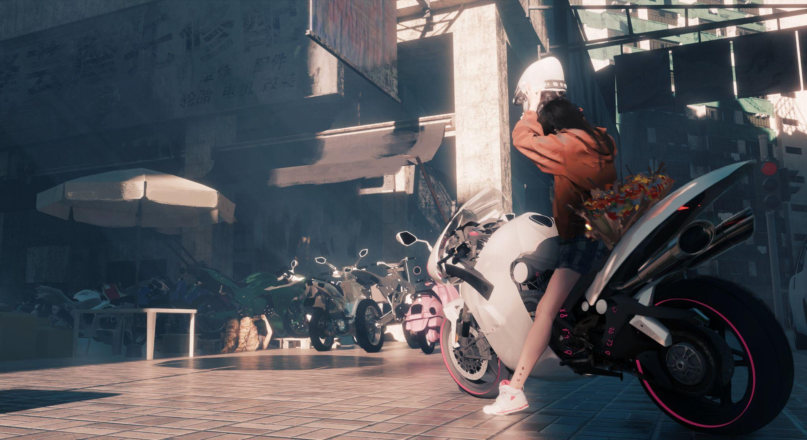

**VI**: [Biển hiệu] Tiệm sửa chữa và phụ tùng mô tô Phong Vân

**ZH**: [店铺]峰芸摩托修配

**EN**: [Shop]Fengyun Motorcycle Repair Shop

**VI**: “Chị Vân ơi!”

**ZH**: “芸姐！”

**EN**: “Hey, Aunt Yun!”

**VI**: “Ối chà, Nguyệt Nha Nhi! Dạo này cô nương lặn mất tăm đi đâu thế hả? Gọi điện thoại cũng không thèm nghe máy!”

**ZH**: “哟，月牙儿，这阵子玩失踪呢？电话也不接！”

**EN**: “Oh, Mahina! You’ve been missing in action lately—haven’t been picking up your phone!”

**VI**: “Dạo này tiệm đông khách lắm hả chị Vân, sao nhiều xe thế này?”

**ZH**: “最近单子很多吗，芸姐，这么多车？”

**EN**: “Have you been busy with a lot of orders, Aunt Yun? So many motorcycles here!”

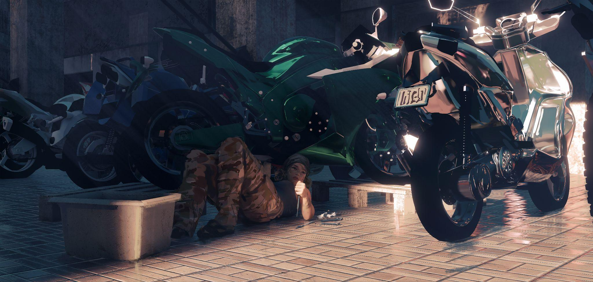

**VI**: “Đúng thế đấy, Vân Trùng sắp tới rồi, mấy cái xe đồng hồ điện tử này đều không chạy được trên đường nữa, người ta kéo nhau đến đổi sang cụm đồng hồ cơ học, đèn xe cũng phải độ lại, mấy hôm nay làm mòn cả cái lưng già của chị rồi. Xe của em có cần độ lại không? Chị ưu tiên làm trước cho em nhé.”

**ZH**: “是啊，云虫一来，这些电子仪表的车全不能上路，都来改机械仪表盘，还有车灯也要改，这几天快把我这条老腰给干废了。你的车也要改吗？我可以先帮你弄哦。”

**EN**: “Yes. Once the CloudInsect arrives, none of these bikes with electronic instrument panels can be driven. Everyone is bringing them in to switch to mechanical gauges, and the headlights have to be converted too. These past few days have nearly broken my back.Does your bike need work as well? I can do yours first.”

**VI**: “Dạ thôi khỏi chị, chị quên là em có bằng lái trong vùng trường Vân Trùng rồi sao, xe của em vốn dĩ đã là cơ học hoàn toàn rồi mà. Em không thích mấy thứ đồ điện tử.”

**ZH**: “不用，你忘了我有云虫场内的驾照么，我这车本来就是全机械的。我不喜欢那些电子的东西。”

**EN**: “No need, don’t you remember I have a license for the CloudInsect zone? My bike is all mechanical to begin with. I don’t like those electronic things.”

**VI**: “À phải rồi Nguyệt Nha Nhi, anh Vương chủ quán bar Đao Hồn gọi điện mấy lần tìm em đến hát đấy, bảo là không liên lạc được với em, có phải em chặn số người ta rồi không?”

**ZH**: “对了，月牙儿，刀魂酒吧的王老板来了好几次电话，找你去驻唱呢，说打不通你电话，你是不是把人家拉黑了？”

**EN**: “Hey, Mahina, Boss Wang from the Ghostblade Bar has called several times looking for you to perform. He said he couldn’t get through to you—did you block him?”

**VI**: “Dạ vâng, em không muốn đến những chỗ như thế nữa.”

**ZH**: “是的，我不想去那种地方了。”

**EN**: “Yeah, I don’t want to go to that kind of place anymore.”

**VI**: “Trời đất ơi cái con bé ngốc này, quán bar của người ta là đàng hoàng chính quy, anh Vương sống cũng rất có tình có nghĩa, bảo sẽ tăng thù lao thêm bao nhiêu là tiền, lại còn bố trí vệ sĩ riêng cho em nữa. Mấy lần trước em hát xong, bao nhiêu khách cứ nhớ mãi không quên, anh Vương đang đợi em quay lại để giữ khách cho quán đấy. Chị nói cho mà nghe, trời phú cho em chất giọng hay ngút ngàn, mặt mũi lại xinh xắn ưa nhìn thế kia, đúng là được tổ nghề đãi cơm, em đi hát một đêm bằng chị còng lưng cả tháng trời, ngữ thô kệch chỉ biết lao động chân tay như chị có nằm mơ cũng chẳng dám bì... Ơ kìa? Sao mặt mày lại trầy xước thế kia, đã bảo em đừng có chơi mấy cái môn thể thao nguy hiểm ấy nữa rồi cơ mà!”

**ZH**: “啊呀月牙儿你这瓜娃子，人家正规酒吧，王老板人也挺厚道，说要再给你加多少多少的报酬，还要给你配私人保镖。前几次你去唱完，好多客人都对你念念不忘，王老板等你回去给他撑场面呢。你说你天生好嗓子，又生得一副挠人的小模样，老天爷赏饭吃，唱一晚上歌都顶的上我忙活个把月了，像我这种只能干粗活的真是羡慕都羡慕不来……咦？怎么又把脸弄花了，叫你别去玩那些危险的运动了。”

**EN**: “Oh, come on, Mahina! It’s a legitimate bar. Boss Wang is a good guy; he even said he’d increase your pay and provide a personal bodyguard. After your last few performances, so many customers couldn’t stop talking about you. Boss Wang is waiting for you to come back and help him out! You have such a natural talent for singing, and you’ve got that cute look. You could easily make as much in one night as I do in a month. I’m just a rough worker; I really envy you… Hey? What happened to your face? I told you to stop doing those risky sports!”

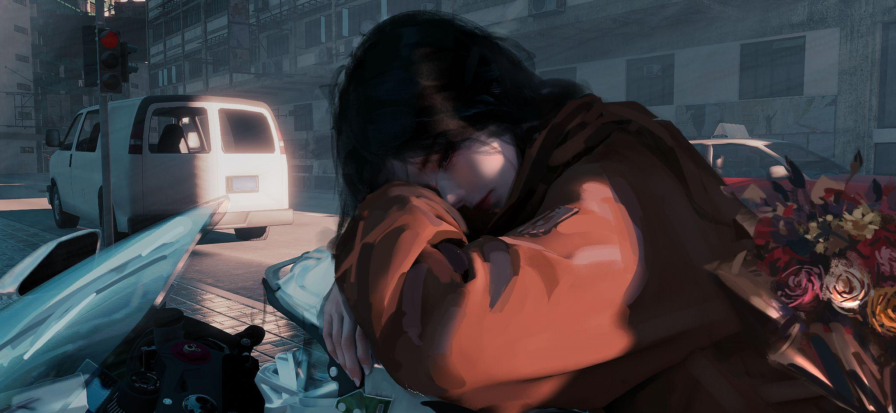

**VI**: “Chị Vân đừng nói nữa mà, không phải em ghét bỏ gì anh Vương đâu, quán bar cũng chẳng có vấn đề gì cả. Chỉ là... em cũng không hiểu tại sao, càng ở những nơi náo nhiệt đông đúc, em lại càng cảm thấy cô đơn và trống rỗng.”

**ZH**: “芸姐你别再说了，不是针对王老板，他酒吧也没问题。只是……也不知道为什么，越是在热闹的地方，我就越觉得孤单沮丧。”

**EN**: “Aunt Yun, please stop. It’s not that I have a problem with Boss Wang or his bar. It’s just… I don’t know why, but the more lively the place is, the lonelier and more depressed I feel.”

**VI**: “Sao thế hả Nguyệt Nha Nhi? Có phải mấy đứa bạn cùng lớp lại nói ra nói vào sau lưng em không?”

**ZH**: “怎么了月牙儿？是不是你那些同学又在背后闲言碎语了？”

**EN**: “What’s wrong, Mahina? Is it those classmates of yours gossiping behind your back again?”

**VI**: “Chị Vân, thật ra hôm nay em đến là muốn ghé thăm chị thôi.”

**ZH**: “芸姐，我这次来其实就是想看看你。”

**EN**: “Aunt Yun, I actually came here just to see you.”

**VI**: “Chị thì có gì mà thăm nom, người ngợm lem luốc toàn dầu với mỡ...”

**ZH**: “我有什么好看的，这满身油污的……”

**EN**: “What’s there to see? I’m covered in grease…”

**VI**: “Cảm ơn chị suốt mấy năm qua đã luôn quan tâm và chăm sóc em, chị Vân nhé.”

**ZH**: “谢谢你这几年来对我的照顾，芸姐。”

**EN**: “Thank you for taking care of me all these years, Aunt Yun.”

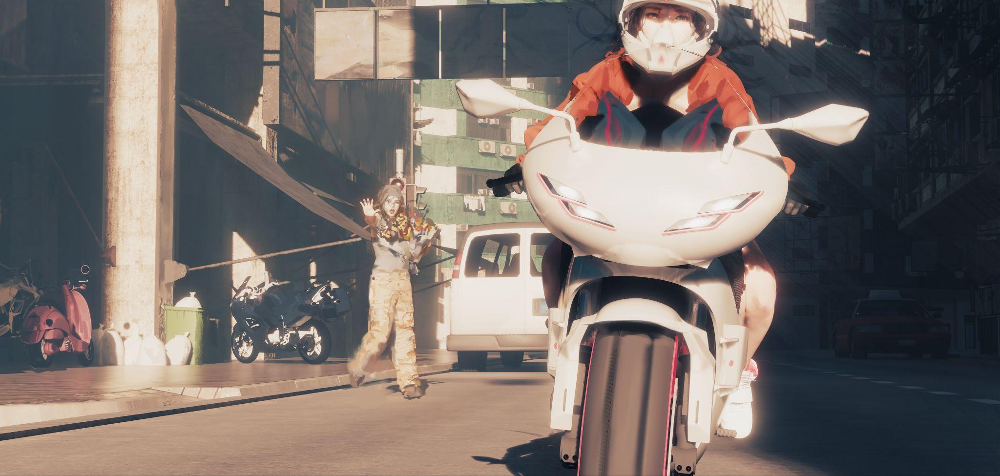

**VI**: “Ơ kìa? Nguyệt Nha Nhi, hoa này là cho chị đấy à? Khoan đã! Nguyệt Nha Nhi! Em nói thế là có ý gì hả? Nguyệt Nha Nhi! Em quay lại đây cho chị!”

**ZH**: “诶？月牙儿，这花是给我的？等等！月牙儿！你说这话什么意思啊？月牙儿！你给我回来！”

**EN**: “Hey? Mahina, are these flowers for me? Wait a second! Mahina! What do you mean by that? Mahina! Come back here!”

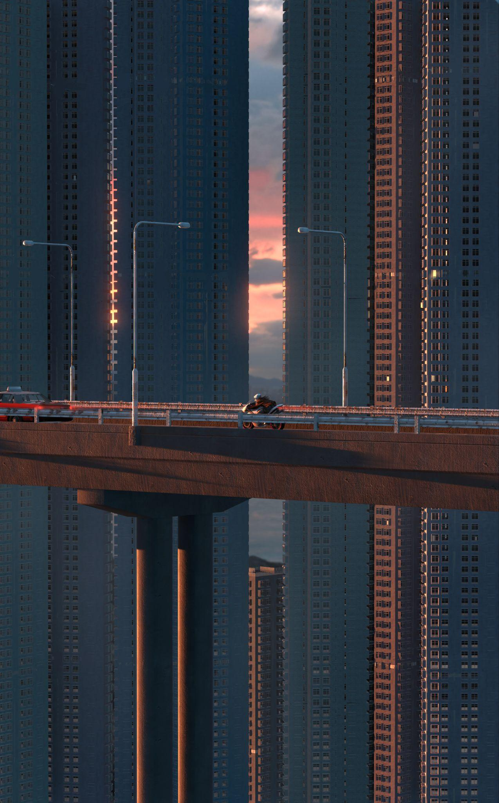

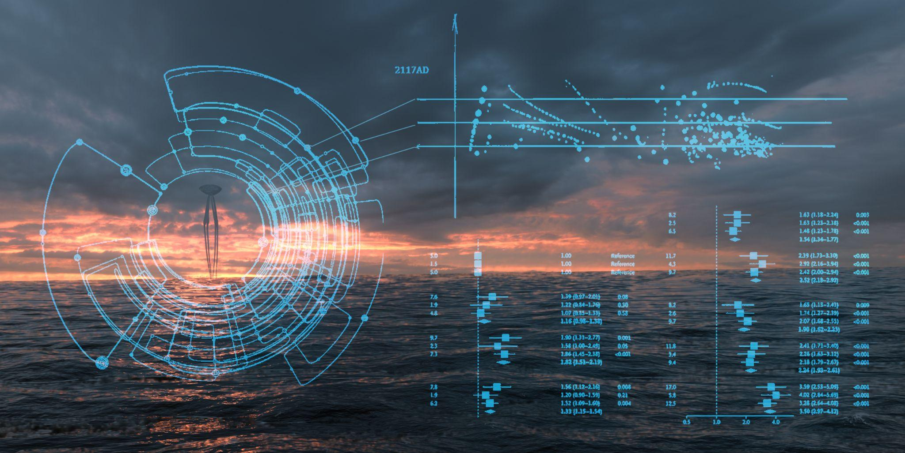

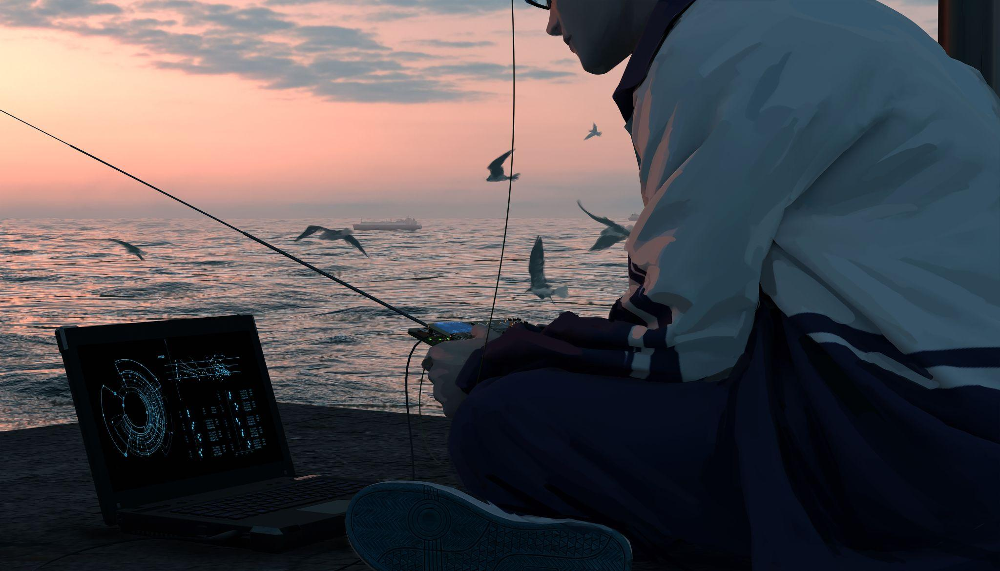

**VI**: “Cậu có biết không, nhảy xuống biển là cách chết mất thể diện nhất đấy. Nước biển lạnh buốt thấu xương như dao cứa, cả quá trình đau đớn chẳng khác nào bị lăng trì. Đến khi thi thể bị sóng đánh dạt vào bờ thì đã trương phềnh to gấp đôi, con ngươi trôi mất tiêu rồi, ngay cả mẹ ruột cậu cũng chẳng nhận ra nổi đâu—”

**ZH**: “你知道吗，跳海是最不体面的死法，海水冰冷刺骨宛如尖刀，整个过程不亚于凌迟，等你被冲上岸的时候身体会泡的足有两倍大，眼珠子都会被冲走，连你亲妈都认不出——”

**EN**: “You know, drowning at sea is the most undignified way to die. The water is bone-cold, like knives against your skin; the whole ordeal is no better than death by a thousand cuts. By the time you wash ashore, your body will have swollen to twice its size and even your eyes may be gone. Your own mother wouldn’t recognize you—”

**VI**: “Hả? Ai thèm nhảy biển chứ? Cậu bị thần kinh à, cậu là ai đấy hả! Học sinh cấp ba à? Nhóc con cấp ba không lo mà ôn thi đại học đi, chạy ra đây nghịch ngợm cái gì?”

**ZH**: “啊？谁要跳海了？神经病吧你你谁啊！高中生？小屁孩高中生不去准备高考，来这里玩啥呢？”

**EN**: “Huh? Who said anything about jumping into the sea? Are you out of your mind? Who even are you?A high school kid? Shouldn’t you be studying for the college entrance exam instead of hanging around here?”

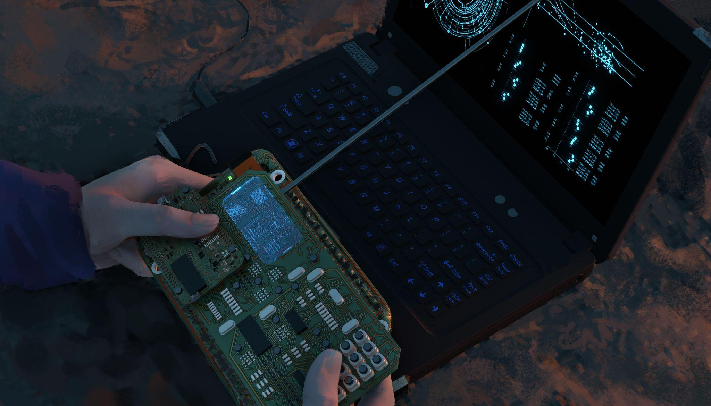

**VI**: “Tôi không cần thi đại học, đã được tuyển thẳng vào Viện Vật lý Đại học Bắc Kinh rồi. Với lại tôi cũng không rảnh rỗi ra đây chơi, tôi đang giúp đội ngũ của Giáo sư Bạch ở Bắc Đại đo đạc số liệu tới hạn của trường Vân Trùng.”

**ZH**: “我不用高考，已经保送北大物理学院了；还有我也不是在玩，我在帮北大白教授的团队测量云虫场的临界数据。”

**EN**: “I don’t need to take the college entrance exam; I’ve already been admitted to Peking University’s Physics Department. And I’m not just playing around—I’m helping Professor Bai’s team measure critical data about the CloudInsect field.”

**VI**: “Xì... Ghét nhất cái ngữ làm màu như mấy người...”

**ZH**: “切……最烦你们这种装x的……”

**EN**: “Ugh… I can’t stand people like you who act all high and mighty…”

**VI**: “Nguyệt Nha Nhi? Tên nghe đặc biệt thật đấy, tôi tên là Hi Dương. 'Hi' trong hy vọng, 'Dương' trong giương buồm ra khơi.”

**ZH**: “月牙儿？好特别的名字，我叫希扬，希望的希，扬帆的扬。”

**EN**: “Mahina? That’s an unusual name. I’m Suvan. The characters mean ‘hope’ and ‘set sail.’”

**VI**: “Hi Dương? Phụt... ha ha ha, cái tên nghe cổ lỗ sĩ thế! Sao cậu không đặt tên là Tịch Dương Hồng (Nắng Chiều Rực Rỡ) luôn đi cho hợp cảnh! Cậu cũng từ tỉnh Đông Giang tới đây à? Thế thì chúng mình cũng coi như nửa người đồng hương rồi đấy.”

**ZH**: “希扬？噗哈哈哈，好老气的名字，你怎么不叫夕阳红！多应景啊！所以你也是东江省来的？那我们也算半个老乡了。”

**EN**: “Suvan? Pfft—what an old-fashioned name. Why not call yourself ‘Sunset’? It would suit you perfectly!So you’re from Dongjiang Province too? Then I guess we’re almost from the same hometown.”

**VI**: “Ừ, quê tôi ở vùng nông thôn tỉnh Đông Giang, lên Sa Khê học cấp ba, năm nay là năm thứ ba rồi. Còn cậu?”

**ZH**: “嗯，我家里是东江省农村的，来沙市读高中，今年第三年了。你呢？”

**EN**: “Yeah, I’m from a rural area in Dongjiang Province. I’ve been studying in Shashi for three years now. What about you?”

**VI**: “Lên đại học tôi mới tới đây, được hai năm rồi. Cậu học cấp hai đã một thân một mình lên thành phố học trường chuyên, giờ lại còn được tuyển thẳng vào Bắc Đại. Gia đình cậu chắc hẳn tự hào về cậu lắm nhỉ.”

**ZH**: “我是读大学才来的，两年了。你中学就一个人来外地读重点高中，还保送北大。你的家人一定很为你骄傲吧。”

**EN**: “I came here for university two years ago. You came to a key high school all by yourself in a different city since middle school, and now you’re headed to Peking University. Your family must be really proud of you.”

**VI**: “Cậu không hiểu đâu, kỳ vọng quá mức của người khác đôi khi chính là lưỡi dao đoạt mạng đấy.”

**ZH**: “你不知道，过度的期待就是置人于死地的利剑。”

**EN**: “You don’t understand. Excessive expectations are a blade that can kill.”

**VI**: “Đúng là sướng mà không biết đường sướng.”

**ZH**: “真是身在福中不知福。”

**EN**: “You really don’t know how to appreciate what you have.”

**VI**: “Thế nên người ta mới bảo trên đời này làm gì có chuyện ai thấu cảm trọn vẹn cho ai, có người chịu lắng nghe mình nói đã là điều may mắn lắm rồi. Gia cảnh nhà tôi không khá giả, đi học xa nhà đều nhờ làng xóm gom góp cưu mang. Miệng người ta bảo là niềm tự hào của cả làng, nhưng áp lực kinh khủng lắm. Bắc Đại tuy cấp học bổng toàn phần cho tôi, nhưng sinh hoạt phí sau này ra Bắc Kinh vẫn phải tự mình tích cóp. Đo số liệu cho Giáo sư Bạch thật ra cũng chỉ là kiếm thêm chút đỉnh trang trải, công việc này nhàm chán vô cùng. Vé xe về quê thì ngày một đắt đỏ, Tết năm ngoái tôi còn chẳng dám về nhà. Còn cậu, bao lâu cậu về thăm bố mẹ một lần?”

**ZH**: “所以说这个世界上没有感同身受，有人倾听已是万幸。我家里条件不太好，来外地读书靠村里的资助。说是全村人的骄傲，其实压力很大。北大虽是给了我全额奖学金，但之后去北京的生活费还是得自己攒。给白教授测数据其实就是为了挣点外快，这活枯燥得很。回家的路费也越来越贵，去年过年都没回家。你呢，多久回去一次看爸妈？”

**EN**: “That’s why no one can ever truly feel another person’s pain. Having someone listen is already a blessing.My family doesn’t have much, and I rely on support from the village to study away from home. Everyone calls me the pride of the village, but the pressure is enormous. Peking University gave me a full scholarship, yet I still have to save for my living expenses in Beijing. I’m collecting data for Professor Bai to earn some extra money, and the work is painfully dull. Travel home keeps getting more expensive; I couldn’t even go back for New Year last year. What about you? How often do you visit your parents?”

**VI**: “Gia đình... Đã lâu lắm rồi tôi không còn khái niệm về hai chữ đó nữa. Từ hồi tôi còn rất nhỏ bố mẹ đã ly hôn rồi. Sau đó họ đều có gia đình mới, sinh thêm con cái, tôi nghiễm nhiên trở thành kẻ thừa thãi nhất. Tôi từng phải sống nhờ, chuyển qua chuyển lại nhà mấy người họ hàng. Mối liên hệ với bố mẹ cũng chỉ gói gọn trong khoản tiền sinh hoạt họ gửi hàng tháng. Cái ngày nhận giấy báo trúng tuyển Đại học Sa Khê có lẽ là ngày tôi hạnh phúc nhất trong đời, tôi chịu đủ cảnh ăn nhờ ở đậu, nhìn sắc mặt người khác mà sống rồi. Bây giờ tôi chỉ muốn tự lực cánh sinh, đi làm thêm ở tiệm đồ ăn nhanh, đi phát tờ rơi ngoài đường, đi hát ở quán bar... Miễn là không phải tiêu tiền của bố mẹ, không phải trông mặt họ hàng, việc gì tôi cũng làm hết.”

**ZH**: “家……我已经很久没有过这个概念了。我很小的时候父母就离婚了，后来他们又各自组建了家庭，有了孩子，我就变成了最多余的那一个了。辗转寄住过几个亲戚家。和父母的联系也就仅限于每月的生活费。考上沙市大学的那天可能是我人生中最开心的一天，我受够了寄人篱下的生活了。我现在只想自力更生，去快餐店打工，去大街上发传单，去酒吧唱歌，只要不再花父母的钱，不用看亲戚的脸色，干什么都行。”

**EN**: “Home… I haven’t had anything I could call that for a long time. My parents divorced when I was little. They each started another family and had more children, and I became the unwanted one. I was passed from one relative’s home to another. My only contact with my parents was the living allowance they sent each month.The day I got into Shashi University may have been the happiest day of my life. I was sick of living under other people’s roofs. Now I only want to support myself—work at a fast-food restaurant, hand out flyers, sing in bars. I’ll do anything, as long as I no longer have to take my parents’ money or live at my relatives’ mercy.”

**VI**: “Cậu vừa bảo đi hát ở đâu cơ?”

**ZH**: “你说去哪唱歌？”

**EN**: “Where did you say you sang before?”

**VI**: “Nhóc con, đừng có hỏi nhiều chuyện người lớn.”

**ZH**: “小屁孩，别问这么多。”

**EN**: “Hey, kid, don’t ask so many questions.”

**VI**: U u u ——

**ZH**: 呜——

**EN**: Wooo—

**VI**: U u u ——

**ZH**: 呜——

**EN**: Wooo—

**VI**: “Nghe kìa, là tiếng trùng ngâm đấy.”

**ZH**: “听，是虫鸣。”

**EN**: “Listen. That’s the CloudInsect’s call.”

**VI**: “Là tiếng trùng ngâm.”

**ZH**: “是虫鸣。”

**EN**: “The CloudInsect’s call.”

**VI**: “Nghe như tiếng trầm ngâm vậy.”

**ZH**: “像沉吟。”

**EN**: “Like a low chant.”

**VI**: “Là tiếng thở dài.”

**ZH**: “是叹息。”

**EN**: “It’s a sigh.”

**VI**: “Thở dài ư? Sao lại thế?”

**ZH**: “叹息？为什么？”

**EN**: “A sigh? Why?”

**VI**: “Tôi không biết, nhưng tôi có thể nghe ra được, đó chính là tiếng thở dài của nó.”

**ZH**: “我不知道，但我听得出来，那是它的叹息。”

**EN**: “I don’t know, but I can tell—it’s its sigh.”

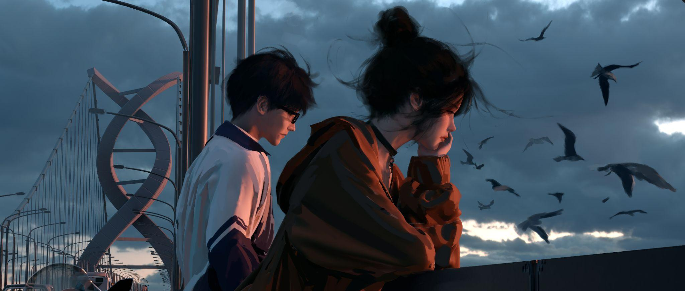

**VI**: “Nó vừa tới là tôi cảm thấy cả thế giới này đều đảo lộn, loạn cào cào hết cả lên. Những sinh viên tài ba, các học giả, giáo sư kiệt xuất như các cậu đã nghiên cứu ra được tiến triển gì chưa? Cậu đang đo đạc những số liệu gì thế?”

**ZH**: “它一来，我感觉整个世界都乱糟糟的，你们那么多厉害的高材生，学者，教授，研究出什么进展了吗？你测的这些是什么数据？”

**EN**: “It arrives, and I feel like the whole world is in chaos. With so many brilliant students, scholars, and professors, what progress have you made? What data are you measuring?”

**VI**: “Trường Vân Trùng đã làm nhân loại đau đầu bế tắc suốt hàng ngàn năm qua, đâu phải dễ dàng đạt được tiến triển. Năm ngoái, Giáo sư Vi bên Khoa Toán của Bắc Đại đã đưa ra một giả thuyết, cho rằng sự biến đổi của các hằng số vật lý trong trường Vân Trùng thay đổi tùy theo khoảng cách tính từ tâm Vân Trùng, thậm chí ông còn lập ra một biểu thức giải tích giữa hằng số dị biến và khoảng cách — tức là Phương trình trường Vân Trùng, gây chấn động cả giới học thuật. Hiện tại nhiều dữ liệu đo được khá khớp với phương trình này, nhưng vẫn còn rất nhiều điểm dị thường chưa thể giải thích nổi. Giáo sư Bạch, người hướng dẫn của tôi, đang dốc sức kiểm chứng phương trình trường Vân Trùng của 'Vi Thần', việc này đòi hỏi lượng dữ liệu khổng lồ. Chỗ tôi đang đo đạc chính là số liệu dị biến ở vùng rìa ngoài tiếp giáp ranh giới trường Vân Trùng. Đợi đến khi thực sự tiến sâu vào trong trường lực, các thiết bị điện tử đều tê liệt thì dữ liệu sẽ cực kỳ khó thu thập, tiến triển quả thực vô cùng mong manh.”

**ZH**: “云虫场困扰了人类几千年，哪是这么容易取得进展的。去年北大数学系的韦教授提出了一个猜想，认为云虫场内的常量异变是根据与云虫中心距离而改变的，还给出了异变常量和距离间的解析式，也就是云虫场方程，引发了学术界的轰动。目前已有的数据很多都能对的上这个方程，但也有不少坏点解释不了。我的导师白教授致力于验证韦神的云虫场方程，需要大量的数据。我现在测量的就是云虫场外围临近边界的那部分发生异变的数据。等真正进入了云虫场，仪器失效数据就不好测了，进展真的渺茫。”

**EN**: “The CloudInsect field has confounded humanity for thousands of years. Progress was never going to come easily.Last year, Professor Wei of Peking University’s Mathematics Department proposed that changes in physical constants within the CloudInsect field vary with distance from its center. He even derived an analytical relationship between those constants and distance—the CloudInsect field equation—which caused a sensation in academia.Much of the existing data fits the equation, but there are still many bad data points we cannot explain. My advisor, Professor Bai, is working to verify the legendary Professor Wei’s CloudInsect field equation, and that requires an enormous amount of data. I’m measuring the anomalous values in the outer region near the field boundary. Once we enter the field itself, the instruments will fail and the data will be much harder to collect. Progress is painfully slow.”

**VI**: “Nếu phương trình đó được chứng minh là đúng thật, thì sau đó sẽ ra sao?”

**ZH**: “如果真的验证了这个方程，之后又会怎样呢？”

**EN**: “If the equation is validated, what will happen next?”

**VI**: “Thì cũng mới chỉ là bước đi đầu tiên trong cuộc trường chinh vạn dặm thôi, nhưng ít nhất chúng ta có thể dựa vào phương trình để tái thiết kế các loại thiết bị thí nghiệm, ứng dụng ở các cự ly khác nhau so với Vân Trùng, từng bước mở chiếc hộp Pandora này ra. Quan điểm chủ lưu trong giới khoa học cho rằng Vân Trùng không phải sinh vật sống, mà chỉ là một cỗ máy cơ khí. Nhưng nền văn minh tạo ra nó chắc chắn vượt xa nhân loại chúng ta hàng triệu bậc. Siêu dẫn nhiệt độ phòng, phản ứng nhiệt hạch có thể kiểm soát, sự hủy diệt vật chất tối, truyền năng lượng bằng sóng hấp dẫn... Tất cả đều được suy đoán là đang tồn tại bên trong Vân Trùng. Chỉ cần hé mở được một góc của tảng băng chìm ấy thôi, cũng đủ để đẩy nền văn minh nhân loại tiến lên một bước dài.”

**ZH**: “也只算走出了万里长征的第一步，但至少我们可以根据方程重新设计各类实验仪器，在距云虫不同距离下使用，慢慢打开这个潘多拉魔盒。科学界主流看法认为云虫不是生物体，而只是一个机械体。但它的制造者一定远超我们人类的文明。常温超导，可控核聚变，暗物质湮灭，引力波能量传输等等都被推测在云虫内部存在。只要能揭秘其冰山一角，就足以推动人类文明往前走一大步。”

**EN**: “It would only be the first step in a journey of ten thousand miles. But at least the equation would let us redesign instruments for use at different distances from a CloudInsect and slowly pry open Pandora’s box.The prevailing view is that CloudInsects are machines, not living organisms. But their makers must belong to a civilization far beyond ours. Room-temperature superconductivity, controlled nuclear fusion, dark-matter annihilation, gravitational-wave energy transmission—all are believed to exist inside a CloudInsect. Revealing even the tip of that iceberg would be enough to carry human civilization a great step forward.”

**VI**: “Thế sao? Những kẻ đầu tiên nắm giữ được công nghệ đó liệu có chịu chia sẻ cho người khác không? Hay nó sẽ chỉ trở thành thứ vũ khí để một nhóm người đi bóc lột và đàn áp một nhóm người khác? Hi Dương, đã bao giờ cậu tự hỏi, sự phát triển của khoa học công nghệ hiện nay rốt cuộc đang khiến nhân loại trở nên văn minh hơn, hay ngày càng dã man hơn không?”

**ZH**: “是吗？首先掌握这些技术的人会分享给其它人吗？还是只是成为某个群体收割打压另一个群体的武器？希扬，你有没有想过，现在科技的发展，是让人类变得更文明还是更野蛮？”

**EN**: “Really? Would the first people to master those technologies share them with everyone else? Or would they turn them into weapons for one group to exploit and suppress another?Suvan, have you ever wondered whether technological progress is making humanity more civilized—or more barbaric?”

**VI**: “Cảm giác cậu chán đời ghê gớm nhỉ, ban nãy không phải cậu muốn nhảy thật đấy chứ?”

**ZH**: “感觉你很厌世啊，刚刚不会是真想跳吧？”

**EN**: “Sounds like you’re feeling pretty nihilistic. You weren’t actually thinking about jumping, were you?”

**VI**: “Cậu yên tâm đi, trên đời này còn bao nhiêu món ngon tôi chưa được ăn, bao nhiêu quần áo đẹp tôi chưa được mặc, bao nhiêu nơi vui vẻ tôi chưa từng đặt chân tới, tôi còn lâu mới chịu chết nhé. Cuộc đời dài như thế, kiểu gì chẳng gặp phải vài kẻ khốn nạn. Tôi yêu cuộc sống này lắm, chỉ là tôi không thích thế giới xô bồ, vô vị và ồn ào này thôi.”

**ZH**: “你放心，还有那么好吃的没吃过，那么多好看的衣服没穿过，那么多好玩的地方没去过，我才舍不得死呢。人生那么长，总能遇到几个混蛋的。我热爱生命，只是不太喜欢这个世界，无趣又吵闹。”

**EN**: “Don’t worry, there’s still so much delicious food I haven’t tried, so many beautiful clothes I haven’t worn, and countless fun places I haven’t visited. I wouldn’t want to miss out on life. Life is long, and I’ll surely run into a few jerks along the way. I love life; I just don’t like this world—it’s dull and noisy.”

**VI**: “Thắc mắc của cậu tôi cũng từng nghĩ qua rồi. Nhưng khát vọng khám phá và trí tò mò trước những điều chưa biết vốn đã được khắc sâu vào chuỗi xoắn DNA của nhân loại rồi. Cho dù Vân Trùng thực sự là chiếc hộp tai họa Pandora đi chăng nữa, thì khi nó bày ra ngay trước mắt, tôi tin chẳng có ai có thể cưỡng lại được sự thôi thúc muốn mở nó ra đâu.”

**ZH**: “你的疑问我也有想过。但对未知的探索欲和好奇是被刻在人类DNA里的。即便云虫真的是一个潘多拉的魔盒，当它真正摆到我们面前时，也没有人能拒绝打开它吧。”

**EN**: “I’ve thought about your question too. But the desire for exploration and curiosity about the unknown are etched into our DNA. Even if the CloudInsect is truly a Pandora’s box, when it’s presented to us, I don’t think anyone could resist opening it.”

**VI**: “Tôi cũng tò mò, nhưng không phải tò mò về mấy thứ công nghệ hay phương trình cao siêu kia. Tôi tò mò là nếu Vân Trùng thực sự là thực thể vượt xa nền văn minh nhân loại như lời cậu nói, thì tại sao nó lại phải dựng lên một cái lồng chụp để chắn mình lại, ngăn cản con người nghiên cứu nó làm gì?”

**ZH**: “我也好奇，但不是对那些什么技术和方程，我好奇的是如果云虫真如你所说是远高于人类文明的存在，那它为什么还要设置一个罩子把自己罩起来阻碍人类研究它呢？”

**EN**: “I’m curious too, but not about those technologies and equations. I’m curious about why, if the CloudInsect is indeed a being far beyond human civilization, it would set up a barrier to block our research.”

**VI**: “Thế cậu nghĩ lý do là vì sao?”

**ZH**: “你觉得是为什么呢？”

**EN**: “Why do you think that is?”

**VI**: “Có khi là do con người chúng ta tự mình đa tình thôi. Chúng ta chẳng thể nào hiểu nổi mục đích của Vân Trùng, cũng giống như lũ sâu bọ chẳng bao giờ hiểu được suy nghĩ của con người vậy.”

**ZH**: “可能是我们人类自作多情了。我们没法理解云虫的目的，就像虫子没法理解我们。”

**EN**: “Maybe we’re flattering ourselves. We can’t understand a CloudInsect’s purpose, just as insects can’t understand ours.”

**VI**: “Có lẽ là thế thật. Vân Trùng đã tồn tại hàng vạn năm nay rồi, chúng ta mới chính là giống loài hạ đẳng đáng thương.”

**ZH**: “也许吧，云虫都存在数万年了，我们才是可怜的低等生物。”

**EN**: “Maybe. The CloudInsect has existed for tens of thousands of years; we’re the pathetic, lower beings.”

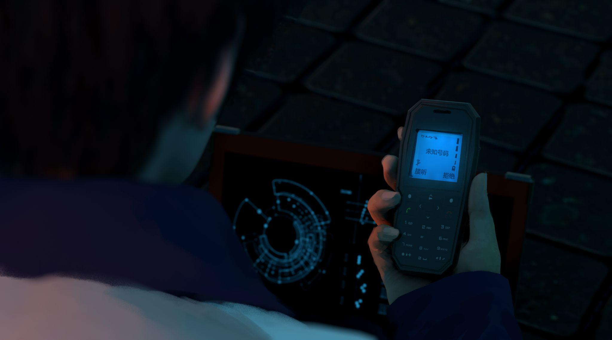

**VI**: “Rõ ràng trên cầu này làm gì có sóng, sao lại có cuộc gọi đến thế này, mà còn không hiện số nữa chứ... Trường Vân Trùng đã bắt đầu tác động làm nhiễu sóng điện từ rồi.”

**ZH**: “这桥上明明没信号，怎么接到个电话，还没号码……云虫场已经开始影响电磁信号了。”

**EN**: “There's clearly no signal on this bridge. How did I get a call with no number…? The CloudInsect field is already affecting electromagnetic signals.”

**VI**: “Cậu dùng cái điện thoại từ thời cổ đại nào thế kia, cơ mà nhìn lại thấy hợp với cái tên của cậu ra phết đấy.”

**ZH**: “你这是什么朝代的手机，倒是和你的名字很配。”

**EN**: “What kind of ancient phone are you using? It really suits your name.”

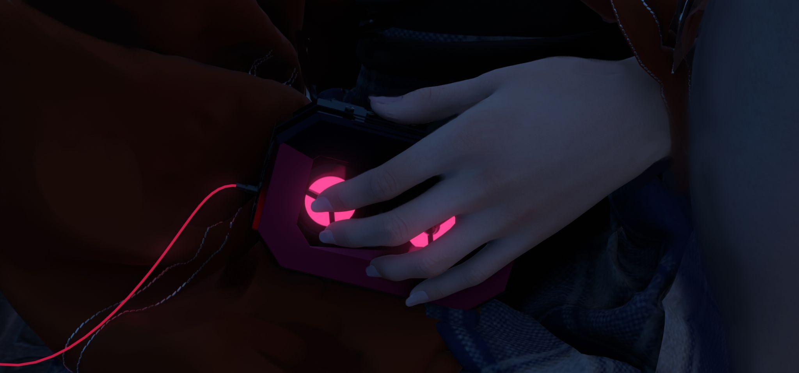

**VI**: “Cậu cũng có hơn gì tôi đâu, cái máy cát-xét nghe nhạc của cậu chắc thời điểm khai quật cũng chẳng muộn hơn cái điện thoại của tôi là mấy đâu nhỉ. Thời buổi nào rồi mà cậu vẫn còn nghe băng cát-xét thế?”

**ZH**: “你也好不到哪去，你这随身听出土时间不会比我的手机晚吧，什么年代了，还听卡带？”

**EN**: “You’re no better. Your cassette player looks as if it was unearthed no later than my phone. What century are we in, and you’re still listening to tapes?”

**VI**: “Có lẽ, về bản chất chúng ta là cùng một kiểu người đấy.”

**ZH**: “也许，我们本质上是同类人吧。”

**EN**: “Maybe, at our core, we’re kindred spirits.”

**VI**: “Là cùng một kiểu người nhưng bị đặt vào những hoàn cảnh sống khác nhau.”

**ZH**: “被赋予了不同的境遇的同类人。”

**EN**: “Kindred spirits with different circumstances.”

**VI**: “Ừm.”

**ZH**: “嗯。”

**EN**: “Yeah.”

**VI**: “Thế thì tôi đoán, bài hát mà 'người cùng hội cùng thuyền' với tôi đang nghe lúc này, chắc chắn là bài từ thế kỷ trước rồi.”

**ZH**: “那我猜，我这个同类现在听的歌，一定是上个世纪的。”

**EN**: “Then I bet the song my kindred spirit is listening to must be from the last century.”

**VI**: “Này, nghe đi.”

**ZH**: “给。”

**EN**: “Here you go.”

**VI**: [Lời bài hát] “Sợ rằng bi kịch sẽ lại tái diễn,

**ZH**: [歌曲]“害怕悲剧重演

**EN**: [Lyrics]“Afraid the tragedy will happen again,

**VI**: [Lời bài hát] Số mệnh của tôi ơi, số mệnh...

**ZH**: [歌曲]我的命中命中

**EN**: [Lyrics]My fate, my fate—

**VI**: [Lời bài hát] Càng là thứ đẹp đẽ, tôi lại càng không thể chạm vào.”

**ZH**: [歌曲]越美丽的东西我越不可碰“

**EN**: [Lyrics]The more beautiful a thing, the less I am allowed to touch it.”

**VI**: “Quả nhiên là một bài hát xưa thật đấy.”

**ZH**: “果然好老的歌。”

**EN**: “Definitely an old song.”

**VI**: “Ừm, tôi thích giai điệu mộc mạc của thời kỳ đó. Khi ấy, bố mẹ tôi vẫn còn ở bên nhau.”

**ZH**: “嗯，我喜欢那个年代的声音。那个时候，我父母还在一起。”

**EN**: “Yeah, I love the sound from that era.Back then, my parents were still together.”

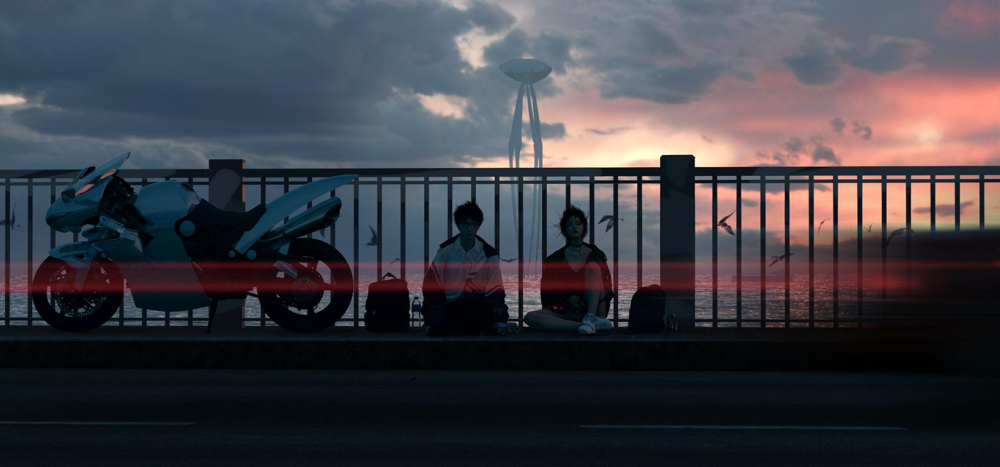

**VI**: [Lời bài hát] “Điều gì tôi cũng đều có linh cảm trước,

**ZH**: [歌曲]“什么我都有预感

**EN**: [Lyrics]“I have a premonition of everything,

**VI**: [Lời bài hát] Rồi chẳng dám mở mắt nhìn định mệnh giáng lâm,

**ZH**: [歌曲]然后睁不开两眼看命运光临

**EN**: [Lyrics]Then I can't open my eyes to see fate arrive,

**VI**: [Lời bài hát] Rồi trên bầu trời, từng tầng mây đen lại cuồn cuộn dâng trào...”

**ZH**: [歌曲]然后天空又再涌起密云”

**EN**: [Lyrics]And the sky once again surges with dark clouds.”

**VI**: —— Vương Phi, ca khúc "Ám Dũng" (1997)

**ZH**: ——王菲《暗涌》（1997）

**EN**: — Faye Wong, “Undercurrent” (1997)

**VI**: Có những khúc ca, chỉ nghe khúc dạo đầu đã thấy ấm áp.

**ZH**: 有些歌，光听前奏就觉得温暖，

**EN**: Some songs feel warm just from the intro.

**VI**: Có những người, chỉ cần được gặp gỡ đã thấy ngập tràn niềm vui.

**ZH**: 有些人，光是相遇就觉得开心。

**EN**: Some people bring joy just by meeting them.
