# 云虫 - 第一章 希扬

---

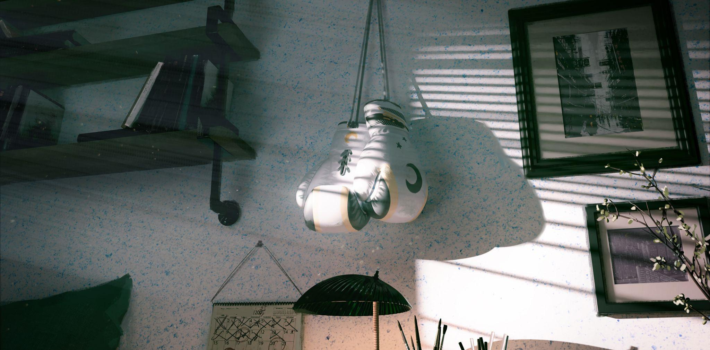

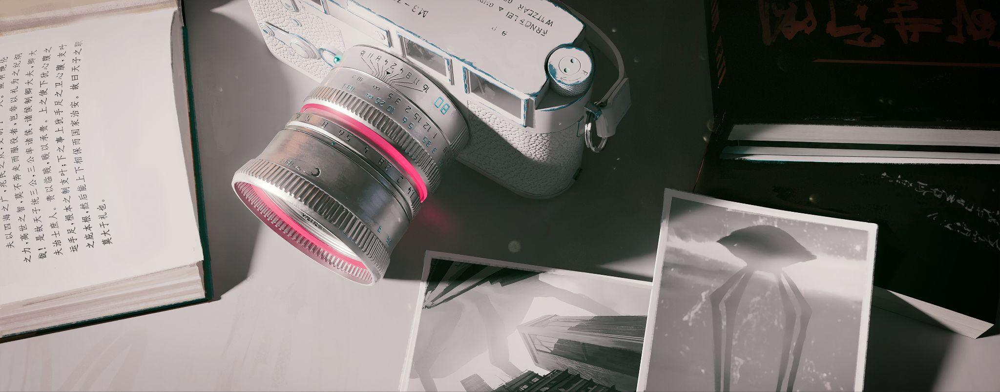

> [书籍]断代史：春秋

> [胶片相机]

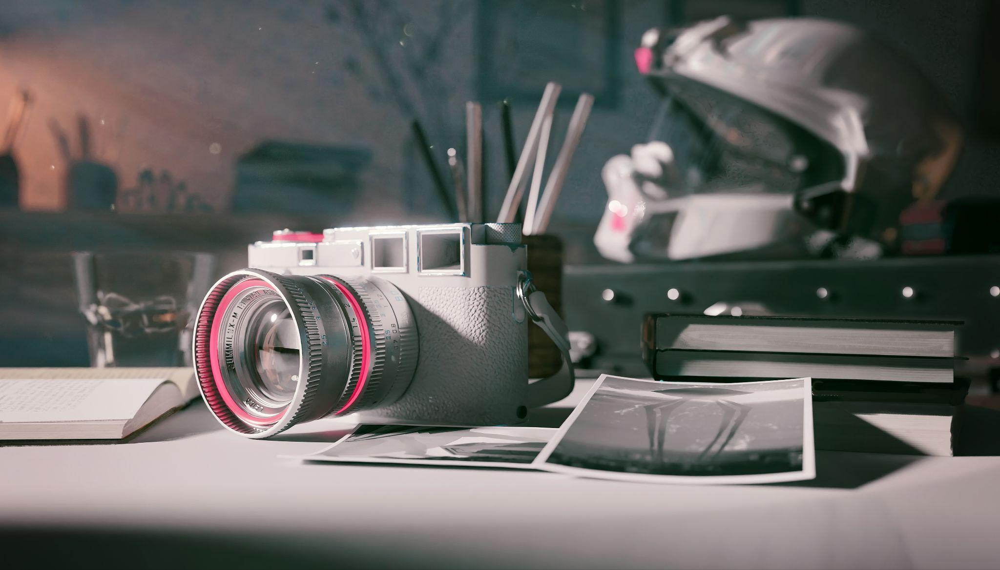

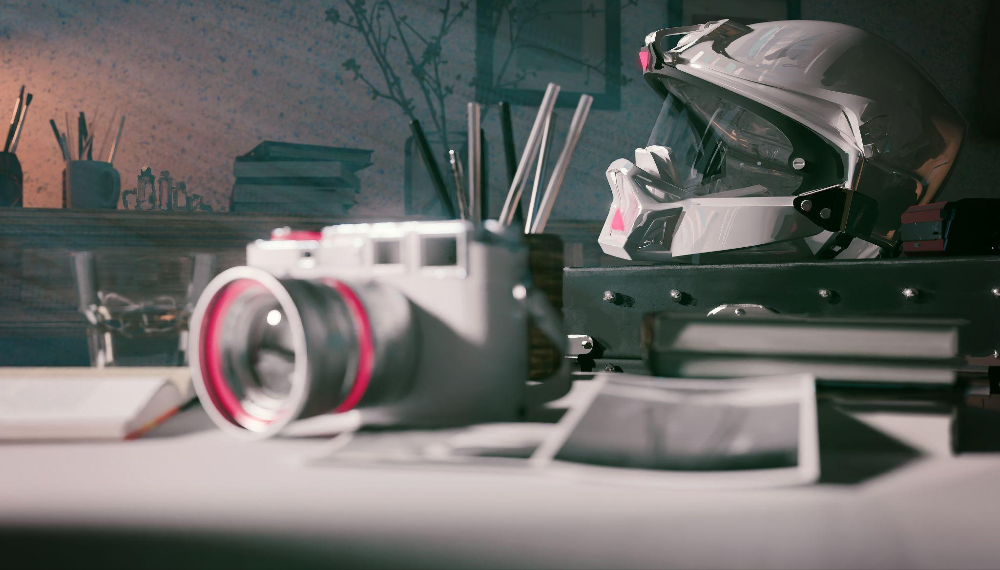

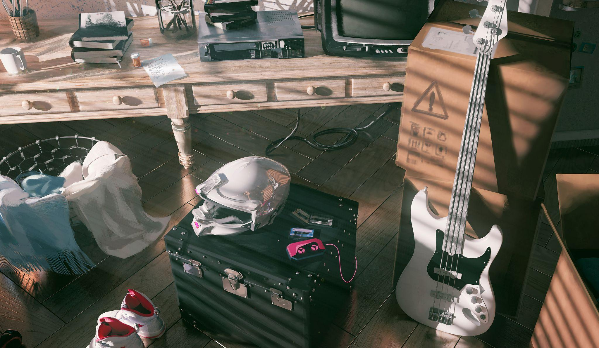

> [书籍]罗马帝国

> [书籍]小提琴谱

> [书籍]世界文明简史

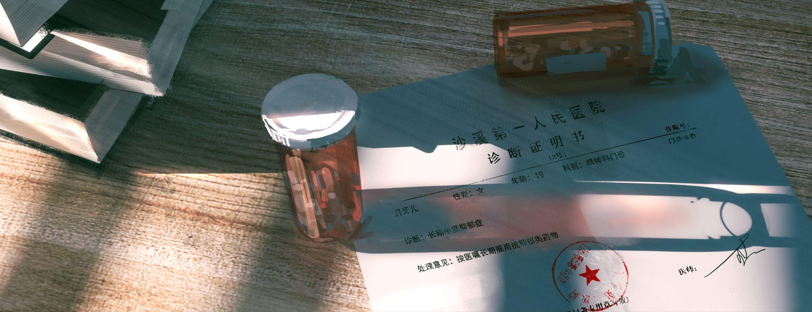

> [药瓶]艾司西酞普兰(抗抑郁药物)

> [诊断书]姓名：月牙儿

> [诊断书]性别：女

> [诊断书]年龄：19

> [诊断书]科别：精神科门诊

> [诊断书]诊断：长期中度抑郁症

> [诊断书]处理意见：按医嘱长期服用抗抑郁类药物

> 咚咚咚

> “来了，稍等。”

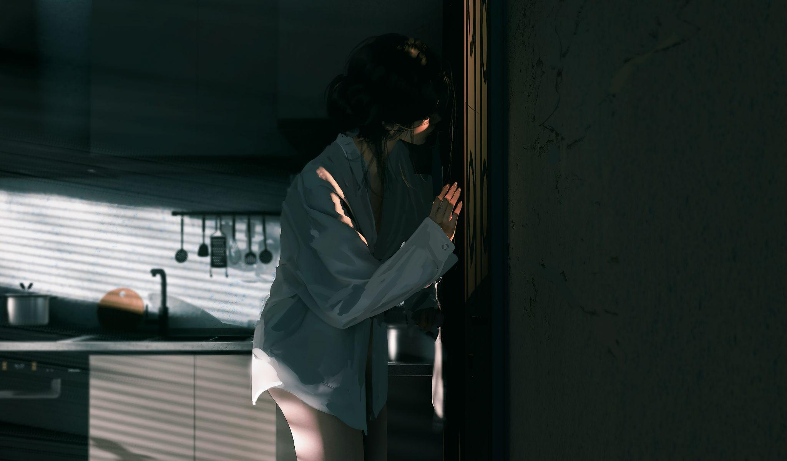

> “李伯啊，什么事？”

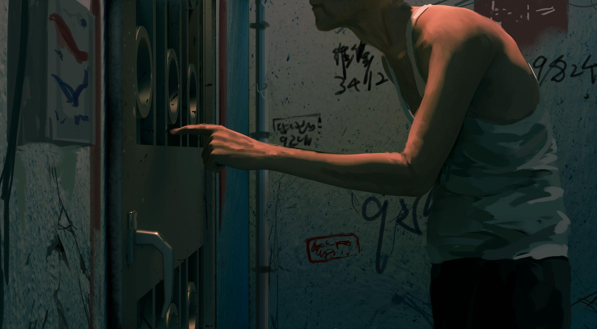

> “月牙儿，还没搬走啊，这都几号了！”

> “李伯，再迟几天行么？我东西多，打包需要不少时间。而且现在外面找房子租也没那么快……”

> “不行不行！都提早那么多天通知你了！不是我赶你走，这片区域靠近云虫落脚点，政府要求所有人都按时提前撤离的，这两天已经有人来催了，迟了要交罚款的你知不知道！”

> “李伯，这也还没到政府要求的期限啊，就算罚款也是罚租客，罚不到您头上—— 我看您是怕顶层搭的违建凉棚被查到吧？”

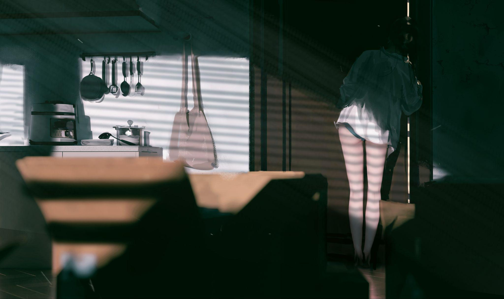

> “你瞎讲！哪里有违建！我那棚都搭了十几年了！你叫他们来查，来查！哼哼……反正你明晚前必须搬走，不然我就给你断水断电！”

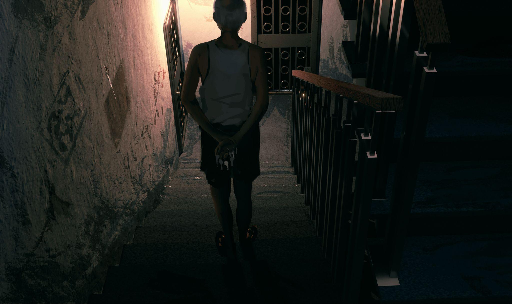

> “哼……现在的大学生，不像话！”

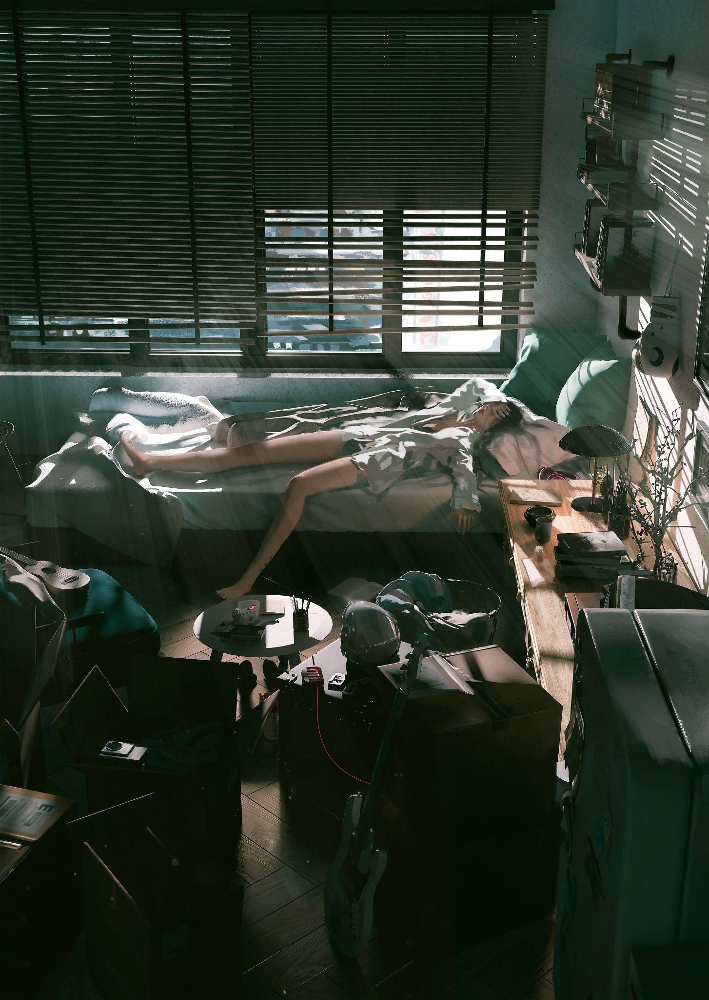

> “唉，好烦啊——”

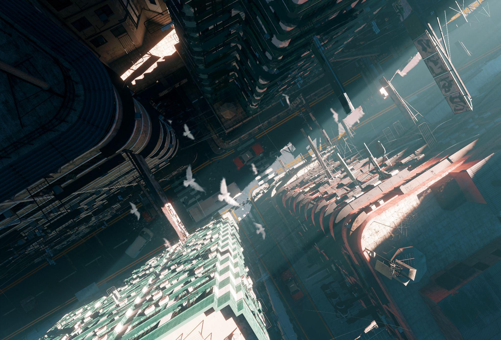

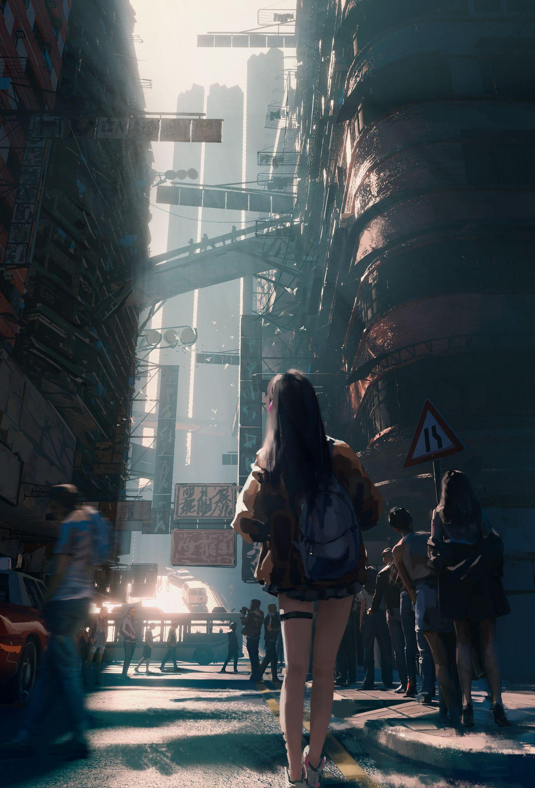

> [职员]阿姨，您这卡今天已经超过取款限额了，所以取不出来，不是机器的问题。

> [民众]取不出来？我自己的钱为什么取不出来！这云虫一来，你们银行电一断，我这几十万不就全没了！现在什么都是电子的，一点都不安全！

> [职员]不会的阿姨，只是云虫经过的这几个星期暂停电子业务而已，之后就会恢复正常的，您的钱也不会丢。

> [民众]前面取钱的能快点吗？后面排了那么长的队了！

> [商业]小姐，桥南区的公寓了解一下？云虫期特价，业主急走！

> [宗教]不要被嘈杂之景蒙蔽双眼，云虫乃我们天母的使者，降临至此，审判众生。让我们潜心祈祷，寻求天母的庇护！云虫教会欢迎您的加入！

> [商贩]特价蜡烛和冷光棒，20块一打，数量有限，明天加价！

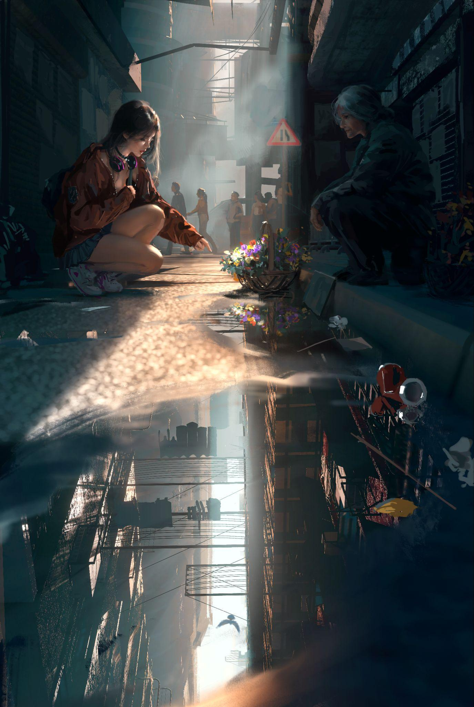

> “阿婆，这花怎么卖？”

> “5毛钱一支，你要喜欢的话就拿几枝走吧，反正今天也卖不完了。大家都忙着屯盐和蜡烛，孩子，你还是赶紧去对面超市买些吧，卖完了得等明天了。”

> “为什么要屯盐？”

> “我也不知道，大家都在抢，应该是有用的吧。”

> “阿婆，这些花，全卖我吧。”

> “啊？全部？”

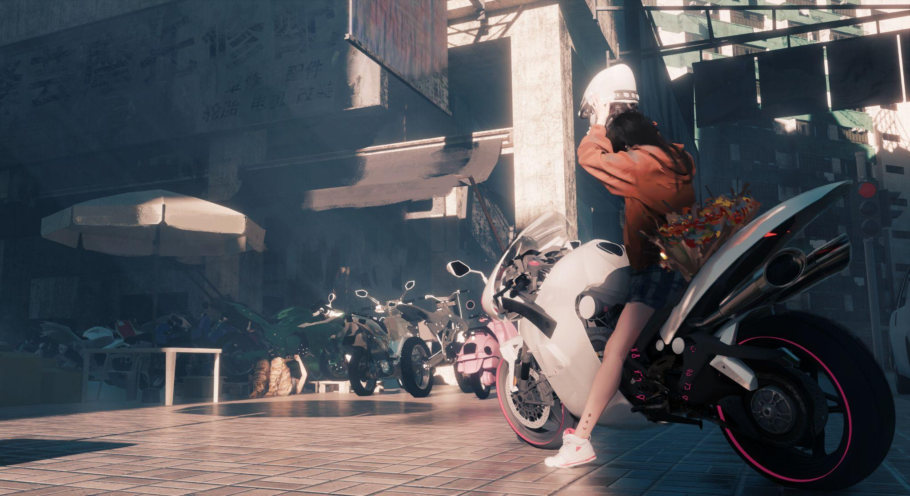

> [店铺]峰芸摩托修配

> “芸姐！”

> “哟，月牙儿，这阵子玩失踪呢？电话也不接！”

> “最近单子很多吗，芸姐，这么多车？”

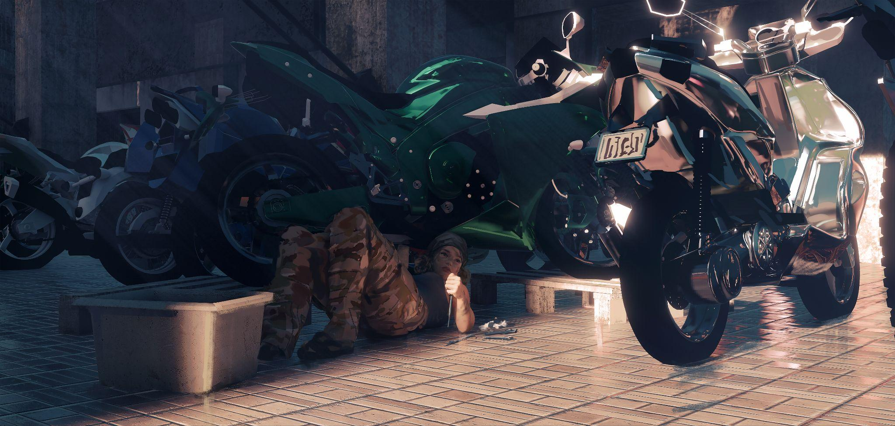

> “是啊，云虫一来，这些电子仪表的车全不能上路，都来改机械仪表盘，还有车灯也要改，这几天快把我这条老腰给干废了。你的车也要改吗？我可以先帮你弄哦。”

> “不用，你忘了我有云虫场内的驾照么，我这车本来就是全机械的。我不喜欢那些电子的东西。”

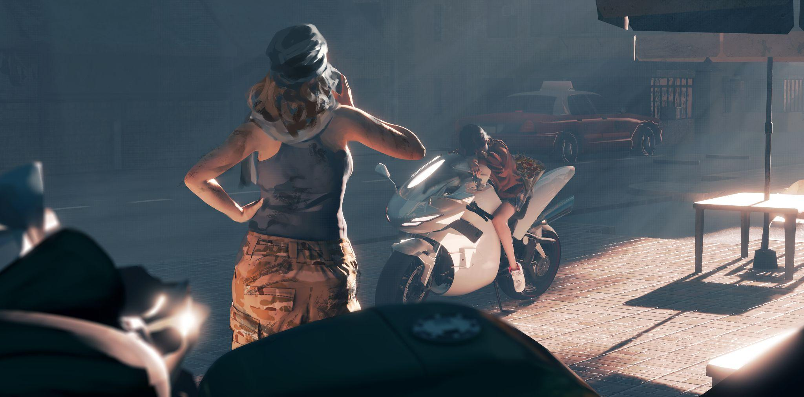

> “对了，月牙儿，刀魂酒吧的王老板来了好几次电话，找你去驻唱呢，说打不通你电话，你是不是把人家拉黑了？”

> “是的，我不想去那种地方了。”

> “啊呀月牙儿你这瓜娃子，人家正规酒吧，王老板人也挺厚道，说要再给你加多少多少的报酬，还要给你配私人保镖。前几次你去唱完，好多客人都对你念念不忘，王老板等你回去给他撑场面呢。你说你天生好嗓子，又生得一副挠人的小模样，老天爷赏饭吃，唱一晚上歌都顶的上我忙活个把月了，像我这种只能干粗活的真是羡慕都羡慕不来……咦？怎么又把脸弄花了，叫你别去玩那些危险的运动了。”

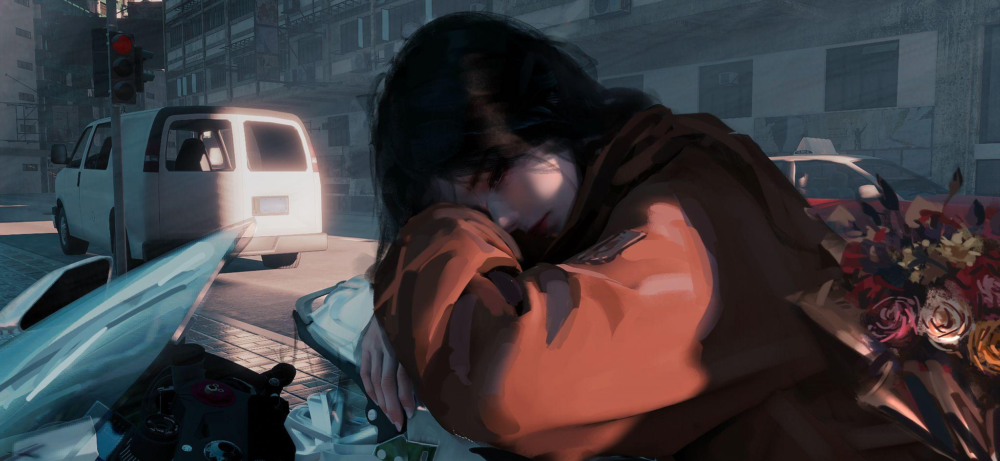

> “芸姐你别再说了，不是针对王老板，他酒吧也没问题。只是……也不知道为什么，越是在热闹的地方，我就越觉得孤单沮丧。”

> “怎么了月牙儿？是不是你那些同学又在背后闲言碎语了？”

> “芸姐，我这次来其实就是想看看你。”

> “我有什么好看的，这满身油污的……”

> “谢谢你这几年来对我的照顾，芸姐。”

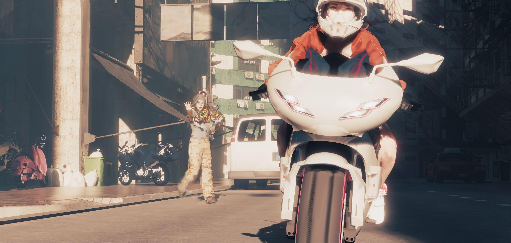

> “诶？月牙儿，这花是给我的？等等！月牙儿！你说这话什么意思啊？月牙儿！你给我回来！”

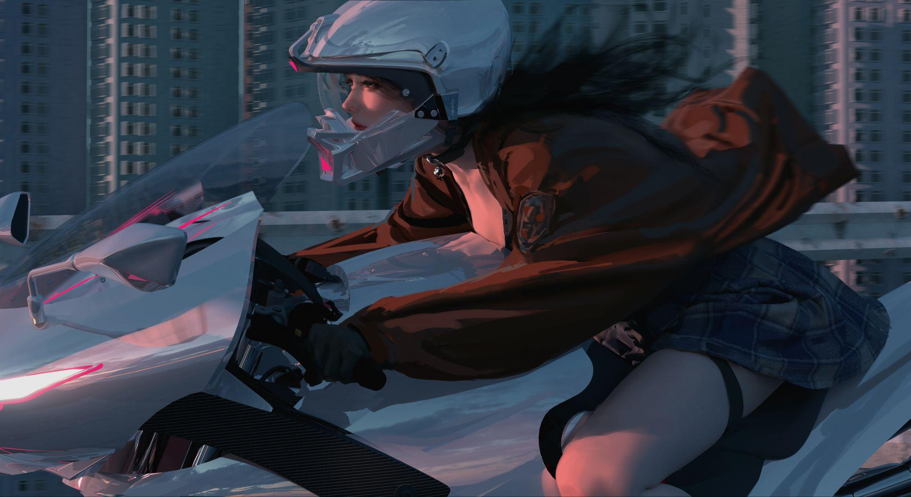

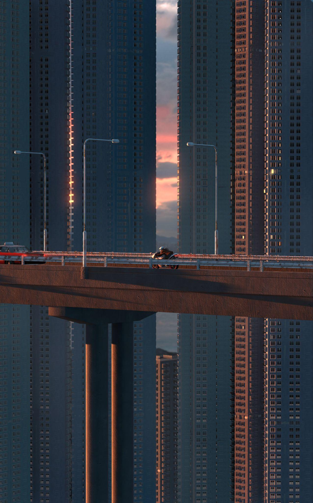

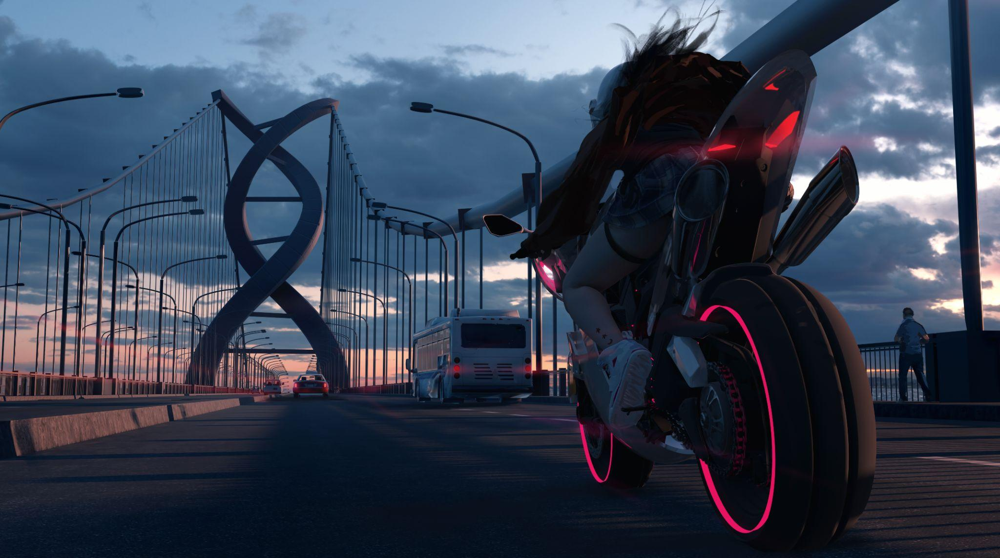

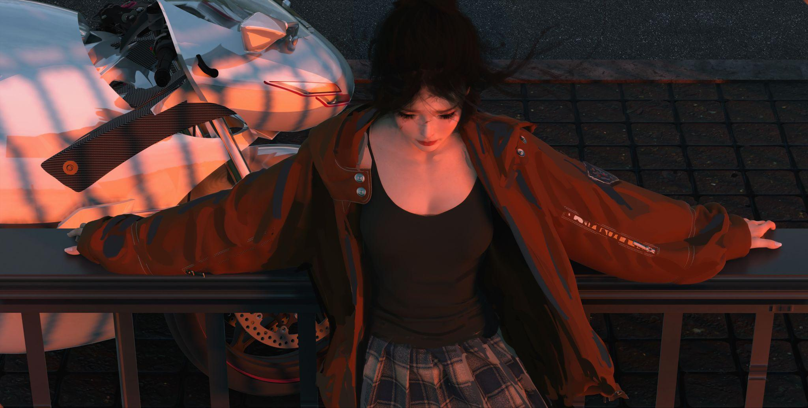

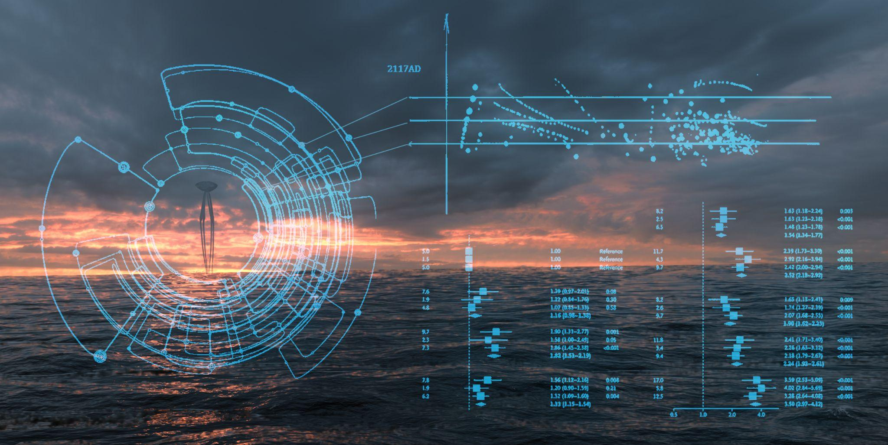

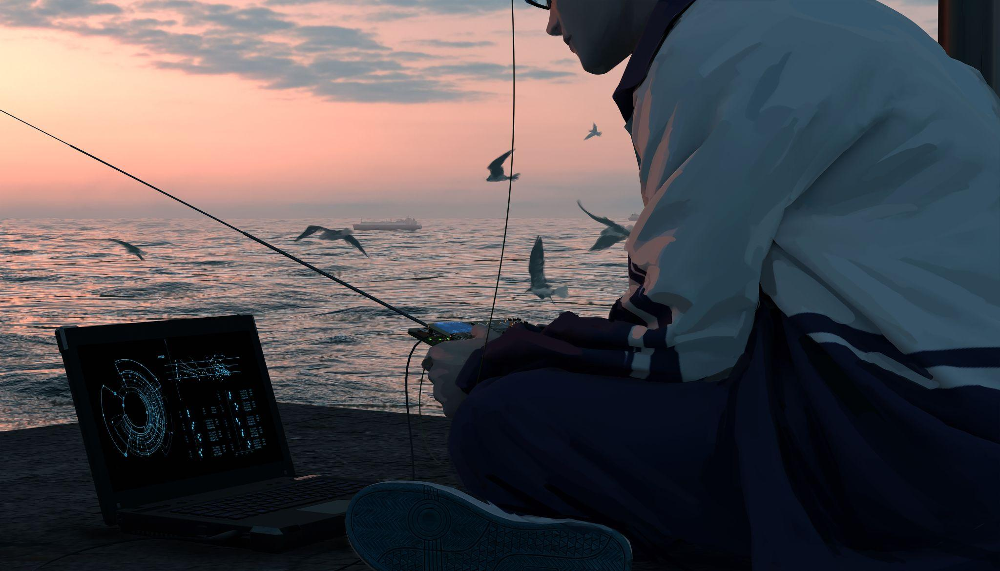

> “你知道吗，跳海是最不体面的死法，海水冰冷刺骨宛如尖刀，整个过程不亚于凌迟，等你被冲上岸的时候身体会泡的足有两倍大，眼珠子都会被冲走，连你亲妈都认不出——”

> “啊？谁要跳海了？神经病吧你你谁啊！高中生？小屁孩高中生不去准备高考，来这里玩啥呢？”

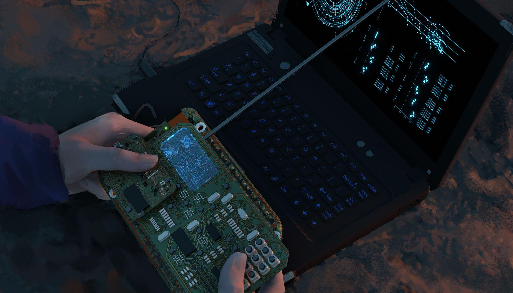

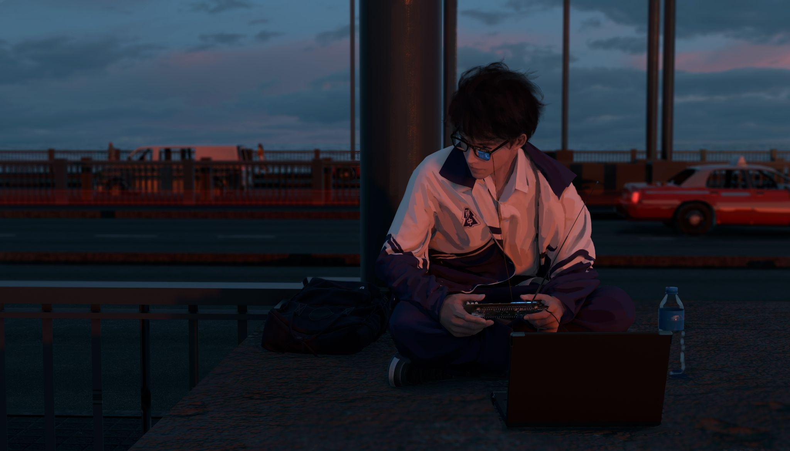

> “我不用高考，已经保送北大物理学院了；还有我也不是在玩，我在帮北大白教授的团队测量云虫场的临界数据。”

> “切……最烦你们这种装x的……”

> “月牙儿？好特别的名字，我叫希扬，希望的希，扬帆的扬。”

> “希扬？噗哈哈哈，好老气的名字，你怎么不叫夕阳红！多应景啊！所以你也是东江省来的？那我们也算半个老乡了。”

> “嗯，我家里是东江省农村的，来沙市读高中，今年第三年了。你呢？”

> “我是读大学才来的，两年了。你中学就一个人来外地读重点高中，还保送北大。你的家人一定很为你骄傲吧。”

> “你不知道，过度的期待就是置人于死地的利剑。”

> “真是身在福中不知福。”

> “所以说这个世界上没有感同身受，有人倾听已是万幸。我家里条件不太好，来外地读书靠村里的资助。说是全村人的骄傲，其实压力很大。北大虽是给了我全额奖学金，但之后去北京的生活费还是得自己攒。给白教授测数据其实就是为了挣点外快，这活枯燥得很。回家的路费也越来越贵，去年过年都没回家。你呢，多久回去一次看爸妈？”

> “家……我已经很久没有过这个概念了。我很小的时候父母就离婚了，后来他们又各自组建了家庭，有了孩子，我就变成了最多余的那一个了。辗转寄住过几个亲戚家。和父母的联系也就仅限于每月的生活费。考上沙市大学的那天可能是我人生中最开心的一天，我受够了寄人篱下的生活了。我现在只想自力更生，去快餐店打工，去大街上发传单，去酒吧唱歌，只要不再花父母的钱，不用看亲戚的脸色，干什么都行。”

> “你说去哪唱歌？”

> “小屁孩，别问这么多。”

> 呜——

> 呜——

> “听，是虫鸣。”

> “是虫鸣。”

> “像沉吟。”

> “是叹息。”

> “叹息？为什么？”

> “我不知道，但我听得出来，那是它的叹息。”

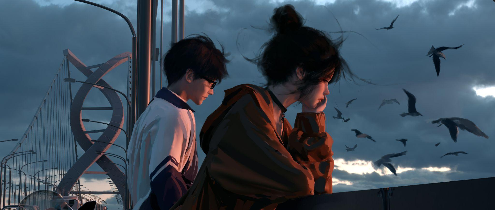

> “它一来，我感觉整个世界都乱糟糟的，你们那么多厉害的高材生，学者，教授，研究出什么进展了吗？你测的这些是什么数据？”

> “云虫场困扰了人类几千年，哪是这么容易取得进展的。去年北大数学系的韦教授提出了一个猜想，认为云虫场内的常量异变是根据与云虫中心距离而改变的，还给出了异变常量和距离间的解析式，也就是云虫场方程，引发了学术界的轰动。目前已有的数据很多都能对的上这个方程，但也有不少坏点解释不了。我的导师白教授致力于验证韦神的云虫场方程，需要大量的数据。我现在测量的就是云虫场外围临近边界的那部分发生异变的数据。等真正进入了云虫场，仪器失效数据就不好测了，进展真的渺茫。”

> “如果真的验证了这个方程，之后又会怎样呢？”

> “也只算走出了万里长征的第一步，但至少我们可以根据方程重新设计各类实验仪器，在距云虫不同距离下使用，慢慢打开这个潘多拉魔盒。科学界主流看法认为云虫不是生物体，而只是一个机械体。但它的制造者一定远超我们人类的文明。常温超导，可控核聚变，暗物质湮灭，引力波能量传输等等都被推测在云虫内部存在。只要能揭秘其冰山一角，就足以推动人类文明往前走一大步。”

> “是吗？首先掌握这些技术的人会分享给其它人吗？还是只是成为某个群体收割打压另一个群体的武器？希扬，你有没有想过，现在科技的发展，是让人类变得更文明还是更野蛮？”

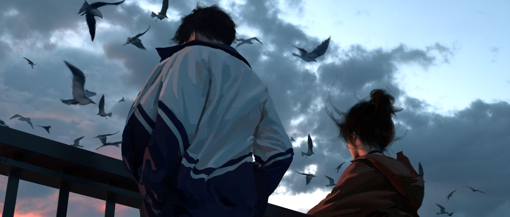

> “感觉你很厌世啊，刚刚不会是真想跳吧？”

> “你放心，还有那么好吃的没吃过，那么多好看的衣服没穿过，那么多好玩的地方没去过，我才舍不得死呢。人生那么长，总能遇到几个混蛋的。我热爱生命，只是不太喜欢这个世界，无趣又吵闹。”

> “你的疑问我也有想过。但对未知的探索欲和好奇是被刻在人类DNA里的。即便云虫真的是一个潘多拉的魔盒，当它真正摆到我们面前时，也没有人能拒绝打开它吧。”

> “我也好奇，但不是对那些什么技术和方程，我好奇的是如果云虫真如你所说是远高于人类文明的存在，那它为什么还要设置一个罩子把自己罩起来阻碍人类研究它呢？”

> “你觉得是为什么呢？”

> “可能是我们人类自作多情了。我们没法理解云虫的目的，就像虫子没法理解我们。”

> “也许吧，云虫都存在数万年了，我们才是可怜的低等生物。”

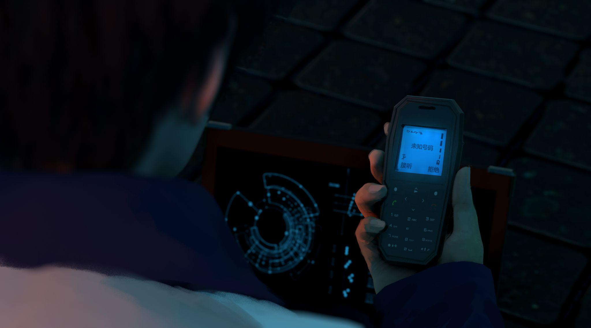

> “这桥上明明没信号，怎么接到个电话，还没号码……云虫场已经开始影响电磁信号了。”

> “你这是什么朝代的手机，倒是和你的名字很配。”

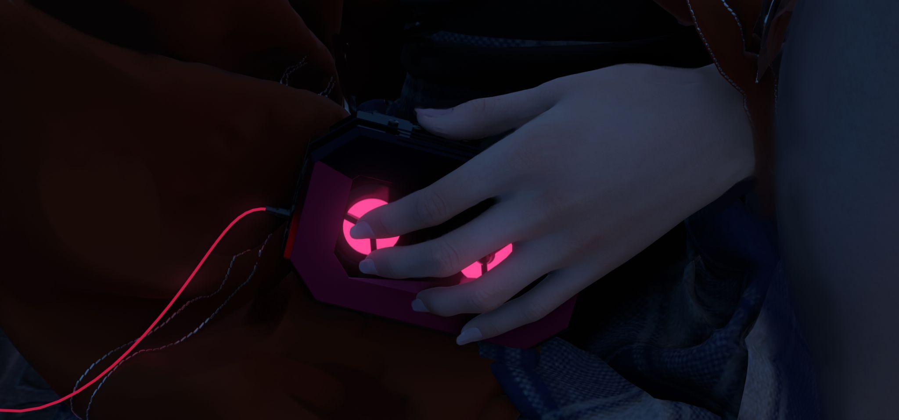

> “你也好不到哪去，你这随身听出土时间不会比我的手机晚吧，什么年代了，还听卡带？”

> “也许，我们本质上是同类人吧。”

> “被赋予了不同的境遇的同类人。”

> “嗯。”

> “那我猜，我这个同类现在听的歌，一定是上个世纪的。”

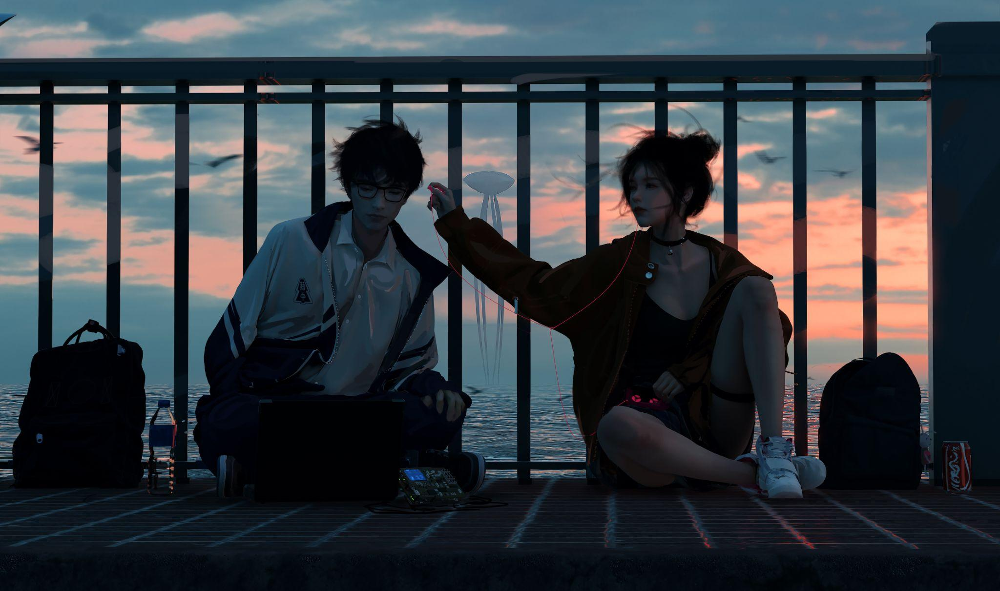

> “给。”

> [歌曲]“害怕悲剧重演

> [歌曲]我的命中命中

> [歌曲]越美丽的东西我越不可碰“

> “果然好老的歌。”

> “嗯，我喜欢那个年代的声音。那个时候，我父母还在一起。”

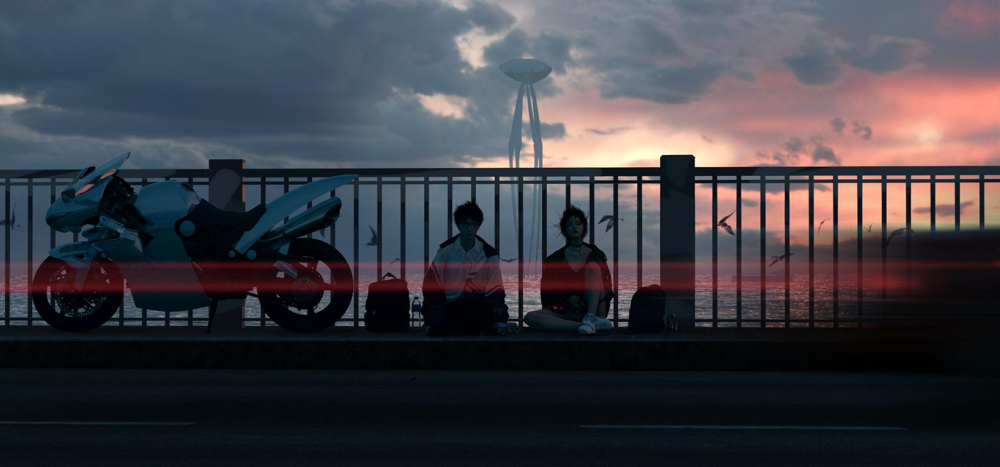

> [歌曲]“什么我都有预感

> [歌曲]然后睁不开两眼看命运光临

> [歌曲]然后天空又再涌起密云”

> ——王菲《暗涌》（1997）

> 有些歌，光听前奏就觉得温暖，

> 有些人，光是相遇就觉得开心。

