# CloudInsect - Chapter 2: Cloud Dwellers · Part 1

*Original Title: 第二章 云中人 · 一*

---

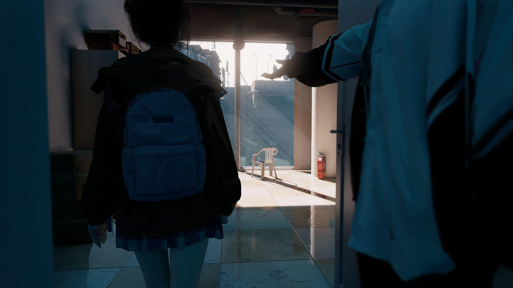

> Click.

> “Come in.”

> The hinge gave a faint metallic scrape, like a rusted spine being forced open. The air held the factory’s peculiar smell of oxidized metal, mingled with the stale odor of old electrical equipment. The desolation of the place made it feel alien.

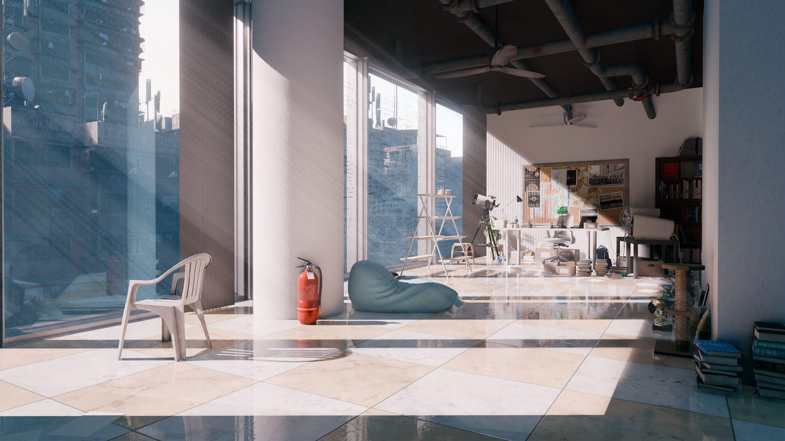

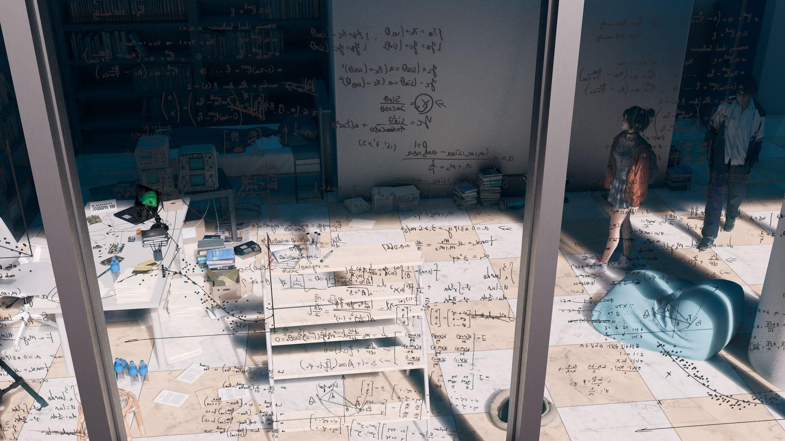

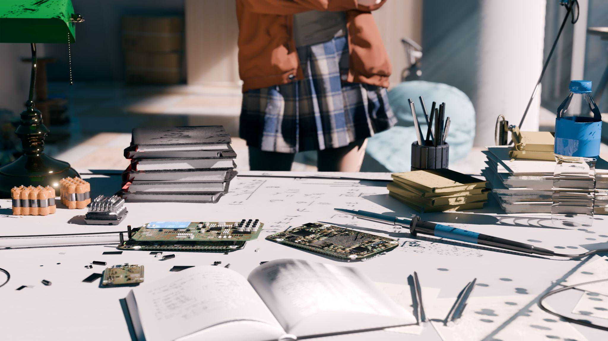

> [Discarded PCB boards]

> [Soldering iron]

> [Electronic components]

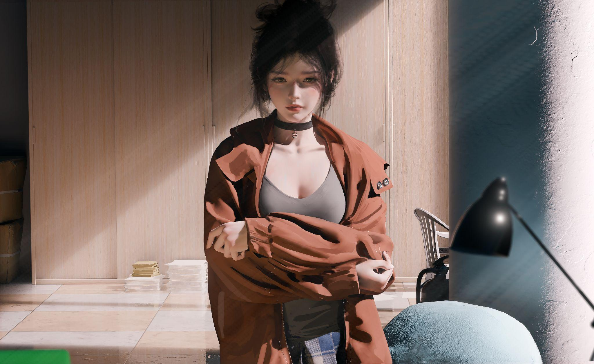

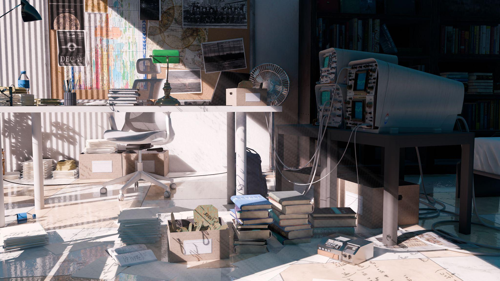

> [Book]Collection of Difficult Problems

> [Book]Mathematical Analysis

> [Book]Field Theory

> [Oscilloscope]

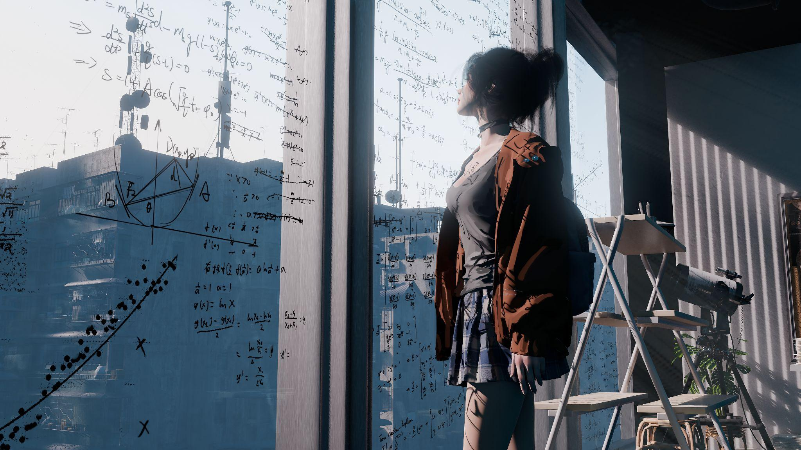

> “You live here? Isn’t this an industrial building?”

> She wrinkled her nose slightly, her eyes roaming aimlessly over scattered, yellowed papers and cluttered instruments, briefly pausing on a dark water stain at the corner. Her brow furrowed subtly, a hint of unease threading through her casual tone.

> “Yeah, it is. This place was scheduled for redevelopment years ago, but they never got around to it. A murder happened here a few years back, still unsolved. That scared everyone off, so the rent is really cheap.”

> “A murder house? Doesn’t that bother you? Maybe you should put up a statue of Guanyin to keep the place quiet.”

> She joked lightly, but her eyes betrayed an unspoken caution. Outside, faint murmurs from the approaching CloudInsect whispered through the city, casting a restless tension over everything.

> “An exorcism may be in order, but I have a more physical solution.”

> “More physical?”

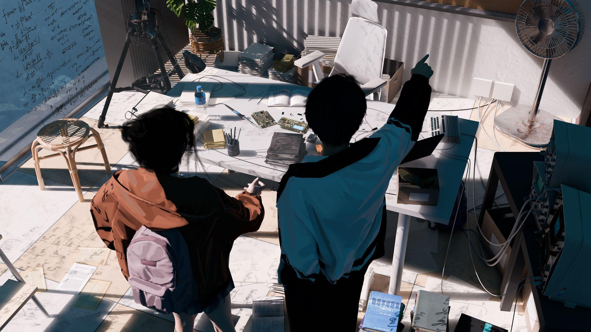

> “With these masters around, no ghost or spirit would dare come within a hundred meters.”

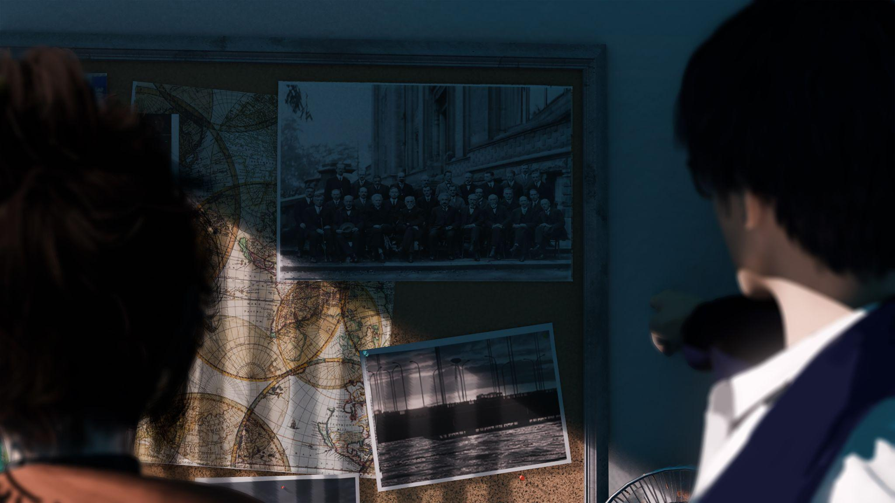

> [Photo]The Fifth Solvay Conference (1927)

> [Image]Timeline of Human Civilization

> Her eyes followed his finger, settling on the dusty black-and-white photo from the 1927 Solvay Conference, showcasing legendary physicists—Einstein, Schrödinger, Bohr, and Heisenberg—sitting sternly, eyes fixed forward with cold authority.

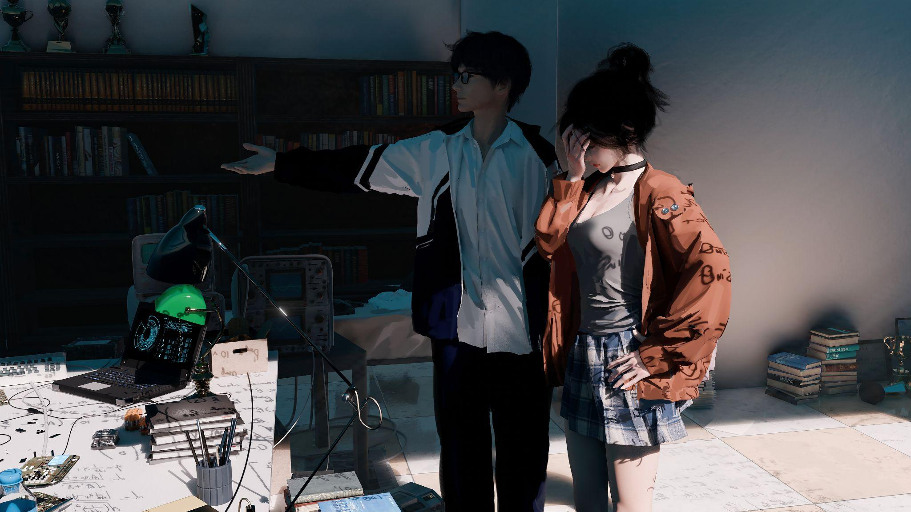

> “All right. That is certainly… physical.”

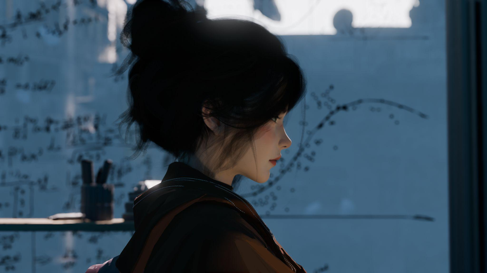

> “I thought your university provided dormitories—why rent your own place?”

> He glanced quietly at her gentle profile, lips subtly tightening and then relaxing, as if gathering the resolve to ask a lingering question.

> “I don’t really get along with my roommates.Besides, I have to work part-time often, so it’s inconvenient to stay on campus.”

> “Singing at bars?”

> “You’re a good student—why ask about that?”

> “It’s tough renting a place these days. If you don’t mind, you can stay here temporarily until you find somewhere else. There’s some space near the window…”

> “…Are you sure?”

> “Yeah.”

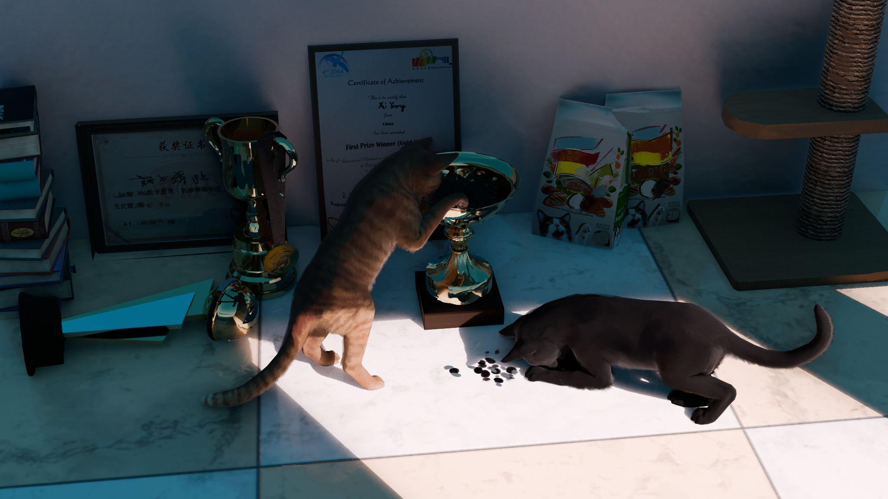

> Meow!

> [Trophy]Physics Olympiad Gold Medal

> [Cat Food]

> [Certificate]First Prize, National Mathematics Competition

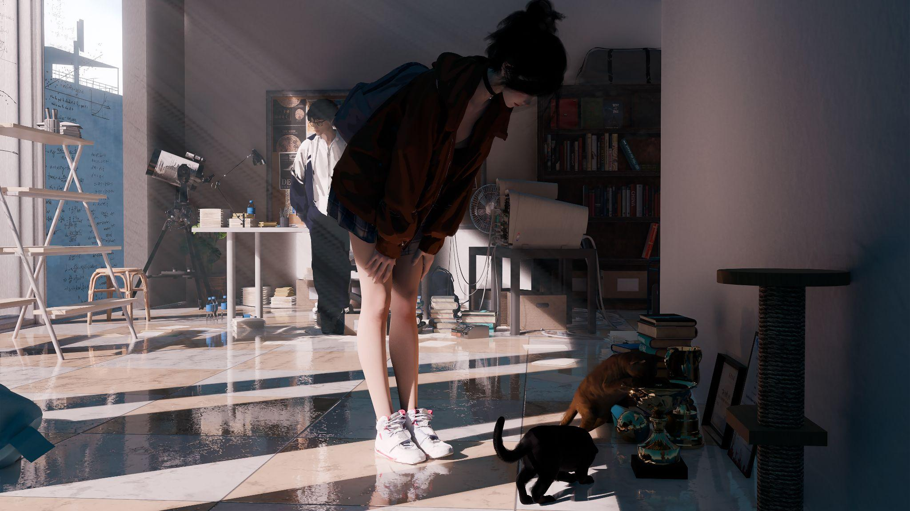

> “Is this your cat?”

> “Not exactly. They’re strays, but I feed them regularly, so they've gotten used to me.”

> “Do they have names?”

> “The black one’s Betelgeuse, and the orange one’s Europa.”

> “They’re such beautiful cats. Why give them such strange names?”

> “You wouldn’t understand. The names of stars are the most romantic names there are.”

> “Wow, even a scientist knows romance? Planning to adopt an entire galaxy?”

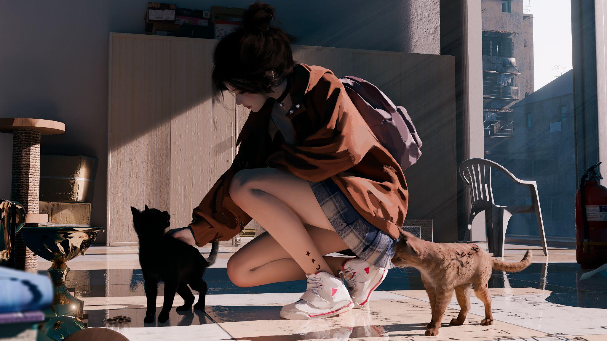

> “Poor little thing. So beautiful, yet still unwanted.”

> She bent down, gently caressing the black cat’s soft, warm fur, oblivious to the quiet sadness creeping into her voice.

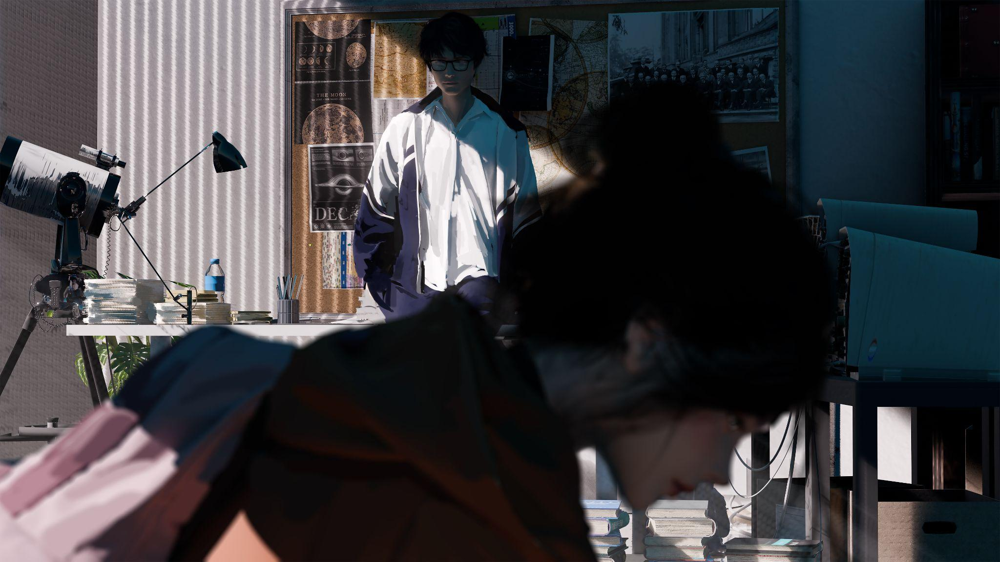

> He stood silently for a moment, sensing the subtle sorrow in her tone but choosing not to speak. He simply stood there, bathed in gentle sunlight, his expression calm and unreadable as ice untouched by warmth.

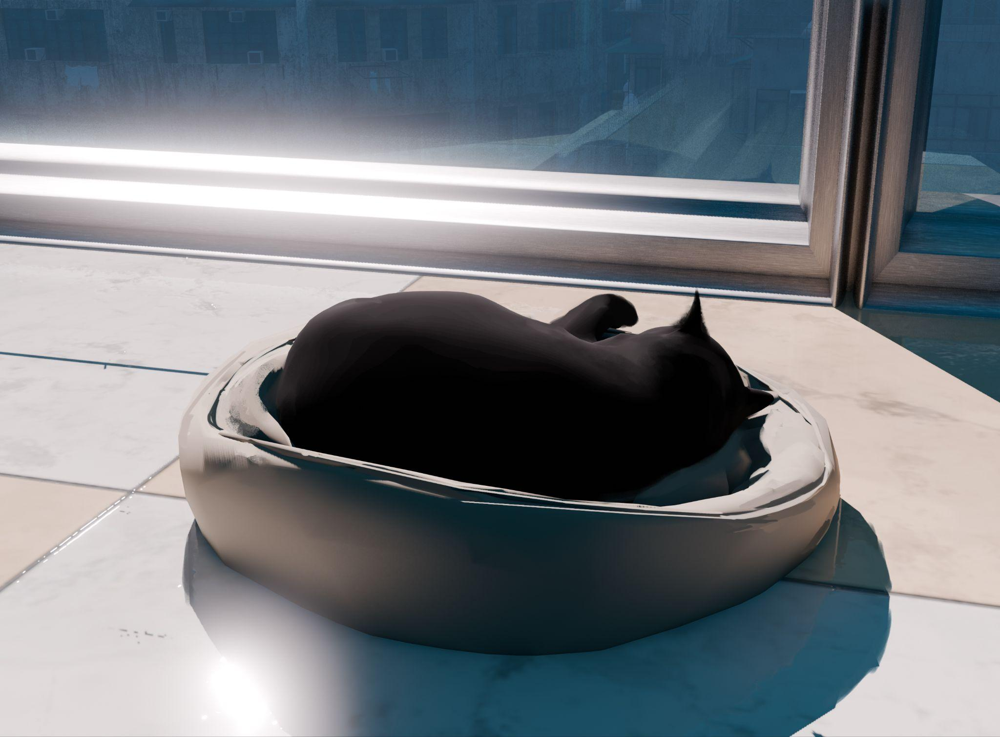

> Never had I encountered a god,

> until that day—

> he stood within the light

> and bestowed on me food and the names of stars.

