# Vân Trùng - Chương 2: Người Trong Mây · I

---

Cạch.

“Mời vào.”

Bản lề cửa phát ra một tiếng ma sát kim loại khe khẽ, tựa như một đốt sống rỉ sét bị người ta gượng gạo vặn mở. Trong không khí phảng phất mùi gỉ sét kim loại đặc trưng của nhà xưởng, lẫn với mùi ngai ngái của đồ điện tử cũ kỹ, lạnh lẽo đến mức khiến lòng người sinh ra cảm giác xa lạ tách biệt.

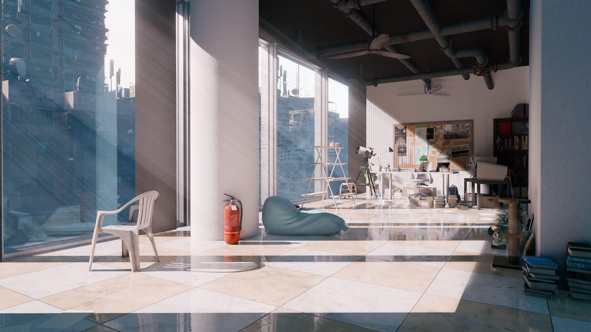

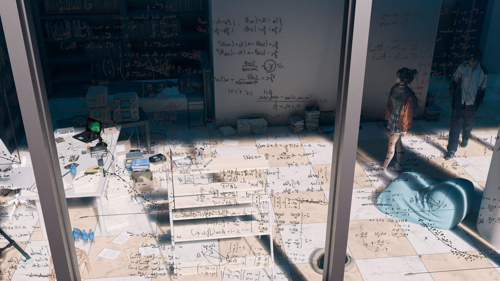

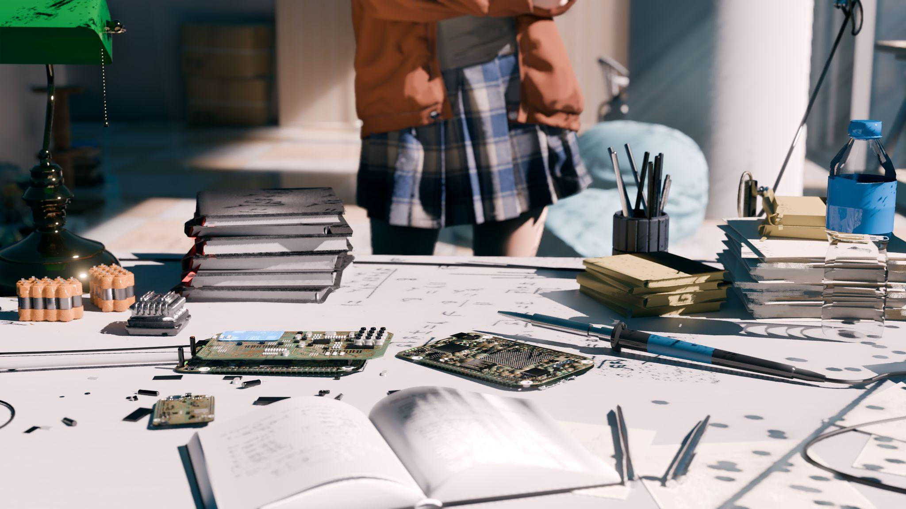

[Bo mạch điện tử PCB phế liệu]

[Mỏ hàn chì]

[Linh kiện điện tử]

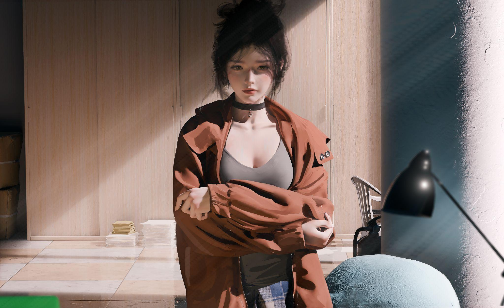

[Sách] Tuyển tập các bài toán hóc búa

[Sách] Giải tích toán học

[Sách] Lý thuyết trường

[Máy hiện sóng Oscilloscope]

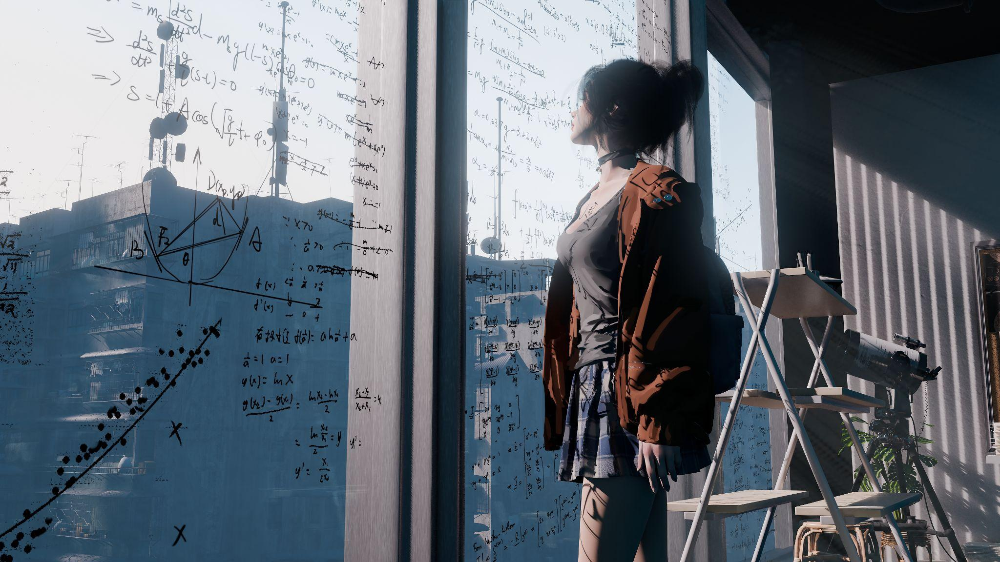

“Cậu sống ở đây thật đấy à? Chỗ này chẳng phải là tòa nhà xưởng công nghiệp sao?”

Cô hơi chun mũi, đưa mắt nhìn quanh bốn phía, ánh nhìn lướt qua những trang giấy ố vàng, các thiết bị đo đạc nằm ngổn ngang, rồi dừng lại một cách vô định nơi vết ố nước màu đen loang lổ góc tường. Đôi lông mày khẽ chau lại, giọng nói lộ rõ vẻ ngờ vực pha lẫn chút bất an mơ hồ.

“Ừ, đúng vậy. Khu này từ nhiều năm trước đã nằm trong diện quy hoạch cải tạo, nhưng rồi cứ bị đình trệ mãi. Mấy năm trước ở đây từng xảy ra một vụ án mạng, đến giờ vẫn chưa phá được án, thế nên chẳng ai dám thuê cả, giá thuê tự nhiên rẻ như bèo.”

“Hả? Nhà có án mạng á? Cậu không kiêng kỵ gì sao? Có cần thỉnh một bức tượng Quan Âm về để trấn yểm không đấy?”

Giọng cô nghe như đang nói đùa, nhưng trong ánh mắt lại vô thức để lộ chút cảnh giác và đề phòng. Ngoài cửa sổ, thanh âm náo động khi Vân Trùng sắp tới lờ mờ vọng lại, cả thành phố như bị bao phủ trong một nỗi hoang mang khó tả.

“Trừ tà thì cũng cần đấy, nhưng tôi có cách giải quyết mang tính 'vật lý' hơn nhiều.”

“Mang tính vật lý hơn?”

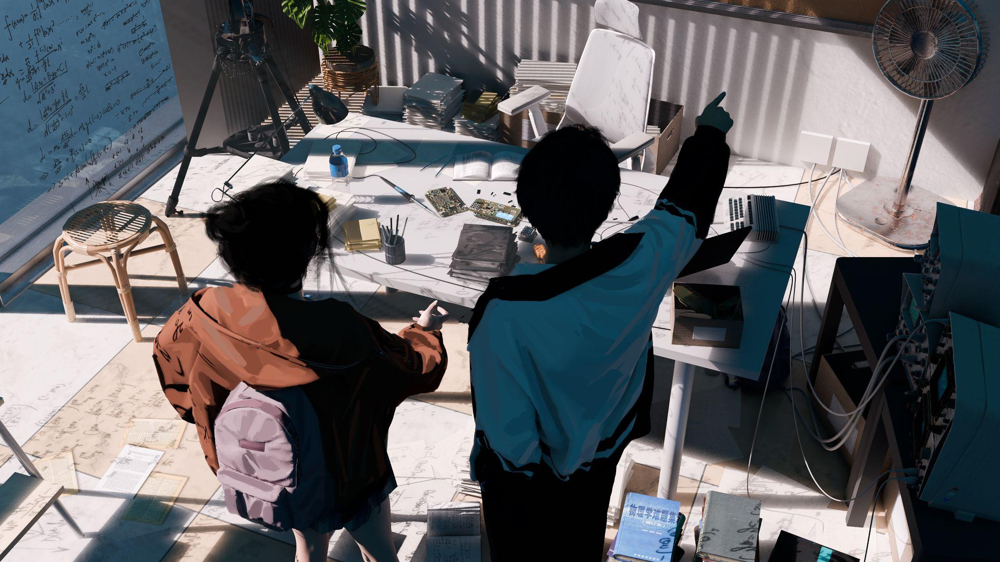

“Nhìn kìa, có các vị 'đại thần' này trấn tọa ở đây, trong vòng bán kính trăm mét quỷ thần cũng chẳng dám bén mảng tới gần đâu.”

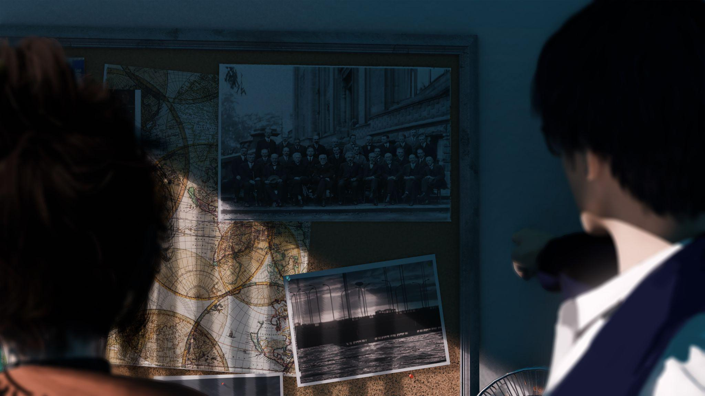

[Bức ảnh] Hội nghị Solvay lần thứ 5 (Năm 1927)

[Sơ đồ] Trục thời gian tiến trình phát triển của văn minh nhân loại

Cô dõi theo ngón tay chỉ của cậu, nhìn thấy một bức ảnh đen trắng đã cũ kỹ, trên mặt phủ một lớp bụi mỏng. Trong bức ảnh là Hội nghị Solvay lần thứ 5 năm 1927, quy tụ cả một dàn cự phách vĩ đại nhất của nền vật lý thế giới — Einstein, Schrödinger, Bohr, Heisenberg... Họ ngồi ngay ngắn bên nhau, nghiêm nghị nhìn thẳng vào ống kính, toát lên một vẻ uy nghiêm lãnh đạm đầy khí phách.

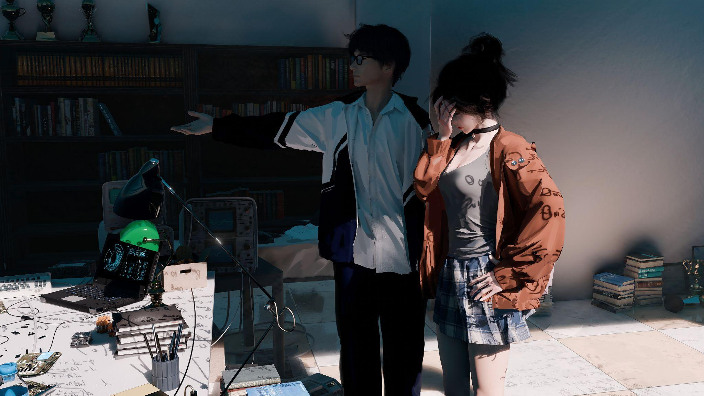

“Được rồi... Cách này quả thực rất là 'vật lý'...”

“Tôi nhớ trường đại học của các cậu có ký túc xá mà, sao cậu lại phải tự ra ngoài thuê phòng làm gì?”

Cậu nhìn nghiêng gương mặt tĩnh lặng và dịu dàng của cô, bờ môi khẽ mím lại rồi thả lỏng, dường như cuối cùng vẫn quyết định mở lời hỏi câu hỏi chất chứa bấy lâu.

“Tôi không hợp tính với bạn cùng phòng. Với lại tôi thường xuyên phải ra ngoài làm thêm, ở trong trường bất tiện lắm.”

“Là đi hát ở quán bar sao?”

“Cậu là học sinh ngoan trò giỏi, hỏi mấy chuyện này làm chi?”

“Bây giờ thuê phòng bên ngoài khó khăn lắm. Nếu cậu không chê, thì trong lúc chưa tìm được phòng mới, có thể tạm thời ở lại đây. Chỗ phía bên cửa sổ kia của tôi vẫn còn một khoảng trống...”

“... Cậu chắc chứ?”

“Ừ.”

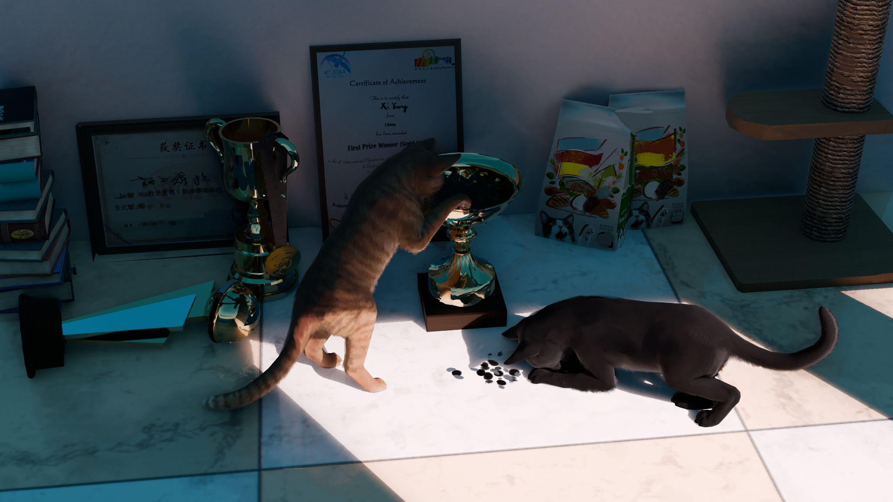

Meo!

[Cúp lưu niệm] Huy chương Vàng Olympic Vật lý

[Hạt thức ăn cho mèo]

[Bằng khen] Giải Nhất Kỳ thi Học sinh Giỏi Toán Quốc gia

“Con mèo này là do cậu nuôi à?”

“Cũng không hẳn. Là mèo hoang đấy. Tôi hay cho chúng ăn, nên chúng quen hơi bén mùi thôi.”

“Chúng có tên không?”

“Con lông đen tên là Sâm Túc Tứ (Betelgeuse), còn con lông vàng tên là Mộc Vệ Nhị (Europa).”

“Mèo đẹp thế này mà cậu đặt cho chúng cái tên kỳ quặc gì vậy trời...”

“Cậu không hiểu đâu, tên của các vì tinh tú mới là thứ lãng mạn nhất trần đời.”

“Ối chà, dân tự nhiên kỹ thuật mà cũng biết lãng mạn cơ đấy à? Sao nào, cậu định nhặt cả dải Ngân Hà mang về nuôi luôn chắc?”

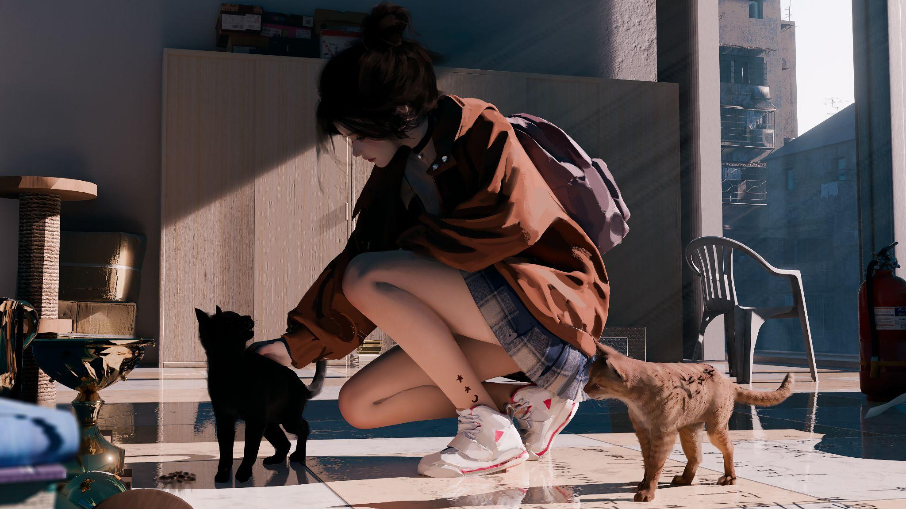

“Sinh linh bé nhỏ tội nghiệp, rõ ràng xinh xắn thế này, mà cuối cùng vẫn chẳng có ai cần.”

Cô cúi đầu vuốt ve dọc sống lưng chú mèo đen, dùng đầu ngón tay cảm nhận lớp lông mềm mại và ấm áp của nó, dường như chẳng hề nhận ra trong giọng nói của chính mình đang thoáng gợn lên một nỗi bi thương trầm lắng khôn nguôi.

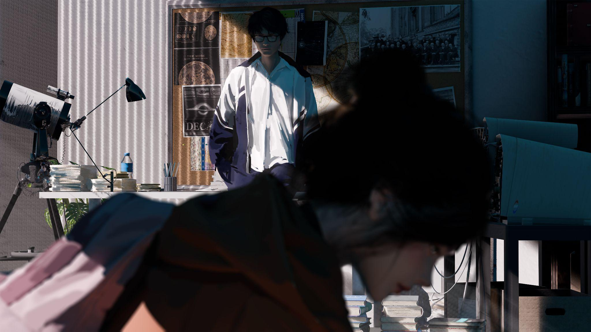

Cậu lặng thinh hồi lâu, dường như lắng nghe và hiểu được điều gì đó ẩn sau câu nói, nhưng không đáp lại. Cậu chỉ lặng lẽ đứng giữa luồng sáng, ánh mắt bình lặng và thâm trầm tựa như một tảng băng vĩnh cửu chưa từng tan chảy.

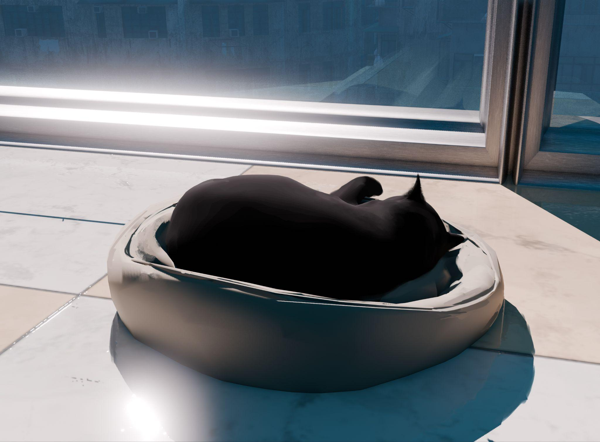

Ta chưa từng diện kiến thần linh.

Cho đến ngày hôm ấy,

Người đứng giữa vầng dương chan hòa,

Ban cho ta lương thực cùng danh xưng của muôn vì tinh tú.
