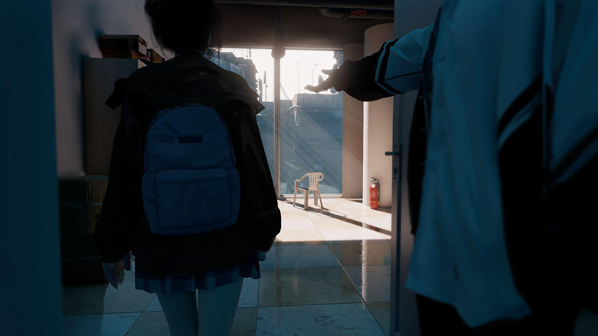
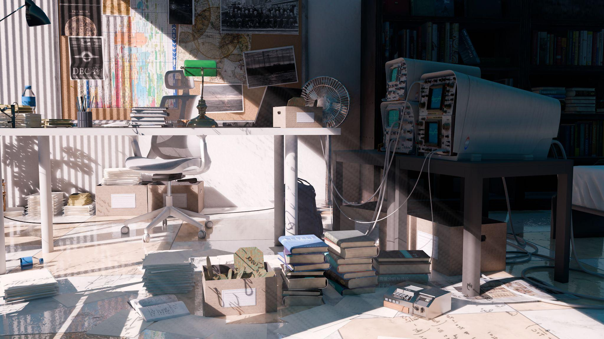
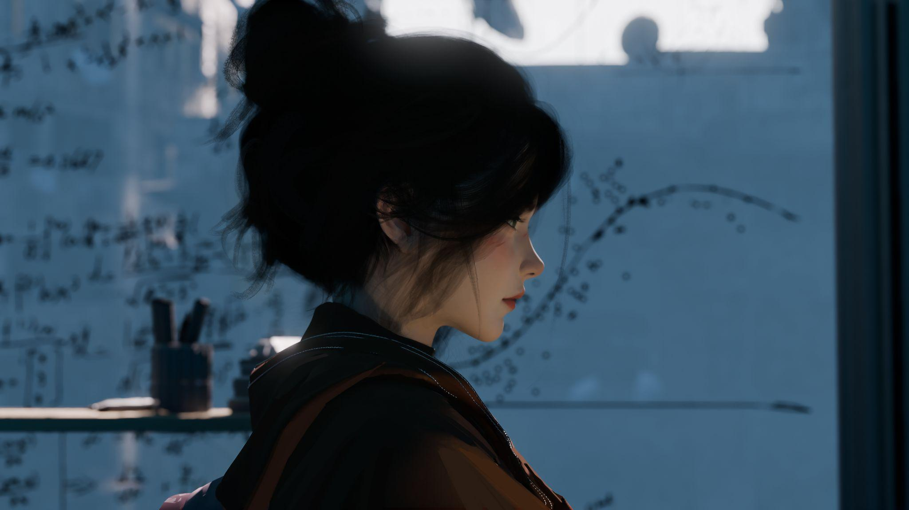
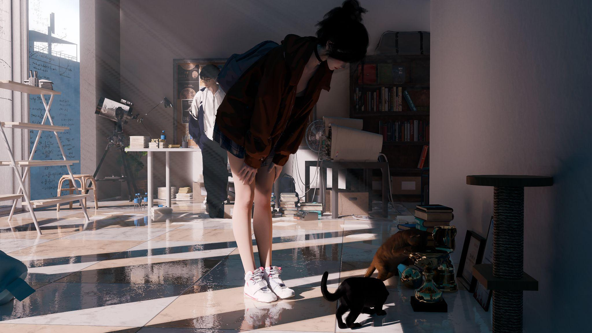

# Vân Trùng - Chương 2: Người Trong Mây · I

---

* **Lời thoại / Nội dung phát ra:**
  > *(Cạch.)*
  > 
  > **[Hi Dương]** "Mời vào."
  > 
  > *(Bản lề cửa phát ra một tiếng ma sát kim loại khe khẽ, tựa như một đốt sống rỉ sét bị người ta gượng gạo vặn mở. Trong không khí phảng phất mùi gỉ sắt đặc trưng của nhà xưởng, lẫn với mùi đồ điện tử cũ kỹ, lạnh lẽo đến mức khiến lòng người sinh ra cảm giác xa lạ tách biệt.)*

---

---

---

* **Chữ trong ảnh:**
  * Bảng mạch in (PCB) cũ phế liệu
  * Mỏ hàn thiếc điện
  * Các linh kiện điện tử rời

---

---

* **Chữ trong ảnh:**
  * Tựa sách chuyên ngành: **Tuyển tập các bài toán hóc búa** (*难题集萃*)
  * Tựa sách: **Giải tích toán học** (*数学分析*)
  * Tựa sách: **Lý thuyết trường** (*场论*)
  * Màn hình máy hiện sóng dao động (Oscilloscope)

---

* **Lời thoại / Nội dung phát ra:**
  > **[Nguyệt Nha Nhi]** "Cậu sống ở đây thật đấy à? Chỗ này chẳng phải là tòa nhà xưởng công nghiệp sao?"
  > 
  > *(Cô hơi chun mũi, đưa mắt nhìn quanh bốn phía, ánh nhìn lướt qua những trang giấy ố vàng, các thiết bị ngổn ngang, rồi dừng lại nơi vệt nước ố đen loang lổ góc tường. Đôi mày khẽ nhíu lại, giọng nói lộ rõ vẻ ngờ vực pha lẫn bất an thoáng qua.)*
  > 
  > **[Hi Dương]** "Ừ, đúng vậy. Khu này từ nhiều năm trước đã nằm trong diện quy hoạch cải tạo, nhưng rồi cứ bị đình trệ mãi. Mấy năm trước ở đây từng xảy ra một vụ án mạng, đến giờ vẫn chưa phá được án, thế nên chẳng ai dám thuê cả, giá thuê tự nhiên rẻ như bèo."
  > 
  > **[Nguyệt Nha Nhi]** "Hả? Nhà có án mạng á? Cậu không kiêng kỵ gì sao? Có cần thỉnh một bức tượng Quan Âm về để trấn yểm không đấy?"
  > 
  > *(Giọng cô nghe như đang nói đùa, nhưng trong ánh mắt lại vô thức để lộ chút cảnh giác và đề phòng. Ngoài cửa sổ, thanh âm náo động khi Vân Trùng sắp tới lờ mờ vọng lại, cả thành phố như bị bao phủ trong một nỗi hoang mang khó tả.)*
  > 
  > **[Hi Dương]** "Trừ tà thì cũng cần đấy, nhưng tôi có cách giải quyết mang tính 'vật lý' hơn nhiều."
  > 
  > **[Nguyệt Nha Nhi]** "Mang tính vật lý hơn?"

---

* **Lời thoại / Nội dung phát ra:**
  > **[Hi Dương]** "Nhìn kìa, có các vị 'đại thần' này trấn tọa ở đây, trong vòng bán kính trăm mét quỷ thần cũng chẳng dám bén mảng tới gần đâu."

---

* **Chữ trong ảnh:**
  * Bức ảnh lịch sử đóng khung: **Hội nghị Solvay lần thứ 5 (Năm 1927)**
  * Biểu đồ treo tường: **Trục thời gian tiến trình phát triển của văn minh nhân loại**
* **Lời thoại / Nội dung phát ra:**
  > *(Cô dõi theo ngón tay chỉ của cậu, nhìn thấy một bức ảnh đen trắng đã cũ kỹ, trên mặt phủ một lớp bụi mỏng. Trong bức ảnh là Hội nghị Solvay lần thứ 5 năm 1927, quy tụ cả một dàn cự phách vĩ đại nhất của nền vật lý thế giới — Einstein, Schrödinger, Bohr, Heisenberg... Họ ngồi ngay ngắn bên nhau, nghiêm nghị nhìn thẳng vào ống kính, toát lên một vẻ uy nghiêm lãnh đạm đầy khí phách.)*

---

* **Lời thoại / Nội dung phát ra:**
  > **[Nguyệt Nha Nhi]** "Được rồi... Cách này quả thực rất là 'vật lý'..."

---

* **Lời thoại / Nội dung phát ra:**
  > **[Hi Dương]** "Tôi nhớ trường đại học của các cậu có ký túc xá mà, sao cậu lại phải tự ra ngoài thuê phòng làm gì?"
  > 
  > *(Cậu nhìn nghiêng gương mặt tĩnh lặng và dịu dàng của cô, bờ môi khẽ mím lại rồi thả lỏng, dường như cuối cùng vẫn quyết định mở lời hỏi câu hỏi chất chứa bấy lâu.)*
  > 
  > **[Nguyệt Nha Nhi]** "Tôi không hợp tính với bạn cùng phòng. Với lại tôi thường xuyên phải ra ngoài làm thêm, ở trong trường bất tiện lắm."
  > 
  > **[Hi Dương]** "Là đi hát ở quán bar sao?"
  > 
  > **[Nguyệt Nha Nhi]** "Cậu là học sinh ngoan trò giỏi, hỏi mấy chuyện này làm chi?"
  > 
  > **[Hi Dương]** "Bây giờ thuê phòng bên ngoài khó khăn lắm. Nếu cậu không chê, thì trong lúc chưa tìm được phòng mới, có thể tạm thời ở lại đây. Chỗ phía bên cửa sổ kia của tôi vẫn còn một khoảng trống..."
  > 
  > **[Nguyệt Nha Nhi]** "... Cậu chắc chứ?"
  > 
  > **[Hi Dương]** "Ừ."

---

* **Chữ trong ảnh:**
  * Kỷ niệm chương / Cúp: **Huy chương Vàng Olympic Vật lý**
  * Túi thức ăn cho mèo: **Thức ăn hạt cho mèo**
  * Bằng khen: **Giải Nhất Kỳ thi Học sinh Giỏi Toán Toàn quốc**
* **Lời thoại / Nội dung phát ra:**
  > *(Meo!)*

---

* **Lời thoại / Nội dung phát ra:**
  > **[Nguyệt Nha Nhi]** "Con mèo này là do cậu nuôi à?"
  > 
  > **[Hi Dương]** "Cũng không hẳn. Là mèo hoang đấy. Tôi hay cho chúng ăn, nên chúng quen hơi bén mùi thôi."
  > 
  > **[Nguyệt Nha Nhi]** "Chúng có tên không?"
  > 
  > **[Hi Dương]** "Con lông đen tên là Sâm Túc Tứ (Betelgeuse), còn con lông vàng tên là Mộc Vệ Nhị (Europa)."
  > 
  > **[Nguyệt Nha Nhi]** "Mèo đẹp thế này mà cậu đặt cho chúng cái tên kỳ quặc gì vậy trời..."
  > 
  > **[Hi Dương]** "Cậu không hiểu đâu, tên của các vì tinh tú mới là thứ lãng mạn nhất trần đời."
  > 
  > **[Nguyệt Nha Nhi]** "Ối chà, dân tự nhiên kỹ thuật mà cũng biết lãng mạn cơ đấy à? Sao nào, cậu định nhặt cả dải Ngân Hà mang về nuôi luôn chắc?"

---

* **Lời thoại / Nội dung phát ra:**
  > **[Nguyệt Nha Nhi]** "Sinh linh bé nhỏ tội nghiệp, rõ ràng xinh xắn thế này, mà cuối cùng vẫn chẳng có ai cần."
  > 
  > *(Cô cúi đầu vuốt ve dọc sống lưng chú mèo đen, dùng đầu ngón tay cảm nhận lớp lông mềm mại và ấm áp của nó, dường như chẳng hề nhận ra trong giọng nói của chính mình đang thoáng gợn lên một nỗi bi thương trầm lắng khôn nguôi.)*

---

* **Lời thoại / Nội dung phát ra:**
  > *(Cậu lặng thinh hồi lâu, dường như lắng nghe và hiểu được điều gì đó ẩn sau câu nói, nhưng không đáp lại. Cậu chỉ lặng lẽ đứng giữa luồng sáng, ánh mắt bình lặng và thâm trầm tựa như một tảng băng vĩnh cửu chưa từng tan chảy.)*

---

* **Lời thơ tự sự của chú mèo đen:**
  > *"Ta chưa từng diện kiến thần linh.*
  > *Cho đến ngày hôm ấy,*
  > *Người đứng giữa vầng dương chan hòa,*
  > *Ban cho ta lương thực cùng danh xưng của muôn vì tinh tú."*
