# Vân Trùng / 云虫 - Chương 2: Người Trong Mây · I (第二章 云中人 · 一)

---

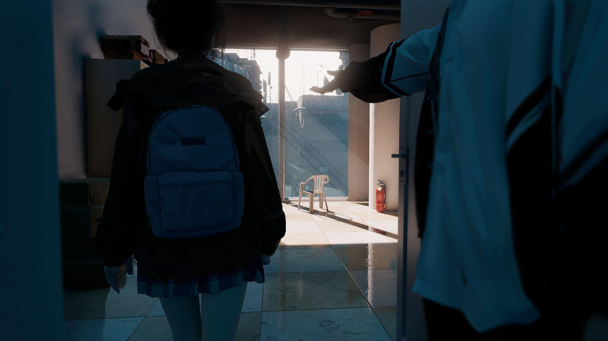

**VI**: Cạch.

**ZH**: 咔嚓

**VI**: “Mời vào.”

**ZH**: “请进。”

**VI**: Bản lề cửa phát ra một tiếng ma sát kim loại khe khẽ, tựa như một đốt sống rỉ sét bị người ta gượng gạo vặn mở. Trong không khí phảng phất mùi gỉ sét kim loại đặc trưng của nhà xưởng, lẫn với mùi ngai ngái của đồ điện tử cũ kỹ, lạnh lẽo đến mức khiến lòng người sinh ra cảm giác xa lạ tách biệt.

**ZH**: 门轴发出一声细微的金属摩擦声，像某种生锈的脊骨被硬生生拧开。空气中弥漫着工厂特有的金属锈味，夹杂着老旧电器散发的气息，冷清得令人心生疏离。

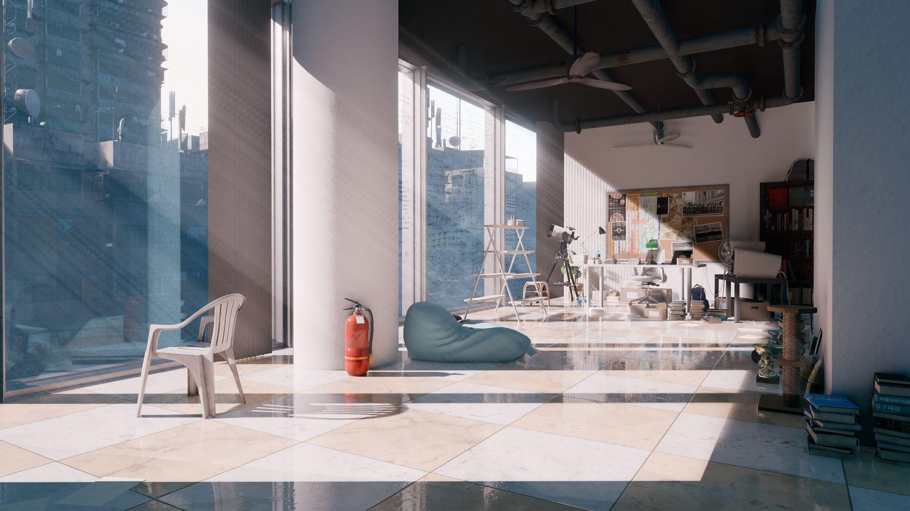

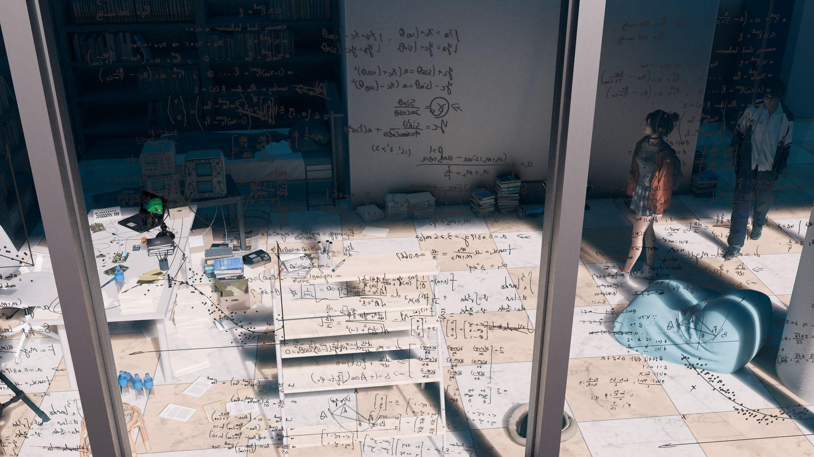

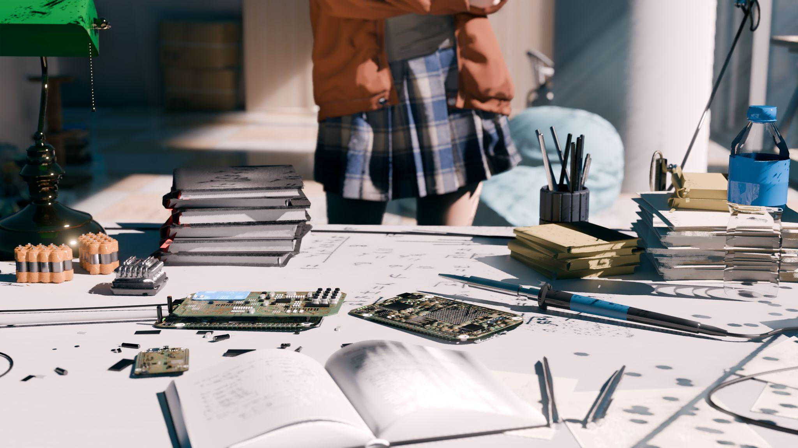

**VI**: [Bo mạch điện tử PCB phế liệu]

**ZH**: [废旧PCB板]

**VI**: [Mỏ hàn chì]

**ZH**: [电烙铁]

**VI**: [Linh kiện điện tử]

**ZH**: [电子元件]

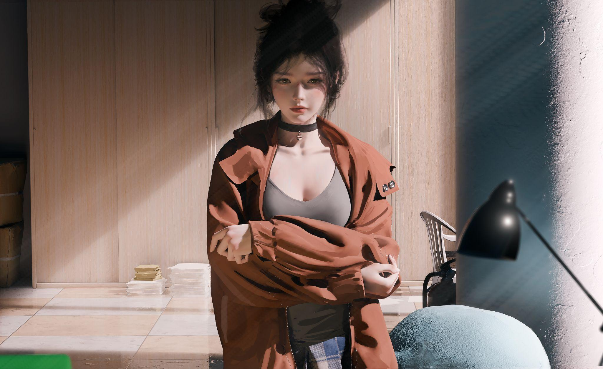

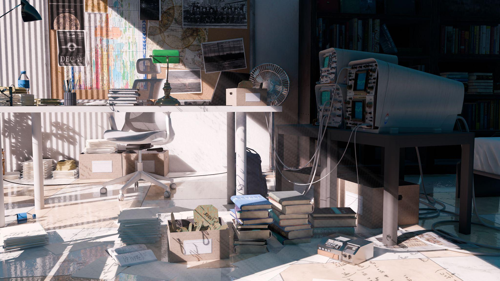

**VI**: [Sách] Tuyển tập các bài toán hóc búa

**ZH**: [书籍]难题集萃

**VI**: [Sách] Giải tích toán học

**ZH**: [书籍]数学分析

**VI**: [Sách] Lý thuyết trường

**ZH**: [书籍]场论

**VI**: [Máy hiện sóng Oscilloscope]

**ZH**: [示波器]

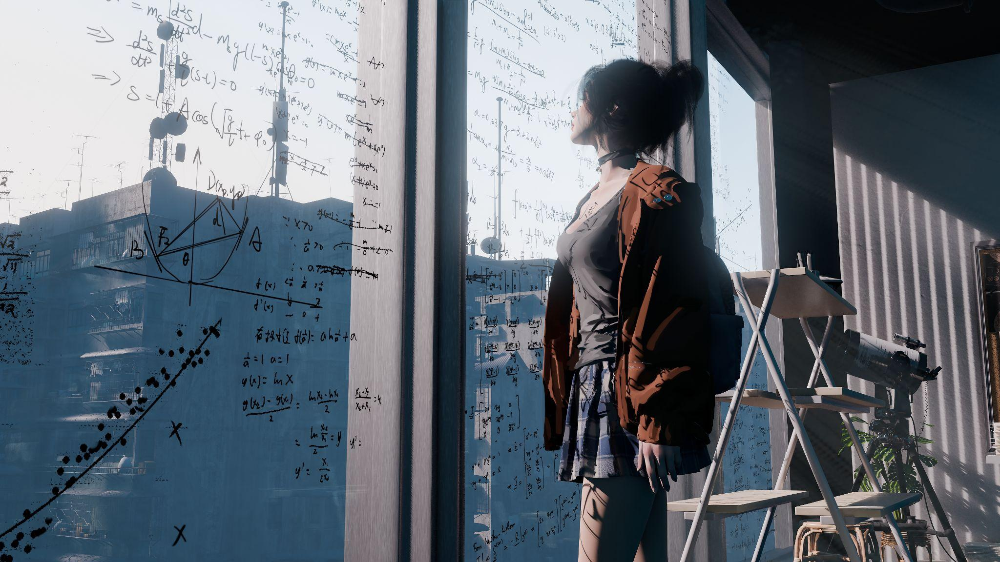

**VI**: “Cậu sống ở đây thật đấy à? Chỗ này chẳng phải là tòa nhà xưởng công nghiệp sao?”

**ZH**: “你就住这？这不是工厦吗？”

**VI**: Cô hơi chun mũi, đưa mắt nhìn quanh bốn phía, ánh nhìn lướt qua những trang giấy ố vàng, các thiết bị đo đạc nằm ngổn ngang, rồi dừng lại một cách vô định nơi vết ố nước màu đen loang lổ góc tường. Đôi lông mày khẽ chau lại, giọng nói lộ rõ vẻ ngờ vực pha lẫn chút bất an mơ hồ.

**ZH**: 她皱了皱鼻子，环顾四周，目光掠过那些泛黄的纸页、散落的仪器，眼神漫不经心地停留在墙角的黑色水渍上，眉头轻轻地蹙了蹙，声音里透出疑惑与淡淡的不安。

**VI**: “Ừ, đúng vậy. Khu này từ nhiều năm trước đã nằm trong diện quy hoạch cải tạo, nhưng rồi cứ bị đình trệ mãi. Mấy năm trước ở đây từng xảy ra một vụ án mạng, đến giờ vẫn chưa phá được án, thế nên chẳng ai dám thuê cả, giá thuê tự nhiên rẻ như bèo.”

**ZH**: “是啊。这片区域早年划入了重建计划，结果一直搁置。几年前还发生过一起命案，案子到现在没破，所以根本没人敢租，房租自然便宜。”

**VI**: “Hả? Nhà có án mạng á? Cậu không kiêng kỵ gì sao? Có cần thỉnh một bức tượng Quan Âm về để trấn yểm không đấy?”

**ZH**: “啊？凶宅啊？你不忌讳？要不要放尊观音像镇一镇？”

**VI**: Giọng cô nghe như đang nói đùa, nhưng trong ánh mắt lại vô thức để lộ chút cảnh giác và đề phòng. Ngoài cửa sổ, thanh âm náo động khi Vân Trùng sắp tới lờ mờ vọng lại, cả thành phố như bị bao phủ trong một nỗi hoang mang khó tả.

**ZH**: 她的语气像开玩笑，目光却无意间流露出某种防备与戒心。窗外，云虫将至的躁动声隐约传来，城市被一股难以言喻的慌乱笼罩着。

**VI**: “Trừ tà thì cũng cần đấy, nhưng tôi có cách giải quyết mang tính 'vật lý' hơn nhiều.”

**ZH**: “驱邪是要的，不过我有更物理的办法。”

**VI**: “Mang tính vật lý hơn?”

**ZH**: “更物理的？”

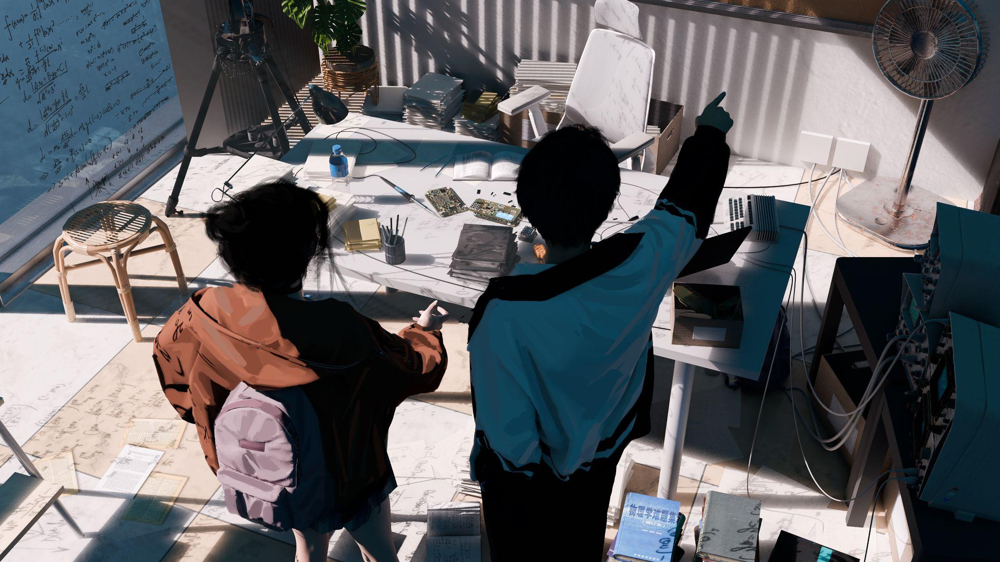

**VI**: “Nhìn kìa, có các vị 'đại thần' này trấn tọa ở đây, trong vòng bán kính trăm mét quỷ thần cũng chẳng dám bén mảng tới gần đâu.”

**ZH**: “看，有这些大神们坐镇，方圆百米鬼神莫近。”

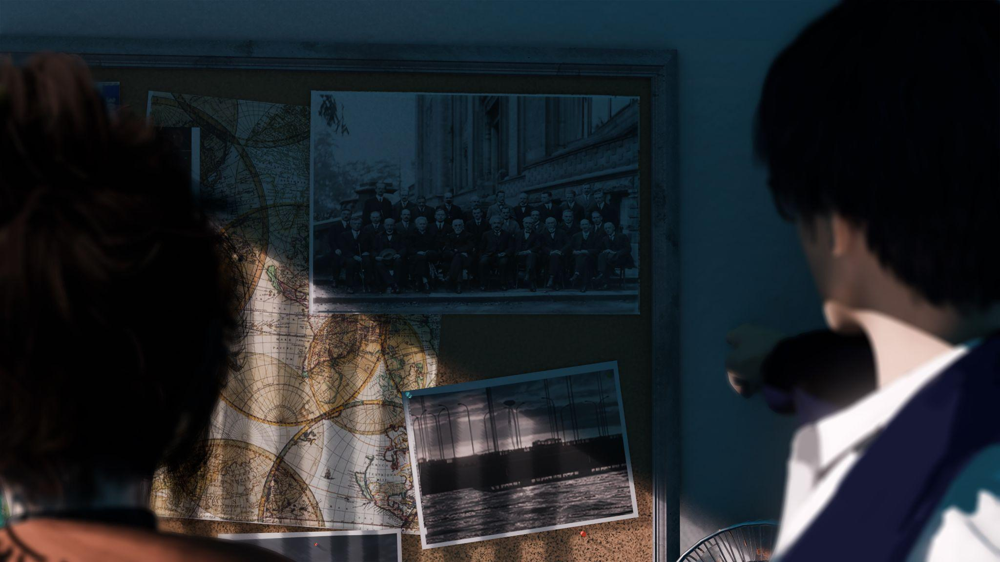

**VI**: [Bức ảnh] Hội nghị Solvay lần thứ 5 (Năm 1927)

**ZH**: [相片]第五届索尔维会议 （AD1927）

**VI**: [Sơ đồ] Trục thời gian tiến trình phát triển của văn minh nhân loại

**ZH**: [图片]人类文明发展时间轴

**VI**: Cô dõi theo ngón tay chỉ của cậu, nhìn thấy một bức ảnh đen trắng đã cũ kỹ, trên mặt phủ một lớp bụi mỏng. Trong bức ảnh là Hội nghị Solvay lần thứ 5 năm 1927, quy tụ cả một dàn cự phách vĩ đại nhất của nền vật lý thế giới — Einstein, Schrödinger, Bohr, Heisenberg... Họ ngồi ngay ngắn bên nhau, nghiêm nghị nhìn thẳng vào ống kính, toát lên một vẻ uy nghiêm lãnh đạm đầy khí phách.

**ZH**: 她顺着他的手指望过去，看到一张陈旧的黑白照片，上面蒙了一层淡淡的灰。照片里是1927年第五届索尔维会议，一群物理学界的巨匠——爱因斯坦、薛定谔、玻尔、海森堡——正坐在一起，面无表情地直视镜头，神情里透着某种冷峻的威严。

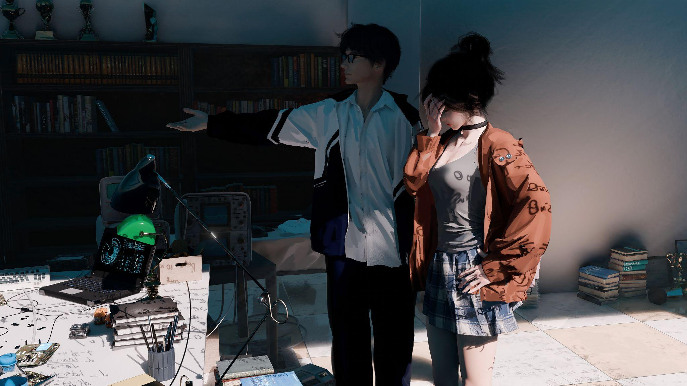

**VI**: “Được rồi... Cách này quả thực rất là 'vật lý'...”

**ZH**: “好吧，这确实很物理……”

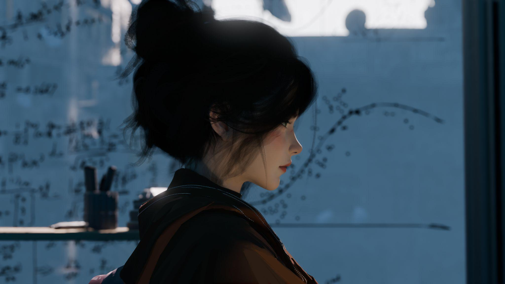

**VI**: “Tôi nhớ trường đại học của các cậu có ký túc xá mà, sao cậu lại phải tự ra ngoài thuê phòng làm gì?”

**ZH**: “我记得你们大学是有宿舍的，为什么还要自己租房？”

**VI**: Cậu nhìn nghiêng gương mặt tĩnh lặng và dịu dàng của cô, bờ môi khẽ mím lại rồi thả lỏng, dường như cuối cùng vẫn quyết định mở lời hỏi câu hỏi chất chứa bấy lâu.

**ZH**: 他望着她安静而柔和的侧脸，唇角微微抿起又放开，似乎终于还是决定开口问出那个问题。

**VI**: “Tôi không hợp tính với bạn cùng phòng. Với lại tôi thường xuyên phải ra ngoài làm thêm, ở trong trường bất tiện lắm.”

**ZH**: “我和室友合不来。而且我经常要出去打工，住校也不方便。”

**VI**: “Là đi hát ở quán bar sao?”

**ZH**: “是去酒吧唱歌么？”

**VI**: “Cậu là học sinh ngoan trò giỏi, hỏi mấy chuyện này làm chi?”

**ZH**: “你可是好学生，问这些干嘛？”

**VI**: “Bây giờ thuê phòng bên ngoài khó khăn lắm. Nếu cậu không chê, thì trong lúc chưa tìm được phòng mới, có thể tạm thời ở lại đây. Chỗ phía bên cửa sổ kia của tôi vẫn còn một khoảng trống...”

**ZH**: “现在外面租房不易，如果不嫌弃的话，等你找到房子之前，可以先凑合住这儿。我那边靠窗还有块地方空着……”

**VI**: “... Cậu chắc chứ?”

**ZH**: “……你确定？”

**VI**: “Ừ.”

**ZH**: “嗯。”

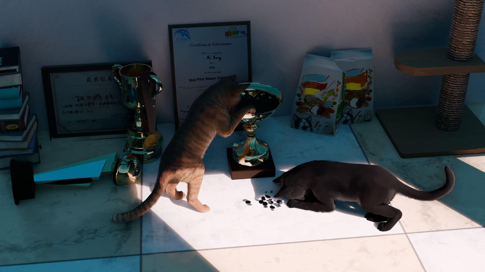

**VI**: Meo!

**ZH**: 喵！

**VI**: [Cúp lưu niệm] Huy chương Vàng Olympic Vật lý

**ZH**: [奖杯]物理奥林匹克竞赛金牌

**VI**: [Hạt thức ăn cho mèo]

**ZH**: [猫粮]

**VI**: [Bằng khen] Giải Nhất Kỳ thi Học sinh Giỏi Toán Quốc gia

**ZH**: [奖状]全国数学竞赛一等奖

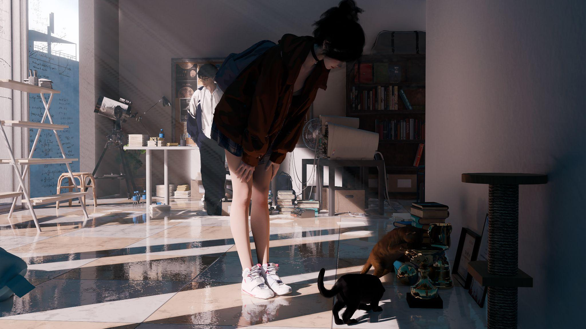

**VI**: “Con mèo này là do cậu nuôi à?”

**ZH**: “这猫是你养的？”

**VI**: “Cũng không hẳn. Là mèo hoang đấy. Tôi hay cho chúng ăn, nên chúng quen hơi bén mùi thôi.”

**ZH**: “不算。流浪猫。我常喂它们吃的，它们就认熟了。”

**VI**: “Chúng có tên không?”

**ZH**: “有名字么？”

**VI**: “Con lông đen tên là Sâm Túc Tứ (Betelgeuse), còn con lông vàng tên là Mộc Vệ Nhị (Europa).”

**ZH**: “黑的叫参宿四，橘的叫木卫二。”

**VI**: “Mèo đẹp thế này mà cậu đặt cho chúng cái tên kỳ quặc gì vậy trời...”

**ZH**: “这么好看的猫，起的什么鬼名字……”

**VI**: “Cậu không hiểu đâu, tên của các vì tinh tú mới là thứ lãng mạn nhất trần đời.”

**ZH**: “你不懂，星星的名字才是最浪漫的。”

**VI**: “Ối chà, dân tự nhiên kỹ thuật mà cũng biết lãng mạn cơ đấy à? Sao nào, cậu định nhặt cả dải Ngân Hà mang về nuôi luôn chắc?”

**ZH**: “哟，理工男也懂浪漫啊，怎么，想捡个银河系回来？”

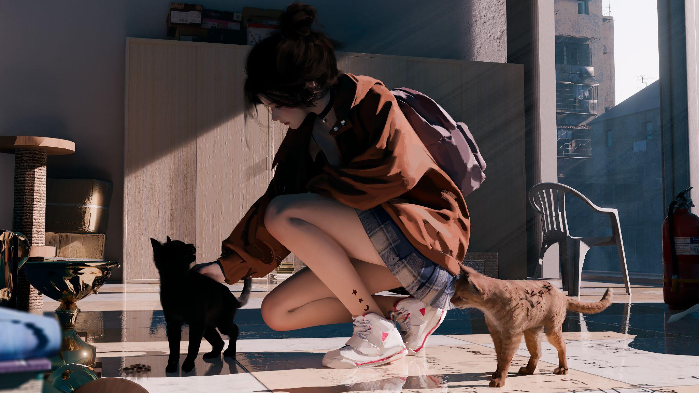

**VI**: “Sinh linh bé nhỏ tội nghiệp, rõ ràng xinh xắn thế này, mà cuối cùng vẫn chẳng có ai cần.”

**ZH**: “可怜的小家伙，这么好看，到最后还是没人要。”

**VI**: Cô cúi đầu vuốt ve dọc sống lưng chú mèo đen, dùng đầu ngón tay cảm nhận lớp lông mềm mại và ấm áp của nó, dường như chẳng hề nhận ra trong giọng nói của chính mình đang thoáng gợn lên một nỗi bi thương trầm lắng khôn nguôi.

**ZH**: 她低头抚摸着黑猫的背，用指尖感受它柔软而温热的皮毛，没察觉到自己声音里透出一丝漫不经心的悲哀。

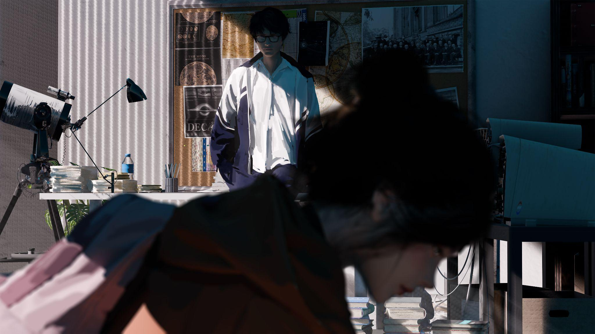

**VI**: Cậu lặng thinh hồi lâu, dường như lắng nghe và hiểu được điều gì đó ẩn sau câu nói, nhưng không đáp lại. Cậu chỉ lặng lẽ đứng giữa luồng sáng, ánh mắt bình lặng và thâm trầm tựa như một tảng băng vĩnh cửu chưa từng tan chảy.

**ZH**: 他沉默片刻，似乎听出了什么，却没有接话。只是站在光里，眼神平静得像一块久未融化的坚冰。

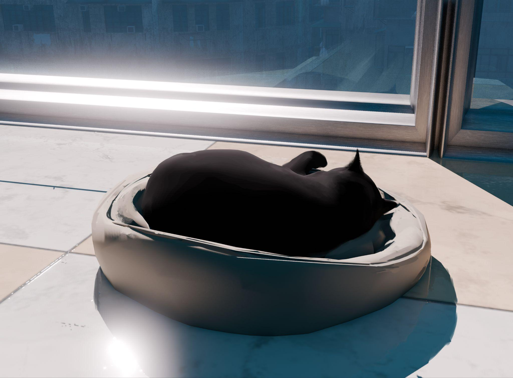

**VI**: Ta chưa từng diện kiến thần linh.

**ZH**: 我未曾遇见过神明。

**VI**: Cho đến ngày hôm ấy,

**ZH**: 直至那日，

**VI**: Người đứng giữa vầng dương chan hòa,

**ZH**: 他立于光中，

**VI**: Ban cho ta lương thực cùng danh xưng của muôn vì tinh tú.

**ZH**: 赐我食粮与星辰之名。
