# 云虫 - 第二章 云中人 · 一

---

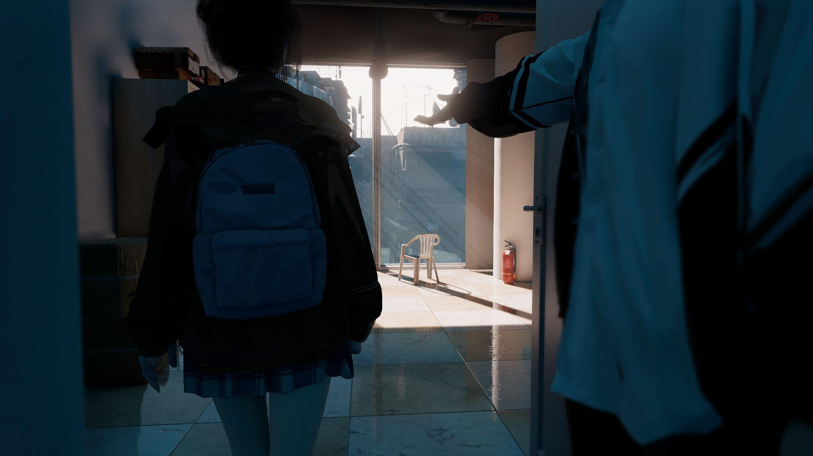

> 咔嚓

> “请进。”

> 门轴发出一声细微的金属摩擦声，像某种生锈的脊骨被硬生生拧开。空气中弥漫着工厂特有的金属锈味，夹杂着老旧电器散发的气息，冷清得令人心生疏离。

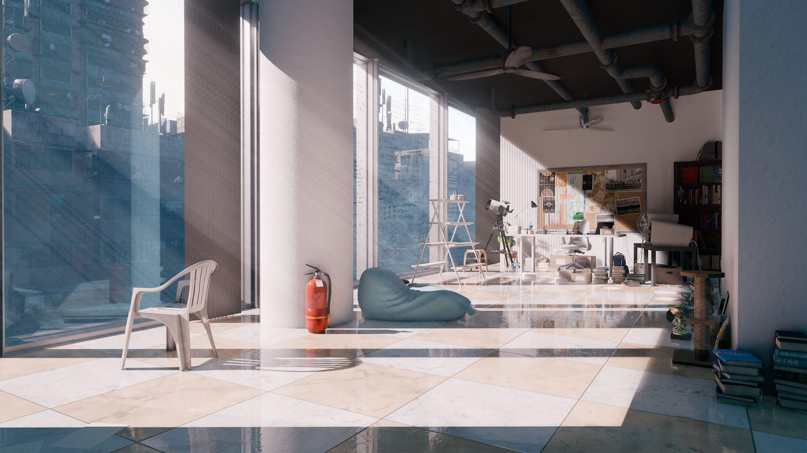

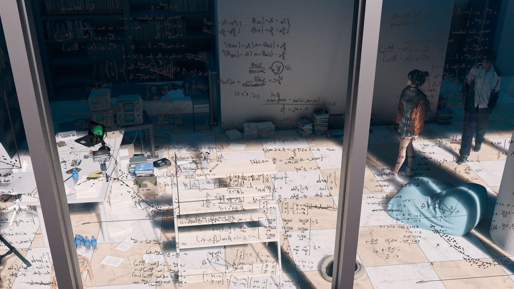

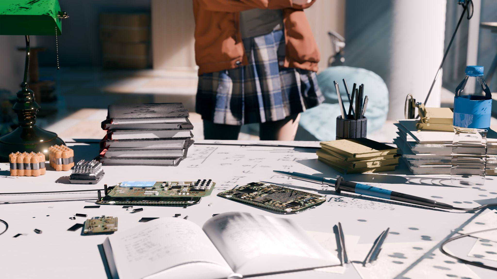

> [废旧PCB板]

> [电烙铁]

> [电子元件]

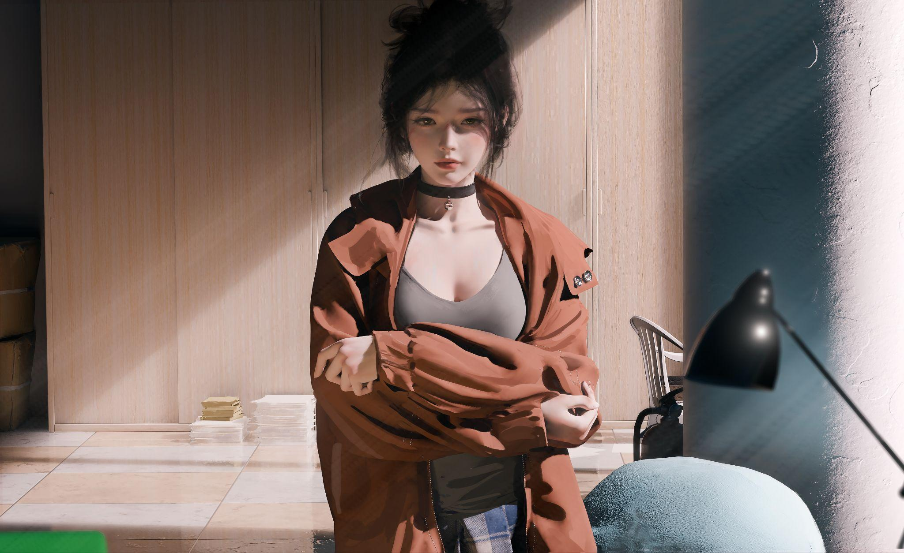

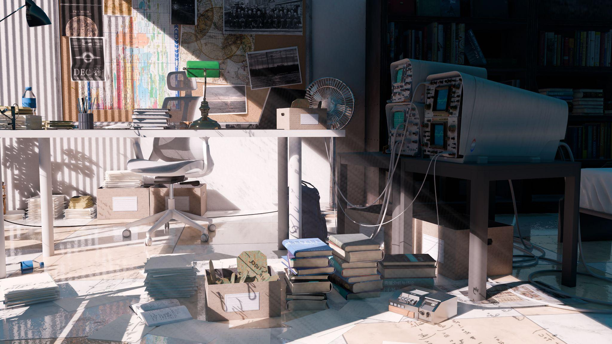

> [书籍]难题集萃

> [书籍]数学分析

> [书籍]场论

> [示波器]

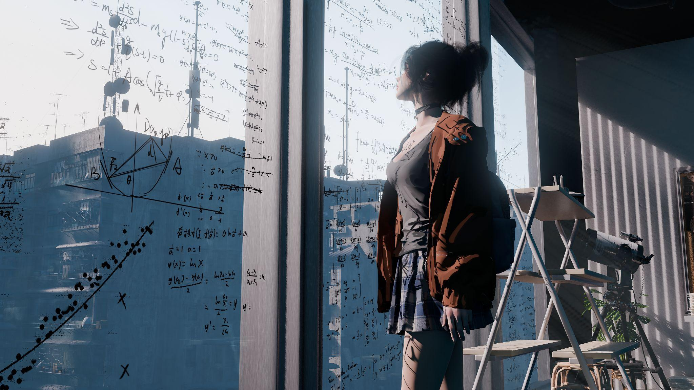

> “你就住这？这不是工厦吗？”

> 她皱了皱鼻子，环顾四周，目光掠过那些泛黄的纸页、散落的仪器，眼神漫不经心地停留在墙角的黑色水渍上，眉头轻轻地蹙了蹙，声音里透出疑惑与淡淡的不安。

> “是啊。这片区域早年划入了重建计划，结果一直搁置。几年前还发生过一起命案，案子到现在没破，所以根本没人敢租，房租自然便宜。”

> “啊？凶宅啊？你不忌讳？要不要放尊观音像镇一镇？”

> 她的语气像开玩笑，目光却无意间流露出某种防备与戒心。窗外，云虫将至的躁动声隐约传来，城市被一股难以言喻的慌乱笼罩着。

> “驱邪是要的，不过我有更物理的办法。”

> “更物理的？”

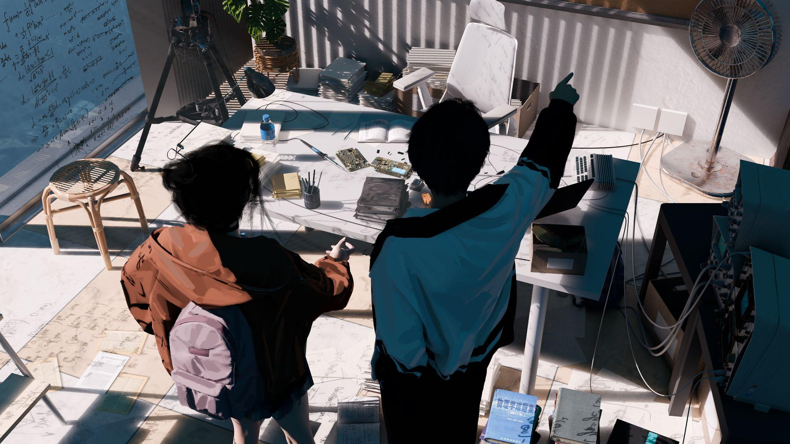

> “看，有这些大神们坐镇，方圆百米鬼神莫近。”

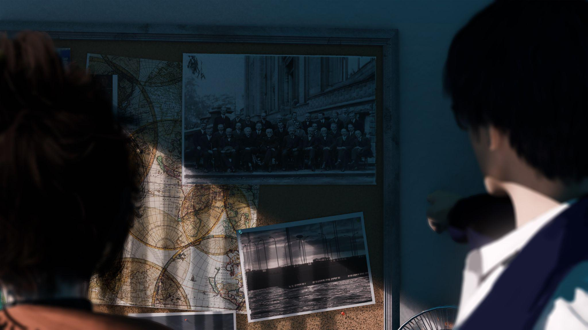

> [相片]第五届索尔维会议 （AD1927）

> [图片]人类文明发展时间轴

> 她顺着他的手指望过去，看到一张陈旧的黑白照片，上面蒙了一层淡淡的灰。照片里是1927年第五届索尔维会议，一群物理学界的巨匠——爱因斯坦、薛定谔、玻尔、海森堡——正坐在一起，面无表情地直视镜头，神情里透着某种冷峻的威严。

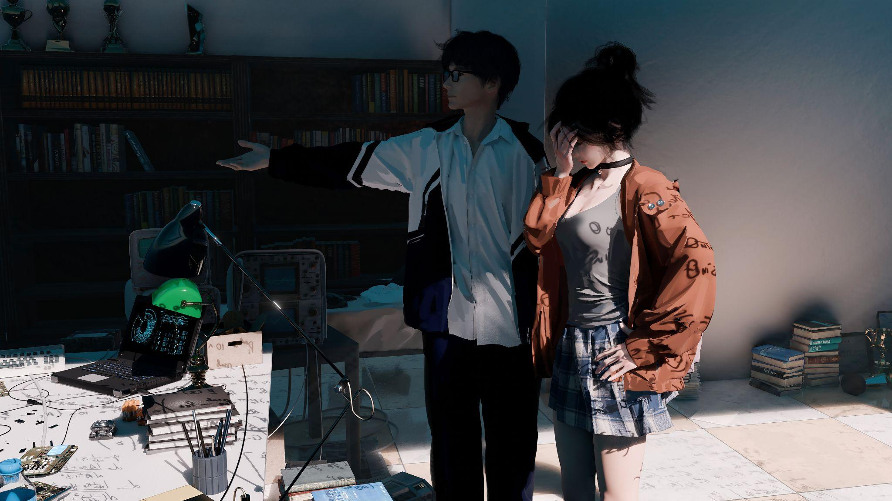

> “好吧，这确实很物理……”

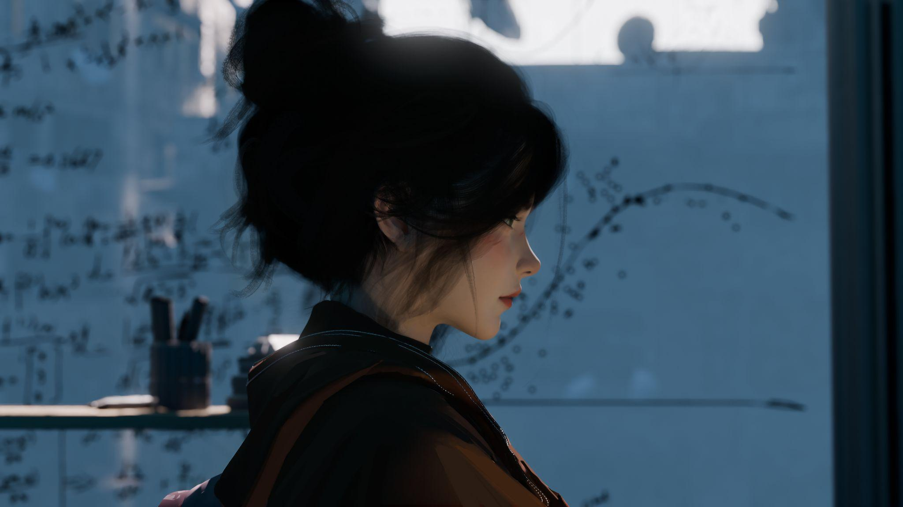

> “我记得你们大学是有宿舍的，为什么还要自己租房？”

> 他望着她安静而柔和的侧脸，唇角微微抿起又放开，似乎终于还是决定开口问出那个问题。

> “我和室友合不来。而且我经常要出去打工，住校也不方便。”

> “是去酒吧唱歌么？”

> “你可是好学生，问这些干嘛？”

> “现在外面租房不易，如果不嫌弃的话，等你找到房子之前，可以先凑合住这儿。我那边靠窗还有块地方空着……”

> “……你确定？”

> “嗯。”

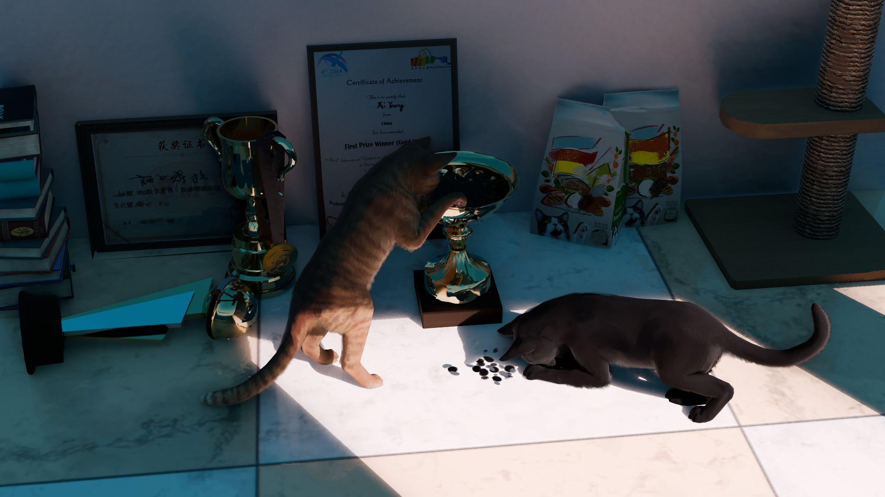

> 喵！

> [奖杯]物理奥林匹克竞赛金牌

> [猫粮]

> [奖状]全国数学竞赛一等奖

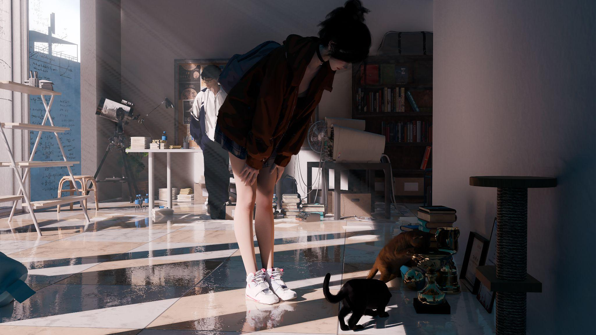

> “这猫是你养的？”

> “不算。流浪猫。我常喂它们吃的，它们就认熟了。”

> “有名字么？”

> “黑的叫参宿四，橘的叫木卫二。”

> “这么好看的猫，起的什么鬼名字……”

> “你不懂，星星的名字才是最浪漫的。”

> “哟，理工男也懂浪漫啊，怎么，想捡个银河系回来？”

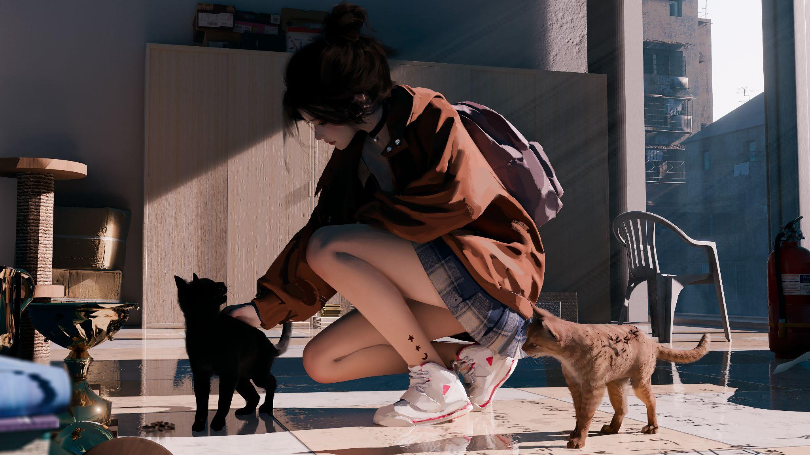

> “可怜的小家伙，这么好看，到最后还是没人要。”

> 她低头抚摸着黑猫的背，用指尖感受它柔软而温热的皮毛，没察觉到自己声音里透出一丝漫不经心的悲哀。

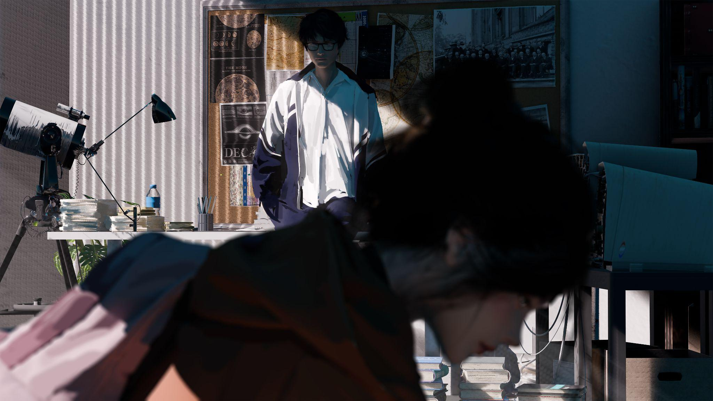

> 他沉默片刻，似乎听出了什么，却没有接话。只是站在光里，眼神平静得像一块久未融化的坚冰。

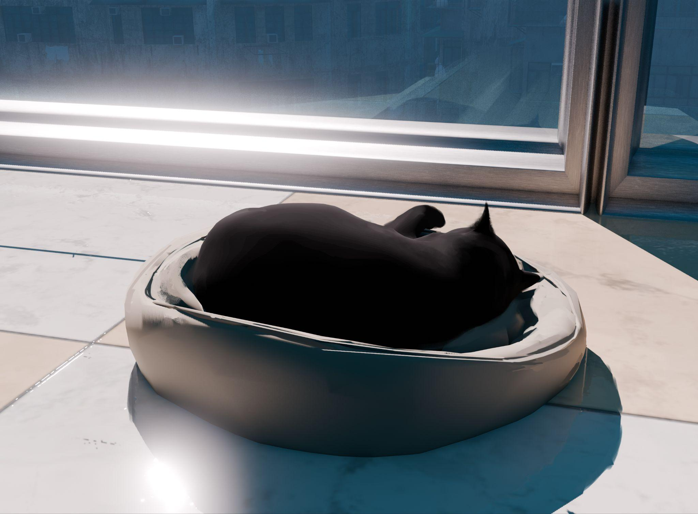

> 我未曾遇见过神明。

> 直至那日，

> 他立于光中，

> 赐我食粮与星辰之名。

