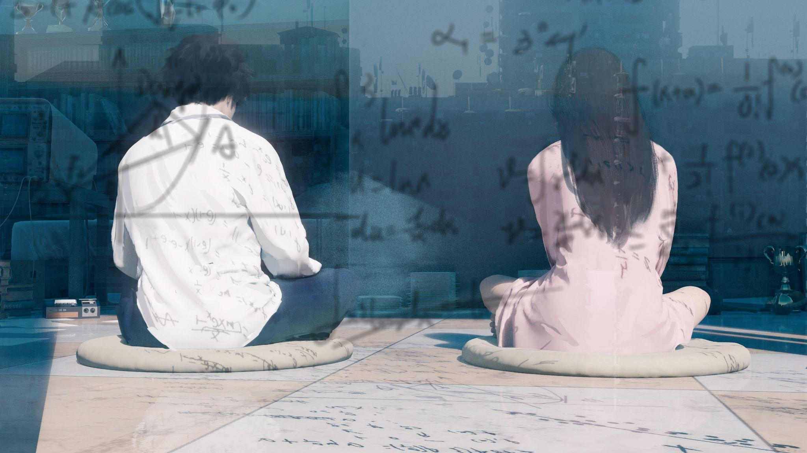
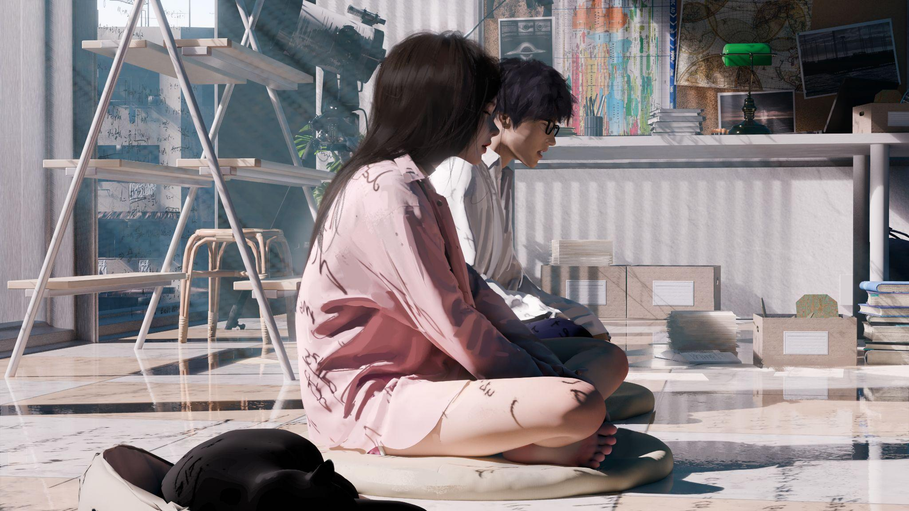
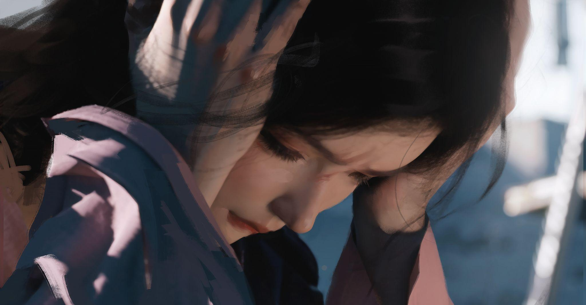
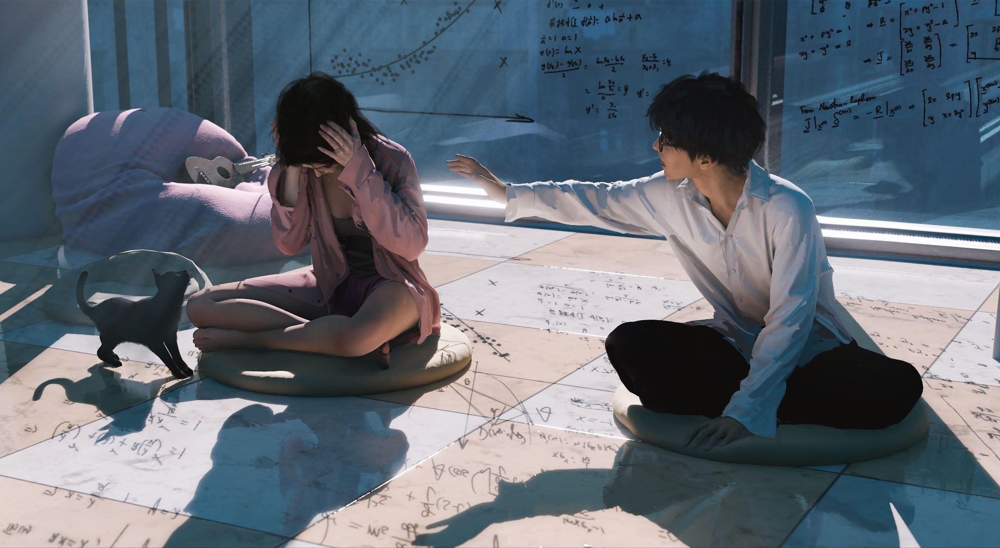
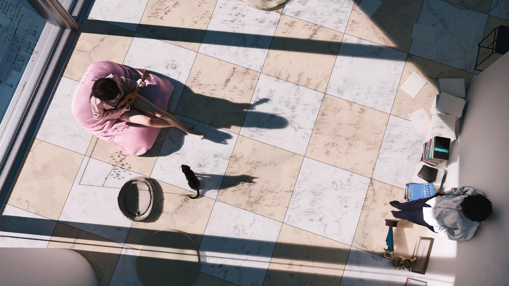
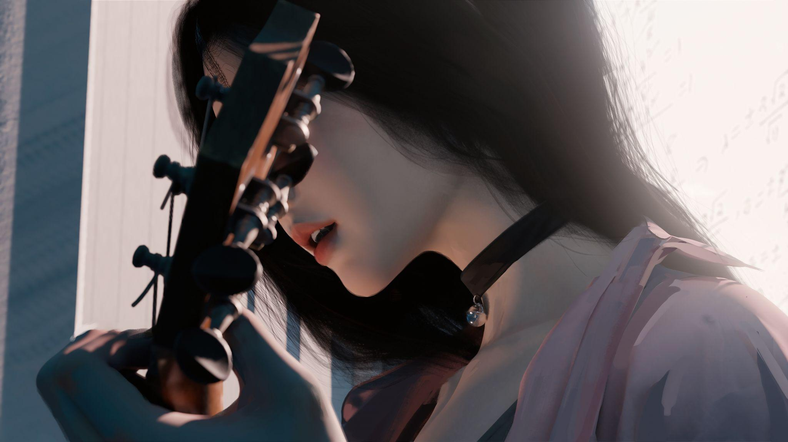
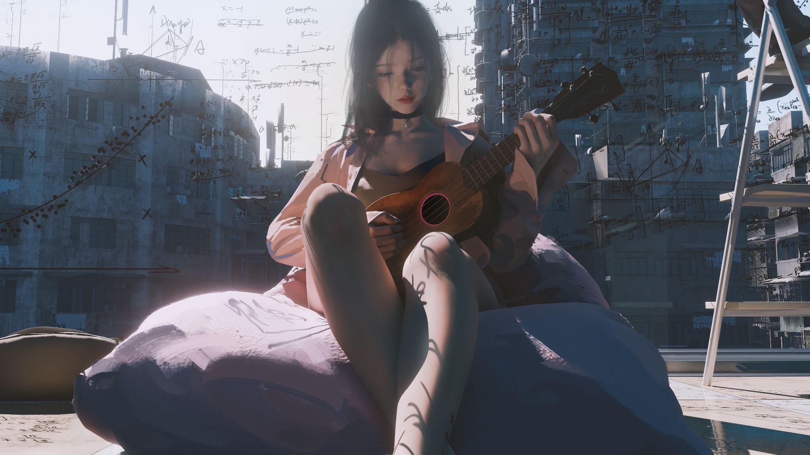
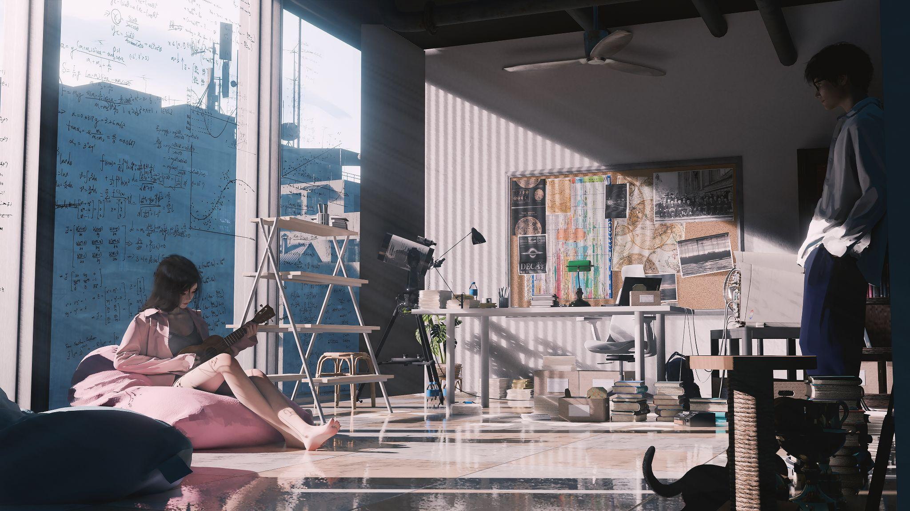

# CloudInsect - Chapter 2: Cloud Dwellers · Part 2

*Original Title: 第二章 云中人 · 二*

---

> “Take a deep breath.Empty your mind.Let go of every stray thought.Try to feel the present moment in its purest form—Feel the ground beneath you, the quiet strength it gives.Feel the cool air filling your lungs,And the warmth as it leaves you.”

> “Did you invent this spell yourself?”

> “It’s meditation. Pretty common now. Might help settle your mind.Close your eyes. Repeat after me—”

> “Imagine a gentle light flowing through your body.”

> “…A gentle light… flowing through me…”

> “Now really listen to the sounds around you.Don’t resist them. Don’t chase them.”

> “…Don’t resist… don’t chase…”

> “Feel the air moving softly. Let yourself merge with the space.”

> “……”

> [Noise]“Your dad already gave you gifts and money. What more do you want? He’s taking the whole family abroad. He doesn’t have time.”

> “I don’t want those things. I just want him to spend one day with me. On my eighteenth birthday. Just one day.”

> “Why are you so unreasonable? You know he’s busy, yet you cling like this.”

> [Noise]“Mahina, let’s… break up.”

> [Noise]“You need to move out by tomorrow night. Or I’m cutting your water and power.”

> [Noise]“Mahina, we took a vote. You can’t hang your clothes on the balcony anymore.”

> “…Why?”

> “Those bar outfits you wear—people will think we’re all like that.”

> “Then where should I dry them?”

> “Take them to a laundromat. You’ve got money, don’t you?”

> “Why do you think I’m rich?”

> “Come on. You sing one night at the bar and earn thousands. I heard the bosses even stuff cash down your bra.”

> “…Really? Haha…”

> “Mahina? What’s wrong? You look pale.”

> “…Nothing. Just dizzy. This technique—no, meditation—may not suit me. But thank you. At least you truly wanted to help. Sigh…”

> “As thanks… let me sing you a song.”

> [Soft singing]

> “Don’t tell me to give up,To open my eyes—I feel the world with my heart.You’re not me,How could you understand?”

> ...

> [Soft singing]

> “I’m not as perfect as you believe.Sometimes I can’t even tell what’s real.”

> ...

> “It’s just a song. Why are you blushing?”

> “Huh? No—I’m not!Do you sing like this at the bar?”

> “Yeah.”

> “And the people who listen there… what kind of people are they?”

> “Not good people.”

> “…Not good?”

> “But not bad either.They’re just… lost souls, like me—Wandering this world.”

> [Continues singing softly]

> “Whose heart should I borrow

> To feel everything around me?

> Even pain, even tears—

> They’re still mine.”

> — Faye Wong, “No Regrets” (1993)

> Her voice was airy, slightly hoarse, like sunlight catching dust mid-air.

> Outside, the sound of the CloudInsect and city noise tangled like threads,

> as if the whole city held its breath under the omen of the approaching CloudInsect.

> He watched Mahina bathed in backlight,

> a faint halo blooming on her shoulder—soft, dreamlike.

> His eyes stayed on her.

> Everything else blurred into silence.

> Only her—

> that gentle, solitary outline—remained.

