# Vân Trùng - Chương 2: Người Trong Mây · II

---

* **Lời thoại / Nội dung phát ra:**
  > **[Hi Dương]** "Hít sâu vào... Thả lỏng tâm trí, trút bỏ mọi tạp niệm, thử cảm nhận khoảnh khắc hiện tại một cách thuần khiết nhất. Cảm nhận mặt đất nâng đỡ cơ thể bạn, cảm nhận làn khí mát lạnh khẽ lướt qua khi hít vào. Và cảm nhận hơi thở ấm áp nhẹ nhàng tỏa ra khi thở ra..."

---

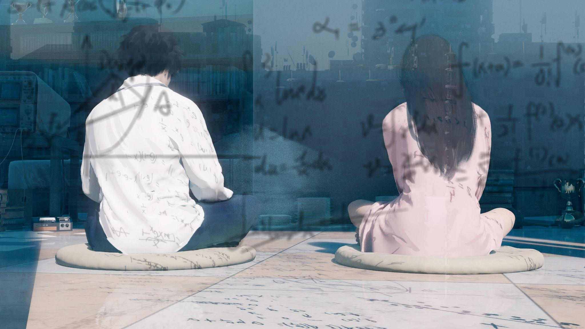

* **Lời thoại / Nội dung phát ra:**
  > **[Nguyệt Nha Nhi]** "Cái 'tâm pháp' này là do cậu tự sáng tạo ra đấy à?"
  > 
  > **[Hi Dương]** "Là thiền định đấy, dạo này đang khá phổ biến, có thể giúp xoa dịu tâm trạng của cậu rất tốt. Nhắm mắt lại nào, đọc theo tôi nhé:"

---

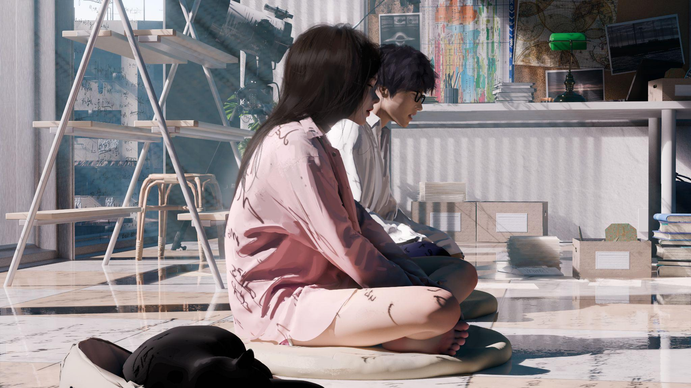

* **Lời thoại / Nội dung phát ra:**
  > **[Hi Dương]** "Hãy tưởng tượng một luồng ánh sáng dịu dàng, chầm chậm chảy qua khắp cơ thể bạn."
  > 
  > **[Nguyệt Nha Nhi]** "... Một luồng sáng dịu dàng... chảy qua khắp cơ thể tôi..."

---

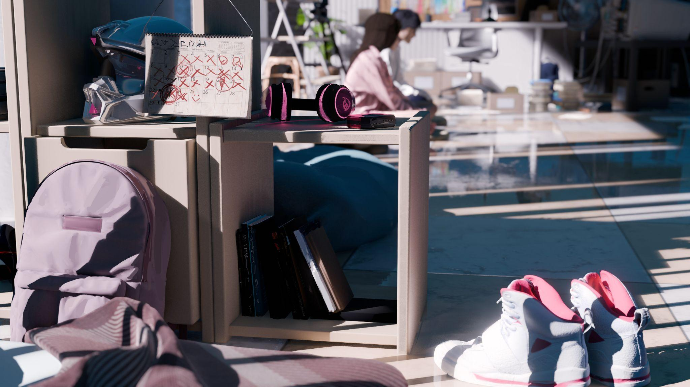

* **Lời thoại / Nội dung phát ra:**
  > **[Hi Dương]** "Dùng tâm lắng nghe những âm thanh xung quanh, không kháng cự, cũng chẳng đuổi theo."
  > 
  > **[Nguyệt Nha Nhi]** "... Không kháng cự... không đuổi theo..."

---

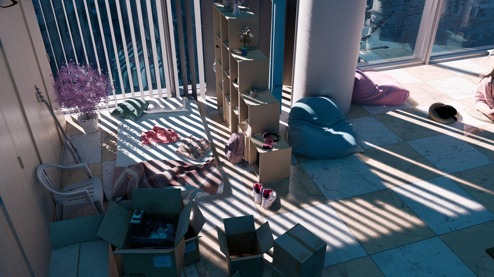

* **Lời thoại / Nội dung phát ra:**
  > **[Hi Dương]** "Cảm nhận không khí nhẹ nhàng lưu chuyển, để bản thân hòa vào khoảng không gian."
  > 
  > **[Nguyệt Nha Nhi]** "......"

---

* **Lời thoại / Tiếng vọng ký ức hỗn loạn:**
  > **[Tiếng người cô]** "Bố mày đã tặng quà sinh nhật với cho bao nhiêu tiền rồi, mày còn muốn thế nào nữa? Bố mày phải đưa cả nhà đi du lịch nước ngoài, đâu rảnh rỗi mà ở bên mày!"
  > 
  > **[Nguyệt Nha Nhi]** "Cô ơi, cháu không cần những thứ đó. Cháu chỉ muốn sinh nhật 18 tuổi bố có thể ở bên cháu một ngày thôi, chỉ một ngày thôi mà..."
  > 
  > **[Tiếng người cô]** "Con ranh này sao chẳng hiểu chuyện gì cả thế? Mày rõ ràng biết bố mày không tiện, mà cứ bám riết lấy ông ấy mãi!"
  > 
  > **[Tiếng bạn trai cũ]** "Nguyệt Nha Nhi, chúng mình... chia tay đi..."
  > 
  > **[Tiếng chủ nhà]** "Trước tối mai cô phải dọn đi hết cho tôi, bằng không tôi cắt điện cắt nước đấy!"

---

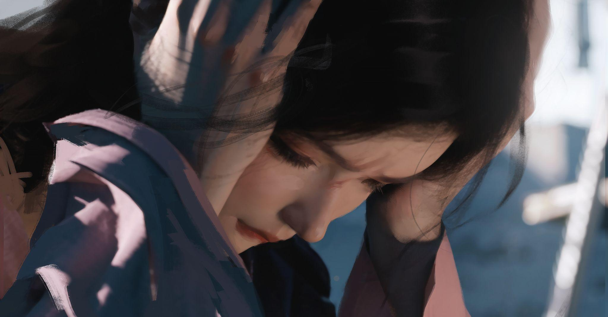

* **Lời thoại / Tiếng vọng ký ức hỗn loạn:**
  > **[Bạn cùng phòng]** "Nguyệt Nha Nhi, cả phòng chúng tao thống nhất bỏ phiếu rồi, mấy bộ quần áo đó của mày không được phơi ngoài ban công nữa."
  > 
  > **[Nguyệt Nha Nhi]** "Tại sao chứ?"
  > 
  > **[Bạn cùng phòng]** "Mấy bộ đồ mày mặc đi hát quán bar phơi tơ hơ ở ngoài, người ta nhìn vào lại tưởng cả phòng này toàn ngữ gái gú chẳng đứng đắn."
  > 
  > **[Nguyệt Nha Nhi]** "Thế sau này đồ của tôi phơi ở đâu?"
  > 
  > **[Bạn cùng phòng]** "Ra tiệm giặt ủi mà giặt sấy chứ sao, chẳng phải mày nhiều tiền lắm à?"
  > 
  > **[Nguyệt Nha Nhi]** "Tại sao các người lại nghĩ là tôi nhiều tiền?"
  > 
  > **[Bạn cùng phòng]** "Giả vờ giả vịt cái gì chứ? Mày đi hát một đêm ở quán bar được mấy ngàn tệ, tao nghe nói mấy ông chủ quán còn nhét tiền thẳng vào áo lót của mày cơ mà."
  > 
  > **[Tiếng cười cợt nhạo báng]** "Thế thật á, ha ha ha..."

---

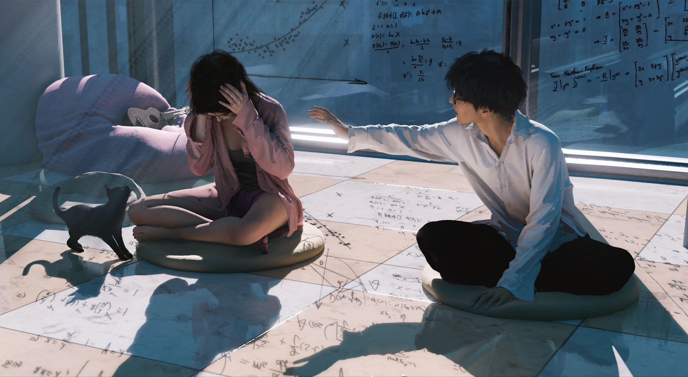

* **Lời thoại / Nội dung phát ra:**
  > **[Hi Dương]** "Nguyệt Nha Nhi? Cậu sao thế, sắc mặt sao lại tái mét thế kia?"

---

* **Lời thoại / Nội dung phát ra:**
  > **[Nguyệt Nha Nhi]** "... Tôi không sao, chỉ là thấy hơi chóng mặt thôi. Cái 'tâm pháp' này của cậu — à không, thiền định — có lẽ không hợp với tôi rồi. Nhưng vẫn cảm ơn cậu nhé, ít nhất thì cậu cũng thực lòng muốn giúp tôi. Haizz..."

---

* **Lời thoại / Nội dung phát ra:**
  > **[Nguyệt Nha Nhi]** "Để đáp lại lòng tốt của cậu, tôi hát tặng cậu một bài nhé."

---

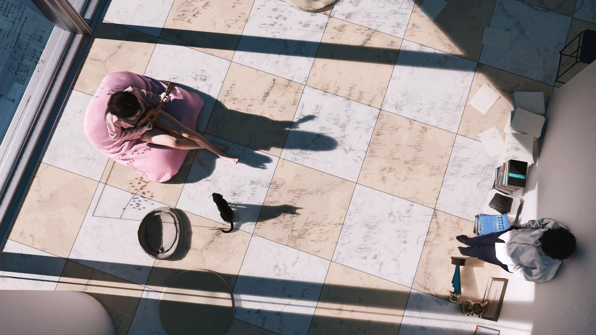

* **Lời thoại / Lời hát đệm bass:**
  > **[Nguyệt Nha Nhi khẽ hát]**
  > *"Đừng bảo tôi rằng nên từ bỏ*
  > *Nên mở to đôi mắt ra nhìn đời*
  > *Tôi dùng trái tim của chính mình*
  > *Để ngắm nhìn, để cảm nhận*
  > *Bạn đâu phải là tôi*
  > *Thì làm sao có thể thấu hiểu được...*
  > *......"*

---

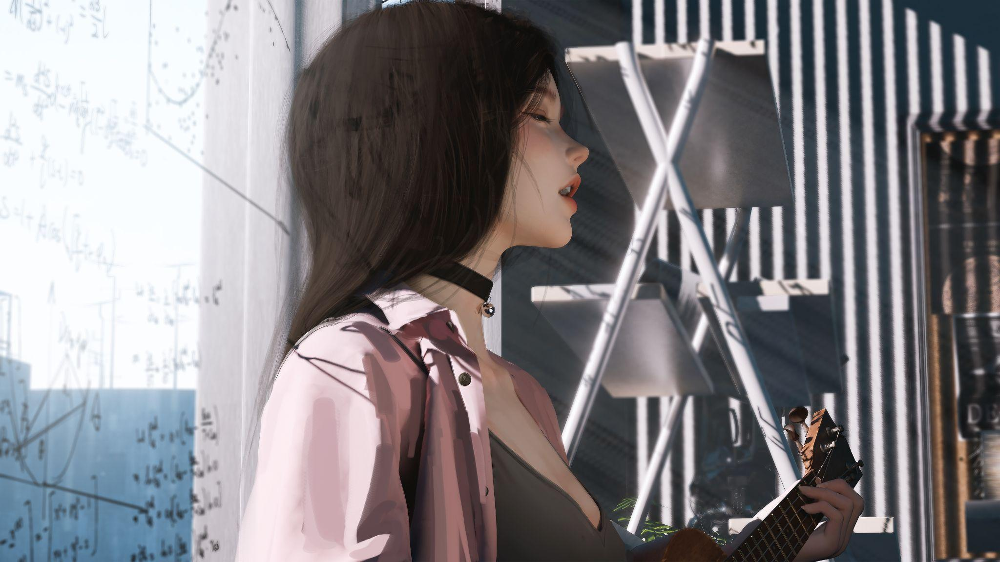

* **Lời thoại / Lời hát đệm bass:**
  > **[Nguyệt Nha Nhi khẽ hát]**
  > *"Tôi chẳng hoàn mỹ như các người vẫn tưởng*
  > *Tôi thừa nhận đôi khi mình cũng chẳng phân định nổi trắng đen thực hư——"*

---

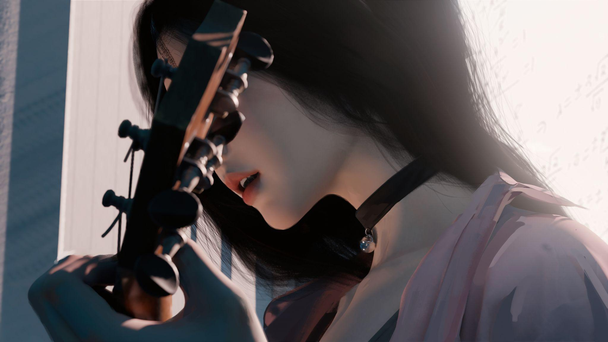

* **Lời thoại / Nội dung phát ra:**
  > **[Nguyệt Nha Nhi]** "Người ta mới hát có một bài thôi, cậu đỏ mặt cái nỗi gì đấy hả?"

---

* **Lời thoại / Nội dung phát ra:**
  > **[Hi Dương]** "Hả? Đâu... đâu có đỏ mặt đâu... Ở quán bar, cậu cũng hát như thế này sao?"
  > 
  > **[Nguyệt Nha Nhi]** "Đúng vậy đấy."
  > 
  > **[Hi Dương]** "Những người đến đó nghe cậu hát... là những người thế nào?"
  > 
  > **[Nguyệt Nha Nhi]** "Đều chẳng phải người tốt đẹp gì."
  > 
  > **[Hi Dương]** "... Không phải người tốt?"

---

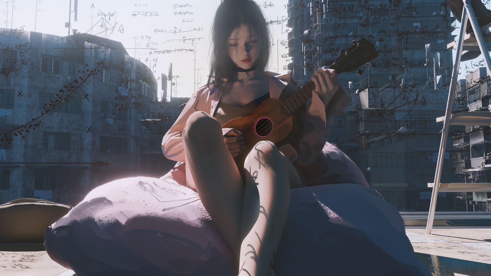

* **Lời thoại / Nội dung phát ra:**
  > **[Nguyệt Nha Nhi]** "Nhưng đương nhiên cũng chẳng phải kẻ xấu xa độc ác. Họ cũng giống như tôi vậy thôi, đều là những linh hồn lạc lối giữa cõi nhân gian này."
  > 
  > **[Nguyệt Nha Nhi tiếp tục khẽ hát]**
  > *"Phải mượn trái tim của ai để thấu tỏ*
  > *Để cảm nhận chân thực mọi thứ xung quanh mình*
  > *Dẫu cho có là đớn đau, dẫu cho có là nước mắt*
  > *Thì đó cũng là nỗi đau thương thuộc về riêng tôi"*
  > 
  > *(— Vương Phi, ca khúc "Chấp Mê Bất Hối" (1993))*

---

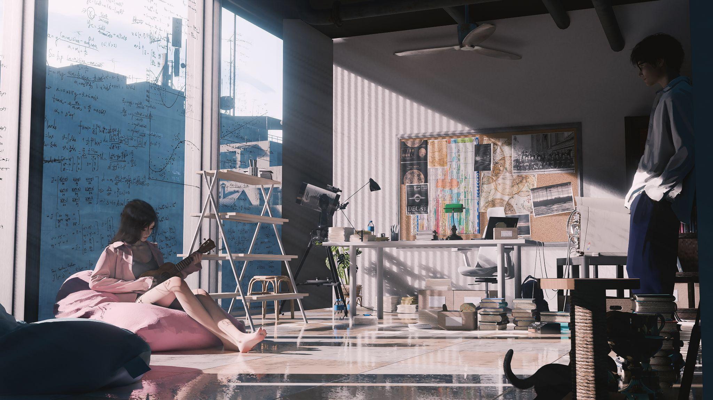

* **Lời trần thuật:**
  > Giọng hát của cô thanh thoát, vang vọng mà lại vương chút khàn nhẹ, tựa như những hạt bụi li ti lững lờ trôi giữa vạt nắng mai.
  > 
  > Bên ngoài khung cửa sổ, tiếng trùng ngâm nơi xa cùng thanh âm huyên náo của phố thị đan xen vào nhau, cả thành phố chìm trong nỗi bất an mơ hồ trước điềm báo Vân Trùng sắp giáng lâm.
  > 
  > Ánh mắt cậu chăm chú dõi theo Nguyệt Nha Nhi đứng ngược sáng, ánh dương hắt lên vai cô tạo thành một vầng hào quang mờ ảo, phác họa nên một bóng hình dịu dàng mà cô tịch khôn cùng.
