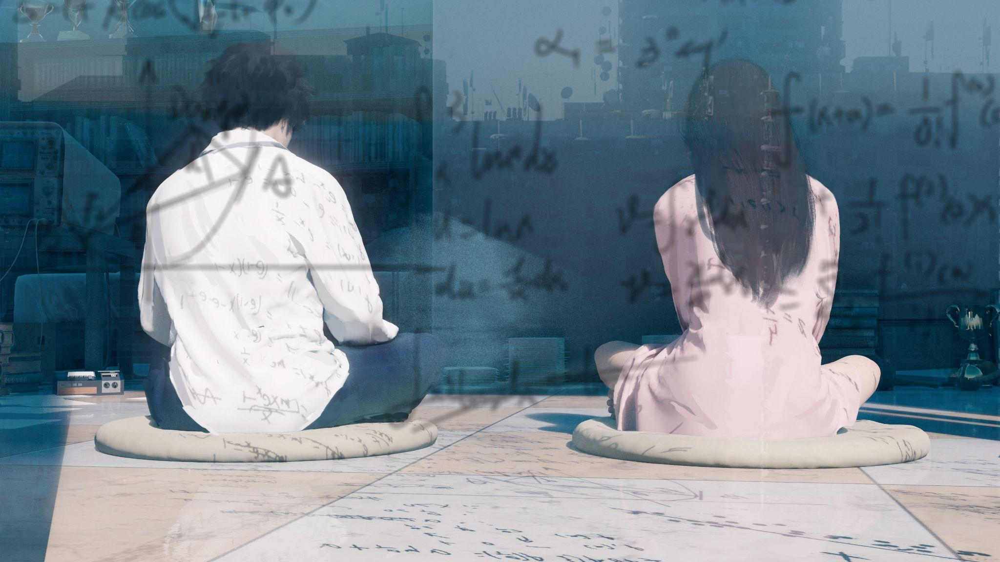
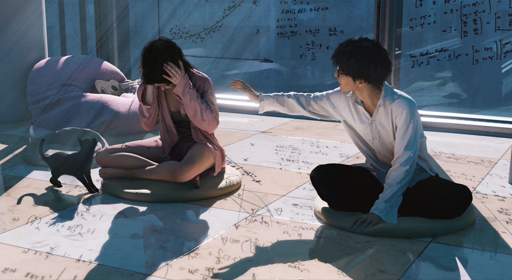
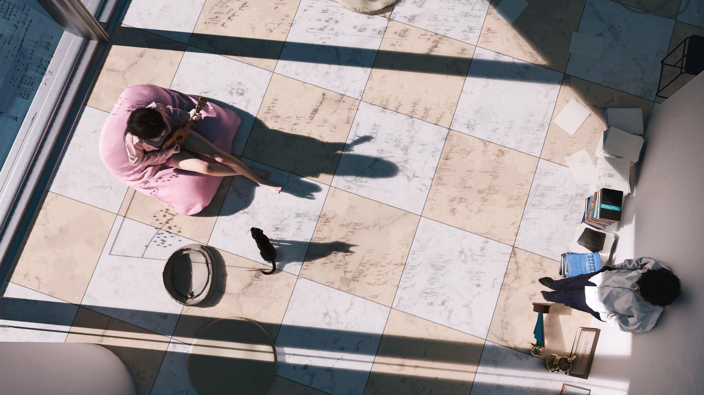
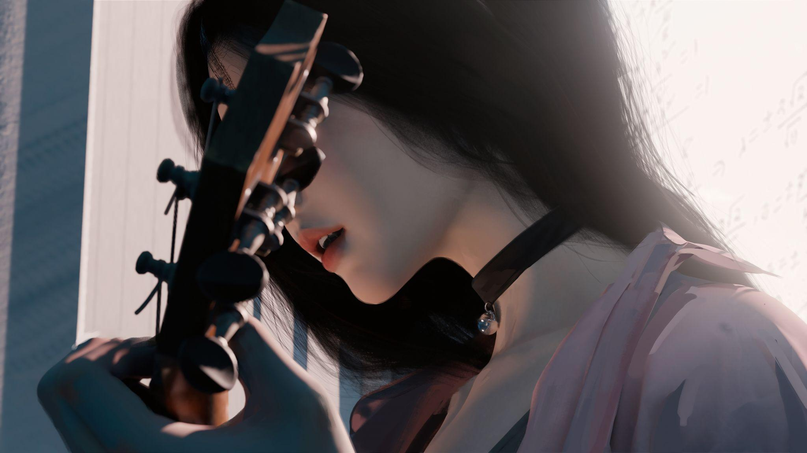
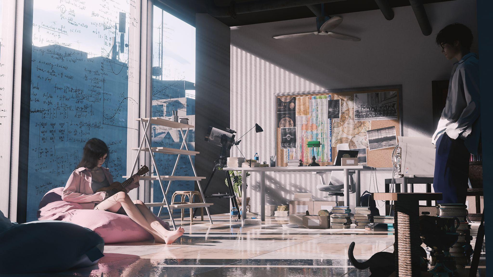

# Vân Trùng / CloudInsect - Chương 2: Người Trong Mây · II (第二章 云中人 · 二)

---

**VI**: “Hít sâu vào... Thả lỏng tâm trí, trút bỏ mọi tạp niệm, thử cảm nhận khoảnh khắc hiện tại một cách thuần khiết nhất. Cảm nhận mặt đất nâng đỡ cơ thể bạn, cảm nhận làn khí mát lạnh khẽ lướt qua khi hít vào. Và cảm nhận hơi thở ấm áp nhẹ nhàng tỏa ra khi thở ra...”

**ZH**: “深呼吸，把心放空，放下一切杂念，试着去感受最纯粹的当下。感受地面对你的支撑力，感受吸入的空气的微凉。感受呼出的空气的温热……”

**EN**: “Take a deep breath.Empty your mind.Let go of every stray thought.Try to feel the present moment in its purest form—Feel the ground beneath you, the quiet strength it gives.Feel the cool air filling your lungs,And the warmth as it leaves you.”

**VI**: “Cái 'tâm pháp' này là do cậu tự sáng tạo ra đấy à?”

**ZH**: “你这心法是自创的？”

**EN**: “Did you invent this spell yourself?”

**VI**: “Là thiền định đấy, dạo này đang khá phổ biến, có thể giúp xoa dịu tâm trạng của cậu rất tốt. Nhắm mắt lại nào, đọc theo tôi nhé:”

**ZH**: “是冥想，现在挺流行的，对缓解你的心情有帮助。 闭上眼，跟我念：”

**EN**: “It’s meditation. Pretty common now. Might help settle your mind.Close your eyes. Repeat after me—”

**VI**: “Hãy tưởng tượng một luồng ánh sáng dịu dàng, chầm chậm chảy qua khắp cơ thể bạn.”

**ZH**: “想象一道温柔的光，缓缓流过你的身体。”

**EN**: “Imagine a gentle light flowing through your body.”

**VI**: “... Một luồng sáng dịu dàng... chảy qua khắp cơ thể tôi...”

**ZH**: “……温柔的光，流过我的身体。”

**EN**: “…A gentle light… flowing through me…”

**VI**: “Dùng tâm lắng nghe những âm thanh xung quanh, không kháng cự, cũng chẳng đuổi theo.”

**ZH**: “用心去听周围的声音，既不抗拒，也不追随。”

**EN**: “Now really listen to the sounds around you.Don’t resist them. Don’t chase them.”

**VI**: “... Không kháng cự... không đuổi theo...”

**ZH**: “……不抗拒，不追随。”

**EN**: “…Don’t resist… don’t chase…”

**VI**: “Cảm nhận không khí nhẹ nhàng lưu chuyển, để bản thân hòa vào khoảng không gian.”

**ZH**: “感受空气轻柔流动，让自己融入空间。”

**EN**: “Feel the air moving softly. Let yourself merge with the space.”

**VI**: “......”

**ZH**: “……”

**EN**: “……”

**VI**: [Hồi ức hỗn loạn] “Bố cháu đã tặng quà sinh nhật và gửi cho cháu bao nhiêu tiền rồi, cháu còn muốn đòi hỏi gì nữa đây? Bố cháu còn phải đưa cả nhà đi du lịch nước ngoài, làm gì có thời gian mà ở bên cháu!”

**ZH**: [嘈杂]“你爸给了你生日礼物和不少钱了，你还想怎么样？他要带全家去国外旅游，没时间陪你。 ”

**EN**: [Noise]“Your dad already gave you gifts and money. What more do you want? He’s taking the whole family abroad. He doesn’t have time.”

**VI**: “Cô ơi, cháu không cần những thứ đó. Cháu chỉ mong sinh nhật tuổi 18 này bố có thể ở bên cháu một ngày thôi, chỉ một ngày thôi mà cô...”

**ZH**: “姑妈，我不要这些，我只想18岁生日他能陪我一天，就一天。”

**EN**: “I don’t want those things. I just want him to spend one day with me. On my eighteenth birthday. Just one day.”

**VI**: “Con bé này sao lại không biết điều thế hả? Cháu thừa biết bố cháu không tiện, thế mà cứ quấn lấy bố cháu mãi!”

**ZH**: “你这孩子怎么这么不懂事？你明明知道他不方便，还老是缠着他。”

**EN**: “Why are you so unreasonable? You know he’s busy, yet you cling like this.”

**VI**: [Hồi ức hỗn loạn] “Nguyệt Nha Nhi, chúng mình... chia tay đi...”

**ZH**: [嘈杂]“月牙儿，我们……还是分手吧。”

**EN**: [Noise]“Mahina, let’s… break up.”

**VI**: [Hồi ức hỗn loạn] “Trước tối mai cháu bắt buộc phải dọn đi, nếu không bác sẽ cắt điện cắt nước đấy!”

**ZH**: [嘈杂]“你明晚前必须搬走，不然我就给你断水断电！”

**EN**: [Noise]“You need to move out by tomorrow night. Or I’m cutting your water and power.”

**VI**: [Hồi ức hỗn loạn] “Nguyệt Nha Nhi, phòng ký túc xá chúng ta đã nhất trí biểu quyết rồi, mấy bộ quần áo đó của cậu không được phơi ngoài ban công nữa đâu nhé.”

**ZH**: [嘈杂]“月牙儿，我们宿舍的人一致投票决定，你那些衣服不能再晾在阳台了。”

**EN**: [Noise]“Mahina, we took a vote. You can’t hang your clothes on the balcony anymore.”

**VI**: “Tại sao cơ chứ?”

**ZH**: “为什么？”

**EN**: “…Why?”

**VI**: “Mấy bộ đồ cậu mặc đi hát ở quán bar mà phơi tơ hơ ngoài kia, người ta nhìn vào lại tưởng cả phòng chúng mình toàn ngữ chẳng đàng hoàng gì.”

**ZH**: “你在酒吧穿的那些衣服晾外面，别人看到会以为我们宿舍都不是什么正经人。”

**EN**: “Those bar outfits you wear—people will think we’re all like that.”

**VI**: “Thế sau này đồ của tôi biết phơi ở đâu?”

**ZH**: “那我以后衣服晾哪？”

**EN**: “Then where should I dry them?”

**VI**: “Thì mang ra tiệm giặt ủi bên ngoài mà giặt sấy, dù sao cậu cũng đâu có thiếu tiền, đúng không nào?”

**ZH**: “出去洗衣店洗呗，反正你不是很有钱吗？ ”

**EN**: “Take them to a laundromat. You’ve got money, don’t you?”

**VI**: “Tại sao các cậu lại nghĩ là tôi có tiền?”

**ZH**: “你们为什么觉得我有钱？”

**EN**: “Why do you think I’m rich?”

**VI**: “Thôi đừng có giả vờ giả vịt nữa đi! Chẳng phải cậu đi hát quán bar một đêm kiếm được mấy ngàn tệ sao, tớ nghe người ta đồn mấy ông chủ toàn nhét tiền thẳng vào trong áo lót của cậu đấy thôi.”

**ZH**: “装什么啊？你不是在酒吧唱一晚上就有好几千么，我听说那些老板都是把钱直接塞你内衣里的。”

**EN**: “Come on. You sing one night at the bar and earn thousands. I heard the bosses even stuff cash down your bra.”

**VI**: “Thế cơ đấy à... ha ha ha...”

**ZH**: “真的么，哈哈哈……”

**EN**: “…Really? Haha…”

**VI**: “Nguyệt Nha Nhi? Cậu sao thế, sắc mặt sao lại tái mét thế kia?”

**ZH**: “月牙儿？你怎么了，脸色这么难看？”

**EN**: “Mahina? What’s wrong? You look pale.”

**VI**: “... Tôi không sao, chỉ là thấy hơi chóng mặt thôi. Cái 'tâm pháp' này của cậu — à không, thiền định — có lẽ không hợp với tôi rồi. Nhưng vẫn cảm ơn cậu nhé, ít nhất thì cậu cũng thực lòng muốn giúp tôi. Haizz...”

**ZH**: “……没事，就是头晕。你的这个心法——不，冥想，可能不适合我。但还是谢谢你，至少你是真的想帮我。唉……”

**EN**: “…Nothing. Just dizzy. This technique—no, meditation—may not suit me. But thank you. At least you truly wanted to help. Sigh…”

**VI**: “Để đáp lại lòng tốt của cậu, tôi hát tặng cậu một bài nhé.”

**ZH**: “作为答谢，我给你唱支歌吧。”

**EN**: “As thanks… let me sing you a song.”

**VI**: [Khẽ hát] “Đừng bảo tôi rằng nên từ bỏ,

**ZH**: [轻唱]“别说我应该放弃

**EN**: [Soft singing]

**VI**: Nên mở to đôi mắt ra nhìn đời,

**ZH**: 应该睁开眼

**EN**: “Don’t tell me to give up,To open my eyes—I feel the world with my heart.You’re not me,How could you understand?”

**VI**: Tôi dùng trái tim của chính mình,

**ZH**: 我用我的心

**EN**: ...

**VI**: Để ngắm nhìn, để cảm nhận,

**ZH**: 去看去感觉

**VI**: Bạn đâu phải là tôi,

**ZH**: 你并不是我

**VI**: Thì làm sao có thể thấu hiểu được...

**ZH**: 又怎能了解

**VI**: ......”

**ZH**: ……”

**VI**: [Khẽ hát] “Tôi chẳng hoàn mỹ như các người vẫn tưởng,

**ZH**: [轻唱]“我不是你们想的如此完美

**EN**: [Soft singing]

**VI**: Tôi thừa nhận đôi khi mình cũng chẳng phân định nổi trắng đen thực hư —”

**ZH**: 我承认有时也会辨不清真伪——”

**EN**: “I’m not as perfect as you believe.Sometimes I can’t even tell what’s real.”

**EN**: ...

**VI**: “Người ta mới hát có một bài thôi, cậu đỏ mặt cái nỗi gì đấy hả?”

**ZH**: “唱首歌而已，你脸红什么呀？”

**EN**: “It’s just a song. Why are you blushing?”

**VI**: “Hả? Đâu... đâu có đỏ mặt đâu... Ở quán bar, cậu cũng hát như thế này sao?”

**ZH**: “啊？没，没有啊……你在酒吧，也是这样唱歌的么？”

**EN**: “Huh? No—I’m not!Do you sing like this at the bar?”

**VI**: “Đúng vậy đấy.”

**ZH**: “是啊。”

**EN**: “Yeah.”

**VI**: “Những người đến đó nghe cậu hát... là những người thế nào?”

**ZH**: “去那里听你唱歌的，都是些什么人？”

**EN**: “And the people who listen there… what kind of people are they?”

**VI**: “Đều chẳng phải người tốt đẹp gì.”

**ZH**: “都不是什么好人。”

**EN**: “Not good people.”

**VI**: “... Không phải người tốt?”

**ZH**: “……不是好人？”

**EN**: “…Not good?”

**VI**: “Nhưng đương nhiên cũng chẳng phải kẻ xấu xa độc ác. Họ cũng giống như tôi vậy thôi, đều là những linh hồn lạc lối giữa cõi nhân gian này.”

**ZH**: “当然也不是什么坏人。都是和我一样，在人间迷路的灵魂。”

**EN**: “But not bad either.They’re just… lost souls, like me—Wandering this world.”

**VI**: [Tiếp tục khẽ hát] “Phải mượn trái tim của ai để thấu tỏ,

**ZH**: [继续轻唱]“要我用谁的心去体会

**EN**: [Continues singing softly]

**VI**: Để cảm nhận chân thực mọi thứ xung quanh mình,

**ZH**: 真真切切地感受周围

**EN**: “Whose heart should I borrow

**VI**: Dẫu cho có là đớn đau, dẫu cho có là nước mắt,

**ZH**: 就算痛苦 就算是泪

**EN**: To feel everything around me?

**VI**: Thì đó cũng là nỗi đau thương thuộc về riêng tôi.”

**ZH**: 也是属于我的伤悲”

**EN**: Even pain, even tears—

**VI**: —— Vương Phi, ca khúc "Chấp Mê Bất Hối" (1993)

**ZH**: ——王菲《执迷不悔》（1993）

**EN**: They’re still mine.”

**EN**: — Faye Wong, “No Regrets” (1993)

**VI**: Giọng hát của cô thanh thoát, vang vọng mà lại vương chút khàn nhẹ, tựa như những hạt bụi li ti lững lờ trôi giữa vạt nắng mai.

**ZH**: 她的声音空灵又带着微微沙哑，像飘荡在阳光里的细碎尘埃。

**EN**: Her voice was airy, slightly hoarse, like sunlight catching dust mid-air.

**VI**: Bên ngoài khung cửa sổ, tiếng trùng ngâm nơi xa cùng thanh âm huyên náo của phố thị đan xen vào nhau, cả thành phố chìm trong nỗi bất an mơ hồ trước điềm báo Vân Trùng sắp giáng lâm.

**ZH**: 窗外，远处的虫鸣与嘈杂的市声相互交织，整座城市在云虫将至的预感中隐隐不安。他凝视着逆光中的月牙儿，阳光在她肩头形成淡淡的光晕，轮廓柔和而迷蒙。

**EN**: Outside, the sound of the CloudInsect and city noise tangled like threads,

**VI**: Ánh mắt cậu chăm chú dõi theo Nguyệt Nha Nhi đứng ngược sáng, ánh dương hắt lên vai cô tạo thành một vầng hào quang mờ ảo, phác họa nên một bóng hình dịu dàng mà cô tịch khôn cùng.

**ZH**: 他的目光定定地落在她身上，四周的一切逐渐模糊淡去，只剩下她那道温柔却孤绝的轮廓。

**EN**: as if the whole city held its breath under the omen of the approaching CloudInsect.

**EN**: He watched Mahina bathed in backlight,

**EN**: a faint halo blooming on her shoulder—soft, dreamlike.

**EN**: His eyes stayed on her.

**EN**: Everything else blurred into silence.

**EN**: Only her—

**EN**: that gentle, solitary outline—remained.
