# 云虫 - 第二章 云中人 · 二

---

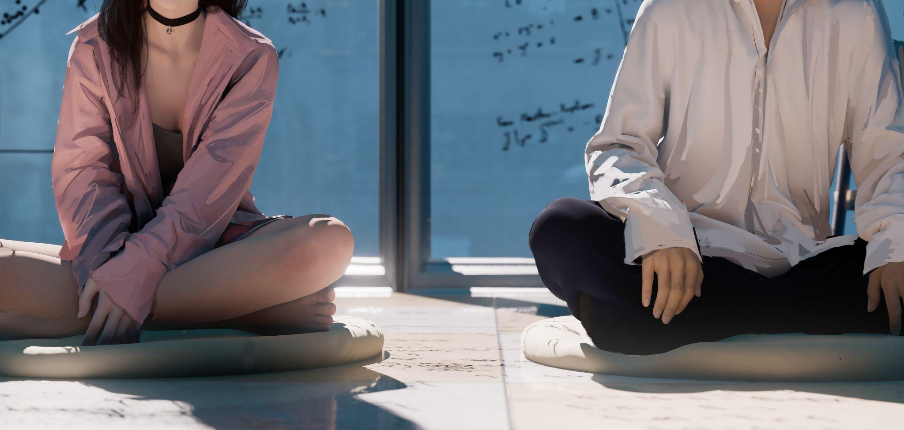

> “深呼吸，把心放空，放下一切杂念，试着去感受最纯粹的当下。感受地面对你的支撑力，感受吸入的空气的微凉。感受呼出的空气的温热……”

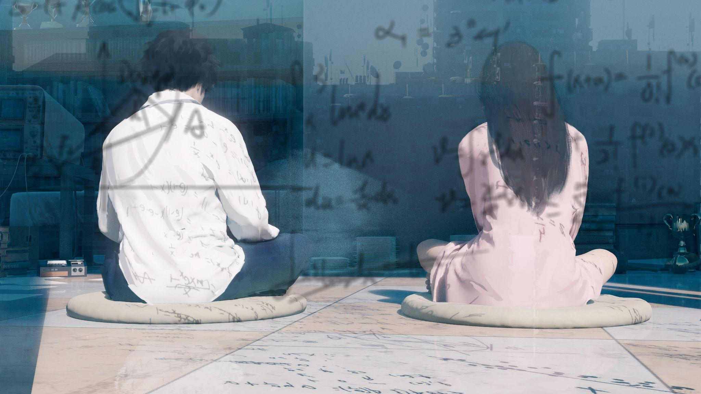

> “你这心法是自创的？”

> “是冥想，现在挺流行的，对缓解你的心情有帮助。 闭上眼，跟我念：”

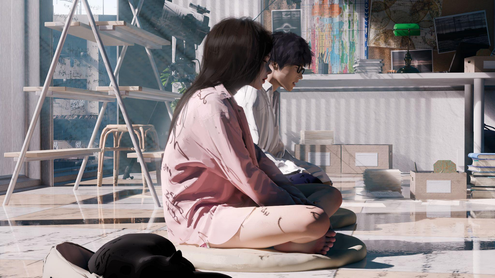

> “想象一道温柔的光，缓缓流过你的身体。”

> “……温柔的光，流过我的身体。”

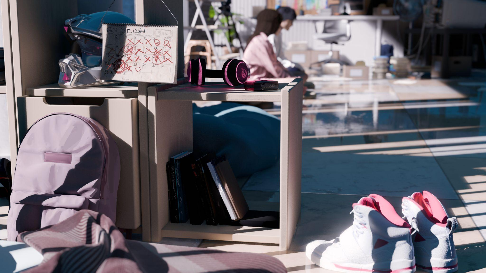

> “用心去听周围的声音，既不抗拒，也不追随。”

> “……不抗拒，不追随。”

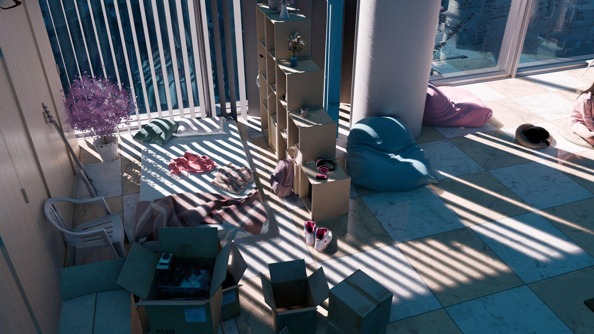

> “感受空气轻柔流动，让自己融入空间。”

> “……”

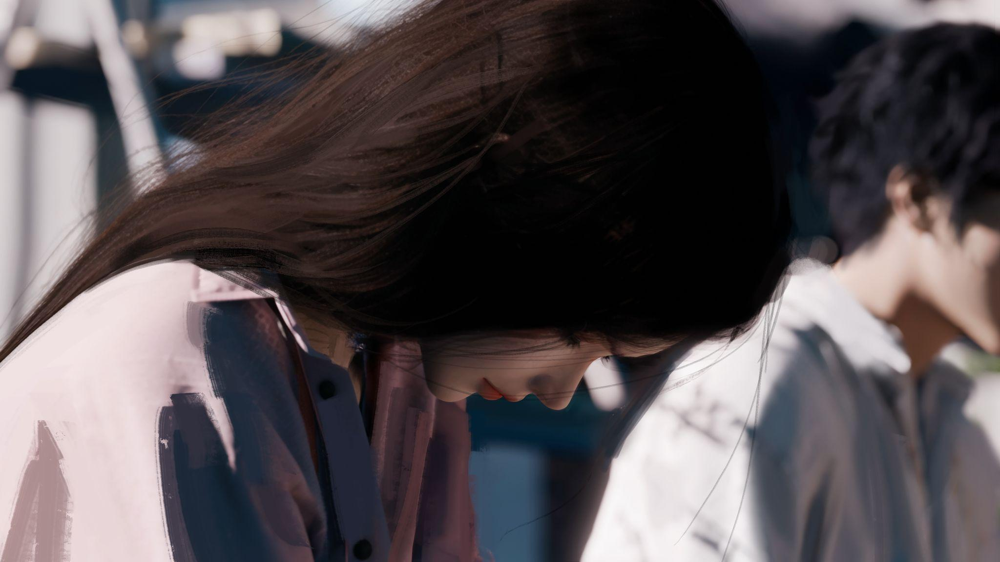

> [嘈杂]“你爸给了你生日礼物和不少钱了，你还想怎么样？他要带全家去国外旅游，没时间陪你。 ”

> “姑妈，我不要这些，我只想18岁生日他能陪我一天，就一天。”

> “你这孩子怎么这么不懂事？你明明知道他不方便，还老是缠着他。”

> [嘈杂]“月牙儿，我们……还是分手吧。”

> [嘈杂]“你明晚前必须搬走，不然我就给你断水断电！”

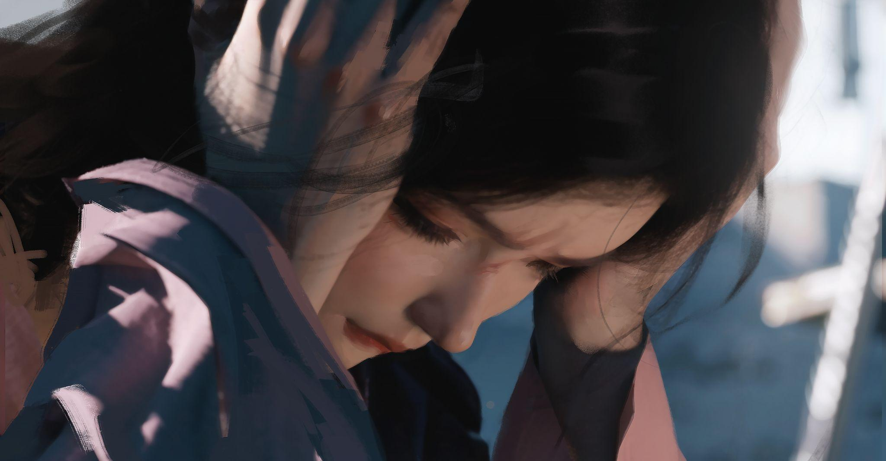

> [嘈杂]“月牙儿，我们宿舍的人一致投票决定，你那些衣服不能再晾在阳台了。”

> “为什么？”

> “你在酒吧穿的那些衣服晾外面，别人看到会以为我们宿舍都不是什么正经人。”

> “那我以后衣服晾哪？”

> “出去洗衣店洗呗，反正你不是很有钱吗？ ”

> “你们为什么觉得我有钱？”

> “装什么啊？你不是在酒吧唱一晚上就有好几千么，我听说那些老板都是把钱直接塞你内衣里的。”

> “真的么，哈哈哈……”

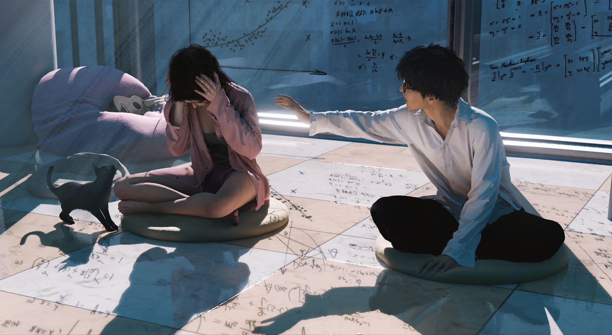

> “月牙儿？你怎么了，脸色这么难看？”

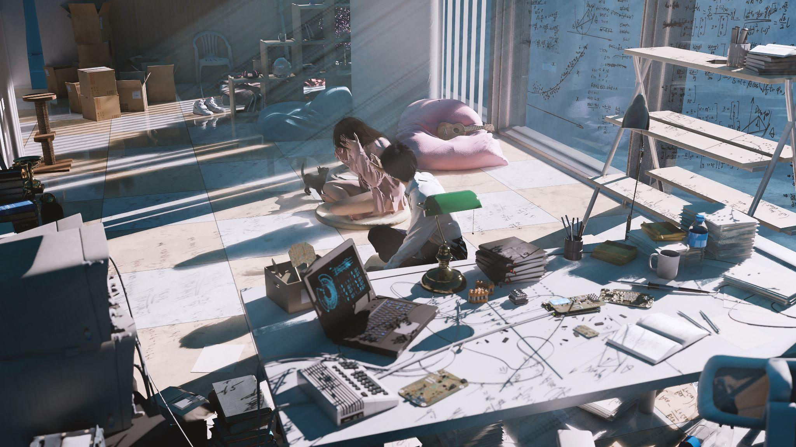

> “……没事，就是头晕。你的这个心法——不，冥想，可能不适合我。但还是谢谢你，至少你是真的想帮我。唉……”

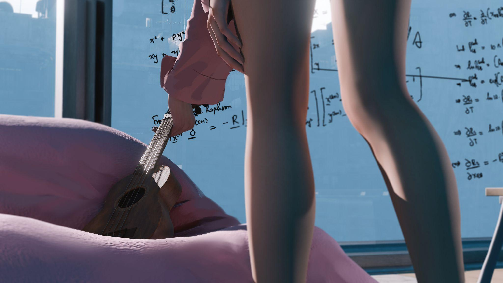

> “作为答谢，我给你唱支歌吧。”

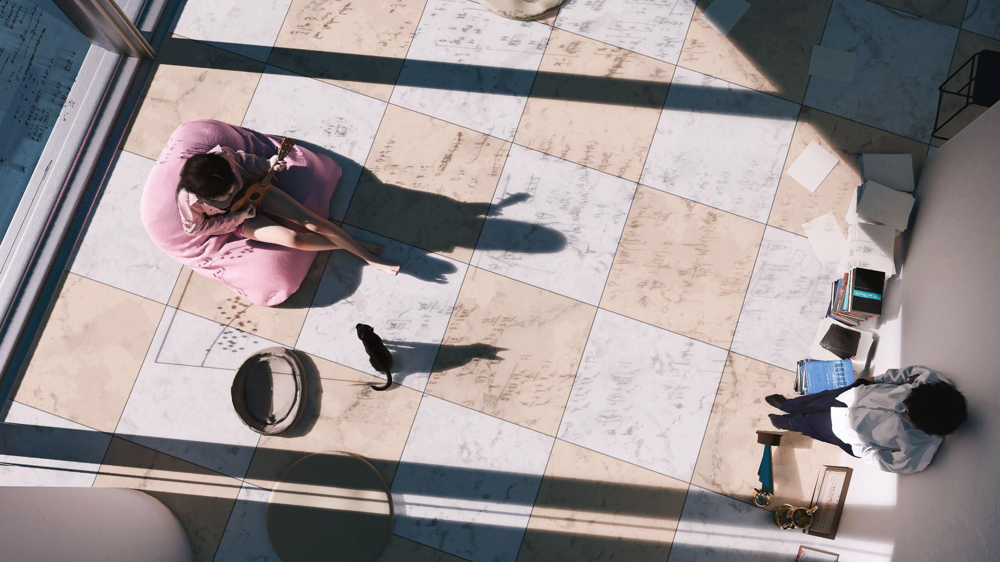

> [轻唱]“别说我应该放弃

> 应该睁开眼

> 我用我的心

> 去看去感觉

> 你并不是我

> 又怎能了解

> ……”

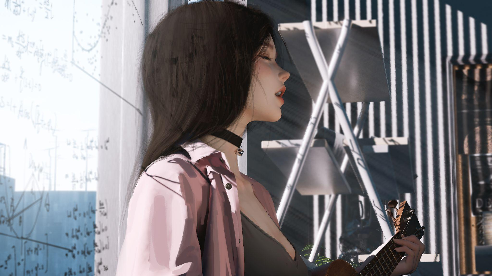

> [轻唱]“我不是你们想的如此完美

> 我承认有时也会辨不清真伪——”

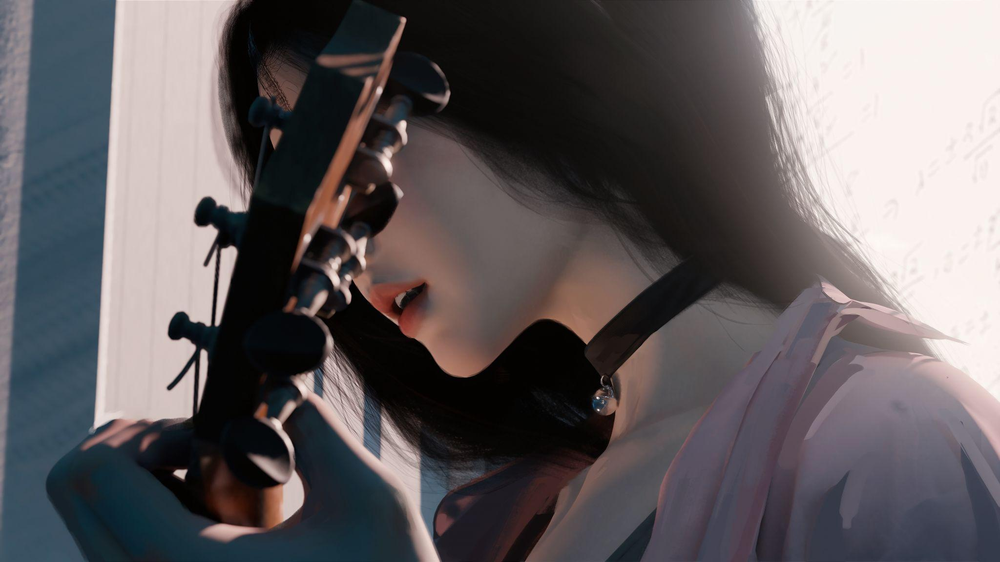

> “唱首歌而已，你脸红什么呀？”

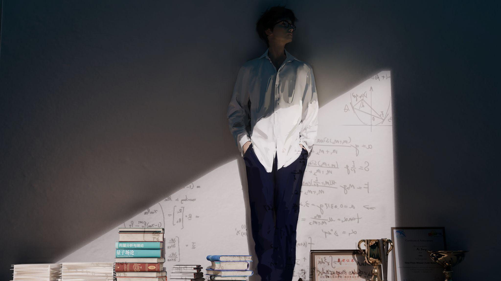

> “啊？没，没有啊……你在酒吧，也是这样唱歌的么？”

> “是啊。”

> “去那里听你唱歌的，都是些什么人？”

> “都不是什么好人。”

> “……不是好人？”

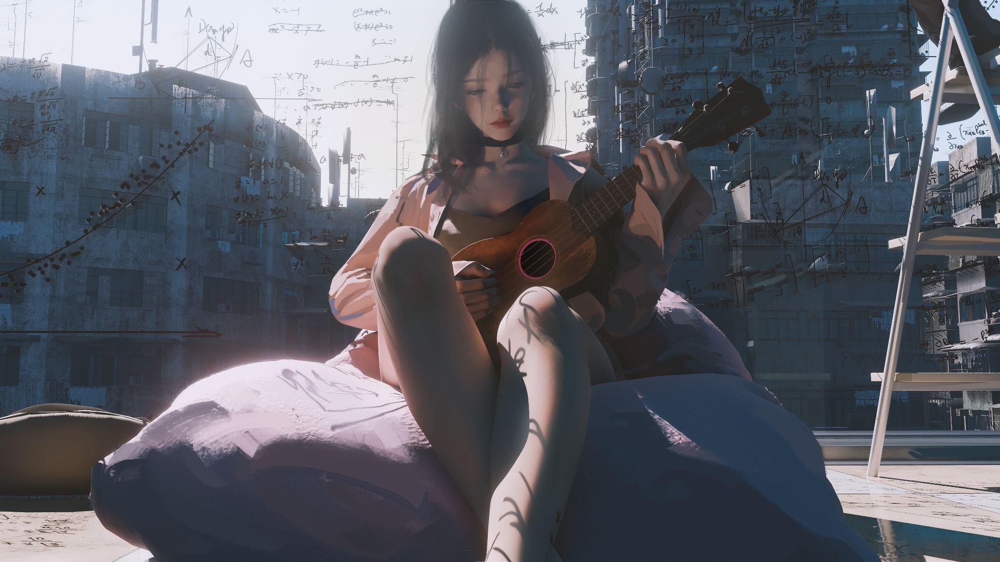

> “当然也不是什么坏人。都是和我一样，在人间迷路的灵魂。”

> [继续轻唱]“要我用谁的心去体会

> 真真切切地感受周围

> 就算痛苦 就算是泪

> 也是属于我的伤悲”

> ——王菲《执迷不悔》（1993）

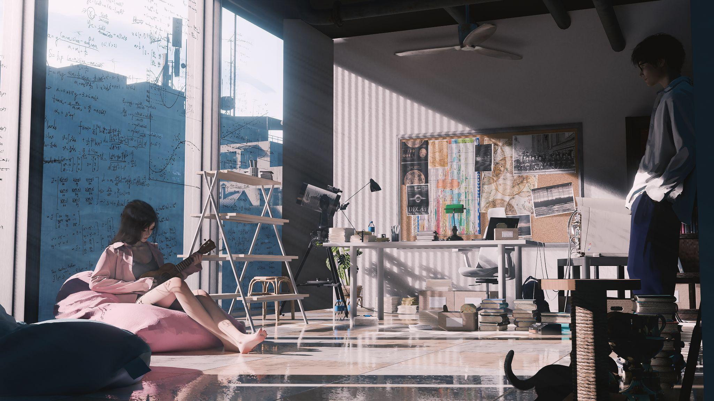

> 她的声音空灵又带着微微沙哑，像飘荡在阳光里的细碎尘埃。

> 窗外，远处的虫鸣与嘈杂的市声相互交织，整座城市在云虫将至的预感中隐隐不安。他凝视着逆光中的月牙儿，阳光在她肩头形成淡淡的光晕，轮廓柔和而迷蒙。

> 他的目光定定地落在她身上，四周的一切逐渐模糊淡去，只剩下她那道温柔却孤绝的轮廓。

