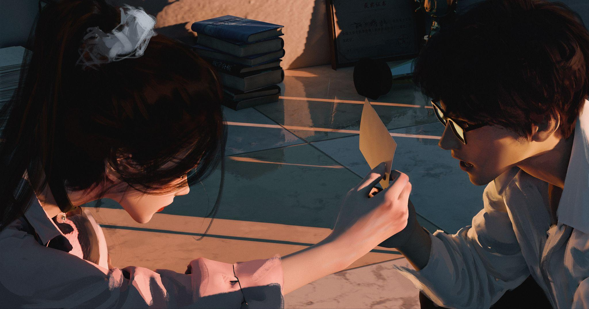
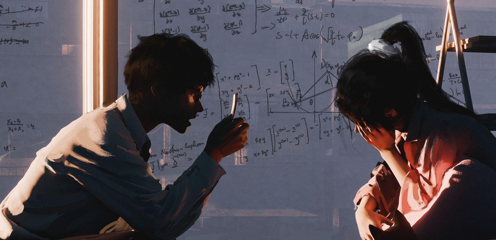
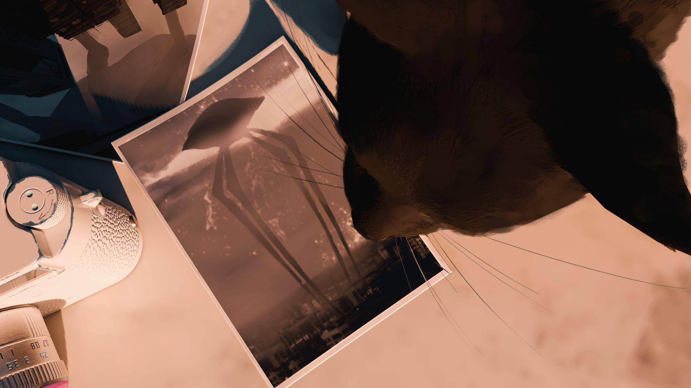
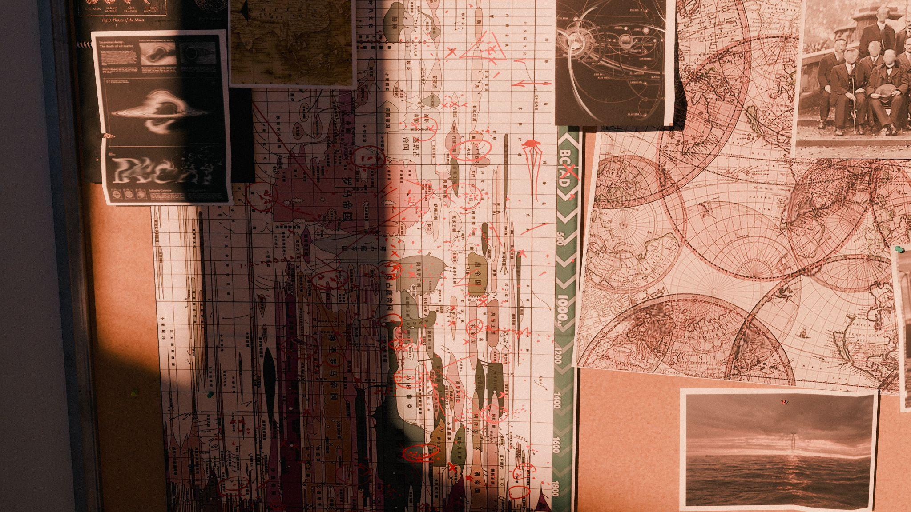
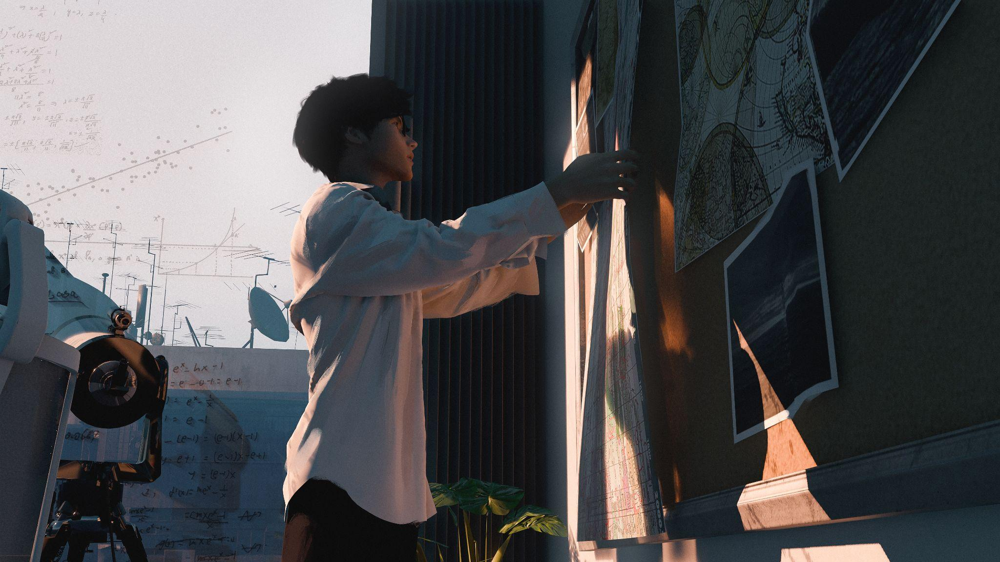
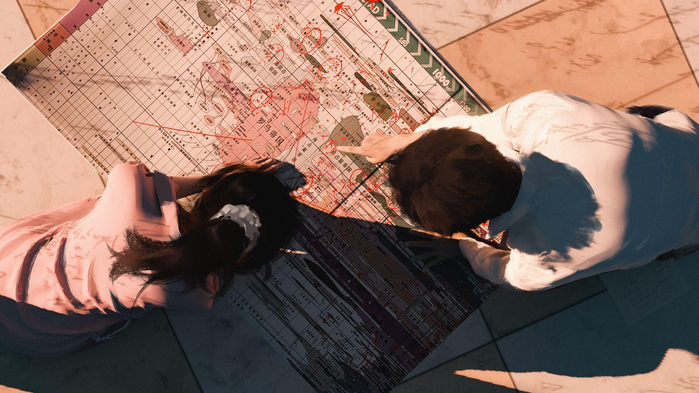
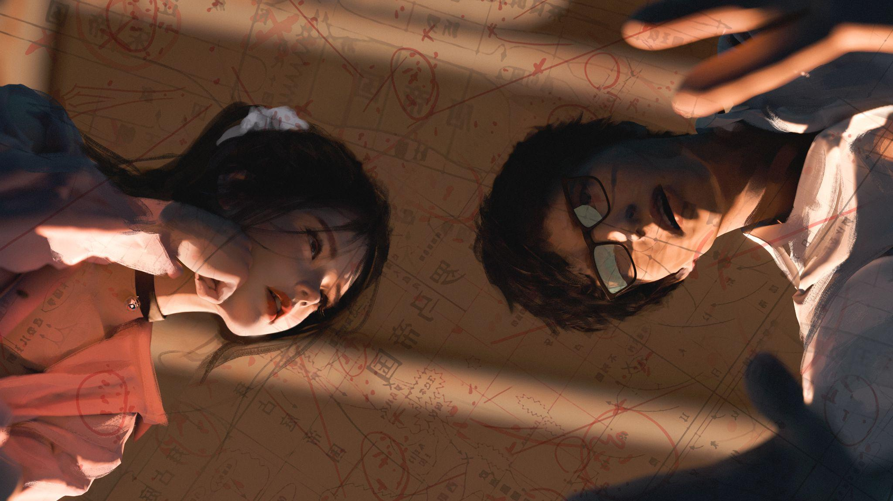
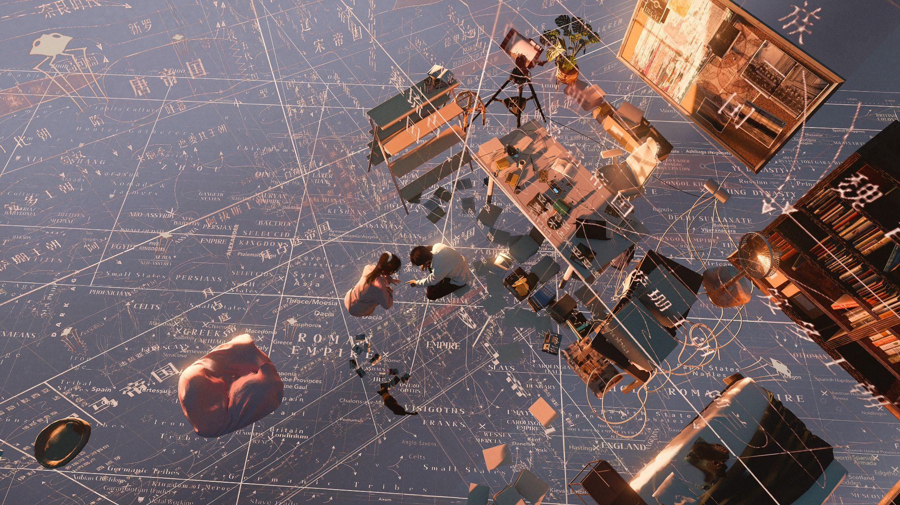

# 云虫 / CloudInsect - 第二章 云中人 · 三 (Chapter 2: Cloud Dwellers · Part 3)

---

**ZH**: “这几张——你应该能认出来。”

**EN**: “These photos—you should recognize them.”

**ZH**: “布达拉宫？等等……这云层下的是……盘古？这角度也太绝了……你不会是爬上什么山崖拍的吧？”

**EN**: “The Potala Palace? Wait... under that cloud layer... is that Pangu?This angle is insane. Don’t tell me you climbed some cliff to shoot this?”

**ZH**: “没有，我只是站在一块废弃观测台上。去年暑假我特意去追它——一号云虫盘古，按预测轨迹一路骑行进了藏南。”

**EN**: “Nope. I was just standing on a derelict observation deck. Last summer I followed it—CloudInsect No. 1, ‘Pangu.’ Rode all the way into southern Tibet along its predicted path.”

**ZH**: “骑行西藏，还追着‘盘古’拍照片……你的人生也太精彩了吧。”

**EN**: “You biked through Tibet, chasing Pangu for photos... Your life is unreal.”

**ZH**: “我这样的人，也值得你这高材生羡慕？”

**EN**: “And someone like me is worthy of admiration from a top student like you?”

**ZH**: “值得，非常值得。你是用……胶卷拍的？”

**EN**: “Absolutely. Totally worth it. Did you shoot this on... film?”

**ZH**: “就用这个。”

**EN**: “Yeah. With this.”

**ZH**: “这相机还真适合你。你是不是故意活得像从九十年代穿越来的？”

**EN**: “It suits you. You sure you're not a time traveler from the ’90s?”

**ZH**: “胶片洗出来那种灰调子，是数码永远做不出来的。”

**EN**: “Film develops this grayish tone that digital can never replicate.”

**ZH**: “可离云虫这么近的地方……不都应该划入禁区了么？”

**EN**: “But places that close to a CloudInsect... aren't they restricted zones?”

**ZH**: “你果然是个乖学生。云虫穿过城市时才会设禁区，荒郊野岭的，谁来管？”

**EN**: “Spoken like a true model student. They only establish restricted zones when CloudInsects pass through cities. Out in the wilderness, who would bother?”

**ZH**: “你每次都……一个人吗？”

**EN**: “Do you always... go alone?”

**ZH**: “那你希望我每次都是一个人吗？”

**EN**: “Would you prefer I always go alone?”

**ZH**: “我……”

**EN**: “I...”

**ZH**: “别乱猜了，还有谁愿意陪我做这种傻事。来，这张是我压箱底的，你肯定感兴趣。”

**EN**: “Don't overthink it. Who else would be crazy enough to do this with me?Here—this one’s my favorite. I’ve never shown it to anyone. I think you’ll be interested.”

**ZH**: “好模糊……两个人影？长焦拍的？等等……”

**EN**: “It’s blurry... two figures? Shot with a telephoto lens? Wait—”

**ZH**: “你拍到——云中人了？！”

**EN**: “You captured a Cloud Dweller?!”

**ZH**: “你确定？”

**EN**: “Are you sure?”

**ZH**: “不然呢？这比例，这位置，人影明明就在云虫表面——你怎么拍到的？”

**EN**: “What else could it be? The scale, the position... those figures are clearly on the surface of the CloudInsect.How did you even take this?”

**ZH**: “那次云虫经过雅鲁藏布江，我在河谷对岸守了一整晚。凌晨五点拍到的。那时候我也想再靠近一点。但那地方……安静得有点奇怪。没有鸟叫，没有风，只有低频的嗡鸣，像在耳膜里盘旋。你会不自觉地想后退，像是有一双陌生的眼睛正盯着你看。更诡异的是，我回来之后发现整卷胶片都曝光了，唯独这一张没事。”

**EN**: “That time the CloudInsect passed over the Yarlung Tsangpo River, I waited overnight on the opposite bank. Took the shot at 5 a.m.I wanted to get closer, but the place was... unnaturally silent. No birds, no wind—just this low-frequency hum circling inside my ears. You feel this instinctive urge to step back, like something unseen is watching you.Stranger still—when I came back, the entire roll of film was overexposed... except this one.”

**ZH**: “你不怕吗？一个人在荒郊野外，杳无人烟，巨大的云虫，诡异的人影……”

**EN**: “Weren’t you scared? Alone, in the middle of nowhere—no one around. A colossal CloudInsect, and those... strange figures?”

**ZH**: “我也不知道为什么，那些孤独、荒凉、无人回应的地方……反而让我安心。我喜欢云虫。庞大，沉默，孤独，俯瞰众生，却从不靠近。——它太美了。像一位沉睡千年的古神，梦醒时却发现，世上早已没人记得它的名字。”

**EN**: “I don’t know why, but lonely, desolate places where no one answers… they make me feel safe. I like CloudInsects. Vast, silent, solitary—looking down upon all life, yet never drawing near.They’re beautiful. Like an ancient god who slumbered for a thousand years, only to awaken and find that no one remembers its name.”

**ZH**: “……你真是疯了。”

**EN**: “...You’re insane.”

**ZH**: 她笑了，笑里带着一点不动声色的挑衅，像一只知道自己已经绕开规则的猫，懒懒地看着还在规规矩矩做题的人。光线斜斜落下，照亮她眼尾一丝似有若无的弯。

**EN**: She smiled, a subtle, unreadable provocation in her eyes—like a cat who knows it’s already slipped past the rules, lazily watching others still stuck playing by them. The afternoon light angled in, catching the faintest curve at the corner of her eye.

**ZH**: “你不是说我像九十年代来的嘛，那会儿的小孩都爱往野外跑。”

**EN**: “Didn’t you say I looked like I came from the ’90s? Back then, kids loved running into the wild.”

**ZH**: “可那时候没人是追着云虫跑。”

**EN**: “Sure, but none of them were chasing CloudInsects.”

**ZH**: 他们都笑了，笑声短促，在落地窗透进的金光里轻轻散开。

**EN**: They both laughed—a brief sound, scattering softly in the golden light pouring through the floor-to-ceiling windows.

**ZH**: 月牙儿撑着下巴，指尖轻敲地面，眼神却飘向一旁，仿佛对自己的古怪执念毫无歉意，甚至有些得意。

**EN**: Mahina rested her chin on one hand, fingertips tapping the ground idly. Her gaze drifted sideways, unapologetic—perhaps even a little proud—about her strange obsession. Suvan lowered his eyes to the photo still in his hand, his fingers unconsciously tracing its edges.

**ZH**: 希扬低头看了看那张仍握在手中的照片，手指不自觉地沿着边缘抚过一圈。

**EN**: “Did you ever post this online?”

**ZH**: “这张照片，你有没有发到过网上？”

**EN**: “No.You’re the first person to see it.—So, do you believe Cloud Dwellers really exist?”

**ZH**: “没有。你是第一个看到的。——所以，你相信世界上真的有‘云中人’吗？”

**EN**: “I do. From ancient murals to medieval manuscripts, civilizations across time have recorded similar figures. It can’t be coincidence.”

**ZH**: “我信。从古代壁画到中世纪书稿，各文明在不同年代都记载过相似的身影，不可能是巧合。”

**ZH**: “我也觉得。我读《断代史》的时候，看到有人把‘锥中之人’解释为云中人。我国春秋时期就有关于‘云中人’的童谣。而相机这种东西，也不过才发明了一百多年。可也有人说，那只是当时的人在描述异象。”

**EN**: “I think so too.I was reading Chronicle of Eras once—someone interpreted the term ‘The Figure in the Cone’ as referring to Cloud Dwellers.There’s even a nursery rhyme from our Spring and Autumn period that mentions them. And film cameras? They've only existed for a little over a century. Some say the ancients were just describing natural phenomena.”

**ZH**: “对，上世纪末，一个北欧极限运动员用跳伞方式登陆云虫，带回的画面显示它表面完全无缝，连尘屑都撬不下来。也没发现任何生命迹象。”

**EN**: “Right. At the end of the last century, there was that Nordic extreme athlete—he parachuted onto a CloudInsect. The footage he brought back showed a seamless surface, no dust, nothing to scrape off. No signs of life at all.”

**ZH**: “我记得那件事。他说，云虫就像一个完整的、闭合的机器。”

**EN**: “I remember that. He said the CloudInsect felt like a complete, sealed machine.”

**ZH**: “古代人见到他们，说是神。中世纪人叫他们‘云使’或‘光之灵’。而现代人，只会说‘云中人’不过是电磁异常引发的大气蜃景。科技越进步，我们的想象力反而越贫瘠。”

**EN**: “Ancient people saw them and called them gods.Medieval folks called them ‘Cloud Messengers’ or ‘Spirits of Light.’And modern science? It reduces them to optical illusions—atmospheric mirages caused by electromagnetic anomalies.The more advanced we become, the poorer our imagination gets.”

**ZH**: 希扬抬头望了一眼对面的墙。

**EN**: Suvan looked up at the wall across from them.

**ZH**: 那张被图钉固定的文明时间轴图在夕阳下微微翘起边角，纸面泛黄。

**EN**: The civilizational timeline pinned there curled slightly at the corners in the fading light.

**ZH**: 他走过去，伸手把它从墙上揭了下来，铺在地面上——

**EN**: He walked over, unpinned it, and spread it across the floor.

**ZH**: 红点密布，如流星划过史册。

**EN**: Red dots covered the sheet—like shooting stars strewn across the pages of history.

**ZH**: “这是我标注过的史料中云中人目击记录。你看这些红点密集区域，分布得很有意思——东周战国末年、东汉末期、罗马从共和国转向帝国的时期、还有孔雀帝国解体前后、泰西封被破萨珊帝国覆灭的时期，还有欧洲一战二战的时候……”

**EN**: “These are the Cloud Dweller sightings I marked in the historical record. Look at the dense clusters of red: the late Eastern Zhou during the Warring States period, the late Eastern Han, Rome’s transition from republic to empire, the disintegration of the Maurya Empire, the fall of Ctesiphon and the collapse of the Sasanian Empire, and the two world wars in Europe…”

**ZH**: “听起来，都是战争时期？”

**EN**: “Sounds like they all happened during times of war.”

**ZH**: “也不全是。唐朝贞观年间、罗马的五贤帝时期也有很多记录，那些可是黄金时代。”

**EN**: “Not all.There were also many records during golden ages, such as the Zhenguan era of the Tang dynasty and Rome’s age of the Five Good Emperors.”

**ZH**: “那可能只是幸存者偏差。盛世乱世，人们都更有理由把‘神迹’记下来。”

**EN**: “Maybe that’s just survivorship bias.In both peace and chaos, people are more inclined to write down what they see as ‘miracles.’”

**ZH**: 摊开的图纸在风中微微颤动，像一场被搁浅的预言。太阳已西沉，窗外的城市浸入薄暮。某个尚未被证实的真相，正悄悄在两人之间张开暗影。

**EN**: The open map trembled lightly in the wind, like a stranded prophecy.

**ZH**: “如果一切都归因于‘偏差’，那史学和科学还有存在的意义吗？”

**EN**: The sun had sunk low; outside, the city was soaking in dusk.

**ZH**: “那你看到什么规律了？”

**EN**: Some truth, not yet proven, quietly unfolded in the space between them.

**ZH**: “这些光明与黑暗并存的时代……无一不是人类文明剧烈变动的临界点。”

**EN**: “If everything can be written off as ‘bias,’ then what’s the point of history or science?”

**EN**: “So... what pattern have you seen?”

**EN**: “All those ages—both bright and dark—Every one of them marked a turning point in human civilization.”

**ZH**: “那「他们」是来见证的，还是来推动的？”

**EN**: “Do you think ‘they’ came to witness... or to intervene?”

**ZH**: “这才是我想知道的。”

**EN**: “That’s what I want to know.”

**ZH**: 沉默片刻，他手指轻轻敲了敲图纸边角，像是在数数上面那些散落的红点。

**EN**: He fell silent. Then lightly tapped the edge of the map with his finger, as if counting the scattered red dots.

**ZH**: “你觉得，如果我们是历史的一部分……会被谁在图上点一个红点？”

**EN**: “Do you think... if we’re part of history too...someone will mark us with a red dot?”

**ZH**: “你希望有人记得你吗？”

**EN**: “Do you want someone to remember you?”

**ZH**: 他没答，只是静静地坐在文明的余晖里。

**EN**: He didn’t reply.

**ZH**: 时间的脉络以奇异的方式延展，交错的线条从脚下蔓延至四壁，像蛛网，又像命运的经纬。密集的红点在纸上微微发亮，记录着那些回荡虫鸣的年代。

**EN**: He simply sat there, quiet, in the fading glow of civilization.

**ZH**: 这一刻，他们像两粒悬空的灰尘，在时间的巨网中，等待下一次古神的低鸣。

**EN**: The lines of time extended outward in strange directions, crossing underfoot and creeping up the walls like circuit traces—or perhaps strands of fate.

**ZH**: 幽幽虫鸣，

**EN**: In the slanting light, the red dots glowed faintly, each one a whisper of a time when CloudInsects had passed and the world had trembled.

**ZH**: 何知我心，

**EN**: At that moment, they were like two drifting specks caught in the great web of time—waiting for the next low hum of the ancient god to echo through the world once more.

**ZH**: 云中之人，

**EN**: Softly hums the insect,

**ZH**: 在水之滨。

**EN**: who can know my heart?

**ZH**: 哀哀虫鸣，

**EN**: The Cloud Dweller

**ZH**: 何虑我行，

**EN**: stands at the water’s edge.

**ZH**: 锥中之人，

**EN**: Mournfully hums the insect,

**ZH**: 在云之顶。

**EN**: why should I fear my path?

**ZH**: ——春秋 佚名

**EN**: The Figure in the Cone

**EN**: stands atop the clouds.

**EN**: — Anonymous, Spring and Autumn Period

