# CloudInsect - Chapter 2: Cloud Dwellers · Part 3

*Original Title: 第二章 云中人 · 三*

---

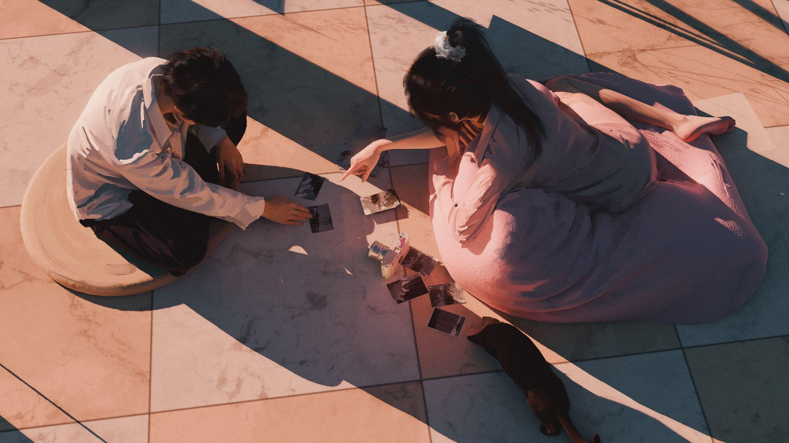

> “These photos—you should recognize them.”

> “The Potala Palace? Wait... under that cloud layer... is that Pangu?This angle is insane. Don’t tell me you climbed some cliff to shoot this?”

> “Nope. I was just standing on a derelict observation deck. Last summer I followed it—CloudInsect No. 1, ‘Pangu.’ Rode all the way into southern Tibet along its predicted path.”

> “You biked through Tibet, chasing Pangu for photos... Your life is unreal.”

> “And someone like me is worthy of admiration from a top student like you?”

> “Absolutely. Totally worth it. Did you shoot this on... film?”

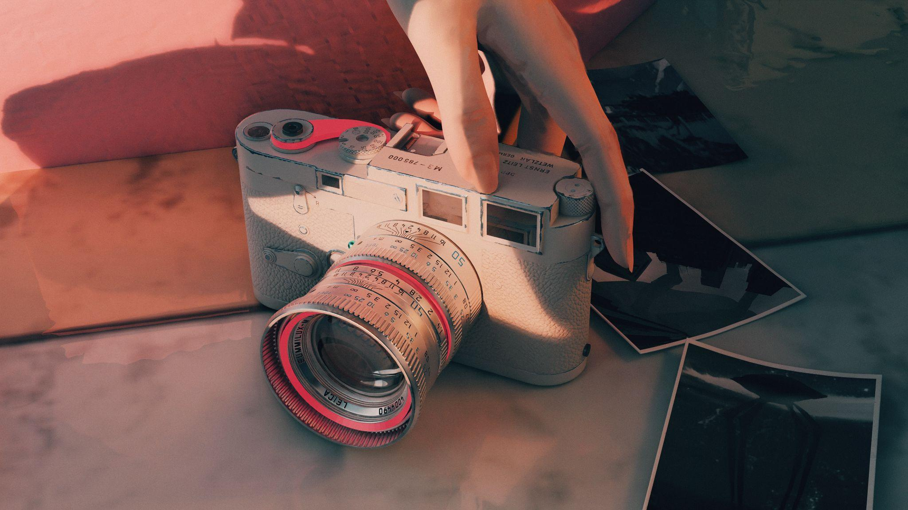

> “Yeah. With this.”

> “It suits you. You sure you're not a time traveler from the ’90s?”

> “Film develops this grayish tone that digital can never replicate.”

> “But places that close to a CloudInsect... aren't they restricted zones?”

> “Spoken like a true model student. They only establish restricted zones when CloudInsects pass through cities. Out in the wilderness, who would bother?”

> “Do you always... go alone?”

> “Would you prefer I always go alone?”

> “I...”

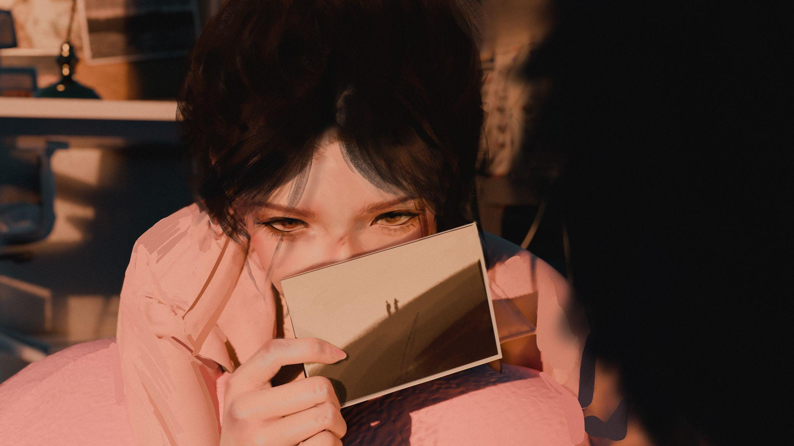

> “Don't overthink it. Who else would be crazy enough to do this with me?Here—this one’s my favorite. I’ve never shown it to anyone. I think you’ll be interested.”

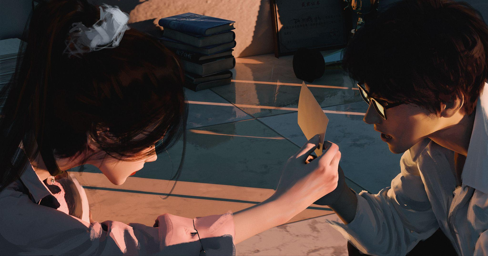

> “It’s blurry... two figures? Shot with a telephoto lens? Wait—”

> “You captured a Cloud Dweller?!”

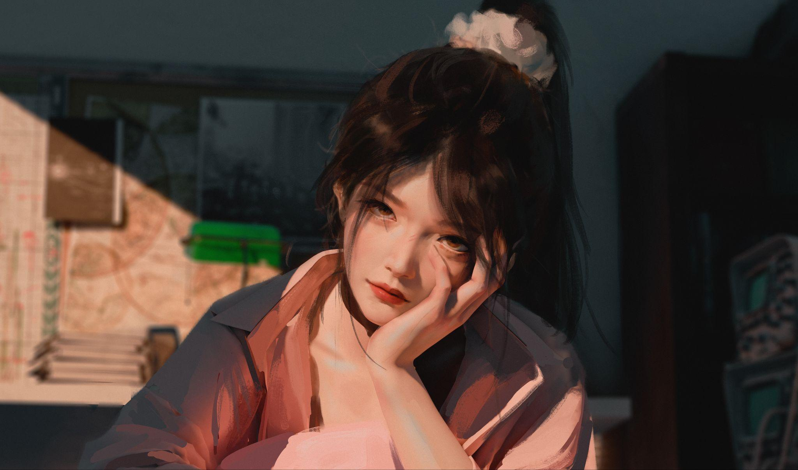

> “Are you sure?”

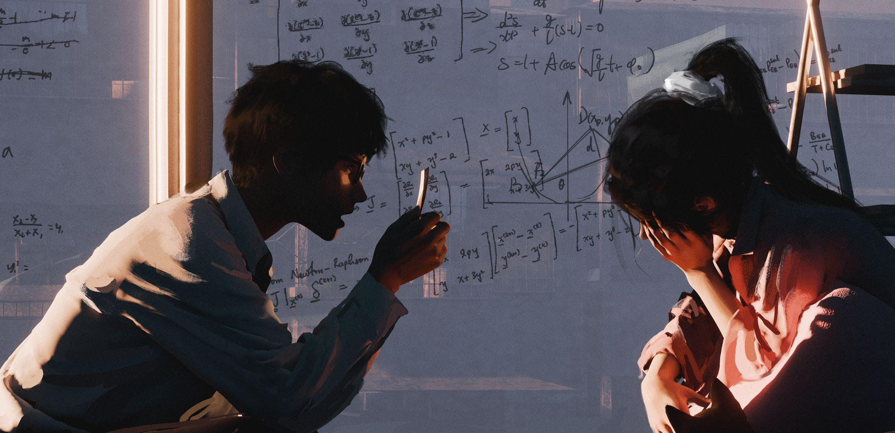

> “What else could it be? The scale, the position... those figures are clearly on the surface of the CloudInsect.How did you even take this?”

> “That time the CloudInsect passed over the Yarlung Tsangpo River, I waited overnight on the opposite bank. Took the shot at 5 a.m.I wanted to get closer, but the place was... unnaturally silent. No birds, no wind—just this low-frequency hum circling inside my ears. You feel this instinctive urge to step back, like something unseen is watching you.Stranger still—when I came back, the entire roll of film was overexposed... except this one.”

> “Weren’t you scared? Alone, in the middle of nowhere—no one around. A colossal CloudInsect, and those... strange figures?”

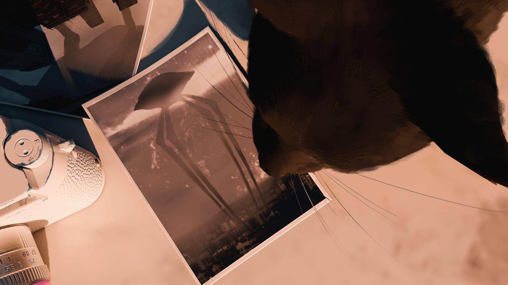

> “I don’t know why, but lonely, desolate places where no one answers… they make me feel safe. I like CloudInsects. Vast, silent, solitary—looking down upon all life, yet never drawing near.They’re beautiful. Like an ancient god who slumbered for a thousand years, only to awaken and find that no one remembers its name.”

> “...You’re insane.”

> She smiled, a subtle, unreadable provocation in her eyes—like a cat who knows it’s already slipped past the rules, lazily watching others still stuck playing by them. The afternoon light angled in, catching the faintest curve at the corner of her eye.

> “Didn’t you say I looked like I came from the ’90s? Back then, kids loved running into the wild.”

> “Sure, but none of them were chasing CloudInsects.”

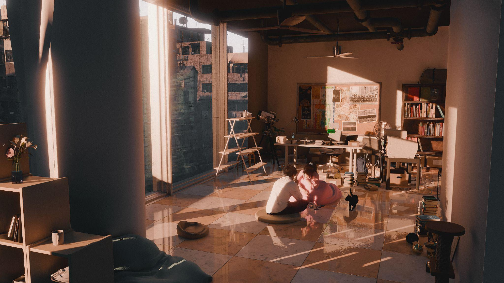

> They both laughed—a brief sound, scattering softly in the golden light pouring through the floor-to-ceiling windows.

> Mahina rested her chin on one hand, fingertips tapping the ground idly. Her gaze drifted sideways, unapologetic—perhaps even a little proud—about her strange obsession. Suvan lowered his eyes to the photo still in his hand, his fingers unconsciously tracing its edges.

> “Did you ever post this online?”

> “No.You’re the first person to see it.—So, do you believe Cloud Dwellers really exist?”

> “I do. From ancient murals to medieval manuscripts, civilizations across time have recorded similar figures. It can’t be coincidence.”

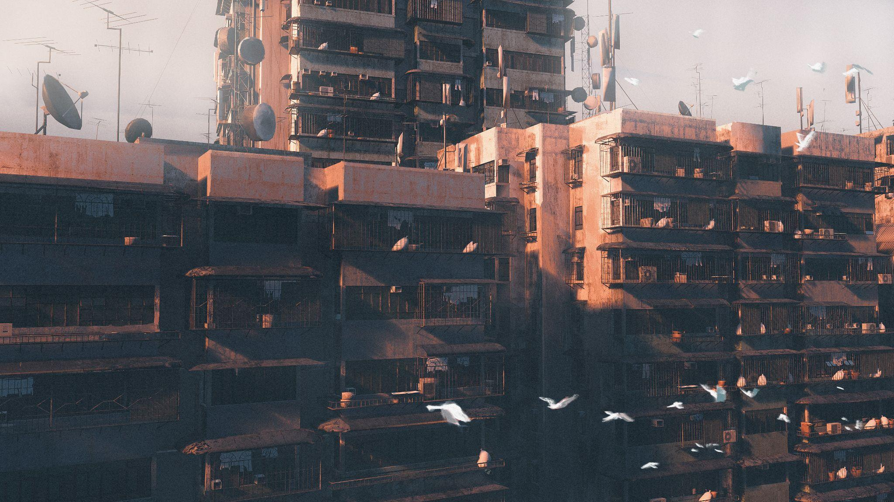

> “I think so too.I was reading Chronicle of Eras once—someone interpreted the term ‘The Figure in the Cone’ as referring to Cloud Dwellers.There’s even a nursery rhyme from our Spring and Autumn period that mentions them. And film cameras? They've only existed for a little over a century. Some say the ancients were just describing natural phenomena.”

> “Right. At the end of the last century, there was that Nordic extreme athlete—he parachuted onto a CloudInsect. The footage he brought back showed a seamless surface, no dust, nothing to scrape off. No signs of life at all.”

> “I remember that. He said the CloudInsect felt like a complete, sealed machine.”

> “Ancient people saw them and called them gods.Medieval folks called them ‘Cloud Messengers’ or ‘Spirits of Light.’And modern science? It reduces them to optical illusions—atmospheric mirages caused by electromagnetic anomalies.The more advanced we become, the poorer our imagination gets.”

> Suvan looked up at the wall across from them.

> The civilizational timeline pinned there curled slightly at the corners in the fading light.

> He walked over, unpinned it, and spread it across the floor.

> Red dots covered the sheet—like shooting stars strewn across the pages of history.

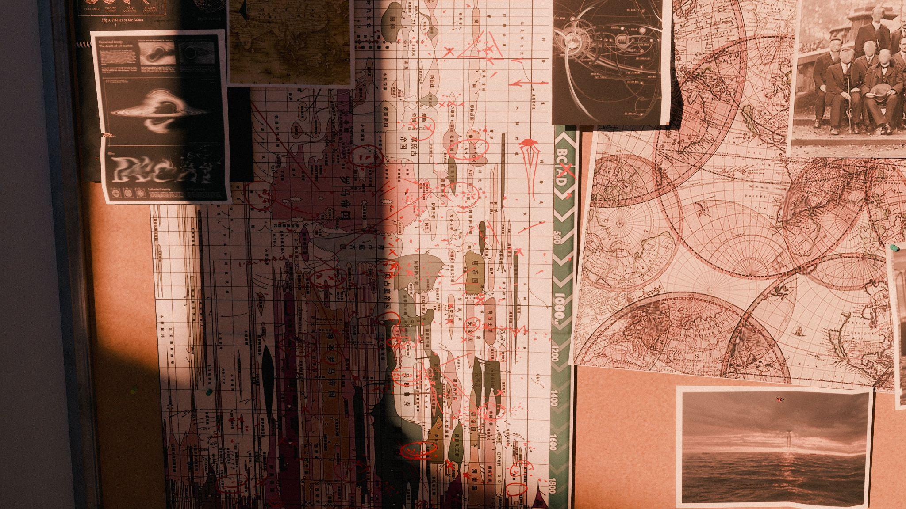

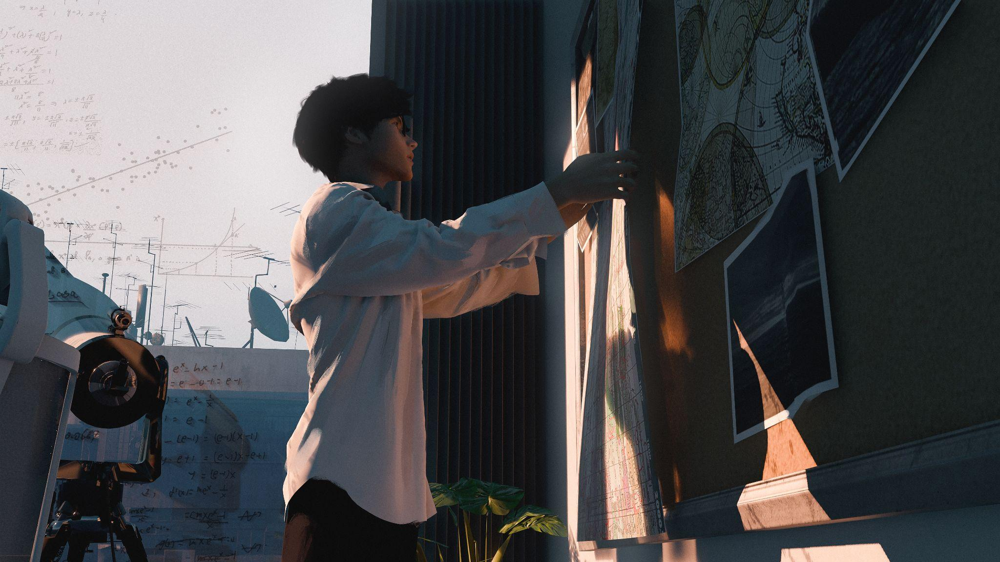

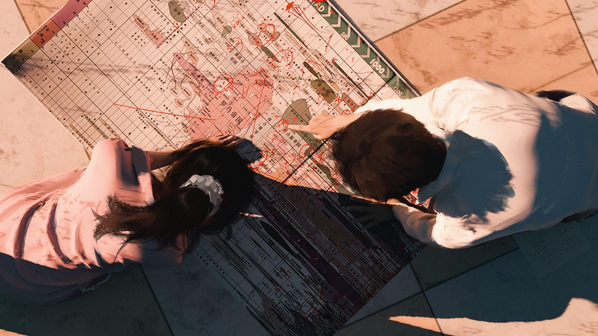

> “These are the Cloud Dweller sightings I marked in the historical record. Look at the dense clusters of red: the late Eastern Zhou during the Warring States period, the late Eastern Han, Rome’s transition from republic to empire, the disintegration of the Maurya Empire, the fall of Ctesiphon and the collapse of the Sasanian Empire, and the two world wars in Europe…”

> “Sounds like they all happened during times of war.”

> “Not all.There were also many records during golden ages, such as the Zhenguan era of the Tang dynasty and Rome’s age of the Five Good Emperors.”

> “Maybe that’s just survivorship bias.In both peace and chaos, people are more inclined to write down what they see as ‘miracles.’”

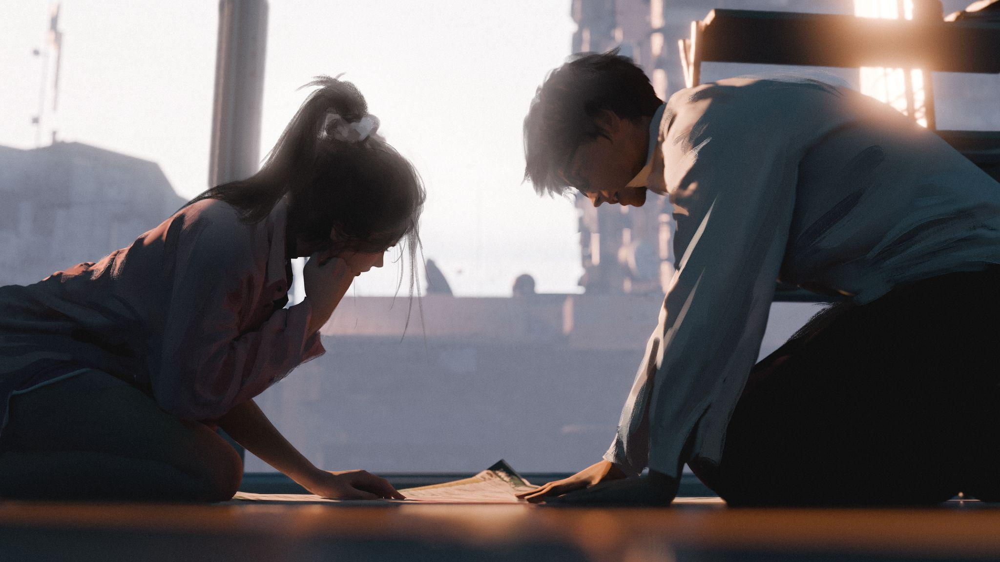

> The open map trembled lightly in the wind, like a stranded prophecy.

> The sun had sunk low; outside, the city was soaking in dusk.

> Some truth, not yet proven, quietly unfolded in the space between them.

> “If everything can be written off as ‘bias,’ then what’s the point of history or science?”

> “So... what pattern have you seen?”

> “All those ages—both bright and dark—Every one of them marked a turning point in human civilization.”

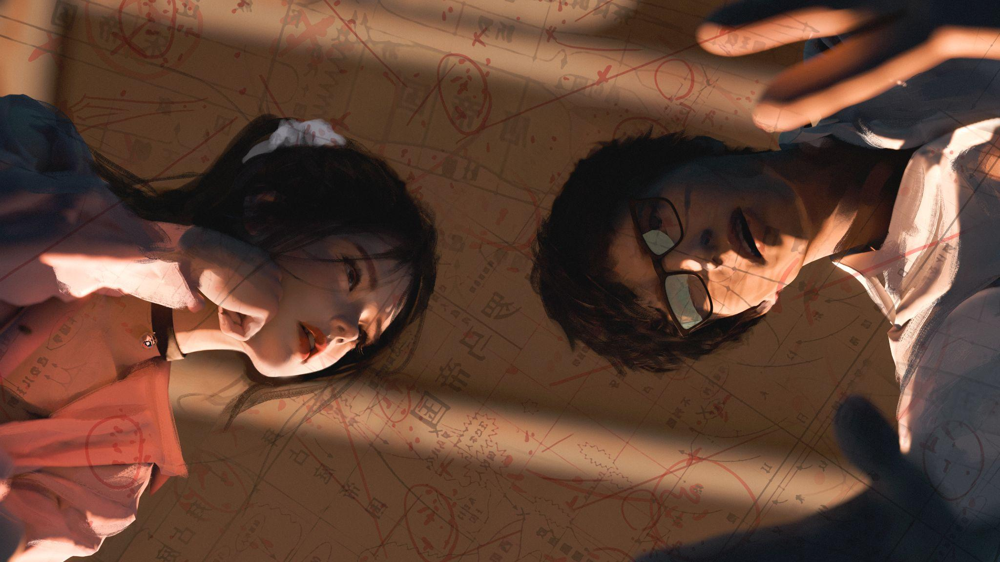

> “Do you think ‘they’ came to witness... or to intervene?”

> “That’s what I want to know.”

> He fell silent. Then lightly tapped the edge of the map with his finger, as if counting the scattered red dots.

> “Do you think... if we’re part of history too...someone will mark us with a red dot?”

> “Do you want someone to remember you?”

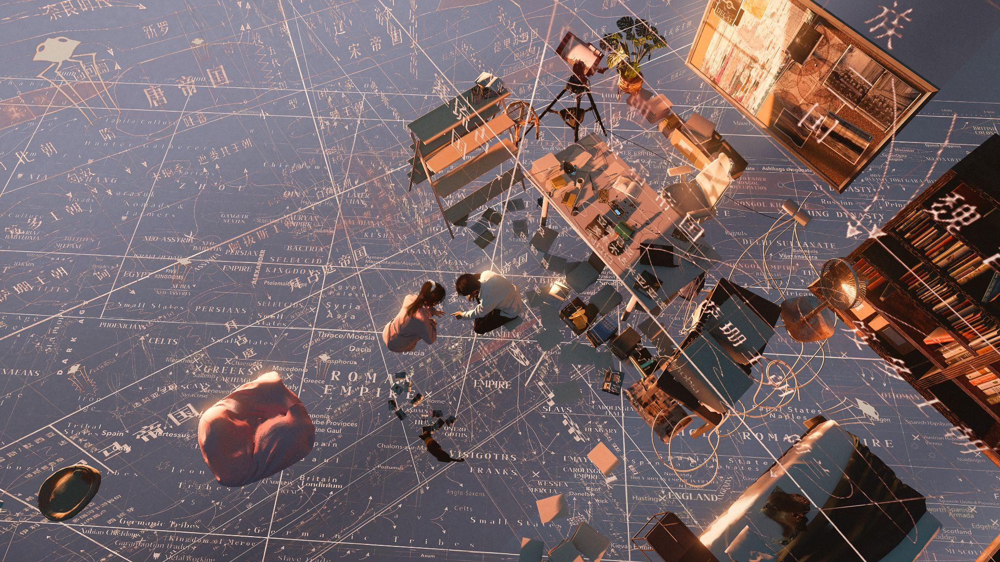

> He didn’t reply.

> He simply sat there, quiet, in the fading glow of civilization.

> The lines of time extended outward in strange directions, crossing underfoot and creeping up the walls like circuit traces—or perhaps strands of fate.

> In the slanting light, the red dots glowed faintly, each one a whisper of a time when CloudInsects had passed and the world had trembled.

> At that moment, they were like two drifting specks caught in the great web of time—waiting for the next low hum of the ancient god to echo through the world once more.

> Softly hums the insect,

> who can know my heart?

> The Cloud Dweller

> stands at the water’s edge.

> Mournfully hums the insect,

> why should I fear my path?

> The Figure in the Cone

> stands atop the clouds.

> — Anonymous, Spring and Autumn Period

