# Vân Trùng - Chương 2: Người Trong Mây · III

---

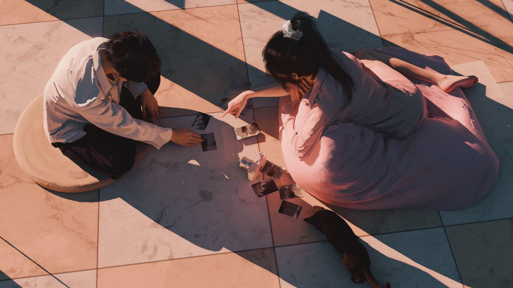

“Mấy tấm này — chắc là cậu nhận ra được chứ?”

“Cung điện Potala ư? Khoan đã nào... Phía dưới tầng mây kia là... Bàn Cổ sao? Góc chụp này ảo diệu quá thể... Không lẽ cậu trèo lên vách đá nào đó để chụp đấy à?”

“Không có, tôi chỉ đứng trên một đài quan sát bỏ hoang thôi. Hè năm ngoái tôi cố tình đuổi theo nó — Vân Trùng số 1 mang tên 'Bàn Cổ', men theo quỹ đạo dự báo mà đạp xe một mạch vào tận vùng Nam Tạng đấy.”

“Đạp xe xuyên Tây Tạng, lại còn rượt theo 'Bàn Cổ' để chụp ảnh... Cuộc đời cậu sống rực rỡ và phóng khoáng quá đỗi.”

“Người như tôi, mà cũng đáng để một sinh viên trường chuyên lớp chọn như cậu ngưỡng mộ cơ à?”

“Đáng chứ, cực kỳ đáng ngưỡng mộ luôn. Cậu chụp bằng... máy cơ film à?”

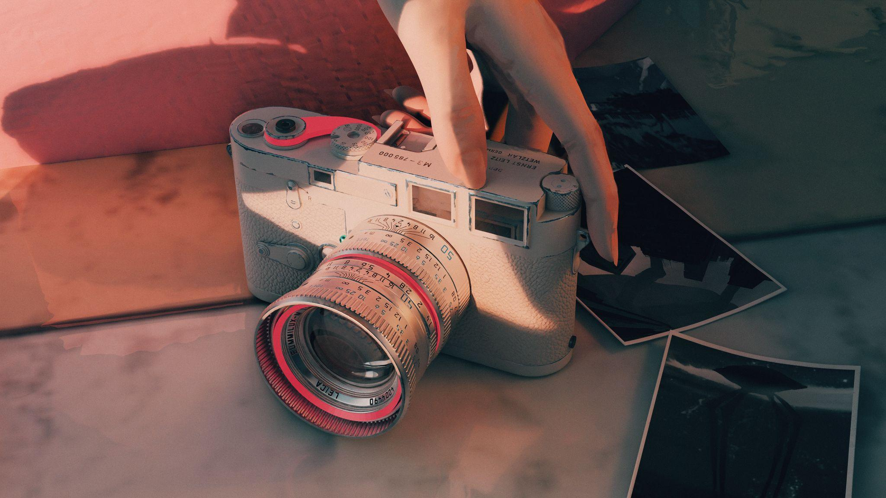

“Chính là bằng chiếc máy này đây.”

“Chiếc máy ảnh này thực sự rất hợp với phong cách của cậu. Có phải cậu cố tình sống như một người vừa du hành thời gian từ những năm thập niên 90 xuyên không tới đây không?”

“Cái tông màu xám trầm mặc độc đáo sau khi tráng film là thứ mà máy ảnh kỹ thuật số vĩnh viễn không bao giờ tái hiện nổi đâu.”

“Nhưng những nơi ở gần Vân Trùng đến thế... chẳng phải đều bị phong tỏa thành khu vực cấm rồi sao?”

“Cậu đúng là một học sinh gương mẫu ngoan ngoãn. Khi Vân Trùng đi xuyên qua các đô thị lớn người ta mới thiết lập khu cấm thôi, chứ chốn rừng thiêng nước độc, đồng không mông quạnh thì ai rảnh đâu mà quản lý?”

“Lần nào cậu cũng... đi một mình hết sao?”

“Thế cậu có hy vọng lần nào tôi cũng đi một mình không?”

“Tôi...”

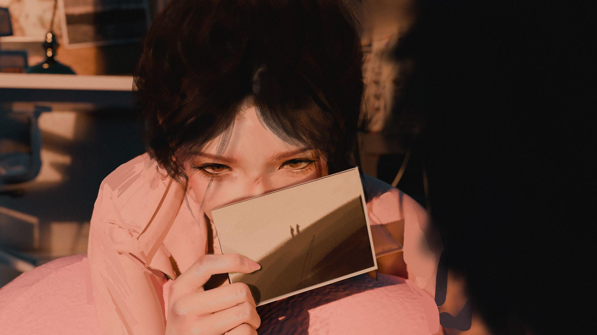

“Thôi đừng có đoán mò đoán non nữa, làm gì có ai chịu điên rồ cùng tôi làm mấy cái trò ngốc nghếch này. Nào, bức ảnh này là bảo bối đáy hòm của tôi đấy, đảm bảo cậu sẽ cực kỳ có hứng thú cho xem.”

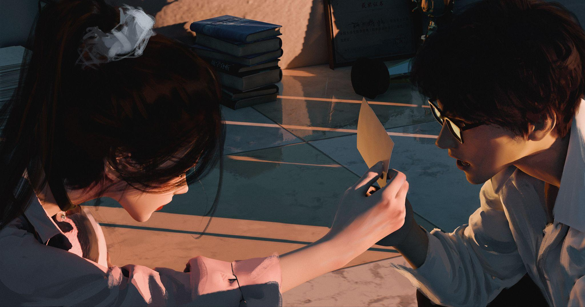

“Mờ quá... Hai bóng người sao? Chụp bằng ống kính tele à? Khoan đã...”

“Cậu chụp được... 'Người Trong Mây' rồi ư?!”

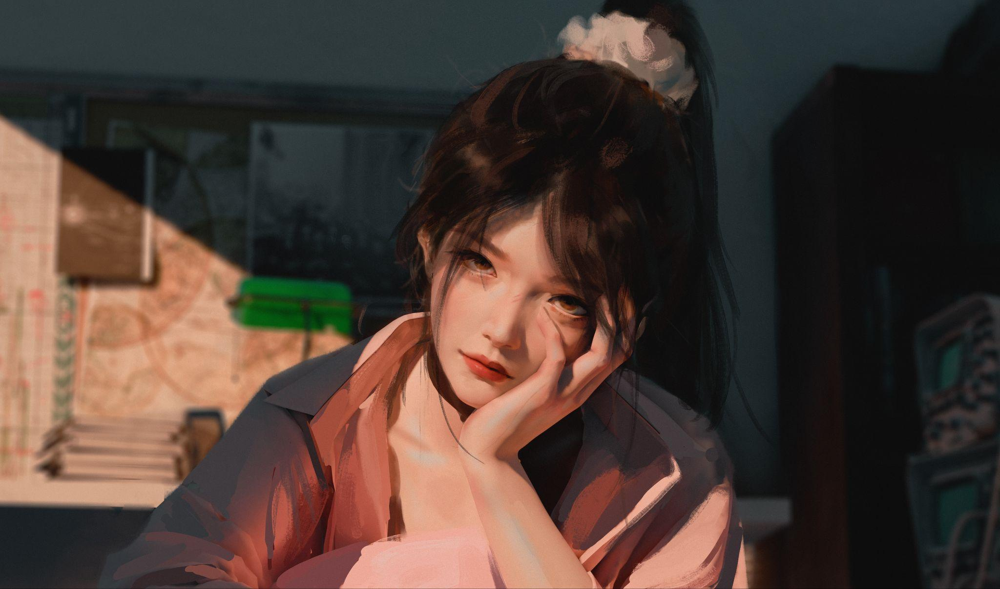

“Cậu có chắc không đấy?”

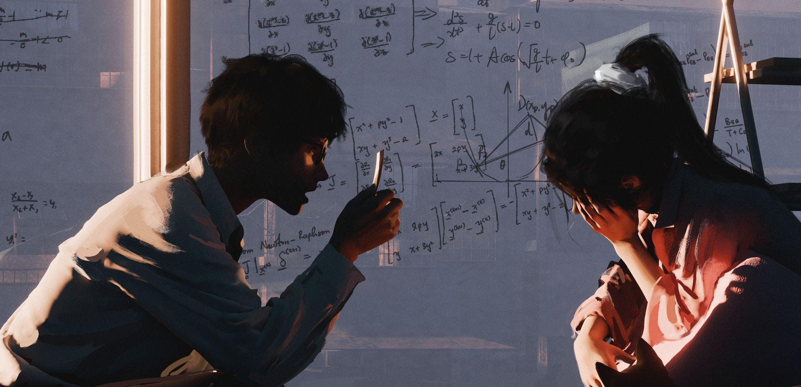

“Không thì còn là gì nữa? Tỷ lệ này, vị trí này, bóng người rõ ràng đang đứng ngay trên bề mặt của Vân Trùng cơ mà — Cậu làm thế nào mà chụp được hay vậy?”

“Lần đó Vân Trùng đi ngang qua sông Yarlung Tsangpo, tôi thức trắng nguyên đêm canh chừng ở bờ bên kia hẻm núi. Chụp được vào lúc năm giờ sáng đấy. Khi đó tôi cũng đã muốn tiến lại gần thêm một chút nữa. Nhưng cái nơi ấy... nó tĩnh mịch đến mức kỳ quái đến rợn người. Không có một tiếng chim hót, không một ngọn gió lay, chỉ có tiếng vo ve trầm đục lượn lờ dội thẳng vào màng nhĩ. Cậu sẽ bất giác muốn lùi bước lại, có cảm giác như đang có một đôi mắt vô hình xa lạ dán chặt nhìn chằm chằm vào mình. Kỳ dị hơn nữa là, sau khi trở về tôi phát hiện toàn bộ cuộn film đều bị phơi sáng hỏng bét, duy chỉ có đúng một tấm này là còn nguyên vẹn bình an vô sự.”

“Cậu không sợ sao? Một thân một mình giữa chốn đồng hoang lạnh lẽo không một bóng người, trước mặt là thực thể Vân Trùng khổng lồ cùng những bóng người ma quái kỳ dị...”

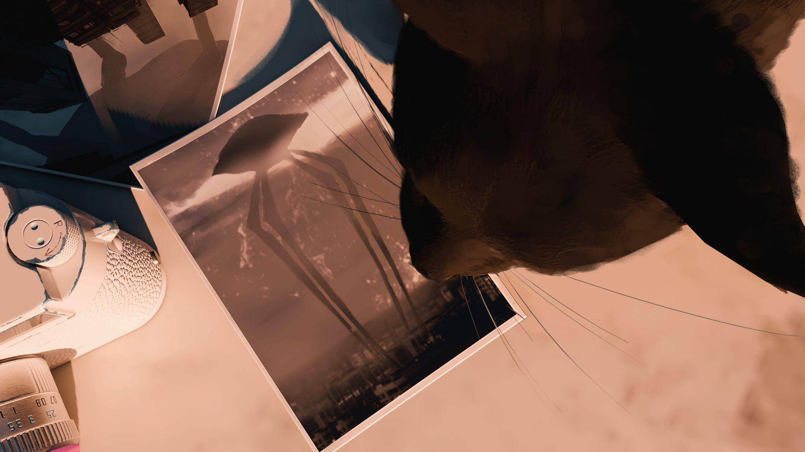

“Tôi cũng chẳng hiểu tại sao nữa, những nơi chốn cô độc, hoang vu, không một lời hồi đáp ấy... trái lại lại khiến lòng tôi cảm thấy an yên đến lạ lùng. Tôi yêu Vân Trùng. Đồ sộ, trầm mặc, cô tịch, đứng từ trên cao dõi mắt nhìn xuống chúng sinh, nhưng chưa từng bao giờ hạ mình bước lại gần. —— Nó đẹp đến nao lòng. Tựa như một vị cổ thần đã chìm sâu vào giấc ngủ ngàn năm, để rồi khi bừng tỉnh giấc mộng mới bàng hoàng nhận ra, trên thế gian này đã chẳng còn một ai nhớ nổi tôn danh của người nữa rồi.”

“... Cậu đúng là điên thật rồi.”

Cô mỉm cười, nụ cười ẩn hiện chút khiêu khích thầm kín đầy ý nhị, tựa như một chú mèo tinh nghịch biết rõ mình đã lách qua mọi ranh giới của quy tắc, lười biếng liếc nhìn kẻ vẫn đang cặm cụi ngồi giải từng bài toán quy củ. Vệt nắng chiều xiên khoai hắt xuống, thắp sáng khóe mắt đang khẽ cong cong của cô.

“Chẳng phải cậu vừa bảo tôi giống người từ thập niên 90 tới sao, lũ trẻ thời đó đứa nào mà chẳng mê mẩn việc chạy nhảy ngoài thiên nhiên hoang dã.”

“Nhưng thời ấy làm gì có ai dại dột chạy rượt theo Vân Trùng như cậu đâu.”

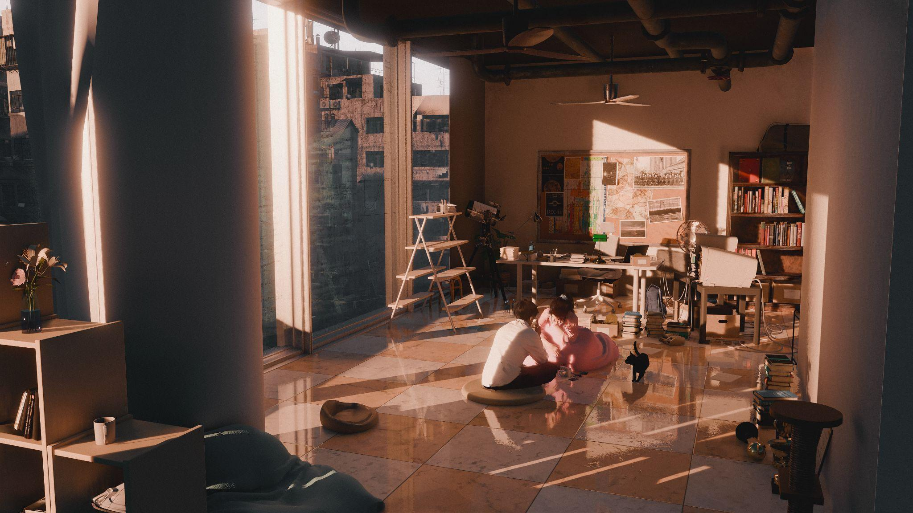

Cả hai cùng bật cười, tiếng cười khúc khích ngắn ngủi khẽ tan vào trong vạt nắng vàng ruộm rọi qua ô cửa kính sát sàn.

Nguyệt Nha Nhi chống cằm, đầu ngón tay khẽ gõ nhịp xuống mặt sàn, nhưng ánh mắt lại hướng về khoảng không xa xăm bên cạnh, dường như chẳng hề bận lòng áy náy về sự cố chấp kỳ quặc của mình, thậm chí còn thoáng nét đắc ý tự hào.

Hi Dương cúi đầu ngắm nghía tấm ảnh vẫn đang cầm trên tay, ngón tay bất giác nhẹ nhàng lướt quanh viền mép ảnh.

“Tấm ảnh này, cậu đã từng đăng lên mạng bao giờ chưa?”

“Chưa hề. Cậu là người đầu tiên được xem nó đấy. —— Thế nên, cậu có tin trên đời này thực sự có 'Người Trong Mây' không?”

“Tôi tin. Từ những bức bích họa cổ xưa cho đến các thủ bản thời Trung Cổ, các nền văn minh ở các niên đại khác nhau đều từng ghi chép lại những hình bóng tương tự, tuyệt đối không thể nào là chuyện trùng hợp ngẫu nhiên được.”

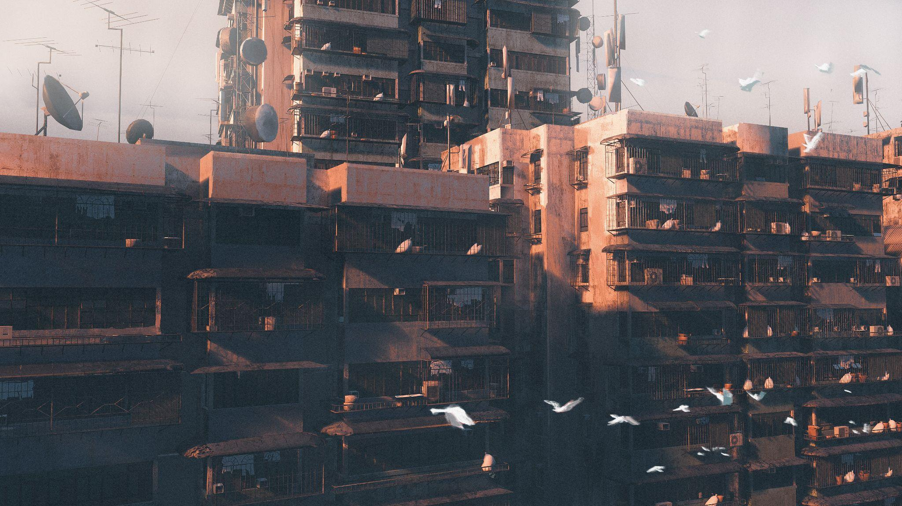

“Tôi cũng nghĩ như vậy đấy. Hồi tôi đọc cuốn 'Đoạn Đại Sử', từng thấy có người giải thích cụm từ 'Người Trong Nón' chính là để chỉ Người Trong Mây. Từ thời Xuân Thu ở nước ta đã lưu truyền bài đồng dao nhắc tới 'Người Trong Mây' rồi. Còn máy ảnh cơ thì mới chỉ được phát minh ra hơn một trăm năm nay thôi. Nhưng cũng có người lại bảo, đó chẳng qua chỉ là người xưa đang miêu tả lại một hiện tượng dị tượng tự nhiên nào đó mà thôi.”

“Phải rồi, cuối thế kỷ trước, từng có một vận động viên thể thao mạo hiểm người Bắc Âu đã dùng dù lượn nhảy đáp xuống lưng Vân Trùng. Thước phim ghi lại mang về cho thấy bề mặt của nó hoàn toàn liền mạch không tì vết, ngay cả một hạt bụi cũng chẳng cạy ra nổi. Và hoàn toàn không phát hiện bất kỳ dấu hiệu nào của sự sống.”

“Tôi nhớ vụ đó rồi. Người ấy bảo rằng, Vân Trùng giống như một cỗ máy cơ khí hoàn chỉnh và khép kín tuyệt đối.”

“Người thời cổ đại nhìn thấy họ thì gọi họ là Thần linh. Người thời Trung Cổ gọi họ là 'Vân Sứ' hay 'Linh Hồn Ánh Sáng'. Còn con người thời hiện đại chúng ta, thì chỉ biết quy kết 'Người Trong Mây' chẳng qua là hiện tượng ảo ảnh quang học trong khí quyển do dị biến điện từ gây ra. Khoa học công nghệ càng tiến bộ, thì trí tưởng tượng của nhân loại dường như lại càng trở nên nghèo nàn kiệt quệ.”

Hi Dương ngẩng đầu nhìn lên bức tường đối diện.

Bản sơ đồ trục thời gian tiến trình văn minh được ghim trên tường đang khẽ cong vênh mép giấy dưới ánh tà dương, mặt giấy đã ngả màu ố vàng.

Cậu bước lại gần, giơ tay gỡ nó xuống khỏi bức tường, rồi trải rộng ra mặt sàn —

Dày đặc những chấm đỏ chi chít, tựa như muôn vệt sao băng rạch ngang qua các trang sử sách ngàn năm.

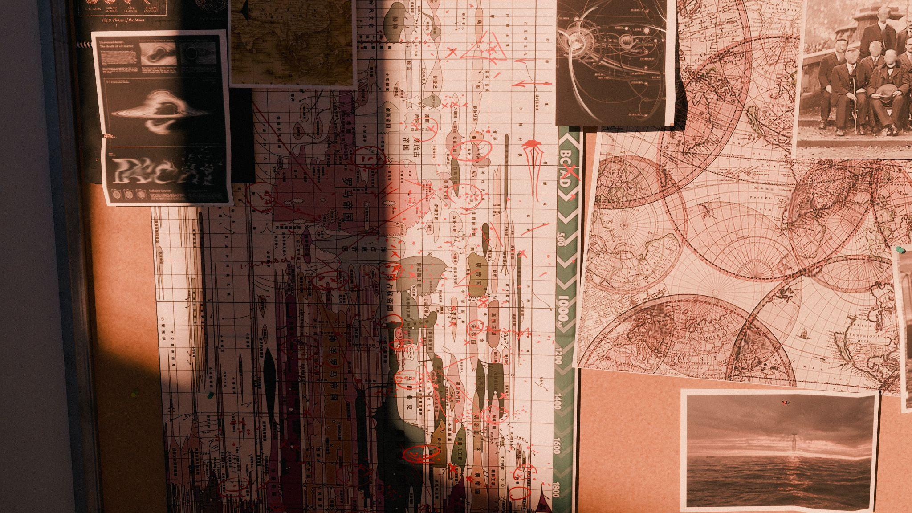

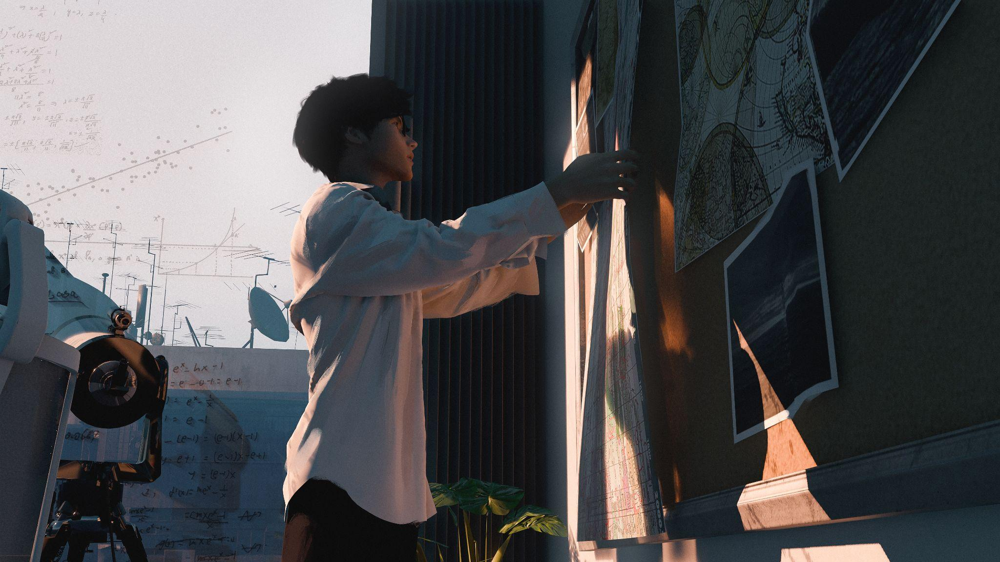

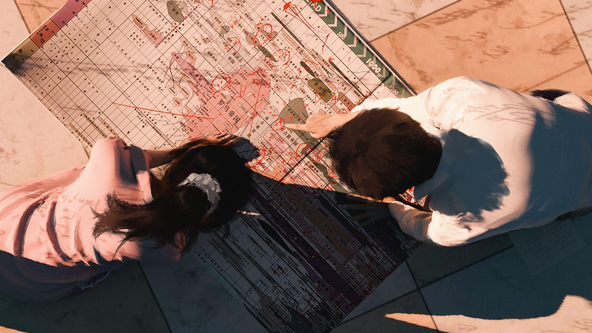

“Đây là những ghi chép về việc nhìn thấy Người Trong Mây trong các sử liệu mà tôi đã từng đánh dấu. Cậu nhìn những khu vực tập trung dày đặc các chấm đỏ này xem, sự phân bố của chúng cực kỳ thú vị — Cuối thời Chiến Quốc thời Đông Chu, giai đoạn cuối thời Đông Hán, thời kỳ La Mã chuyển từ thể chế Cộng hòa sang Đế quốc, rồi khoảng thời gian Đế quốc Maurya tan rã, thời kỳ thành Ctesiphon thất thủ dẫn đến sự diệt vong của Đế quốc Sasanian, rồi cả Thế chiến thứ Nhất và Thế chiến thứ Hai ở châu Âu nữa...”

“Nghe qua thì có vẻ toàn rơi vào những thời kỳ chiến tranh loạn lạc khốc liệt nhỉ?”

“Cũng không hẳn hoàn toàn như vậy. Thời kỳ Trinh Quán thịnh trị đời nhà Đường, hay giai đoạn Ngũ Hiền Đế của La Mã cũng có rất nhiều ghi chép, những thời kỳ đó đều là những thời đại hoàng kim rực rỡ cả đấy.”

“Thế thì có lẽ chỉ là thiên kiến kẻ sống sót (Survivorship bias) mà thôi. Cả thời thịnh thế lẫn thời loạn thế, con người ta đều có nhiều lý do hơn để ghi chép lại những điều mà họ coi là 'thần tích'.”

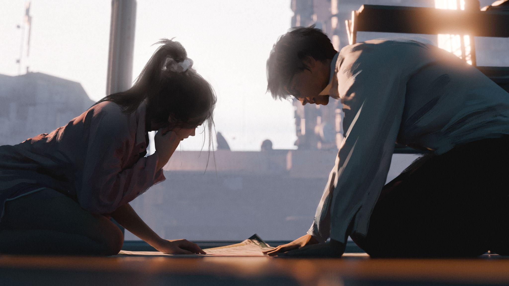

Tấm bản đồ mở rộng khẽ rung rinh nhè nhẹ trong làn gió, tựa như một lời sấm truyền bị dòng thời gian bỏ quên. Vầng thái dương đã lặn hẳn về tây, thành phố bên ngoài cửa sổ chìm dần vào làn sương chạng vạng. Một chân tướng nào đó chưa từng được kiểm chứng, đang âm thầm phủ bóng mờ giữa hai con người.

“Nếu như vạn sự vạn vật đều quy chụp cho hai chữ 'thiên kiến', vậy thì sử học và khoa học còn có ý nghĩa gì để tồn tại nữa chứ?”

“Thế cậu đã nhìn ra được quy luật gì từ nó rồi?”

“Những thời đại mà ánh sáng và bóng tối cùng song hành đan xen ấy... không có một thời đại nào không phải là điểm nút tới hạn chứng kiến sự biến động dữ dội của văn minh nhân loại cả.”

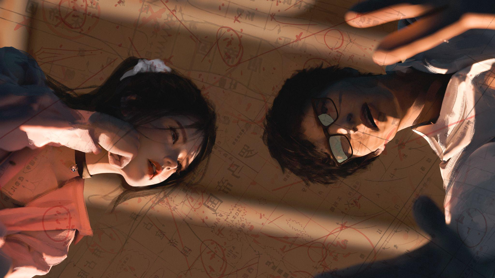

“Vậy 'họ' đến là để làm chứng nhân, hay là đến để thúc đẩy tiến trình ấy?”

“Đó mới chính là điều mà tôi muốn tìm ra câu trả lời.”

Trầm mặc trong giây lát, ngón tay cậu khẽ gõ nhẹ lên góc bản đồ, tựa như đang đếm lại những chấm đỏ rải rác trên trang giấy.

“Cậu có nghĩ rằng, nếu như chúng ta cũng là một phần của lịch sử... thì liệu có ai sẽ chấm một nét mực đỏ lên bản đồ này vì chúng ta không?”

“Cậu có mong muốn sẽ có người nhớ đến mình không?”

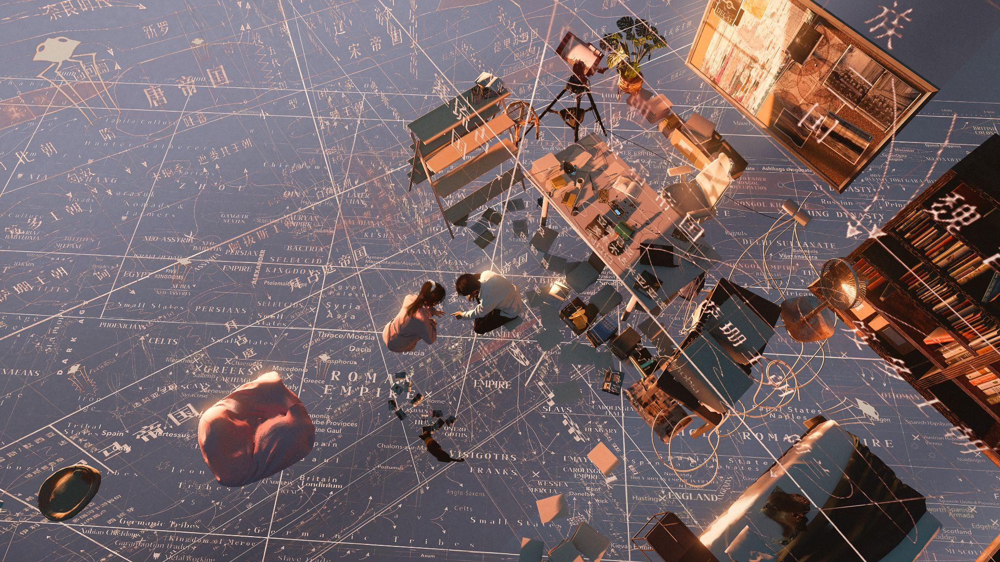

Cậu không trả lời, chỉ lặng lẽ ngồi giữa vầng tàn dương của nền văn minh.

Mạch lạc của thời gian kéo dài theo một phương thức kỳ dị, những đường nét đan chéo chằng chịt từ dưới chân lan ra khắp bốn bức tường, tựa như mạng nhện, lại tựa như kinh vĩ của số phận. Những chấm đỏ dày đặc trên giấy khẽ ánh lên tia sáng mờ ảo, ghi dấu những niên đại từng vang vọng tiếng trùng ngâm thảng thốt.

Trong khoảnh khắc này, hai người họ tựa như hai hạt bụi nhỏ nhoi lơ lửng giữa không trung, vướng vào tấm lưới khổng lồ của thời gian, lặng lẽ đợi chờ tiếng ngâm trầm đục kế tiếp của vị cổ thần vang vọng giữa trời đất.

U u trùng ngâm,

Hà tri ngã tâm.

Vân trung chi nhân,

Tại thủy chi tân.

Ai ai trùng ngâm,

Hà lự ngã hành.

Chùy trung chi nhân,

Tại vân chi đính.

—— Khuyết danh thời Xuân Thu
