# Vân Trùng / 云虫 - Chương 2: Người Trong Mây · III (第二章 云中人 · 三)

---

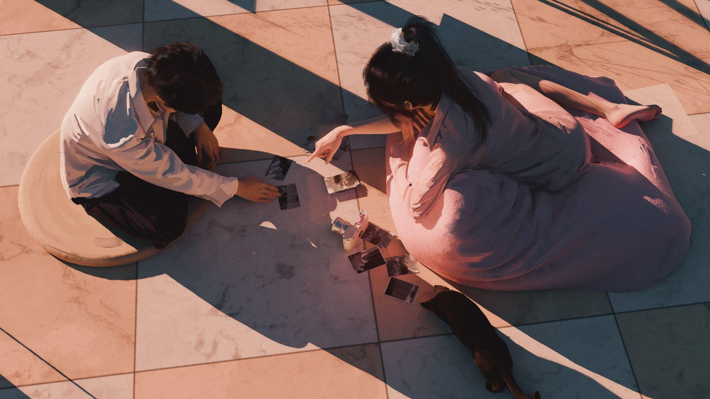

**VI**: “Mấy tấm này — chắc là cậu nhận ra được chứ?”

**ZH**: “这几张——你应该能认出来。”

**VI**: “Cung điện Potala ư? Khoan đã nào... Phía dưới tầng mây kia là... Bàn Cổ sao? Góc chụp này ảo diệu quá thể... Không lẽ cậu trèo lên vách đá nào đó để chụp đấy à?”

**ZH**: “布达拉宫？等等……这云层下的是……盘古？这角度也太绝了……你不会是爬上什么山崖拍的吧？”

**VI**: “Không có, tôi chỉ đứng trên một đài quan sát bỏ hoang thôi. Hè năm ngoái tôi cố tình đuổi theo nó — Vân Trùng số 1 mang tên 'Bàn Cổ', men theo quỹ đạo dự báo mà đạp xe một mạch vào tận vùng Nam Tạng đấy.”

**ZH**: “没有，我只是站在一块废弃观测台上。去年暑假我特意去追它——一号云虫盘古，按预测轨迹一路骑行进了藏南。”

**VI**: “Đạp xe xuyên Tây Tạng, lại còn rượt theo 'Bàn Cổ' để chụp ảnh... Cuộc đời cậu sống rực rỡ và phóng khoáng quá đỗi.”

**ZH**: “骑行西藏，还追着‘盘古’拍照片……你的人生也太精彩了吧。”

**VI**: “Người như tôi, mà cũng đáng để một sinh viên trường chuyên lớp chọn như cậu ngưỡng mộ cơ à?”

**ZH**: “我这样的人，也值得你这高材生羡慕？”

**VI**: “Đáng chứ, cực kỳ đáng ngưỡng mộ luôn. Cậu chụp bằng... máy cơ film à?”

**ZH**: “值得，非常值得。你是用……胶卷拍的？”

**VI**: “Chính là bằng chiếc máy này đây.”

**ZH**: “就用这个。”

**VI**: “Chiếc máy ảnh này thực sự rất hợp với phong cách của cậu. Có phải cậu cố tình sống như một người vừa du hành thời gian từ những năm thập niên 90 xuyên không tới đây không?”

**ZH**: “这相机还真适合你。你是不是故意活得像从九十年代穿越来的？”

**VI**: “Cái tông màu xám trầm mặc độc đáo sau khi tráng film là thứ mà máy ảnh kỹ thuật số vĩnh viễn không bao giờ tái hiện nổi đâu.”

**ZH**: “胶片洗出来那种灰调子，是数码永远做不出来的。”

**VI**: “Nhưng những nơi ở gần Vân Trùng đến thế... chẳng phải đều bị phong tỏa thành khu vực cấm rồi sao?”

**ZH**: “可离云虫这么近的地方……不都应该划入禁区了么？”

**VI**: “Cậu đúng là một học sinh gương mẫu ngoan ngoãn. Khi Vân Trùng đi xuyên qua các đô thị lớn người ta mới thiết lập khu cấm thôi, chứ chốn rừng thiêng nước độc, đồng không mông quạnh thì ai rảnh đâu mà quản lý?”

**ZH**: “你果然是个乖学生。云虫穿过城市时才会设禁区，荒郊野岭的，谁来管？”

**VI**: “Lần nào cậu cũng... đi một mình hết sao?”

**ZH**: “你每次都……一个人吗？”

**VI**: “Thế cậu có hy vọng lần nào tôi cũng đi một mình không?”

**ZH**: “那你希望我每次都是一个人吗？”

**VI**: “Tôi...”

**ZH**: “我……”

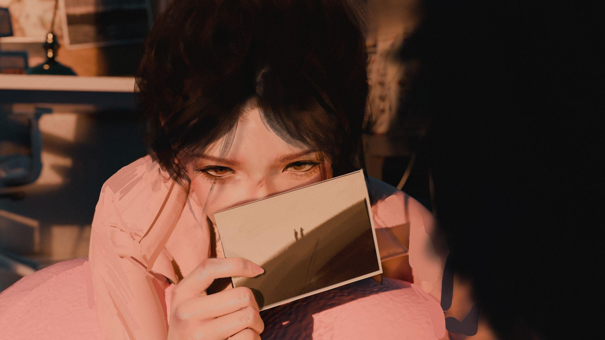

**VI**: “Thôi đừng có đoán mò đoán non nữa, làm gì có ai chịu điên rồ cùng tôi làm mấy cái trò ngốc nghếch này. Nào, bức ảnh này là bảo bối đáy hòm của tôi đấy, đảm bảo cậu sẽ cực kỳ có hứng thú cho xem.”

**ZH**: “别乱猜了，还有谁愿意陪我做这种傻事。来，这张是我压箱底的，你肯定感兴趣。”

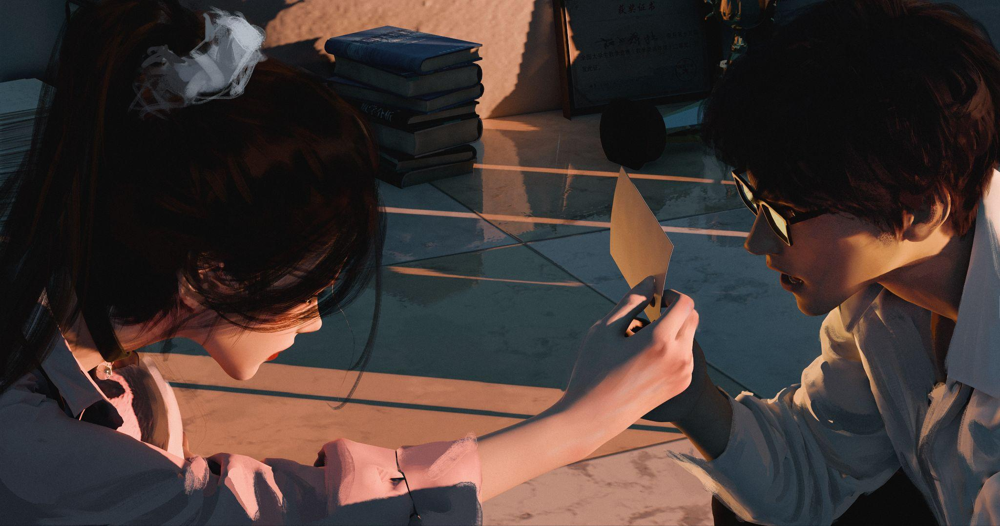

**VI**: “Mờ quá... Hai bóng người sao? Chụp bằng ống kính tele à? Khoan đã...”

**ZH**: “好模糊……两个人影？长焦拍的？等等……”

**VI**: “Cậu chụp được... 'Người Trong Mây' rồi ư?!”

**ZH**: “你拍到——云中人了？！”

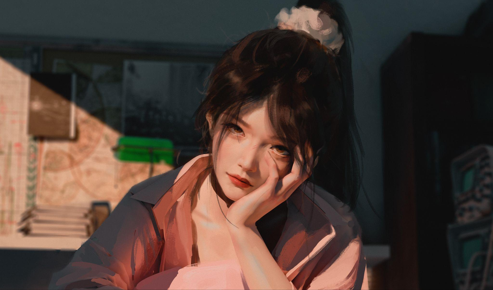

**VI**: “Cậu có chắc không đấy?”

**ZH**: “你确定？”

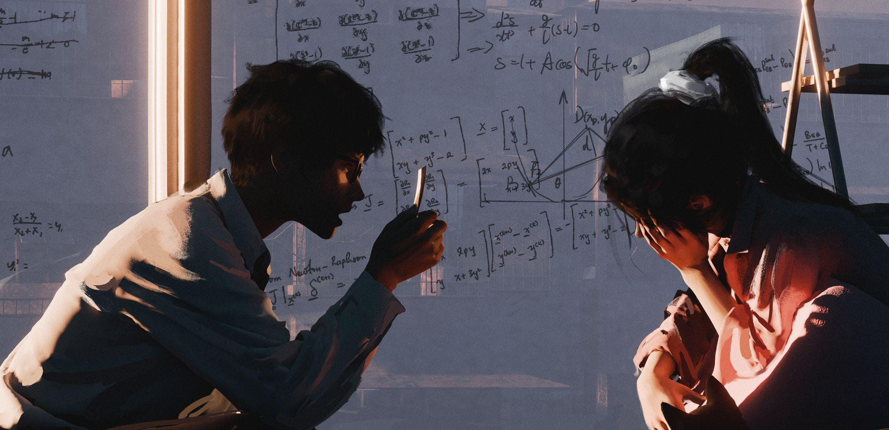

**VI**: “Không thì còn là gì nữa? Tỷ lệ này, vị trí này, bóng người rõ ràng đang đứng ngay trên bề mặt của Vân Trùng cơ mà — Cậu làm thế nào mà chụp được hay vậy?”

**ZH**: “不然呢？这比例，这位置，人影明明就在云虫表面——你怎么拍到的？”

**VI**: “Lần đó Vân Trùng đi ngang qua sông Yarlung Tsangpo, tôi thức trắng nguyên đêm canh chừng ở bờ bên kia hẻm núi. Chụp được vào lúc năm giờ sáng đấy. Khi đó tôi cũng đã muốn tiến lại gần thêm một chút nữa. Nhưng cái nơi ấy... nó tĩnh mịch đến mức kỳ quái đến rợn người. Không có một tiếng chim hót, không một ngọn gió lay, chỉ có tiếng vo ve trầm đục lượn lờ dội thẳng vào màng nhĩ. Cậu sẽ bất giác muốn lùi bước lại, có cảm giác như đang có một đôi mắt vô hình xa lạ dán chặt nhìn chằm chằm vào mình. Kỳ dị hơn nữa là, sau khi trở về tôi phát hiện toàn bộ cuộn film đều bị phơi sáng hỏng bét, duy chỉ có đúng một tấm này là còn nguyên vẹn bình an vô sự.”

**ZH**: “那次云虫经过雅鲁藏布江，我在河谷对岸守了一整晚。凌晨五点拍到的。那时候我也想再靠近一点。但那地方……安静得有点奇怪。没有鸟叫，没有风，只有低频的嗡鸣，像在耳膜里盘旋。你会不自觉地想后退，像是有一双陌生的眼睛正盯着你看。更诡异的是，我回来之后发现整卷胶片都曝光了，唯独这一张没事。”

**VI**: “Cậu không sợ sao? Một thân một mình giữa chốn đồng hoang lạnh lẽo không một bóng người, trước mặt là thực thể Vân Trùng khổng lồ cùng những bóng người ma quái kỳ dị...”

**ZH**: “你不怕吗？一个人在荒郊野外，杳无人烟，巨大的云虫，诡异的人影……”

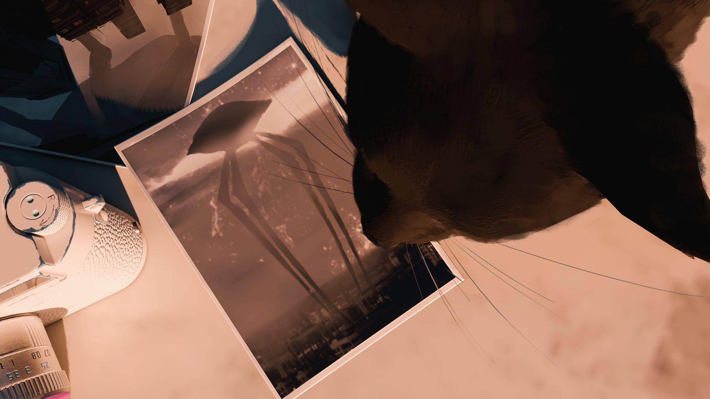

**VI**: “Tôi cũng chẳng hiểu tại sao nữa, những nơi chốn cô độc, hoang vu, không một lời hồi đáp ấy... trái lại lại khiến lòng tôi cảm thấy an yên đến lạ lùng. Tôi yêu Vân Trùng. Đồ sộ, trầm mặc, cô tịch, đứng từ trên cao dõi mắt nhìn xuống chúng sinh, nhưng chưa từng bao giờ hạ mình bước lại gần. —— Nó đẹp đến nao lòng. Tựa như một vị cổ thần đã chìm sâu vào giấc ngủ ngàn năm, để rồi khi bừng tỉnh giấc mộng mới bàng hoàng nhận ra, trên thế gian này đã chẳng còn một ai nhớ nổi tôn danh của người nữa rồi.”

**ZH**: “我也不知道为什么，那些孤独、荒凉、无人回应的地方……反而让我安心。我喜欢云虫。庞大，沉默，孤独，俯瞰众生，却从不靠近。——它太美了。像一位沉睡千年的古神，梦醒时却发现，世上早已没人记得它的名字。”

**VI**: “... Cậu đúng là điên thật rồi.”

**ZH**: “……你真是疯了。”

**VI**: Cô mỉm cười, nụ cười ẩn hiện chút khiêu khích thầm kín đầy ý nhị, tựa như một chú mèo tinh nghịch biết rõ mình đã lách qua mọi ranh giới của quy tắc, lười biếng liếc nhìn kẻ vẫn đang cặm cụi ngồi giải từng bài toán quy củ. Vệt nắng chiều xiên khoai hắt xuống, thắp sáng khóe mắt đang khẽ cong cong của cô.

**ZH**: 她笑了，笑里带着一点不动声色的挑衅，像一只知道自己已经绕开规则的猫，懒懒地看着还在规规矩矩做题的人。光线斜斜落下，照亮她眼尾一丝似有若无的弯。

**VI**: “Chẳng phải cậu vừa bảo tôi giống người từ thập niên 90 tới sao, lũ trẻ thời đó đứa nào mà chẳng mê mẩn việc chạy nhảy ngoài thiên nhiên hoang dã.”

**ZH**: “你不是说我像九十年代来的嘛，那会儿的小孩都爱往野外跑。”

**VI**: “Nhưng thời ấy làm gì có ai dại dột chạy rượt theo Vân Trùng như cậu đâu.”

**ZH**: “可那时候没人是追着云虫跑。”

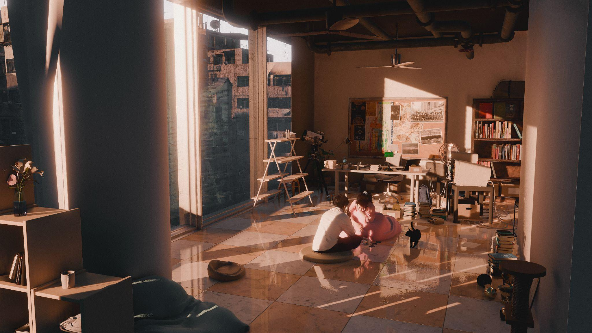

**VI**: Cả hai cùng bật cười, tiếng cười khúc khích ngắn ngủi khẽ tan vào trong vạt nắng vàng ruộm rọi qua ô cửa kính sát sàn.

**ZH**: 他们都笑了，笑声短促，在落地窗透进的金光里轻轻散开。

**VI**: Nguyệt Nha Nhi chống cằm, đầu ngón tay khẽ gõ nhịp xuống mặt sàn, nhưng ánh mắt lại hướng về khoảng không xa xăm bên cạnh, dường như chẳng hề bận lòng áy náy về sự cố chấp kỳ quặc của mình, thậm chí còn thoáng nét đắc ý tự hào.

**ZH**: 月牙儿撑着下巴，指尖轻敲地面，眼神却飘向一旁，仿佛对自己的古怪执念毫无歉意，甚至有些得意。

**VI**: Hi Dương cúi đầu ngắm nghía tấm ảnh vẫn đang cầm trên tay, ngón tay bất giác nhẹ nhàng lướt quanh viền mép ảnh.

**ZH**: 希扬低头看了看那张仍握在手中的照片，手指不自觉地沿着边缘抚过一圈。

**VI**: “Tấm ảnh này, cậu đã từng đăng lên mạng bao giờ chưa?”

**ZH**: “这张照片，你有没有发到过网上？”

**VI**: “Chưa hề. Cậu là người đầu tiên được xem nó đấy. —— Thế nên, cậu có tin trên đời này thực sự có 'Người Trong Mây' không?”

**ZH**: “没有。你是第一个看到的。——所以，你相信世界上真的有‘云中人’吗？”

**VI**: “Tôi tin. Từ những bức bích họa cổ xưa cho đến các thủ bản thời Trung Cổ, các nền văn minh ở các niên đại khác nhau đều từng ghi chép lại những hình bóng tương tự, tuyệt đối không thể nào là chuyện trùng hợp ngẫu nhiên được.”

**ZH**: “我信。从古代壁画到中世纪书稿，各文明在不同年代都记载过相似的身影，不可能是巧合。”

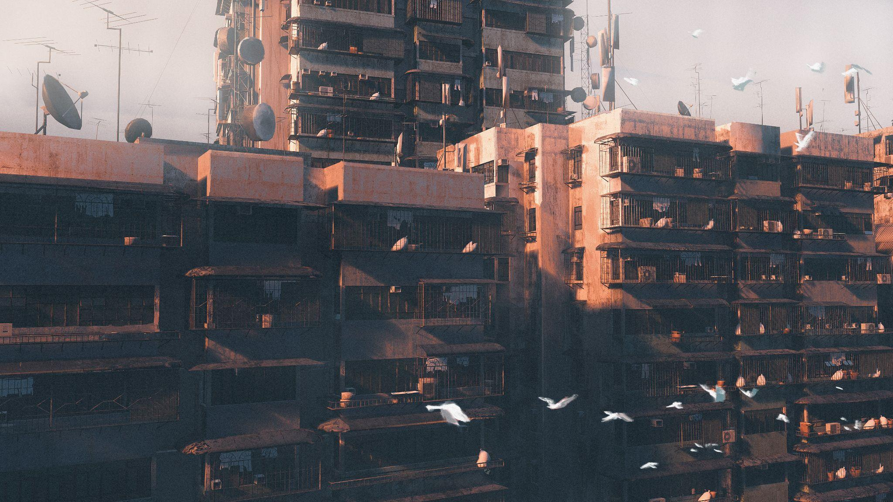

**VI**: “Tôi cũng nghĩ như vậy đấy. Hồi tôi đọc cuốn 'Đoạn Đại Sử', từng thấy có người giải thích cụm từ 'Người Trong Nón' chính là để chỉ Người Trong Mây. Từ thời Xuân Thu ở nước ta đã lưu truyền bài đồng dao nhắc tới 'Người Trong Mây' rồi. Còn máy ảnh cơ thì mới chỉ được phát minh ra hơn một trăm năm nay thôi. Nhưng cũng có người lại bảo, đó chẳng qua chỉ là người xưa đang miêu tả lại một hiện tượng dị tượng tự nhiên nào đó mà thôi.”

**ZH**: “我也觉得。我读《断代史》的时候，看到有人把‘锥中之人’解释为云中人。我国春秋时期就有关于‘云中人’的童谣。而相机这种东西，也不过才发明了一百多年。可也有人说，那只是当时的人在描述异象。”

**VI**: “Phải rồi, cuối thế kỷ trước, từng có một vận động viên thể thao mạo hiểm người Bắc Âu đã dùng dù lượn nhảy đáp xuống lưng Vân Trùng. Thước phim ghi lại mang về cho thấy bề mặt của nó hoàn toàn liền mạch không tì vết, ngay cả một hạt bụi cũng chẳng cạy ra nổi. Và hoàn toàn không phát hiện bất kỳ dấu hiệu nào của sự sống.”

**ZH**: “对，上世纪末，一个北欧极限运动员用跳伞方式登陆云虫，带回的画面显示它表面完全无缝，连尘屑都撬不下来。也没发现任何生命迹象。”

**VI**: “Tôi nhớ vụ đó rồi. Người ấy bảo rằng, Vân Trùng giống như một cỗ máy cơ khí hoàn chỉnh và khép kín tuyệt đối.”

**ZH**: “我记得那件事。他说，云虫就像一个完整的、闭合的机器。”

**VI**: “Người thời cổ đại nhìn thấy họ thì gọi họ là Thần linh. Người thời Trung Cổ gọi họ là 'Vân Sứ' hay 'Linh Hồn Ánh Sáng'. Còn con người thời hiện đại chúng ta, thì chỉ biết quy kết 'Người Trong Mây' chẳng qua là hiện tượng ảo ảnh quang học trong khí quyển do dị biến điện từ gây ra. Khoa học công nghệ càng tiến bộ, thì trí tưởng tượng của nhân loại dường như lại càng trở nên nghèo nàn kiệt quệ.”

**ZH**: “古代人见到他们，说是神。中世纪人叫他们‘云使’或‘光之灵’。而现代人，只会说‘云中人’不过是电磁异常引发的大气蜃景。科技越进步，我们的想象力反而越贫瘠。”

**VI**: Hi Dương ngẩng đầu nhìn lên bức tường đối diện.

**ZH**: 希扬抬头望了一眼对面的墙。

**VI**: Bản sơ đồ trục thời gian tiến trình văn minh được ghim trên tường đang khẽ cong vênh mép giấy dưới ánh tà dương, mặt giấy đã ngả màu ố vàng.

**ZH**: 那张被图钉固定的文明时间轴图在夕阳下微微翘起边角，纸面泛黄。

**VI**: Cậu bước lại gần, giơ tay gỡ nó xuống khỏi bức tường, rồi trải rộng ra mặt sàn —

**ZH**: 他走过去，伸手把它从墙上揭了下来，铺在地面上——

**VI**: Dày đặc những chấm đỏ chi chít, tựa như muôn vệt sao băng rạch ngang qua các trang sử sách ngàn năm.

**ZH**: 红点密布，如流星划过史册。

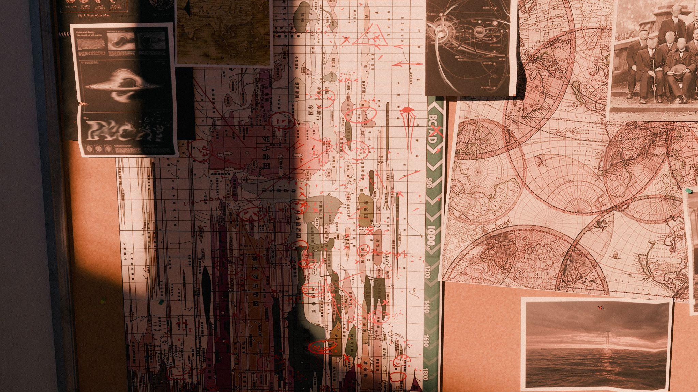

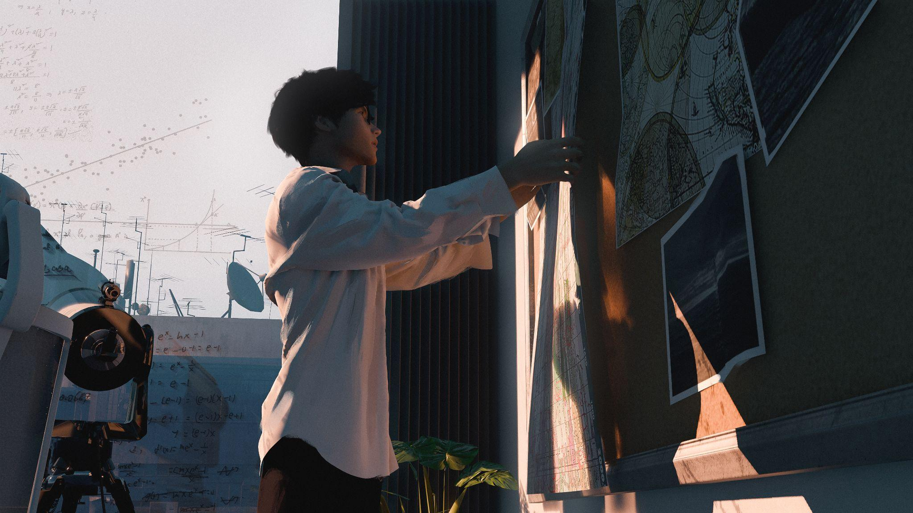

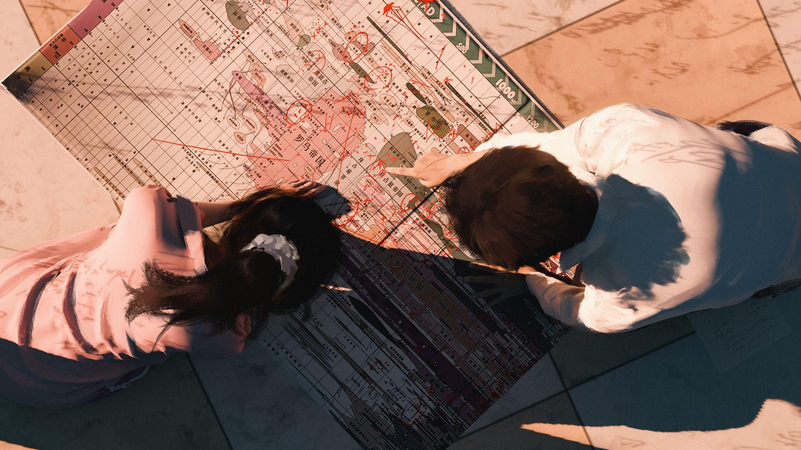

**VI**: “Đây là những ghi chép về việc nhìn thấy Người Trong Mây trong các sử liệu mà tôi đã từng đánh dấu. Cậu nhìn những khu vực tập trung dày đặc các chấm đỏ này xem, sự phân bố của chúng cực kỳ thú vị — Cuối thời Chiến Quốc thời Đông Chu, giai đoạn cuối thời Đông Hán, thời kỳ La Mã chuyển từ thể chế Cộng hòa sang Đế quốc, rồi khoảng thời gian Đế quốc Maurya tan rã, thời kỳ thành Ctesiphon thất thủ dẫn đến sự diệt vong của Đế quốc Sasanian, rồi cả Thế chiến thứ Nhất và Thế chiến thứ Hai ở châu Âu nữa...”

**ZH**: “这是我标注过的史料中云中人目击记录。你看这些红点密集区域，分布得很有意思——东周战国末年、东汉末期、罗马从共和国转向帝国的时期、还有孔雀帝国解体前后、泰西封被破萨珊帝国覆灭的时期，还有欧洲一战二战的时候……”

**VI**: “Nghe qua thì có vẻ toàn rơi vào những thời kỳ chiến tranh loạn lạc khốc liệt nhỉ?”

**ZH**: “听起来，都是战争时期？”

**VI**: “Cũng không hẳn hoàn toàn như vậy. Thời kỳ Trinh Quán thịnh trị đời nhà Đường, hay giai đoạn Ngũ Hiền Đế của La Mã cũng có rất nhiều ghi chép, những thời kỳ đó đều là những thời đại hoàng kim rực rỡ cả đấy.”

**ZH**: “也不全是。唐朝贞观年间、罗马的五贤帝时期也有很多记录，那些可是黄金时代。”

**VI**: “Thế thì có lẽ chỉ là thiên kiến kẻ sống sót (Survivorship bias) mà thôi. Cả thời thịnh thế lẫn thời loạn thế, con người ta đều có nhiều lý do hơn để ghi chép lại những điều mà họ coi là 'thần tích'.”

**ZH**: “那可能只是幸存者偏差。盛世乱世，人们都更有理由把‘神迹’记下来。”

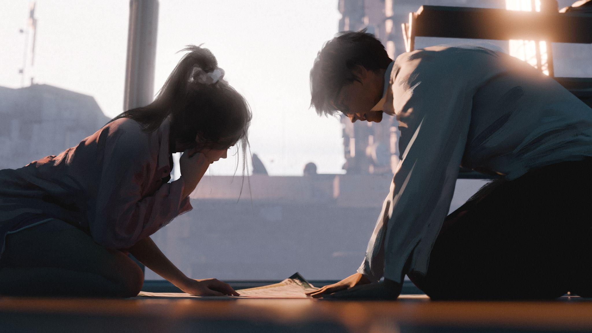

**VI**: Tấm bản đồ mở rộng khẽ rung rinh nhè nhẹ trong làn gió, tựa như một lời sấm truyền bị dòng thời gian bỏ quên. Vầng thái dương đã lặn hẳn về tây, thành phố bên ngoài cửa sổ chìm dần vào làn sương chạng vạng. Một chân tướng nào đó chưa từng được kiểm chứng, đang âm thầm phủ bóng mờ giữa hai con người.

**ZH**: 摊开的图纸在风中微微颤动，像一场被搁浅的预言。太阳已西沉，窗外的城市浸入薄暮。某个尚未被证实的真相，正悄悄在两人之间张开暗影。

**VI**: “Nếu như vạn sự vạn vật đều quy chụp cho hai chữ 'thiên kiến', vậy thì sử học và khoa học còn có ý nghĩa gì để tồn tại nữa chứ?”

**ZH**: “如果一切都归因于‘偏差’，那史学和科学还有存在的意义吗？”

**VI**: “Thế cậu đã nhìn ra được quy luật gì từ nó rồi?”

**ZH**: “那你看到什么规律了？”

**VI**: “Những thời đại mà ánh sáng và bóng tối cùng song hành đan xen ấy... không có một thời đại nào không phải là điểm nút tới hạn chứng kiến sự biến động dữ dội của văn minh nhân loại cả.”

**ZH**: “这些光明与黑暗并存的时代……无一不是人类文明剧烈变动的临界点。”

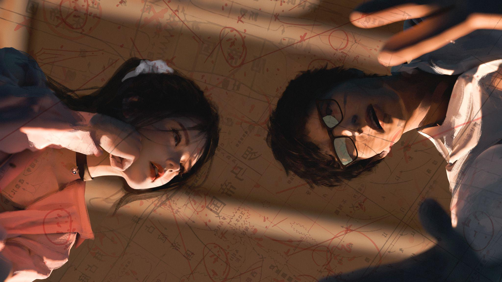

**VI**: “Vậy 'họ' đến là để làm chứng nhân, hay là đến để thúc đẩy tiến trình ấy?”

**ZH**: “那「他们」是来见证的，还是来推动的？”

**VI**: “Đó mới chính là điều mà tôi muốn tìm ra câu trả lời.”

**ZH**: “这才是我想知道的。”

**VI**: Trầm mặc trong giây lát, ngón tay cậu khẽ gõ nhẹ lên góc bản đồ, tựa như đang đếm lại những chấm đỏ rải rác trên trang giấy.

**ZH**: 沉默片刻，他手指轻轻敲了敲图纸边角，像是在数数上面那些散落的红点。

**VI**: “Cậu có nghĩ rằng, nếu như chúng ta cũng là một phần của lịch sử... thì liệu có ai sẽ chấm một nét mực đỏ lên bản đồ này vì chúng ta không?”

**ZH**: “你觉得，如果我们是历史的一部分……会被谁在图上点一个红点？”

**VI**: “Cậu có mong muốn sẽ có người nhớ đến mình không?”

**ZH**: “你希望有人记得你吗？”

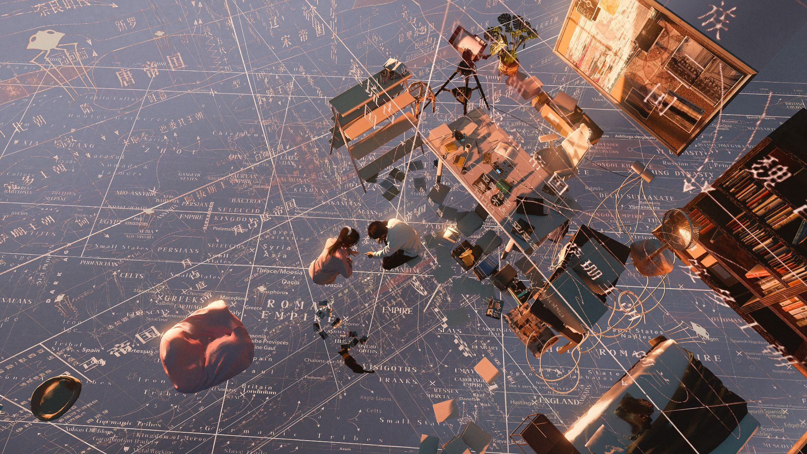

**VI**: Cậu không trả lời, chỉ lặng lẽ ngồi giữa vầng tàn dương của nền văn minh.

**ZH**: 他没答，只是静静地坐在文明的余晖里。

**VI**: Mạch lạc của thời gian kéo dài theo một phương thức kỳ dị, những đường nét đan chéo chằng chịt từ dưới chân lan ra khắp bốn bức tường, tựa như mạng nhện, lại tựa như kinh vĩ của số phận. Những chấm đỏ dày đặc trên giấy khẽ ánh lên tia sáng mờ ảo, ghi dấu những niên đại từng vang vọng tiếng trùng ngâm thảng thốt.

**ZH**: 时间的脉络以奇异的方式延展，交错的线条从脚下蔓延至四壁，像蛛网，又像命运的经纬。密集的红点在纸上微微发亮，记录着那些回荡虫鸣的年代。

**VI**: Trong khoảnh khắc này, hai người họ tựa như hai hạt bụi nhỏ nhoi lơ lửng giữa không trung, vướng vào tấm lưới khổng lồ của thời gian, lặng lẽ đợi chờ tiếng ngâm trầm đục kế tiếp của vị cổ thần vang vọng giữa trời đất.

**ZH**: 这一刻，他们像两粒悬空的灰尘，在时间的巨网中，等待下一次古神的低鸣。

**VI**: U u trùng ngâm,

**ZH**: 幽幽虫鸣，

**VI**: Hà tri ngã tâm.

**ZH**: 何知我心，

**VI**: Vân trung chi nhân,

**ZH**: 云中之人，

**VI**: Tại thủy chi tân.

**ZH**: 在水之滨。

**VI**: Ai ai trùng ngâm,

**ZH**: 哀哀虫鸣，

**VI**: Hà lự ngã hành.

**ZH**: 何虑我行，

**VI**: Chùy trung chi nhân,

**ZH**: 锥中之人，

**VI**: Tại vân chi đính.

**ZH**: 在云之顶。

**VI**: —— Khuyết danh thời Xuân Thu

**ZH**: ——春秋 佚名
