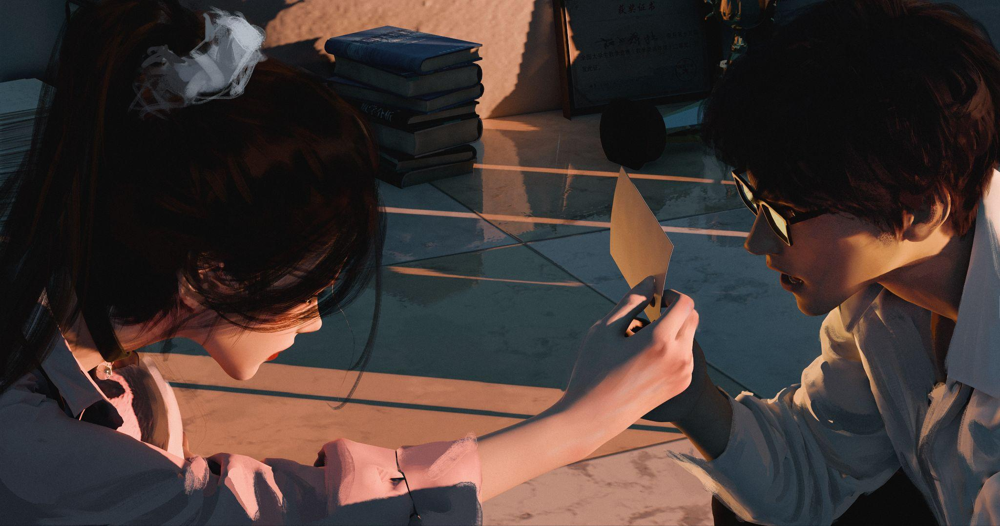
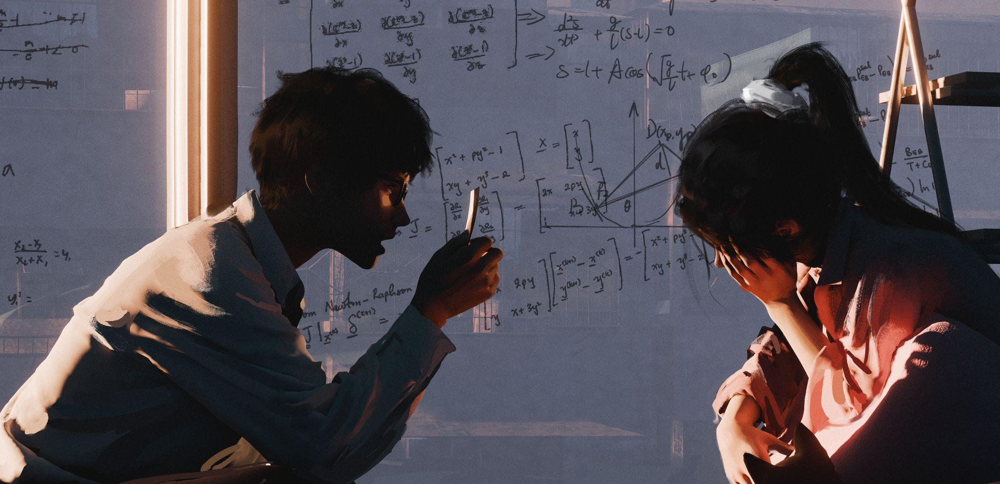
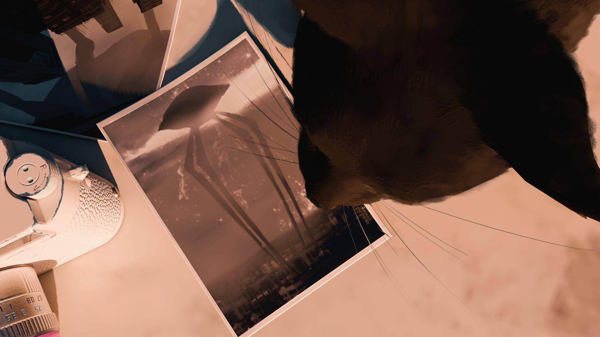
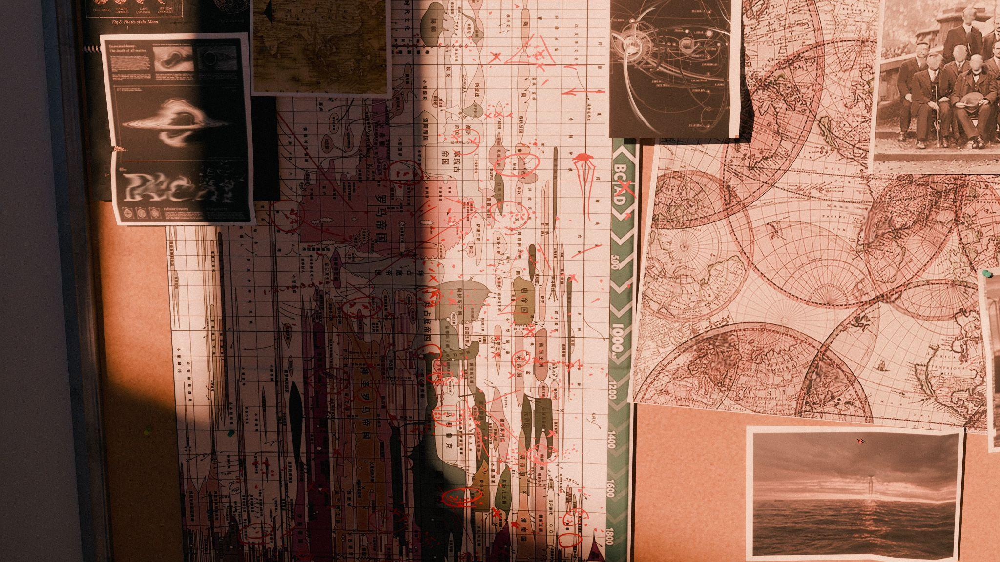
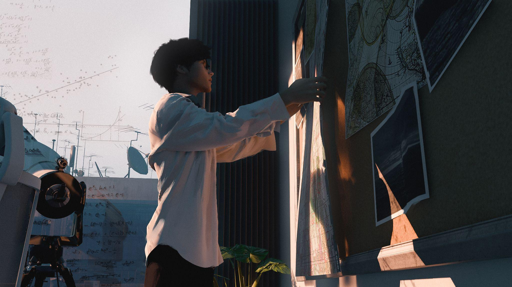
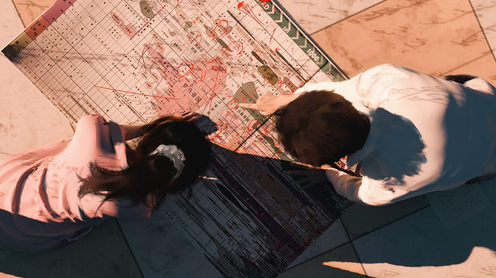
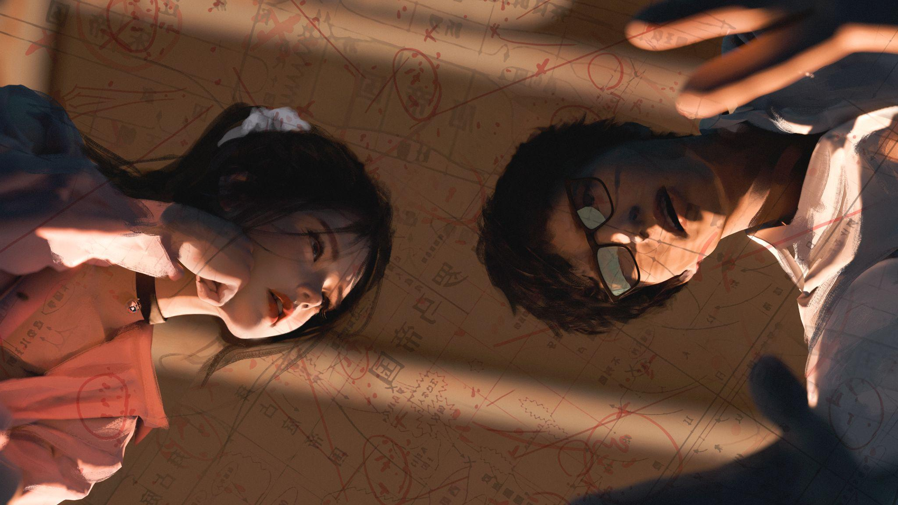
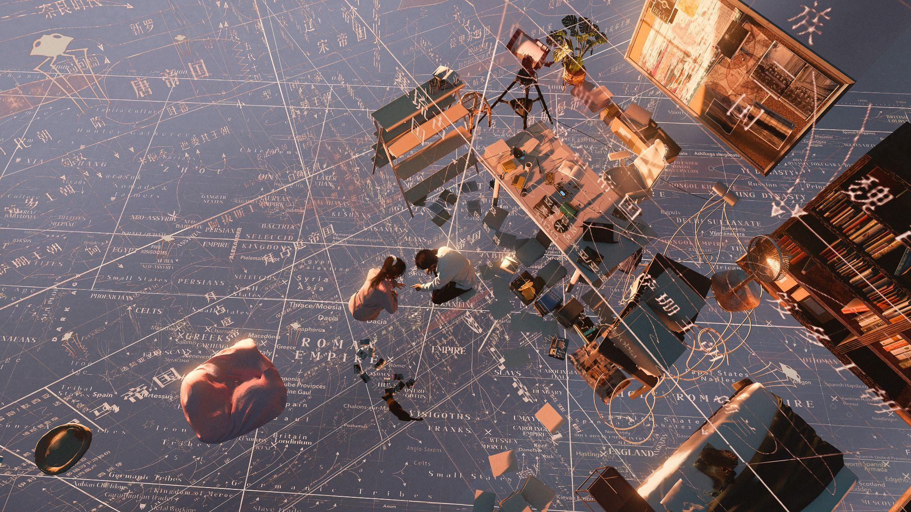

# 云虫 - 第二章 云中人 · 三

---

> “这几张——你应该能认出来。”

> “布达拉宫？等等……这云层下的是……盘古？这角度也太绝了……你不会是爬上什么山崖拍的吧？”

> “没有，我只是站在一块废弃观测台上。去年暑假我特意去追它——一号云虫盘古，按预测轨迹一路骑行进了藏南。”

> “骑行西藏，还追着‘盘古’拍照片……你的人生也太精彩了吧。”

> “我这样的人，也值得你这高材生羡慕？”

> “值得，非常值得。你是用……胶卷拍的？”

> “就用这个。”

> “这相机还真适合你。你是不是故意活得像从九十年代穿越来的？”

> “胶片洗出来那种灰调子，是数码永远做不出来的。”

> “可离云虫这么近的地方……不都应该划入禁区了么？”

> “你果然是个乖学生。云虫穿过城市时才会设禁区，荒郊野岭的，谁来管？”

> “你每次都……一个人吗？”

> “那你希望我每次都是一个人吗？”

> “我……”

> “别乱猜了，还有谁愿意陪我做这种傻事。来，这张是我压箱底的，你肯定感兴趣。”

> “好模糊……两个人影？长焦拍的？等等……”

> “你拍到——云中人了？！”

> “你确定？”

> “不然呢？这比例，这位置，人影明明就在云虫表面——你怎么拍到的？”

> “那次云虫经过雅鲁藏布江，我在河谷对岸守了一整晚。凌晨五点拍到的。那时候我也想再靠近一点。但那地方……安静得有点奇怪。没有鸟叫，没有风，只有低频的嗡鸣，像在耳膜里盘旋。你会不自觉地想后退，像是有一双陌生的眼睛正盯着你看。更诡异的是，我回来之后发现整卷胶片都曝光了，唯独这一张没事。”

> “你不怕吗？一个人在荒郊野外，杳无人烟，巨大的云虫，诡异的人影……”

> “我也不知道为什么，那些孤独、荒凉、无人回应的地方……反而让我安心。我喜欢云虫。庞大，沉默，孤独，俯瞰众生，却从不靠近。——它太美了。像一位沉睡千年的古神，梦醒时却发现，世上早已没人记得它的名字。”

> “……你真是疯了。”

> 她笑了，笑里带着一点不动声色的挑衅，像一只知道自己已经绕开规则的猫，懒懒地看着还在规规矩矩做题的人。光线斜斜落下，照亮她眼尾一丝似有若无的弯。

> “你不是说我像九十年代来的嘛，那会儿的小孩都爱往野外跑。”

> “可那时候没人是追着云虫跑。”

> 他们都笑了，笑声短促，在落地窗透进的金光里轻轻散开。

> 月牙儿撑着下巴，指尖轻敲地面，眼神却飘向一旁，仿佛对自己的古怪执念毫无歉意，甚至有些得意。

> 希扬低头看了看那张仍握在手中的照片，手指不自觉地沿着边缘抚过一圈。

> “这张照片，你有没有发到过网上？”

> “没有。你是第一个看到的。——所以，你相信世界上真的有‘云中人’吗？”

> “我信。从古代壁画到中世纪书稿，各文明在不同年代都记载过相似的身影，不可能是巧合。”

> “我也觉得。我读《断代史》的时候，看到有人把‘锥中之人’解释为云中人。我国春秋时期就有关于‘云中人’的童谣。而相机这种东西，也不过才发明了一百多年。可也有人说，那只是当时的人在描述异象。”

> “对，上世纪末，一个北欧极限运动员用跳伞方式登陆云虫，带回的画面显示它表面完全无缝，连尘屑都撬不下来。也没发现任何生命迹象。”

> “我记得那件事。他说，云虫就像一个完整的、闭合的机器。”

> “古代人见到他们，说是神。中世纪人叫他们‘云使’或‘光之灵’。而现代人，只会说‘云中人’不过是电磁异常引发的大气蜃景。科技越进步，我们的想象力反而越贫瘠。”

> 希扬抬头望了一眼对面的墙。

> 那张被图钉固定的文明时间轴图在夕阳下微微翘起边角，纸面泛黄。

> 他走过去，伸手把它从墙上揭了下来，铺在地面上——

> 红点密布，如流星划过史册。

> “这是我标注过的史料中云中人目击记录。你看这些红点密集区域，分布得很有意思——东周战国末年、东汉末期、罗马从共和国转向帝国的时期、还有孔雀帝国解体前后、泰西封被破萨珊帝国覆灭的时期，还有欧洲一战二战的时候……”

> “听起来，都是战争时期？”

> “也不全是。唐朝贞观年间、罗马的五贤帝时期也有很多记录，那些可是黄金时代。”

> “那可能只是幸存者偏差。盛世乱世，人们都更有理由把‘神迹’记下来。”

> 摊开的图纸在风中微微颤动，像一场被搁浅的预言。太阳已西沉，窗外的城市浸入薄暮。某个尚未被证实的真相，正悄悄在两人之间张开暗影。

> “如果一切都归因于‘偏差’，那史学和科学还有存在的意义吗？”

> “那你看到什么规律了？”

> “这些光明与黑暗并存的时代……无一不是人类文明剧烈变动的临界点。”

> “那「他们」是来见证的，还是来推动的？”

> “这才是我想知道的。”

> 沉默片刻，他手指轻轻敲了敲图纸边角，像是在数数上面那些散落的红点。

> “你觉得，如果我们是历史的一部分……会被谁在图上点一个红点？”

> “你希望有人记得你吗？”

> 他没答，只是静静地坐在文明的余晖里。

> 时间的脉络以奇异的方式延展，交错的线条从脚下蔓延至四壁，像蛛网，又像命运的经纬。密集的红点在纸上微微发亮，记录着那些回荡虫鸣的年代。

> 这一刻，他们像两粒悬空的灰尘，在时间的巨网中，等待下一次古神的低鸣。

> 幽幽虫鸣，

> 何知我心，

> 云中之人，

> 在水之滨。

> 哀哀虫鸣，

> 何虑我行，

> 锥中之人，

> 在云之顶。

> ——春秋 佚名

