# CloudInsect - Chapter 3: Beyond Light Cone · Part 1

*Original Title: 第三章 光锥之外 · 一*

---

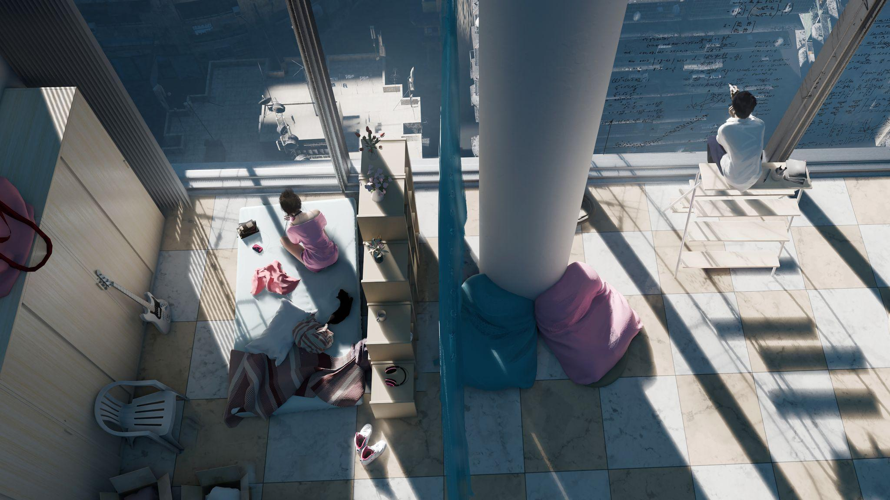

> Sunlight slanted in through the floor-to-ceiling window, slicing the floor into quiet grids of shadow and light.

> Mahina sat on the narrow bed by the window, her old book flipped open to the middle. Faint smudges of dust clung to her fingertips where they had touched the yellowed page.

> Betelgeuse curled up behind her, its tail swaying softly—

> as if listening to the thoughts she hadn’t spoken aloud.

> Across the room, Suvan sat alone on the steps.

> His figure was stretched long by the afternoon sun.

> Formulas filled the glass before him, densely written like a silent star map.

> He was deep in thought, lips moving faintly, reciting something under his breath.

> A pale blue curtain hung down from the ceiling, quietly dividing the room in two—

> on one side, the stillness of the tide;

> on the other, the flicker of a star.

> “Glory like autumn chrysanthemums; grace like spring pines…”

> “She glides like drifting clouds across the moon,”

> “like snow swept by the turning wind…”

> “What are you reciting?”

> “Nothing. Just something from class.”

> “Really? Then tell me—which high school textbook includes Rhapsody on the Goddess of the Luo?”

> He blushed, cleared his throat, and ducked his head, scribbling again on the glass.

> Sunlight slid across his cheek and lit the edge of his ear—

> betraying that brief moment of being seen through.

> “You don’t go out on weekends, you don’t play games, and you don’t even touch your phone.”

> “Staring at those formulas all day—don’t you ever get bored?”

> “Don’t you have... I don’t know, any hobbies?”

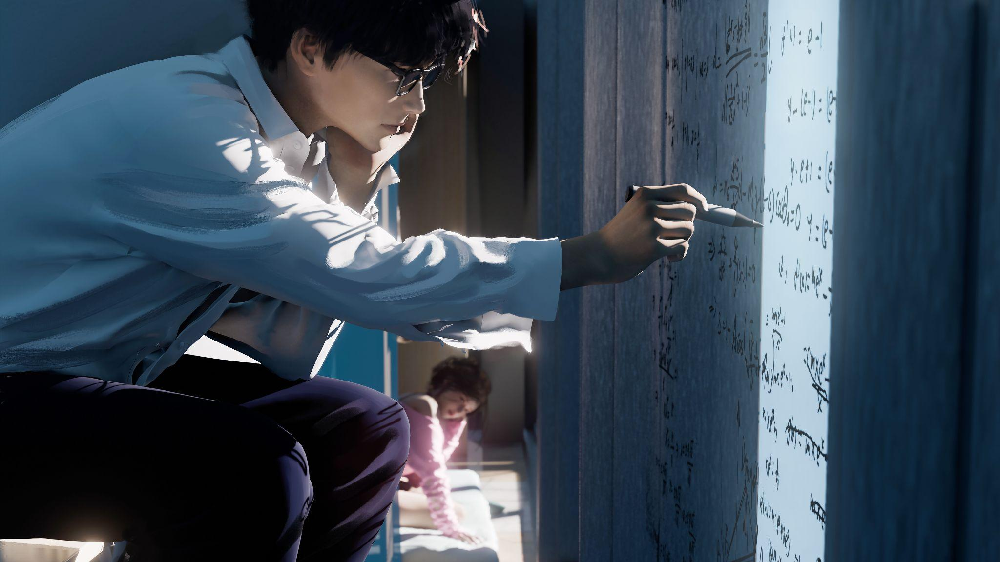

> “This is entertainment, to me.”

> “Compared to games designed by humans, I prefer the ones designed by gods.”

> “So? Got any leads yet?”

> “Inside the CloudInsect field, the laws of electromagnetism become abnormal. Maxwell’s equations no longer hold, and electromagnetic fields behave nonlinearly. Fluctuations in Planck’s constant disrupt the rules governing electron energy-level transitions, rendering almost every silicon-chip device useless. Even logic gates lose their original functions—NAND gates begin behaving like OR gates.”

> “Speak human, please.”

> “In short?”

> “All our precision instruments are pretty much dead.”

> “But there’s one thing we do know for sure:”

> “These anomalies scale with our distance from the CloudInsect.”

> “The closer we are—the smaller the variables get.”

> “If we get close enough...”

> “could those anomalous variables become negligible?”

> She turned slightly, glancing at him through the gap between the bookshelf and the window, quietly observing his expression.

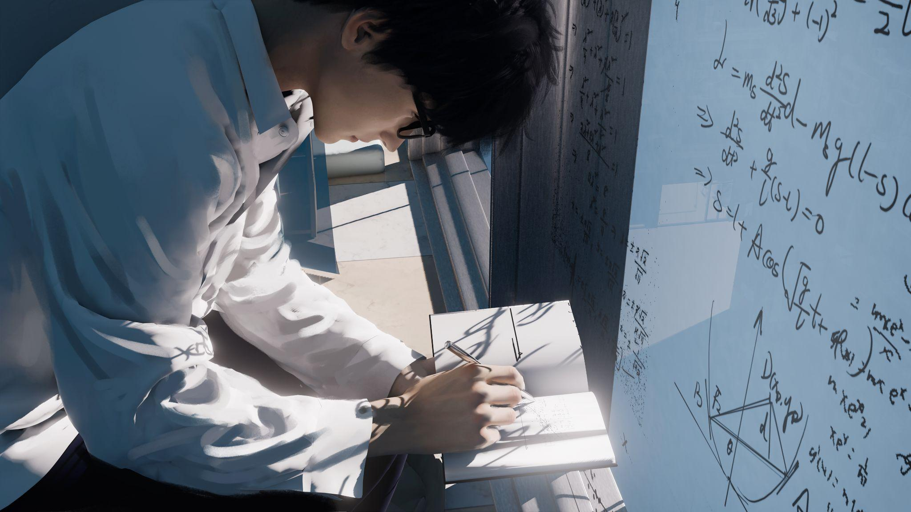

> “Yes.”

> “If we’re close enough, those variables can be treated as infinitesimals—negligible within the equations.”

> “With that in mind, even simple reconfigured devices might work again.”

> “It’s just that—”

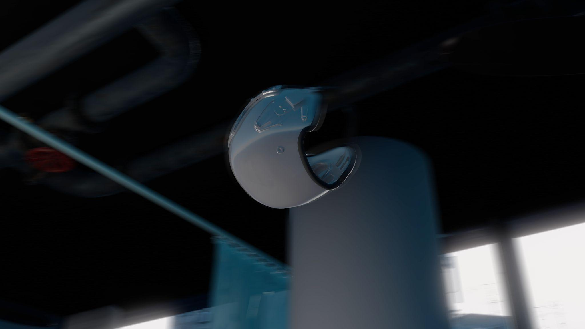

> “Let’s go!”

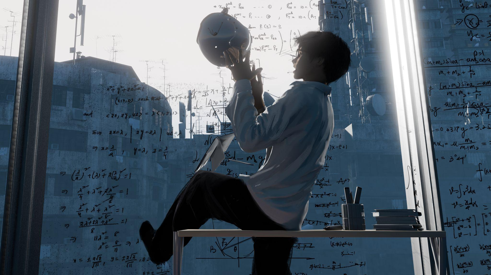

> Before the words even finished echoing, a helmet came flying through the curtain.

> Suvan flinched, instinctively reaching out to catch it—

> but got smacked square in the chest instead.

> The helmet dropped into his lap, and he nearly tumbled down the steps, looking thoroughly caught off guard.

> “Huh? Go where?”

> “Your big sister is taking you to see a real CloudInsect.”

> She stood there, barefoot, clutching another helmet in one hand, her feet bathed in shattered patches of sunlight like a sprite poised atop light itself.

> With a flick of her hair and a tilt of her chin, she looked at him—

> eyes bright, leaving no room for refusal.

> Rambler Channel | Near the CloudInsect’s core zone

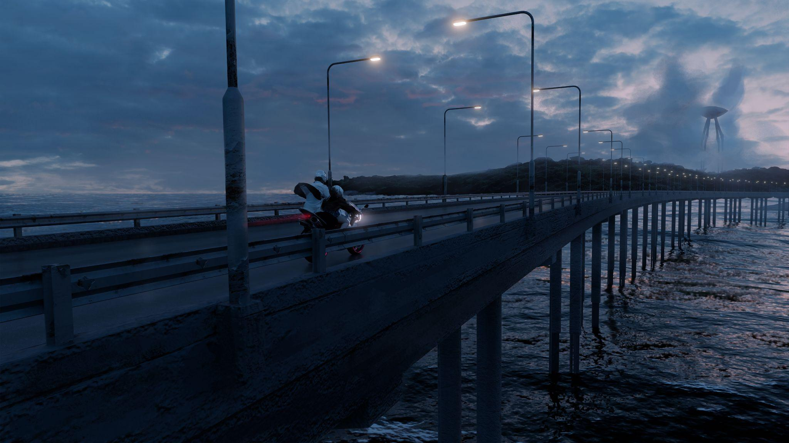

> The roar of the motorcycle engine sliced through the empty coastal highway.Mahina, in a dark jacket, leaned forward with quiet intensity. Strands of hair whipped out from beneath her helmet, her gaze sharp, unwavering—as if she and the machine had long become one.

> Suvan sat behind her, one hand resting lightly on her shoulder.His head was bowed slightly, but every so often he glanced up—toward the distant outline of the CloudInsect, faint and colossal, a shape that seemed to belong to another world altogether.

> “Don't touch my shoulder. You're throwing off my balance.”

> “Then... where should I hold on? I need to grab something.”

> “My waist.”

> “...Huh?”

> Suvan flushed, awkwardly shifting his posture.

> He didn't argue this time.

> Quietly, obediently—he wrapped his arms around her waist.

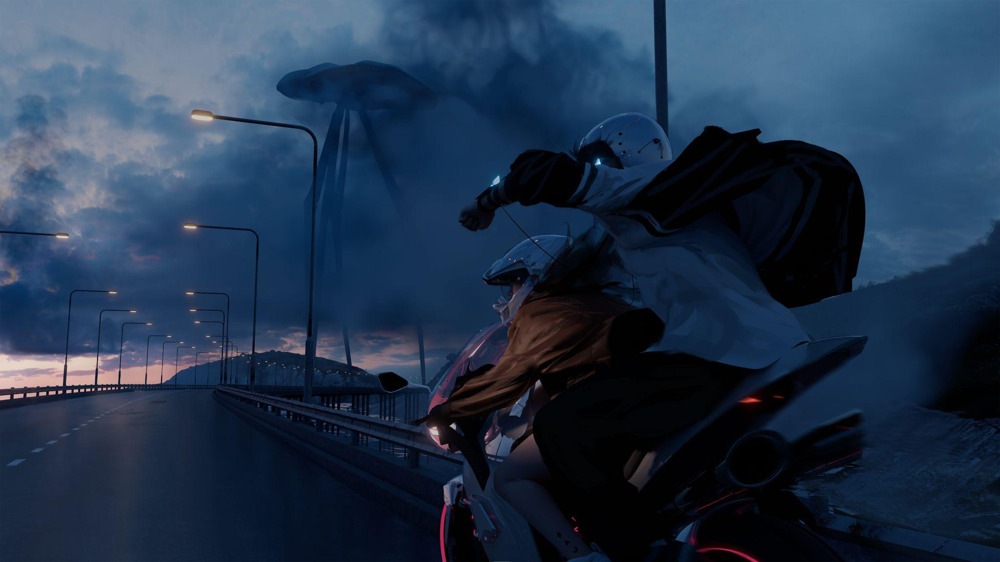

> “You sure this thing can really handle the CloudInsect field?”

> “Relax. I have a special motorcycle license for riding inside a CloudInsect field.”

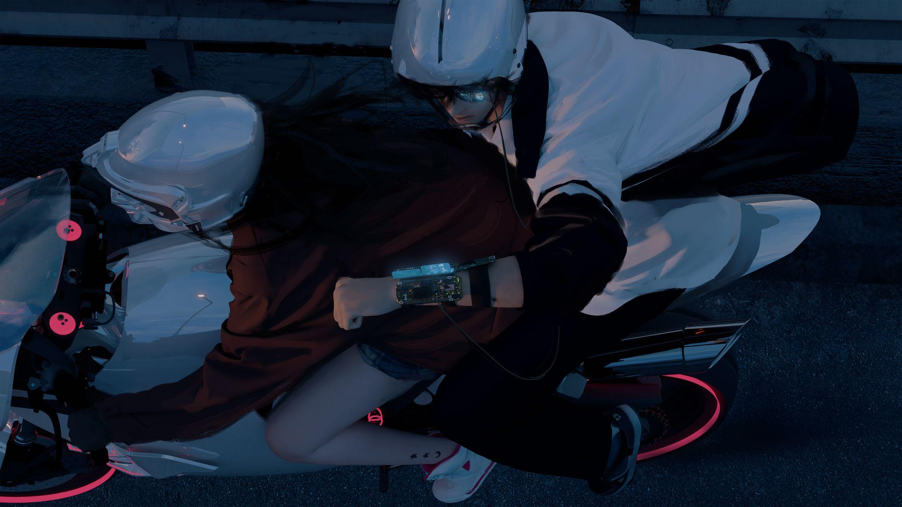

> He kept his eyes fixed on the sensor strapped to his forearm—just a handful of crude circuit boards, wires messily soldered together.

> Pale blue digits flickered across the LCD, blinking in soft, precise intervals.

> With every new reading, the device gave off a faint beep—beep—, a sound swallowed by the roar of the combustion engine—like the heartbeat of some deep-sea creature, pulsing from the abyss.

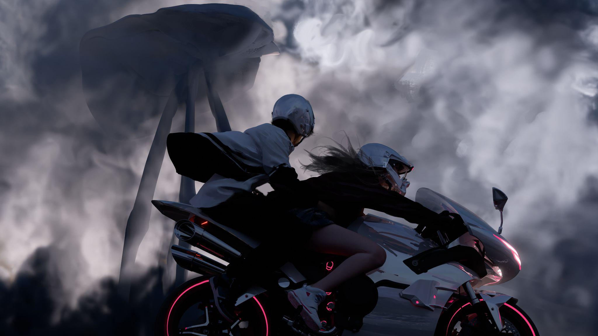

> “So this is what the world looks like... when it’s truly beautiful.”

> Mahina didn’t respond. She simply eased off the throttle.

> The wind caught his quiet words, scattering them across the long, empty bridge behind them.

> The motorcycle raced forward like a meteor, streaking toward the figure looming in the sky—the CloudInsect, vast and still, slowly revealing its silhouette.

> Like a slumbering titan curled upon the edge of the firmament.

> From the backseat, Suvan couldn’t take his eyes off it.

> His voice had held the weight of something long buried.

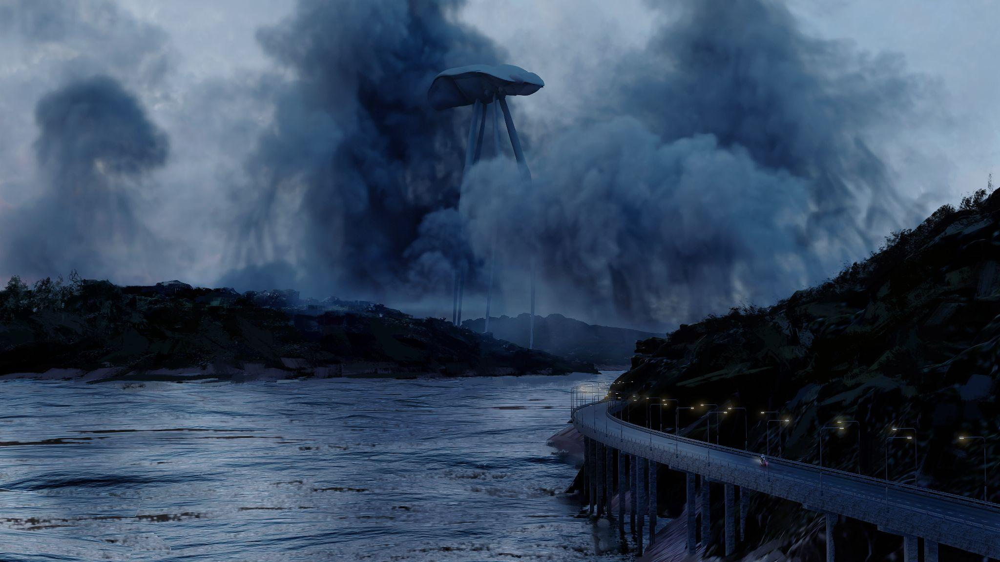

> They drew closer to the CloudInsect.

> Beneath the slumbering giant, mist churned like a rising tide.

> A few hours later | Mid-channel

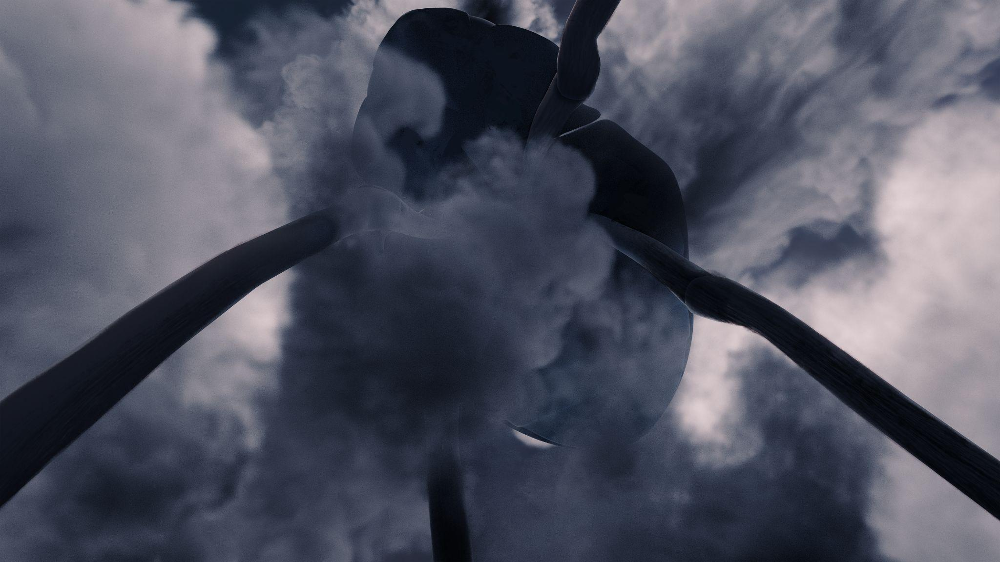

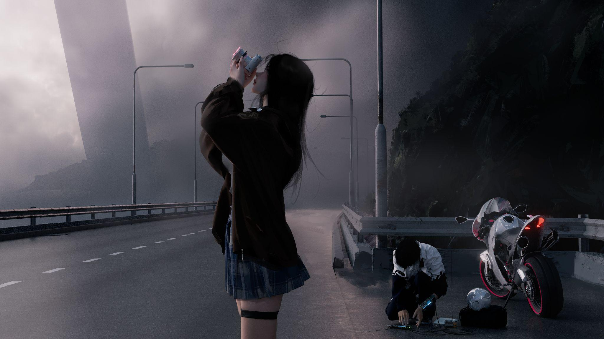

> They stopped on an empty stretch of road in the middle of the channel.

> Directly overhead loomed the core of the CloudInsect’s presence—

> the clouds hung low and heavy, like a ceiling of sky sinking toward the earth.

> As soon as Suvan got off the bike, he opened his equipment case and knelt down to begin calibration. He checked the display, then quickly circled the vehicle, scanning for magnetic fluctuations in the area.

> “This is my first time seeing it from this angle...”

> “We're right beneath the interference core of the CloudInsect.”

> “Basic testing instruments should be able to function here.”

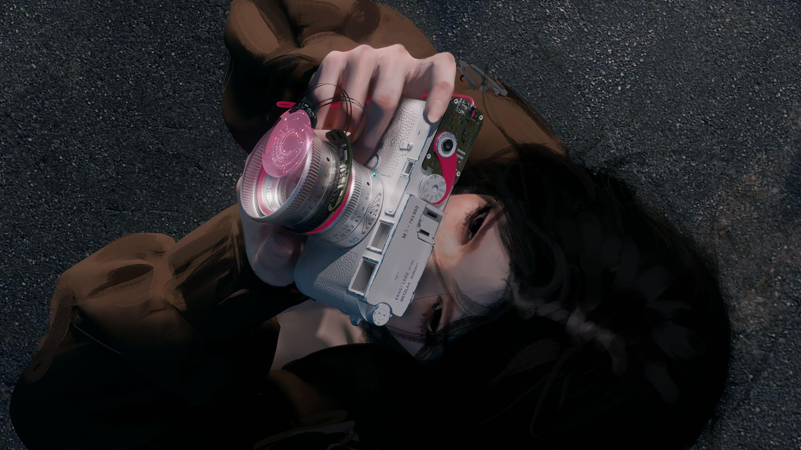

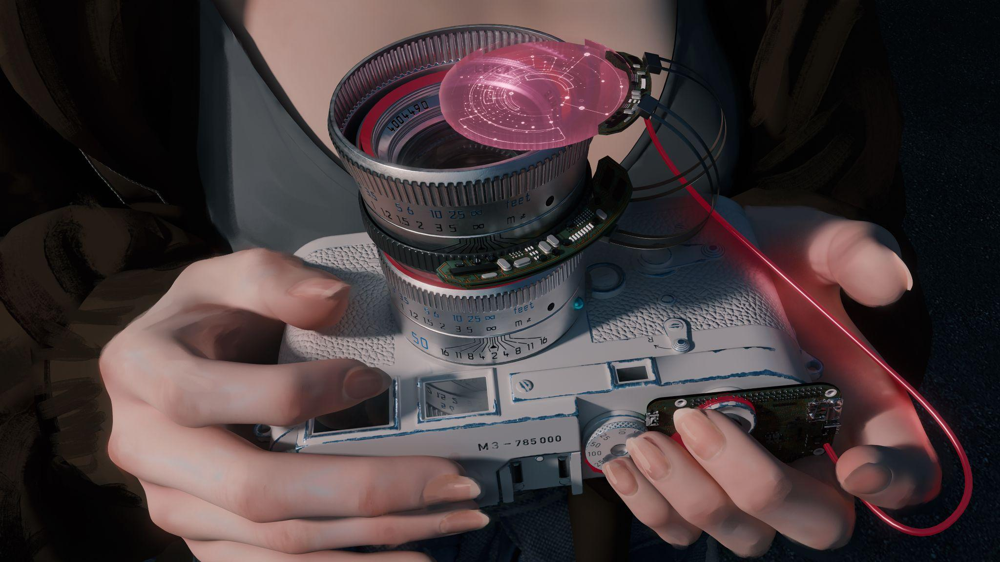

> “The detector you mounted on my camera—its screen isn’t responding at all.”

> “Yeah, that’s expected. The LCD won’t react in this interference field—its driving frequency is completely mismatched. But as long as you press the shutter, the device will still capture the signal. You just can’t see it right now, that’s all.”

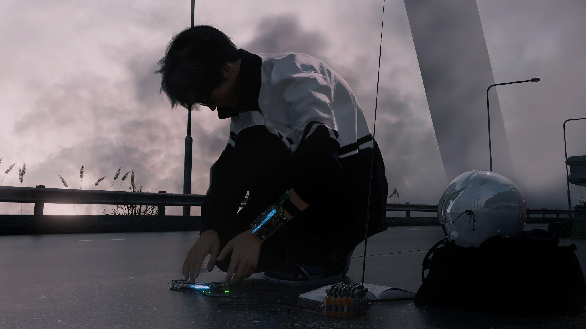

> He pulled another device from his backpack—a modified circuit board rigged with a glowing LED and a thin antenna.

> He manually adjusted the frequency using a dial, connected the wires to a battery, and within seconds, the indicator light began blinking in a steady rhythm. The signal had gone through.

> “It’s working... Just as I thought. Close enough to the CloudInsect, those interference variables become negligible. Simple signals can pierce through the field.”

> He looked down, ready to log the data—

> But suddenly, his expression froze. His eyes locked onto the frequency feedback on the transmitter.

> A fine layer of sweat began to gather at his temples, and his fingers started to tremble.

> “…I just got a reply.”

> “A reply? From what?”

> “I sent ‘Hello’ as a test just now… and I received a reply on the same frequency—also ‘Hello.’”

> “Could it have bounced back from some nearby device? Maybe someone else is around here?”

> “Impossible. The transmitter's power is minimal—its effective range is less than five meters. There can’t be any receivers nearby… and no people either.”

> “Then… send another message. See what happens.”

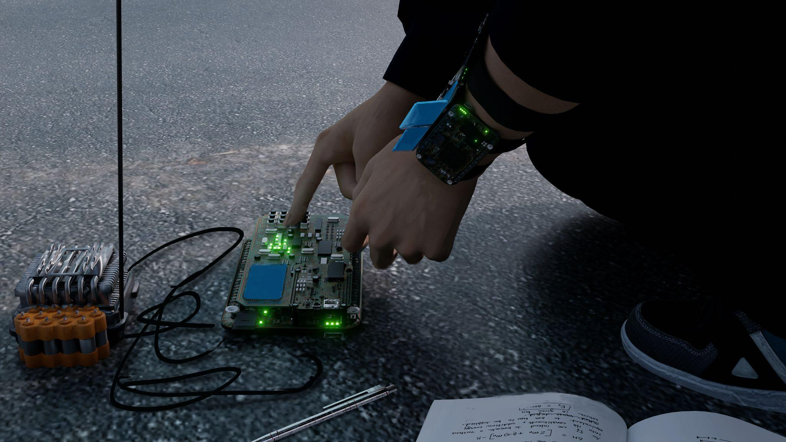

> He adjusted the frequency again and changed the input to: “Who are you?”

> Seconds later, the indicator light blinked—short, sharp, unmistakable.

> The return signal was precise.

> He quickly grabbed a notebook from his side and began jotting down the on-and-off rhythm of each binary flash.

> As he wrote, he decoded them one by one, cross-referencing a chart beside him.

> With each character deciphered, his pen paused for a beat—

> ‘I’

> ‘am’

> ‘the… Sow…er…’

> When the final word appeared, his hand trembled, the pen nearly tearing the paper.

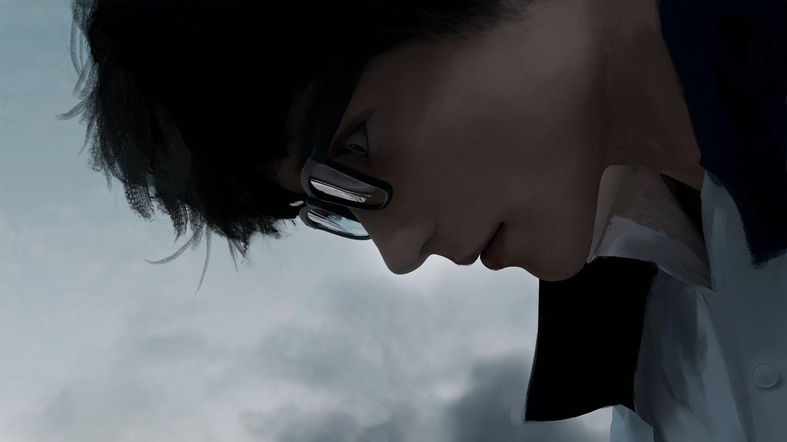

> “‘…I’m the Sower…?’”

> Just then, Mahina let out a sharp, hushed gasp that snapped him out of his thoughts.

> There was fear in her voice—clear and urgent—more shaken than he was.

> “Suvan! Forget the signal—come look at this, now!”

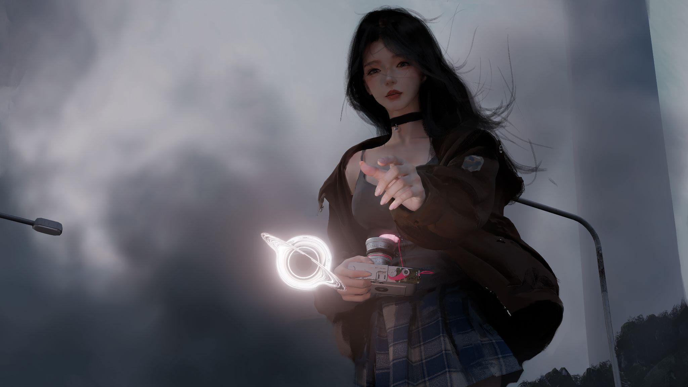

> He turned around—

> A glowing vortex hovered half a meter above the ground, no larger than a human palm. It spun in utter silence, its edges bending light into a blurred halo—gravitational lensing in motion. Even the air around it seemed pulled inward, frozen in place.

> At the center, the vortex sagged inward slightly, as if collapsing—space and time stretching, distorting, unraveling into what felt like the beginning of a tear.

> Mahina stood before it, staring at the strange structure with fear and confusion in her eyes. Slowly, she reached out—fingers trembling—toward that collapsing fold in space.

