# Vân Trùng - Chương 3: Ngoài Nón Ánh Sáng · I

---

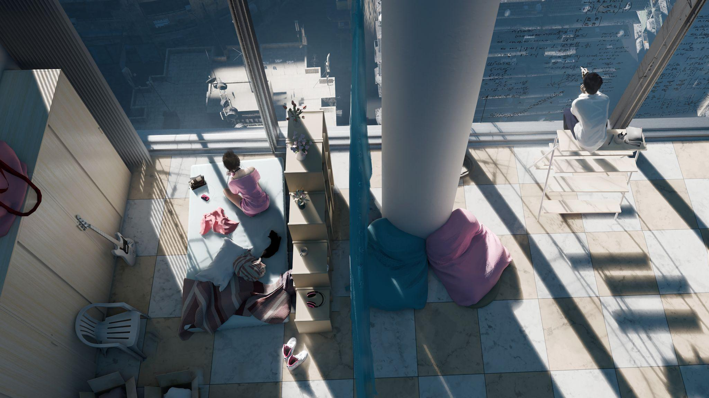

Ánh nắng từ khung cửa kính sát sàn nghiêng nghiêng rọi vào phòng, cắt mặt sàn thành từng ô sáng tối trầm mặc.

Nguyệt Nha Nhi ngồi trên chiếc giường nhỏ cạnh cửa sổ, cuốn sách cũ trên tay mở đến giữa trang, đầu ngón tay còn vương lại vệt bụi ố vàng của giấy. Chú mèo Sâm Túc Tứ cuộn tròn sau lưng cô, chiếc đuôi khẽ phe phẩy, như thể cũng đang lắng nghe những tâm sự chưa thành lời trong lòng cô.

Ở phía bên kia, Hi Dương ngồi một mình trên bậc thềm, bóng cậu bị vệt nắng kéo dài trên mặt đất. Trên ô kính chằng chịt những công thức toán học dày đặc, tựa như một tấm bản đồ sao tĩnh lặng khôn cùng. Cậu tập trung cao độ, bờ môi khẽ mấp máy, lẩm nhẩm học thuộc điều gì đó.

Tấm rèm vải màu lam nhạt buông rủ ở chính giữa, lặng lẽ chia căn phòng này thành hai thế giới riêng biệt —

Một bên là dòng thủy triều trầm lắng, một bên là đốm lửa bừng sáng khát khao.

“Rực rỡ như cúc mùa thu, tươi tốt như tùng mùa xuân. Thấp thoáng tựa mây nhẹ che trăng, phất phơ như gió cuốn tuyết bay...”

“Cậu đang lẩm bẩm cái gì đấy?”

“Không có gì... đang ôn lại bài học thôi.”

“Ồ? Thế cậu nói cho tôi biết xem — cuốn sách giáo khoa cấp ba nào có dạy bài 'Lạc Thần Phú' thế hả?”

Mặt cậu hơi ửng đỏ, khẽ hắng giọng một tiếng, rồi lại cúi đầu tiếp tục hí hoáy tính toán trên mặt kính. Ánh nắng chiều xiên khoai chiếu lên sau vành tai cậu, để lộ khoảnh khắc lúng túng ngượng ngùng khi vừa bị người ta nhìn thấu tâm can.

“Cuối tuần cậu không ra ngoài đi chơi, cũng chẳng chơi game, đến điện thoại còn chẳng buồn động vào.”

“Cả ngày cứ cắm mặt vào đống công thức khô khốc kia, cậu không thấy chán ngắt à? Không có hoạt động giải trí gì sao?”

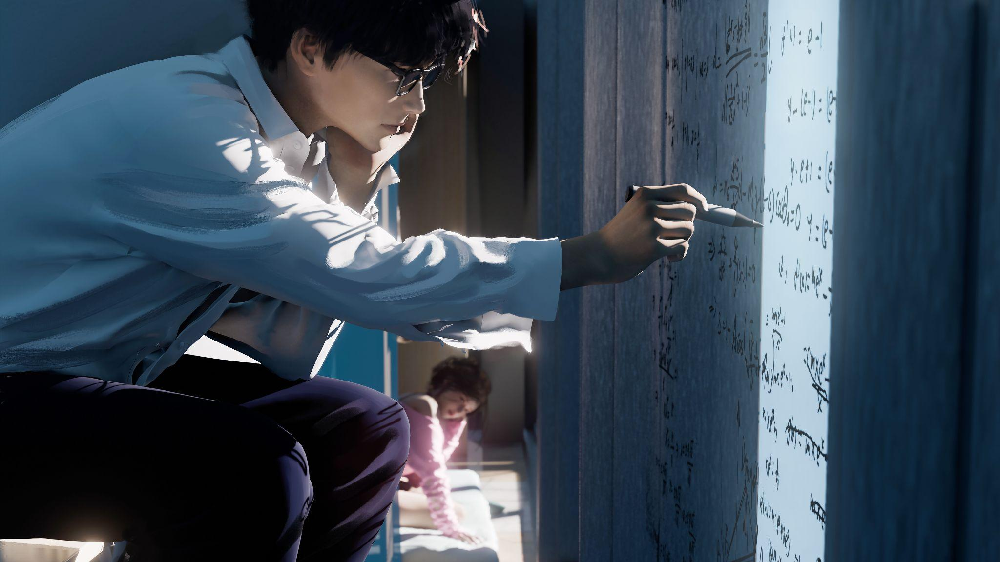

“Đối với tôi, đây chính là hoạt động giải trí rồi.”

“So với những trò chơi do con người tạo ra, tôi lại thích... những trò chơi do Thần linh thiết kế hơn.”

“Thế giờ cậu đã tìm ra được manh mối gì chưa?”

“Quy luật điện từ bên trong trường Vân Trùng xuất hiện dị thường, hệ phương trình Maxwell ở đây không còn nghiệm đúng nữa, điện từ trường bắt đầu thể hiện những hành vi phi tuyến tính. Sự dao động của hằng số Planck khiến cho quy tắc bước nhảy mức năng lượng electron bị hỗn loạn, hầu như toàn bộ thiết bị sử dụng chip bán dẫn silicon đều hoàn toàn tê liệt. Thậm chí đến cả các cổng logic cũng bị nhiễu loạn đến mất đi chức năng ban đầu — cổng NAND giờ đây lại biểu hiện ra đặc tính của cổng OR.”

“Nói tiếng người giùm cái đi!”

“Nói đơn giản là, toàn bộ các thiết bị điện tử tinh vi coi như vứt xó hết rồi.”

“Nhưng có một điều có thể khẳng định chắc chắn: những biến số dị thường này tỷ lệ thuận với khoảng cách giữa chúng ta và Vân Trùng — càng tiến lại gần nó, sai số biến lượng trái lại càng thu nhỏ lại.”

“Nếu như chúng ta tiến lại đủ gần... thì liệu những biến số dị thường kia có nhỏ tới mức có thể bỏ qua được không?”

Cô nghiêng đầu nhìn sang phía bên kia, qua khe hở giữa giá sách và khung cửa sổ, lặng lẽ quan sát biểu cảm trên gương mặt cậu.

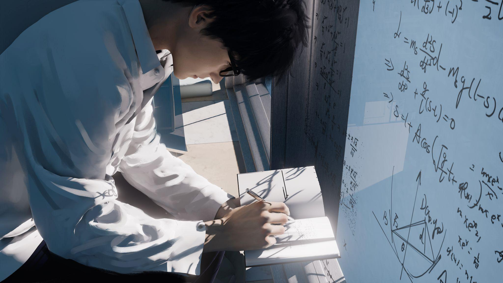

“Đúng vậy. Nếu tiến lại đủ gần, những biến lượng ấy trong công thức hoàn toàn có thể coi là đại lượng vô cùng bé và có thể bỏ qua. Khi đó, các thiết bị điện tử cơ bản được cải tiến lại có lẽ sẽ có thể hoạt động trở lại. Chỉ là —”

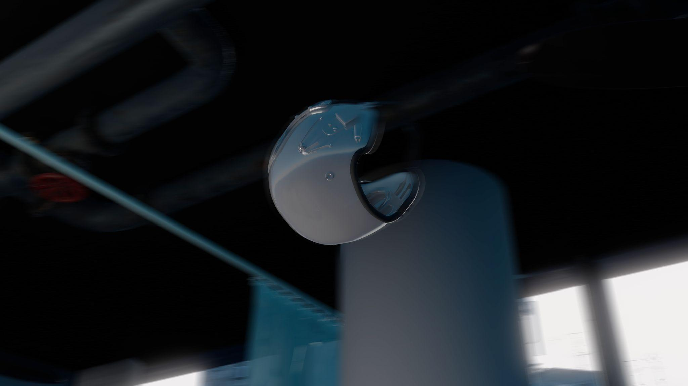

“Đi thôi!”

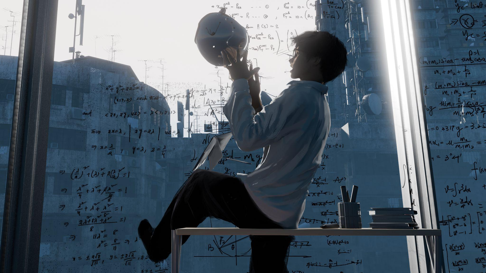

Lời còn chưa dứt, một chiếc mũ bảo hiểm đã bay vèo qua tấm rèm vải. Hi Dương giật nảy mình, theo phản xạ giơ tay đón lấy, nhưng vẫn bị va trúng. Chiếc mũ rơi vào lòng, cả người cậu lảo đảo suýt ngã khỏi bậc thềm, bộ dạng có phần lúng túng vụng về.

“Hả? Đi... đi đâu cơ?”

“Bà chị đây dẫn cậu đi chiêm ngưỡng Vân Trùng thực sự!”

Cô đứng sừng sững ở đó, tay xách chiếc mũ bảo hiểm còn lại, đôi chân trần giẫm lên những vệt nắng vụn vỡ rải rác trên sàn nhà, tựa như một tinh linh kiêu hãnh đang khiêu vũ trên muôn luồng ánh sáng.

Cô một tay hất nhẹ lọn tóc, đồng thời khẽ nhướng cằm về phía cậu, ánh mắt sáng rực đầy kiên định không cho phép từ chối.

[Eo biển Rambler ｜ Tiếp giáp khu vực lõi của Vân Trùng]

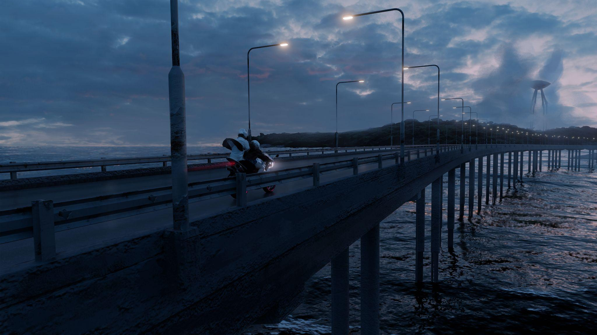

Tiếng gầm rú của động cơ mô tô xé toạc màn đêm trên cung đường cao tốc ven biển vắng tanh không bóng người. Nguyệt Nha Nhi khoác chiếc áo khoác tối màu, những lọn tóc bay bay trong gió luồn ra dưới vành mũ bảo hiểm, ánh mắt cô điềm tĩnh và tập trung cao độ, dường như đã từ lâu hòa làm một thể với cỗ xe kim loại lạnh lẽo.

Hi Dương ngồi ở ghế sau, hai tay khẽ bám lấy vai cô, mặt hơi cúi thấp — thỉnh thoảng ngước mắt lên, nhìn về phía sâu thẳm trong tầng mây mù phía trước, nơi bóng hình đồ sộ khổng lồ kia đang lờ mờ ẩn hiện, tựa như một tạo vật chẳng hề thuộc về thế giới phàm trần này.

“Đừng có tì vào vai tôi, làm mất thăng bằng khó lái xe lắm.”

“Thế tôi để tay ở đâu bây giờ? Dù sao cũng phải có chỗ nào bám vào chứ.”

“Ôm lấy eo tôi này.”

“... Hả?”

Cậu càng thêm bối rối ngượng ngùng, ấp úng dịch chuyển lại tư thế ngồi, nhưng cũng chẳng buồn cãi lại nữa, ngoan ngoãn đưa hai tay vòng qua ôm chặt lấy eo cô.

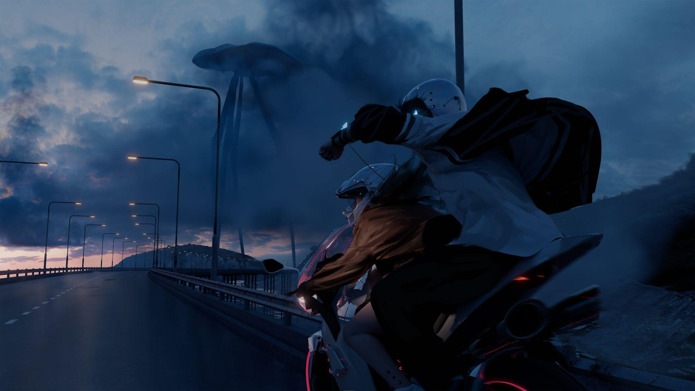

“Cậu có chắc là chiếc xe này đi vào trong trường Vân Trùng... thực sự không có vấn đề gì chứ?”

“Yên tâm đi, bằng lái xe tôi thi được là bằng lái mô tô đặc chủng chuyên dụng trong vùng trường Vân Trùng đấy nhé.”

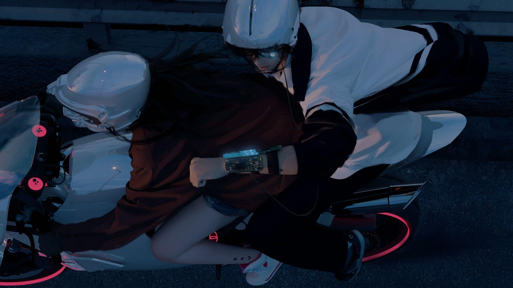

Cậu cúi đầu nhìn chăm chú vào thiết bị đo lường buộc trên cẳng tay mình — chỉ là vài bảng mạch thô sơ được hàn nối tạm bợ, trên màn hình tinh thể lỏng nhảy múa những con số phát ra ánh sáng lam nhạt. Mỗi lần dữ liệu được cập nhật, thiết bị lại phát ra tiếng kêu 'tút... tút...' đều đặn và khe khẽ. Âm thanh ấy bị tiếng gầm của động cơ đốt trong nuốt trọn, tựa như nhịp đập con tim của một sinh vật huyền bí nào đó nơi đáy biển sâu.

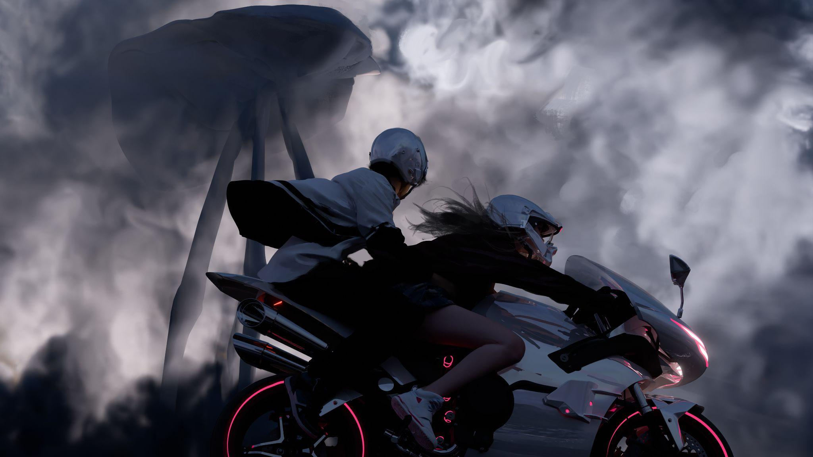

“Hóa ra…… thế giới này, lại có thể tráng lệ và đẹp đẽ đến nhường này.”

Nguyệt Nha Nhi không đáp lại, chỉ nhẹ nhàng nhả bớt tay ga. Tiếng gió cuốn lấy câu thì thầm khẽ khàng ấy, cùng nhau bị cuốn vào vùng hoang dã mênh mông phía sau lưng.

Hi Dương ngồi ở phía sau, ánh mắt vẫn luôn đăm đăm nhìn nó. Lời cảm thán ấy tựa như một tiếng thở dài kìm nén bấy lâu nay.

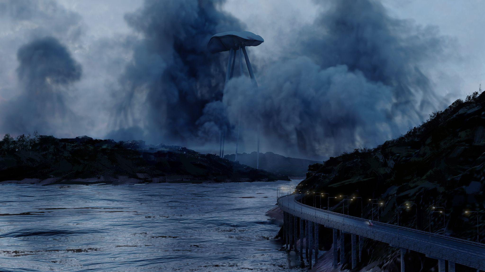

Họ đang ngày một tiến lại gần Vân Trùng hơn. Dưới chân vị cự thần, sương mù dày đặc cuồn cuộn dâng trào.

Vài giờ sau, đoạn giữa eo biển...

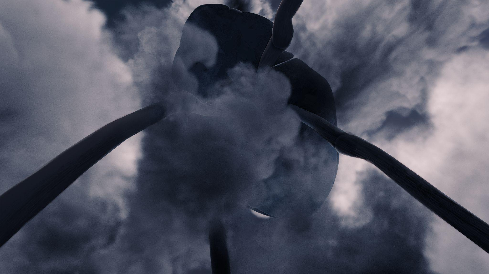

Họ dừng xe lại ở một đoạn đường trống trải nằm ngay chính giữa eo biển. Ngay trên đỉnh đầu họ chính là khu vực lõi nơi Vân Trùng đang lơ lửng, tầng mây xám xịt dày cộm tựa như một mái vòm khổng lồ trĩu nặng, đè nén mặt đất bên dưới.

Hi Dương vừa xuống xe đã lập tức mở thiết bị ra, ngồi xổm xuống bắt đầu cân chỉnh. Cậu kiểm tra màn hình hiển thị, rồi nhanh chóng đi một vòng quanh xe để xác nhận sự biến đổi của độ nhiễu từ trường xung quanh.

“Đây là lần đầu tiên tôi được ngắm nhìn nó từ góc độ này... Nơi đây nằm ngay chính giữa vùng lõi nhiễu loạn bên dưới Vân Trùng. Các thiết bị đo đạc đơn giản đã có thể bắt đầu vận hành được rồi.”

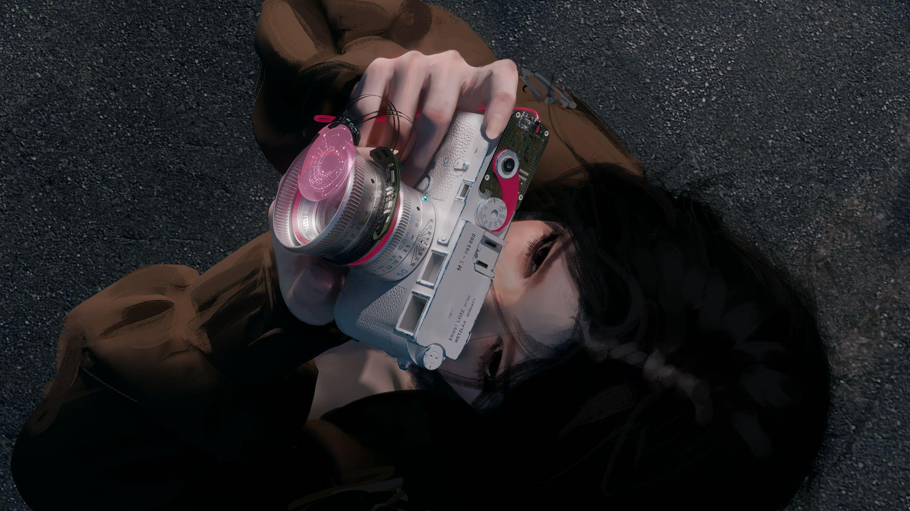

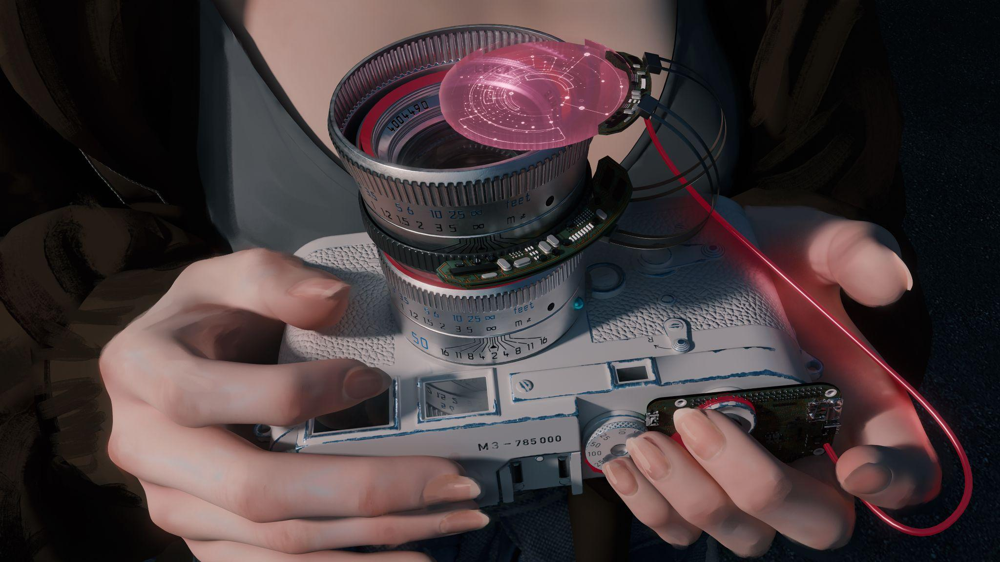

“Cái bộ phận cảm biến cậu gắn trên máy ảnh của tôi, màn hình của nó chẳng có chút phản ứng nào cả.”

“Ừ, màn hình tinh thể lỏng không hiển thị là chuyện bình thường mà, trường nhiễu loạn ở đây quá mạnh, tần số điều khiển hoàn toàn bị lệch pha. Nhưng chỉ cần cậu bấm nút chụp, thiết bị vẫn sẽ tự động ghi lại tín hiệu — chỉ là bây giờ mắt thường không nhìn thấy được thôi.”

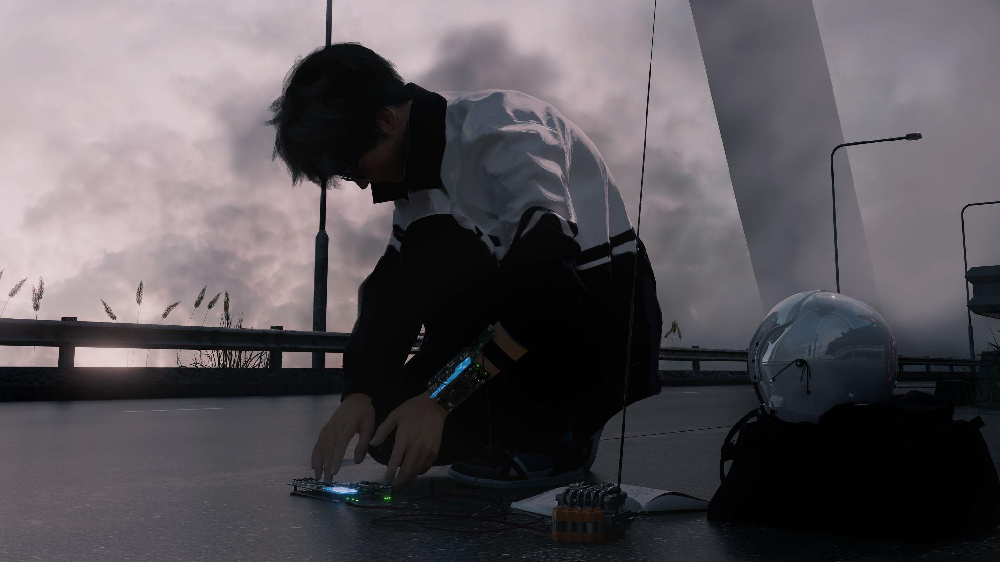

Cậu lấy từ trong ba lô ra một thiết bị khác — một bo mạch điện tử đã được cải tiến, gắn đèn đi-ốt phát quang cùng một chiếc ăng-ten mỏng dài. Cậu dùng núm xoay điều chỉnh tần số bằng tay, đấu dây nối vào cục pin, vài giây sau, đèn tín hiệu bắt đầu nhấp nháy theo nhịp điệu đều đặn. Tín hiệu đã được phát đi thành công.

“Dùng được rồi... Quả nhiên, ở khoảng cách đủ gần với Vân Trùng, những biến số nhiễu loạn kia hoàn toàn có thể bỏ qua được... Tín hiệu đơn giản đã có thể xuyên qua được trường Vân Trùng rồi.”

Cậu cúi đầu chuẩn bị ghi chép số liệu, bỗng nhiên sắc mặt thay đổi đột ngột, ánh mắt dán chặt vào màn hình phản hồi tần số của bộ phát tín hiệu. Mồ hôi lạnh lấm tấm rịn ra trên trán, những ngón tay cũng bắt đầu run rẩy nhè nhẹ.

“... Tôi nhận được tín hiệu hồi đáp rồi.”

“Hồi đáp từ cái gì cơ?”

“Vừa rồi lúc thử máy tôi có phát đi một câu 'Xin chào'... Bây giờ tôi lại nhận được phản hồi trên đúng dải tần số ấy — cũng là 'Xin chào'.”

“Có khi nào là do thiết bị nào gần đây thu được rồi tự động phản xạ ngược lại không? Quanh đây... liệu có người nào khác không?”

“Không thể nào. Công suất phát của tôi cực kỳ thấp, cự ly tương đương chưa tới năm mét. Xung quanh đây tuyệt đối không thể có thiết bị thu... và cũng chẳng có bóng người nào cả.”

“Thế cậu... thử phát thêm một câu nữa xem sao.”

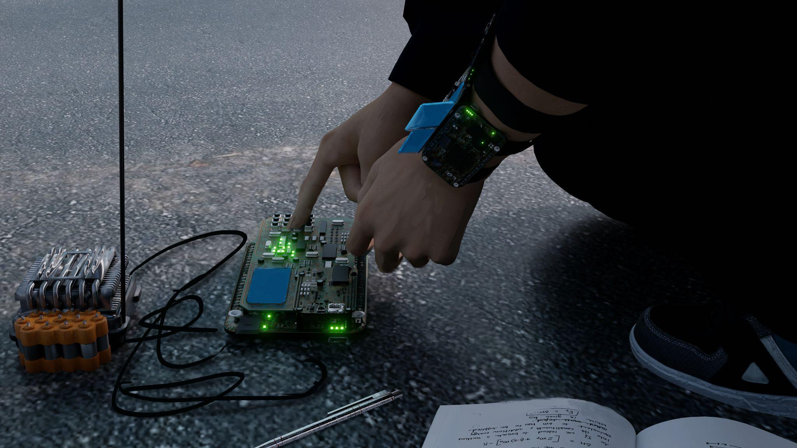

Cậu chỉnh lại tần số, đổi nội dung nhập thành: “Ngươi là ai?”

Vài giây sau, đèn chỉ thị lại một lần nữa sáng lên, ngắn ngủi nhưng vô cùng dứt khoát và rõ ràng, tín hiệu phản hồi quay trở lại chuẩn xác.

Cậu vội vã lôi cuốn sổ tay bên cạnh ra, nhanh chóng ghi lại nhịp điệu sáng tắt của từng chuỗi tín hiệu nhị phân trên trang giấy. Vừa viết, cậu vừa đối chiếu với bảng mã để giải mã, mỗi khi dịch xong một từ, ngón tay cậu lại khựng lại trong giây lát —

‘TÔI’. ‘LÀ’. ‘KẺ... GIEO... MẦM...’.

Khi nét bút viết xong từ cuối cùng, tay cậu run lên bần bật, đầu ngòi bút suýt chút nữa đâm rách toạc trang giấy.

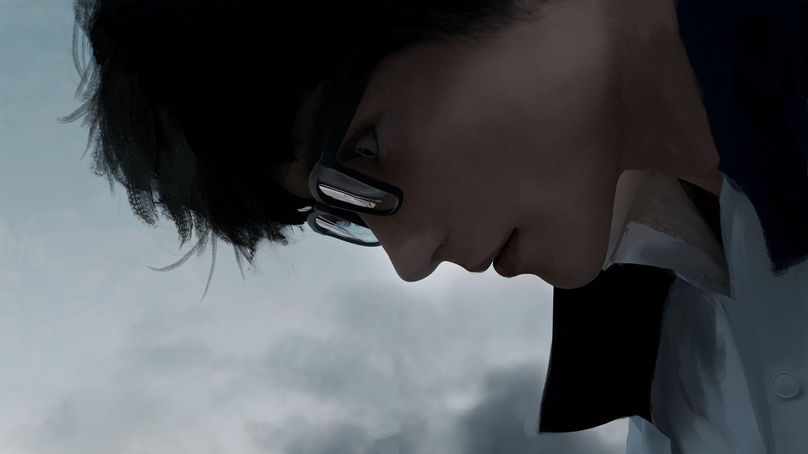

“‘... Tôi là Kẻ Gieo Mầm...’ ư?”

Đúng lúc này, Nguyệt Nha Nhi bỗng thốt lên một tiếng kinh hô nén chặt, cắt đứt dòng suy nghĩ đang cuộn trào của cậu. Thanh âm ấy chứa đựng nỗi hoảng loạn và sợ hãi tột cùng, thậm chí còn thất thần hơn cả cậu lúc này —

“Hi Dương! Đừng bận tâm tới tín hiệu nữa, cậu mau lại đây xem cái này đi —!”

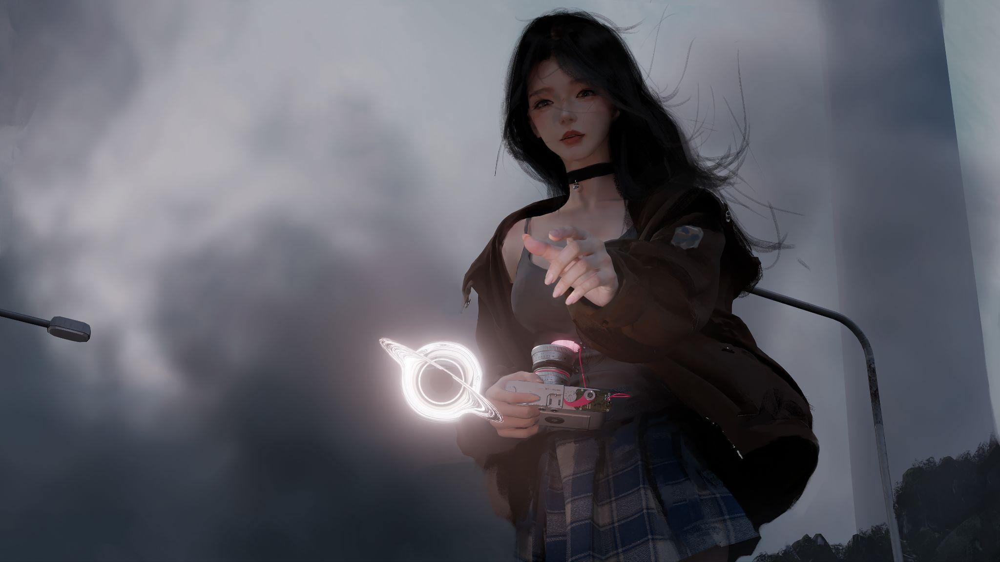

Cậu ngoảnh đầu nhìn lại —

Một xoáy lốc ánh sáng phát quang đang lơ lửng cách mặt đất chừng nửa mét, kích thước chỉ độ bằng một lòng bàn tay, đang lặng lẽ xoay tròn trong tĩnh mịch tuyệt đối. Ở rìa ngoài xuất hiện hiệu ứng thấu kính hấp dẫn, ánh sáng bị bẻ cong thành một vầng hào quang nhòe mờ, ngay cả không khí xung quanh dường như cũng bị lực hút kéo lệch, gần như đông cứng lại.

Tâm của xoáy lốc hơi trũng xuống, tựa như đang liên tục sụp đổ vào bên trong, không-thời gian tại điểm đó đang âm thầm bị kéo giãn, biến dạng, dường như sắp sửa bị xé toạc ra thành một vết nứt sâu thẳm.

Nguyệt Nha Nhi đứng sững sờ trước mặt nó, ngơ ngác nhìn cấu trúc kỳ dị chưa từng thấy này, trong đáy mắt thoáng qua nỗi khiếp sợ xen lẫn hoang mang tột độ. Cô từ từ giơ tay ra, những đầu ngón tay run rẩy, chầm chậm vươn về phía khoảng không-thời gian đang sụp đổ ấy —
