# Vân Trùng / CloudInsect - Chương 3: Ngoài Nón Ánh Sáng · I (第三章 光锥之外 · 一)

---

**VI**: Ánh nắng từ khung cửa kính sát sàn nghiêng nghiêng rọi vào phòng, cắt mặt sàn thành từng ô sáng tối trầm mặc.

**ZH**: 光线从落地窗外倾斜而入，在地板上切割出一格一格静默的光影。

**EN**: Sunlight slanted in through the floor-to-ceiling window, slicing the floor into quiet grids of shadow and light.

**VI**: Nguyệt Nha Nhi ngồi trên chiếc giường nhỏ cạnh cửa sổ, cuốn sách cũ trên tay mở đến giữa trang, đầu ngón tay còn vương lại vệt bụi ố vàng của giấy. Chú mèo Sâm Túc Tứ cuộn tròn sau lưng cô, chiếc đuôi khẽ phe phẩy, như thể cũng đang lắng nghe những tâm sự chưa thành lời trong lòng cô.

**ZH**: 月牙儿坐在靠窗的小床上，手里的旧书翻到中页，指尖还留着书页泛黄的灰纹。参宿四蜷在她身后，尾巴轻轻摆动，像也在听她心里的声音。

**EN**: Mahina sat on the narrow bed by the window, her old book flipped open to the middle. Faint smudges of dust clung to her fingertips where they had touched the yellowed page.

**VI**: Ở phía bên kia, Hi Dương ngồi một mình trên bậc thềm, bóng cậu bị vệt nắng kéo dài trên mặt đất. Trên ô kính chằng chịt những công thức toán học dày đặc, tựa như một tấm bản đồ sao tĩnh lặng khôn cùng. Cậu tập trung cao độ, bờ môi khẽ mấp máy, lẩm nhẩm học thuộc điều gì đó.

**ZH**: 另一侧，希扬独坐在阶梯上，身影被阳光拉得很长。玻璃上的公式密密麻麻，像一面悄无声息的星图。他神情专注，嘴唇微动，低声背诵着什么。

**EN**: Betelgeuse curled up behind her, its tail swaying softly—

**VI**: Tấm rèm vải màu lam nhạt buông rủ ở chính giữa, lặng lẽ chia căn phòng này thành hai thế giới riêng biệt —

**ZH**: 淡蓝色的布帘在中央垂下，悄悄将这间屋子一分为二——

**EN**: as if listening to the thoughts she hadn’t spoken aloud.

**VI**: Một bên là dòng thủy triều trầm lắng, một bên là đốm lửa bừng sáng khát khao.

**ZH**: 一边是沉静的潮汐，一边是跃动的星火。

**EN**: Across the room, Suvan sat alone on the steps.

**VI**: “Rực rỡ như cúc mùa thu, tươi tốt như tùng mùa xuân. Thấp thoáng tựa mây nhẹ che trăng, phất phơ như gió cuốn tuyết bay...”

**ZH**: “荣曜秋菊，华茂春松。髣髴兮若轻云之蔽月，飘飖兮若流风之回雪……”

**EN**: His figure was stretched long by the afternoon sun.

**VI**: “Cậu đang lẩm bẩm cái gì đấy?”

**ZH**: “在念什么呢？”

**EN**: Formulas filled the glass before him, densely written like a silent star map.

**VI**: “Không có gì... đang ôn lại bài học thôi.”

**ZH**: “没什么……在背课文。”

**EN**: He was deep in thought, lips moving faintly, reciting something under his breath.

**VI**: “Ồ? Thế cậu nói cho tôi biết xem — cuốn sách giáo khoa cấp ba nào có dạy bài 'Lạc Thần Phú' thế hả?”

**ZH**: “哦？那你告诉我——哪本高中课本里有《洛神赋》？”

**EN**: A pale blue curtain hung down from the ceiling, quietly dividing the room in two—

**VI**: Mặt cậu hơi ửng đỏ, khẽ hắng giọng một tiếng, rồi lại cúi đầu tiếp tục hí hoáy tính toán trên mặt kính. Ánh nắng chiều xiên khoai chiếu lên sau vành tai cậu, để lộ khoảnh khắc lúng túng ngượng ngùng khi vừa bị người ta nhìn thấu tâm can.

**ZH**: 他脸上微红，轻咳一声，低头继续在玻璃上演算。阳光斜照在他耳后，露出一瞬被人看穿后的局促。

**EN**: on one side, the stillness of the tide;

**EN**: on the other, the flicker of a star.

**EN**: “Glory like autumn chrysanthemums; grace like spring pines…”

**EN**: “She glides like drifting clouds across the moon,”

**EN**: “like snow swept by the turning wind…”

**EN**: “What are you reciting?”

**EN**: “Nothing. Just something from class.”

**EN**: “Really? Then tell me—which high school textbook includes Rhapsody on the Goddess of the Luo?”

**EN**: He blushed, cleared his throat, and ducked his head, scribbling again on the glass.

**EN**: Sunlight slid across his cheek and lit the edge of his ear—

**EN**: betraying that brief moment of being seen through.

**VI**: “Cuối tuần cậu không ra ngoài đi chơi, cũng chẳng chơi game, đến điện thoại còn chẳng buồn động vào.”

**ZH**: “周末你不出门，也不玩游戏，连手机都不碰。”

**EN**: “You don’t go out on weekends, you don’t play games, and you don’t even touch your phone.”

**VI**: “Cả ngày cứ cắm mặt vào đống công thức khô khốc kia, cậu không thấy chán ngắt à? Không có hoạt động giải trí gì sao?”

**ZH**: “一整天对着那些公式，你不觉得无聊吗？就没有娱乐活动？”

**EN**: “Staring at those formulas all day—don’t you ever get bored?”

**EN**: “Don’t you have... I don’t know, any hobbies?”

**VI**: “Đối với tôi, đây chính là hoạt động giải trí rồi.”

**ZH**: “这对我来说就是娱乐活动。”

**EN**: “This is entertainment, to me.”

**VI**: “So với những trò chơi do con người tạo ra, tôi lại thích... những trò chơi do Thần linh thiết kế hơn.”

**ZH**: “相比于人类设计的游戏，我更喜欢……神明设计的游戏。”

**EN**: “Compared to games designed by humans, I prefer the ones designed by gods.”

**VI**: “Thế giờ cậu đã tìm ra được manh mối gì chưa?”

**ZH**: “那现在有什么头绪了？”

**EN**: “So? Got any leads yet?”

**VI**: “Quy luật điện từ bên trong trường Vân Trùng xuất hiện dị thường, hệ phương trình Maxwell ở đây không còn nghiệm đúng nữa, điện từ trường bắt đầu thể hiện những hành vi phi tuyến tính. Sự dao động của hằng số Planck khiến cho quy tắc bước nhảy mức năng lượng electron bị hỗn loạn, hầu như toàn bộ thiết bị sử dụng chip bán dẫn silicon đều hoàn toàn tê liệt. Thậm chí đến cả các cổng logic cũng bị nhiễu loạn đến mất đi chức năng ban đầu — cổng NAND giờ đây lại biểu hiện ra đặc tính của cổng OR.”

**ZH**: “云虫场内的电磁规律发生异常，麦克斯韦方程组在这里已无法成立，电磁场开始呈现非线性行为。普朗克常量的波动导致电子能级跃迁规则紊乱，所有依赖硅基芯片的仪器几乎完全失效。甚至连逻辑门都被干扰得失去原有功能——与非门现在反而表现出或门的特性。”

**EN**: “Inside the CloudInsect field, the laws of electromagnetism become abnormal. Maxwell’s equations no longer hold, and electromagnetic fields behave nonlinearly. Fluctuations in Planck’s constant disrupt the rules governing electron energy-level transitions, rendering almost every silicon-chip device useless. Even logic gates lose their original functions—NAND gates begin behaving like OR gates.”

**VI**: “Nói tiếng người giùm cái đi!”

**ZH**: “说人话！”

**EN**: “Speak human, please.”

**VI**: “Nói đơn giản là, toàn bộ các thiết bị điện tử tinh vi coi như vứt xó hết rồi.”

**ZH**: “简单讲，精密仪器基本全废了。”

**EN**: “In short?”

**VI**: “Nhưng có một điều có thể khẳng định chắc chắn: những biến số dị thường này tỷ lệ thuận với khoảng cách giữa chúng ta và Vân Trùng — càng tiến lại gần nó, sai số biến lượng trái lại càng thu nhỏ lại.”

**ZH**: “但有一点是确定的：这些异常和我们离云虫的距离成正比——越靠近它，变量反而越小。”

**EN**: “All our precision instruments are pretty much dead.”

**EN**: “But there’s one thing we do know for sure:”

**EN**: “These anomalies scale with our distance from the CloudInsect.”

**EN**: “The closer we are—the smaller the variables get.”

**VI**: “Nếu như chúng ta tiến lại đủ gần... thì liệu những biến số dị thường kia có nhỏ tới mức có thể bỏ qua được không?”

**ZH**: “如果靠得足够近……那些异常变量，会不会就变得可以忽略？”

**EN**: “If we get close enough...”

**VI**: Cô nghiêng đầu nhìn sang phía bên kia, qua khe hở giữa giá sách và khung cửa sổ, lặng lẽ quan sát biểu cảm trên gương mặt cậu.

**ZH**: 她侧头望向那边，透过书架与窗之间的缝隙，悄悄打量着他的神情。

**EN**: “could those anomalous variables become negligible?”

**EN**: She turned slightly, glancing at him through the gap between the bookshelf and the window, quietly observing his expression.

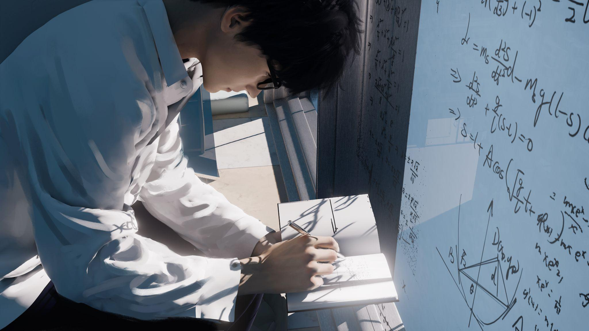

**VI**: “Đúng vậy. Nếu tiến lại đủ gần, những biến lượng ấy trong công thức hoàn toàn có thể coi là đại lượng vô cùng bé và có thể bỏ qua. Khi đó, các thiết bị điện tử cơ bản được cải tiến lại có lẽ sẽ có thể hoạt động trở lại. Chỉ là —”

**ZH**: “是的。如果靠得足够近，这些变量在公式中可以被视作无穷小量而忽略。重新改装的简单电子仪器，也许就能再次运作。只是——”

**EN**: “Yes.”

**EN**: “If we’re close enough, those variables can be treated as infinitesimals—negligible within the equations.”

**EN**: “With that in mind, even simple reconfigured devices might work again.”

**EN**: “It’s just that—”

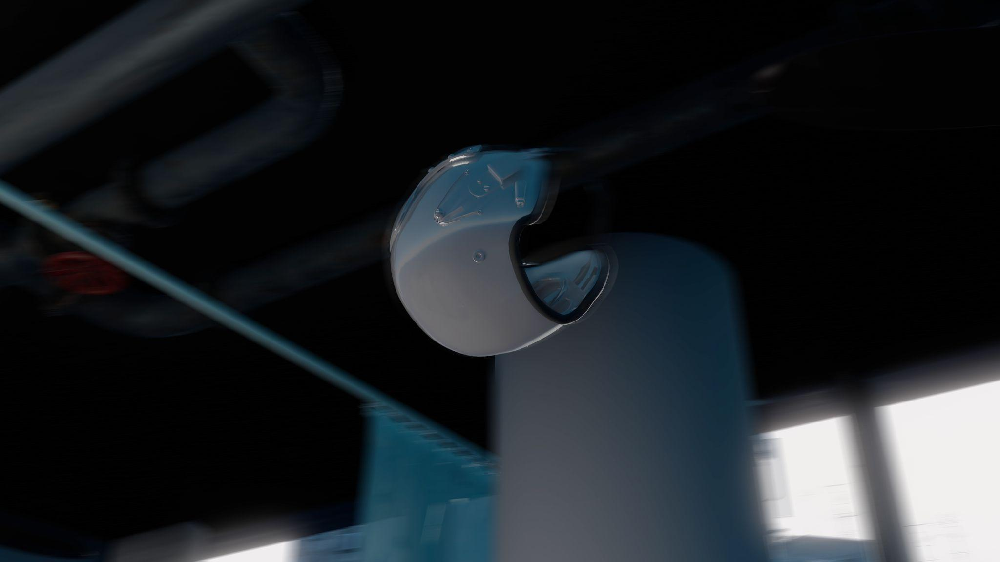

**VI**: “Đi thôi!”

**ZH**: “走！”

**EN**: “Let’s go!”

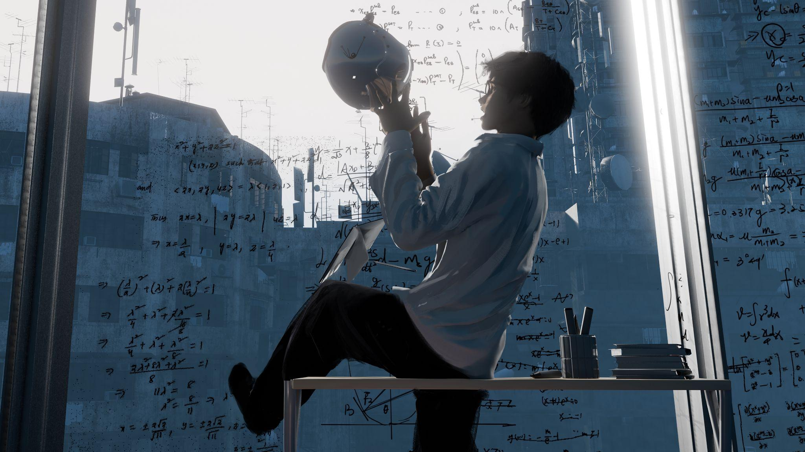

**VI**: Lời còn chưa dứt, một chiếc mũ bảo hiểm đã bay vèo qua tấm rèm vải. Hi Dương giật nảy mình, theo phản xạ giơ tay đón lấy, nhưng vẫn bị va trúng. Chiếc mũ rơi vào lòng, cả người cậu lảo đảo suýt ngã khỏi bậc thềm, bộ dạng có phần lúng túng vụng về.

**ZH**: 话音还没落，一只头盔就从帘子那边飞了过来。希扬一惊，下意识伸手去接，却被砸了个正着。头盔掉进怀里，他自己几乎跌下台阶，动作有点狼狈。

**EN**: Before the words even finished echoing, a helmet came flying through the curtain.

**VI**: “Hả? Đi... đi đâu cơ?”

**ZH**: “啊？要去哪？”

**EN**: Suvan flinched, instinctively reaching out to catch it—

**EN**: but got smacked square in the chest instead.

**EN**: The helmet dropped into his lap, and he nearly tumbled down the steps, looking thoroughly caught off guard.

**EN**: “Huh? Go where?”

**VI**: “Bà chị đây dẫn cậu đi chiêm ngưỡng Vân Trùng thực sự!”

**ZH**: “姐姐带你去看真正的云虫。”

**EN**: “Your big sister is taking you to see a real CloudInsect.”

**VI**: Cô đứng sừng sững ở đó, tay xách chiếc mũ bảo hiểm còn lại, đôi chân trần giẫm lên những vệt nắng vụn vỡ rải rác trên sàn nhà, tựa như một tinh linh kiêu hãnh đang khiêu vũ trên muôn luồng ánh sáng.

**ZH**: 她就那样站在那里，手里拎着头盔，赤脚踩在被杂物切碎的光斑上，像一只踩在光上的精灵。

**EN**: She stood there, barefoot, clutching another helmet in one hand, her feet bathed in shattered patches of sunlight like a sprite poised atop light itself.

**VI**: Cô một tay hất nhẹ lọn tóc, đồng thời khẽ nhướng cằm về phía cậu, ánh mắt sáng rực đầy kiên định không cho phép từ chối.

**ZH**: 她一手拨开头发，同时朝他扬了扬下巴，眼神里带着不容拒绝的明亮。

**EN**: With a flick of her hair and a tilt of her chin, she looked at him—

**VI**: [Eo biển Rambler ｜ Tiếp giáp khu vực lõi của Vân Trùng]

**ZH**: [蓝巴勒海峡｜临近云虫核心区域]

**EN**: eyes bright, leaving no room for refusal.

**EN**: Rambler Channel | Near the CloudInsect’s core zone

**VI**: Tiếng gầm rú của động cơ mô tô xé toạc màn đêm trên cung đường cao tốc ven biển vắng tanh không bóng người. Nguyệt Nha Nhi khoác chiếc áo khoác tối màu, những lọn tóc bay bay trong gió luồn ra dưới vành mũ bảo hiểm, ánh mắt cô điềm tĩnh và tập trung cao độ, dường như đã từ lâu hòa làm một thể với cỗ xe kim loại lạnh lẽo.

**ZH**: 摩托的引擎声在无人的公路上疾驰而过。月牙儿穿着深色外套，头盔下的发尾在风中飞舞，目光冷静专注，仿佛早已与那冰冷的机车合为一体。

**EN**: The roar of the motorcycle engine sliced through the empty coastal highway.Mahina, in a dark jacket, leaned forward with quiet intensity. Strands of hair whipped out from beneath her helmet, her gaze sharp, unwavering—as if she and the machine had long become one.

**VI**: Hi Dương ngồi ở ghế sau, hai tay khẽ bám lấy vai cô, mặt hơi cúi thấp — thỉnh thoảng ngước mắt lên, nhìn về phía sâu thẳm trong tầng mây mù phía trước, nơi bóng hình đồ sộ khổng lồ kia đang lờ mờ ẩn hiện, tựa như một tạo vật chẳng hề thuộc về thế giới phàm trần này.

**ZH**: 希扬坐在后座，轻轻搭着她肩膀，脸埋得有些低——偶尔抬眼，望向前方云层深处，那道若隐若现、仿佛不是此世之物的庞然轮廓。

**EN**: Suvan sat behind her, one hand resting lightly on her shoulder.His head was bowed slightly, but every so often he glanced up—toward the distant outline of the CloudInsect, faint and colossal, a shape that seemed to belong to another world altogether.

**VI**: “Đừng có tì vào vai tôi, làm mất thăng bằng khó lái xe lắm.”

**ZH**: “别搭我肩，会影响我开车。”

**EN**: “Don't touch my shoulder. You're throwing off my balance.”

**VI**: “Thế tôi để tay ở đâu bây giờ? Dù sao cũng phải có chỗ nào bám vào chứ.”

**ZH**: “那我手放哪？总得抓点什么吧。”

**EN**: “Then... where should I hold on? I need to grab something.”

**VI**: “Ôm lấy eo tôi này.”

**ZH**: “搂我腰啊。”

**EN**: “My waist.”

**VI**: “... Hả?”

**ZH**: “啊？”

**EN**: “...Huh?”

**VI**: Cậu càng thêm bối rối ngượng ngùng, ấp úng dịch chuyển lại tư thế ngồi, nhưng cũng chẳng buồn cãi lại nữa, ngoan ngoãn đưa hai tay vòng qua ôm chặt lấy eo cô.

**ZH**: 他一下子更窘，支支吾吾地挪了下姿势，却也没再反驳，老老实实地环住她的腰。

**EN**: Suvan flushed, awkwardly shifting his posture.

**EN**: He didn't argue this time.

**EN**: Quietly, obediently—he wrapped his arms around her waist.

**VI**: “Cậu có chắc là chiếc xe này đi vào trong trường Vân Trùng... thực sự không có vấn đề gì chứ?”

**ZH**: “你确定这车进云虫场……真的没问题？”

**EN**: “You sure this thing can really handle the CloudInsect field?”

**VI**: “Yên tâm đi, bằng lái xe tôi thi được là bằng lái mô tô đặc chủng chuyên dụng trong vùng trường Vân Trùng đấy nhé.”

**ZH**: “放心，我考的可是云虫场内特种机车驾照。”

**EN**: “Relax. I have a special motorcycle license for riding inside a CloudInsect field.”

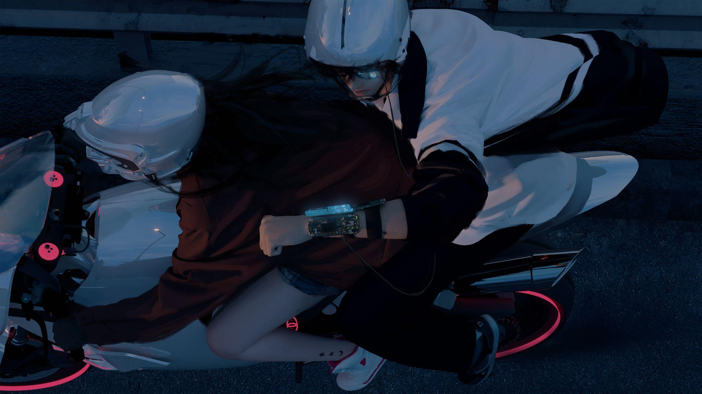

**VI**: Cậu cúi đầu nhìn chăm chú vào thiết bị đo lường buộc trên cẳng tay mình — chỉ là vài bảng mạch thô sơ được hàn nối tạm bợ, trên màn hình tinh thể lỏng nhảy múa những con số phát ra ánh sáng lam nhạt. Mỗi lần dữ liệu được cập nhật, thiết bị lại phát ra tiếng kêu 'tút... tút...' đều đặn và khe khẽ. Âm thanh ấy bị tiếng gầm của động cơ đốt trong nuốt trọn, tựa như nhịp đập con tim của một sinh vật huyền bí nào đó nơi đáy biển sâu.

**ZH**: 他低头盯着绑在小臂上的测试仪——几块简陋的电路板焊接而成，液晶屏上跳动着浅蓝色的读数。每一次数据更新，设备都会发出规律而细碎的“嘟——嘟——”声。那声音被内燃机的轰鸣包裹着，像是某种神秘生物在深海中的心跳。

**EN**: He kept his eyes fixed on the sensor strapped to his forearm—just a handful of crude circuit boards, wires messily soldered together.

**EN**: Pale blue digits flickered across the LCD, blinking in soft, precise intervals.

**EN**: With every new reading, the device gave off a faint beep—beep—, a sound swallowed by the roar of the combustion engine—like the heartbeat of some deep-sea creature, pulsing from the abyss.

**VI**: “Hóa ra…… thế giới này, lại có thể tráng lệ và đẹp đẽ đến nhường này.”

**ZH**: “原来……这个世界，是这么美的啊。”

**EN**: “So this is what the world looks like... when it’s truly beautiful.”

**VI**: Nguyệt Nha Nhi không đáp lại, chỉ nhẹ nhàng nhả bớt tay ga. Tiếng gió cuốn lấy câu thì thầm khẽ khàng ấy, cùng nhau bị cuốn vào vùng hoang dã mênh mông phía sau lưng.

**ZH**: 月牙儿没有接话，只是轻轻松开油门。风声裹挟着那句低语，一同被甩进身后逐渐拉远的长桥。摩托如流星般飞驰而去，朝着那道高悬天际的身影——云虫的轮廓正缓缓显现，像是沉睡在天穹之上的巨神。

**EN**: Mahina didn’t respond. She simply eased off the throttle.

**VI**: Hi Dương ngồi ở phía sau, ánh mắt vẫn luôn đăm đăm nhìn nó. Lời cảm thán ấy tựa như một tiếng thở dài kìm nén bấy lâu nay.

**ZH**: 坐在后座的希扬，始终望着它。那句感慨像是压抑许久的喟叹。

**EN**: The wind caught his quiet words, scattering them across the long, empty bridge behind them.

**EN**: The motorcycle raced forward like a meteor, streaking toward the figure looming in the sky—the CloudInsect, vast and still, slowly revealing its silhouette.

**EN**: Like a slumbering titan curled upon the edge of the firmament.

**EN**: From the backseat, Suvan couldn’t take his eyes off it.

**EN**: His voice had held the weight of something long buried.

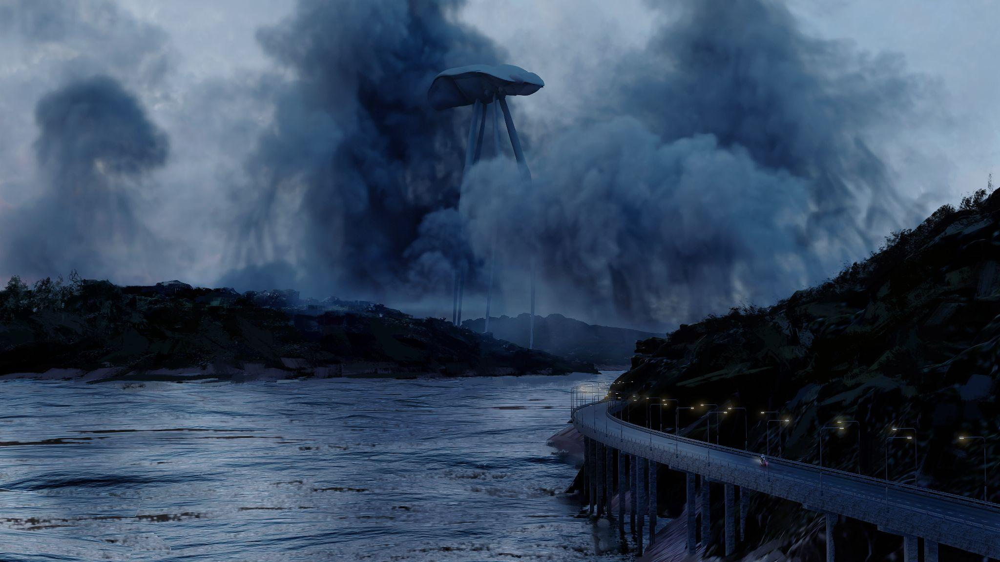

**VI**: Họ đang ngày một tiến lại gần Vân Trùng hơn. Dưới chân vị cự thần, sương mù dày đặc cuồn cuộn dâng trào.

**ZH**: 他们离云虫越来越近。巨神脚下，浓雾翻涌。

**EN**: They drew closer to the CloudInsect.

**VI**: Vài giờ sau, đoạn giữa eo biển...

**ZH**: 数小时后，海峡中段

**EN**: Beneath the slumbering giant, mist churned like a rising tide.

**EN**: A few hours later | Mid-channel

**VI**: Họ dừng xe lại ở một đoạn đường trống trải nằm ngay chính giữa eo biển. Ngay trên đỉnh đầu họ chính là khu vực lõi nơi Vân Trùng đang lơ lửng, tầng mây xám xịt dày cộm tựa như một mái vòm khổng lồ trĩu nặng, đè nén mặt đất bên dưới.

**ZH**: 他们在一段海峡中央的一段空旷路段停了车。头顶正是云虫悬停的核心区域，厚重的云层像一块低垂的天盖，缓缓压迫着大地。

**EN**: They stopped on an empty stretch of road in the middle of the channel.

**VI**: Hi Dương vừa xuống xe đã lập tức mở thiết bị ra, ngồi xổm xuống bắt đầu cân chỉnh. Cậu kiểm tra màn hình hiển thị, rồi nhanh chóng đi một vòng quanh xe để xác nhận sự biến đổi của độ nhiễu từ trường xung quanh.

**ZH**: 希扬下车后立刻展开仪器，蹲下开始调试。他检查显示屏，又迅速绕车一圈，确认四周的磁扰变化。

**EN**: Directly overhead loomed the core of the CloudInsect’s presence—

**VI**: “Đây là lần đầu tiên tôi được ngắm nhìn nó từ góc độ này... Nơi đây nằm ngay chính giữa vùng lõi nhiễu loạn bên dưới Vân Trùng. Các thiết bị đo đạc đơn giản đã có thể bắt đầu vận hành được rồi.”

**ZH**: “我第一次从这个角度看它……这里，正好位于云虫下方的干扰核心区域。简单的测试仪器可以开始运作了。”

**EN**: the clouds hung low and heavy, like a ceiling of sky sinking toward the earth.

**EN**: As soon as Suvan got off the bike, he opened his equipment case and knelt down to begin calibration. He checked the display, then quickly circled the vehicle, scanning for magnetic fluctuations in the area.

**EN**: “This is my first time seeing it from this angle...”

**EN**: “We're right beneath the interference core of the CloudInsect.”

**EN**: “Basic testing instruments should be able to function here.”

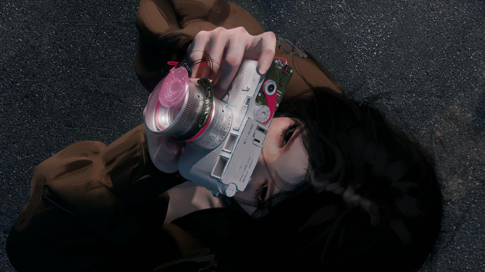

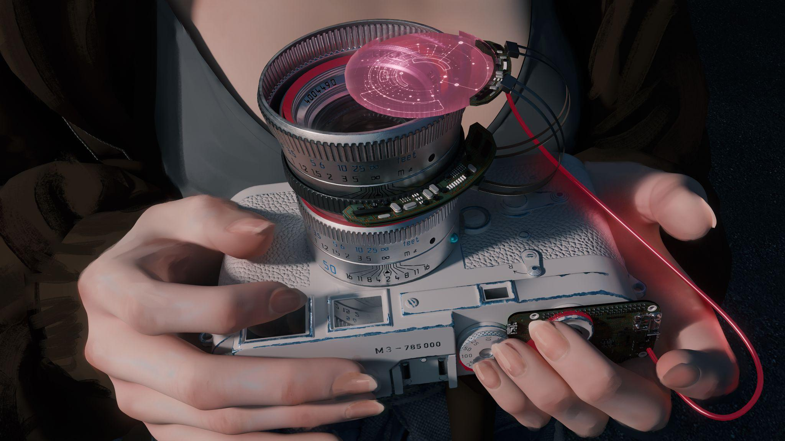

**VI**: “Cái bộ phận cảm biến cậu gắn trên máy ảnh của tôi, màn hình của nó chẳng có chút phản ứng nào cả.”

**ZH**: “你装在我相机上的那个探测器，屏幕上完全没反应。”

**EN**: “The detector you mounted on my camera—its screen isn’t responding at all.”

**VI**: “Ừ, màn hình tinh thể lỏng không hiển thị là chuyện bình thường mà, trường nhiễu loạn ở đây quá mạnh, tần số điều khiển hoàn toàn bị lệch pha. Nhưng chỉ cần cậu bấm nút chụp, thiết bị vẫn sẽ tự động ghi lại tín hiệu — chỉ là bây giờ mắt thường không nhìn thấy được thôi.”

**ZH**: “嗯，液晶屏没反应是正常的，这种干扰场太强，驱动频率根本对不上。但只要你按下快门，装置还是会记录信号——只是现在看不见而已。”

**EN**: “Yeah, that’s expected. The LCD won’t react in this interference field—its driving frequency is completely mismatched. But as long as you press the shutter, the device will still capture the signal. You just can’t see it right now, that’s all.”

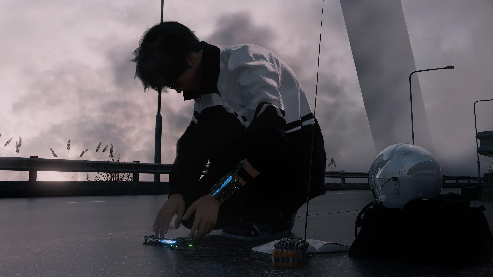

**VI**: Cậu lấy từ trong ba lô ra một thiết bị khác — một bo mạch điện tử đã được cải tiến, gắn đèn đi-ốt phát quang cùng một chiếc ăng-ten mỏng dài. Cậu dùng núm xoay điều chỉnh tần số bằng tay, đấu dây nối vào cục pin, vài giây sau, đèn tín hiệu bắt đầu nhấp nháy theo nhịp điệu đều đặn. Tín hiệu đã được phát đi thành công.

**ZH**: 他从背包中取出另一台装置——一块改装过的电路板，接上了发光的二极管与细长天线。通过拨盘手动调节频率，导线连通电池，几秒后，指示灯依节奏闪烁，信号成功发出。

**EN**: He pulled another device from his backpack—a modified circuit board rigged with a glowing LED and a thin antenna.

**VI**: “Dùng được rồi... Quả nhiên, ở khoảng cách đủ gần với Vân Trùng, những biến số nhiễu loạn kia hoàn toàn có thể bỏ qua được... Tín hiệu đơn giản đã có thể xuyên qua được trường Vân Trùng rồi.”

**ZH**: “可以用了……果然，在离云虫足够近的地方，那些扰动变量可以忽略掉……简单的信号，就能穿透云虫场。”

**EN**: He manually adjusted the frequency using a dial, connected the wires to a battery, and within seconds, the indicator light began blinking in a steady rhythm. The signal had gone through.

**EN**: “It’s working... Just as I thought. Close enough to the CloudInsect, those interference variables become negligible. Simple signals can pierce through the field.”

**VI**: Cậu cúi đầu chuẩn bị ghi chép số liệu, bỗng nhiên sắc mặt thay đổi đột ngột, ánh mắt dán chặt vào màn hình phản hồi tần số của bộ phát tín hiệu. Mồ hôi lạnh lấm tấm rịn ra trên trán, những ngón tay cũng bắt đầu run rẩy nhè nhẹ.

**ZH**: 他低头准备记录数据，忽然神色一变，盯住发射器的频率反馈显示。额头悄然渗出细汗，手指也开始微微颤抖。

**EN**: He looked down, ready to log the data—

**VI**: “... Tôi nhận được tín hiệu hồi đáp rồi.”

**ZH**: “……我收到回信了。”

**EN**: But suddenly, his expression froze. His eyes locked onto the frequency feedback on the transmitter.

**VI**: “Hồi đáp từ cái gì cơ?”

**ZH**: “什么回信？”

**EN**: A fine layer of sweat began to gather at his temples, and his fingers started to tremble.

**VI**: “Vừa rồi lúc thử máy tôi có phát đi một câu 'Xin chào'... Bây giờ tôi lại nhận được phản hồi trên đúng dải tần số ấy — cũng là 'Xin chào'.”

**ZH**: “我刚才测试的时候发出了一句‘你好’……现在收到了同一频段的回应——也是‘你好’。”

**EN**: “…I just got a reply.”

**VI**: “Có khi nào là do thiết bị nào gần đây thu được rồi tự động phản xạ ngược lại không? Quanh đây... liệu có người nào khác không?”

**ZH**: “是不是被附近什么设备接收了，又自动反射回来？这附近……会不会还有别人？”

**EN**: “A reply? From what?”

**VI**: “Không thể nào. Công suất phát của tôi cực kỳ thấp, cự ly tương đương chưa tới năm mét. Xung quanh đây tuyệt đối không thể có thiết bị thu... và cũng chẳng có bóng người nào cả.”

**ZH**: “不可能。我的发射功率极低，等效距离不到五米。附近根本不可能有接收器……也没人。”

**EN**: “I sent ‘Hello’ as a test just now… and I received a reply on the same frequency—also ‘Hello.’”

**VI**: “Thế cậu... thử phát thêm một câu nữa xem sao.”

**ZH**: “那你……再发一句试试。”

**EN**: “Could it have bounced back from some nearby device? Maybe someone else is around here?”

**EN**: “Impossible. The transmitter's power is minimal—its effective range is less than five meters. There can’t be any receivers nearby… and no people either.”

**EN**: “Then… send another message. See what happens.”

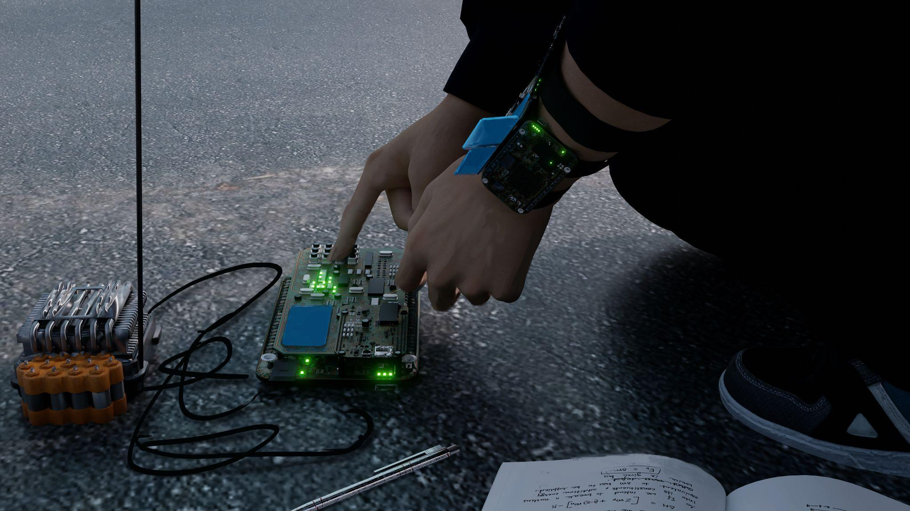

**VI**: Cậu chỉnh lại tần số, đổi nội dung nhập thành: “Ngươi là ai?”

**ZH**: 他重新调频，将输入改为：“你是谁？”

**EN**: He adjusted the frequency again and changed the input to: “Who are you?”

**VI**: Vài giây sau, đèn chỉ thị lại một lần nữa sáng lên, ngắn ngủi nhưng vô cùng dứt khoát và rõ ràng, tín hiệu phản hồi quay trở lại chuẩn xác.

**ZH**: 几秒之后，指示灯再次亮起，短促但清晰，回波信号准确地返回。

**EN**: Seconds later, the indicator light blinked—short, sharp, unmistakable.

**VI**: Cậu vội vã lôi cuốn sổ tay bên cạnh ra, nhanh chóng ghi lại nhịp điệu sáng tắt của từng chuỗi tín hiệu nhị phân trên trang giấy. Vừa viết, cậu vừa đối chiếu với bảng mã để giải mã, mỗi khi dịch xong một từ, ngón tay cậu lại khựng lại trong giây lát —

**ZH**: 他迅速在身旁翻出那本笔记本，在纸上记下每一道二进制信号的明灭节奏。一边写，一边对照表格解码，每还原出一个字，手指就停顿片刻——

**EN**: The return signal was precise.

**VI**: ‘TÔI’. ‘LÀ’. ‘KẺ... GIEO... MẦM...’.

**ZH**: ‘我’。‘是’。‘播……种……者’。

**EN**: He quickly grabbed a notebook from his side and began jotting down the on-and-off rhythm of each binary flash.

**VI**: Khi nét bút viết xong từ cuối cùng, tay cậu run lên bần bật, đầu ngòi bút suýt chút nữa đâm rách toạc trang giấy.

**ZH**: 当最后一个字落下，他的手微微一抖，笔尖差点划破纸页。

**EN**: As he wrote, he decoded them one by one, cross-referencing a chart beside him.

**EN**: With each character deciphered, his pen paused for a beat—

**EN**: ‘I’

**EN**: ‘am’

**EN**: ‘the… Sow…er…’

**EN**: When the final word appeared, his hand trembled, the pen nearly tearing the paper.

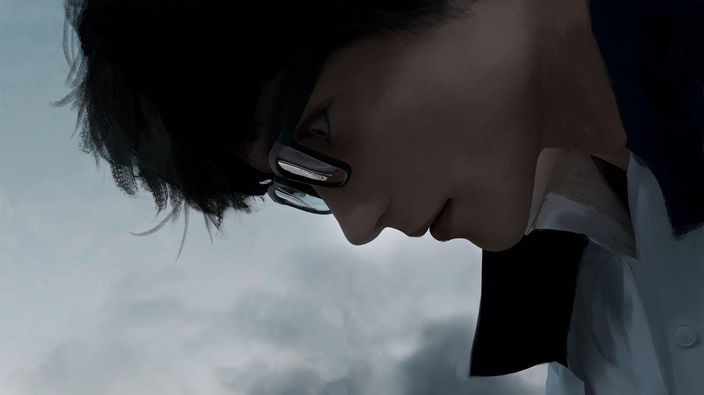

**VI**: “‘... Tôi là Kẻ Gieo Mầm...’ ư?”

**ZH**: “‘……我是播种者……’？”

**EN**: “‘…I’m the Sower…?’”

**VI**: Đúng lúc này, Nguyệt Nha Nhi bỗng thốt lên một tiếng kinh hô nén chặt, cắt đứt dòng suy nghĩ đang cuộn trào của cậu. Thanh âm ấy chứa đựng nỗi hoảng loạn và sợ hãi tột cùng, thậm chí còn thất thần hơn cả cậu lúc này —

**ZH**: 这时，月牙儿忽然发出一声压低的惊呼，打断了他的思绪。那声音里带着明显的惊惧，比他此刻还要更慌乱几分——

**EN**: Just then, Mahina let out a sharp, hushed gasp that snapped him out of his thoughts.

**VI**: “Hi Dương! Đừng bận tâm tới tín hiệu nữa, cậu mau lại đây xem cái này đi —!”

**ZH**: “希扬！别管信号了，你快过来看这个——！”

**EN**: There was fear in her voice—clear and urgent—more shaken than he was.

**EN**: “Suvan! Forget the signal—come look at this, now!”

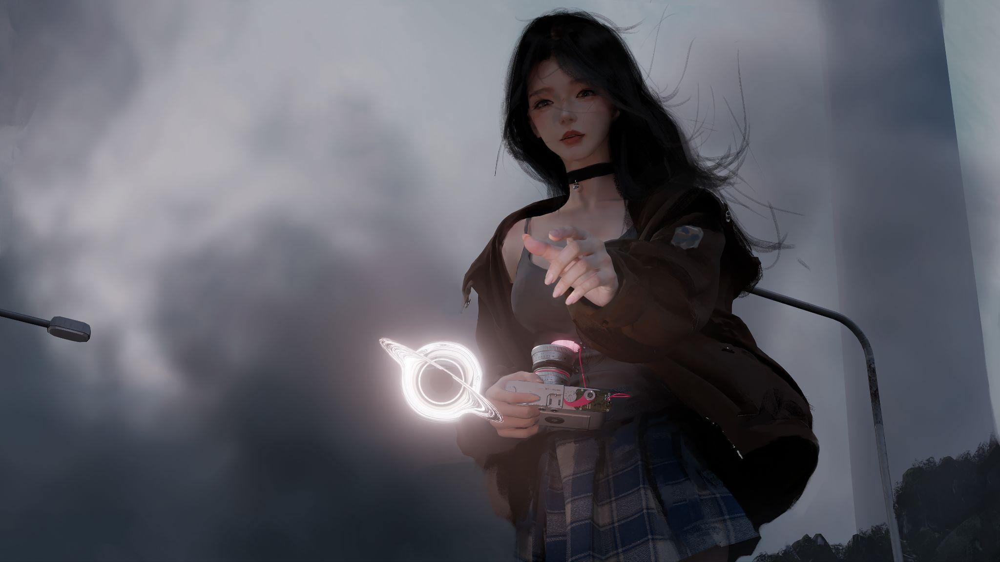

**VI**: Cậu ngoảnh đầu nhìn lại —

**ZH**: 他回头望去——

**EN**: He turned around—

**VI**: Một xoáy lốc ánh sáng phát quang đang lơ lửng cách mặt đất chừng nửa mét, kích thước chỉ độ bằng một lòng bàn tay, đang lặng lẽ xoay tròn trong tĩnh mịch tuyệt đối. Ở rìa ngoài xuất hiện hiệu ứng thấu kính hấp dẫn, ánh sáng bị bẻ cong thành một vầng hào quang nhòe mờ, ngay cả không khí xung quanh dường như cũng bị lực hút kéo lệch, gần như đông cứng lại.

**ZH**: 一团发光的漩涡悬浮在地表半米处，约莫巴掌大，静静旋转着。边缘出现引力透镜效应，光线被扭曲成一圈模糊的晕环，连周围的空气都仿佛被牵引，几近停滞。

**EN**: A glowing vortex hovered half a meter above the ground, no larger than a human palm. It spun in utter silence, its edges bending light into a blurred halo—gravitational lensing in motion. Even the air around it seemed pulled inward, frozen in place.

**VI**: Tâm của xoáy lốc hơi trũng xuống, tựa như đang liên tục sụp đổ vào bên trong, không-thời gian tại điểm đó đang âm thầm bị kéo giãn, biến dạng, dường như sắp sửa bị xé toạc ra thành một vết nứt sâu thẳm.

**ZH**: 漩涡中央微微塌陷，像是在持续坍缩，时空在那一点悄然拉伸、变形，仿佛正被撕开一道裂缝。

**EN**: At the center, the vortex sagged inward slightly, as if collapsing—space and time stretching, distorting, unraveling into what felt like the beginning of a tear.

**VI**: Nguyệt Nha Nhi đứng sững sờ trước mặt nó, ngơ ngác nhìn cấu trúc kỳ dị chưa từng thấy này, trong đáy mắt thoáng qua nỗi khiếp sợ xen lẫn hoang mang tột độ. Cô từ từ giơ tay ra, những đầu ngón tay run rẩy, chầm chậm vươn về phía khoảng không-thời gian đang sụp đổ ấy —

**ZH**: 月牙儿站在它面前，怔怔望着这奇异结构，眼中闪过惊惧与迷惑。她缓缓伸出手，指尖颤抖着，朝那片塌陷的空间伸去——

**EN**: Mahina stood before it, staring at the strange structure with fear and confusion in her eyes. Slowly, she reached out—fingers trembling—toward that collapsing fold in space.
