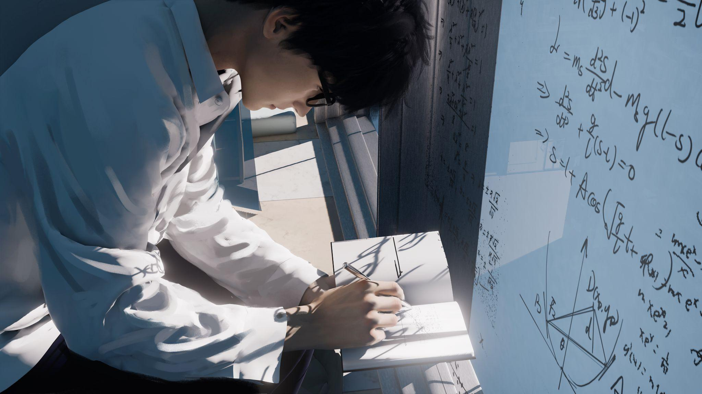
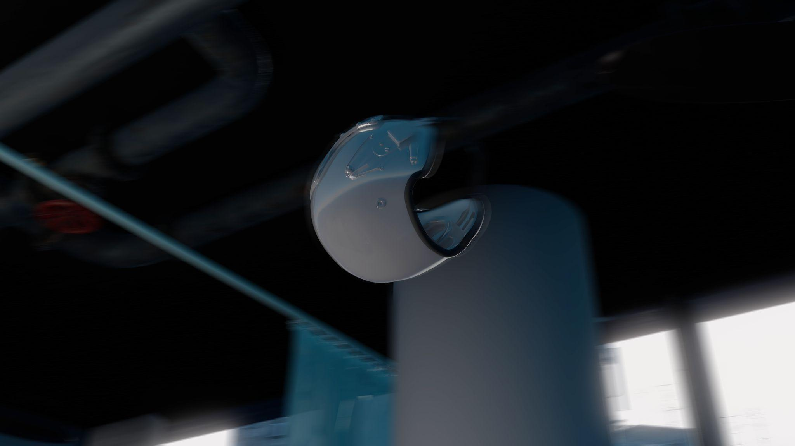
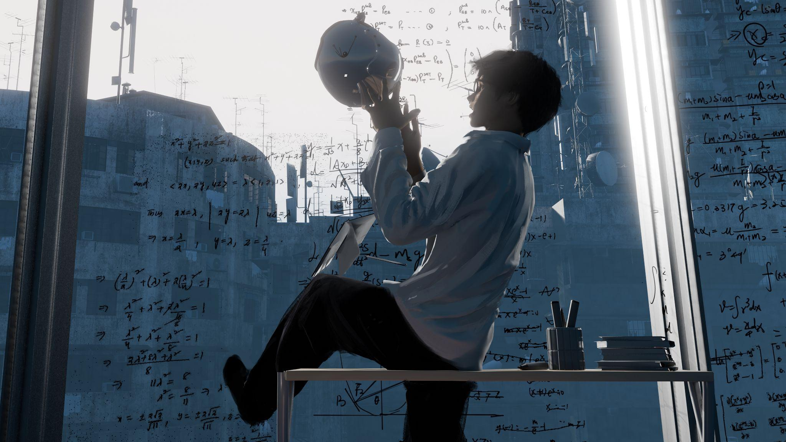
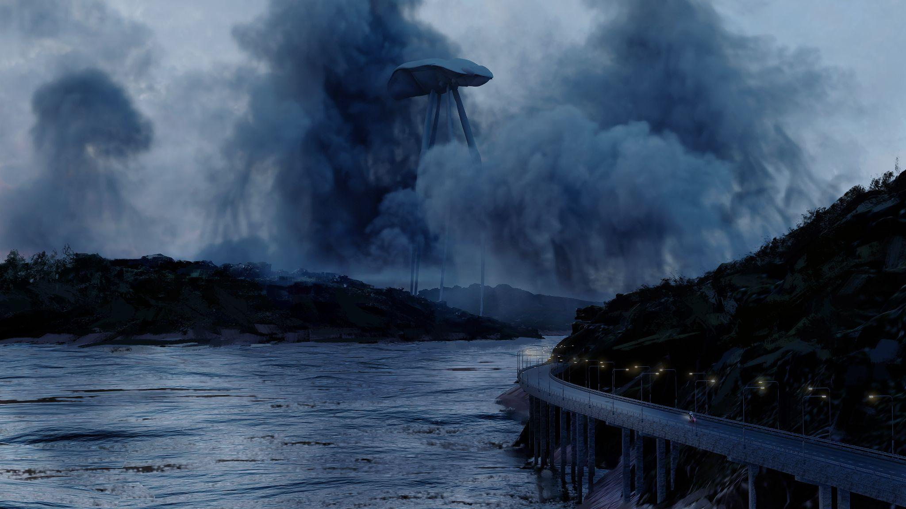
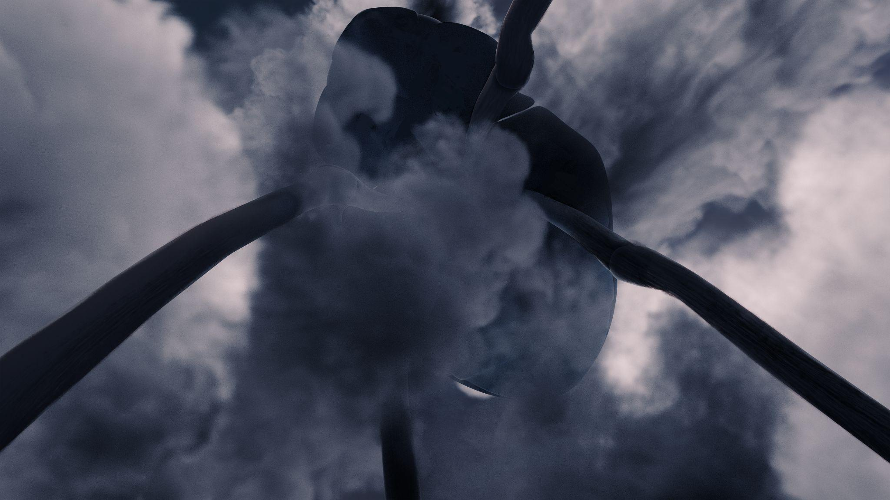
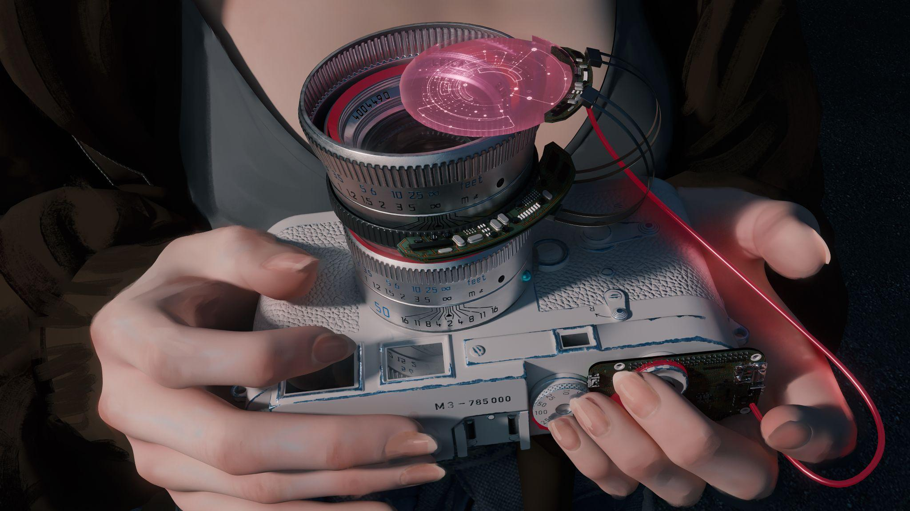
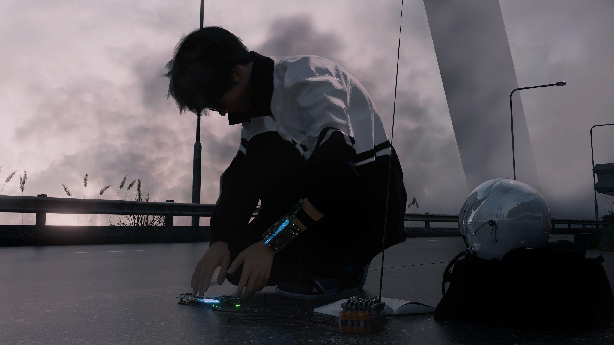
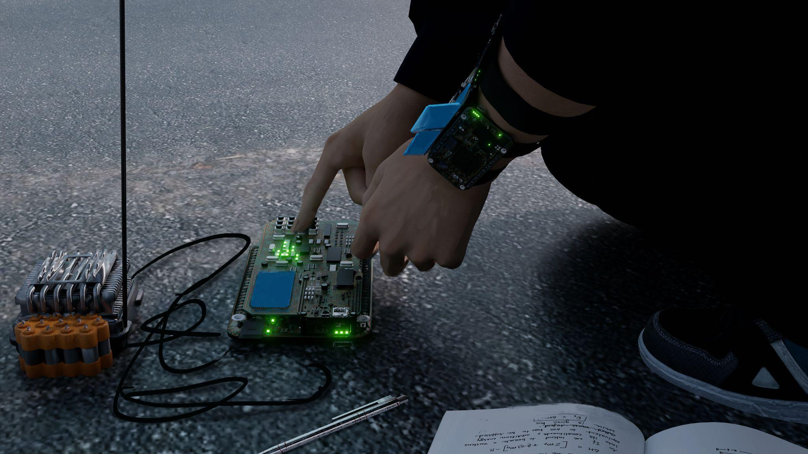

# 云虫 - 第三章 光锥之外 · 一

---

> 光线从落地窗外倾斜而入，在地板上切割出一格一格静默的光影。

> 月牙儿坐在靠窗的小床上，手里的旧书翻到中页，指尖还留着书页泛黄的灰纹。参宿四蜷在她身后，尾巴轻轻摆动，像也在听她心里的声音。

> 另一侧，希扬独坐在阶梯上，身影被阳光拉得很长。玻璃上的公式密密麻麻，像一面悄无声息的星图。他神情专注，嘴唇微动，低声背诵着什么。

> 淡蓝色的布帘在中央垂下，悄悄将这间屋子一分为二——

> 一边是沉静的潮汐，一边是跃动的星火。

> “荣曜秋菊，华茂春松。髣髴兮若轻云之蔽月，飘飖兮若流风之回雪……”

> “在念什么呢？”

> “没什么……在背课文。”

> “哦？那你告诉我——哪本高中课本里有《洛神赋》？”

> 他脸上微红，轻咳一声，低头继续在玻璃上演算。阳光斜照在他耳后，露出一瞬被人看穿后的局促。

> “周末你不出门，也不玩游戏，连手机都不碰。”

> “一整天对着那些公式，你不觉得无聊吗？就没有娱乐活动？”

> “这对我来说就是娱乐活动。”

> “相比于人类设计的游戏，我更喜欢……神明设计的游戏。”

> “那现在有什么头绪了？”

> “云虫场内的电磁规律发生异常，麦克斯韦方程组在这里已无法成立，电磁场开始呈现非线性行为。普朗克常量的波动导致电子能级跃迁规则紊乱，所有依赖硅基芯片的仪器几乎完全失效。甚至连逻辑门都被干扰得失去原有功能——与非门现在反而表现出或门的特性。”

> “说人话！”

> “简单讲，精密仪器基本全废了。”

> “但有一点是确定的：这些异常和我们离云虫的距离成正比——越靠近它，变量反而越小。”

> “如果靠得足够近……那些异常变量，会不会就变得可以忽略？”

> 她侧头望向那边，透过书架与窗之间的缝隙，悄悄打量着他的神情。

> “是的。如果靠得足够近，这些变量在公式中可以被视作无穷小量而忽略。重新改装的简单电子仪器，也许就能再次运作。只是——”

> “走！”

> 话音还没落，一只头盔就从帘子那边飞了过来。希扬一惊，下意识伸手去接，却被砸了个正着。头盔掉进怀里，他自己几乎跌下台阶，动作有点狼狈。

> “啊？要去哪？”

> “姐姐带你去看真正的云虫。”

> 她就那样站在那里，手里拎着头盔，赤脚踩在被杂物切碎的光斑上，像一只踩在光上的精灵。

> 她一手拨开头发，同时朝他扬了扬下巴，眼神里带着不容拒绝的明亮。

> [蓝巴勒海峡｜临近云虫核心区域]

> 摩托的引擎声在无人的公路上疾驰而过。月牙儿穿着深色外套，头盔下的发尾在风中飞舞，目光冷静专注，仿佛早已与那冰冷的机车合为一体。

> 希扬坐在后座，轻轻搭着她肩膀，脸埋得有些低——偶尔抬眼，望向前方云层深处，那道若隐若现、仿佛不是此世之物的庞然轮廓。

> “别搭我肩，会影响我开车。”

> “那我手放哪？总得抓点什么吧。”

> “搂我腰啊。”

> “啊？”

> 他一下子更窘，支支吾吾地挪了下姿势，却也没再反驳，老老实实地环住她的腰。

> “你确定这车进云虫场……真的没问题？”

> “放心，我考的可是云虫场内特种机车驾照。”

> 他低头盯着绑在小臂上的测试仪——几块简陋的电路板焊接而成，液晶屏上跳动着浅蓝色的读数。每一次数据更新，设备都会发出规律而细碎的“嘟——嘟——”声。那声音被内燃机的轰鸣包裹着，像是某种神秘生物在深海中的心跳。

> “原来……这个世界，是这么美的啊。”

> 月牙儿没有接话，只是轻轻松开油门。风声裹挟着那句低语，一同被甩进身后逐渐拉远的长桥。摩托如流星般飞驰而去，朝着那道高悬天际的身影——云虫的轮廓正缓缓显现，像是沉睡在天穹之上的巨神。

> 坐在后座的希扬，始终望着它。那句感慨像是压抑许久的喟叹。

> 他们离云虫越来越近。巨神脚下，浓雾翻涌。

> 数小时后，海峡中段

> 他们在一段海峡中央的一段空旷路段停了车。头顶正是云虫悬停的核心区域，厚重的云层像一块低垂的天盖，缓缓压迫着大地。

> 希扬下车后立刻展开仪器，蹲下开始调试。他检查显示屏，又迅速绕车一圈，确认四周的磁扰变化。

> “我第一次从这个角度看它……这里，正好位于云虫下方的干扰核心区域。简单的测试仪器可以开始运作了。”

> “你装在我相机上的那个探测器，屏幕上完全没反应。”

> “嗯，液晶屏没反应是正常的，这种干扰场太强，驱动频率根本对不上。但只要你按下快门，装置还是会记录信号——只是现在看不见而已。”

> 他从背包中取出另一台装置——一块改装过的电路板，接上了发光的二极管与细长天线。通过拨盘手动调节频率，导线连通电池，几秒后，指示灯依节奏闪烁，信号成功发出。

> “可以用了……果然，在离云虫足够近的地方，那些扰动变量可以忽略掉……简单的信号，就能穿透云虫场。”

> 他低头准备记录数据，忽然神色一变，盯住发射器的频率反馈显示。额头悄然渗出细汗，手指也开始微微颤抖。

> “……我收到回信了。”

> “什么回信？”

> “我刚才测试的时候发出了一句‘你好’……现在收到了同一频段的回应——也是‘你好’。”

> “是不是被附近什么设备接收了，又自动反射回来？这附近……会不会还有别人？”

> “不可能。我的发射功率极低，等效距离不到五米。附近根本不可能有接收器……也没人。”

> “那你……再发一句试试。”

> 他重新调频，将输入改为：“你是谁？”

> 几秒之后，指示灯再次亮起，短促但清晰，回波信号准确地返回。

> 他迅速在身旁翻出那本笔记本，在纸上记下每一道二进制信号的明灭节奏。一边写，一边对照表格解码，每还原出一个字，手指就停顿片刻——

> ‘我’。‘是’。‘播……种……者’。

> 当最后一个字落下，他的手微微一抖，笔尖差点划破纸页。

> “‘……我是播种者……’？”

> 这时，月牙儿忽然发出一声压低的惊呼，打断了他的思绪。那声音里带着明显的惊惧，比他此刻还要更慌乱几分——

> “希扬！别管信号了，你快过来看这个——！”

> 他回头望去——

> 一团发光的漩涡悬浮在地表半米处，约莫巴掌大，静静旋转着。边缘出现引力透镜效应，光线被扭曲成一圈模糊的晕环，连周围的空气都仿佛被牵引，几近停滞。

> 漩涡中央微微塌陷，像是在持续坍缩，时空在那一点悄然拉伸、变形，仿佛正被撕开一道裂缝。

> 月牙儿站在它面前，怔怔望着这奇异结构，眼中闪过惊惧与迷惑。她缓缓伸出手，指尖颤抖着，朝那片塌陷的空间伸去——

