# CloudInsect - Chapter 3: Beyond Light Cone · Part 2

*Original Title: 第三章 光锥之外 · 二*

---

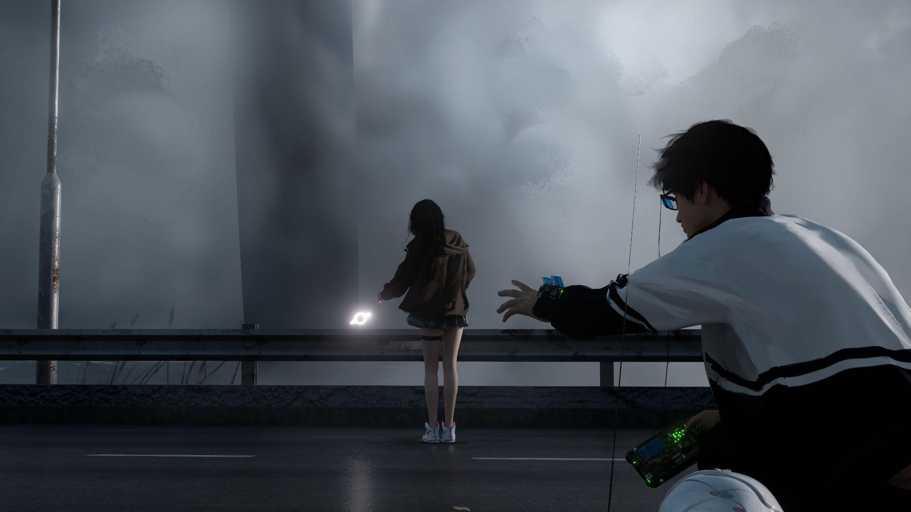

> “Wait—Mahina! Don’t touch that!”

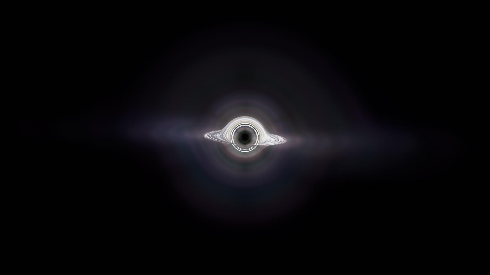

> —hiss—

> Light bent along the rim of the black hole, drawn as if by an invisible hand. Air collapsed inward; sound and color were torn away together. Time began to coagulate—each second stretched infinitely, then shattered in an instant. Mahina felt her consciousness ripped into countless fragments, spinning, breaking, and reassembling in the dark without light. And the world… seemed to be rearranging itself on the other side.

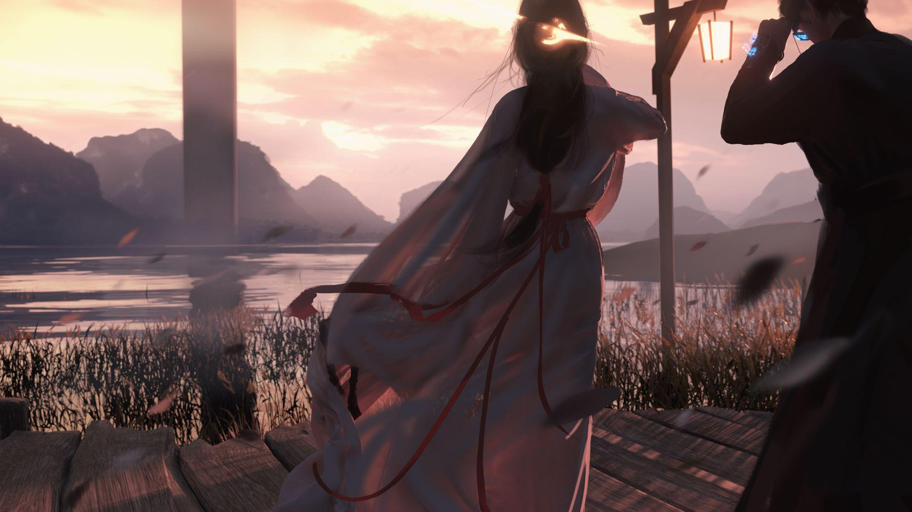

> The wind regained its weight. Leaves drifted down through backlight. The air was filled with a scent—thick, damp, laced with soil, ash, and the metallic tang of iron. It pressed into her lungs, raw and heavy, stirring unease deep in her chest.

> The wooden planks beneath her feet quivered. Mahina’s chest tightened; the taste of rust crept up her throat, sharp and dry. She wanted to cough, but no sound came out. She slowly opened her eyes. The light was too bright—instinctively, she raised a hand to shield them. The glare faded, leaving only twilight and the shadow of distant mountains.

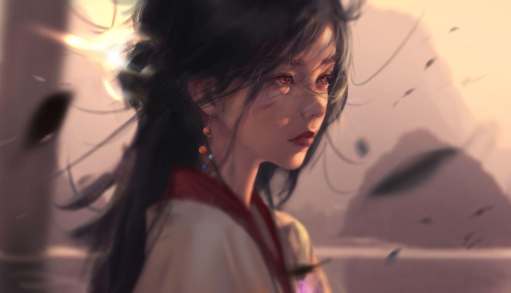

> “Where… are we?”

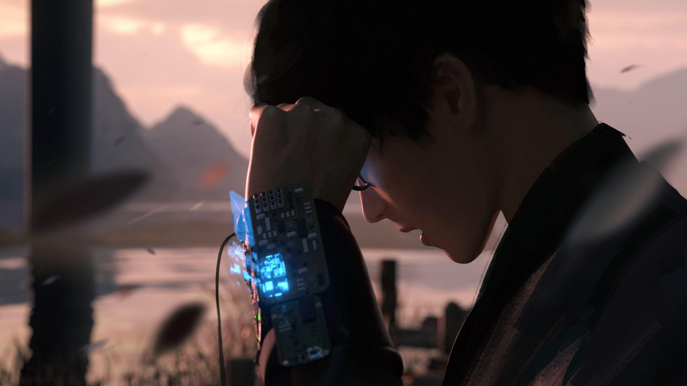

> “I don’t know… The LCD just came on?The CloudInsect field here is abnormally weak.We’re still right beneath it—but the interference’s almost gone.”

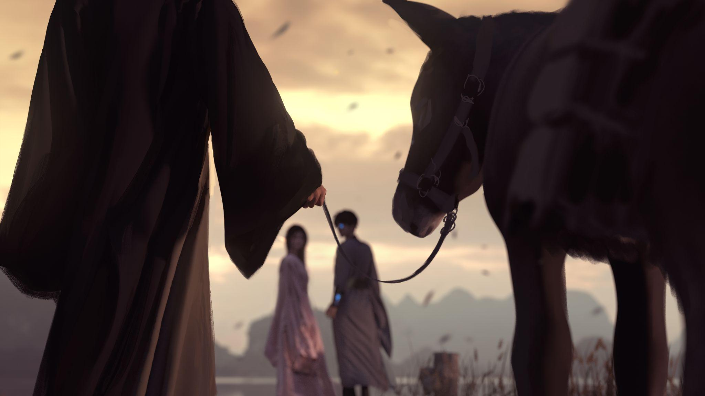

> [???]

> “Are the two of you also answering the Qin Lord’s call for the worthy?If so, perhaps we might travel together.”

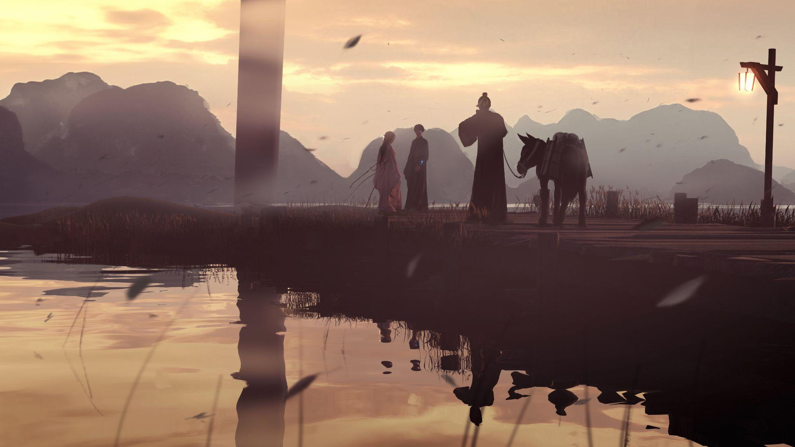

> Mahina and Suvan turned at the same moment.

> A man stood at the end of the twilight road, leading a donkey by its reins. The setting sun stretched his shadow long across the dust. His robe was black—sleek lines, steady fabric, moving faintly with the wind. He stood upright, movements calm and measured. His brow was sharp, his gaze cutting like a blade—yet not hostile; the kind that made one straighten their back without realizing it. There was a quiet certainty in his expression, as though he had already seen the road ahead. He stopped in the middle of the path, drew the reins gently, and saluted them with a polite bow.

> “Who are you?”

> “Who are you?”

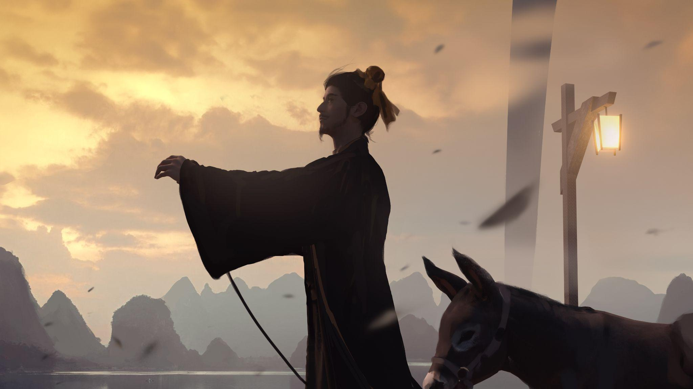

> [???]

> “I bear the compound surname Gongsun, given name Yang, a man of Wei.I journey to Yueyang at the summons of the Qin Lord’s decree for talent.Your attire differs greatly from the people of this land—Perhaps you, too, are travelers from afar?”

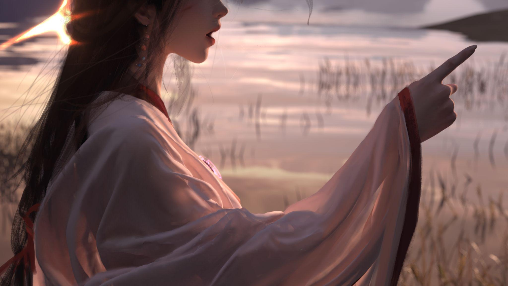

> “Gongsun Yang… from Wei?Wait—you’re—Shang—”

> The final syllable never formed. Air froze. Wind stopped. The river stilled. That sound—the half-spoken name—stretched infinitely, until even the waves of it seemed visible, inch by inch suspended in time. Then—everything stopped.

> And the familiar tearing returned. Light twisted; gravity tilted; the world folded into itself. Her mind was torn apart again, reassembled the next heartbeat. A shriek roared in her ears, as if time itself were splitting open. Mountains, borders, dynasties flashed past her vision, each swallowed by the next burst of light. They fell through the creases of countless timelines, two motes of dust hurled into a storm of time and space.

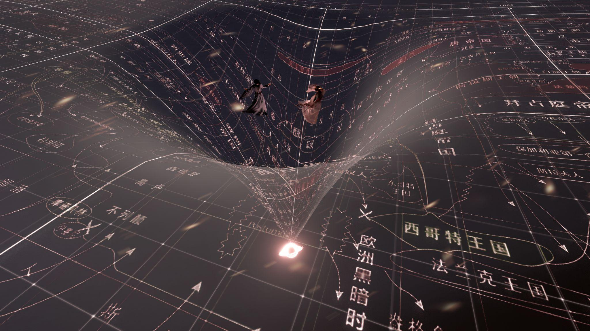

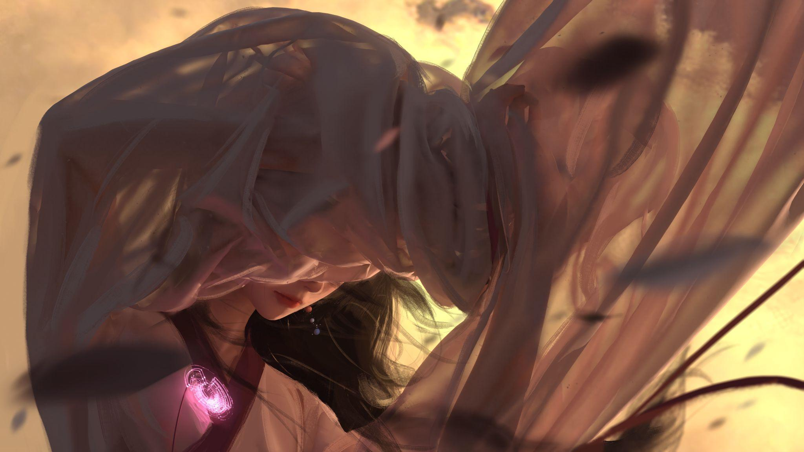

> Light returned to the world. A blinding radiance poured from all directions. The sky flipped, the air shimmered with motes of dust. Suvan’s voice broke through, urgent and trembling:

> “Mahina! Mahina! Are you alright?”

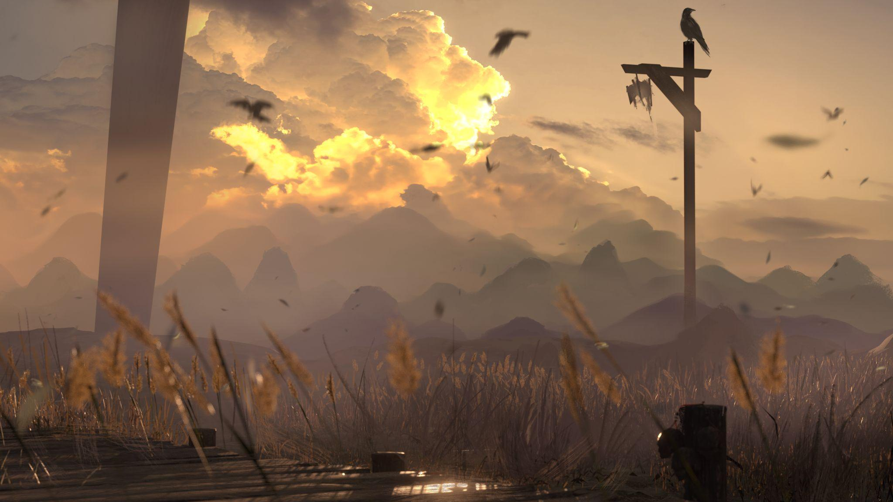

> “What… happened this time?Suvan… where are we now?”

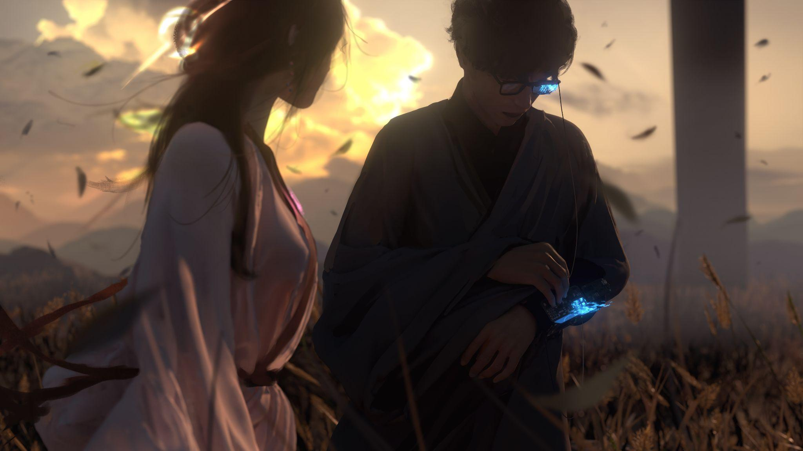

> “I think… we’re still in the same place.”

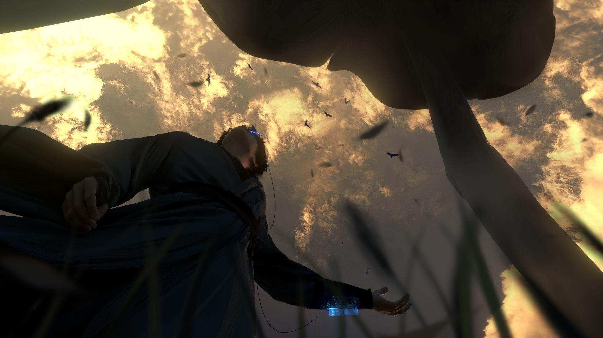

> “But not the same moment.”

> [???]

> “You’ve finally arrived.”

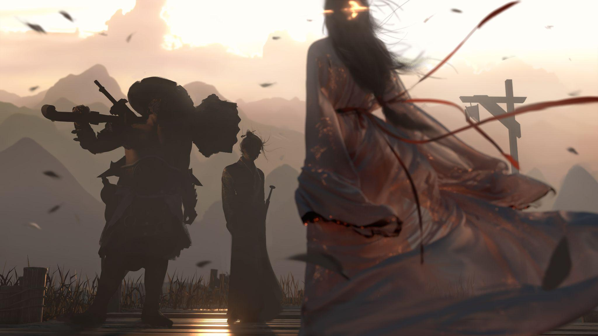

> A soft rustle of sand-laced footsteps came from behind them. Two figures emerged from the mist and fractured light.

> The first was a tall, straight-backed young man in a dark robe lined with gold. His sword hung at his waist, the sheath catching the fading light. A mask shaped like fangs covered his face, revealing only calm, penetrating eyes. Behind him strode a broad-shouldered warrior, carrying a massive hammer across his back. His armor was worn, his arms scarred, skin dark as bronze, gaze unwavering. Their steps were slow and sure—like men walking out of a dream. The masked youth stopped before them and inclined his head slightly.

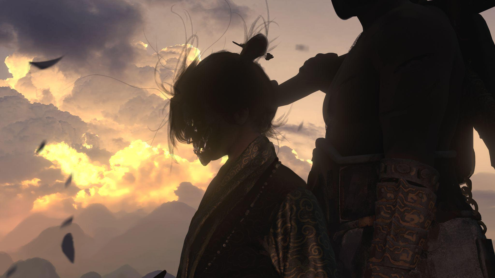

> [???]

> “I am Zhang Liang, courtesy name Zifang.I have awaited the Cloud Dwellers for some time.”

> Mahina and Suvan froze. For a heartbeat, they saw the same shock reflected in each other’s eyes. In this utterly foreign world—they had heard a name they knew. Zhang Liang. And more than that—three words that made their hearts tighten—Cloud Dwellers.

> Every broken thread in their memories twisted together in that instant, tangled into a single knot—as though fate itself had drawn them to this point. For the first time, they understood—that the name “Cloud Dwellers” existed not only on their tongues.

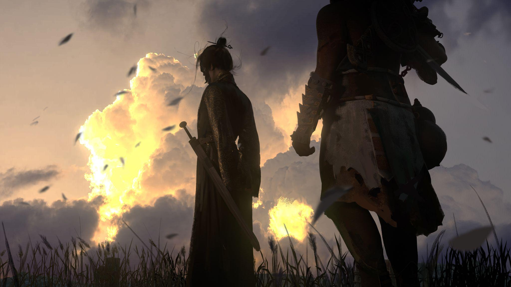

> [Zhang Liang]

> “The Qin Emperor is tyrannical, and all under Heaven has suffered beneath Qin for too long.Cloud Dwellers, will you help me rescue the people from fire and flood?”

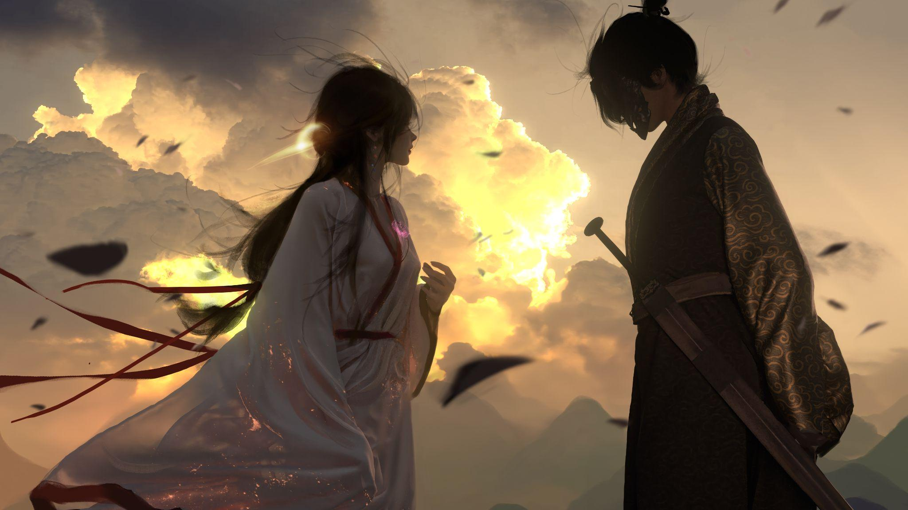

> The young man who called himself Zhang Liang stepped closer, stopping a single pace from Mahina. His voice was calm and even, every word precise—carrying the restraint of a scholar, yet a force that could not be denied.

> He stood tall, like a drawn sword piercing heaven and earth. The air around him seemed to bend; even the warrior behind him dimmed in comparison. Mahina felt as though that unseen gaze beneath the mask pierced straight through her. Her fingertips trembled; breath caught—her mind blank beneath the weight of his silence.

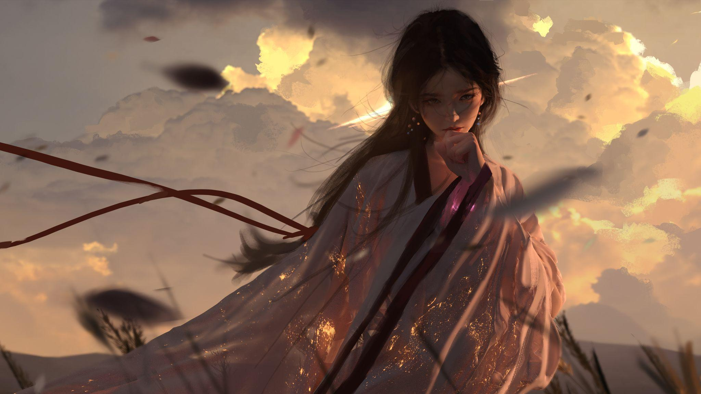

> “Then… how can we help you?”

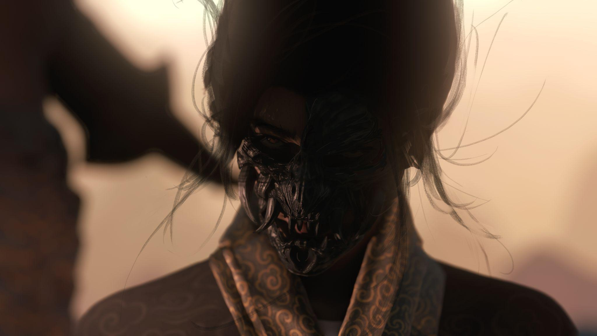

> [Zhang Liang]

> “It is simple.Tell me this:when the Qin Emperor travels east and passes through Bolang Sha,will he ride in the front carriage… or the rear?”

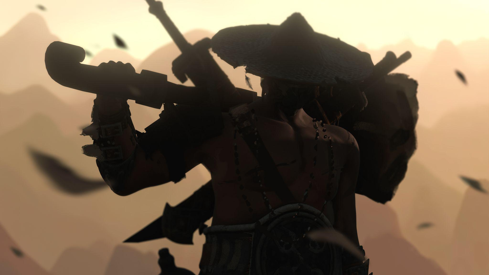

> At the mention of Bolang Sha, Mahina’s heart jolted. That name—so familiar. It rose like dust from the pages of history, from the half-forgotten corners of memory.

> She glanced up instinctively toward the giant behind Zhang Liang. Evening light glinted cold along his bare shoulder; The hammer across his back seemed heavy enough to split the air. Her heartbeat thundered in her chest.

> “He… he’s—”

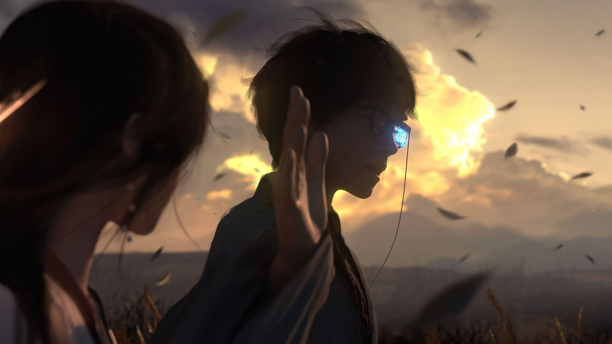

> “Wait! Mahina!”

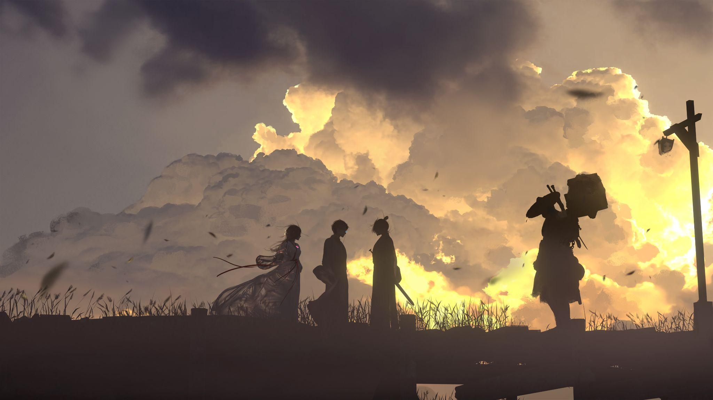

> “Do you really think—killing the Qin Emperor will save the world?”

> The boy who had been silent for so long was suddenly between them. He moved without a sound, placing himself before Mahina, shielding her.

> His spine was straight as a drawn bow, standing half a step from Zhang Liang—eyes locked, unwavering. Each word left his lips with clarity and edge, as sharp as Zhang Liang’s own. The setting sun burned between them like fire caught between two blades, light and shadow crossing in the air.

> Mahina stared at Suvan’s back—her chest loosened. Amid fear and confusion, warmth flickered through her. This boy she had always seen as a quiet, bookish student—was now her one point of calm in the storm.

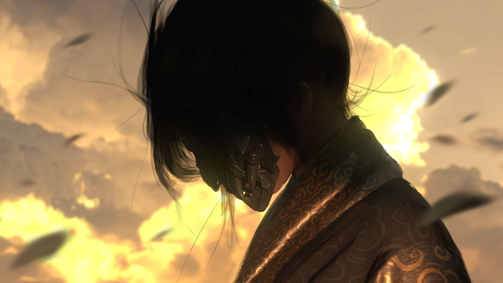

> [Zhang Liang]

> “As I thought. You cannot say, can you?Then the tales were true—The Cloud Dwellers are not of this world.You see the flow of Heaven’s path,yet you do not speak of its design.”

> He exhaled softly, lowering his head. The sigh was almost carried away by the wind, not heavy with reproach, but with a quiet sorrow long expected.

> Mahina and Suvan exchanged a glance; they understood then—the strategist behind that mask had never truly sought an answer. He was merely confirming a loneliness written into fate.

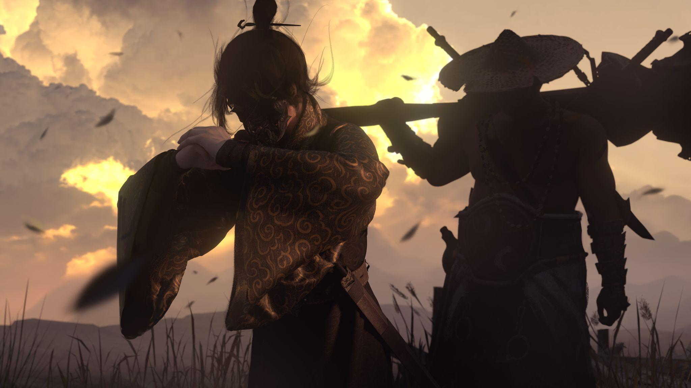

> [Zhang Liang]

> “But to meet the Cloud Dwellers in my lifetime—Zhang Liang has no regrets.What Heaven has revealed will one day shine in full light.Now… our paths diverge.”

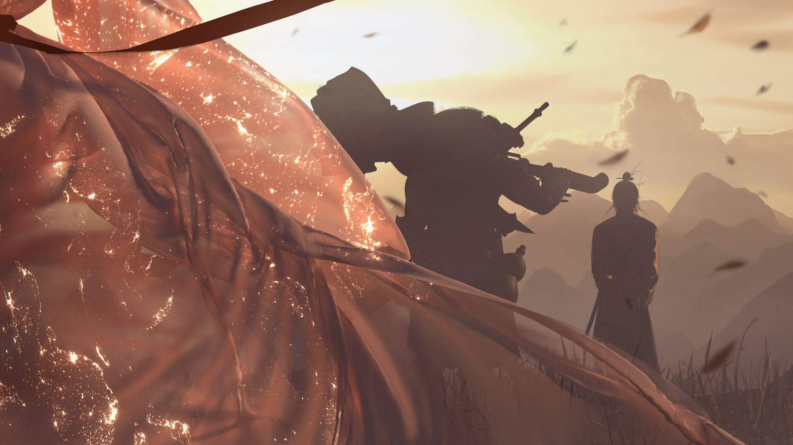

> The wind swept over the hills, tugging at his robes. He turned and walked away—steps light, calm, as if already at peace with heaven and earth.

> Mahina watched his fading figure, dazed, as though waking from a dream.

> “Wait—Can I ask… where are we, exactly?”

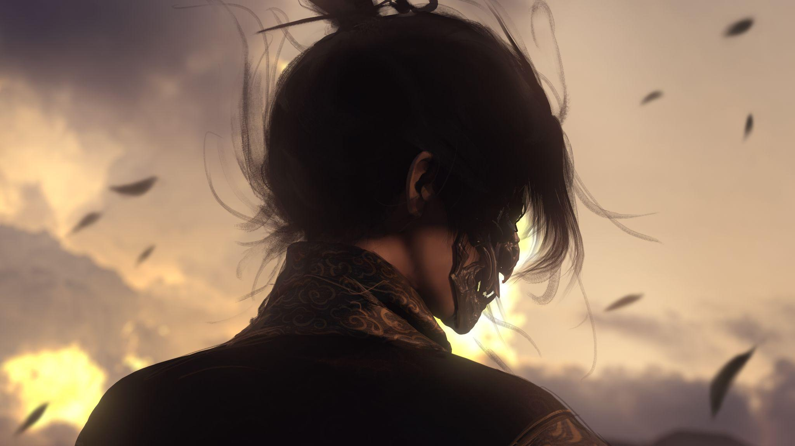

> [Zhang Liang]

> “Beyond the light cone.”

> Records of the Grand Historian · Biography of Lord Shang — Sima Qian

> Lord Shang was an illegitimate son of a lesser branch of the ruling house of Wei. His given name was Yang and his surname Gongsun; his ancestors had borne the Ji surname.

> After Gongsun Cuo died, Gongsun Yang heard that Duke Xiao of Qin had issued an order throughout the state seeking men of talent, intending to restore the achievements of Duke Mu and recover Qin’s lost lands in the east. He therefore traveled west to Qin and sought an audience with Duke Xiao through Jing Jian, one of the duke’s favored retainers.

> Records of the Grand Historian · Hereditary House of the Marquis of Liu — Sima Qian

> The Marquis of Liu, Zhang Liang, came from a family of Han. His grandfather Kaidi served as chancellor to Marquis Zhao, King Xuanhui, and King Xiang’ai of Han. His father Ping served as chancellor to King Li and King Daohui.

> Zhang Liang once studied ritual in Huaiyang. Traveling east, he met Lord Canghai and obtained a strongman for whom he made an iron mace weighing one hundred and twenty catties. When the Qin Emperor toured east, Zhang Liang and his companion ambushed him at Bolang Sha, but struck the decoy carriage. The Qin Emperor was furious and ordered a great search throughout the realm. Because the hunt for Zhang Liang was so urgent, he changed his name and went into hiding at Xiapi.

> Shang Yang (c. 390 BCE–338 BCE)

> Born Gongsun Yang in the State of Wei, he entered Qin in response to Duke Xiao’s ‘Edict Summoning Worthy Men’ and led its reforms. His policies enriched the state and strengthened its armies, allowing Qin to rise rapidly and laying a firm foundation for Qin Shi Huang’s unification of the six states. After the reforms succeeded, he was enfeoffed in Shang and became known to later generations as Shang Yang. His legal and political thought profoundly influenced later systems of government and the course of Chinese civilization, and its effects endure to this day.

> Shang Yang nevertheless remains a controversial figure. After Duke Xiao of Qin died, political enemies persecuted him; he was defeated and killed, and his body was torn apart by chariots in Xianyang.

> Zhang Liang (?–186 BCE)

> Courtesy name Zifang, he was from Yingchuan, within the former territory of the state of Han. During the uprisings at the end of Qin, he plotted unsuccessfully to assassinate Qin Shi Huang. He later joined Liu Bang and became one of his most important strategists. Liu Bang praised him for ‘devising strategies within the command tent and deciding victory a thousand li away.’ Together with Xiao He and Han Xin, he was known as one of the Three Heroes of the Early Han and was among the founders of the Han Empire.

> After victory, he declined a fief of thirty thousand households, accepted only ten thousand, and ultimately withdrew from public life, meeting a peaceful end.

