# Vân Trùng - Chương 3: Ngoài Nón Ánh Sáng · II

---

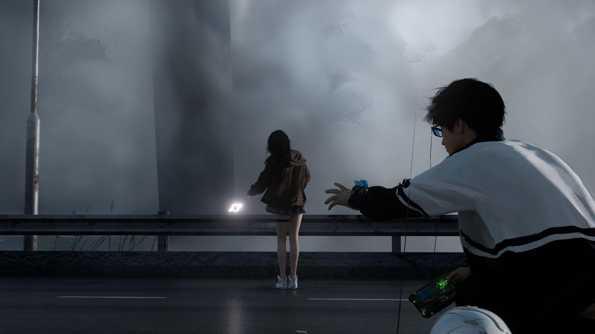

* **Lời thoại / Nội dung phát ra:**
  > **[Hi Dương hét lớn]** "Khoan đã—— Nguyệt Nha Nhi! Đừng chạm vào!"

---

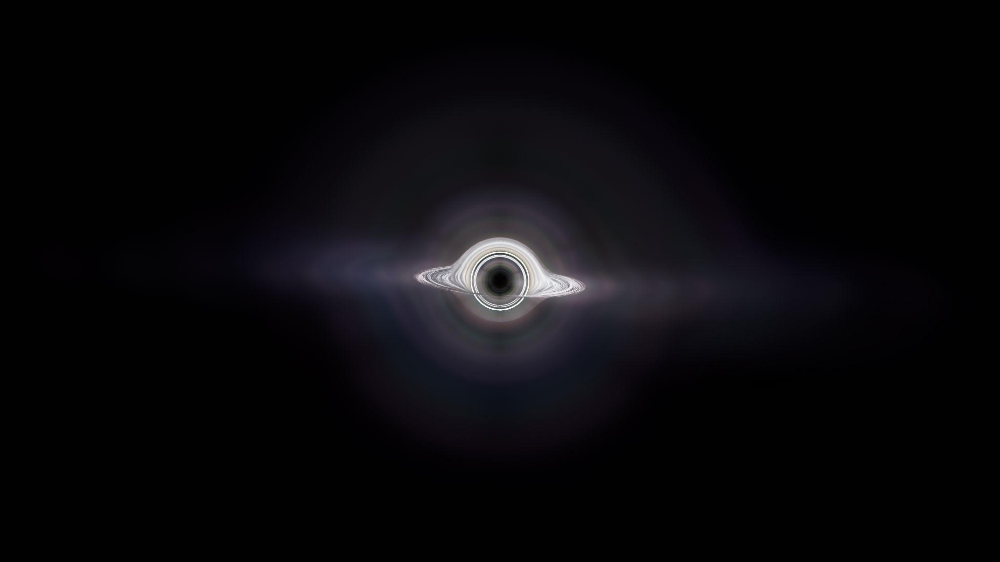

* **Lời thoại / Nội dung phát ra:**
  > *(—— Xì ——*
  > *Ánh sáng uốn cong quanh rìa hố đen, tựa như bị một bàn tay vô hình kéo giật. Không khí đột ngột sụp đổ, âm thanh và sắc màu cùng lúc bị tước đoạt.*
  > *Thời gian bắt đầu đông kết—— từng giây từng khắc bị kéo dài vô tận, rồi lại sụp đổ trong nháy mắt. Nguyệt Nha Nhi cảm thấy ý thức của mình bị xé toạc thành vô số mảnh vụn, cuồn cuộn, tan vỡ rồi tái tổ hợp nơi sâu thẳm không một tia sáng. Mà thế giới, dường như đang được sắp đặt lại ở một bờ bên kia.)*

---

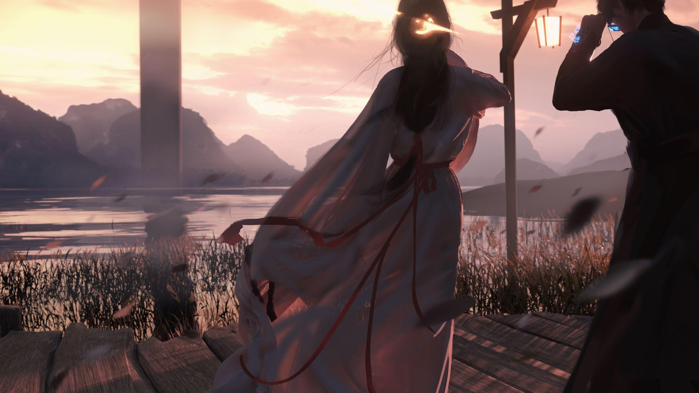

* **Lời thoại / Nội dung phát ra:**
  > *(Gió lại tìm lại được trọng lượng. Những chiếc lá rụng chao nghiêng trong ánh ngược sáng, không khí tràn ngập một mùi hương xa lạ—— nồng đậm, ẩm ướt, xen lẫn mùi bùn đất, tro tàn và vị tanh lạnh của sắt thép, khiến lòng người bản năng dâng lên nỗi bất an.*
  > *Những tấm ván gỗ dưới chân khẽ rung lên. Lồng ngực Nguyệt Nha Nhi thắt lại, thứ mùi ấy len vào cổ họng, mang theo vị chát han gỉ, khiến cô muốn ho mà không sao ho nổi. Cô từ từ mở mắt, ánh sáng quá chói chang khiến cô vô thức giơ tay lên che. Lớp hào quang chói mắt kia dần tan biến, chỉ còn lại ráng chiều tà và bóng núi xa xa.)*

---

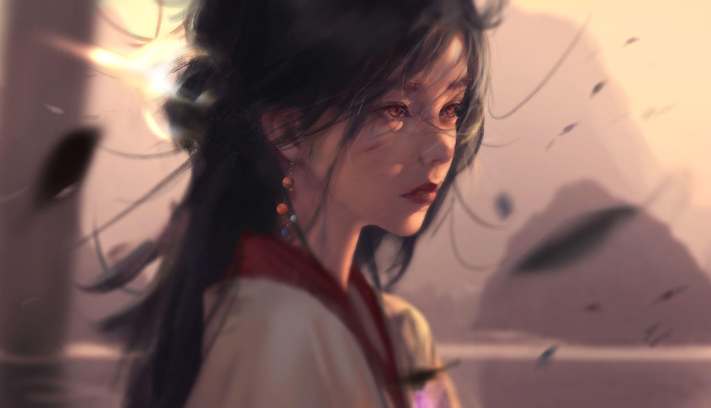

* **Lời thoại / Nội dung phát ra:**
  > **[Nguyệt Nha Nhi]** "…… Đây là đâu?"

---

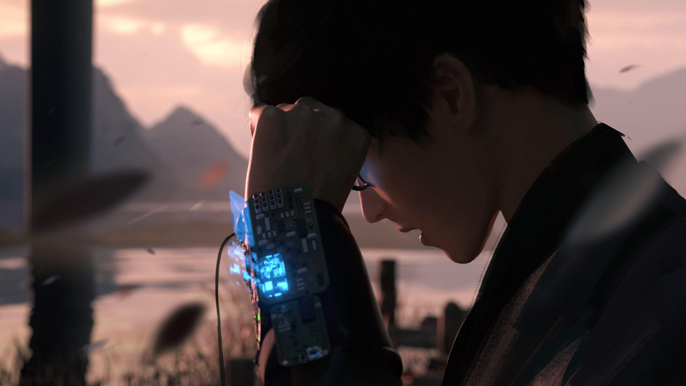

* **Lời thoại / Nội dung phát ra:**
  > **[Hi Dương]** "Không biết…… Màn hình tinh thể lỏng đã bật rồi? Trường Vân Trùng ở đây…… cường độ cực thấp. Rõ ràng chúng ta vẫn đang ở ngay bên dưới nó, nhưng nhiễu loạn gần như biến mất hoàn toàn?"

---

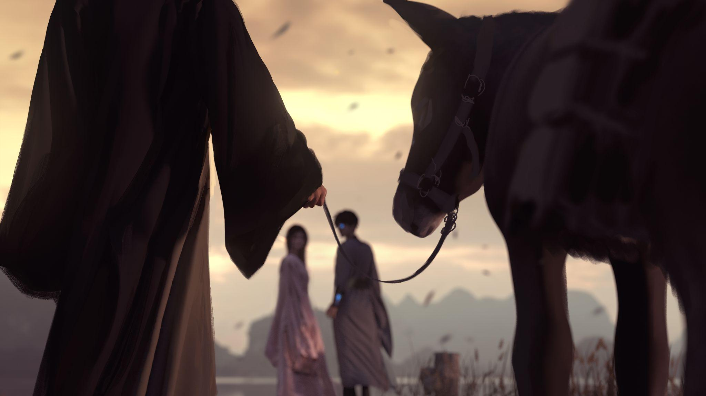

* **Lời thoại / Nội dung phát ra:**
  > **[Người lạ mặt]** "Hai vị, chẳng hay cũng vì Chiếu Chiêu Hiền của Tần công mà đến? Nếu cùng chung đường, chi bằng kết bạn đồng hành?"

---

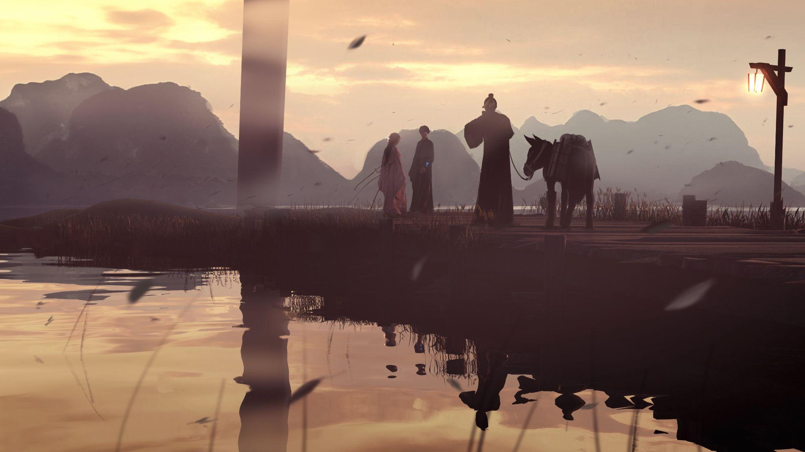

* **Lời thoại / Nội dung phát ra:**
  > *(Nguyệt Nha Nhi và Hi Dương gần như cùng lúc quay người lại.*
  > *Người nọ dắt một con lừa, đang đứng ở tận cùng của ánh hoàng hôn. Tà dương kéo chiếc bóng của ông ta dài thật dài, vạt áo dài khẽ lay động trong gió. Đó là một bộ trường bào màu đen sẫm, đường nét gọn gàng dứt khoát, chất vải trầm ổn. Dáng người ông thẳng tắp, cử chỉ ung dung tự tại. Xương mày góc cạnh sắc sảo, ánh mắt sắc như lưỡi đao nhưng không hề mang vẻ lấn át, chỉ là khi ánh mắt ấy dừng lại, người ta sẽ bất giác thẳng sống lưng lên. Thần thái toát ra một sự tự tin kiên định—— như một kẻ từ lâu đã nhìn thấu con đường phía trước. Ông dừng lại giữa đường, khẽ ghì dây cương, chắp tay hành lễ với hai người.)*
  > 
  > **[Nguyệt Nha Nhi]** "Ông là ai?"
  > 
  > **[Hi Dương]** "Ông là ai?"

---

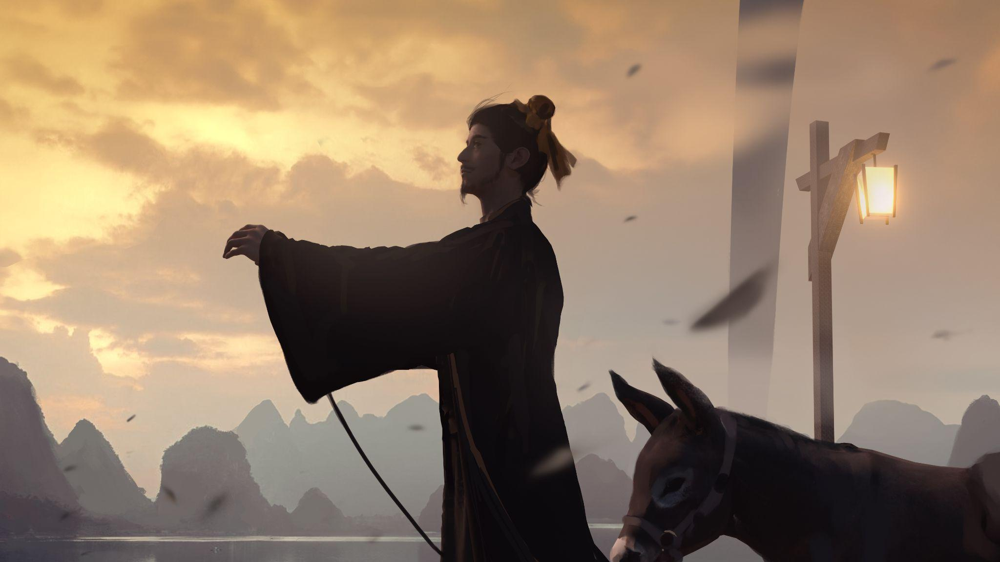

* **Chữ trong ảnh / Thẻ nhân vật:** **[公孙鞅 / 商鞅]** (Công Tôn Ưởng / Thương Ưởng)
* **Lời thoại / Nội dung phát ra:**
  > **[Công Tôn Ưởng]** "Tại hạ phục tính Công Tôn, danh Ưởng, người nước Vệ. Chuyến đi này nhằm hưởng ứng Chiếu Chiêu Hiền của Tần công, muốn sang Lịch Dương thử sức một phen. Y phục của hai vị khác lạ nơi này, chắc hẳn cũng chẳng phải người bản xứ?"

---

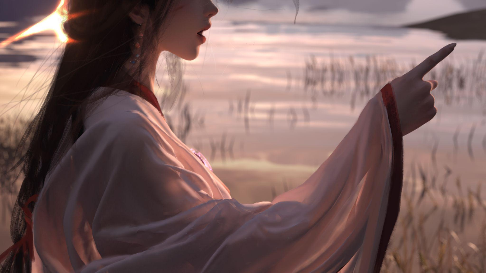

* **Lời thoại / Nội dung phát ra:**
  > **[Nguyệt Nha Nhi thảng thốt]** "Công Tôn…… Ưởng? Người nước Vệ? Khoan đã, ông là—— Thương——"

---

* **Lời thoại / Nội dung phát ra:**
  > *(Nguyệt Nha Nhi vừa thốt ra chữ "Thương", âm tiết cuối cùng còn chưa kịp định hình thì không khí đột nhiên đông cứng lại. Gió ngừng thổi, mặt nước chẳng còn gợn sóng. Thanh âm kia trong không khí bị kéo dài vô tận, chậm đến mức tựa như có thể nhìn thấy từng đợt sóng âm đang từng tấc từng tấc đóng băng trong dòng thời gian. Rồi sau đó—— vạn vật tĩnh lặng tuyệt đối.*
  > *Tiếp theo là cảm giác giằng xé quen thuộc. Ánh sáng vặn xoắn, trọng lực đảo nghiêng, thế giới như bị một bàn tay vô hình vặn chặt thành một khối. Ý thức của cô lại một lần nữa bị xé nát thành vô số mảnh vụn, rồi tái tổ hợp trong giây tiếp theo. Tiếng thét rít bên tai như thể chính thời gian đang đứt gãy. Tên gọi của núi sông, bờ cõi, các triều đại liên tục lướt qua trong tầm mắt rồi bị tầng ánh sáng kế tiếp nuốt chửng. Họ rơi tự do giữa muôn vàn nếp gấp của thời gian, tựa như hai hạt bụi nhỏ bị ném vào giữa dòng hồng lưu thời-không cuồng nộ.)*

---

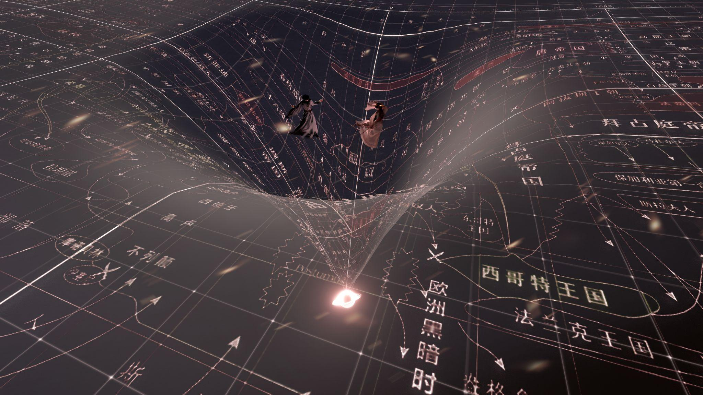

---

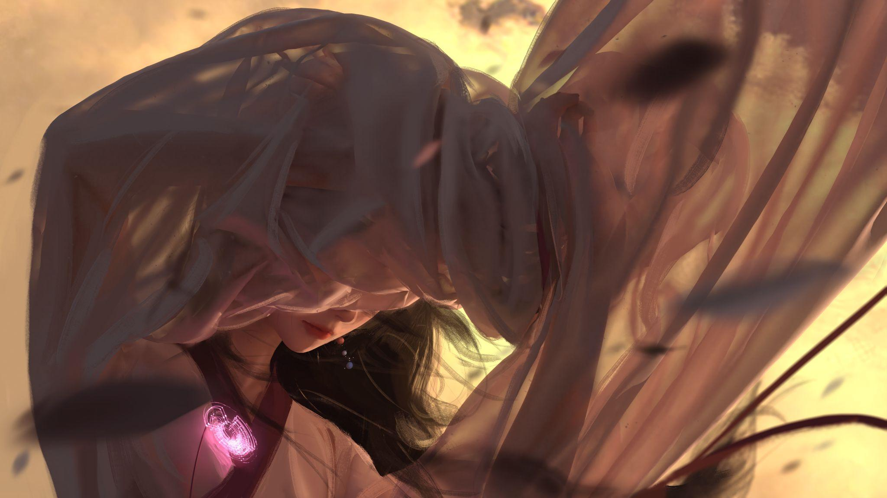

* **Lời thoại / Nội dung phát ra:**
  > *(Ánh sáng lại tràn về thế giới. Một luồng hào quang chói lòa từ bốn phương tám hướng rọi vào, trời đất đảo lộn, không khí tràn ngập những hạt bụi phát sáng li ti. Bên tai vang lên giọng nói quen thuộc—— sốt sắng, kìm nén, nhưng chứa chan vẻ lo âu cuống quýt:)*
  > 
  > **[Hi Dương]** "Nguyệt Nha Nhi, Nguyệt Nha Nhi! Cậu có sao không?"

---

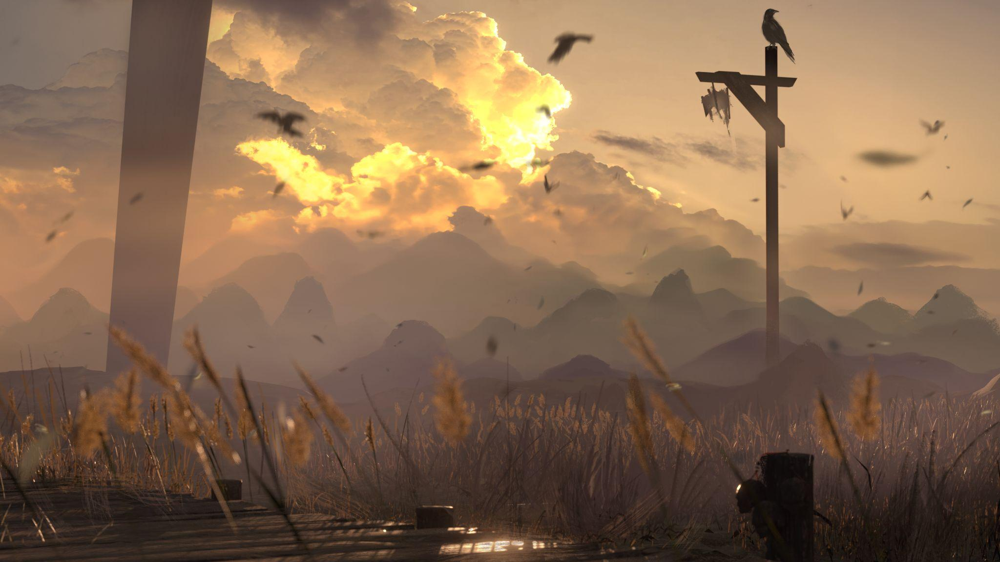

* **Lời thoại / Nội dung phát ra:**
  > **[Nguyệt Nha Nhi]** "…… Lại chuyện gì thế này? Hi Dương…… Đây…… rốt cuộc lại là đâu nữa rồi?"

---

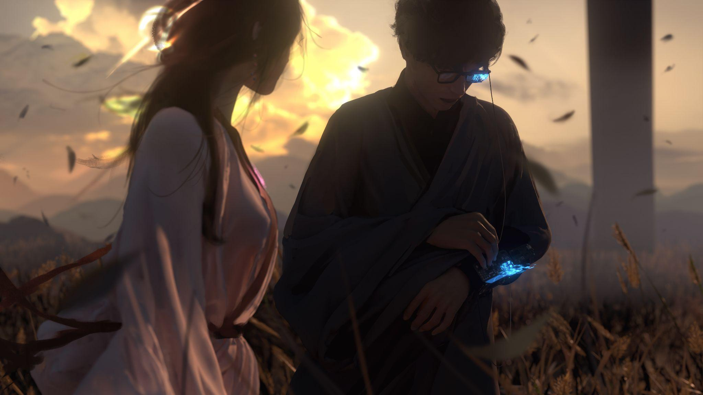

* **Lời thoại / Nội dung phát ra:**
  > **[Hi Dương]** "Chúng ta…… chắc vẫn đang ở chỗ cũ."

---

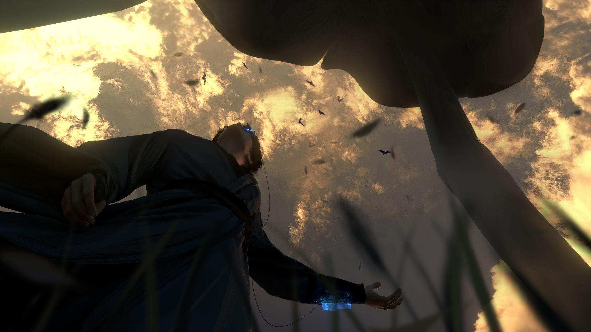

* **Lời thoại / Nội dung phát ra:**
  > **[Hi Dương]** "Nhưng—— dường như không phải ở cùng một thời điểm."
  > 
  > **[Giọng nói trầm tĩnh trong sương]** "Các vị, cuối cùng cũng đã tới."

---

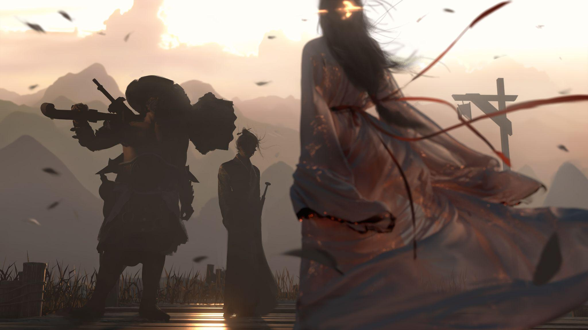

* **Chữ trong ảnh:** Hình tượng vị mưu sĩ mang mặt nạ nanh quỷ, bên hông đeo thanh trường kiếm lạnh lẽo, cùng người tráng sĩ cơ bắp cuồn cuộn vác đại thiết chùy nặng trăm cân.
* **Lời thoại / Nội dung phát ra:**
  > *(Tiếng bước chân giẫm trên cát sỏi vang lên từ phía sau lưng họ. Hai bóng hình chậm rãi hiện ra giữa làn quang ảnh mờ ảo.*
  > *Người đi trước là một thanh niên dáng người đĩnh đạc, trường bào viền chỉ vàng thêu huyền sắc khẽ bay theo gió, bên hông đeo trường kiếm, vỏ kiếm ánh lên sắc lạnh thâm trầm. Chàng đeo một chiếc mặt nạ nanh quỷ che kín cả khuôn mặt, chỉ để lộ đôi mắt tĩnh lặng, ánh nhìn sắc bén, khí thế sắc sảo hiển lộ ra ngoài. Phía sau chàng là một tráng hán vai vác đại thiết chùy khổng lồ, khoác giáp rách, bờ vai trần vạm vỡ hằn vết sẹo cũ, nước da ngăm đen, ánh mắt lạnh như thép nguội. Bước chân của họ vững vàng mà thanh thoát, tựa như từng bước bước ra từ cõi sương mù. Người thanh niên dừng lại trước mặt hai người, khẽ gật đầu chào.)*

---

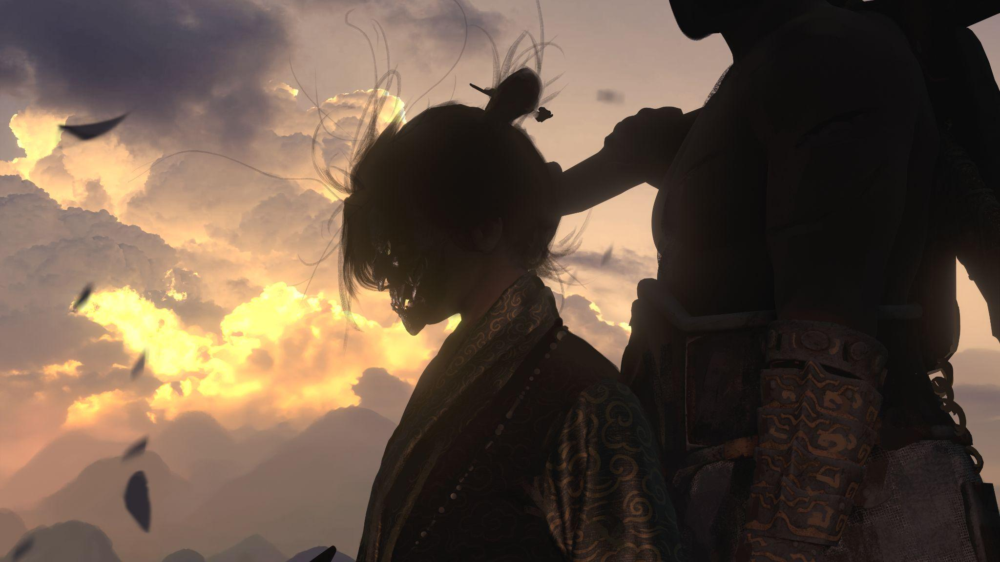

* **Chữ trong ảnh / Thẻ nhân vật:** **[张良 / 子房]** (Trương Lương / Tử Phòng)
* **Lời thoại / Nội dung phát ra:**
  > **[Trương Lương]** "Tại hạ Trương Lương, tự Tử Phòng, đã ở chốn này đợi hai vị Người Trong Mây từ rất lâu rồi."
  > 
  > *(Nguyệt Nha Nhi và Hi Dương bàng hoàng nhìn nhau. Trong khoảnh khắc ấy, cả hai đều đọc được cơn sóng gió kinh hoàng trong mắt đối phương. Giữa một thời không xa lạ đến nhường này, họ lại nghe được một cái tên quen thuộc đến vậy—— Trương Lương. Và điều khiến lồng ngực họ thắt lại, chính là ba chữ chàng vừa thốt ra: Người Trong Mây. Tất cả những manh mối vụn vặt rải rác trong phút chốc quấn chặt lại thành một mối gút định mệnh, tựa như bị số phận buộc chặt lại với nhau. Lần đầu tiên họ nhận thức sâu sắc rằng—— danh xưng "Người Trong Mây" kia không chỉ tồn tại trong lời nói của riêng hai người.)*

---

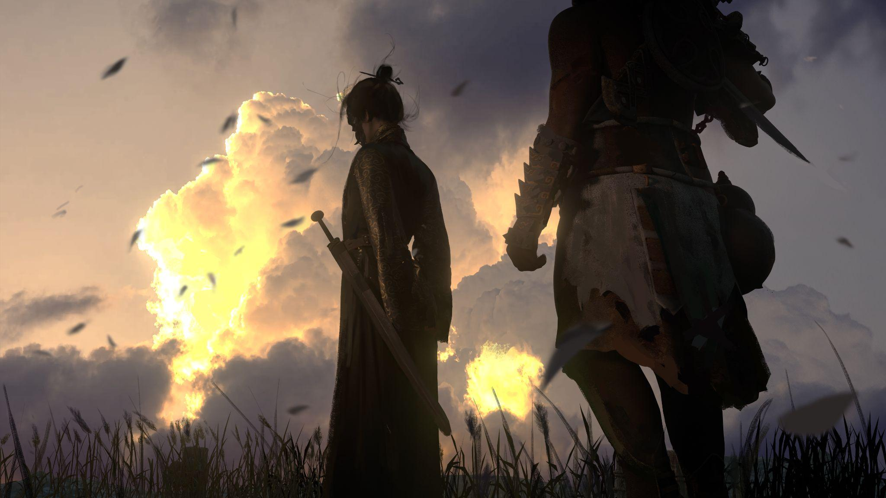

* **Lời thoại / Nội dung phát ra:**
  > **[Trương Lương]** "Tần Hoàng bạo ngược, thiên hạ chịu khổ vì Tần đã quá lâu rồi. Xin hai vị Người Trong Mây hãy giúp ta cứu muôn dân thiên hạ thoát khỏi cảnh nước sôi lửa bỏng."

---

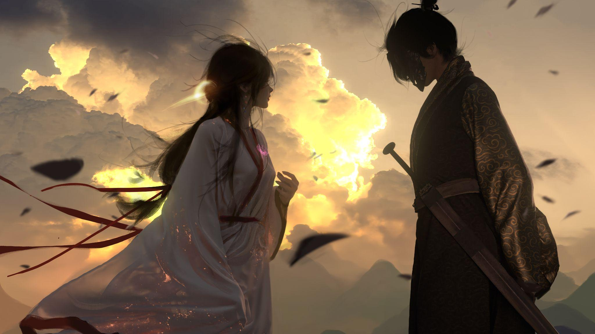

* **Lời thoại / Nội dung phát ra:**
  > *(Người thanh niên tự xưng là Trương Lương chậm rãi bước lại gần, dừng lại chỉ cách Nguyệt Nha Nhi một bước chân. Giọng nói của chàng trầm ổn và ôn hòa, từng chữ tròn vành rõ tiếng, mang theo phong thái lễ độ tao nhã của bậc Nho sĩ, nhưng tự thân lại toát ra một uy nghi kiên định không thể chối từ.*
  > *Chàng đứng sừng sững ở đó, cả người tựa như một thanh bảo kiếm sắc bén cắm giữa trời đất, luồng khí tràng vô hình ấy khiến cho võ sĩ vạm vỡ như núi non phía sau cũng phải lu mờ. Nguyệt Nha Nhi cảm thấy mình sắp bị ánh mắt dưới chiếc mặt nạ kia nhìn thấu tâm can, đầu ngón tay cô khẽ run rẩy, hơi thở nghẹn lại, tâm trí bị khí thế trầm mặc ấy nuốt trọn, đầu óc hoàn toàn trống rỗng.)*

---

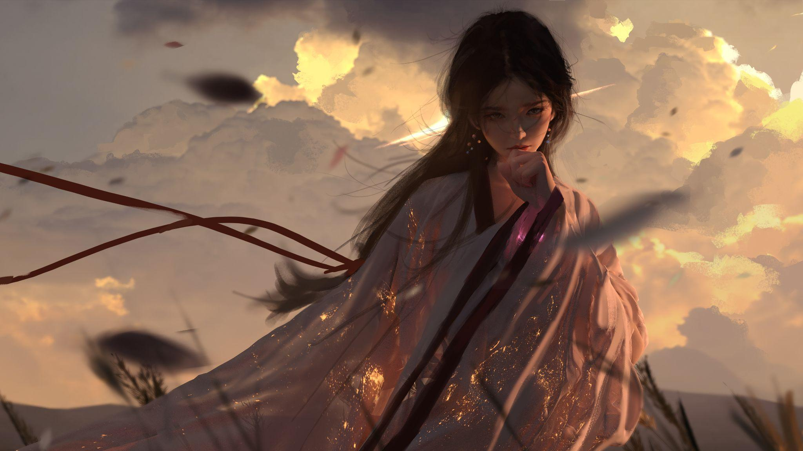

* **Lời thoại / Nội dung phát ra:**
  > **[Nguyệt Nha Nhi]** "…… Thế…… chúng tôi phải giúp ông bằng cách nào?"

---

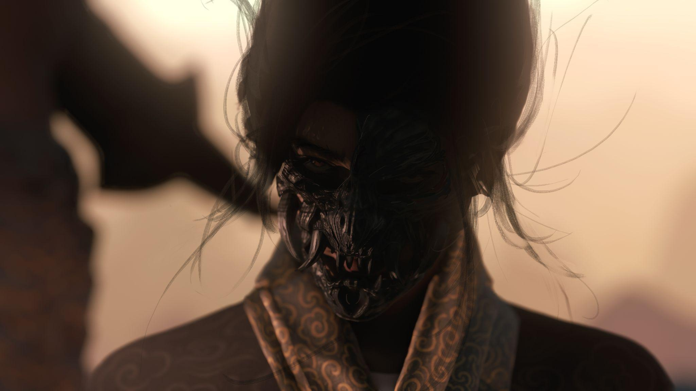

* **Lời thoại / Nội dung phát ra:**
  > **[Trương Lương]** "Rất đơn giản. Hai vị chỉ cần nói cho ta biết—— Chuyến tuần du phía Đông lần này của Tần Hoàng đế, khi đi qua Bác Lãng Sa, người ngồi ở xe trước…… hay xe sau?"

---

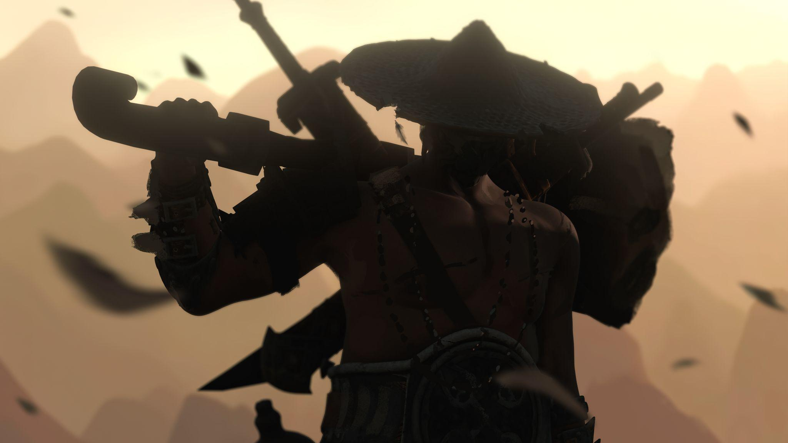

* **Lời thoại / Nội dung phát ra:**
  > *(Khoảnh khắc ba chữ "Bác Lãng Sa" vừa dứt, trái tim Nguyệt Nha Nhi bỗng thắt lại nhói buốt. Cái tên ấy quá đỗi quen thuộc—— tựa như được rút ra từ những trang sách giáo khoa bám bụi, từ nơi sâu thẳm nhất của ký ức.*
  > *Cô vô thức ngước mắt nhìn người tráng sĩ đứng sau Trương Lương. Ánh tà dương hắt lên bờ vai trần của người ấy tạo nên luồng sáng sắc lạnh, cây cự chùy trên vai nặng trĩu tựa như sắp đập vỡ nát cả bầu không khí. Cô cảm thấy trái tim mình sắp nhảy tung ra khỏi lồng ngực.)*
  > 
  > **[Nguyệt Nha Nhi run rẩy]** "Ông ấy…… ông ấy ở trong——"

---

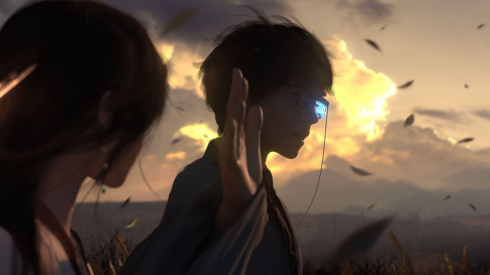

* **Lời thoại / Nội dung phát ra:**
  > **[Hi Dương xông lên]** "Đợi đã! Nguyệt Nha Nhi!"

---

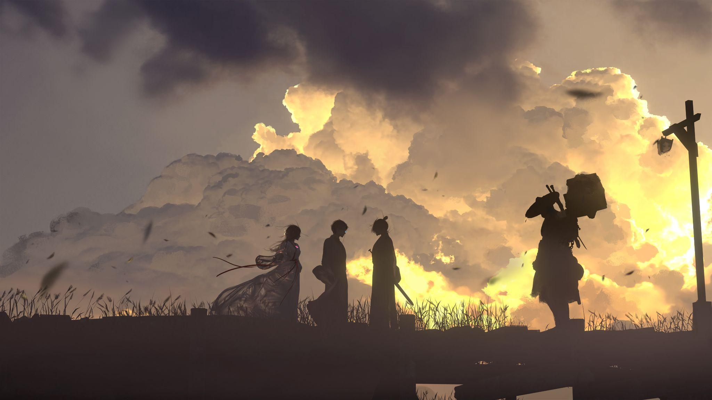

* **Lời thoại / Nội dung phát ra:**
  > **[Hi Dương đanh thép]** "Ông thực sự nghĩ rằng—— giết chết Tần Thủy Hoàng là có thể cứu vớt được thiên hạ sao?"
  > 
  > *(Hi Dương, người vốn im lặng bấy lâu nay bên cạnh, không biết từ lúc nào đã bước đến chen vào giữa họ. Cậu hơi nghiêng người, che chắn Nguyệt Nha Nhi ở phía sau lưng mình, sống lưng thẳng tắp tựa như cánh cung đã giương căng hết cỡ.*
  > *Cậu và Trương Lương chỉ cách nhau nửa bước, ánh mắt giao nhau quyết liệt, không hề có chút nao núng khiếp sợ. Từng chữ cậu thốt ra đều mang theo sự điềm tĩnh và sắc bén tương đồng. Ánh hoàng hôn tựa như đang bùng cháy giữa hai lưỡi kiếm sắc, quang ảnh đan xen, hơi thở ngưng tụ thành một sợi tơ căng thẳng.*
  > *Nguyệt Nha Nhi nhìn bóng lưng của Hi Dương, lồng ngực bỗng chốc buông lỏng nhẹ nhõm. Giữa nỗi sợ hãi và bàng hoàng, bỗng nhen nhóm lên một hơi ấm bất ngờ. Cậu học sinh cấp ba mà cô vẫn luôn coi là mọt sách này, vậy mà ngay trong thời khắc sinh tử lại mang đến cho cô một cảm giác an toàn khó tả.)*

---

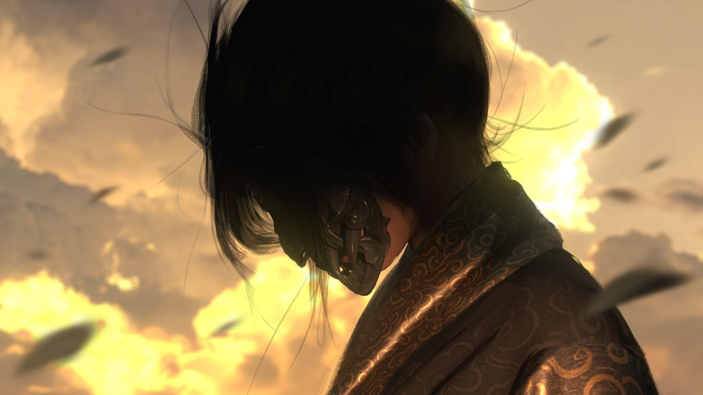

* **Lời thoại / Nội dung phát ra:**
  > **[Trương Lương]** "Quả nhiên là vậy, không thể tiết lộ, phải không? Cho nên, quả đúng như lời tương truyền—— Người trong mây, chẳng phải người cõi này. Có thể thấy được dòng chảy của thiên đạo, thấu suốt hướng đi của mệnh số, nhưng lại chẳng thể tiết lộ thiên cơ."
  > 
  > *(Chàng thở dài một tiếng, chậm rãi cúi đầu, tiếng thở dài bị gió cuốn vào giữa những tầng mây nhuộm sắc vàng rực rỡ. Giọng nói ấy không mang chút trách cứ, chỉ có một nỗi cô liêu đã được dự liệu từ trước.*
  > *Nguyệt Nha Nhi và Hi Dương nhìn nhau không nói nên lời, hóa ra mưu sĩ dưới chiếc mặt nạ kia chưa từng kỳ vọng một câu trả lời, chàng chỉ đang xác nhận lại một nỗi cô độc đã được số phận an bài.)*

---

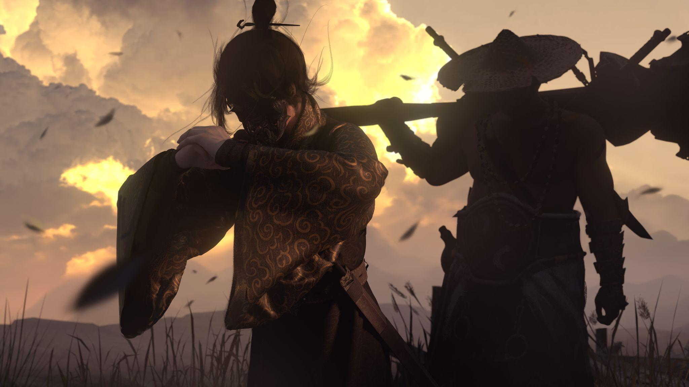

* **Lời thoại / Nội dung phát ra:**
  > **[Trương Lương]** "Nhưng hôm nay được diện kiến hai vị Người Trong Mây, Trương Lương này đời này chẳng còn điều gì hối tiếc. Những gì trời cao hiển lộ, cuối cùng rồi cũng có lúc tỏ tường. Xin cáo biệt tại đây!"

---

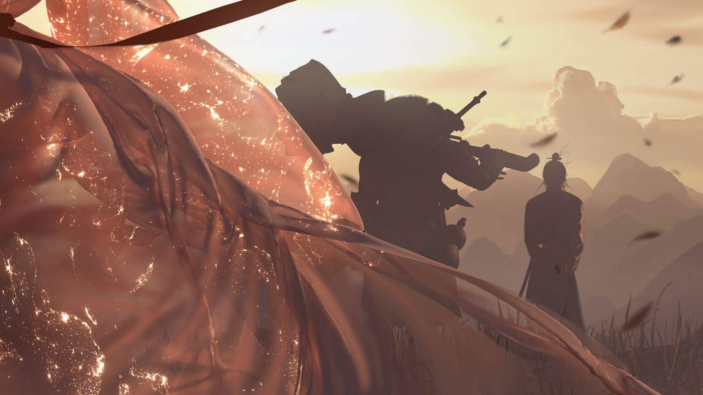

* **Lời thoại / Nội dung phát ra:**
  > *(Gió cuốn qua núi đồi hoang vu, vạt áo bay phấp phới. Chàng quay người rời đi, bước đi vô cùng nhẹ nhàng, tựa như từ lâu đã đạt được sự thấu hiểu ngầm với đất trời, kiên định mà thong dong.*
  > *Nguyệt Nha Nhi ngơ ngác nhìn theo hai bóng lưng kia, tựa như vừa bị ai đánh thức khỏi một giấc mộng.)*
  > 
  > **[Nguyệt Nha Nhi gọi với theo]** "Khoan đã—— tôi có thể hỏi một câu không…… Rốt cuộc hiện tại chúng tôi đang ở đâu?"

---

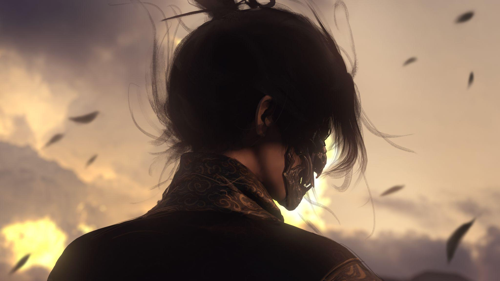

* **Lời thoại / Nội dung phát ra:**
  > **[Trương Lương]** "—— Ngoài nón ánh sáng."

---

* **Chữ trong ảnh / Điển tích sử liệu:**
  * **Trích 《Sử Ký · Thương Quân Liệt Truyện》 — Tư Mã Thiên:**
    > "Thương Quân vốn là con thứ của dòng thứ công thất nước Vệ, tên Ưởng, mang họ Công Tôn, tổ tiên vốn là họ Cơ. Sau khi Công Thúc Thoa chết, Công Tôn Ưởng nghe tin Tần Hiếu Công hạ lệnh cầu hiền trong nước, muốn nối lại nghiệp của Tần Mục Công, thu phục đất đai phía đông, bèn sang phía tây vào đất Tần, nhờ sủng thần của Hiếu Công là Cảnh Giám để xin yết kiến Hiếu Công."
  * **Trích 《Sử Ký · Lưu Hầu Thế Gia》 — Tư Mã Thiên:**
    > "Lưu Hầu Trương Lương, tổ tiên là người nước Hàn. Ông nội là Khai Địa, cha là Bình, đều làm tướng quốc nước Hàn. Trương Lương từng sang phía đông gặp Thương Hải Quân, tìm được một dũng sĩ, đúc cho cây chùy sắt nặng một trăm hai mươi cân. Khi Tần Hoàng đế tuần du phía đông, Trương Lương cùng dũng sĩ mai phục thích sát Tần Hoàng đế tại Bác Lãng Sa, nhưng đánh nhầm vào xe phụ. Tần Hoàng đế nổi giận lôi đình, ra lệnh lùng sục khắp thiên hạ, truy nã thích khách ráo riết vì duyên cớ Trương Lương. Trương Lương bèn đổi họ thay tên, trốn đến Hạ Bì."
  * **Tiểu sử nhân vật lịch sử:**
    * **Thương Ưởng (khoảng 390 TCN — 338 TCN):** Tên Công Tôn Ưởng, người nước Vệ. Hưởng ứng Chiếu Cầu Hiền của Tần Hiếu Công, chủ trì biến pháp giúp nước Tần phú cường, tạo tiền đề thống nhất thiên hạ. Sau khi Hiếu Công mất, bị đối thủ chính trị hãm hại, thua trận bị giết và bị phanh thây bằng xe (xa liệt) tại Hàm Dương.
    * **Trương Lương (? — 186 TCN):** Tự Tử Phòng, người Dĩnh Xuyên (nước Hàn thời Chiến Quốc). Mưu thích sát Tần Hoàng bất thành, sau phò tá Lưu Bang lập nên nhà Hán, được xưng tụng "Vận trù duy ác chi trung, quyết thắng thiên lý chi ngoại", một trong Hán Sơ Tam Kiệt. Đại nghiệp thành công liền lui về ở ẩn, thiện chung trọn vẹn.
