# 云虫 - 第三章 光锥之外 · 二

---

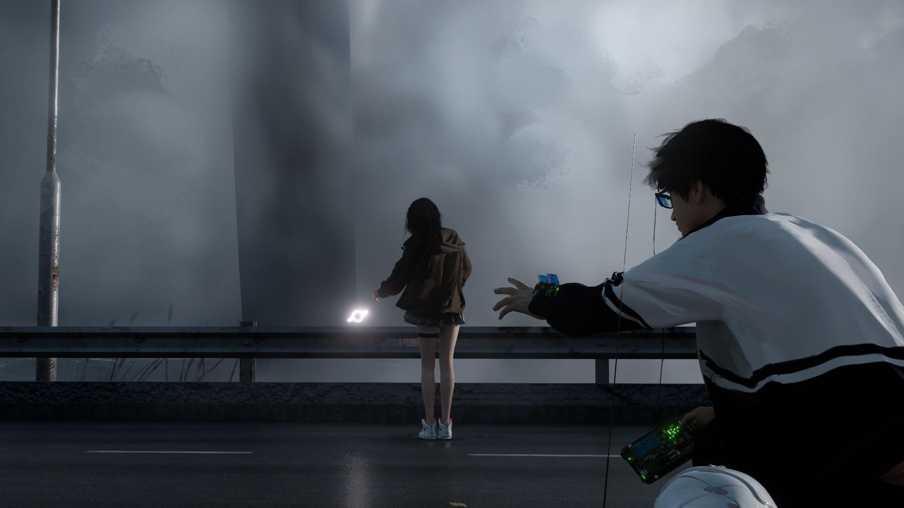

> “等等——月牙儿！别碰！”

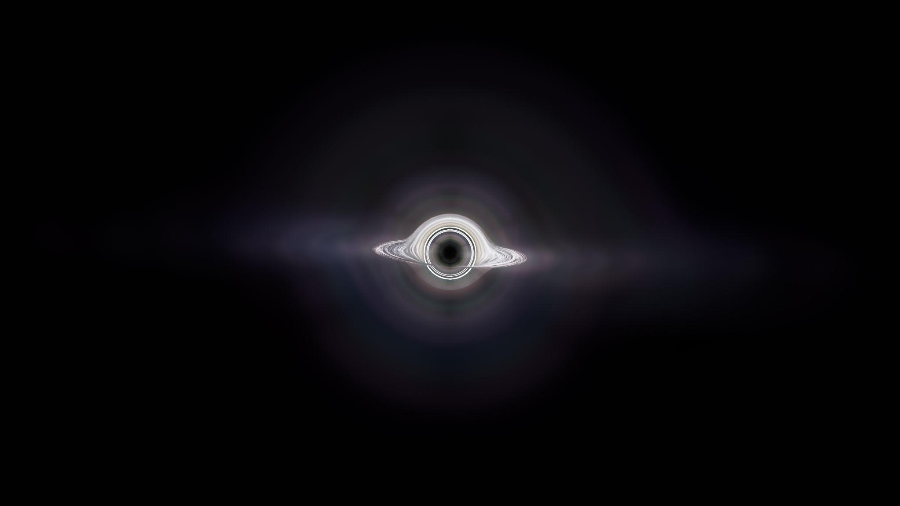

> ——嘶——

> 光从黑洞边缘弯折，像被无形的手牵引。空气骤然塌陷，声音与色彩一同被抽离。

> 时间开始凝聚——每一秒都被无限拉长，又在瞬息之间崩塌。月牙儿感觉自己的意识被撕扯成无数碎片，在无光的深处翻涌、撕裂、再度重组。而世界，似乎正在另一端重新排列。

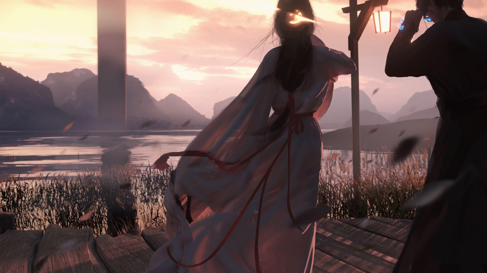

> 风重新有了重量。落叶从逆光中飘下，空气里弥漫着一种陌生的气味——厚重、潮湿，夹着泥土、烟灰与铁的腥意，让人本能地感到不安。

> 脚下的木板轻轻颤动。月牙儿胸口微微发紧，那味道钻进喉咙，带着一丝生锈的涩味，让她想咳，却又咳不出来。她缓缓睁开眼，光线太强，下意识抬手去遮。那层刺目的炫光逐渐散去，只剩暮色与远处的山影。

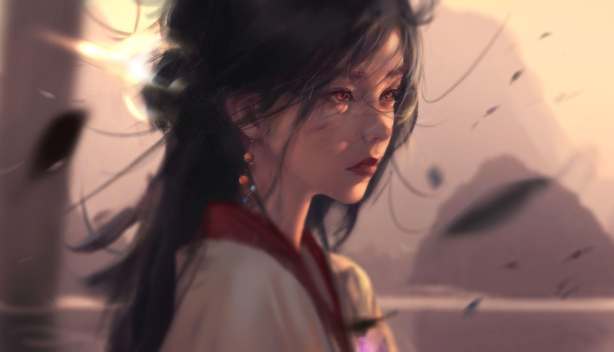

> “……这是哪里？”

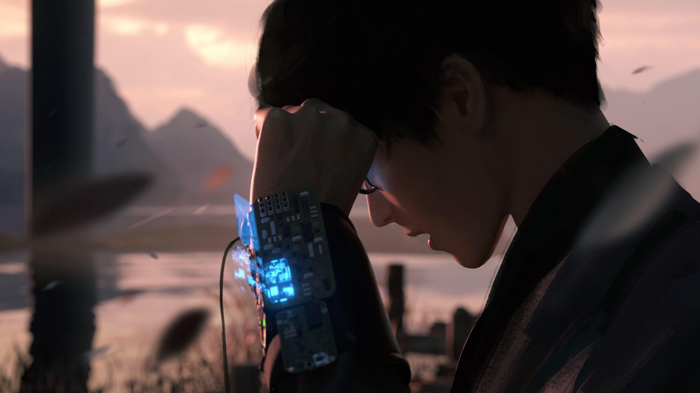

> “不知道……液晶屏启动了？这里的云虫场……强度极低。明明我们还在它的正下方，可干扰几乎消失了？”

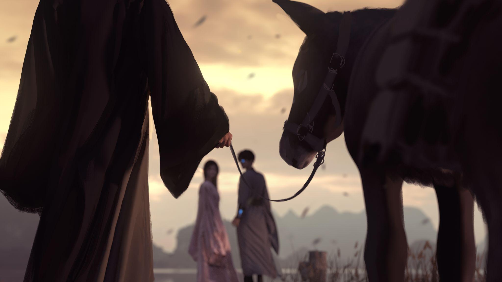

> [???]

> “二位，可也是为秦公的昭贤令而来？若是同途，不如结伴同行？”

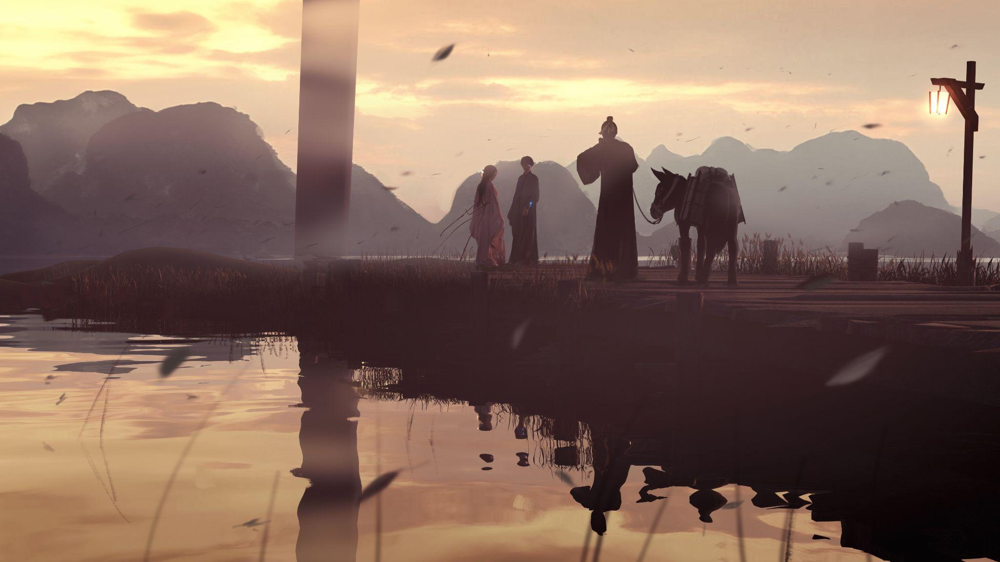

> 月牙儿与希扬几乎同时转过身。

> 那人牵着一头驴，正立在暮色的尽头。夕阳将他的身影拉得很长，长袍的下摆在风中微微摆动。那是一袭深黑的衣袍，线条利落，质地沉稳。他身形笔直，举止从容。眉骨锋挺，目光锐利如刃，却不显侵人，只是那种目光一落，便让人本能地挺直了背脊。神态透着一种笃定的自信——像是早已看清前路的人。他停在路中央，轻轻收缰，朝他们拱手致礼。

> “你是？”

> “你是？”

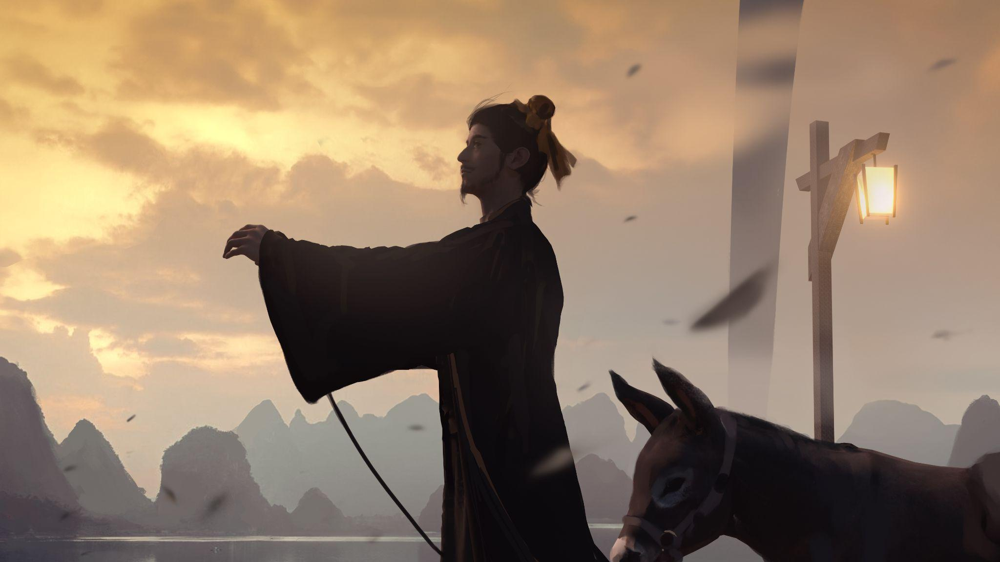

> [???]

> “在下复姓公孙，名鞅，卫人也。此行乃应秦公昭贤之令，欲往栎阳一试。二位衣着颇异于此地，想必亦非本乡之人？”

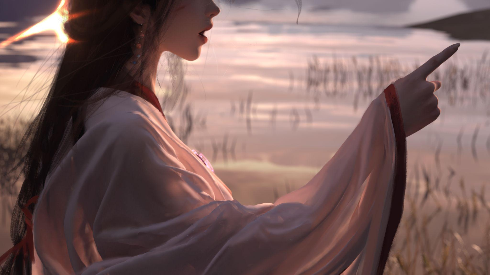

> “公孙……鞅？卫国人？等等，你是——商——”

> 月牙儿刚吐出“商”字，最后一个音节尚未成形。空气忽然凝固了。风停了，水面也不再起波。那声音在空气中被无限拉长，慢到仿佛能看见声波本身，一寸一寸冻结在时间里。然后——一切静止。

> 紧接着，是熟悉的撕扯感。光线扭曲、重力倾斜，世界像被无形的手拧成一股。她的意识再次被撕成无数碎片，又在下一秒被重组。耳边的嘶鸣像时间本身在断裂，山川、疆域、王朝的名字在视野中不断掠过，又被下一层光吞没。他们在无数条时间的褶皱之间坠落，如两颗被抛出的微尘，穿过一场时空洪流。

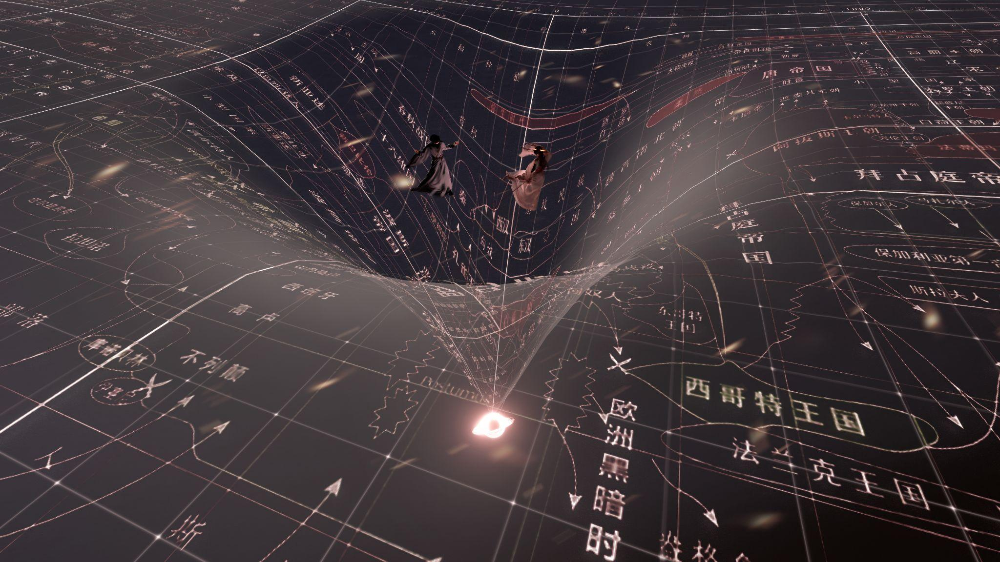

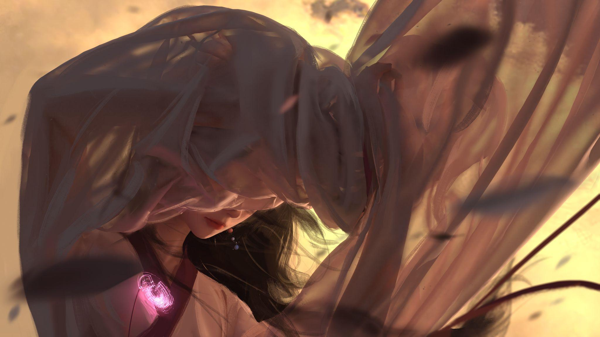

> 光重新涌回世界。一阵刺目的炫光从四面透入，天地翻转，空气中满是细碎的尘光。耳边传来熟悉的声音——焦急、压低，却带着急切：

> “月牙儿，月牙儿！你没事吧？”

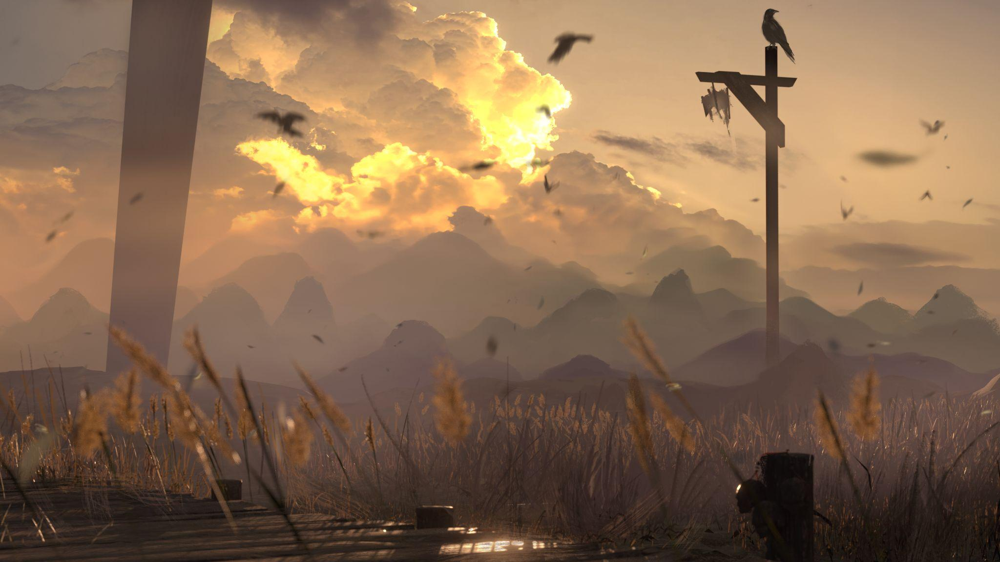

> “……这又是怎么了？希扬……这……又是哪儿？”

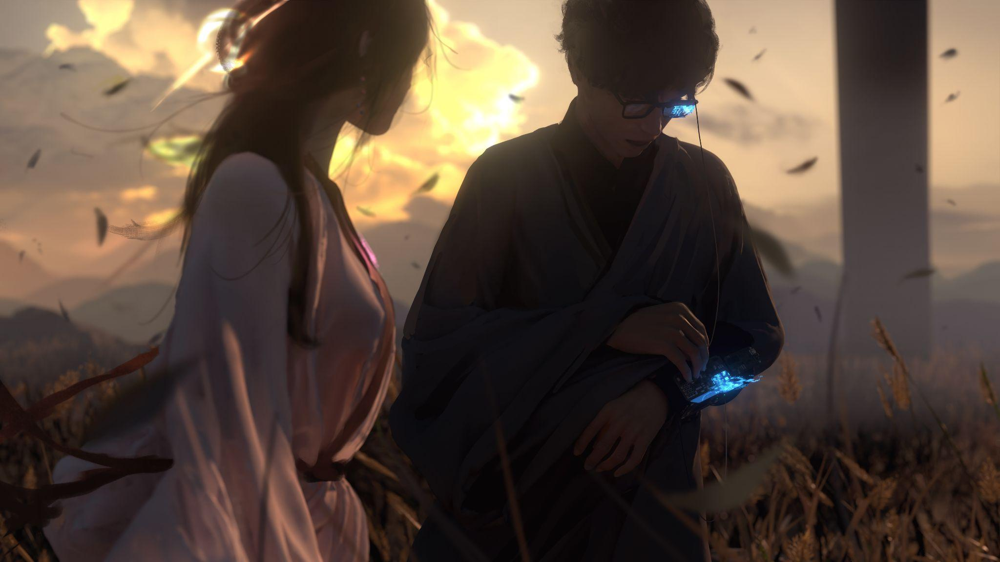

> “我们……应该还在原来的地方。”

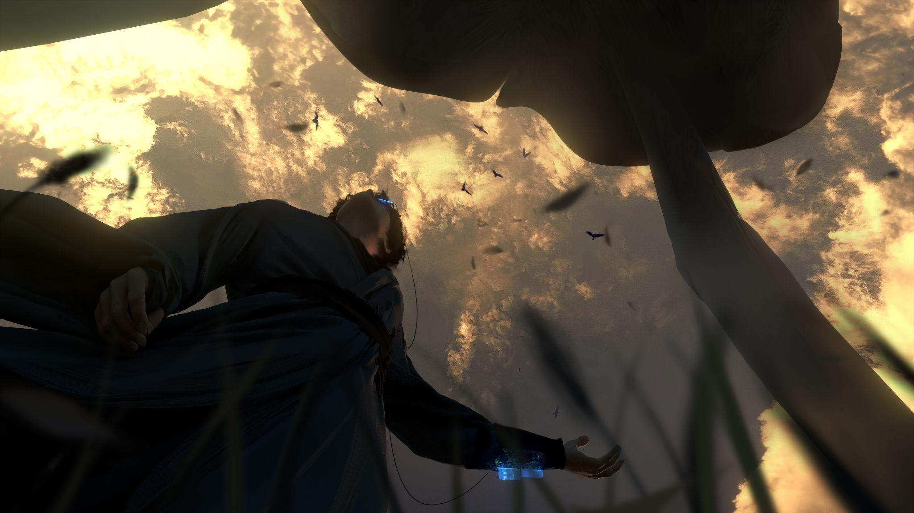

> “但——似乎不在同一个时间点。”

> [???]

> “你们，终于来了。”

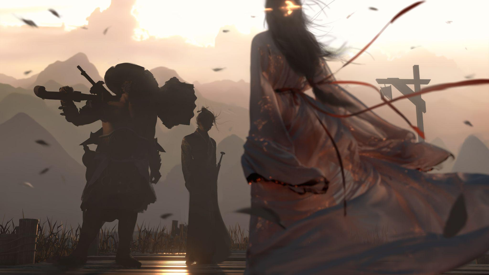

> 一阵清沙般的脚步声，从他们身后传来。两道身影缓缓出现在朦胧光影之间。

> 前者是一名身姿挺拔的青年，玄金镶边的长袍在风中微微拂动，腰间佩剑，剑鞘泛着冷光。他戴着一副遮住全脸的獠牙面具，只露出一双沉静的眼，目光锐利，锋芒外泄。在他身后，是一名肩扛巨锤的壮汉，肩披残甲，裸露的臂膀上隐见旧伤的痕迹，肤色黝黑，眼神如铁。他们脚步稳而轻，仿佛是从雾中一步步走出。青年在两人面前停下，向他们微微点头示意。

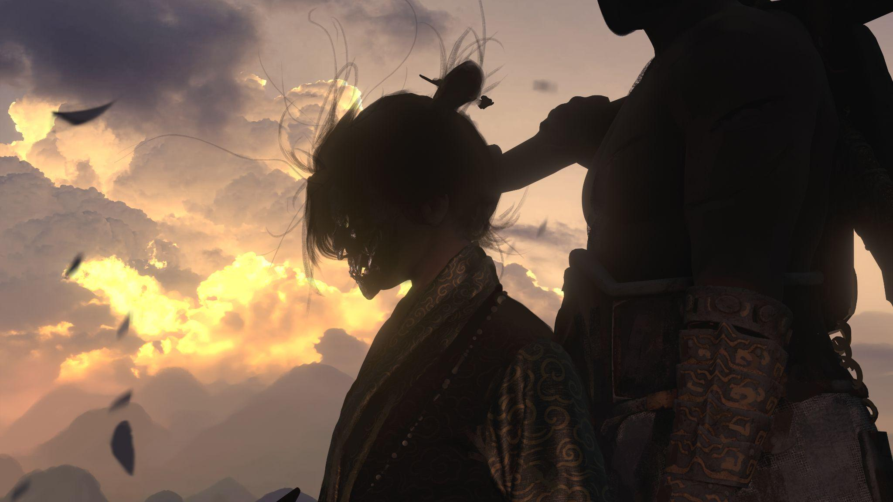

> [???]

> “在下张良，字子房，已在此等候二位云中之人多时。”

> 月牙儿与希扬猛然对视。那一瞬，两人都在对方的眼中读到了惊涛骇浪。在这片如此陌生的时空里，他们竟听到了一个如此熟悉的名字——张良。而让人心口发紧的，是他口中的那三个字——云中人。

> 所有散乱的线索在这一刻纠缠成一个死结，像是被命运拧在了一处。他们第一次意识到——“云中人”这个称呼，不只存在于自己口中。

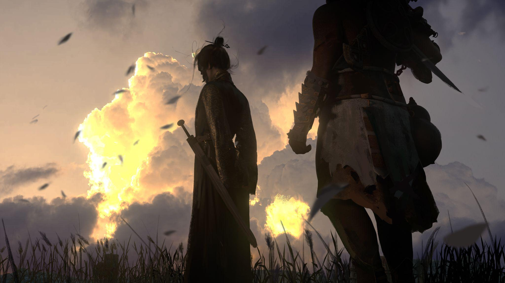

> [张良]

> “秦皇帝暴虐，天下苦秦久矣。二位云中之人，请助我救天下于水火。”

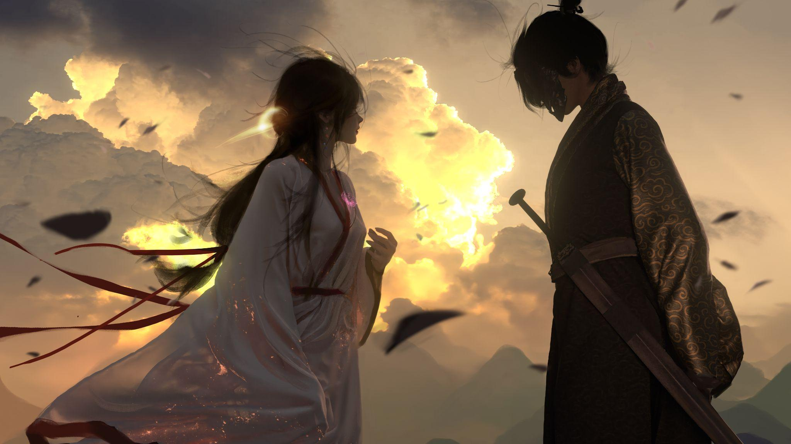

> 那名自称张良的青年缓缓走近，停在离月牙儿仅一步之遥处。他的声音平稳而温和，字字清晰，带着读书人的礼节与儒雅，却自有一股不容抗拒的威势。

> 他站在那里，整个人如同一把利剑，矗于天地之间，那股无形的气场让他身后山岳一般的武士都相形失色。月牙儿只觉得自己快被那面具下的目光洞穿，她的指尖微颤，呼吸凝滞，思绪被那份沉默的气势吞没，脑海一片空白。

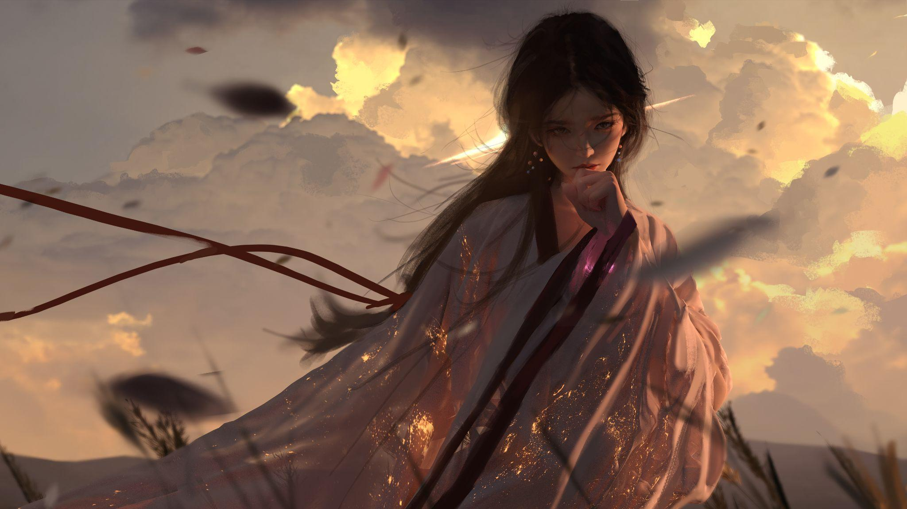

> “……那……我们要怎么帮你？”

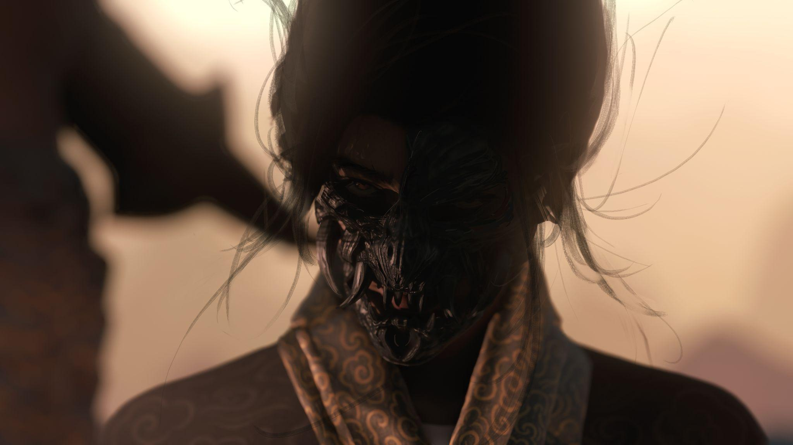

> [张良]

> “很简单。你们只需告诉我——秦皇帝这次东游，过博浪沙时，是坐于前车……还是后车？”

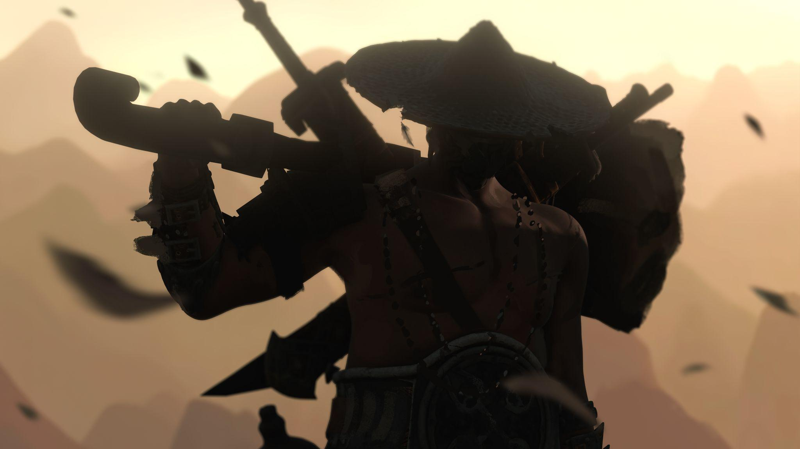

> “博浪沙”三个字落下的瞬间，月牙儿的心猛地一紧。那名字太熟悉了——像是从课本的尘封里、从记忆的深处被抽出。

> 她下意识抬头，看向张良身后的那名壮士。夕光在那人裸露的肩上打出冷色的光，肩上的巨锤厚重得几乎要将空气砸裂。她感觉自己的心快要跳出胸腔了。

> “他……他在——”

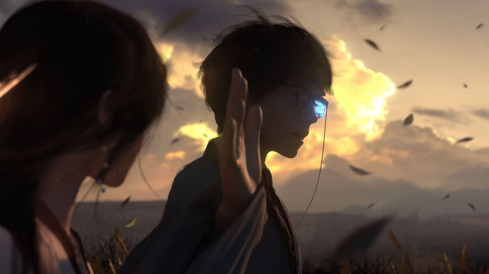

> “等等！月牙儿！”

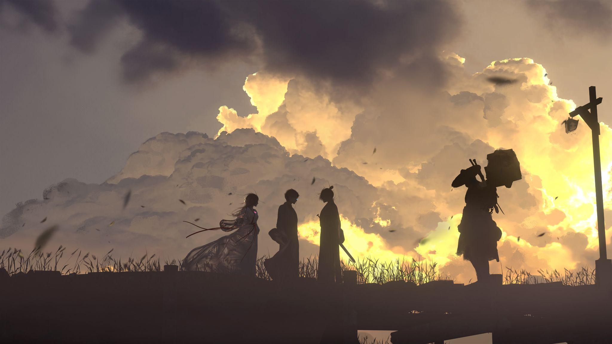

> “你真以为——杀了秦始皇，就能救天下？”

> 在一旁沉默许久的希扬，不知何时已走到他们之间。他微微侧身，将月牙儿护在身后，背脊笔直，如弓上满弦。

> 他与张良相距半步，目光交锋，毫无惧色，吐出的每个字，都带着同样的冷静与锋芒。夕阳仿佛在两柄利剑之间燃烧，光影交错，气息凝成一线。

> 月牙儿望着希扬的背影，胸口忽然一松。惊惧与茫然中，生出一丝意外的温暖。这个一直被她视为书呆子的高中生，竟然在此刻给了她一分莫名的安全感。

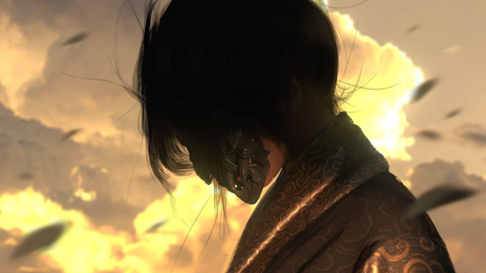

> [张良]

> “果然如此，不能说，是吗？所以，真如传闻所言——云中之人，非此世之人。能见天道之流，知命数之所向，而不言天机。”

> 他叹了口气，缓缓低下头，叹息声被风卷入金色的云端。那声音不带责问，只有一种早已预料的落寞。

> 月牙儿与希扬相顾无言，原来那面具下的谋士，从未期待答案，他只是在确认一场命中注定的孤独。

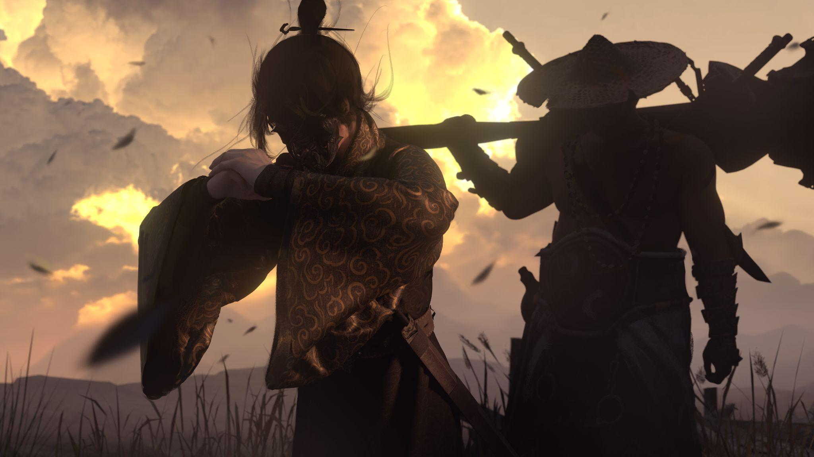

> [张良]

> “但今日得见二位云中人，张良此生已无憾。天之所示，终有启明之时。就此别过！”

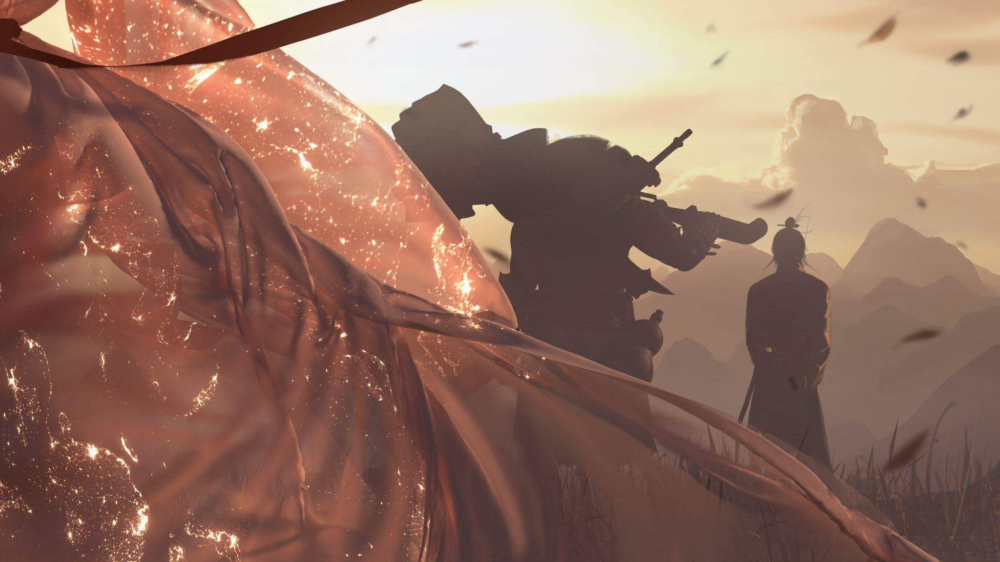

> 风卷过山野，衣袂飞扬。他转身离去，动作极轻，仿佛早已与这天地达成默契，笃定而从容。

> 月牙儿怔怔望着那两道背影，仿佛被什么从梦中惊醒。

> “等等——我能问一下……我们现在，究竟在哪里？”

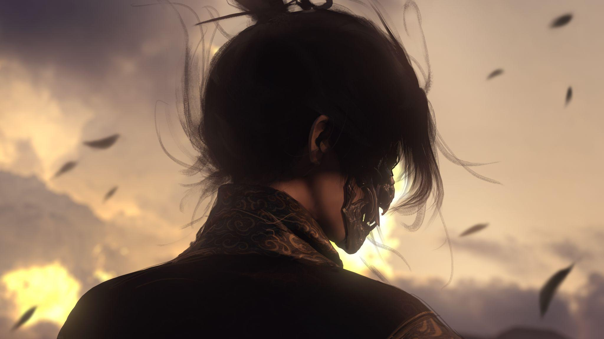

> [张良]

> “——光锥之外。”

> 《史记·商君列传》 — 司马迁

> 商君者，卫之诸庶孽公子也，名鞅，姓公孙氏，其祖本姬姓也。

> 公叔既死，公孙鞅闻秦孝公下令国中求贤者，将修缪公之业，东复侵地，乃遂西入秦，因孝公宠臣景监以求见孝公。

> 《史记·留侯世家》 — 司马迁

> 留侯张良者，其先韩人也。大父开地，相韩昭侯、宣惠王、襄哀王。父平，相厘王、悼惠王。

> 良尝学礼淮阳。东见仓海君。得力士，为铁椎重百二十斤。秦皇帝东游，良与客狙击秦皇帝博浪沙中，误中副车。秦皇帝大怒，大索天下，求贼甚急，为张良故也。良乃更名姓，亡匿下邳。

> 商鞅（约前390年—前338年）

> 名公孙鞅，卫国人。因应秦孝公“求贤令”入秦，主持变法。其改革富国强兵，使秦国迅速崛起，为秦始皇统一六国奠定坚实基础。变法成功后，受封于商地，后世称“商鞅”。其法制思想深刻影响后世政治体系与华夏文明进程，延续至今仍具深远意义。

> 然商鞅亦为争议人物。秦孝公死后，因政敌迫害，兵败被杀，尸体车裂于咸阳。

> 张良（？—前186年）

> 字子房，颍川（战国韩国境内）人。秦末起义时曾谋刺秦始皇未果，后归附刘邦，成为其最重要的谋臣之一。刘邦赞其“运筹帷幄之中，决胜千里之外”，与萧何、韩信并称“汉初三杰”，是大汉帝国的缔造者之一。

> 功成之后，他推辞三万户封赏，仅受万户，最终隐退，得以善终。

