# CloudInsect - Chapter 4: Cone of Fate · Part 1

*Original Title: 第四章 命运之锥 · 一*

---

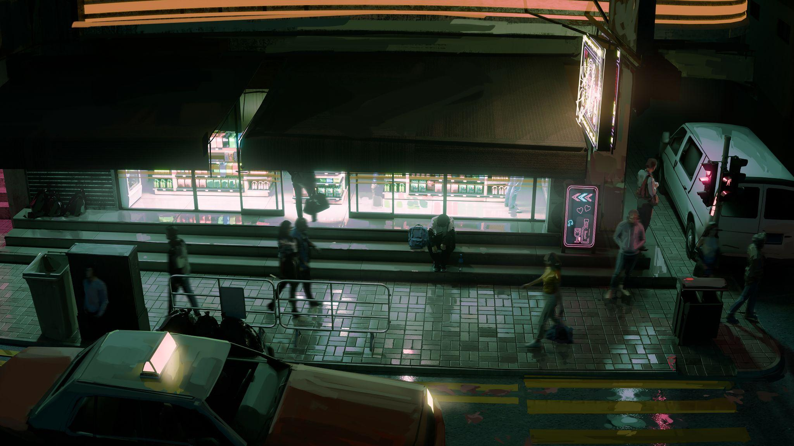

> The convenience store at dusk glowed a stark white. Its glass doors slid open and shut, leaking a little warmth from the hot-food case and the smell of cooked food. The sky over the street had already darkened. Damp wind crept slowly along the steps, and the light spread across the ground like a sheet of cold water.

> Suvan sat alone on the steps outside the entrance, head lowered, elbows resting on his knees, lost in thought. His backpack lay at his feet, beside a half-full bottle of water standing there in silence.

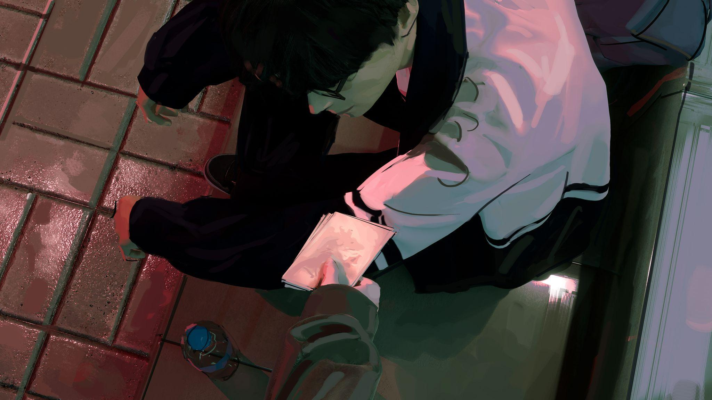

> Then a hand reached in from the side and lightly tapped his shoulder.

> He turned.

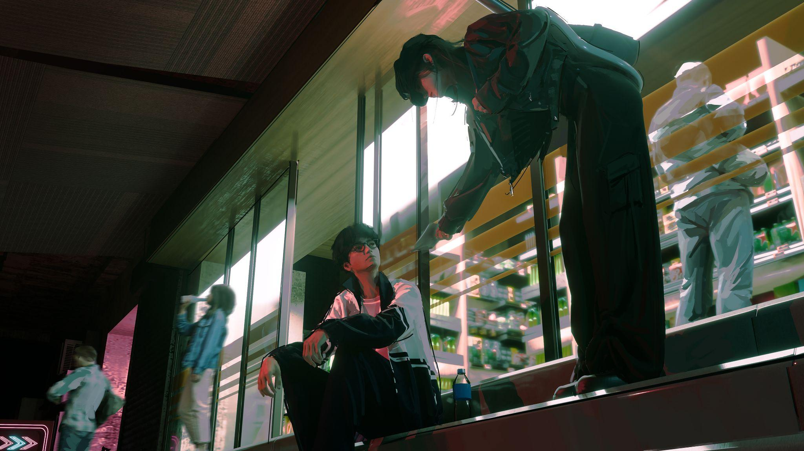

> Mahina was bending down, holding out a stack of freshly developed photographs.

> She was dressed a little differently from usual that day: black trousers, a dark short jacket, the lines of it clean and sharp, as though the night itself had tightened around her. A white bass hung behind one shoulder, slanting against her side, startlingly bright beneath the convenience store’s cold white lights. The brim of her cap was pulled low, hiding most of her face, so that only the light skimming across her nose and lips gave her profile a faint, cold outline.

> Softly, she said,

> “The photos are developed.”

> Suvan took the stack and flipped through the top two.

> “How did they turn out?”

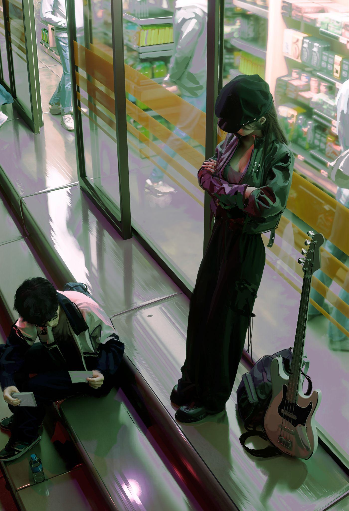

> Mahina leaned back against the glass behind her, folding her arms, her tone flat.

> “Three different shops. Same result every time. Every single one overexposed.”

> He said nothing, only kept looking through them one by one. The paper was washed almost white, as though some fierce light had scorched through it. The scenery and figures that should have remained had nearly all been swallowed, leaving behind only blurred, uncertain traces.

> Mahina watched him and added,

> “Not a total loss, though. A few of them still show something.”

> He looked up.

> She tugged the brim of her cap a little lower, her voice light, as though she were stepping back into that instant in her mind.

> “My head was completely blank back then. By the time I realized I was still holding the camera, Zhang Liang and the others were already turning away. I only managed a few shots as they were leaving.”

> Suvan pulled those few out and studied them carefully. Beneath the pale, ruined wash of light, there really were two dim silhouettes pressed into the frame, one taller than the other, their edges feathered and scattered, as though seen through the residue of an old dream. Barely enough to tell they were human.

> “These are still there,”

> “Yeah.”Mahina’s voice stayed cool.“Zhang Liang. And that assassin. You can still make out a bit of their backs.”

> She paused, lowered her gaze to the tip of her shoe, and gave a faint, almost self-mocking smile.

> “But if you showed these to anyone else, nobody would believe it.”

> Suvan held the photos between his fingers in silence for a moment, then said quietly,

> “At least they prove one thing.”

> She looked up at him.

> He lifted his head too and met her gaze, his voice calm.

> “At least they prove we weren’t crazy. Whatever we saw that day, it wasn’t a hallucination.”

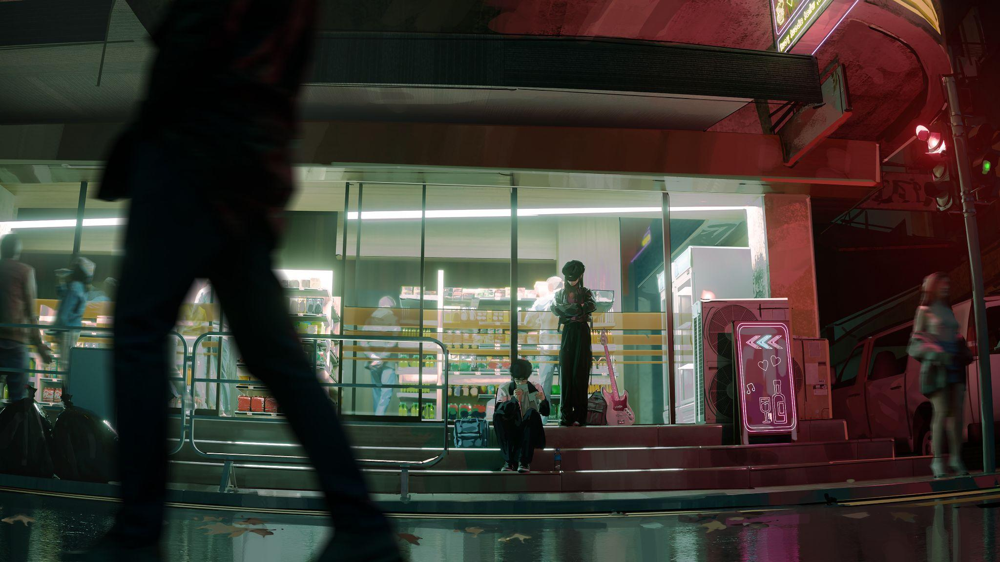

> Mahina fell quiet for a moment. Beneath the brim of her cap, her expression remained unreadable, but the faint coldness at the corner of her mouth seemed, somehow, to loosen. She did not answer that. After a pause, she asked softly,

> “What about your side?”

> Suvan lowered his eyes to the photos in his hands and paused before answering.

> “About the same. Professor Bai assembled a temporary team that very night. They went back to the exact location and parameters I gave them, used the same equipment, the same frequency, and still got nothing. CloudInsect never answered again. As if nothing had happened that day.”

> A gust of wind came through. A scrap of receipt paper rolled halfway across the ground before sticking again by the wall.

> “It almost sounds like the two of us just happened to stumble into something we were never supposed to see.”

> Suvan smiled, but only faintly, as though even he himself could not decide whether it counted as luck.

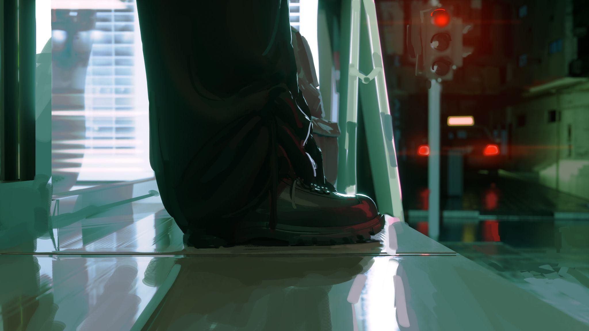

> Mahina lowered her gaze to the ground by her feet, her voice dimming with the light.

> “So your professor and the others probably think we’re making it up now.”

> He shook his head.

> “Professor Bai believes me.”

> He stopped there for a second, his eyes dropping to the damp, gleaming pavement below the steps.

> “He just can’t keep it going. The team was temporary. The equipment, the site, the personnel—all of it has to be approved. If nothing can be reproduced, you can’t keep burning resources forever.”

> Mahina let out a low little “oh.” She didn’t look surprised, as though she had expected that ending from the start.

> “So it’s stopped, then.”

> “Yeah.”

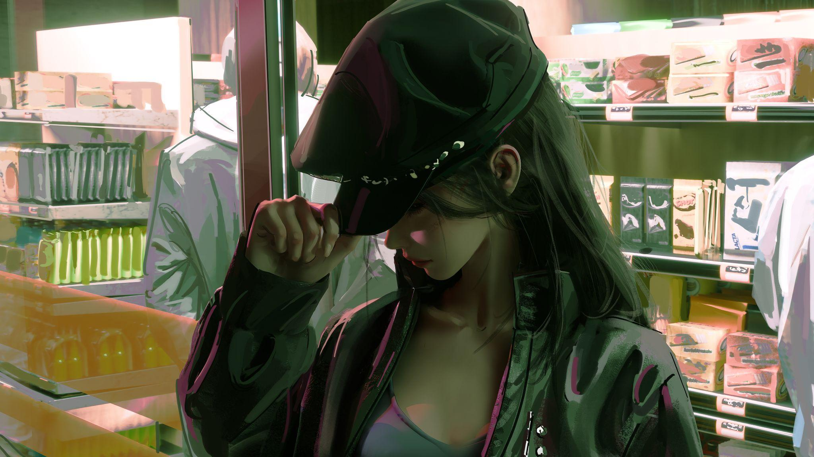

> The automatic doors slid open once more. A middle-aged passerby carrying a plastic bag stepped out, slowed noticeably as they passed, glanced first at Suvan, then let their gaze settle on Mahina. It was the kind of open, shameless scrutiny people reserved for someone they found strange—from the brim of her cap to her jacket and trousers, down to the white bass by her feet, as if she were something that did not belong in the world around them.

> Mahina was clearly used to that kind of gaze. She did not look up. She only tugged the brim of her cap lower, lightly, instinctively, as though trying to sink herself further into shadow. Only after the person had drifted away did she lift her eyes again. There was a trace of irritation there, but it faded almost at once.

> Silence settled between them for a while.

> “What are you doing sitting here?”

> she asked suddenly, turning her head a little.

> Suvan glanced at the digital clock over the convenience store entrance. His tone was still even.

> “Waiting for seven-thirty. After seven-thirty, the boxed meals go half-price.”

> Mahina blinked, then let out a low laugh.

> “So even top students do this.”

> He did not answer that. He only looked at her and asked softly,

> “What about you? Where are you going so late?”

> “I’ve got a show.”

> His eyes dropped to the bass beside her.

> “A bar?”

> Mahina did not deny it. She only curved her lips a little, which was answer enough.

> He hesitated, as though weighing the words carefully, then asked in a low voice,

> “Can I come watch?”

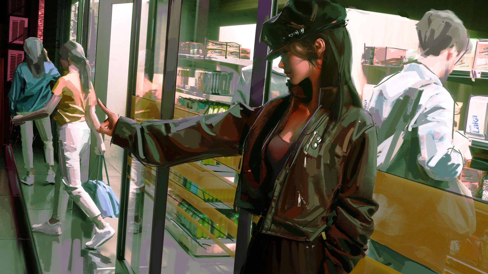

> That made her smile properly. She raised one finger in front of him and slowly wagged it once. The meaning was obvious: no. Someone like him had no business going to a place like that.

> Suvan smiled too and did not press any further.

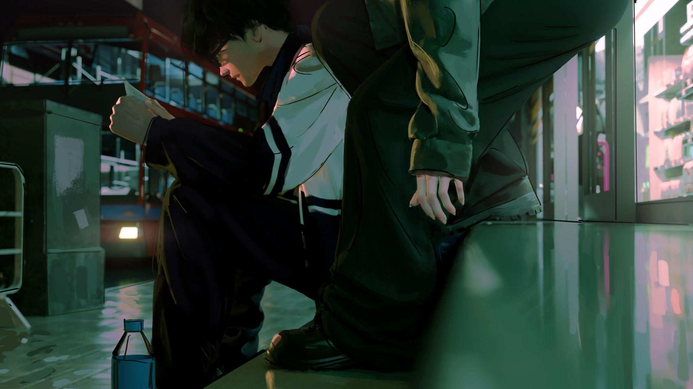

> Mahina lifted a hand, brushed the loose strands of hair by her cheek aside, and then, in the same motion, sat down beside him, one step higher. She moved lightly, almost catlike, the edge of her jacket just barely whispering against the step before the sound was swallowed by the night wind.

> He only felt how close she was now. The breeze coming off the street carried with it a faint trace of her perfume—so light it almost dissolved into the air, and yet impossible to ignore.

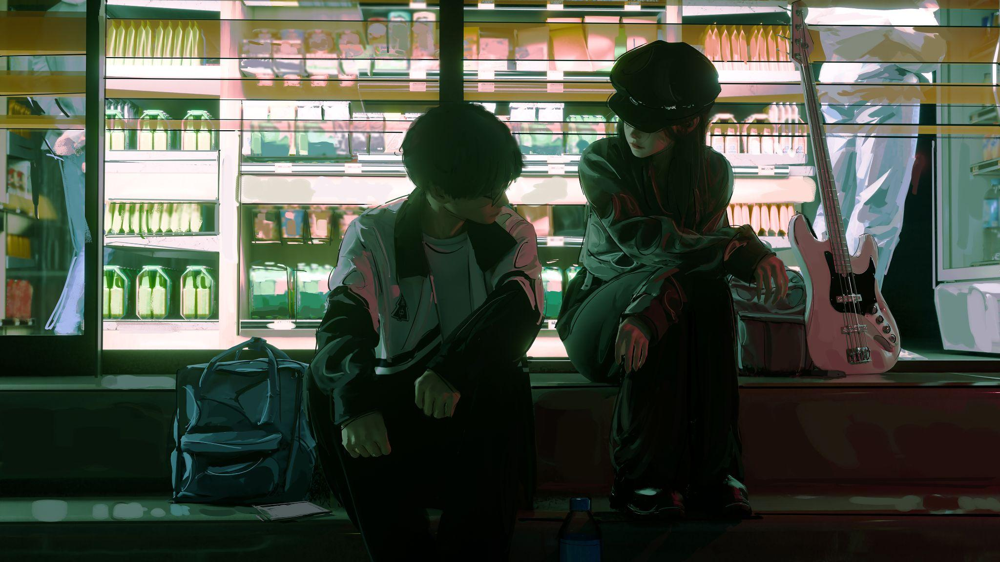

> The convenience store lights shone cold against the glass. People moved in and out, carrying with them the ordinary noise of the city.

> Suvan lowered his head, still holding those pale, ruined photographs. After a long silence, he said quietly,

> “Mahina, let’s go again. Back to the foot of CloudInsect.”

> She turned toward him, startled, and looked at him for two full seconds before answering.

> “We can’t. It’s already moved out over the sea. We can’t reach it.”

> “Then we wait until it makes landfall.”

> Mahina gave a faint shake of her head, the gesture saying more clearly than words that he was making it sound too simple.

> “By the time it reaches land, it’ll already be inside the city. The whole area under it will be sealed off—blockades, checkpoints, observation stations, all of it.”

> Suvan lifted his head and looked toward the streetlights ahead. After a pause, he said,

> “I already asked Professor Bai for temporary work permits. Two of them. Once it lands, if we say we’re CloudInsect observation recorders, we’ll be able to get in.”

> At that, the corner of Mahina’s mouth lifted slightly.

> “Oh?”she drew the word out slightly.“So I’m part of your team now?”

> For a second, he had no answer.

> She watched him, then added, unable to resist,

> “Do I at least get paid?”

> Suvan froze for a beat. A faint flush rose near his ears, though his expression remained almost solemnly serious.

> “If there is pay…”He paused, lowering his voice a little.“You can have my share too.”

> Mahina stifled a laugh and lowered her head, tugging at the brim of her cap. There was something oddly amusing about how serious he was.

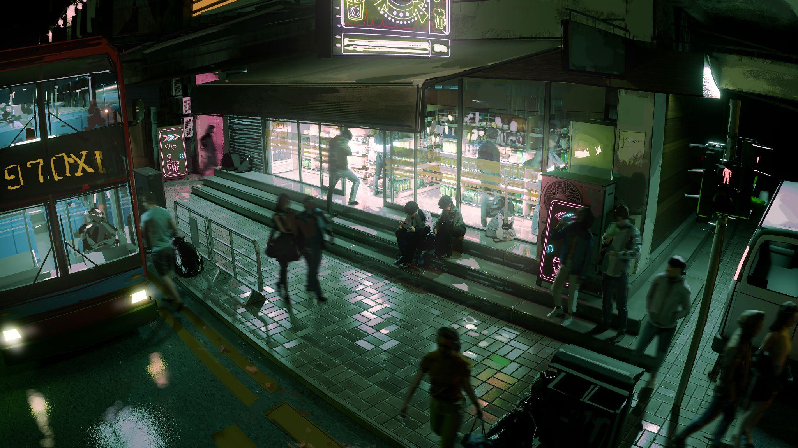

> The wind lifted a corner of the photographs on her knees. She pressed them back down, and the hint of laughter faded from her face. Looking down at them, she was silent for a moment before asking softly,

> “Do you really think only the two of us can speak to CloudInsect? Is that why you’re so determined to go back?”

> Suvan was quiet for a while, then nodded.

> “Professor Bai’s people have been at it for all this time. Equipment, parameters, frequency—they tried everything, and still got nothing. But somehow it was us. That day. In that place. We were the ones who got its reply.”

> Mahina let out a low laugh. The sound was thin, almost self-directed.

> “Do boys your age all like dreaming they’re saviors?”

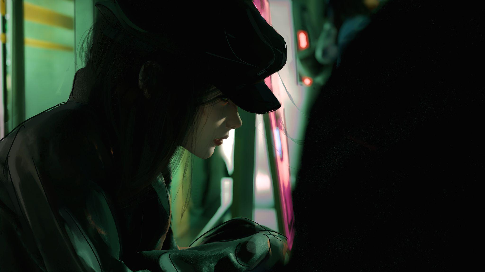

> She drew the photographs back into her arms and hugged her knees, looking across the street at the blurred wash of lights.

> “Look at us. One of us is sitting outside a convenience store waiting for half-price dinners, and the other’s hurrying off to smile and play in some bar. How could saving the world possibly fall to people like us? Shouldn’t that be left to the ones standing up high, the ones actually enjoying this world? It’s their world. Let them be the ones to save it.”

> Suvan said nothing. He only kept looking at her.

> Her voice lowered, softer and softer, as if the wind might carry it off at any second.

> “Besides, this world isn’t all that worth saving.”

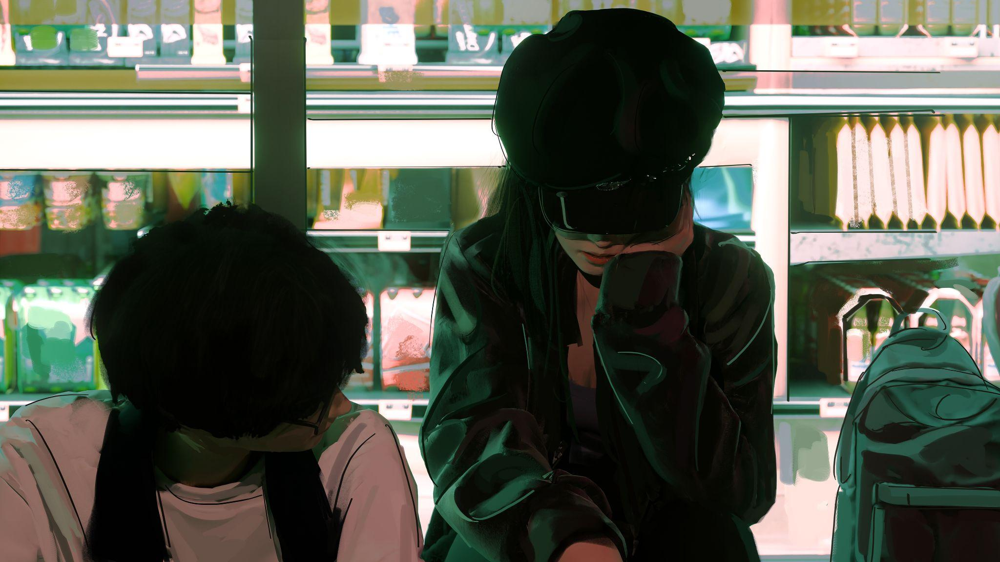

> Night had fully fallen by then. The convenience store’s white light illuminated half her face, while the low brim of her cap hid the rest, keeping her eyes mostly in shadow. Suvan turned toward her, as if trying to see past that darkness, trying to catch her eyes beneath it. He watched her for a moment. When he spoke again, his voice was quieter too, almost tentative.

> “If…”he said,“if a chance like that really did fall into your hands—not something grand, not some impossible feat, just one small choice, one gesture, enough to make the right decision for this world… would you do it?”

> Mahina did not answer at once.

> Her head was lowered. Her face remained unreadable beneath the brim of her cap. Only after a long while did she speak, lightly, almost flatly.

> “This world doesn’t deserve it.”

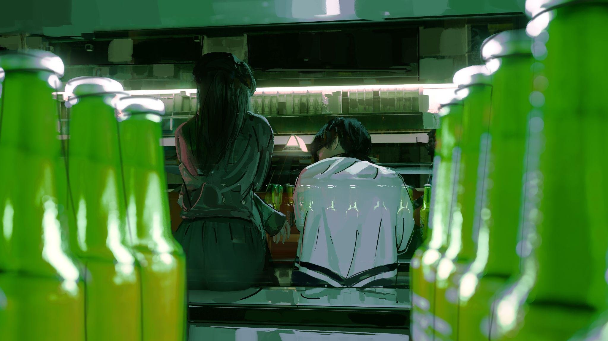

> The words fell, and even she seemed to feel their weight. She went still for a second, then lowered her head with a faint, almost embarrassed smile, as if realizing she had let something too bleak slip out too plainly.

> “Forget it,”she said softly.“You’ve probably heard this one before—life is a gorgeous robe, crawling with fleas.”

> Suvan watched her in silence for a moment, then answered quietly,

> “Then you’ve probably heard this one too.”

> The convenience store’s cold white light drew out the thin lines of his face. There was a strange steadiness in his voice, gentle, but stubborn all the same.

> “We are all living in the gutter,”he said,“but there are still those who look up at the stars.”

> Mahina froze, just slightly.

> It was as though something soft inside her had been touched, very lightly. She had been ready to throw some other famous line back at him, to pin him down with another piece of borrowed brilliance, but the words dissolved before she could speak them.

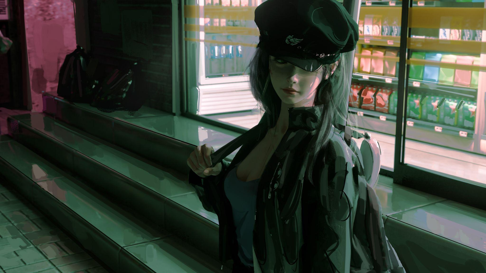

> After a while, she said nothing at all. She simply gathered up the photographs, rose to her feet, slung the bass and her bag back over her shoulder, and turned toward the street.

> After a few steps, she stopped.

> Then she looked back.

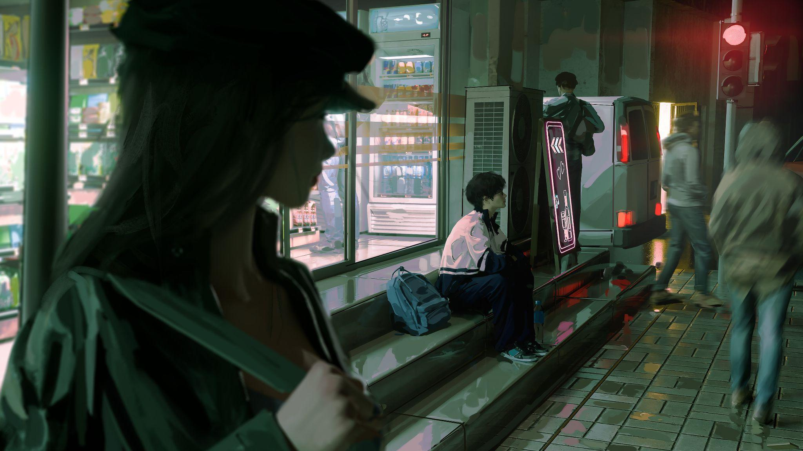

> Suvan was still sitting there on the steps outside the convenience store, in that school uniform faded almost white with repeated washing, his shoulders thin, the reused water bottle beside his feet. Seen from any ordinary angle, he was nothing more than an absurdly frugal, slightly shabby boy, sitting there waiting for the seven-thirty discount meals—hardly dignified, almost faintly ridiculous.

> And yet, in that instant, Mahina felt that he was unlike anyone else she had ever known.

> For some reason he reminded her of that young man in the half-mask, all blade and resolve, determined to strike at Qin Shi Huang. In truth they looked nothing alike. And yet something in them felt the same. Both knew the world was filthy, both knew the road ahead was uncertain, and still neither would let the last bit of light inside them die.

> Mahina stood there for a few seconds, her gaze slightly unfocused.

> In the night, headlights streamed past, voices rose and fell, and the city kept making its noise. But the boy still sat there, very quiet, on the steps.

> He was looking at the stars.

> “Life is a gorgeous robe, crawling with fleas.” — Eileen Chang (1940)

> “We are all living in the gutter, but there are still those who look up at the stars.” — Oscar Wilde (1892)

