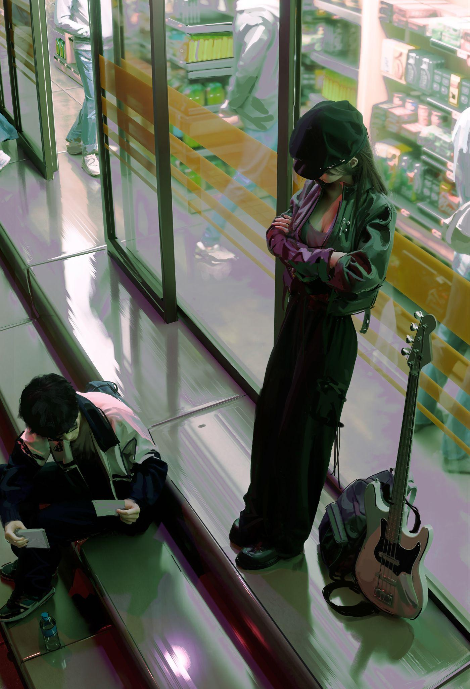
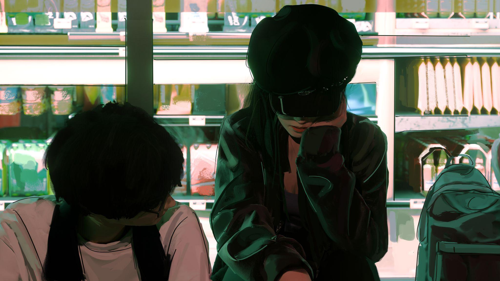

# Vân Trùng - Chương 4: Nón Định Mệnh · I

---

* **Lời thoại / Nội dung phát ra:**
  > *(Cửa hàng tiện lợi lúc chạng vạng sáng rực một màu trắng toát, cửa kính khép mở liên hồi, phả ra chút hơi ấm từ tủ giữ nhiệt và mùi đồ ăn chín. Bầu trời trên đường phố đã tối sẫm, ngọn gió ẩm ướt lùa qua từng bậc thềm, ánh đèn đổ xuống mặt đất như một vũng nước lạnh tanh.*
  > *Hi Dương ngồi một mình trên bậc thềm trước cửa, cúi gằm mặt, hai khuỷu tay tựa lên đầu gối, không rõ đang nghĩ ngợi điều gì. Chiếc cặp sách đặt bên chân, cạnh đó là chai nước khoáng đã vơi một nửa, lặng lẽ đứng yên tại đó.)*

---

* **Lời thoại / Nội dung phát ra:**
  > *(Lúc này, một bàn tay từ bên cạnh vươn tới, khẽ vỗ nhẹ lên vai cậu. Hi Dương quay đầu lại.)*

---

* **Lời thoại / Nội dung phát ra:**
  > *(Nguyệt Nha Nhi đang cúi người xuống, đưa một xấp ảnh vừa mới rửa đến trước mặt cậu. Hôm nay cô ăn mặc có chút khác ngày thường: chiếc quần dài màu đen, áo khoác lửng sẫm màu với những đường cắt gọn gàng, cả người như được bóng đêm siết lại một vòng. Phía sau lưng còn đeo một cây đàn bass màu trắng, nằm chéo bên hông, dưới ánh đèn trắng lạnh của cửa hàng tiện lợi trông vô cùng nổi bật. Vành mũ kéo sụp xuống thật thấp, gần như che khuất nửa khuôn mặt, chỉ để ánh đèn từ một bên hắt tới, lướt qua sống mũi và khóe môi, phác họa nên một đường nét lạnh lùng mờ nhạt.)*
  > 
  > **[Nguyệt Nha Nhi khẽ nói]** "Ảnh rửa xong rồi."
  > 
  > *(Hi Dương đón lấy xấp ảnh, cúi đầu lật xem hai tấm.)*
  > 
  > **[Hi Dương]** "Kết quả thế nào?"

---

* **Chữ trong ảnh:** Những tấm ảnh chụp film bị cháy sáng (overexposed) trắng bệch, lờ mờ in hằn bóng lưng Trương Lương và thích khách mang đại thiết chùy.
* **Lời thoại / Nội dung phát ra:**
  > **[Nguyệt Nha Nhi]** "Chạy qua ba tiệm ảnh rồi, kết quả vẫn y như nhau. Tất cả đều bị cháy sáng."
  > 
  > *(Hi Dương không nói gì, chỉ lần lượt xem qua từng tấm ảnh. Mặt giấy trắng xóa một mảng, tựa hồ vừa bị thứ ánh sáng nào đó thiêu đốt dữ dội, cảnh vật và bóng người lẽ ra phải được lưu lại hầu như đều bị nuốt chửng, chỉ còn sót lại vài đường viền mờ ảo không rõ hình thù.)*
  > 
  > **[Nguyệt Nha Nhi]** "Nhưng cũng không hẳn là hỏng hết. Vẫn còn vài tấm miễn cưỡng nhìn ra được chút gì đó."
  > 
  > *(Hi Dương ngẩng đầu lên. Nguyệt Nha Nhi kéo vành mũ thấp xuống một chút, giọng nói rất nhẹ, như thể đang hồi tưởng lại khoảnh khắc ấy.)*
  > 
  > **[Nguyệt Nha Nhi]** "Lúc đó đầu óc tôi trống rỗng hoàn toàn. Đến khi kịp nhận ra trong tay vẫn đang nắm chiếc máy ảnh thì bọn người Trương Lương đã quay lưng chuẩn bị đi rồi, rốt cuộc chỉ kịp chớp vội vài tấm lúc họ quay lưng đi."
  > 
  > *(Hi Dương rút riêng vài tấm đó ra, cúi đầu chăm chú nhìn một hồi. Trên nền ảnh trắng bệch mờ mịt, quả nhiên vẫn còn lờ mờ in hằn hai bóng lưng, một cao một thấp, viền ngoài tản mác, tựa như nhìn qua một giấc mộng cũ, miễn cưỡng còn nhận ra dáng dấp con người.)*
  > 
  > **[Hi Dương]** "Mấy tấm này vẫn còn."
  > 
  > **[Nguyệt Nha Nhi]** "Ừm. Trương Lương, với cả tên thích khách đó, bóng lưng vẫn còn lại một chút. Nhưng mà cầm thứ này đưa cho người khác xem, chắc cũng chẳng ai tin đâu nhỉ."
  > 
  > *(Hi Dương nắm chặt mấy tấm ảnh trong tay, im lặng giây lát rồi mới khẽ nói:)*
  > 
  > **[Hi Dương]** "Ít nhất nó chứng minh được một điều."
  > 
  > *(Nguyệt Nha Nhi ngước mắt nhìn cậu. Hi Dương cũng ngẩng đầu nhìn cô, giọng điệu vô cùng bình tĩnh.)*
  > 
  > **[Hi Dương]** "Ít nhất chứng minh được rằng, chúng ta không bị điên. Những thứ nhìn thấy ngày hôm đó, cũng không phải là ảo giác."

---

* **Lời thoại / Nội dung phát ra:**
  > *(Nguyệt Nha Nhi im lặng một thoáng, vẻ mặt dưới vành mũ nhìn không rõ, chỉ là nét lạnh lùng nơi khóe môi chẳng biết từ lúc nào đã giãn ra đôi chút. Cô không tiếp lời câu đó, chỉ im lặng một lát rồi khẽ hỏi:)*
  > 
  > **[Nguyệt Nha Nhi]** "Phía cậu thì sao?"
  > 
  > *(Hi Dương cúi đầu nhìn những tấm ảnh trên tay, dừng lại một chút rồi mới nói:)*
  > 
  > **[Hi Dương]** "Cũng tương tự vậy. Ngay trong đêm đó Giáo sư Bạch đã lập tức thành lập một nhóm công tác lâm thời, thử lại một lần nữa theo đúng tọa độ vị trí và thông số tôi cung cấp, dùng cùng một loại thiết bị, cùng một tần số, nhưng rốt cuộc vẫn không thu được bất kỳ thứ gì. Vân Trùng không hề hồi đáp lại nữa, giống như ngày hôm đó chưa từng có chuyện gì xảy ra vậy."
  > 
  > *(Gió thổi qua, một tờ hóa đơn bên thềm bị cuốn bay lên, lăn nửa vòng trên mặt đất rồi lại dán chặt vào góc tường.)*
  > 
  > **[Nguyệt Nha Nhi]** "Nghe qua cứ như thể hai chúng ta vừa tình cờ đụng phải một chuyện vốn dĩ không nên đụng vào vậy."
  > 
  > *(Hi Dương khẽ cười, nhưng ý cười lại rất nhạt, dường như ngay cả chính cậu cũng chẳng rõ đây rốt cuộc có được coi là may mắn hay không.)*

---

* **Lời thoại / Nội dung phát ra:**
  > **[Nguyệt Nha Nhi]** "Vậy thì thầy giáo của cậu bây giờ chắc cũng nghĩ là chúng ta đang nói nhảm rồi."
  > 
  > *(Hi Dương lắc đầu.)*
  > 
  > **[Hi Dương]** "Giáo sư Bạch tin tôi. Chỉ là không có cách nào tiếp tục được nữa. Nhóm công tác chỉ là tạm thời, thiết bị, địa điểm, nhân lực đều phải báo cáo lên cấp trên. Nếu cứ mãi không thể tái lập lại kết quả thì không thể nào tiêu tốn thời gian và kinh phí mãi được."
  > 
  > *(Nguyệt Nha Nhi khẽ 'ồ' một tiếng, nét mặt không hề ngạc nhiên, dường như đã đoán trước được kết cục này.)*
  > 
  > **[Nguyệt Nha Nhi]** "Cho nên rốt cuộc vẫn phải dừng lại."
  > 
  > **[Hi Dương]** "Ừ."

---

* **Chữ trong ảnh:** Đồng hồ điện tử của cửa hàng tiện lợi đang nhảy số hiển thị thời gian sắp tới 19:30.
* **Lời thoại / Nội dung phát ra:**
  > *(Cửa tự động của cửa hàng tiện lợi lại mở ra một lần nữa, một người đàn ông trung niên xách túi nilon bước ra, lúc đi ngang qua trước mặt họ, bước chân rõ ràng chậm lại một nhịp.*
  > *Ông ta liếc nhìn Hi Dương trước, sau đó ánh mắt lập tức dán chặt lên người Nguyệt Nha Nhi, mang theo vẻ soi mói trần trụi và đầy hiếu kỳ, quét từ vành mũ, áo khoác, quần dài, cho đến tận cây đàn bass màu trắng dựng bên chân cô, như thể đang nhìn một thứ kỳ quái không nên xuất hiện ở chốn này.*
  > *Nguyệt Nha Nhi rõ ràng đã quá quen thuộc với những ánh nhìn kiểu này. Cô không hề ngẩng đầu, chỉ kéo vành mũ thấp xuống thêm một chút, động tác rất khẽ nhưng lại mang theo sự kháng cự mang tính bản năng, tựa như muốn giấu mình sâu hơn vào trong bóng tối. Mãi đến khi người đàn ông xách túi nilon lững thững đi xa, cô mới ngước mắt lên lại, vẻ mặt thoáng chút thiếu kiên nhẫn, nhưng rất nhanh sau đó lại chìm sâu vào tĩnh lặng.*
  > *Hai người im lặng một lúc lâu.)*
  > 
  > **[Nguyệt Nha Nhi]** "Cậu ngồi ở đây làm gì thế?"
  > 
  > *(Hi Dương nhìn đồng hồ điện tử đang nhảy số trước cửa hàng tiện lợi, giọng điệu vẫn bình thản như cũ.)*
  > 
  > **[Hi Dương]** "Đợi bảy giờ rưỡi. Sau bảy giờ rưỡi, cơm hộp ở đây sẽ giảm nửa giá."
  > 
  > *(Nguyệt Nha Nhi ngẩn người một thoáng, rồi bất giác bật cười khúc khích.)*
  > 
  > **[Nguyệt Nha Nhi]** "Hóa ra học sinh giỏi giang như cậu cũng làm cái trò này cơ đấy."
  > 
  > *(Hi Dương không đáp lại câu trêu chọc ấy, chỉ nhìn cô rồi khẽ hỏi:)*
  > 
  > **[Hi Dương]** "Còn cậu? Muộn thế này rồi, cậu còn đi đâu nữa?"
  > 
  > **[Nguyệt Nha Nhi]** "Có một buổi biểu diễn."
  > 
  > *(Ánh mắt Hi Dương dừng lại trên cây đàn bass đặt bên cạnh cô một lát, rồi hạ giọng hỏi:)*
  > 
  > **[Hi Dương]** "Quán bar à?"
  > 
  > *(Nguyệt Nha Nhi không phủ nhận, chỉ khẽ nhếch khóe môi xem như ngầm thừa nhận. Hi Dương im lặng giây lát, như thể đang đắn đo suy nghĩ, rồi mới ngập ngừng hỏi một câu:)*
  > 
  > **[Hi Dương]** "Tôi... có thể đến xem được không?"

---

* **Lời thoại / Nội dung phát ra:**
  > *(Nguyệt Nha Nhi bỗng bật cười, giơ tay lên trước mắt cậu từ từ dựng thẳng một ngón tay, khẽ lắc lư qua lại. Ý tứ vô cùng rõ ràng: Không được. Người như cậu, không nên đến những nơi chốn như thế.*
  > *Hi Dương cũng khẽ cười, không gặng hỏi thêm nữa.)*

---

* **Lời thoại / Nội dung phát ra:**
  > *(Nguyệt Nha Nhi giơ tay vén lọn tóc mai bên má, thuận thế ngồi xuống bên cạnh cậu, chỉ là ngồi ở bậc thềm cao hơn cậu một bậc. Động tác ngồi xuống của cô rất nhẹ nhàng, tựa như một chú mèo nhanh nhẹn, gấu áo quét qua mép bậc thềm chỉ phát ra một tiếng sột soạt cực nhỏ, chớp mắt đã bị ngọn gió đêm nuốt trọn.*
  > *Hi Dương chỉ cảm thấy cô ngồi rất gần. Gió đêm từ đầu phố thổi lại, mang theo mùi hương thoang thoảng dịu nhẹ trên người cô, như có như không, nhưng lại khiến người ta bất luận thế nào cũng không tài nào ngó lơ được.)*

---

* **Lời thoại / Nội dung phát ra:**
  > *(Ánh đèn cửa hàng tiện lợi lạnh lùng hắt lên mặt kính, trước cửa người qua kẻ lại tấp nập, xen lẫn muôn vàn tiếng ồn ào huyên náo.*
  > *Hi Dương cúi đầu, tay vẫn mân mê mấy tấm ảnh bạc màu, im lặng rất lâu sau mới bỗng nhiên khẽ nói:)*
  > 
  > **[Hi Dương]** "Nguyệt Nha Nhi, chúng ta lại đi thêm một lần nữa đi. Đến dưới chân Vân Trùng."
  > 
  > *(Nguyệt Nha Nhi khẽ giật mình, quay đầu nhìn cậu hai giây rồi mới nhàn nhạt mở lời:)*
  > 
  > **[Nguyệt Nha Nhi]** "Bây giờ không đi được đâu. Nó đã di chuyển ra ngoài biển rồi, chúng ta không với tới được."
  > 
  > **[Hi Dương]** "Thế thì đợi sau khi nó đổ bộ lên đất liền."
  > 
  > *(Nguyệt Nha Nhi khẽ lắc đầu, như thể chê cậu nghĩ mọi chuyện quá đơn giản.)*
  > 
  > **[Nguyệt Nha Nhi]** "Đợi nó đổ bộ thì đã vào nội thành rồi. Khu vực dưới chân nó từ sớm đã bị phong tỏa hoàn toàn, dây thép gai, vùng cảnh giới, trạm ghi nhận số liệu, cái gì cũng sẽ có đủ cả."
  > 
  > *(Hi Dương ngẩng đầu nhìn ánh đèn đường phía trước, dừng lại một nhịp rồi mới nói:)*
  > 
  > **[Hi Dương]** "Tôi đã xin Giáo sư Bạch cấp thẻ công tác tạm thời rồi, hai cái. Đợi sau khi nó đổ bộ, chỉ cần nói chúng ta là quan sát viên ghi chép dữ liệu Vân Trùng là có thể vào được."
  > 
  > *(Nguyệt Nha Nhi nghe đến đây, khóe môi khẽ cong lên một nụ cười ẩn ý.)*
  > 
  > **[Nguyệt Nha Nhi]** "Ồ? Giờ tôi cũng được tính là người của nhóm nghiên cứu các cậu rồi cơ đấy à?"
  > 
  > *(Hi Dương nhất thời không biết đáp lại thế nào. Nguyệt Nha Nhi nhìn cậu, không nhịn được lại bồi thêm một câu:)*
  > 
  > **[Nguyệt Nha Nhi]** "Thế bên cậu có trả lương cho tôi không?"
  > 
  > *(Hi Dương ngẩn người, vành tai lờ mờ nóng ran lên, nhưng nét mặt vẫn tỏ ra nghiêm túc đứng đắn.)*
  > 
  > **[Hi Dương]** "Nếu như có... thì phần của tôi cũng đưa hết cho cậu."
  > 
  > *(Nguyệt Nha Nhi nén cười, cúi đầu kéo sụp vành mũ xuống, chỉ cảm thấy con người này nghiêm túc đến mức có phần đáng yêu ngộ nghĩnh.)*

---

* **Lời thoại / Nội dung phát ra:**
  > *(Gió thổi qua mép bậc thềm, khẽ lật tung một góc của mấy tấm ảnh đặt trên đầu gối cô. Nguyệt Nha Nhi giơ tay đè giữ lấy, nụ cười trên môi cũng dần nhạt đi. Cô cúi đầu nhìn xấp ảnh, im lặng giây lát rồi bỗng khẽ hỏi:)*
  > 
  > **[Nguyệt Nha Nhi]** "Có phải cậu nghĩ rằng, chỉ có hai chúng ta mới có thể nói chuyện được với Vân Trùng? Cho nên cậu mới nhất quyết đòi đi thêm một lần nữa, có phải không?"
  > 
  > *(Hi Dương im lặng một hồi lâu, rồi mới khẽ gật đầu.)*
  > 
  > **[Hi Dương]** "Nhóm của Giáo sư Bạch bên đó đã xoay xở bấy lâu nay, thiết bị, thông số, tần số, cái gì cũng thử qua hết rồi, kết quả là vẫn không có chút phản ứng nào. Nhưng duy chỉ có hai chúng ta, duy chỉ vào ngày hôm đó, duy chỉ tại đúng địa điểm ấy, lại nhận được tín hiệu hồi đáp của nó."
  > 
  > *(Nguyệt Nha Nhi nghe xong khẽ cười một tiếng, ý cười rất nhạt, nghe giống một sự tự giễu cợt hơn.)*
  > 
  > **[Nguyệt Nha Nhi]** "Đám nhóc con ở độ tuổi của cậu, có phải đứa nào cũng thích ôm mộng làm đấng cứu thế giải cứu thế giới không?"

---

* **Lời thoại / Nội dung phát ra:**
  > *(Cô cất xấp ảnh vào lòng, hai tay ôm lấy đầu gối, ánh mắt dõi nhìn về phía vầng sáng mờ ảo của ánh đèn bên kia đường.)*
  > 
  > **[Nguyệt Nha Nhi]** "Cậu nhìn hai chúng ta xem, một đứa thì ngồi trước cửa tiệm tiện lợi đợi cơm hộp giảm giá nửa giá, một đứa thì vội vã chạy đến quán bar mua vui cho thiên hạ. Chuyện giải cứu thế giới, nghĩ thế nào cũng chẳng đến lượt hai đứa chúng ta. Chẳng phải chuyện đó càng nên để cho những kẻ đang đứng ở trên cao, những kẻ đang tận hưởng thế giới tươi đẹp này làm hay sao? Thế giới là của bọn họ, đương nhiên cũng phải do bọn họ đi cứu rỗi."
  > 
  > *(Hi Dương không đáp lời, chỉ lặng lẽ nhìn cô. Giọng nói của Nguyệt Nha Nhi từ từ chìm xuống, nhẹ bẫng như thể sắp bị ngọn gió đêm cuốn tan biến.)*
  > 
  > **[Nguyệt Nha Nhi]** "Huống hồ, cái thế giới này cũng chẳng đáng giá đến thế."

---

* **Lời thoại / Nội dung phát ra:**
  > *(Màn đêm đã hoàn toàn buông xuống. Ánh sáng trắng lạnh của cửa hàng tiện lợi chiếu lên nửa gương mặt cô, vành mũ kéo sụp rất thấp che khuất phần lớn ánh mắt. Hi Dương quay đầu lại, dường như muốn vượt qua mảng tối ấy để nhìn rõ đôi mắt cô. Cậu ngắm nhìn cô một hồi, giọng nói cũng khẽ khàng theo, thậm chí còn mang theo chút thăm dò:)*
  > 
  > **[Hi Dương]** "Nếu như... tôi nói là nếu như, thực sự có một cơ hội như vậy rơi vào tay cậu, không cần cậu phải làm chuyện gì kinh thiên động địa, chỉ cần trong cái giơ tay nhấc chân, cậu có thể thay thế giới này đưa ra một lựa chọn đúng đắn—— cậu có làm không?"
  > 
  > *(Nguyệt Nha Nhi không lập tức trả lời. Cô cúi đầu, nét mặt dưới vành mũ vẫn không thể nhìn rõ. Rất lâu sau, cô mới nhàn nhạt lên tiếng:)*
  > 
  > **[Nguyệt Nha Nhi]** "Thế giới này không xứng."

---

* **Lời thoại / Nội dung phát ra:**
  > *(Nguyệt Nha Nhi nói xong câu này, chính cô cũng lặng đi một giây. Dường như bỗng cảm thấy lời này nói ra quá nặng nề, cô bèn cúi đầu cười khẽ, ngữ điệu cũng nhạt bớt vài phần.)*
  > 
  > **[Nguyệt Nha Nhi]** "Thôi bỏ đi. Chắc cậu cũng từng nghe qua câu nói này rồi—— 'Đời người là một tấm áo bào hoa lệ, nhưng bên trong bò lúc nhúc đầy rận rệp'."
  > 
  > *(Hi Dương lặng lẽ nhìn cô, một lúc sau mới trầm giọng mở lời:)*
  > 
  > **[Hi Dương]** "Vậy thì cậu chắc cũng từng nghe qua câu này."
  > 
  > *(Ánh đèn trắng lạnh của cửa hàng tiện lợi phác họa nên đường nét thanh mảnh của thiếu niên, trong giọng nói của cậu mang theo một sự kiên định cố chấp lạ thường.)*
  > 
  > **[Hi Dương]** "‘Tất cả chúng ta đều đang sống trong cống rãnh,’ cậu nói, ‘nhưng vẫn luôn có những kẻ ngước nhìn lên những vì sao’."
  > 
  > *(Nguyệt Nha Nhi hơi ngẩn người một thoáng. Tựa như nơi mềm yếu nào đó sâu trong đáy lòng vừa bị ai đó chạm vào thật khẽ khàng. Ban đầu cô còn định lôi thêm câu danh ngôn nào đó ra để đối đáp lại, nhưng lời ra đến đầu môi bỗng chốc tan biến mất.)*

---

* **Lời thoại / Nội dung phát ra:**
  > *(Cô im lặng hồi lâu, rốt cuộc không nói thêm lời nào nữa, chỉ cất kỹ những tấm ảnh, đứng dậy, đeo lại cây đàn bass và chiếc ba lô lên vai, quay người bước về phía đầu đường. Đi được vài bước, cô lại dừng lại, ngoái đầu nhìn cậu một cái.)*

---

* **Lời thoại / Đoạn trần thuật triết lý:**
  > *(Hi Dương vẫn ngồi trên bậc thềm trước cửa hàng tiện lợi, bộ đồng phục học sinh trên người đã giặt đến bạc màu, bờ vai gầy guộc, bên chân là chai nước khoáng đã dùng đi dùng lại nhiều lần. Nhìn thế nào cũng chỉ là một thiếu niên túng thiếu, thậm chí có phần lếch thếch, ngồi đó đợi cơm hộp giảm giá nửa giá sau bảy giờ rưỡi—— thực sự chẳng thể nói là vẻ vang thể diện, thậm chí còn mang theo chút buồn cười khó tả.*
  > *Thế nhưng ngay trong khoảnh khắc ấy, Nguyệt Nha Nhi bỗng cảm thấy, người này khác hẳn với tất cả những ai cô từng gặp trước đây.*
  > *Cảm giác đó lại khiến cô vô cớ nhớ đến chàng thanh niên đeo nửa chiếc mặt nạ, toàn thân toát ra kiếm khí, quyết tâm thích sát Tần Thủy Hoàng nọ. Bọn họ thực ra chẳng hề giống nhau, nhưng lại có một sự tương đồng khó tả nào đó. Rõ ràng biết thế đạo dơ bẩn, tiền đồ mờ mịt, nhưng vẫn kiên quyết không chịu dập tắt đốm lửa sáng le lói trong lòng.*
  > *Nguyệt Nha Nhi đứng chôn chân tại chỗ nhìn vài giây, ánh mắt có phần ngơ ngẩn mơ hồ.*
  > *Trong màn đêm, ánh đèn xe lướt qua, tiếng người ồn ã hỗn độn, thiếu niên ấy vẫn ngồi yên bình lặng trên bậc thềm.*
  > *Cậu đang ngước nhìn lên những vì sao.)*
  > 
  > *"Đời người là một tấm áo bào hoa lệ, nhưng bò đầy rận rệp." — Trương Ái Linh (1940)*
  > 
  > *"Tất cả chúng ta đều đang sống trong cống rãnh, nhưng vẫn luôn có những kẻ ngước nhìn lên những vì sao." — Oscar Wilde (1892)*
