# Vân Trùng - Chương 4: Nón Định Mệnh · I

---

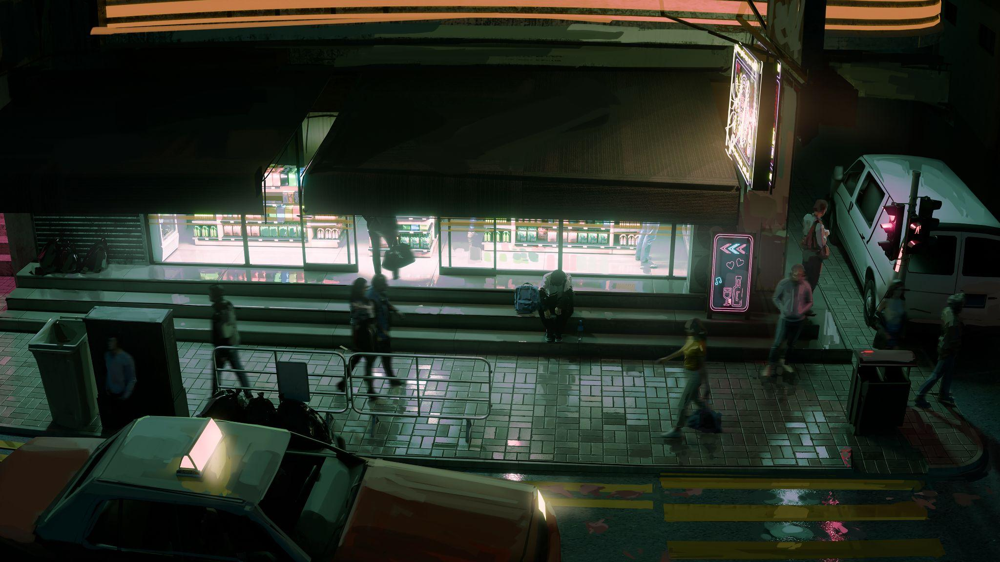

Cửa hàng tiện lợi lúc chạng vạng sáng rực một màu trắng toát, cửa kính khép mở liên hồi, phả ra chút hơi ấm từ tủ giữ nhiệt và mùi đồ ăn chín. Bầu trời trên đường phố đã tối sẫm, ngọn gió ẩm ướt lùa qua từng bậc thềm, ánh đèn đổ xuống mặt đất như một vũng nước lạnh tanh.

Hi Dương ngồi một mình trên bậc thềm trước cửa, cúi gằm mặt, hai khuỷu tay tựa lên đầu gối, không rõ đang nghĩ ngợi điều gì. Chiếc cặp sách đặt bên chân, cạnh đó là chai nước khoáng đã vơi một nửa, lặng lẽ đứng yên tại đó.

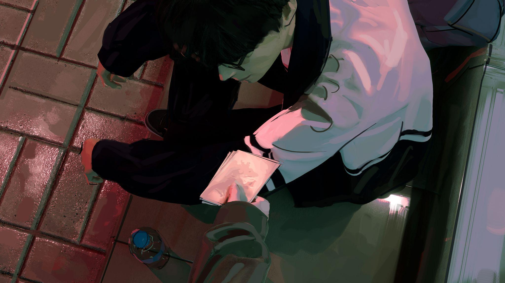

Lúc này, một bàn tay từ bên cạnh vươn tới, khẽ vỗ nhẹ lên vai cậu.

Hi Dương quay đầu lại.

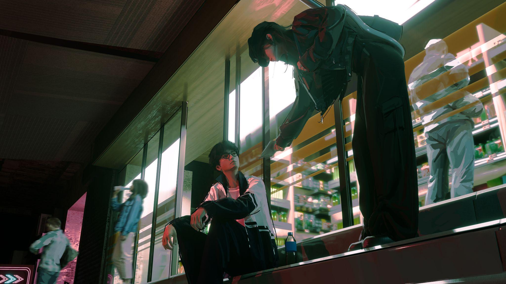

Nguyệt Nha Nhi đang cúi người xuống, đưa một xấp ảnh vừa mới rửa đến trước mặt cậu.

Hôm nay cô ăn mặc có chút khác ngày thường: chiếc quần dài màu đen, áo khoác lửng sẫm màu với những đường cắt gọn gàng, cả người như được bóng đêm siết lại một vòng. Phía sau lưng còn đeo một cây đàn bass màu trắng, nằm chéo bên hông, dưới ánh đèn trắng lạnh của cửa hàng tiện lợi trông vô cùng nổi bật. Vành mũ kéo sụp xuống thật thấp, gần như che khuất nửa khuôn mặt, chỉ để ánh đèn từ một bên hắt tới, lướt qua sống mũi và khóe môi, phác họa nên một đường nét lạnh lùng mờ nhạt.

Cô khẽ nói:

“Ảnh rửa xong rồi.”

Hi Dương đón lấy xấp ảnh, cúi đầu lật xem hai tấm.

“Kết quả thế nào?”

Nguyệt Nha Nhi tựa vào tấm kính phía sau, khoanh tay trước ngực, giọng điệu hờ hững.

“Chạy qua ba tiệm ảnh rồi, kết quả vẫn y như nhau. Tất cả đều bị cháy sáng.”

Hi Dương không nói gì, chỉ lần lượt xem qua từng tấm ảnh. Mặt giấy trắng xóa một mảng, tựa hồ vừa bị thứ ánh sáng nào đó thiêu đốt dữ dội, cảnh vật và bóng người lẽ ra phải được lưu lại hầu như đều bị nuốt chửng, chỉ còn sót lại vài đường viền mờ ảo không rõ hình thù.

Nguyệt Nha Nhi nhìn cậu, lại bồi thêm một câu:

“Nhưng cũng không hẳn là hỏng hết. Vẫn còn vài tấm miễn cưỡng nhìn ra được chút gì đó.”

Hi Dương ngẩng đầu lên.

Nguyệt Nha Nhi kéo vành mũ thấp xuống một chút, giọng nói rất nhẹ, như thể đang hồi tưởng lại khoảnh khắc ấy.

“Lúc đó đầu óc tôi trống rỗng hoàn toàn. Đến khi kịp nhận ra trong tay vẫn đang nắm chiếc máy ảnh thì bọn người Trương Lương đã quay lưng chuẩn bị đi rồi, rốt cuộc chỉ kịp chớp vội vài tấm lúc họ quay lưng đi.”

Hi Dương rút riêng vài tấm đó ra, cúi đầu chăm chú nhìn một hồi. Trên nền ảnh trắng bệch mờ mịt, quả nhiên vẫn còn lờ mờ in hằn hai bóng lưng, một cao một thấp, viền ngoài tản mác, tựa như nhìn qua một giấc mộng cũ, miễn cưỡng còn nhận ra dáng dấp con người.

“Mấy tấm này vẫn còn.”

“Ừm.” Nguyệt Nha Nhi nhàn nhạt nói, “Trương Lương, với cả tên thích khách đó, bóng lưng vẫn còn lại một chút.”

Cô khựng lại một thoáng, nhìn xuống mũi giày, nở một nụ cười tự giễu.

“Nhưng cầm thứ này đi cho người khác xem, chắc cũng chẳng ai tin đâu nhỉ.”

Hi Dương miết nhẹ mấy tấm ảnh, im lặng một lát rồi mới khẽ nói:

“Ít nhất nó cũng chứng minh được một điều.”

Nguyệt Nha Nhi ngước mắt nhìn cậu.

Hi Dương cũng ngẩng đầu lên nhìn cô, giọng điệu vô cùng bình thản.

“Ít nhất có thể chứng minh, chúng ta không bị điên. Những thứ nhìn thấy ngày hôm đó, cũng không phải là ảo giác.”

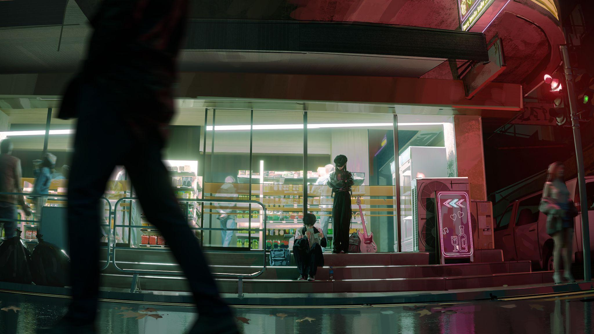

Nguyệt Nha Nhi im lặng trong chốc lát, nét mặt dưới vành mũ không nhìn rõ, chỉ là chút lạnh lùng nhàn nhạt nơi khóe môi chẳng biết tự lúc nào đã giãn ra một chút. Cô không đáp lại câu nói đó, chỉ im lặng một hồi rồi mới khẽ hỏi:

“Phía bên cậu thì sao?”

Hi Dương nhìn xấp ảnh trong tay, dừng một chút rồi nói:

“Cũng gần như vậy. Ngay trong đêm đó giáo sư Bạch đã lập một tổ công tác lâm thời, thử lại một lần nữa theo đúng vị trí và thông số tôi cung cấp, dùng cùng một thiết bị, cùng một tần số, nhưng rốt cuộc vẫn chẳng thu được gì. Vân Trùng không hề phản hồi lại nữa, cứ như thể ngày hôm đó chưa từng có chuyện gì xảy ra.”

Một cơn gió thổi qua, cuốn bay mẩu hóa đơn bên mép bậc thềm, lăn nửa vòng trên mặt đất rồi lại dính vào chân tường.

“Nghe qua thì giống như hai chúng ta vừa tình cờ đụng phải một chuyện vốn không nên đụng phải.”

Hi Dương mỉm cười, nhưng nụ cười ấy rất nhạt, dường như ngay cả chính cậu cũng không rõ đây có được coi là may mắn hay không.

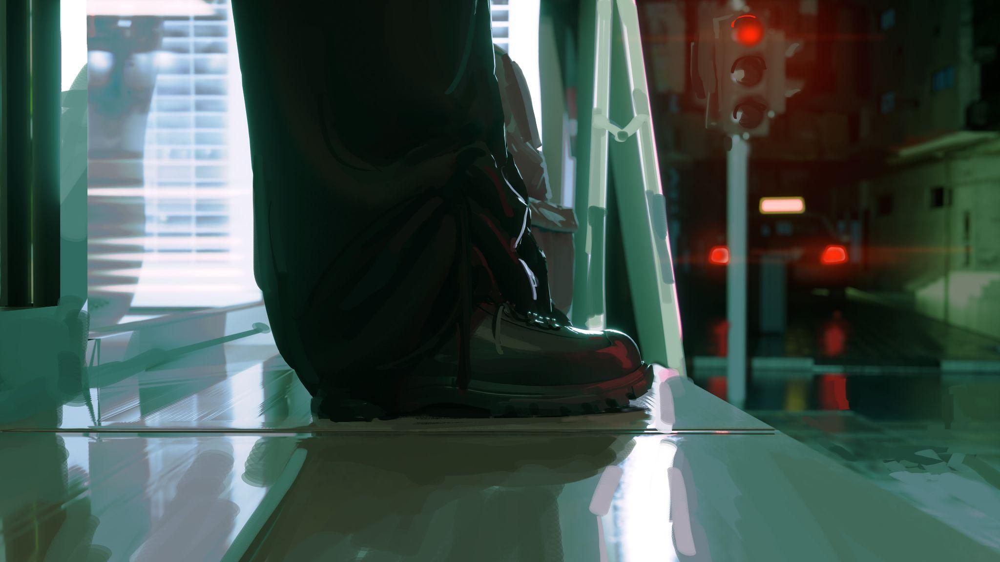

Nguyệt Nha Nhi cúi đầu nhìn xuống chân, giọng nói cũng chùng xuống:

“Vậy thầy giáo của cậu bây giờ chắc cũng nghĩ chúng ta đang nói hươu nói vượn rồi.”

Hi Dương lắc đầu.

“Giáo sư Bạch tin tôi.”

Nói đến đây cậu ngập ngừng một chút, ánh mắt rơi xuống mặt đường ẩm ướt lấp lánh dưới bậc thềm,

“Chỉ là không có cách nào tiếp tục được nữa. Tổ công tác chỉ là tạm thời, thiết bị, địa điểm, nhân lực, tất cả đều phải báo cáo lên cấp trên. Nếu cứ mãi không thể tái hiện lại được kết quả, thì không thể tiêu tốn tài nguyên vô ích mãi như thế được.”

Nguyệt Nha Nhi khẽ “ồ” một tiếng, sắc mặt không hề ngạc nhiên, dường như đã đoán trước được kết cục này.

“Nên dừng lại rồi sao.”

“Ừm.”

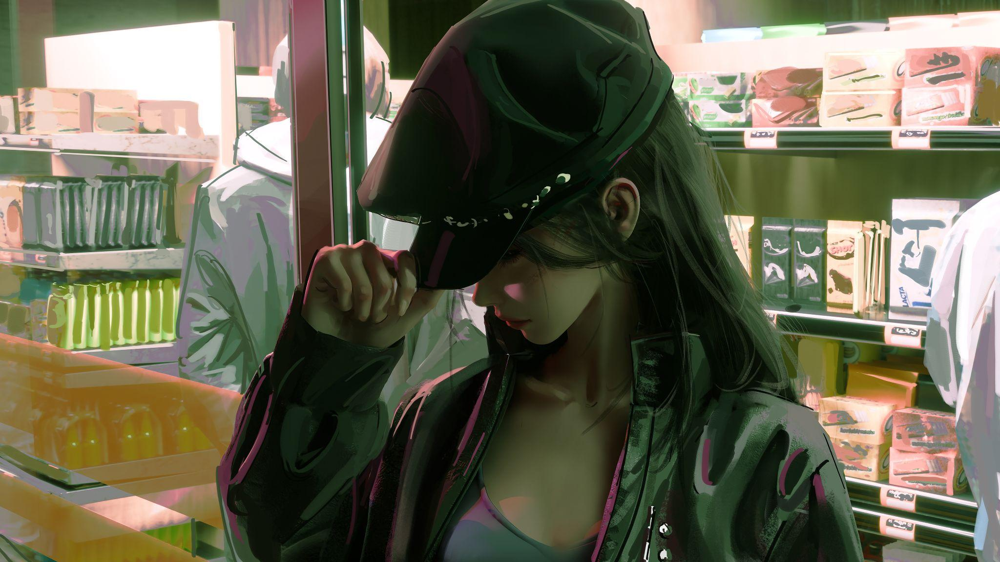

Cửa tự động của cửa hàng tiện lợi lại mở ra một lần nữa, một người trung niên xách túi nilon bước ra, khi đi ngang qua trước mặt họ, bước chân rõ ràng chậm lại.

Người đó liếc nhìn Hi Dương trước, sau đó ánh mắt lập tức dừng lại trên người Nguyệt Nha Nhi, mang theo sự soi mói không hề che giấu đầy vẻ tò mò thích thú, quét từ vành mũ, áo khoác, quần dài, cho tới tận cây đàn bass màu trắng bên chân cô, tựa như đang nhìn một thứ gì đó vốn không nên xuất hiện ở nơi này.

Nguyệt Nha Nhi hiển nhiên đã quá quen thuộc với loại ánh mắt này. Cô không ngẩng đầu lên, chỉ kéo vành mũ thấp xuống thêm một chút, động tác rất nhẹ nhưng mang theo sự kháng cự mang tính bản năng, như muốn giấu mình sâu hơn vào trong bóng tối. Mãi cho đến khi người kia xách túi nilon thong thả đi xa, cô mới ngước mắt lên lại, vẻ mặt thoáng chút bực bội nhàn nhạt, nhưng rất nhanh đã chìm xuống.

Giữa hai người rơi vào im lặng một hồi.

“Cậu ngồi ở đây làm gì thế?”

Nguyệt Nha Nhi nghiêng đầu, đột nhiên hỏi.

Hi Dương liếc nhìn chiếc đồng hồ điện tử đang nhảy số ở cửa ra vào cửa hàng tiện lợi, giọng điệu vẫn bình thản.

“Đợi bảy giờ rưỡi. Sau bảy giờ rưỡi, cơm hộp ở đây sẽ giảm giá một nửa.”

Nguyệt Nha Nhi ngẩn ra một giây, rồi khẽ bật cười khúc khích.

“Hóa ra học sinh giỏi giang, cũng làm mấy chuyện này cơ đấy.”

Hi Dương không đáp lời trêu chọc, chỉ nhìn cô, khẽ hỏi:

“Còn cậu? Muộn thế này rồi, còn định đi đâu nữa?”

Nguyệt Nha Nhi nhàn nhạt đáp: “Có một buổi diễn.”

Ánh mắt Hi Dương rơi xuống cây đàn bass đặt bên cạnh cô, dừng lại một thoáng rồi trầm giọng hỏi:

“Quán bar à?”

Nguyệt Nha Nhi không phủ nhận, chỉ khẽ cong khóe môi, coi như ngầm thừa nhận.

Hi Dương im lặng một lát, như đang đắn đo, rồi mới khẽ hỏi một câu:

“Tôi có thể đến xem được không?”

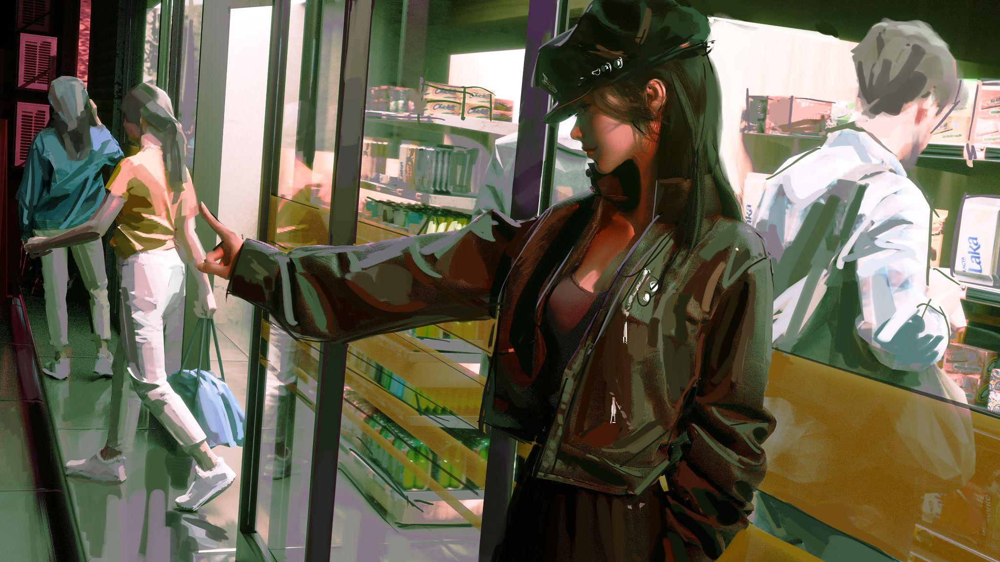

Nguyệt Nha Nhi bật cười, giơ tay lên, chậm rãi dựng một ngón tay trước mắt cậu, khẽ lắc nhẹ. Ý tứ rất rõ ràng: Không được. Một người như cậu, không nên đến những nơi như thế.

Hi Dương cũng mỉm cười, không gặng hỏi thêm nữa.

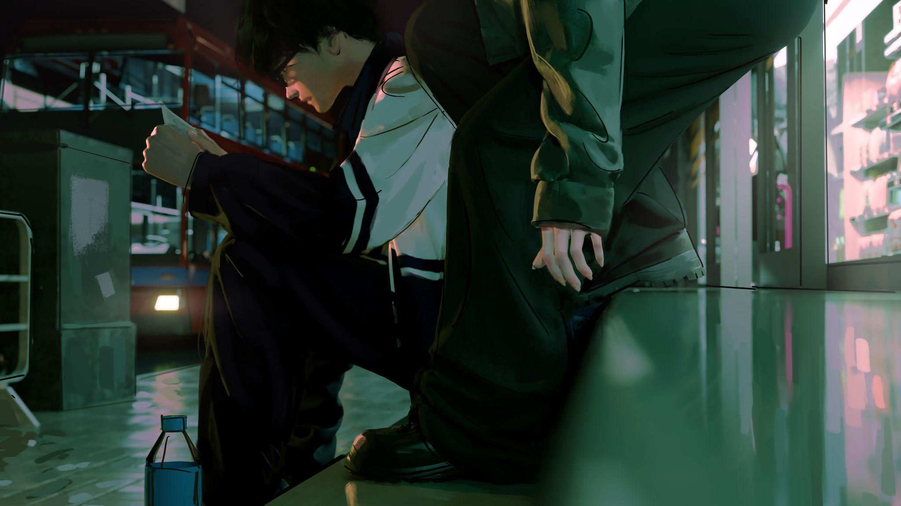

Nguyệt Nha Nhi đưa tay gạt lọn tóc mai lòa xòa bên má, thuận thế ngồi xuống bên cạnh cậu, chỉ là cao hơn cậu một bậc thềm. Động tác ngồi xuống của cô rất nhẹ, như một chú mèo nhanh nhẹn, gấu áo quẹt qua mép bậc thềm chỉ phát ra tiếng động cực nhỏ, trong chớp mắt đã bị ngọn gió đêm nuốt trọn.

Hi Dương chỉ cảm thấy cô ngồi rất gần. Gió đêm từ đầu phố thổi tới, mang theo mùi hương thoang thoảng trên người cô, như có như không, nhưng lại khiến người ta dù thế nào cũng không thể phớt lờ.

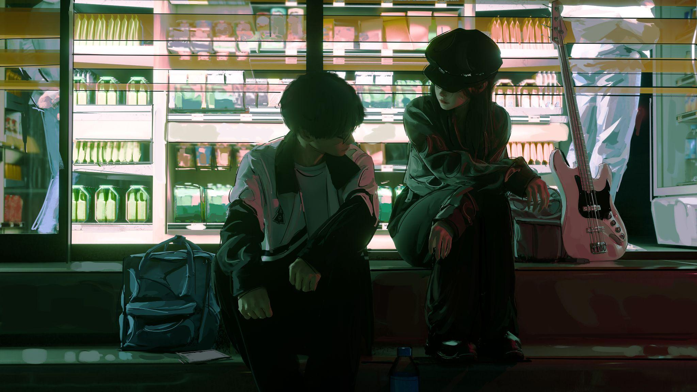

Ánh đèn cửa hàng tiện lợi hắt lên mặt kính sáng lạnh lẽo, trước cửa người qua kẻ lại tấp nập, xen lẫn đủ thứ thanh âm ồn ào của phố thị.

Hi Dương cúi đầu, tay vẫn mân mê mấy tấm ảnh bạc màu, trầm mặc hồi lâu, mới đột nhiên trầm giọng thốt lên một câu:

“Nguyệt Nha Nhi, chúng ta lại đến đó một lần nữa đi. Đến dưới chân Vân Trùng.”

Nguyệt Nha Nhi hơi ngẩn ra, quay đầu nhìn cậu chừng hai giây, rồi mới nhàn nhạt lên tiếng:

“Bây giờ không đi được đâu. Nó đã di chuyển ra biển rồi, chúng ta không với tới được.”

“Vậy thì đợi sau khi nó đổ bộ lên đất liền.”

Nguyệt Nha Nhi khẽ lắc đầu, như muốn nói cậu đã nghĩ mọi chuyện quá đơn giản rồi.

“Đợi nó đổ bộ thì đã vào đến nội thành rồi. Khu vực dưới chân nó từ sớm đã bị phong tỏa, dây phong tỏa, khu vực cảnh giới, trạm quan trắc ghi chép, cái gì cũng có.”

Hi Dương ngẩng đầu lên, nhìn ngọn đèn đường phía trước, ngập ngừng một lát rồi nói:

“Tôi đã xin giáo sư Bạch cấp thẻ công tác tạm thời rồi, hai cái. Đợi sau khi nó đổ bộ, chỉ cần nói chúng ta là nhân viên ghi chép quan sát Vân Trùng là có thể vào được.”

Nguyệt Nha Nhi nghe đến đây, khóe môi khẽ cong lên.

“Ồ?” Cô kéo dài âm đuôi một chút, “Bây giờ tôi cũng được tính là người của tổ công tác các cậu rồi à?”

Hi Dương nhất thời không biết đáp lại thế nào.

Nguyệt Nha Nhi nhìn cậu, không nhịn được lại bồi thêm một câu:

“Thế các cậu có trả lương cho tôi không đấy?”

Hi Dương ngớ người ra một nhịp, vành tai lờ mờ nóng lên, nhưng vẻ mặt vẫn nghiêm túc đứng đắn.

“Nếu như có……” Cậu ngập ngừng, giọng nhỏ lại một chút, “Phần của tôi cũng đưa hết cho cậu.”

Nguyệt Nha Nhi nhịn cười, cúi đầu kéo vành mũ, chỉ cảm thấy cái vẻ nghiêm túc của người này có chút buồn cười thú vị.

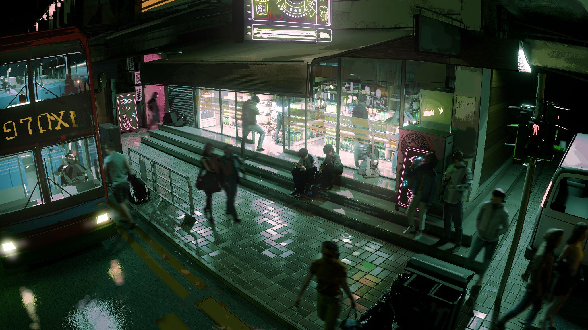

Gió thổi qua mép bậc thềm, khẽ lật một góc của những tấm ảnh đặt trên đầu gối cô. Nguyệt Nha Nhi đưa tay đè xuống, nét cười cũng dần dần phai nhạt. Cô cúi đầu nhìn những bức ảnh, im lặng một lát, bỗng khẽ hỏi:

“Cậu có phải nghĩ rằng, chỉ có hai chúng ta mới có thể nói chuyện được với Vân Trùng? Cho nên cậu mới nhất quyết muốn đi thêm một lần nữa, có phải không?”

Hi Dương im lặng một hồi lâu, rồi mới khẽ gật đầu.

“Phía giáo sư Bạch họ đã xoay xở bấy lâu nay, thiết bị, thông số, tần số, thứ gì cũng thử cả rồi, kết quả vẫn không có lấy một chút phản ứng. Nhưng duy chỉ có chúng ta, duy chỉ vào ngày hôm đó, duy chỉ tại nơi chốn đó, lại nhận được hồi âm của nó.”

Nguyệt Nha Nhi nghe xong, bật cười khẽ một tiếng, nụ cười ấy rất nhạt, ngược lại giống như một sự tự giễu.

“Đám nhóc con ở độ tuổi của cậu, có phải đều thích mơ mộng làm đấng cứu thế không?”

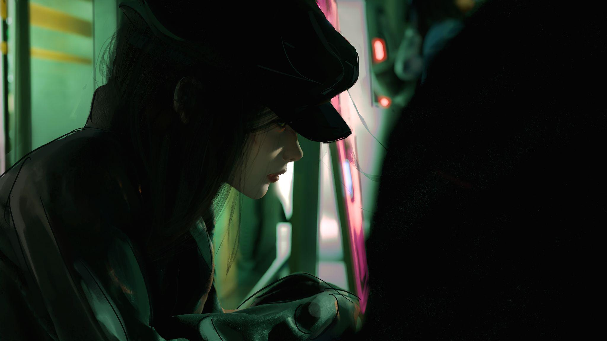

Cô thu những tấm ảnh lại ôm vào lòng, hai tay ôm lấy đầu gối, ánh mắt dõi về phía ánh đèn mờ ảo bên kia đường.

“Cậu nhìn hai chúng ta xem, một người thì ngồi trước cửa hàng tiện lợi đợi cơm hộp giảm giá nửa giá, một người thì tất tả chạy đến quán bar bán nụ cười. Chuyện giải cứu thế giới thế này, nghĩ thế nào cũng không thể đến lượt chúng ta. Chẳng phải nên để dành cho những kẻ đứng trên cao kia, những kẻ đang tận hưởng thế giới này sao? Thế giới là của bọn họ, đương nhiên cũng nên do bọn họ đi cứu.”

Hi Dương không đáp lời, chỉ lặng lẽ nhìn cô.

Giọng của Nguyệt Nha Nhi dần dần trầm xuống, nhẹ đến mức tưởng như sắp bị gió cuốn tan.

“Huống chi, thế giới này cũng chẳng xứng đáng đến thế.”

Màn đêm đã hoàn toàn buông xuống. Ánh sáng trắng của cửa hàng tiện lợi rọi lên nửa khuôn mặt cô, vành mũ lại kéo xuống thật thấp, che khuất phần lớn ánh mắt trong đáy mắt. Hi Dương quay đầu lại, dường như muốn vượt qua mảng bóng tối đó để nhìn rõ đôi mắt cô. Cậu nhìn cô một hồi, giọng nói cũng nhỏ lại theo, thậm chí còn mang theo một chút ngập ngừng thăm dò:

“Nếu như…… Ý tôi là nếu như, thực sự có một cơ hội như vậy rơi vào tay cậu, không cần cậu phải làm chuyện gì kinh thiên động địa, chỉ cần nhấc tay một cái là có thể thay thế giới này đưa ra một lựa chọn đúng đắn——cậu có làm không?”

Nguyệt Nha Nhi không trả lời ngay.

Cô cúi đầu, nét mặt dưới vành mũ vẫn không thể nhìn rõ. Rất lâu sau, cô mới nhàn nhạt lên tiếng:

“Thế giới này không xứng.”

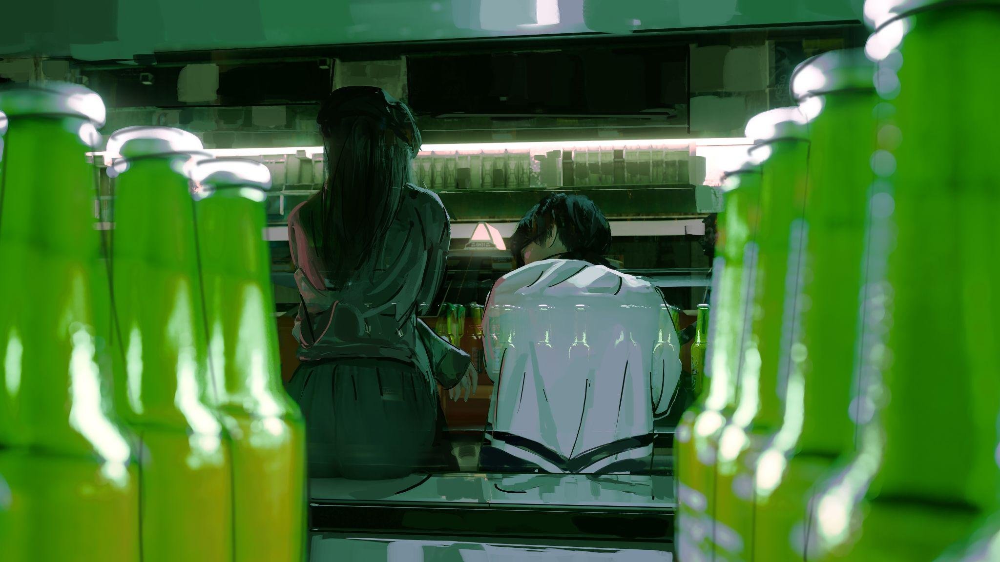

Nguyệt Nha Nhi nói xong câu này, chính cô cũng lặng đi một giây. Dường như bỗng cảm thấy lời này nói ra quá nặng nề, cô bèn cúi đầu cười khẽ, ngữ điệu cũng nhạt bớt vài phần.

“Thôi bỏ đi.” Cô khẽ nói, “Chắc cậu cũng từng nghe qua câu nói này rồi——Đời người là một tấm áo bào hoa lệ, nhưng bò đầy rận rệp.”

Hi Dương lặng lẽ nhìn cô, một lúc sau mới trầm giọng mở lời:

“Vậy thì cậu chắc cũng từng nghe qua câu này.”

Ánh đèn trắng lạnh của cửa hàng tiện lợi phác họa nên đường nét thanh mảnh của thiếu niên, trong giọng nói của cậu mang theo một sự kiên định cố chấp lạ thường.

“Tất cả chúng ta đều đang sống trong cống rãnh,” Cậu nói, “nhưng vẫn luôn có những kẻ ngước nhìn lên những vì sao.”

Nguyệt Nha Nhi hơi ngẩn người một thoáng.

Tựa như nơi mềm yếu nào đó sâu trong đáy lòng vừa bị ai đó chạm vào thật khẽ khàng. Ban đầu cô còn định lôi thêm câu danh ngôn nào đó ra để đối đáp lại, nhưng lời ra đến đầu môi bỗng chốc tan biến mất.

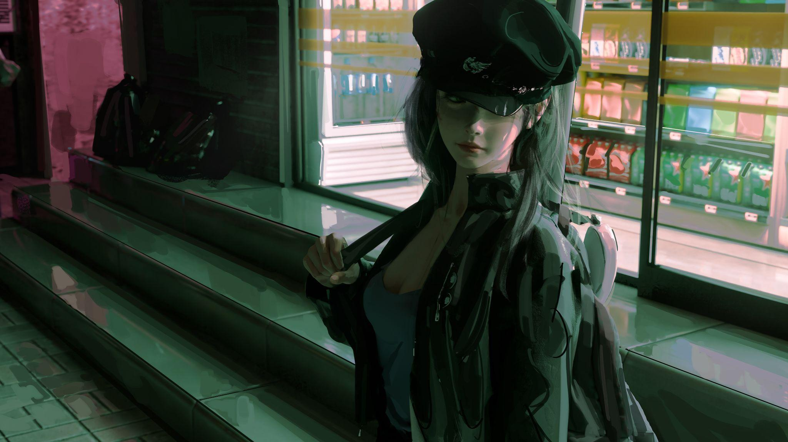

Cô im lặng hồi lâu, rốt cuộc không nói thêm lời nào nữa, chỉ cất kỹ những tấm ảnh, đứng dậy, đeo lại cây đàn bass và chiếc ba lô lên vai, quay người bước về phía đầu đường.

Đi được vài bước, cô lại dừng lại, ngoái đầu nhìn cậu một cái.

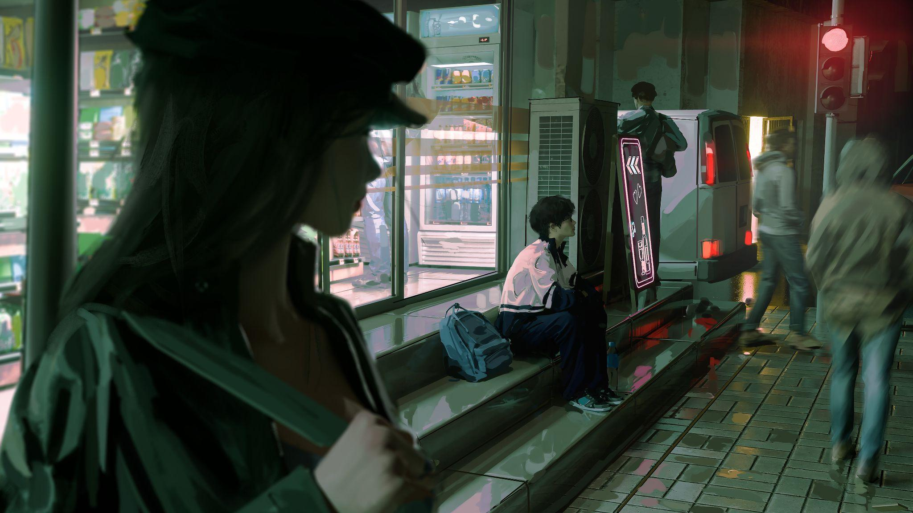

Hi Dương vẫn ngồi trên bậc thềm trước cửa hàng tiện lợi, bộ đồng phục học sinh trên người đã giặt đến bạc màu, bờ vai gầy guộc, bên chân là chai nước khoáng đã dùng đi dùng lại nhiều lần. Nhìn thế nào cũng chỉ là một thiếu niên túng thiếu, thậm chí có phần lếch thếch, ngồi đó đợi cơm hộp giảm giá nửa giá sau bảy giờ rưỡi——thực sự chẳng thể nói là vẻ vang thể diện, thậm chí còn mang theo chút buồn cười khó tả.

Thế nhưng ngay trong khoảnh khắc ấy, Nguyệt Nha Nhi bỗng cảm thấy, người này khác hẳn với tất cả những ai cô từng gặp trước đây.

Cảm giác đó lại khiến cô vô cớ nhớ đến chàng thanh niên đeo nửa chiếc mặt nạ, toàn thân toát ra kiếm khí, quyết tâm thích sát Tần Thủy Hoàng nọ. Bọn họ thực ra chẳng hề giống nhau, nhưng lại có một sự tương đồng khó tả nào đó. Rõ ràng biết thế đạo dơ bẩn, tiền đồ mờ mịt, nhưng vẫn kiên quyết không chịu dập tắt đốm lửa sáng le lói trong lòng.

Nguyệt Nha Nhi đứng chôn chân tại chỗ nhìn vài giây, ánh mắt có phần ngơ ngẩn mơ hồ.

Trong màn đêm, ánh đèn xe lướt qua, tiếng người ồn ã hỗn độn, thiếu niên ấy vẫn ngồi yên bình lặng trên bậc thềm.

Cậu đang ngước nhìn lên những vì sao.

“Đời người là một tấm áo bào hoa lệ, nhưng bò đầy rận rệp.” — Trương Ái Linh (1940)

“Tất cả chúng ta đều đang sống trong cống rãnh, nhưng vẫn luôn có những kẻ ngước nhìn lên những vì sao.” — Oscar Wilde (1892)
