# Vân Trùng / CloudInsect - Chương 4: Nón Định Mệnh · I (第四章 命运之锥 · 一)

---

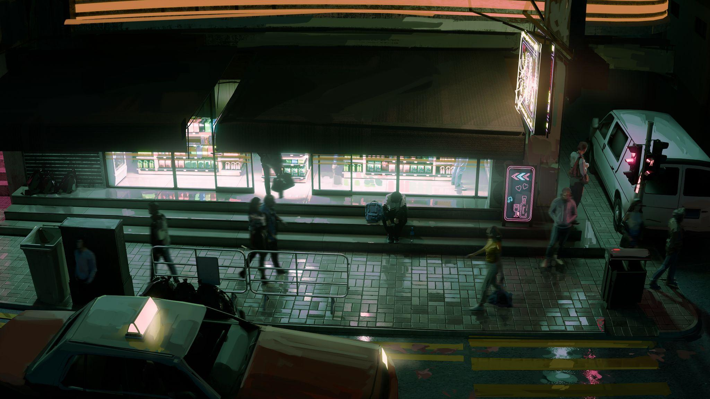

**VI**: Cửa hàng tiện lợi lúc chạng vạng sáng rực một màu trắng toát, cửa kính khép mở liên hồi, phả ra chút hơi ấm từ tủ giữ nhiệt và mùi đồ ăn chín. Bầu trời trên đường phố đã tối sẫm, ngọn gió ẩm ướt lùa qua từng bậc thềm, ánh đèn đổ xuống mặt đất như một vũng nước lạnh tanh.

**ZH**: 傍晚的便利店亮得发白，玻璃门一开一合，漏出一点热柜的暖气和食物的味道。  街上的天色已经沉下去了，潮湿的风贴着台阶慢慢吹过来，灯光落在地上，像一层冷冷的水。

**EN**: The convenience store at dusk glowed a stark white. Its glass doors slid open and shut, leaking a little warmth from the hot-food case and the smell of cooked food. The sky over the street had already darkened. Damp wind crept slowly along the steps, and the light spread across the ground like a sheet of cold water.

**VI**: Hi Dương ngồi một mình trên bậc thềm trước cửa, cúi gằm mặt, hai khuỷu tay tựa lên đầu gối, không rõ đang nghĩ ngợi điều gì. Chiếc cặp sách đặt bên chân, cạnh đó là chai nước khoáng đã vơi một nửa, lặng lẽ đứng yên tại đó.

**ZH**: 希扬一个人坐在门口的台阶上，低着头，手肘搭在膝上，不知在想什么。书包放在脚边，还有一瓶半满的矿泉水，安安静静地立在那里。

**EN**: Suvan sat alone on the steps outside the entrance, head lowered, elbows resting on his knees, lost in thought. His backpack lay at his feet, beside a half-full bottle of water standing there in silence.

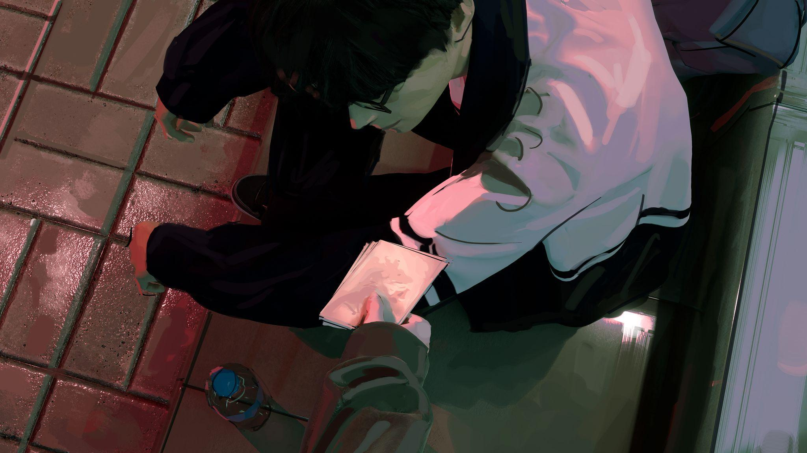

**VI**: Lúc này, một bàn tay từ bên cạnh vươn tới, khẽ vỗ nhẹ lên vai cậu.

**ZH**: 这时，一只手从旁边伸过来，轻轻拍了拍他的肩。

**EN**: Then a hand reached in from the side and lightly tapped his shoulder.

**VI**: Hi Dương quay đầu lại.

**ZH**: 希扬回过头。

**EN**: He turned.

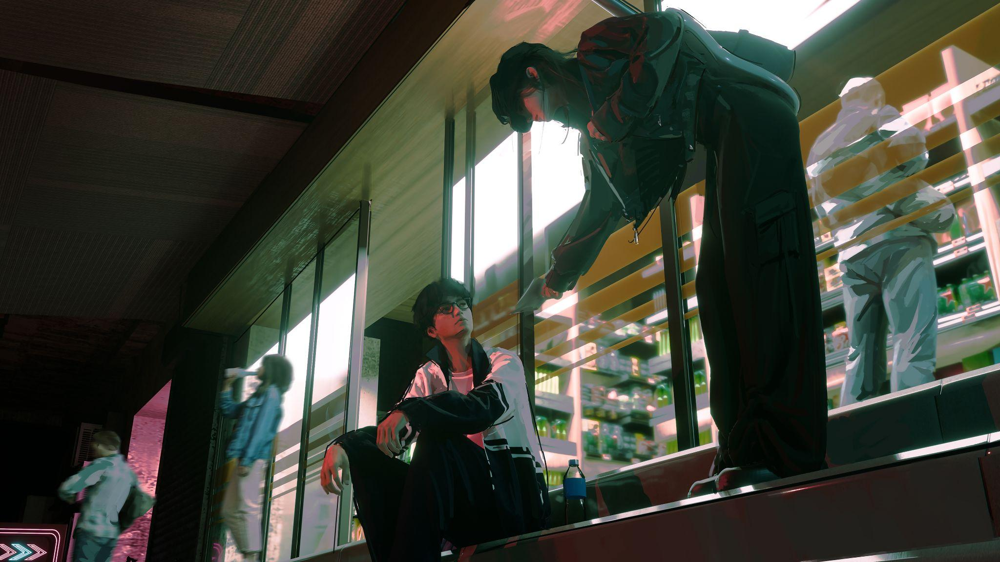

**VI**: Nguyệt Nha Nhi đang cúi người xuống, đưa một xấp ảnh vừa mới rửa đến trước mặt cậu.

**ZH**: 月牙儿正弯下腰，把一叠刚洗出来的照片递到他面前。

**EN**: Mahina was bending down, holding out a stack of freshly developed photographs.

**VI**: Hôm nay cô ăn mặc có chút khác ngày thường: chiếc quần dài màu đen, áo khoác lửng sẫm màu với những đường cắt gọn gàng, cả người như được bóng đêm siết lại một vòng. Phía sau lưng còn đeo một cây đàn bass màu trắng, nằm chéo bên hông, dưới ánh đèn trắng lạnh của cửa hàng tiện lợi trông vô cùng nổi bật. Vành mũ kéo sụp xuống thật thấp, gần như che khuất nửa khuôn mặt, chỉ để ánh đèn từ một bên hắt tới, lướt qua sống mũi và khóe môi, phác họa nên một đường nét lạnh lùng mờ nhạt.

**ZH**: 她这一天穿得和往常有些不一样，黑色的长裤，深色的短夹克，线条很利落，整个人像被夜色重新收束过一遍。  肩后还背着一把白色的贝斯，斜斜贴在身侧，在便利店冷白的灯光下显得格外扎眼。帽檐压得很低，几乎遮住了大半张脸，只留下灯光从侧面落下来，掠过她的鼻梁和唇角，映出一点冷冷的轮廓。

**EN**: She was dressed a little differently from usual that day: black trousers, a dark short jacket, the lines of it clean and sharp, as though the night itself had tightened around her. A white bass hung behind one shoulder, slanting against her side, startlingly bright beneath the convenience store’s cold white lights. The brim of her cap was pulled low, hiding most of her face, so that only the light skimming across her nose and lips gave her profile a faint, cold outline.

**VI**: Cô khẽ nói:

**ZH**: 她低声道：

**EN**: Softly, she said,

**VI**: “Ảnh rửa xong rồi.”

**ZH**: “照片洗出来了。”

**EN**: “The photos are developed.”

**VI**: Hi Dương đón lấy xấp ảnh, cúi đầu lật xem hai tấm.

**ZH**: 希扬接过那叠照片，低头翻了两张。

**EN**: Suvan took the stack and flipped through the top two.

**VI**: “Kết quả thế nào?”

**ZH**: “结果怎么样？”

**EN**: “How did they turn out?”

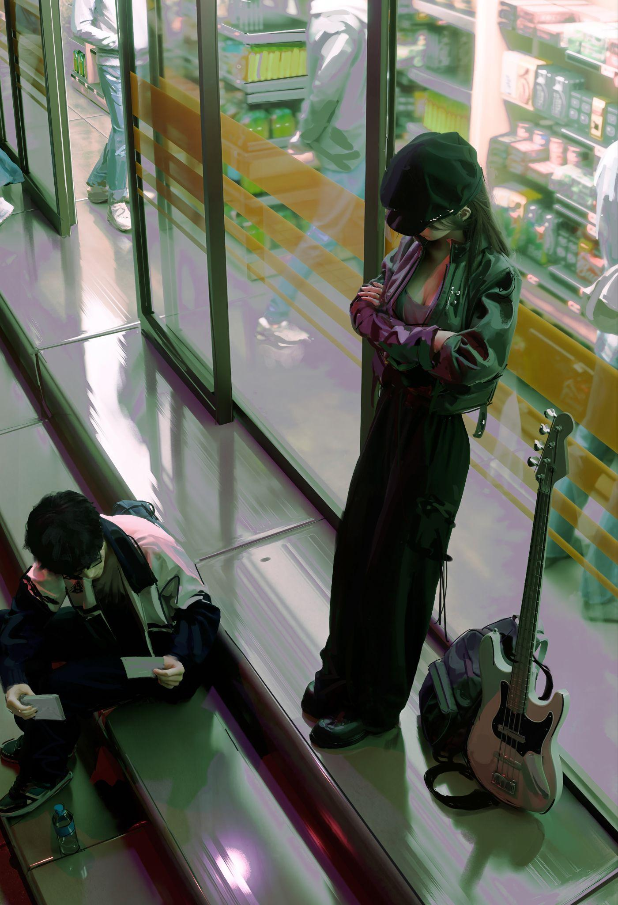

**VI**: Nguyệt Nha Nhi tựa vào tấm kính phía sau, khoanh tay trước ngực, giọng điệu hờ hững.

**ZH**: 月牙儿靠到身后的玻璃上，抱起手臂，语气淡淡的。

**EN**: Mahina leaned back against the glass behind her, folding her arms, her tone flat.

**VI**: “Chạy qua ba tiệm ảnh rồi, kết quả vẫn y như nhau. Tất cả đều bị cháy sáng.”

**ZH**: “跑了三家店，结果还是一样。全都过曝了。”

**EN**: “Three different shops. Same result every time. Every single one overexposed.”

**VI**: Hi Dương không nói gì, chỉ lần lượt xem qua từng tấm ảnh. Mặt giấy trắng xóa một mảng, tựa hồ vừa bị thứ ánh sáng nào đó thiêu đốt dữ dội, cảnh vật và bóng người lẽ ra phải được lưu lại hầu như đều bị nuốt chửng, chỉ còn sót lại vài đường viền mờ ảo không rõ hình thù.

**ZH**: 希扬没有说话，只把那几张照片一张张看过去。纸面上一片发白，像是被什么光狠狠灼过，原本该留下来的景物和人影几乎都被吞了进去，只剩下一些模糊不清的边缘。

**EN**: He said nothing, only kept looking through them one by one. The paper was washed almost white, as though some fierce light had scorched through it. The scenery and figures that should have remained had nearly all been swallowed, leaving behind only blurred, uncertain traces.

**VI**: Nguyệt Nha Nhi nhìn cậu, lại bồi thêm một câu:

**ZH**: 月牙儿看着他，又补了一句：

**EN**: Mahina watched him and added,

**VI**: “Nhưng cũng không hẳn là hỏng hết. Vẫn còn vài tấm miễn cưỡng nhìn ra được chút gì đó.”

**ZH**: “不过也不算全废。有几张还能勉强看出一点东西。”

**EN**: “Not a total loss, though. A few of them still show something.”

**VI**: Hi Dương ngẩng đầu lên.

**ZH**: 希扬抬起头。

**EN**: He looked up.

**VI**: Nguyệt Nha Nhi kéo vành mũ thấp xuống một chút, giọng nói rất nhẹ, như thể đang hồi tưởng lại khoảnh khắc ấy.

**ZH**: 月牙儿把帽檐往下压了压，声音很轻，像是在回想那一瞬间。

**EN**: She tugged the brim of her cap a little lower, her voice light, as though she were stepping back into that instant in her mind.

**VI**: “Lúc đó đầu óc tôi trống rỗng hoàn toàn. Đến khi kịp nhận ra trong tay vẫn đang nắm chiếc máy ảnh thì bọn người Trương Lương đã quay lưng chuẩn bị đi rồi, rốt cuộc chỉ kịp chớp vội vài tấm lúc họ quay lưng đi.”

**ZH**: “当时我脑子一片空白。等我反应过来手里还攥着相机的时候，张良他们已经转身要走了，最后只来得及在他们背过去的时候抓了几张。”

**EN**: “My head was completely blank back then. By the time I realized I was still holding the camera, Zhang Liang and the others were already turning away. I only managed a few shots as they were leaving.”

**VI**: Hi Dương rút riêng vài tấm đó ra, cúi đầu chăm chú nhìn một hồi. Trên nền ảnh trắng bệch mờ mịt, quả nhiên vẫn còn lờ mờ in hằn hai bóng lưng, một cao một thấp, viền ngoài tản mác, tựa như nhìn qua một giấc mộng cũ, miễn cưỡng còn nhận ra dáng dấp con người.

**ZH**: 希扬把那几张单独抽出来，低头仔细看了一会儿。惨白模糊的底色里，果然还隐约压着两道背影，一高一低，边缘发散，像隔着一层旧梦，勉强还能看出人形。

**EN**: Suvan pulled those few out and studied them carefully. Beneath the pale, ruined wash of light, there really were two dim silhouettes pressed into the frame, one taller than the other, their edges feathered and scattered, as though seen through the residue of an old dream. Barely enough to tell they were human.

**VI**: “Mấy tấm này vẫn còn.”

**ZH**: “这几张还在。”

**EN**: “These are still there,”

**VI**: “Ừm.” Nguyệt Nha Nhi nhàn nhạt nói, “Trương Lương, với cả tên thích khách đó, bóng lưng vẫn còn lại một chút.”

**ZH**: “嗯。”月牙儿淡淡道，“张良，还有那个刺客，背影都还剩一点。”

**EN**: “Yeah.”Mahina’s voice stayed cool.“Zhang Liang. And that assassin. You can still make out a bit of their backs.”

**VI**: Cô khựng lại một thoáng, nhìn xuống mũi giày, nở một nụ cười tự giễu.

**ZH**: 她停了一下，低头看着自己鞋尖，像是自嘲似的笑了笑。

**EN**: She paused, lowered her gaze to the tip of her shoe, and gave a faint, almost self-mocking smile.

**VI**: “Nhưng cầm thứ này đi cho người khác xem, chắc cũng chẳng ai tin đâu nhỉ.”

**ZH**: “不过拿这种东西给别人看，也没人会信吧。”

**EN**: “But if you showed these to anyone else, nobody would believe it.”

**VI**: Hi Dương miết nhẹ mấy tấm ảnh, im lặng một lát rồi mới khẽ nói:

**ZH**: 希扬捏着那几张照片，沉默了片刻，才轻声道：

**EN**: Suvan held the photos between his fingers in silence for a moment, then said quietly,

**VI**: “Ít nhất nó cũng chứng minh được một điều.”

**ZH**: “至少它能证明一件事。”

**EN**: “At least they prove one thing.”

**VI**: Nguyệt Nha Nhi ngước mắt nhìn cậu.

**ZH**: 月牙儿抬眼看他。

**EN**: She looked up at him.

**VI**: Hi Dương cũng ngẩng đầu lên nhìn cô, giọng điệu vô cùng bình thản.

**ZH**: 希扬也抬起头，看着她，声音很平静。

**EN**: He lifted his head too and met her gaze, his voice calm.

**VI**: “Ít nhất có thể chứng minh, chúng ta không bị điên. Những thứ nhìn thấy ngày hôm đó, cũng không phải là ảo giác.”

**ZH**: “至少能证明，我们没有疯。那天看到的东西，也不是幻觉。”

**EN**: “At least they prove we weren’t crazy. Whatever we saw that day, it wasn’t a hallucination.”

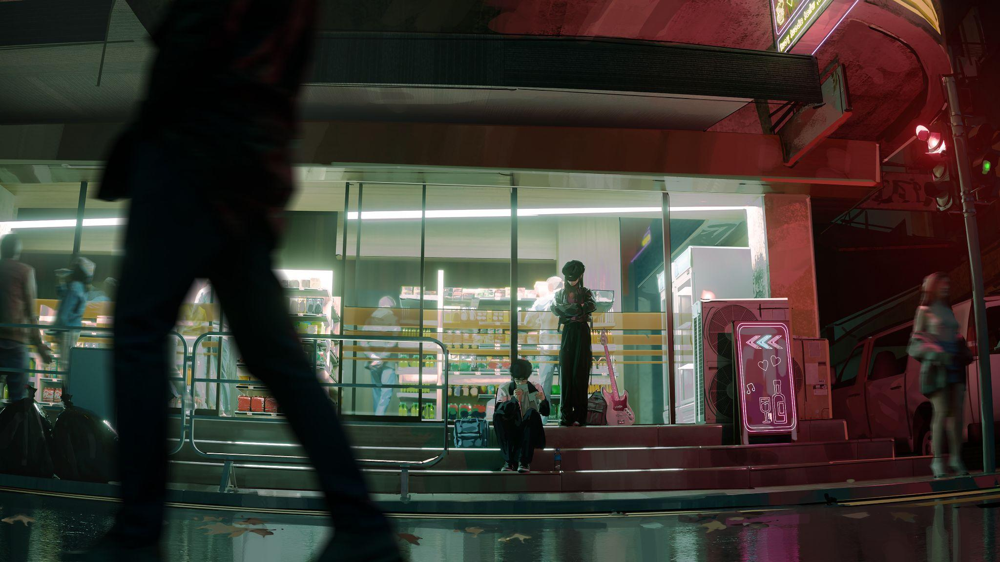

**VI**: Nguyệt Nha Nhi im lặng trong chốc lát, nét mặt dưới vành mũ không nhìn rõ, chỉ là chút lạnh lùng nhàn nhạt nơi khóe môi chẳng biết tự lúc nào đã giãn ra một chút. Cô không đáp lại câu nói đó, chỉ im lặng một hồi rồi mới khẽ hỏi:

**ZH**: 月牙儿安静了一瞬，帽檐下的神情看不分明，只是唇角那点淡淡的冷意，不知什么时候松了一点。她没接这句话，只是沉默了片刻，才轻声问：

**EN**: Mahina fell quiet for a moment. Beneath the brim of her cap, her expression remained unreadable, but the faint coldness at the corner of her mouth seemed, somehow, to loosen. She did not answer that. After a pause, she asked softly,

**VI**: “Phía bên cậu thì sao?”

**ZH**: “你那边呢？”

**EN**: “What about your side?”

**VI**: Hi Dương nhìn xấp ảnh trong tay, dừng một chút rồi nói:

**ZH**: 希扬低头看着手里的照片，停了停才道：

**EN**: Suvan lowered his eyes to the photos in his hands and paused before answering.

**VI**: “Cũng gần như vậy. Ngay trong đêm đó giáo sư Bạch đã lập một tổ công tác lâm thời, thử lại một lần nữa theo đúng vị trí và thông số tôi cung cấp, dùng cùng một thiết bị, cùng một tần số, nhưng rốt cuộc vẫn chẳng thu được gì. Vân Trùng không hề phản hồi lại nữa, cứ như thể ngày hôm đó chưa từng có chuyện gì xảy ra.”

**ZH**: “差不多。白教授当晚就组了一个临时工作组，按我说的位置和参数又试了一次，用的是同样的设备，同样的频率，可最后还是什么都没有。云虫没再回应，像那天什么都没发生过一样。”

**EN**: “About the same. Professor Bai assembled a temporary team that very night. They went back to the exact location and parameters I gave them, used the same equipment, the same frequency, and still got nothing. CloudInsect never answered again. As if nothing had happened that day.”

**VI**: Một cơn gió thổi qua, cuốn bay mẩu hóa đơn bên mép bậc thềm, lăn nửa vòng trên mặt đất rồi lại dính vào chân tường.

**ZH**: 风吹过来，台阶边的一张小票被卷起来，在地上滚了半圈，又贴回墙角。

**EN**: A gust of wind came through. A scrap of receipt paper rolled halfway across the ground before sticking again by the wall.

**VI**: “Nghe qua thì giống như hai chúng ta vừa tình cờ đụng phải một chuyện vốn không nên đụng phải.”

**ZH**: “听起来，倒像是我们两个刚好撞见了一次不该撞见的事。”

**EN**: “It almost sounds like the two of us just happened to stumble into something we were never supposed to see.”

**VI**: Hi Dương mỉm cười, nhưng nụ cười ấy rất nhạt, dường như ngay cả chính cậu cũng không rõ đây có được coi là may mắn hay không.

**ZH**: 希扬笑了笑，那笑意却很淡，像是连他自己也说不清这算不算运气。

**EN**: Suvan smiled, but only faintly, as though even he himself could not decide whether it counted as luck.

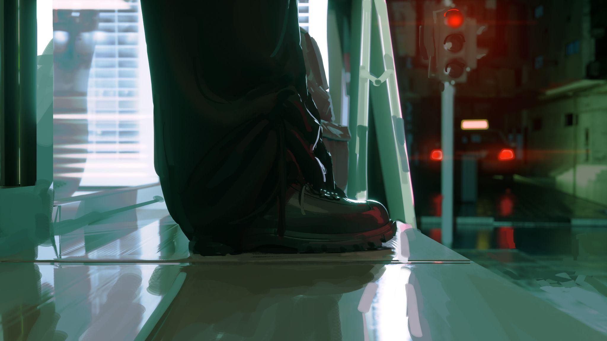

**VI**: Nguyệt Nha Nhi cúi đầu nhìn xuống chân, giọng nói cũng chùng xuống:

**ZH**: 月牙儿低头看着脚边，声音也淡了下来：

**EN**: Mahina lowered her gaze to the ground by her feet, her voice dimming with the light.

**VI**: “Vậy thầy giáo của cậu bây giờ chắc cũng nghĩ chúng ta đang nói hươu nói vượn rồi.”

**ZH**: “那你老师他们现在，大概也觉得我们是在胡说了。”

**EN**: “So your professor and the others probably think we’re making it up now.”

**VI**: Hi Dương lắc đầu.

**ZH**: 希扬摇了摇头。

**EN**: He shook his head.

**VI**: “Giáo sư Bạch tin tôi.”

**ZH**: “白教授信我。”

**EN**: “Professor Bai believes me.”

**VI**: Nói đến đây cậu ngập ngừng một chút, ánh mắt rơi xuống mặt đường ẩm ướt lấp lánh dưới bậc thềm,

**ZH**: 他说到这里顿了一下，目光落在台阶下潮湿发亮的地面上，

**EN**: He stopped there for a second, his eyes dropping to the damp, gleaming pavement below the steps.

**VI**: “Chỉ là không có cách nào tiếp tục được nữa. Tổ công tác chỉ là tạm thời, thiết bị, địa điểm, nhân lực, tất cả đều phải báo cáo lên cấp trên. Nếu cứ mãi không thể tái hiện lại được kết quả, thì không thể tiêu tốn tài nguyên vô ích mãi như thế được.”

**ZH**: “只是没有办法继续。工作小组是临时组的，设备、场地、人手，全都要往上报。如果一直什么都复现不出来，就不可能一直耗下去。”

**EN**: “He just can’t keep it going. The team was temporary. The equipment, the site, the personnel—all of it has to be approved. If nothing can be reproduced, you can’t keep burning resources forever.”

**VI**: Nguyệt Nha Nhi khẽ “ồ” một tiếng, sắc mặt không hề ngạc nhiên, dường như đã đoán trước được kết cục này.

**ZH**: 月牙儿低低“哦”了一声，神情倒并不意外，像是早就猜到了结局。

**EN**: Mahina let out a low little “oh.” She didn’t look surprised, as though she had expected that ending from the start.

**VI**: “Nên dừng lại rồi sao.”

**ZH**: “所以还是停了。”

**EN**: “So it’s stopped, then.”

**VI**: “Ừm.”

**ZH**: “嗯。”

**EN**: “Yeah.”

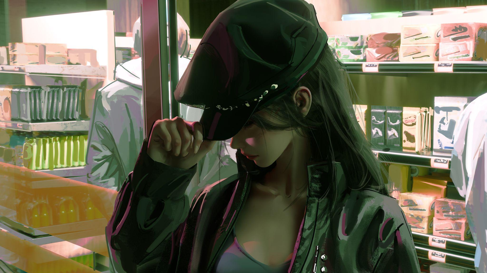

**VI**: Cửa tự động của cửa hàng tiện lợi lại mở ra một lần nữa, một người trung niên xách túi nilon bước ra, khi đi ngang qua trước mặt họ, bước chân rõ ràng chậm lại.

**ZH**: 便利店的自动门又开了一次，一个提着塑料袋的中年人从里面走出来，经过他们面前时，脚步明显慢了一下。

**EN**: The automatic doors slid open once more. A middle-aged passerby carrying a plastic bag stepped out, slowed noticeably as they passed, glanced first at Suvan, then let their gaze settle on Mahina. It was the kind of open, shameless scrutiny people reserved for someone they found strange—from the brim of her cap to her jacket and trousers, down to the white bass by her feet, as if she were something that did not belong in the world around them.

**VI**: Người đó liếc nhìn Hi Dương trước, sau đó ánh mắt lập tức dừng lại trên người Nguyệt Nha Nhi, mang theo sự soi mói không hề che giấu đầy vẻ tò mò thích thú, quét từ vành mũ, áo khoác, quần dài, cho tới tận cây đàn bass màu trắng bên chân cô, tựa như đang nhìn một thứ gì đó vốn không nên xuất hiện ở nơi này.

**ZH**: 他先是看了希扬一眼，随即目光就落到月牙儿身上，带着那种毫不掩饰的、饶有兴味的打量，从帽檐、外套、长裤，一直扫到她脚边那把白色的贝斯，像是在看什么不该出现在这里的东西。

**EN**: Mahina was clearly used to that kind of gaze. She did not look up. She only tugged the brim of her cap lower, lightly, instinctively, as though trying to sink herself further into shadow. Only after the person had drifted away did she lift her eyes again. There was a trace of irritation there, but it faded almost at once.

**VI**: Nguyệt Nha Nhi hiển nhiên đã quá quen thuộc với loại ánh mắt này. Cô không ngẩng đầu lên, chỉ kéo vành mũ thấp xuống thêm một chút, động tác rất nhẹ nhưng mang theo sự kháng cự mang tính bản năng, như muốn giấu mình sâu hơn vào trong bóng tối. Mãi cho đến khi người kia xách túi nilon thong thả đi xa, cô mới ngước mắt lên lại, vẻ mặt thoáng chút bực bội nhàn nhạt, nhưng rất nhanh đã chìm xuống.

**ZH**: 月牙儿显然很熟悉这种目光。她没有抬头，只是把帽檐又往下压了压，动作很轻，却带着一种本能的抗拒，像是想把自己再往阴影里藏深一点。直到那人提着塑料袋慢悠悠走远，她才重新抬起眼，神情里有一点淡淡的不耐，却很快又沉了下去。

**EN**: Silence settled between them for a while.

**VI**: Giữa hai người rơi vào im lặng một hồi.

**ZH**: 两人之间安静了一会儿。

**EN**: “What are you doing sitting here?”

**VI**: “Cậu ngồi ở đây làm gì thế?”

**ZH**: “你坐在这里做什么？”

**EN**: she asked suddenly, turning her head a little.

**VI**: Nguyệt Nha Nhi nghiêng đầu, đột nhiên hỏi.

**ZH**: 月牙儿偏过头，忽然问道。

**EN**: Suvan glanced at the digital clock over the convenience store entrance. His tone was still even.

**VI**: Hi Dương liếc nhìn chiếc đồng hồ điện tử đang nhảy số ở cửa ra vào cửa hàng tiện lợi, giọng điệu vẫn bình thản.

**ZH**: 希扬看了看便利店门口跳动的电子钟，语气依旧平静。

**EN**: “Waiting for seven-thirty. After seven-thirty, the boxed meals go half-price.”

**VI**: “Đợi bảy giờ rưỡi. Sau bảy giờ rưỡi, cơm hộp ở đây sẽ giảm giá một nửa.”

**ZH**: “等七点半。七点半以后，这里的便当会半价。”

**EN**: Mahina blinked, then let out a low laugh.

**VI**: Nguyệt Nha Nhi ngẩn ra một giây, rồi khẽ bật cười khúc khích.

**ZH**: 月牙儿怔了一下，随即低低笑了。

**EN**: “So even top students do this.”

**VI**: “Hóa ra học sinh giỏi giang, cũng làm mấy chuyện này cơ đấy.”

**ZH**: “原来高材生，也会做这种事。”

**EN**: He did not answer that. He only looked at her and asked softly,

**VI**: Hi Dương không đáp lời trêu chọc, chỉ nhìn cô, khẽ hỏi:

**ZH**: 希扬没接这句，只是看着她，轻声问道：

**EN**: “What about you? Where are you going so late?”

**VI**: “Còn cậu? Muộn thế này rồi, còn định đi đâu nữa?”

**ZH**: “你呢？这么晚了，还要去哪里？”

**EN**: “I’ve got a show.”

**VI**: Nguyệt Nha Nhi nhàn nhạt đáp: “Có một buổi diễn.”

**ZH**: 月牙儿淡淡道：“有个演出。”

**EN**: His eyes dropped to the bass beside her.

**VI**: Ánh mắt Hi Dương rơi xuống cây đàn bass đặt bên cạnh cô, dừng lại một thoáng rồi trầm giọng hỏi:

**ZH**: 希扬的目光落到她放在一旁的贝斯上，停了停，低声道：

**EN**: “A bar?”

**VI**: “Quán bar à?”

**ZH**: “酒吧？”

**EN**: Mahina did not deny it. She only curved her lips a little, which was answer enough.

**VI**: Nguyệt Nha Nhi không phủ nhận, chỉ khẽ cong khóe môi, coi như ngầm thừa nhận.

**ZH**: 月牙儿没有否认，只是弯了弯嘴角，算是默认。

**EN**: He hesitated, as though weighing the words carefully, then asked in a low voice,

**VI**: Hi Dương im lặng một lát, như đang đắn đo, rồi mới khẽ hỏi một câu:

**ZH**: 希扬沉默片刻，像是斟酌过，才轻声问了一句：

**EN**: “Can I come watch?”

**VI**: “Tôi có thể đến xem được không?”

**ZH**: “我能去看吗？”

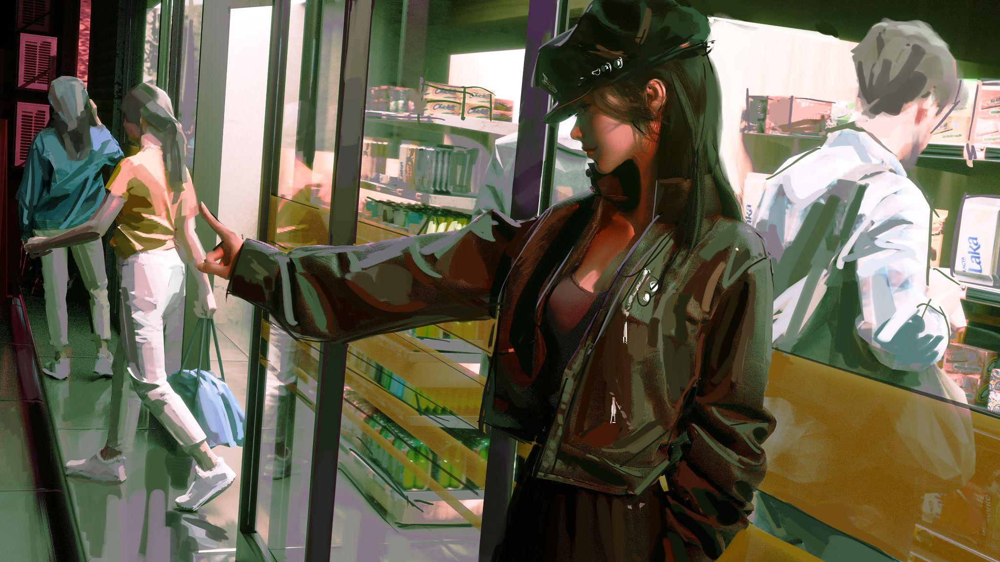

**VI**: Nguyệt Nha Nhi bật cười, giơ tay lên, chậm rãi dựng một ngón tay trước mắt cậu, khẽ lắc nhẹ. Ý tứ rất rõ ràng: Không được. Một người như cậu, không nên đến những nơi như thế.

**ZH**: 月牙儿一下笑了，抬起手，在他眼前慢悠悠地竖起一根手指，轻轻晃了晃。那意思很明白：不行。像他这样的人，不该去那种地方。

**EN**: That made her smile properly. She raised one finger in front of him and slowly wagged it once. The meaning was obvious: no. Someone like him had no business going to a place like that.

**VI**: Hi Dương cũng mỉm cười, không gặng hỏi thêm nữa.

**ZH**: 希扬也笑了笑，没有再追问。

**EN**: Suvan smiled too and did not press any further.

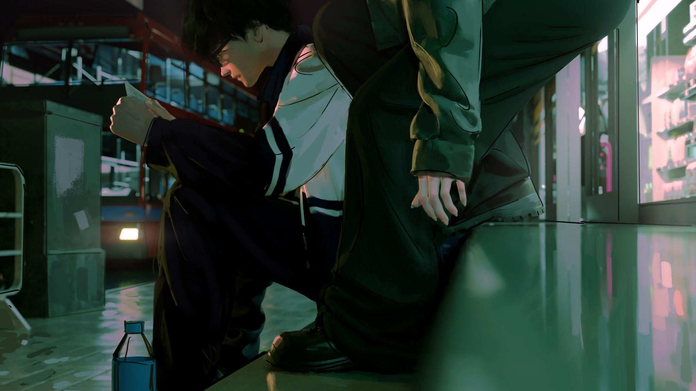

**VI**: Nguyệt Nha Nhi đưa tay gạt lọn tóc mai lòa xòa bên má, thuận thế ngồi xuống bên cạnh cậu, chỉ là cao hơn cậu một bậc thềm. Động tác ngồi xuống của cô rất nhẹ, như một chú mèo nhanh nhẹn, gấu áo quẹt qua mép bậc thềm chỉ phát ra tiếng động cực nhỏ, trong chớp mắt đã bị ngọn gió đêm nuốt trọn.

**ZH**: 月牙儿抬手拨了拨颊边的碎发，顺势在他身边坐了下来，只是比他高出一截台阶。她坐下来的动作很轻，像只敏捷的猫，衣角擦过台阶边缘，也只带起一点极细微的声响，转眼就被夜里的风吞没了。

**EN**: Mahina lifted a hand, brushed the loose strands of hair by her cheek aside, and then, in the same motion, sat down beside him, one step higher. She moved lightly, almost catlike, the edge of her jacket just barely whispering against the step before the sound was swallowed by the night wind.

**VI**: Hi Dương chỉ cảm thấy cô ngồi rất gần. Gió đêm từ đầu phố thổi tới, mang theo mùi hương thoang thoảng trên người cô, như có như không, nhưng lại khiến người ta dù thế nào cũng không thể phớt lờ.

**ZH**: 希扬只觉得她坐得很近。晚风从街口吹过来，夹带着她身上淡淡的香味，若有若无，却又让人无论如何都没法忽略。

**EN**: He only felt how close she was now. The breeze coming off the street carried with it a faint trace of her perfume—so light it almost dissolved into the air, and yet impossible to ignore.

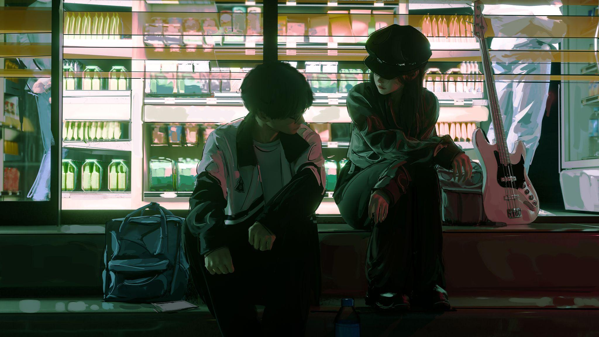

**VI**: Ánh đèn cửa hàng tiện lợi hắt lên mặt kính sáng lạnh lẽo, trước cửa người qua kẻ lại tấp nập, xen lẫn đủ thứ thanh âm ồn ào của phố thị.

**ZH**: 便利店的灯冷冷照在玻璃上，门口人来人往，夹杂着各种喧嚣的人声。

**EN**: The convenience store lights shone cold against the glass. People moved in and out, carrying with them the ordinary noise of the city.

**VI**: Hi Dương cúi đầu, tay vẫn mân mê mấy tấm ảnh bạc màu, trầm mặc hồi lâu, mới đột nhiên trầm giọng thốt lên một câu:

**ZH**: 希扬低着头，手里还捏着那几张发白的照片，沉默了好一会儿，才忽然低声说了一句：

**EN**: Suvan lowered his head, still holding those pale, ruined photographs. After a long silence, he said quietly,

**VI**: “Nguyệt Nha Nhi, chúng ta lại đến đó một lần nữa đi. Đến dưới chân Vân Trùng.”

**ZH**: “月牙儿，我们再去一次吧。去云虫脚下。”

**EN**: “Mahina, let’s go again. Back to the foot of CloudInsect.”

**VI**: Nguyệt Nha Nhi hơi ngẩn ra, quay đầu nhìn cậu chừng hai giây, rồi mới nhàn nhạt lên tiếng:

**ZH**: 月牙儿微微一怔，转过头看了他两秒，才淡淡开口：

**EN**: She turned toward him, startled, and looked at him for two full seconds before answering.

**VI**: “Bây giờ không đi được đâu. Nó đã di chuyển ra biển rồi, chúng ta không với tới được.”

**ZH**: “现在去不了。它已经走到海上了，我们够不着。”

**EN**: “We can’t. It’s already moved out over the sea. We can’t reach it.”

**VI**: “Vậy thì đợi sau khi nó đổ bộ lên đất liền.”

**ZH**: “那就等它登陆以后。”

**EN**: “Then we wait until it makes landfall.”

**VI**: Nguyệt Nha Nhi khẽ lắc đầu, như muốn nói cậu đã nghĩ mọi chuyện quá đơn giản rồi.

**ZH**: 月牙儿轻轻摇了摇头，像是在说他把事情想得太简单了。

**EN**: Mahina gave a faint shake of her head, the gesture saying more clearly than words that he was making it sound too simple.

**VI**: “Đợi nó đổ bộ thì đã vào đến nội thành rồi. Khu vực dưới chân nó từ sớm đã bị phong tỏa, dây phong tỏa, khu vực cảnh giới, trạm quan trắc ghi chép, cái gì cũng có.”

**ZH**: “等它登陆，就已经到市区了。脚下那一带早就会被封起来，封锁线、警戒区、记录站，什么都会有。”

**EN**: “By the time it reaches land, it’ll already be inside the city. The whole area under it will be sealed off—blockades, checkpoints, observation stations, all of it.”

**VI**: Hi Dương ngẩng đầu lên, nhìn ngọn đèn đường phía trước, ngập ngừng một lát rồi nói:

**ZH**: 希扬抬起头，看着前面的街灯，停了一下，才说：

**EN**: Suvan lifted his head and looked toward the streetlights ahead. After a pause, he said,

**VI**: “Tôi đã xin giáo sư Bạch cấp thẻ công tác tạm thời rồi, hai cái. Đợi sau khi nó đổ bộ, chỉ cần nói chúng ta là nhân viên ghi chép quan sát Vân Trùng là có thể vào được.”

**ZH**: “我已经和白教授申请过临时工作证了，两张。等它登陆以后，只要说我们是云虫观察记录员，就能进去。”

**EN**: “I already asked Professor Bai for temporary work permits. Two of them. Once it lands, if we say we’re CloudInsect observation recorders, we’ll be able to get in.”

**VI**: Nguyệt Nha Nhi nghe đến đây, khóe môi khẽ cong lên.

**ZH**: 月牙儿听到这里，唇角轻轻弯了弯。

**EN**: At that, the corner of Mahina’s mouth lifted slightly.

**VI**: “Ồ?” Cô kéo dài âm đuôi một chút, “Bây giờ tôi cũng được tính là người của tổ công tác các cậu rồi à?”

**ZH**: “哦？”她把尾音拖得有些长，“我现在也算你们工作组的人了？”

**EN**: “Oh?”she drew the word out slightly.“So I’m part of your team now?”

**VI**: Hi Dương nhất thời không biết đáp lại thế nào.

**ZH**: 希扬一时没接上话。

**EN**: For a second, he had no answer.

**VI**: Nguyệt Nha Nhi nhìn cậu, không nhịn được lại bồi thêm một câu:

**ZH**: 月牙儿看着他，忍不住又添了一句：

**EN**: She watched him, then added, unable to resist,

**VI**: “Thế các cậu có trả lương cho tôi không đấy?”

**ZH**: “那你们给不给我发工资？”

**EN**: “Do I at least get paid?”

**VI**: Hi Dương ngớ người ra một nhịp, vành tai lờ mờ nóng lên, nhưng vẻ mặt vẫn nghiêm túc đứng đắn.

**ZH**: 希扬怔了一下，耳根隐约有点发热，神情却还是一本正经的。

**EN**: Suvan froze for a beat. A faint flush rose near his ears, though his expression remained almost solemnly serious.

**VI**: “Nếu như có……” Cậu ngập ngừng, giọng nhỏ lại một chút, “Phần của tôi cũng đưa hết cho cậu.”

**ZH**: “要是有的话……”他顿了顿，声音低下来一点，“我的那份也给你。”

**EN**: “If there is pay…”He paused, lowering his voice a little.“You can have my share too.”

**VI**: Nguyệt Nha Nhi nhịn cười, cúi đầu kéo vành mũ, chỉ cảm thấy cái vẻ nghiêm túc của người này có chút buồn cười thú vị.

**ZH**: 月牙儿憋住笑，低头压了压帽檐，只觉得这人认真得有点好玩。

**EN**: Mahina stifled a laugh and lowered her head, tugging at the brim of her cap. There was something oddly amusing about how serious he was.

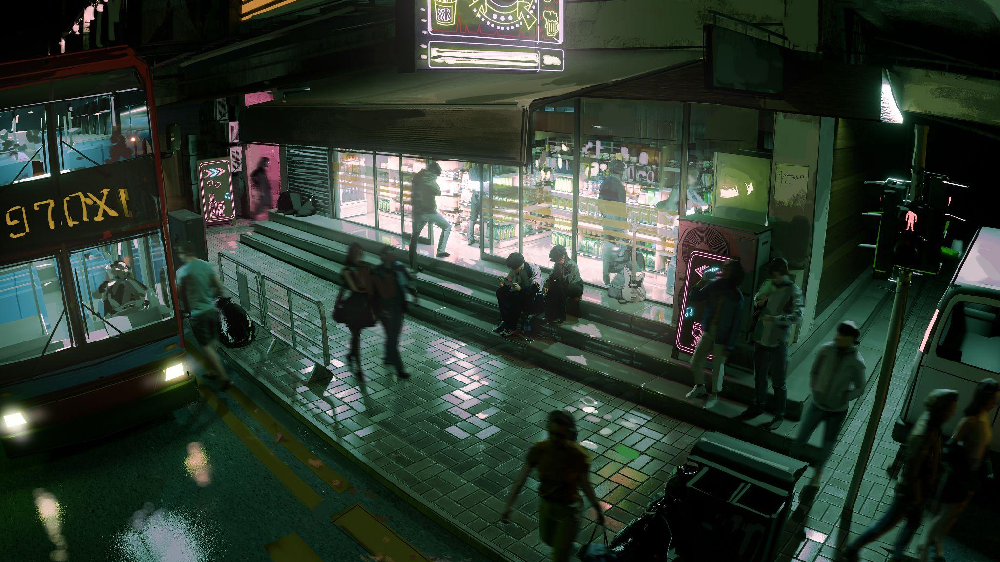

**VI**: Gió thổi qua mép bậc thềm, khẽ lật một góc của những tấm ảnh đặt trên đầu gối cô. Nguyệt Nha Nhi đưa tay đè xuống, nét cười cũng dần dần phai nhạt. Cô cúi đầu nhìn những bức ảnh, im lặng một lát, bỗng khẽ hỏi:

**ZH**: 风吹过台阶边缘，把她放在膝上的那几张照片轻轻掀起一角。月牙儿伸手把它按住，笑意也渐渐淡了下去。她低头看着照片，沉默片刻，忽然轻声问：

**EN**: The wind lifted a corner of the photographs on her knees. She pressed them back down, and the hint of laughter faded from her face. Looking down at them, she was silent for a moment before asking softly,

**VI**: “Cậu có phải nghĩ rằng, chỉ có hai chúng ta mới có thể nói chuyện được với Vân Trùng? Cho nên cậu mới nhất quyết muốn đi thêm một lần nữa, có phải không?”

**ZH**: “你是不是觉得，只有我们两个，才能跟云虫说上话？所以你才非要再去一次，是不是？”

**EN**: “Do you really think only the two of us can speak to CloudInsect? Is that why you’re so determined to go back?”

**VI**: Hi Dương im lặng một hồi lâu, rồi mới khẽ gật đầu.

**ZH**: 希扬沉默了一会儿，才轻轻点了点头。

**EN**: Suvan was quiet for a while, then nodded.

**VI**: “Phía giáo sư Bạch họ đã xoay xở bấy lâu nay, thiết bị, thông số, tần số, thứ gì cũng thử cả rồi, kết quả vẫn không có lấy một chút phản ứng. Nhưng duy chỉ có chúng ta, duy chỉ vào ngày hôm đó, duy chỉ tại nơi chốn đó, lại nhận được hồi âm của nó.”

**ZH**: “白教授他们那边折腾了这么久，设备、参数、频率，什么都试过了，结果还是一点反应都没有。可偏偏是我们，偏偏是那一天，偏偏就在那个地方，收到了它的回信。”

**EN**: “Professor Bai’s people have been at it for all this time. Equipment, parameters, frequency—they tried everything, and still got nothing. But somehow it was us. That day. In that place. We were the ones who got its reply.”

**VI**: Nguyệt Nha Nhi nghe xong, bật cười khẽ một tiếng, nụ cười ấy rất nhạt, ngược lại giống như một sự tự giễu.

**ZH**: 月牙儿听完，低低笑了一声，那笑意很淡，倒更像一种自嘲。

**EN**: Mahina let out a low laugh. The sound was thin, almost self-directed.

**VI**: “Đám nhóc con ở độ tuổi của cậu, có phải đều thích mơ mộng làm đấng cứu thế không?”

**ZH**: “你这个年纪的小孩，是不是都爱做这种救世主的梦？”

**EN**: “Do boys your age all like dreaming they’re saviors?”

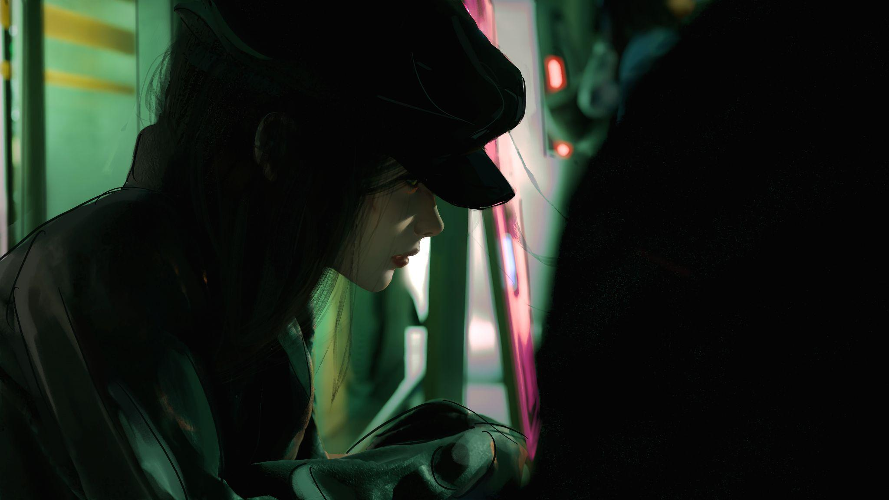

**VI**: Cô thu những tấm ảnh lại ôm vào lòng, hai tay ôm lấy đầu gối, ánh mắt dõi về phía ánh đèn mờ ảo bên kia đường.

**ZH**: 她把照片收回怀里，抱着膝盖，目光落在街对面那一片模糊的灯火上。

**EN**: She drew the photographs back into her arms and hugged her knees, looking across the street at the blurred wash of lights.

**VI**: “Cậu nhìn hai chúng ta xem, một người thì ngồi trước cửa hàng tiện lợi đợi cơm hộp giảm giá nửa giá, một người thì tất tả chạy đến quán bar bán nụ cười. Chuyện giải cứu thế giới thế này, nghĩ thế nào cũng không thể đến lượt chúng ta. Chẳng phải nên để dành cho những kẻ đứng trên cao kia, những kẻ đang tận hưởng thế giới này sao? Thế giới là của bọn họ, đương nhiên cũng nên do bọn họ đi cứu.”

**ZH**: “你看看我们两个，一个坐在便利店门口等半价便当，一个赶着去酒吧卖笑。拯救世界这种事，怎么想也不该轮到我们。不是更应该留给那些站在高处、正在享受这个世界的人吗？世界是他们的，当然也该由他们去救。”

**EN**: “Look at us. One of us is sitting outside a convenience store waiting for half-price dinners, and the other’s hurrying off to smile and play in some bar. How could saving the world possibly fall to people like us? Shouldn’t that be left to the ones standing up high, the ones actually enjoying this world? It’s their world. Let them be the ones to save it.”

**VI**: Hi Dương không đáp lời, chỉ lặng lẽ nhìn cô.

**ZH**: 希扬没有接话，只是安静地看着她。

**EN**: Suvan said nothing. He only kept looking at her.

**VI**: Giọng của Nguyệt Nha Nhi dần dần trầm xuống, nhẹ đến mức tưởng như sắp bị gió cuốn tan.

**ZH**: 月牙儿的声音慢慢低了下去，轻得像是要被风吹散。

**EN**: Her voice lowered, softer and softer, as if the wind might carry it off at any second.

**VI**: “Huống chi, thế giới này cũng chẳng xứng đáng đến thế.”

**ZH**: “何况，这个世界也没那么值得。”

**EN**: “Besides, this world isn’t all that worth saving.”

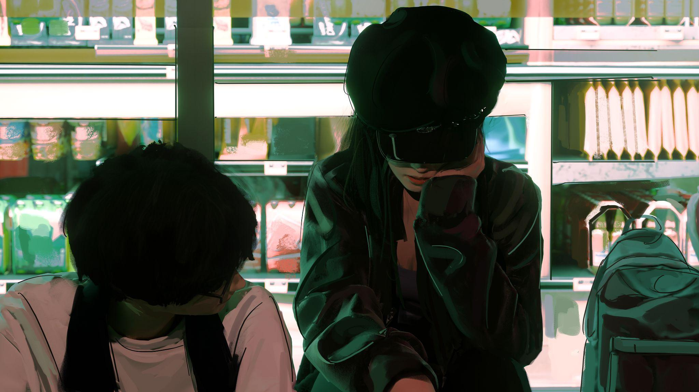

**VI**: Màn đêm đã hoàn toàn buông xuống. Ánh sáng trắng của cửa hàng tiện lợi rọi lên nửa khuôn mặt cô, vành mũ lại kéo xuống thật thấp, che khuất phần lớn ánh mắt trong đáy mắt. Hi Dương quay đầu lại, dường như muốn vượt qua mảng bóng tối đó để nhìn rõ đôi mắt cô. Cậu nhìn cô một hồi, giọng nói cũng nhỏ lại theo, thậm chí còn mang theo một chút ngập ngừng thăm dò:

**ZH**: 夜色已经完全沉下来了。便利店的白光照着她半张脸，帽檐却压得很低，把她眼里的神色遮去了大半。希扬转过头，像是想越过那片阴影，看清她的眼睛。他看了她一会儿，声音也跟着轻了下来，甚至带着一点试探的意味：

**EN**: Night had fully fallen by then. The convenience store’s white light illuminated half her face, while the low brim of her cap hid the rest, keeping her eyes mostly in shadow. Suvan turned toward her, as if trying to see past that darkness, trying to catch her eyes beneath it. He watched her for a moment. When he spoke again, his voice was quieter too, almost tentative.

**VI**: “Nếu như…… Ý tôi là nếu như, thực sự có một cơ hội như vậy rơi vào tay cậu, không cần cậu phải làm chuyện gì kinh thiên động địa, chỉ cần nhấc tay một cái là có thể thay thế giới này đưa ra một lựa chọn đúng đắn——cậu có làm không?”

**ZH**: “如果……我是说如果，真的有这样一个机会落到你手里，并不需要你做什么惊天动地的事，只要你举手之间，就能替这个世界做一个正确的选择——你会吗？”

**EN**: “If…”he said,“if a chance like that really did fall into your hands—not something grand, not some impossible feat, just one small choice, one gesture, enough to make the right decision for this world… would you do it?”

**VI**: Nguyệt Nha Nhi không trả lời ngay.

**ZH**: 月牙儿没有立刻回答。

**EN**: Mahina did not answer at once.

**VI**: Cô cúi đầu, nét mặt dưới vành mũ vẫn không thể nhìn rõ. Rất lâu sau, cô mới nhàn nhạt lên tiếng:

**ZH**: 她低着头，帽檐下的神情仍旧看不分明。过了很久，才淡淡开口：

**EN**: Her head was lowered. Her face remained unreadable beneath the brim of her cap. Only after a long while did she speak, lightly, almost flatly.

**VI**: “Thế giới này không xứng.”

**ZH**: “这个世界不配。”

**EN**: “This world doesn’t deserve it.”

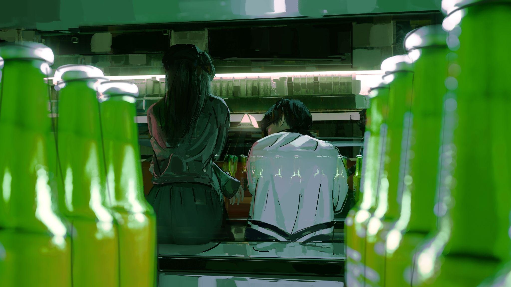

**VI**: Nguyệt Nha Nhi nói xong câu này, chính cô cũng lặng đi một giây. Dường như bỗng cảm thấy lời này nói ra quá nặng nề, cô bèn cúi đầu cười khẽ, ngữ điệu cũng nhạt bớt vài phần.

**ZH**: 月牙儿说完这句话，自己也静了一下。她像是忽然觉得这话说得太重了，便低头笑了笑，语气也淡了几分。

**EN**: The words fell, and even she seemed to feel their weight. She went still for a second, then lowered her head with a faint, almost embarrassed smile, as if realizing she had let something too bleak slip out too plainly.

**VI**: “Thôi bỏ đi.” Cô khẽ nói, “Chắc cậu cũng từng nghe qua câu nói này rồi——Đời người là một tấm áo bào hoa lệ, nhưng bò đầy rận rệp.”

**ZH**: “算了。”她轻声道，“你应该听过这么一句话——生命是一袭华美的袍，爬满了蚤子。”

**EN**: “Forget it,”she said softly.“You’ve probably heard this one before—life is a gorgeous robe, crawling with fleas.”

**VI**: Hi Dương lặng lẽ nhìn cô, một lúc sau mới trầm giọng mở lời:

**ZH**: 希扬安静地看着她，过了片刻，才低声开口：

**EN**: Suvan watched her in silence for a moment, then answered quietly,

**VI**: “Vậy thì cậu chắc cũng từng nghe qua câu này.”

**ZH**: “那你也应该听过这一句。”

**EN**: “Then you’ve probably heard this one too.”

**VI**: Ánh đèn trắng lạnh của cửa hàng tiện lợi phác họa nên đường nét thanh mảnh của thiếu niên, trong giọng nói của cậu mang theo một sự kiên định cố chấp lạ thường.

**ZH**: 便利店冷白的灯光勾勒出少年清瘦的轮廓，他的声音里有一种很固执的平静。

**EN**: The convenience store’s cold white light drew out the thin lines of his face. There was a strange steadiness in his voice, gentle, but stubborn all the same.

**VI**: “Tất cả chúng ta đều đang sống trong cống rãnh,” Cậu nói, “nhưng vẫn luôn có những kẻ ngước nhìn lên những vì sao.”

**ZH**: “我们都生活在阴沟里，”他说，“但仍有人在仰望星空。”

**EN**: “We are all living in the gutter,”he said,“but there are still those who look up at the stars.”

**VI**: Nguyệt Nha Nhi hơi ngẩn người một thoáng.

**ZH**: 月牙儿微微怔了一下。

**EN**: Mahina froze, just slightly.

**VI**: Tựa như nơi mềm yếu nào đó sâu trong đáy lòng vừa bị ai đó chạm vào thật khẽ khàng. Ban đầu cô còn định lôi thêm câu danh ngôn nào đó ra để đối đáp lại, nhưng lời ra đến đầu môi bỗng chốc tan biến mất.

**ZH**: 像是心里某个柔软的地方，被人极轻地碰了一下。她原本还想再搬出哪一句名言顶回去，可话到了嘴边，却忽然散了。

**EN**: It was as though something soft inside her had been touched, very lightly. She had been ready to throw some other famous line back at him, to pin him down with another piece of borrowed brilliance, but the words dissolved before she could speak them.

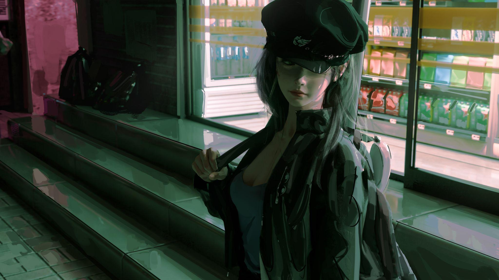

**VI**: Cô im lặng hồi lâu, rốt cuộc không nói thêm lời nào nữa, chỉ cất kỹ những tấm ảnh, đứng dậy, đeo lại cây đàn bass và chiếc ba lô lên vai, quay người bước về phía đầu đường.

**ZH**: 她沉默了片刻，终究什么也没再说，只把照片收好，站起身，把贝斯和背包重新背到肩上，转身朝街口走去。

**EN**: After a while, she said nothing at all. She simply gathered up the photographs, rose to her feet, slung the bass and her bag back over her shoulder, and turned toward the street.

**VI**: Đi được vài bước, cô lại dừng lại, ngoái đầu nhìn cậu một cái.

**ZH**: 走出几步，她又停了下来，回头看了他一眼。

**EN**: After a few steps, she stopped.

**EN**: Then she looked back.

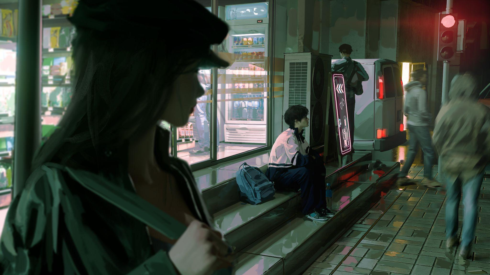

**VI**: Hi Dương vẫn ngồi trên bậc thềm trước cửa hàng tiện lợi, bộ đồng phục học sinh trên người đã giặt đến bạc màu, bờ vai gầy guộc, bên chân là chai nước khoáng đã dùng đi dùng lại nhiều lần. Nhìn thế nào cũng chỉ là một thiếu niên túng thiếu, thậm chí có phần lếch thếch, ngồi đó đợi cơm hộp giảm giá nửa giá sau bảy giờ rưỡi——thực sự chẳng thể nói là vẻ vang thể diện, thậm chí còn mang theo chút buồn cười khó tả.

**ZH**: 希扬还坐在便利店门口的台阶上， 身上那件校服已经洗得有些发白， 肩背清瘦，脚边放着那个反复用了许多次的矿泉水瓶。怎么看都只是个过分节俭、甚至有些落魄的少年，坐在那里等七点半后的半价便当 —— 实在谈不上体面，甚至还带着一点说不出的好笑。

**EN**: Suvan was still sitting there on the steps outside the convenience store, in that school uniform faded almost white with repeated washing, his shoulders thin, the reused water bottle beside his feet. Seen from any ordinary angle, he was nothing more than an absurdly frugal, slightly shabby boy, sitting there waiting for the seven-thirty discount meals—hardly dignified, almost faintly ridiculous.

**VI**: Thế nhưng ngay trong khoảnh khắc ấy, Nguyệt Nha Nhi bỗng cảm thấy, người này khác hẳn với tất cả những ai cô từng gặp trước đây.

**ZH**: 可就在那一瞬间，月牙儿忽然觉得，这个人和她从前见过的那些人都不一样。

**EN**: And yet, in that instant, Mahina felt that he was unlike anyone else she had ever known.

**VI**: Cảm giác đó lại khiến cô vô cớ nhớ đến chàng thanh niên đeo nửa chiếc mặt nạ, toàn thân toát ra kiếm khí, quyết tâm thích sát Tần Thủy Hoàng nọ. Bọn họ thực ra chẳng hề giống nhau, nhưng lại có một sự tương đồng khó tả nào đó. Rõ ràng biết thế đạo dơ bẩn, tiền đồ mờ mịt, nhưng vẫn kiên quyết không chịu dập tắt đốm lửa sáng le lói trong lòng.

**ZH**: 那感觉又让她莫名想起了那个戴着半张面具、一身剑气、决心刺杀秦始皇的青年。他们其实并不相像，可偏偏又有某种说不清的相似。明知世道污浊，前路未卜，却还是不肯熄掉心中的那抹光。

**EN**: For some reason he reminded her of that young man in the half-mask, all blade and resolve, determined to strike at Qin Shi Huang. In truth they looked nothing alike. And yet something in them felt the same. Both knew the world was filthy, both knew the road ahead was uncertain, and still neither would let the last bit of light inside them die.

**VI**: Nguyệt Nha Nhi đứng chôn chân tại chỗ nhìn vài giây, ánh mắt có phần ngơ ngẩn mơ hồ.

**ZH**: 月牙儿站在原地看了几秒，眼神有些恍惚。

**EN**: Mahina stood there for a few seconds, her gaze slightly unfocused.

**VI**: Trong màn đêm, ánh đèn xe lướt qua, tiếng người ồn ã hỗn độn, thiếu niên ấy vẫn ngồi yên bình lặng trên bậc thềm.

**ZH**: 夜色里，车灯流转，人声杂沓，那个少年依旧安安静静地坐在台阶上。

**EN**: In the night, headlights streamed past, voices rose and fell, and the city kept making its noise. But the boy still sat there, very quiet, on the steps.

**VI**: Cậu đang ngước nhìn lên những vì sao.

**ZH**: 他在仰望星空。

**EN**: He was looking at the stars.

**VI**: “Đời người là một tấm áo bào hoa lệ, nhưng bò đầy rận rệp.” — Trương Ái Linh (1940)

**ZH**: 生命是一袭华美的袍，爬满了蚤子 - 张爱玲 （1940）

**EN**: “Life is a gorgeous robe, crawling with fleas.” — Eileen Chang (1940)

**VI**: “Tất cả chúng ta đều đang sống trong cống rãnh, nhưng vẫn luôn có những kẻ ngước nhìn lên những vì sao.” — Oscar Wilde (1892)

**ZH**: 我们都生活在阴沟里，但仍有人仰望星空。 - 奥斯卡·王尔德（1892）

**EN**: “We are all living in the gutter, but there are still those who look up at the stars.” — Oscar Wilde (1892)
