# 云虫 - 第四章 命运之锥 · 一

---

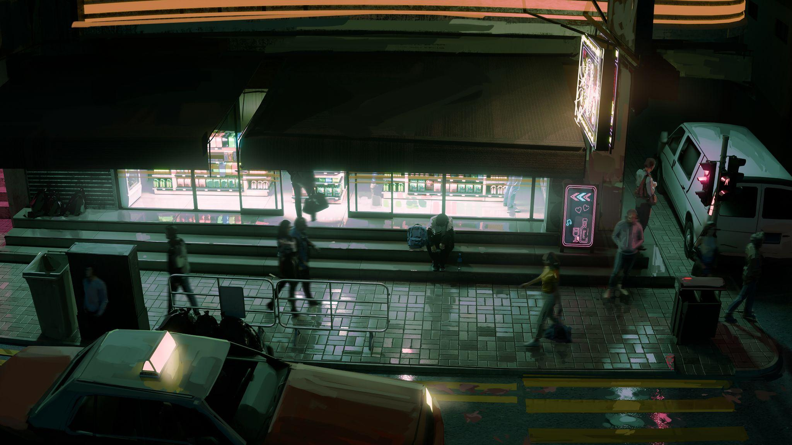

> 傍晚的便利店亮得发白，玻璃门一开一合，漏出一点热柜的暖气和食物的味道。  街上的天色已经沉下去了，潮湿的风贴着台阶慢慢吹过来，灯光落在地上，像一层冷冷的水。

> 希扬一个人坐在门口的台阶上，低着头，手肘搭在膝上，不知在想什么。书包放在脚边，还有一瓶半满的矿泉水，安安静静地立在那里。

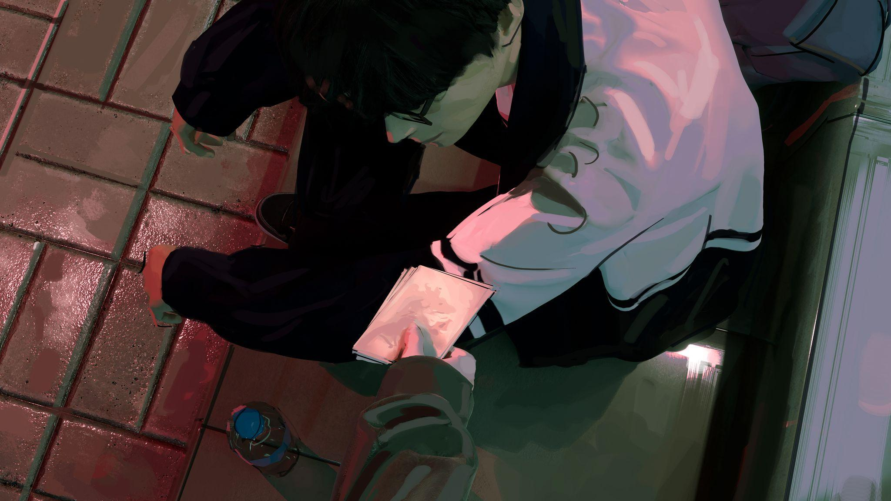

> 这时，一只手从旁边伸过来，轻轻拍了拍他的肩。

> 希扬回过头。

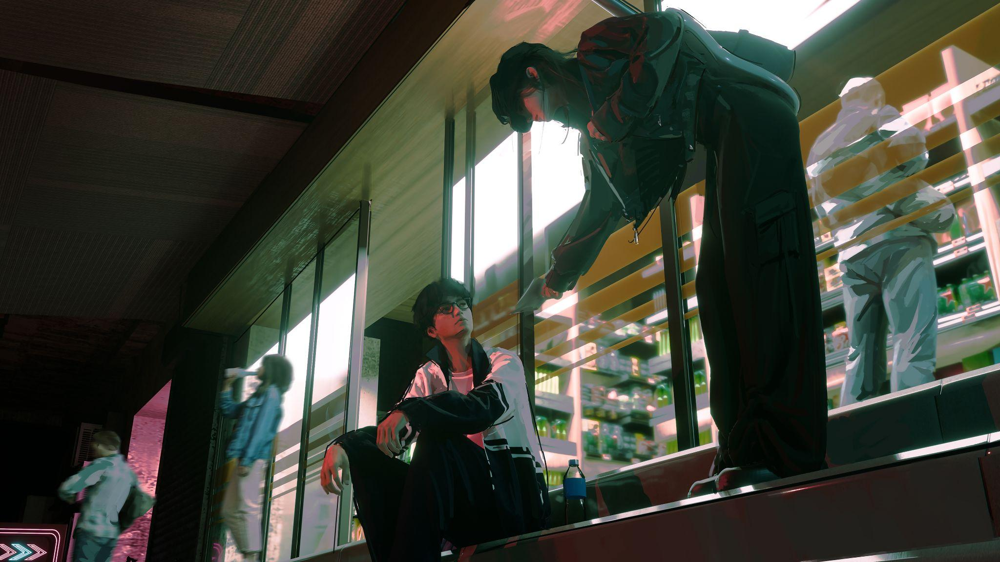

> 月牙儿正弯下腰，把一叠刚洗出来的照片递到他面前。

> 她这一天穿得和往常有些不一样，黑色的长裤，深色的短夹克，线条很利落，整个人像被夜色重新收束过一遍。  肩后还背着一把白色的贝斯，斜斜贴在身侧，在便利店冷白的灯光下显得格外扎眼。帽檐压得很低，几乎遮住了大半张脸，只留下灯光从侧面落下来，掠过她的鼻梁和唇角，映出一点冷冷的轮廓。

> 她低声道：

> “照片洗出来了。”

> 希扬接过那叠照片，低头翻了两张。

> “结果怎么样？”

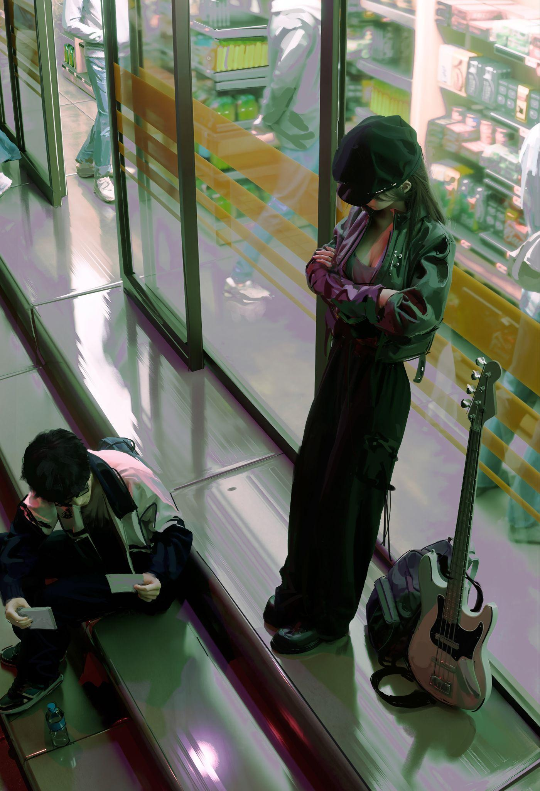

> 月牙儿靠到身后的玻璃上，抱起手臂，语气淡淡的。

> “跑了三家店，结果还是一样。全都过曝了。”

> 希扬没有说话，只把那几张照片一张张看过去。纸面上一片发白，像是被什么光狠狠灼过，原本该留下来的景物和人影几乎都被吞了进去，只剩下一些模糊不清的边缘。

> 月牙儿看着他，又补了一句：

> “不过也不算全废。有几张还能勉强看出一点东西。”

> 希扬抬起头。

> 月牙儿把帽檐往下压了压，声音很轻，像是在回想那一瞬间。

> “当时我脑子一片空白。等我反应过来手里还攥着相机的时候，张良他们已经转身要走了，最后只来得及在他们背过去的时候抓了几张。”

> 希扬把那几张单独抽出来，低头仔细看了一会儿。惨白模糊的底色里，果然还隐约压着两道背影，一高一低，边缘发散，像隔着一层旧梦，勉强还能看出人形。

> “这几张还在。”

> “嗯。”月牙儿淡淡道，“张良，还有那个刺客，背影都还剩一点。”

> 她停了一下，低头看着自己鞋尖，像是自嘲似的笑了笑。

> “不过拿这种东西给别人看，也没人会信吧。”

> 希扬捏着那几张照片，沉默了片刻，才轻声道：

> “至少它能证明一件事。”

> 月牙儿抬眼看他。

> 希扬也抬起头，看着她，声音很平静。

> “至少能证明，我们没有疯。那天看到的东西，也不是幻觉。”

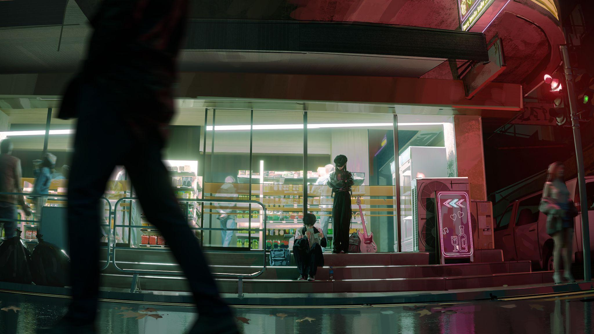

> 月牙儿安静了一瞬，帽檐下的神情看不分明，只是唇角那点淡淡的冷意，不知什么时候松了一点。她没接这句话，只是沉默了片刻，才轻声问：

> “你那边呢？”

> 希扬低头看着手里的照片，停了停才道：

> “差不多。白教授当晚就组了一个临时工作组，按我说的位置和参数又试了一次，用的是同样的设备，同样的频率，可最后还是什么都没有。云虫没再回应，像那天什么都没发生过一样。”

> 风吹过来，台阶边的一张小票被卷起来，在地上滚了半圈，又贴回墙角。

> “听起来，倒像是我们两个刚好撞见了一次不该撞见的事。”

> 希扬笑了笑，那笑意却很淡，像是连他自己也说不清这算不算运气。

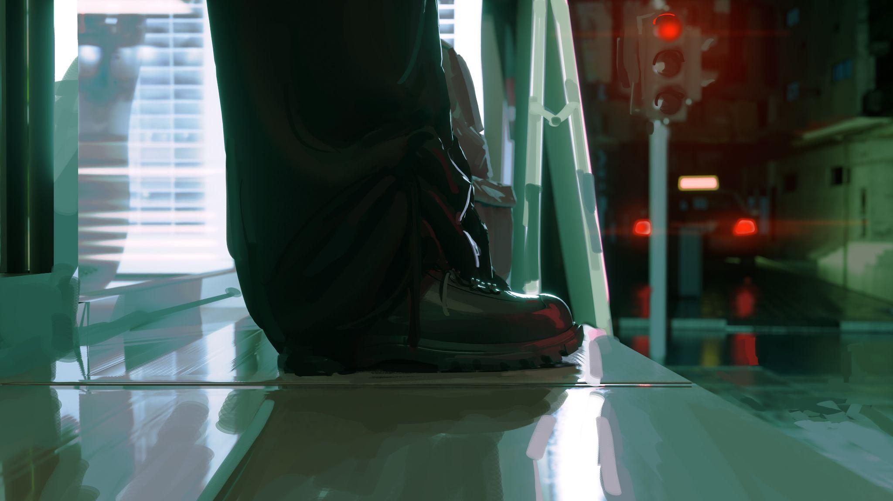

> 月牙儿低头看着脚边，声音也淡了下来：

> “那你老师他们现在，大概也觉得我们是在胡说了。”

> 希扬摇了摇头。

> “白教授信我。”

> 他说到这里顿了一下，目光落在台阶下潮湿发亮的地面上，

> “只是没有办法继续。工作小组是临时组的，设备、场地、人手，全都要往上报。如果一直什么都复现不出来，就不可能一直耗下去。”

> 月牙儿低低“哦”了一声，神情倒并不意外，像是早就猜到了结局。

> “所以还是停了。”

> “嗯。”

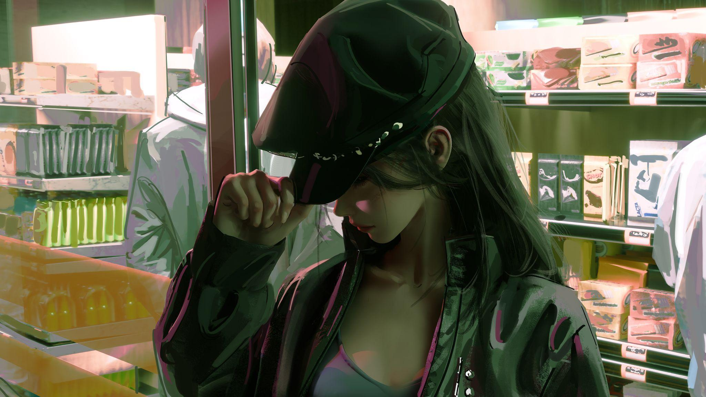

> 便利店的自动门又开了一次，一个提着塑料袋的中年人从里面走出来，经过他们面前时，脚步明显慢了一下。

> 他先是看了希扬一眼，随即目光就落到月牙儿身上，带着那种毫不掩饰的、饶有兴味的打量，从帽檐、外套、长裤，一直扫到她脚边那把白色的贝斯，像是在看什么不该出现在这里的东西。

> 月牙儿显然很熟悉这种目光。她没有抬头，只是把帽檐又往下压了压，动作很轻，却带着一种本能的抗拒，像是想把自己再往阴影里藏深一点。直到那人提着塑料袋慢悠悠走远，她才重新抬起眼，神情里有一点淡淡的不耐，却很快又沉了下去。

> 两人之间安静了一会儿。

> “你坐在这里做什么？”

> 月牙儿偏过头，忽然问道。

> 希扬看了看便利店门口跳动的电子钟，语气依旧平静。

> “等七点半。七点半以后，这里的便当会半价。”

> 月牙儿怔了一下，随即低低笑了。

> “原来高材生，也会做这种事。”

> 希扬没接这句，只是看着她，轻声问道：

> “你呢？这么晚了，还要去哪里？”

> 月牙儿淡淡道：“有个演出。”

> 希扬的目光落到她放在一旁的贝斯上，停了停，低声道：

> “酒吧？”

> 月牙儿没有否认，只是弯了弯嘴角，算是默认。

> 希扬沉默片刻，像是斟酌过，才轻声问了一句：

> “我能去看吗？”

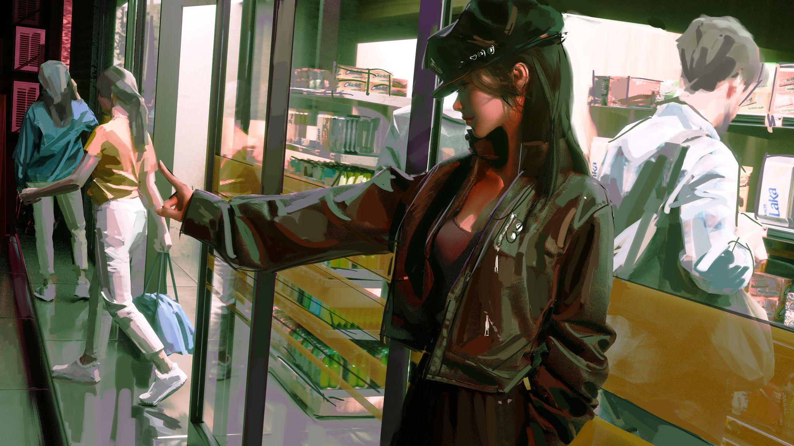

> 月牙儿一下笑了，抬起手，在他眼前慢悠悠地竖起一根手指，轻轻晃了晃。那意思很明白：不行。像他这样的人，不该去那种地方。

> 希扬也笑了笑，没有再追问。

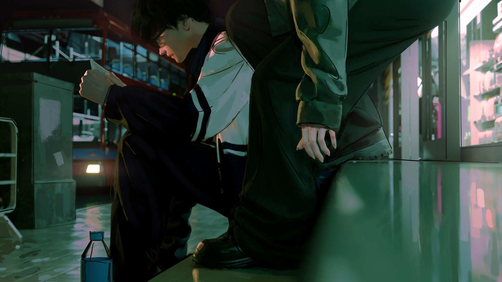

> 月牙儿抬手拨了拨颊边的碎发，顺势在他身边坐了下来，只是比他高出一截台阶。她坐下来的动作很轻，像只敏捷的猫，衣角擦过台阶边缘，也只带起一点极细微的声响，转眼就被夜里的风吞没了。

> 希扬只觉得她坐得很近。晚风从街口吹过来，夹带着她身上淡淡的香味，若有若无，却又让人无论如何都没法忽略。

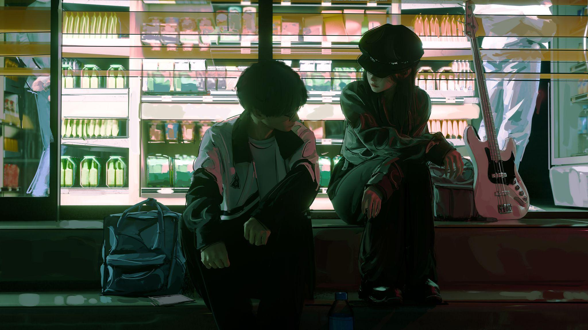

> 便利店的灯冷冷照在玻璃上，门口人来人往，夹杂着各种喧嚣的人声。

> 希扬低着头，手里还捏着那几张发白的照片，沉默了好一会儿，才忽然低声说了一句：

> “月牙儿，我们再去一次吧。去云虫脚下。”

> 月牙儿微微一怔，转过头看了他两秒，才淡淡开口：

> “现在去不了。它已经走到海上了，我们够不着。”

> “那就等它登陆以后。”

> 月牙儿轻轻摇了摇头，像是在说他把事情想得太简单了。

> “等它登陆，就已经到市区了。脚下那一带早就会被封起来，封锁线、警戒区、记录站，什么都会有。”

> 希扬抬起头，看着前面的街灯，停了一下，才说：

> “我已经和白教授申请过临时工作证了，两张。等它登陆以后，只要说我们是云虫观察记录员，就能进去。”

> 月牙儿听到这里，唇角轻轻弯了弯。

> “哦？”她把尾音拖得有些长，“我现在也算你们工作组的人了？”

> 希扬一时没接上话。

> 月牙儿看着他，忍不住又添了一句：

> “那你们给不给我发工资？”

> 希扬怔了一下，耳根隐约有点发热，神情却还是一本正经的。

> “要是有的话……”他顿了顿，声音低下来一点，“我的那份也给你。”

> 月牙儿憋住笑，低头压了压帽檐，只觉得这人认真得有点好玩。

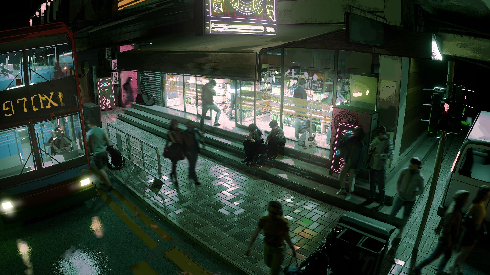

> 风吹过台阶边缘，把她放在膝上的那几张照片轻轻掀起一角。月牙儿伸手把它按住，笑意也渐渐淡了下去。她低头看着照片，沉默片刻，忽然轻声问：

> “你是不是觉得，只有我们两个，才能跟云虫说上话？所以你才非要再去一次，是不是？”

> 希扬沉默了一会儿，才轻轻点了点头。

> “白教授他们那边折腾了这么久，设备、参数、频率，什么都试过了，结果还是一点反应都没有。可偏偏是我们，偏偏是那一天，偏偏就在那个地方，收到了它的回信。”

> 月牙儿听完，低低笑了一声，那笑意很淡，倒更像一种自嘲。

> “你这个年纪的小孩，是不是都爱做这种救世主的梦？”

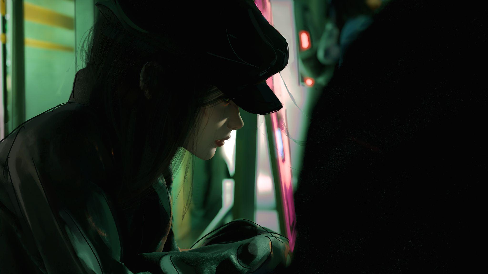

> 她把照片收回怀里，抱着膝盖，目光落在街对面那一片模糊的灯火上。

> “你看看我们两个，一个坐在便利店门口等半价便当，一个赶着去酒吧卖笑。拯救世界这种事，怎么想也不该轮到我们。不是更应该留给那些站在高处、正在享受这个世界的人吗？世界是他们的，当然也该由他们去救。”

> 希扬没有接话，只是安静地看着她。

> 月牙儿的声音慢慢低了下去，轻得像是要被风吹散。

> “何况，这个世界也没那么值得。”

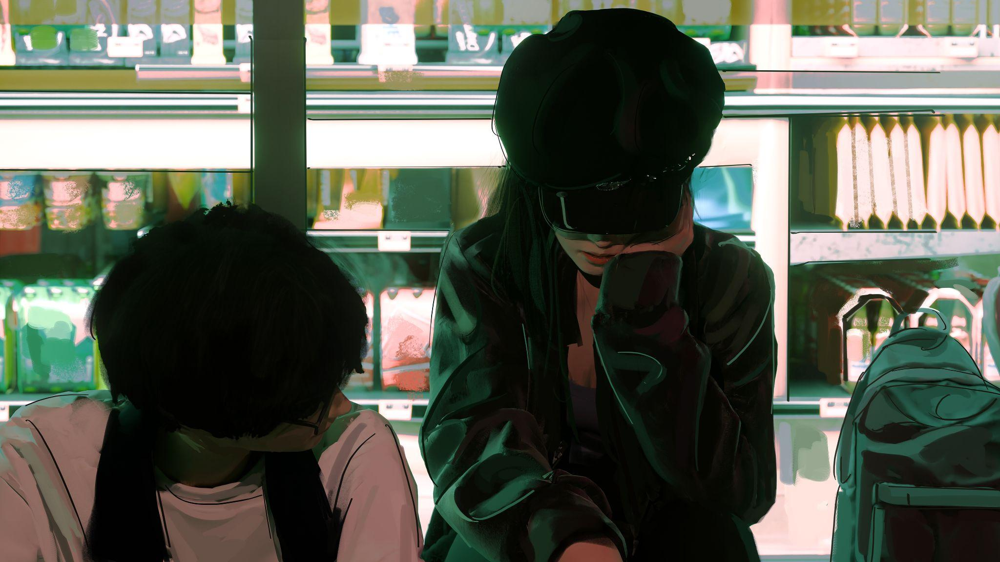

> 夜色已经完全沉下来了。便利店的白光照着她半张脸，帽檐却压得很低，把她眼里的神色遮去了大半。希扬转过头，像是想越过那片阴影，看清她的眼睛。他看了她一会儿，声音也跟着轻了下来，甚至带着一点试探的意味：

> “如果……我是说如果，真的有这样一个机会落到你手里，并不需要你做什么惊天动地的事，只要你举手之间，就能替这个世界做一个正确的选择——你会吗？”

> 月牙儿没有立刻回答。

> 她低着头，帽檐下的神情仍旧看不分明。过了很久，才淡淡开口：

> “这个世界不配。”

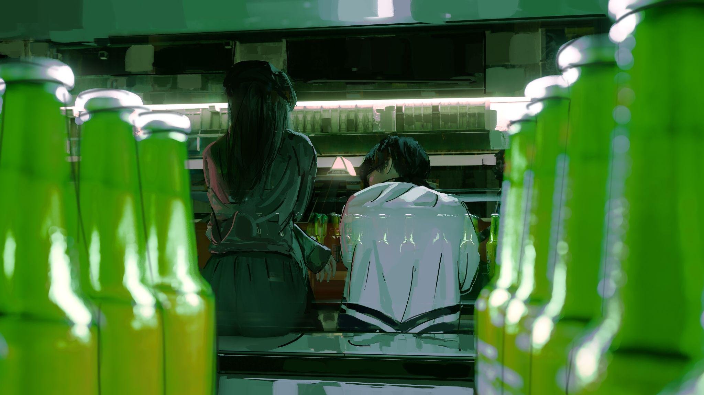

> 月牙儿说完这句话，自己也静了一下。她像是忽然觉得这话说得太重了，便低头笑了笑，语气也淡了几分。

> “算了。”她轻声道，“你应该听过这么一句话——生命是一袭华美的袍，爬满了蚤子。”

> 希扬安静地看着她，过了片刻，才低声开口：

> “那你也应该听过这一句。”

> 便利店冷白的灯光勾勒出少年清瘦的轮廓，他的声音里有一种很固执的平静。

> “我们都生活在阴沟里，”他说，“但仍有人在仰望星空。”

> 月牙儿微微怔了一下。

> 像是心里某个柔软的地方，被人极轻地碰了一下。她原本还想再搬出哪一句名言顶回去，可话到了嘴边，却忽然散了。

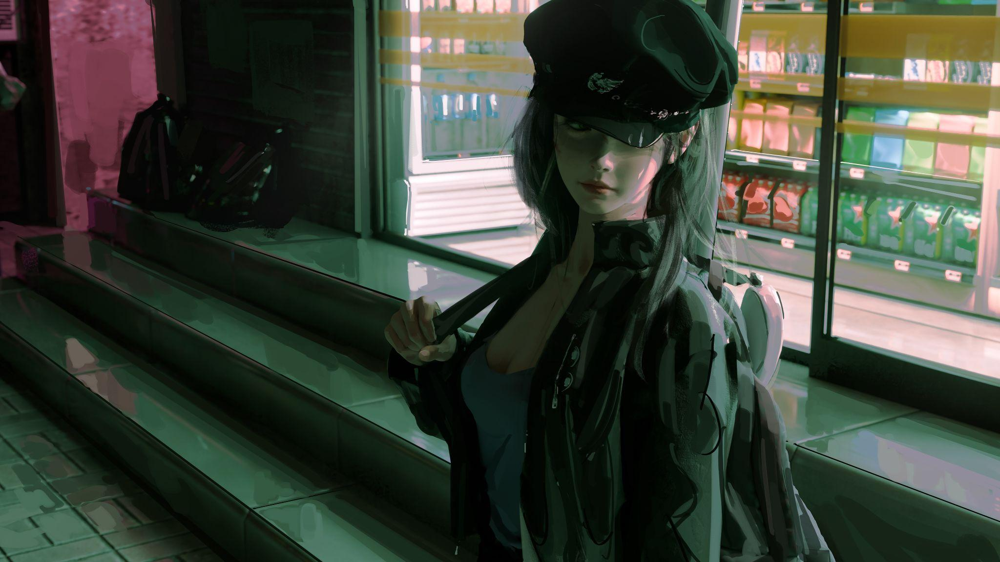

> 她沉默了片刻，终究什么也没再说，只把照片收好，站起身，把贝斯和背包重新背到肩上，转身朝街口走去。

> 走出几步，她又停了下来，回头看了他一眼。

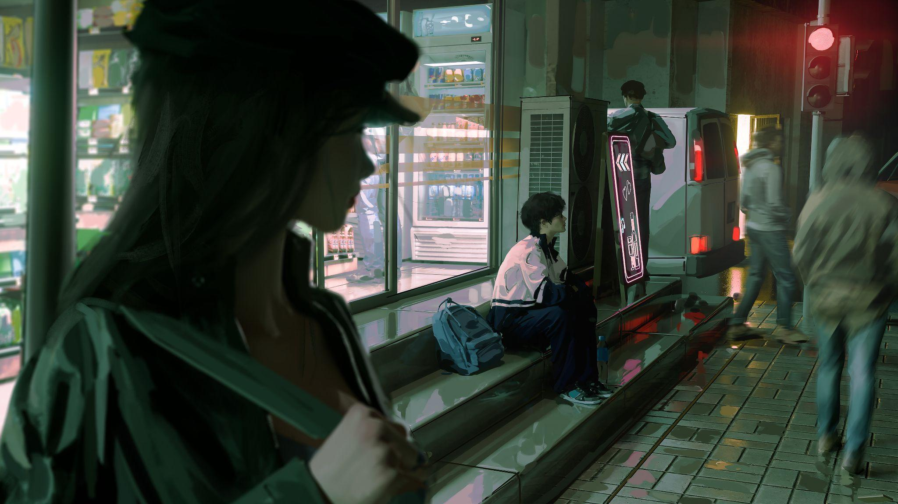

> 希扬还坐在便利店门口的台阶上， 身上那件校服已经洗得有些发白， 肩背清瘦，脚边放着那个反复用了许多次的矿泉水瓶。怎么看都只是个过分节俭、甚至有些落魄的少年，坐在那里等七点半后的半价便当 —— 实在谈不上体面，甚至还带着一点说不出的好笑。

> 可就在那一瞬间，月牙儿忽然觉得，这个人和她从前见过的那些人都不一样。

> 那感觉又让她莫名想起了那个戴着半张面具、一身剑气、决心刺杀秦始皇的青年。他们其实并不相像，可偏偏又有某种说不清的相似。明知世道污浊，前路未卜，却还是不肯熄掉心中的那抹光。

> 月牙儿站在原地看了几秒，眼神有些恍惚。

> 夜色里，车灯流转，人声杂沓，那个少年依旧安安静静地坐在台阶上。

> 他在仰望星空。

> 生命是一袭华美的袍，爬满了蚤子 - 张爱玲 （1940）

> 我们都生活在阴沟里，但仍有人仰望星空。 - 奥斯卡·王尔德（1892）

