# CloudInsect - Chapter 4: Cone of Fate · Part 2

*Original Title: 第四章 命运之锥 · 二*

---

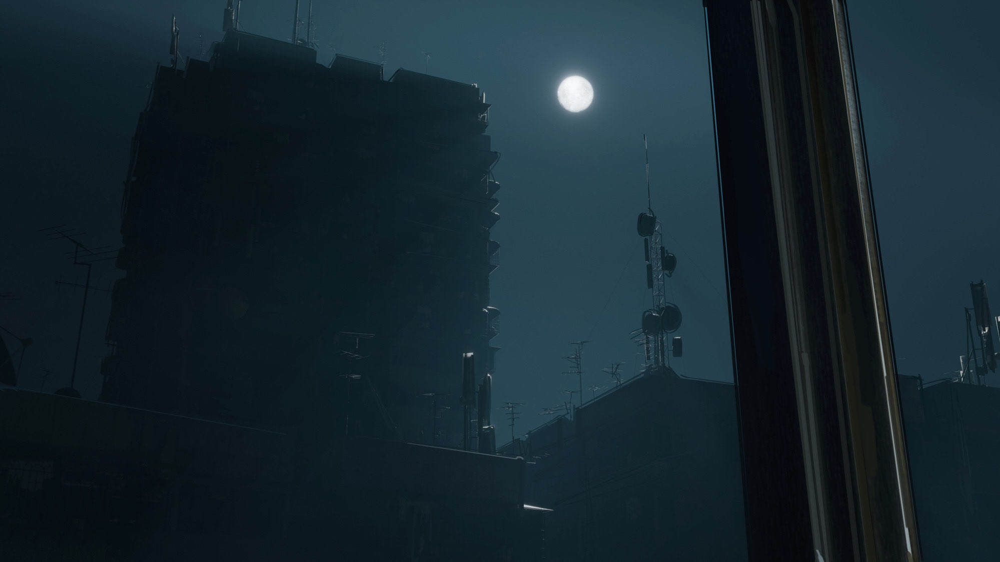

> It was already deep into the night.

> Only a small lamp was still on in the room, its dim yellow light falling across the corner of the desk, over the open books and sheets of calculations. Outside the floor-to-ceiling window, the city lights had thinned. Now and then, traffic slipped soundlessly past in the distance. Above them, there was only a vast black sky. The moon hung very high, so white it almost seemed inhuman.

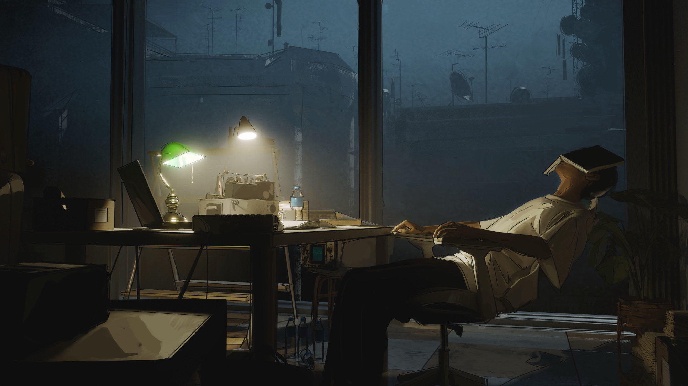

> Suvan lay back in the chair, a book turned facedown over his face, as if he had been reading and had been dragged away by his thoughts halfway through. Several books on field theory, relativity, and CloudInsect field observations lay open across his desk, their pages spread in dense layers.

> “Did the show go well?”

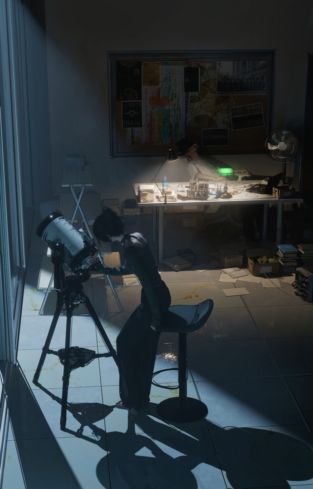

> “It was fine. Same as usual. Pretty lively.”

> Mahina answered absently while fiddling with the astronomical telescope. It was clearly her first time handling such a thing. She lowered her head and studied it for a long while, her movements carrying both curiosity and a trace of stubbornness. The rusty metal stand creaked softly as the eyepiece slowly rose, aiming toward the unusually bright moon in the night sky.

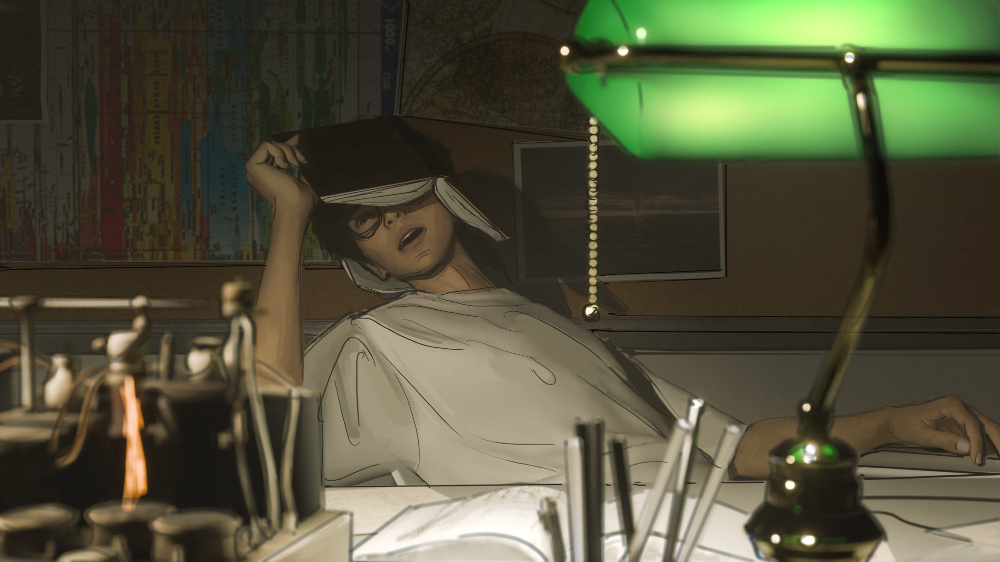

> Suvan lifted one corner of the book covering his face, turned his head to glance at her, and said:

> “Don’t look through the main eyepiece yet.”

> Mahina paused and looked over at him.

> Suvan raised a hand and pointed toward the side of the telescope.

> “See that little red-dot finder on the side? Move it slowly with the controller first. Put the red dot on whatever you want to look at, then adjust the main scope. Otherwise it’s hard to find anything.”

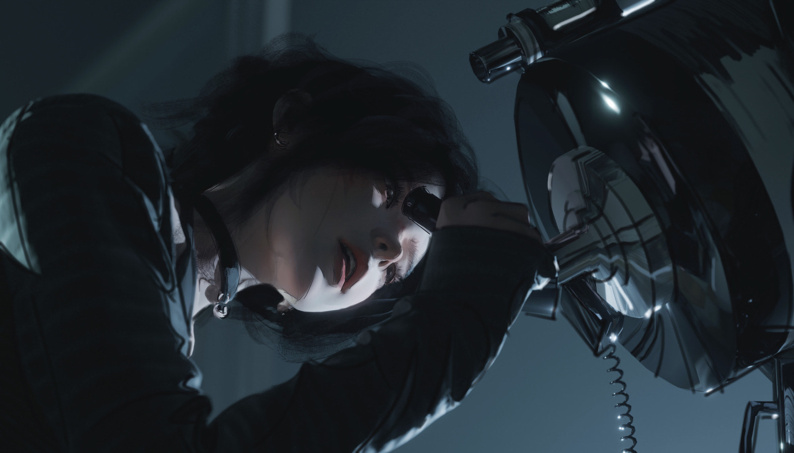

> Mahina followed his instructions and lowered her head to search. Sure enough, she found a tiny sight on the side. She began trying it his way, narrowing one eye slightly, her fingertips pressing the controller as she moved it bit by bit. The moon outside was startlingly bright. The red dot drifted through the dark for a long while before finally settling at the center of the lunar surface.

> She bent down and brought her eye close to the eyepiece. The next second, she let out a soft “wow.”

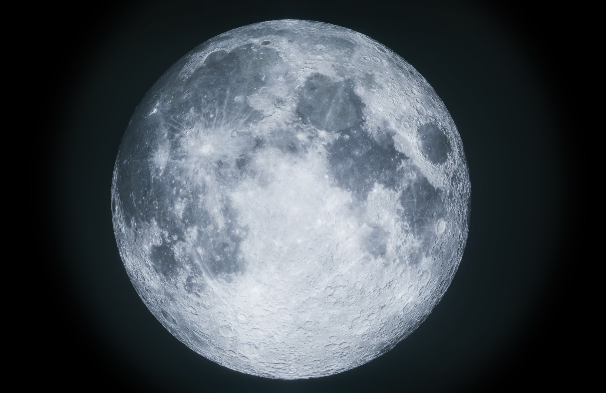

> The moon was suddenly astonishingly close: cold white, silent, its huge outline unnaturally sharp against the dark sky. The rough texture of its surface, the shadows of craters, the deep lunar maria all floated there in clear detail, so quiet it was almost solemn, like a pale and ancient face.

> Mahina looked through the eyepiece for a long time before asking softly:

> “Does it always show us only this side?”

> Suvan’s voice came from behind her, calm and brief:

> “Yes. Because the Moon’s orbital period and rotation period are the same. It circles Earth once, and in that same time it turns once on its own axis. So the side facing us is always the same side.”

> Mahina listened quietly, as if turning the fact over in her mind. Then she asked:

> “Is that a coincidence?”

> “Not exactly,”  Suvan said.  “There are two explanations. It depends which one you prefer.”

> Mahina moved her eye slightly away from the eyepiece.

> “What are they?”

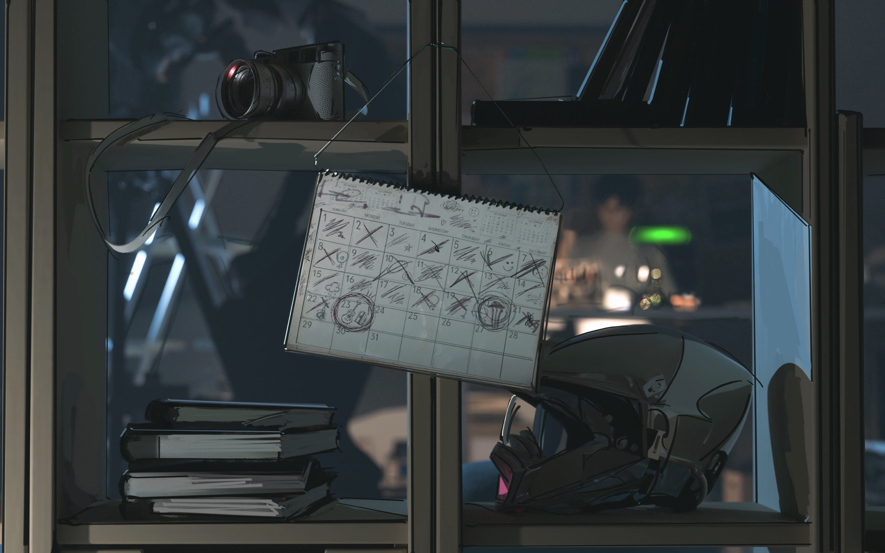

> “The first,”  he said slowly, twirling the pen in his hand once on the desk,

> “is that when the Moon first formed, its orbit and rotation were not synchronized. But over a very long time, Earth exerted tidal forces on it, gradually wearing away the difference in its rotation, until it was finally locked. We call that state tidal locking.”

> Mahina nodded, as if she understood, and naturally asked another question:

> “And the other one?”

> Suvan paused before saying lightly:

> “The second is much simpler.”  Suvan’s gaze fell on her white bass.  “Because the Moon doesn’t want anyone to see her other side.”

> Mahina froze for a moment, then quickly understood the meaning beneath his words.

> She did not answer. She only looked at the moon again for a while. After a long time, she said softly:

> “So this is what it feels like to see the moon with your own eyes. I had only seen it in books and on screens before. I always thought it was just a small white patch hanging far away in the sky. Now I realize it is larger than I imagined, and brighter too.”

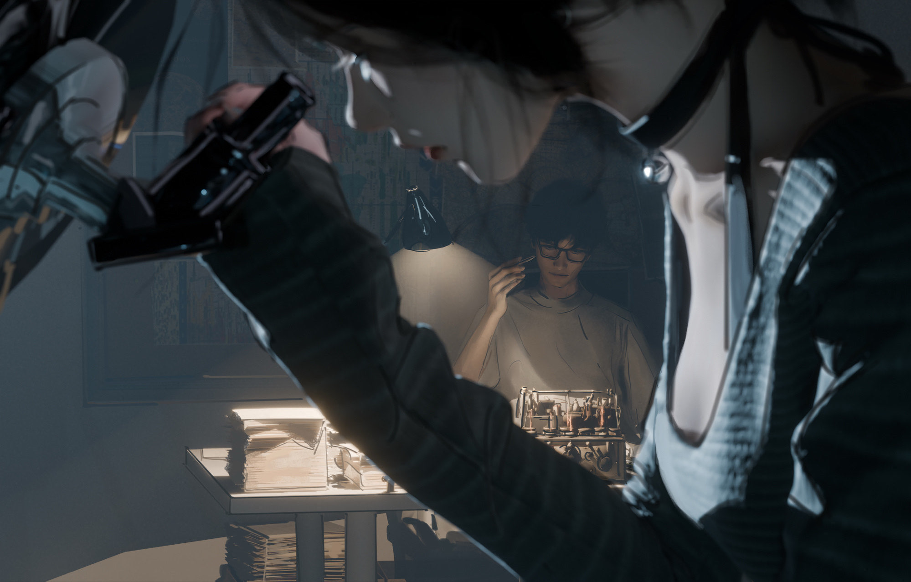

> She paused, then added in an even lighter voice:

> “But this light isn’t really its own, is it? It’s sunlight.”

> Suvan nodded gently.

> “Then how far is the Sun from the Moon?”  Mahina suddenly asked, as if thinking of something.

> Suvan sat in the old chair, his expression still calm, though something deeper seemed to settle inside that calm.

> After a moment, he said in a low voice:

> “Light takes eight and a half minutes.”

> “Eight and a half minutes? That doesn’t sound very far.”

> Suvan did not answer.

> In that instant, Mahina felt as if he wanted to say something, but in the end he did not. She did not press him either. She only lowered her gaze back to the moon. The night wind leaked slowly through the gap in the window, stirring the pale blue curtain ever so slightly.

> After a while of silence, she suddenly asked again:

> “Why do people always use light to measure distance?”

> “Because the speed of light is one of the most fundamental laws of this universe,”  he said.  “The speed of light is the limit for all ordered information. As long as you remain inside that law, nothing can truly cross it and arrive beyond the light cone.”

> “Beyond the Light Cone?”

> When Mahina heard the phrase “beyond the light cone,” her whole body grew alert.

> “Zhang Liang said that day that we were beyond the light cone.”  She looked at him.  “What does that mean? What is a light cone? What kind of place is beyond it?”

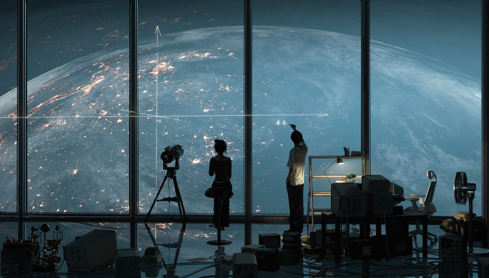

> “Come here. I’ll explain.”

> Suvan had already stood up. He picked up the pen from the desk, walked to the floor-to-ceiling window, and drew a horizontal line on the glass, then a vertical one. The pen tip scraped lightly across the surface.

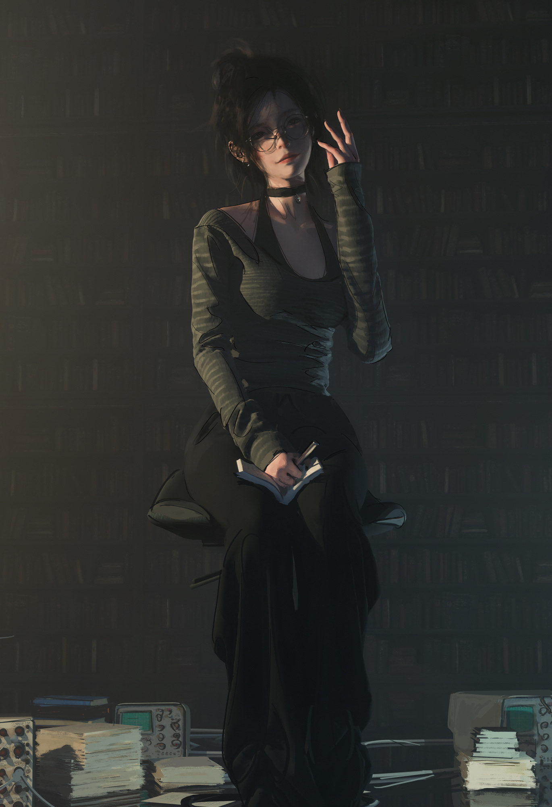

> From somewhere, Mahina produced a pair of round-framed glasses and put them on. Sitting on the high stool, she looked up at him with mock seriousness:

> “Then, Teacher Suvan, please begin your physics lesson.”

> Suvan was flustered enough by her teasing that he could only turn back and continue drawing the two axes on the glass.

> “This horizontal axis represents time. To the right is the future, to the left is the past. The origin is now.”

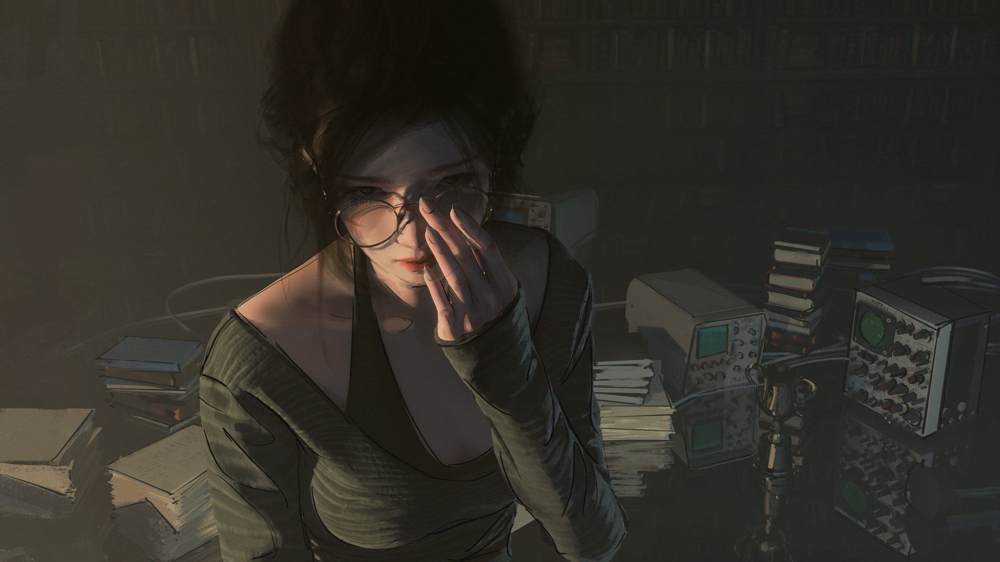

> Mahina adjusted her glasses and nodded seriously.

> “Understood. Now. The origin.”

> “The vertical axis, together with another axis you cannot see right now, forms space, or distance. This coordinate system is a spacetime coordinate system.”

> “Good,”  Mahina said.  “Spacetime coordinates.”

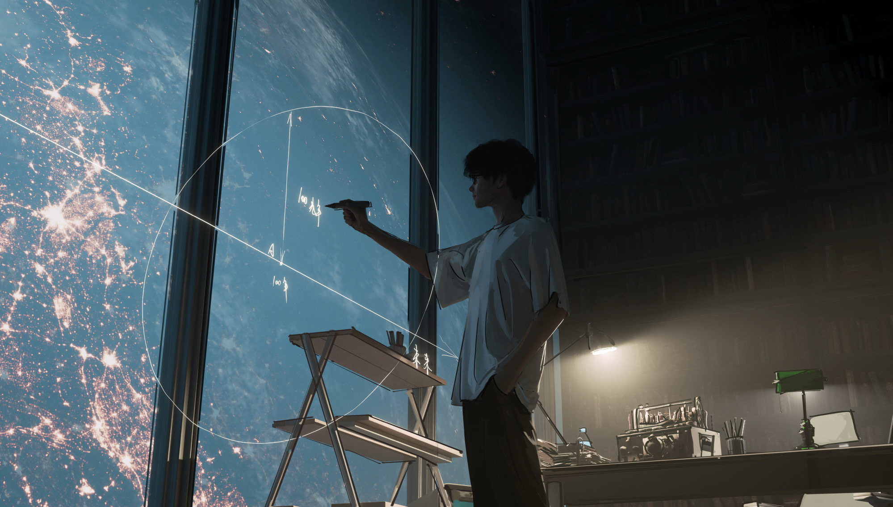

> “Suppose the spacetime position where you were born is the origin.”  Suvan moved to the right and marked a point on the time axis.  “And here is one hundred years later on the time axis. We’ll call it point A. Then, using point A as the center, draw a circle in the spatial plane with a radius of one hundred light-years. That circle is the theoretical boundary of where you can reach after one hundred years.”

> Mahina understood quickly.

> “Because nothing can move faster than light. So after one hundred years, the farthest you could theoretically reach would be one hundred light-years away.”

> “Right,”  Suvan said.  “Now connect that circle back to the origin. What does it look like?”

<video src="./media/light-cone-wall.mp4" controls loop muted playsinline width="100%"></video>

*(Ảnh tĩnh: 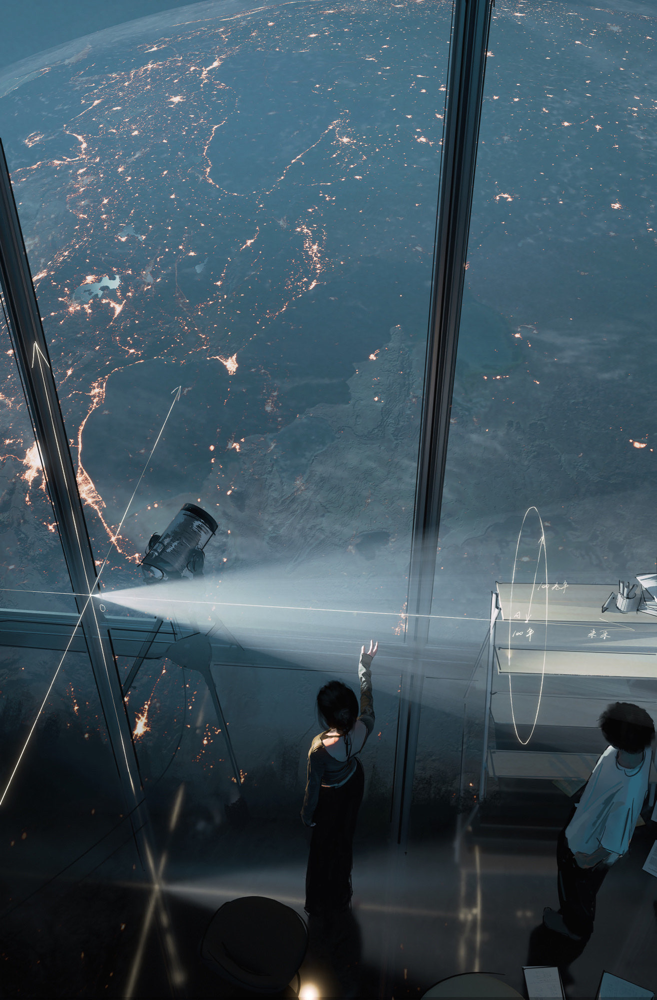)*

> Mahina narrowed her eyes and looked for a while.

> “A cone.”

> “Right,”  Suvan said.  “This is your light cone. All information about you can only exist within this range. Because ordered information can never exceed the speed of light, it can never break through the wall of this cone. Your existence, your influence, the places you can reach, the things you can make others know, all of it is confined within this range. For any point outside the light cone, information about you can never arrive. So from its perspective, you do not exist.”

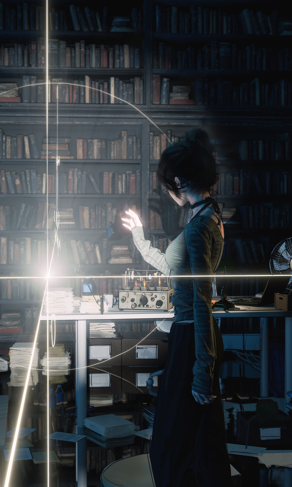

> Mahina stood up and reached forward, as if trying to touch the invisible wall of the light cone.

> “A prison,”  she said softly.

> Suvan said nothing.

> She stared at her own gently moving fingers, as if seeing fate flowing between them, sharp and faintly cold.

> “A cone-shaped prison, locking our entire lives inside it. No matter how long we live, we can never reach the outside.”

<video src="./media/falling-sand.mp4" controls loop muted playsinline width="100%"></video>

*(Ảnh tĩnh: 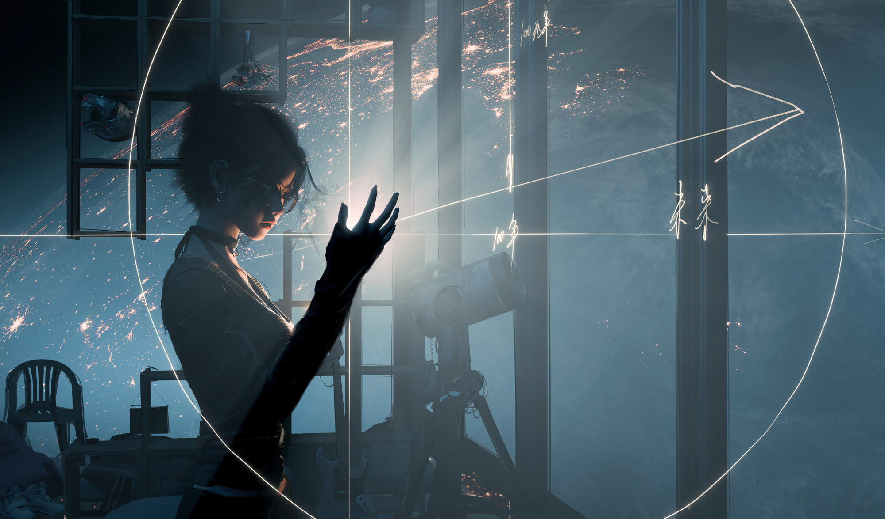)*

> Outside the floor-to-ceiling window, the moon’s cold light fell on the glass. The lines and words freshly written there glimmered faintly in the moonlight, their shadows slanting down over the two of them, like some silent order descending upon them.

> After a while, as if suddenly catching hold of something, she looked up and asked him:

> “But what you just said was that ordered information has the speed of light as its limit. Does that mean there is another kind of thing called unordered information that can break past light speed?”

> Suvan finally smiled. As expected, with her sharpness, she had quickly caught that thread.

> “Yes,”  he said.  “Unordered information.”

> Mahina stared at him, the light in her eyes slowly brightening.

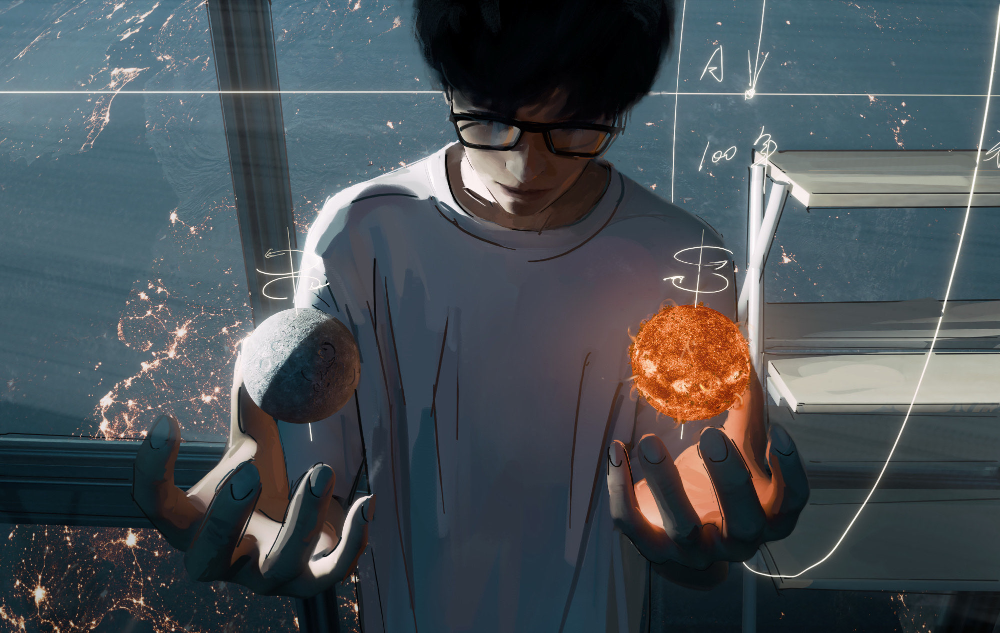

> “You can understand it like this for now. Suppose I have two elementary particles in my hand. Both are spinning, randomly clockwise or counterclockwise, with no fixed pattern. After some kind of physical binding, they enter a very special state. No matter how far apart they are, their changes remain instantaneously synchronized. However one spins, the other spins the same way.”

> Mahina caught on quickly:

> “Quantum entanglement?”

> “Yes.”  Suvan nodded.  “You can understand it first as the simplest model of quantum entanglement.”

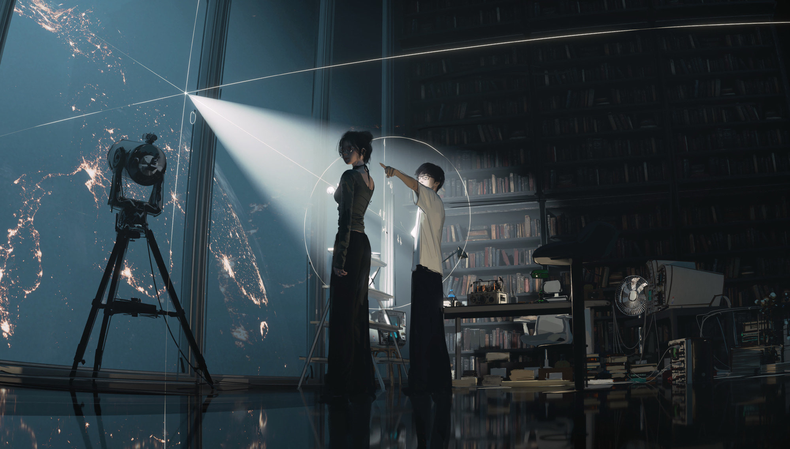

> He pointed toward the left side of the time axis, as if pointing toward some extremely distant place.

> “Now I send one of the particles somewhere very, very far away. A hundred million light-years away, or—”

> He paused.

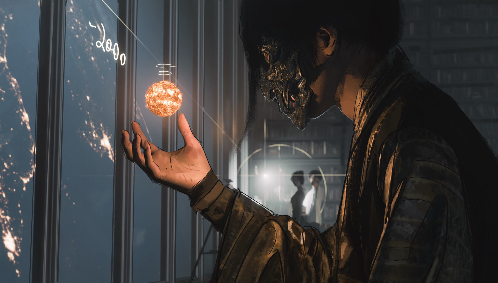

> “To Zhang Liang’s hand, two thousand years ago.”

> Mahina’s gaze tightened slightly.

> “Both of these positions, whether in space or in time, are beyond the light cone for us now.

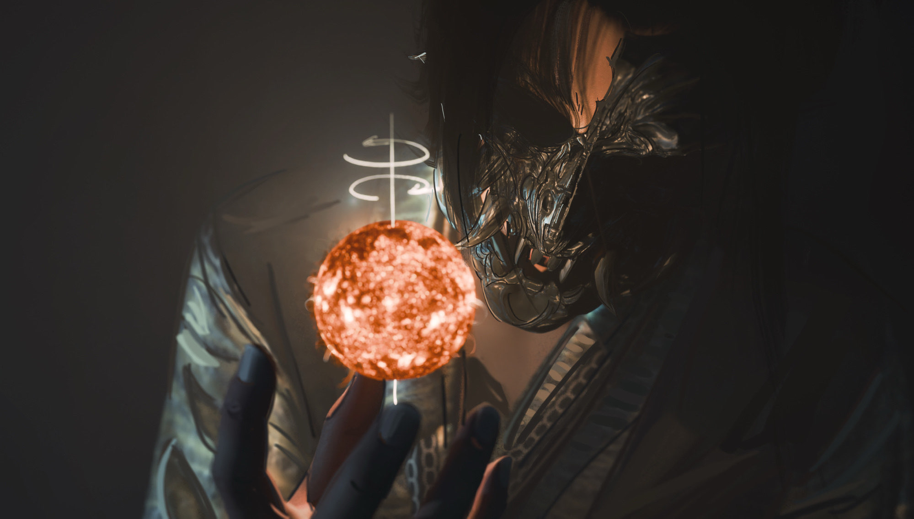

> And if these two particles remain entangled, then when Zhang Liang sees the particle in his hand produce a spin sequence of clockwise, counterclockwise, clockwise, he will know that the one in my hand has produced the same sequence at this very moment.”

> “In other words,”  Mahina said softly,  “this information reached two thousand years into the past.”

> “Yes,”  Suvan said.  “This information has already crossed the speed of light and arrived beyond the light cone.”

<video src="./media/cloudinsect-home-bg-v2.mp4" controls loop muted playsinline width="100%"></video>

*(Ảnh tĩnh: 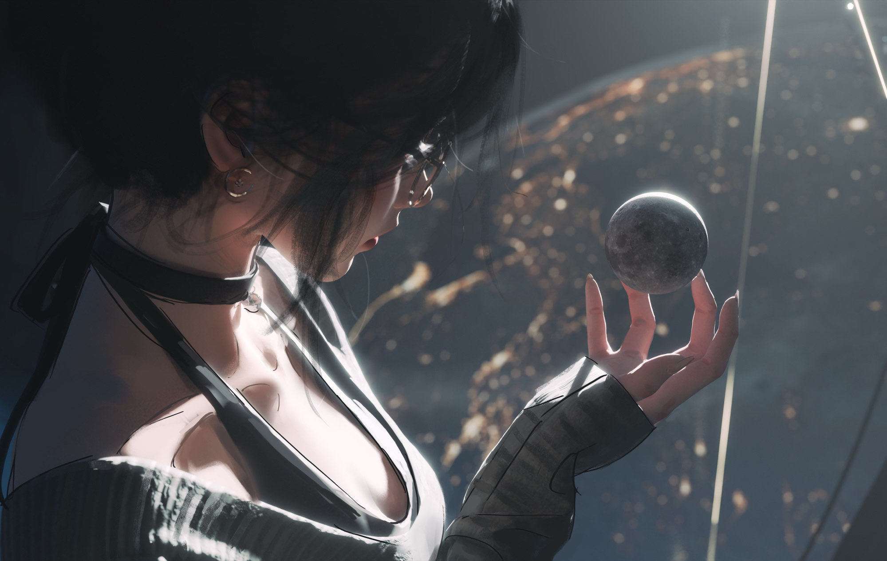)*

> Mahina frowned.

> “I’ve only heard of quantum entanglement across space. Can it happen across time too?”

> “Yes. At the mathematical level, the entanglement quotient can be used to infer that entanglement also exists along the time axis.”

> “So does that mean, in theory, by relying on quantum entanglement, we could communicate in real time with places several light-years away, even transmit information beyond spacetime?”

> Suvan shook his head.

> “No.”

> “Why?”

> “That is the catch. Because it is unordered information,”  Suvan said.  “It is synchronized, but it is random in itself. Neither you nor Zhang Liang can decide whether the next spin will be clockwise or counterclockwise. We can only see what happens. We cannot control what happens.”

> Mahina thought for a moment, then asked again:

> “What if there were a technology that could control its spin?”

<video src="./media/turn.mp4" controls loop muted playsinline width="100%"></video>

*(Ảnh tĩnh: 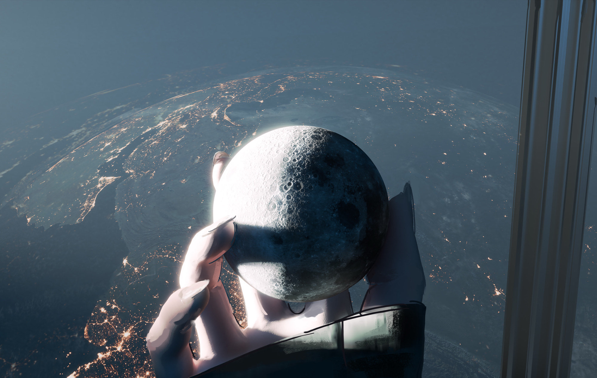)*

> Suvan’s voice slowed.

> “If you reached out now and seized this particle, forcing it to spin the way you wanted. Counterclockwise, clockwise, counterclockwise, counterclockwise. If you carved a meaningful sequence into it and used it to tell Zhang Liang: the King of Qin is in the rear carriage.”

> Mahina’s breath caught softly.

> “What would happen?”

> Suvan stopped the pen tip between those two points and drew a light stroke, as if cutting an invisible thread.

> “Then this information would no longer be unordered. And once it becomes ordered information and is observed beyond the light cone, the entanglement collapses. The connection between the two particles breaks at once, and synchronization can no longer be maintained.”

> “So this information can never reach Zhang Liang’s hand.”

> “Never.”

> Suvan paused, as if deliberately leaving her some time to think.

> “Do you remember when we were transported away the first time we met Gongsun Yang?”

> Mahina followed his words back through her memory, then slowly said:

> “It was when I called him Shang Yang.”

> “Right,”  Suvan said.  “Because at that time, he was not Shang Yang yet. He was only Gongsun Yang. Only later, after his reforms succeeded and he was enfeoffed in the land of Shang, did he receive the name ‘Shang Yang.’ That sentence of yours was ordered information from later generations. It was no longer ordinary conversation. It was changing his understanding of his own fate. Once information like that is spoken, the passage immediately cuts off.”

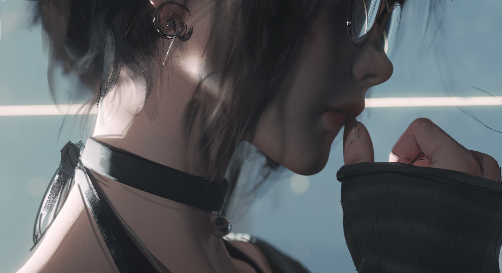

> She only looked at the lines on the window, feeling a chill slowly rise along her back. It was as if many scattered fragments had finally locked together at that moment.

> “No wonder, when I wanted to tell Zhang Liang which carriage the King of Qin was in, you stopped me at once. You weren’t afraid I would change history. You were—”

> Suddenly, as if remembering something, Mahina jolted upright.

> “No wonder...”

> Suvan raised his eyes.

> “What?”

> Mahina looked at him, her expression growing complicated little by little.

> “No wonder... Emperor Guangwu of Han—”

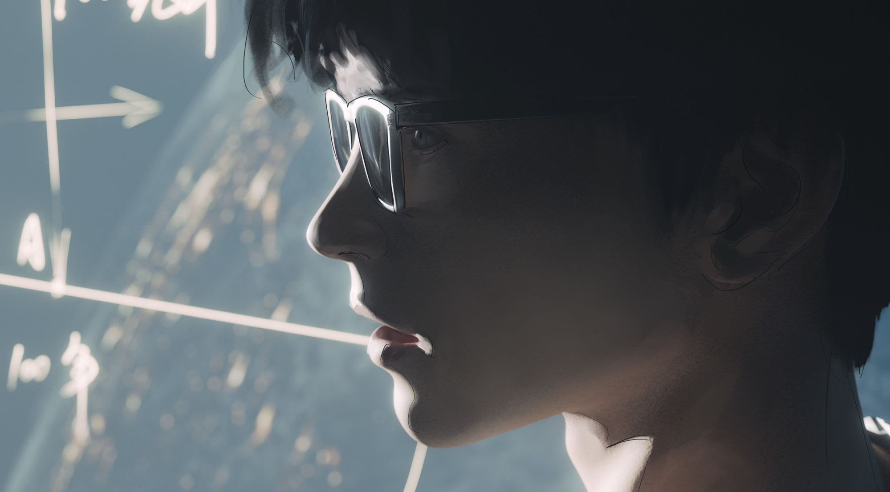

> Suvan froze for a moment.

> “Emperor Guangwu of Han?”

> Mahina did not explain at once. She only frowned, as if piecing together an old and distant memory she had always taken for a hallucination.

> “I think... I may have encountered it once before.”

> Suvan’s expression turned unusually grave.

> “When?”

> “In Tibet,”  Mahina said quietly.  “That time I went chasing after the Pangu CloudInsect.”

> She paused, as if recalling the air and wind of the plateau.

> “At the time, I always thought it was altitude sickness, or lack of oxygen. I thought I had only had a long, strange dream.”

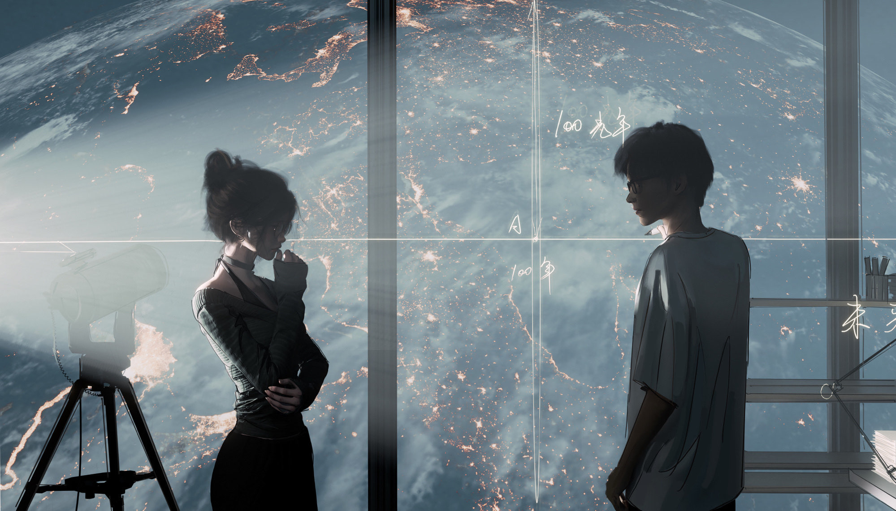

> Suvan’s hand froze in midair, his gaze fixed tightly on her face.

> “Who did you see?”

> Mahina was silent for a while.

> Outside the window, the moon still hung there, quiet and pale. She lowered her head, as if finally touching that name from the depths of memory.

> “Xiang Yu.”

> When she finished speaking, she raised her eyes to Suvan. Her gaze was deep, as if it still held another name she had not said aloud.

