# Vân Trùng - Chương 4: Nón Định Mệnh · II

---

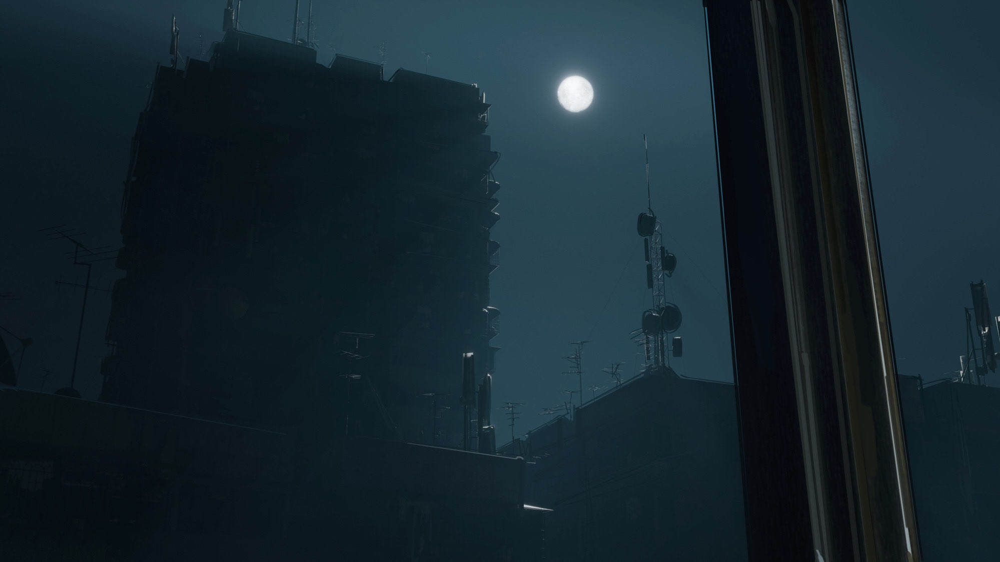

* **Lời thoại / Nội dung phát ra:**
  > *(Đêm đã khuya lắm rồi. Trong phòng chỉ còn bật một ngọn đèn nhỏ, ánh sáng vàng mờ rọi xuống góc bàn, phủ lên những trang sách mở rộng và đống giấy nháp chi chít phép tính. Ngoài khung cửa sổ sát đất, ánh đèn đô thị đã thưa thớt dần, xa xa thi thoảng có vài vệt xe cộ lướt qua trong câm lặng, chếch lên trên chỉ còn lại cả một bầu trời đen thẳm, vầng trăng treo lơ lửng trên cao, trắng bệch đến mức gần như vô tình lãnh đạm.)*

---

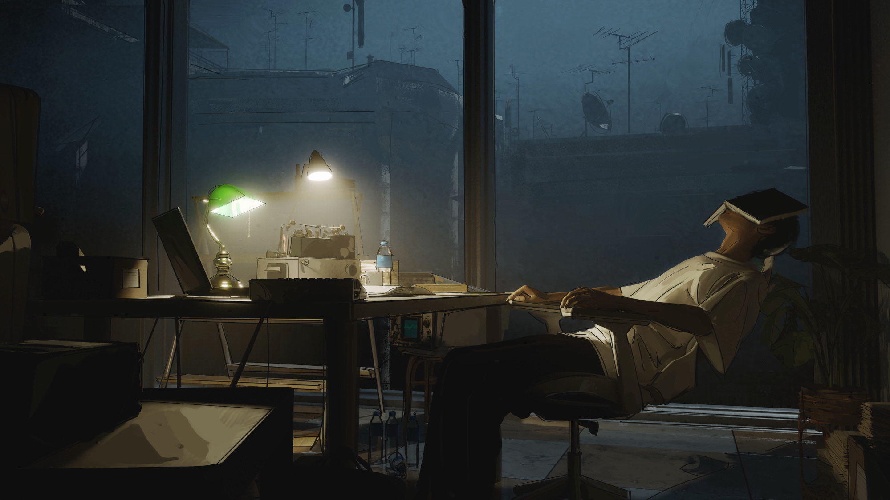

* **Chữ trong ảnh:** Các tài liệu, ghi chép quan trắc trường Vân Trùng, sách lý thuyết trường và thuyết tương đối trải rộng trên bàn.
* **Lời thoại / Nội dung phát ra:**
  > *(Hi Dương tựa lưng vào ghế, một cuốn sách úp ngược lên mặt, tựa hồ ban nãy đang đọc dở thì bị dòng suy nghĩ cuốn trôi đi mất. Trên bàn cậu trải la liệt mấy cuốn sách về lý thuyết trường, thuyết tương đối và các bản ghi quan trắc trường Vân Trùng, các trang giấy xếp dày đặc san sát nhau.)*
  > 
  > **[Hi Dương]** "Buổi diễn thuận lợi chứ?"

---

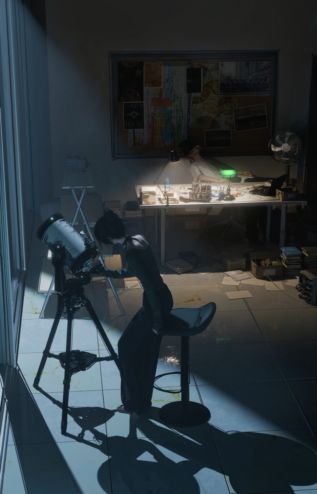

* **Lời thoại / Nội dung phát ra:**
  > **[Nguyệt Nha Nhi]** "Cũng tàm tạm, vẫn như mọi khi, khá là náo nhiệt."
  > 
  > *(Nguyệt Nha Nhi vừa lơ đãng đáp lời, vừa táy máy chiếc kính thiên văn kia. Rõ ràng đây là lần đầu tiên cô chạm vào thứ đồ chơi này, cúi đầu nghiên cứu hồi lâu, trong từng cử động mang theo chút tò mò mới mẻ, lại phảng phất cả sự bướng bỉnh không chịu thua. Khung kim loại đã rỉ sét của kính thiên văn khẽ phát ra tiếng cọt kẹt, thị kính từ từ nâng cao lên, nhắm chuẩn vào vầng trăng sáng dị thường trên bầu trời đêm.)*

---

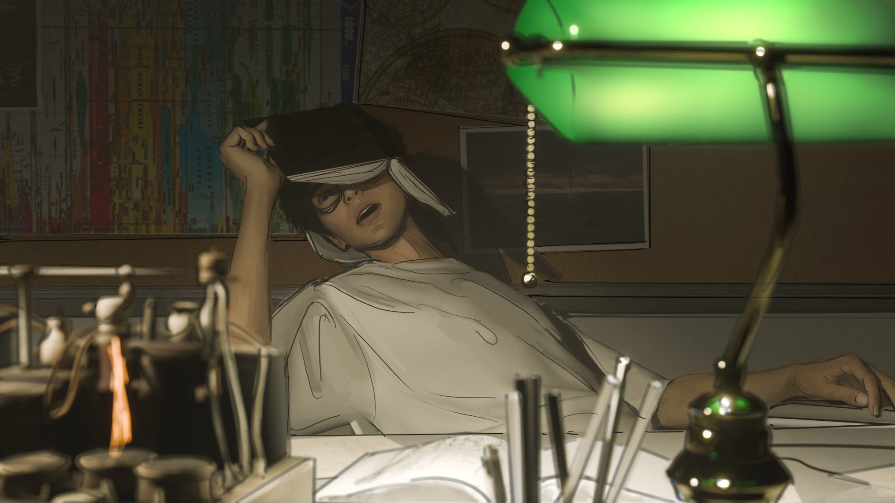

* **Lời thoại / Nội dung phát ra:**
  > *(Hi Dương lật một góc cuốn sách đang che trên mặt lên, nghiêng đầu liếc nhìn cô một cái, mở lời:)*
  > 
  > **[Hi Dương]** "Khoan vội nhìn qua thị kính."
  > 
  > *(Nguyệt Nha Nhi khựng lại, nhìn sang phía cậu. Hi Dương giơ tay chỉ chỉ vào cạnh bên của kính thiên văn.)*
  > 
  > **[Hi Dương]** "Có thấy kính ngắm chấm đỏ ở bên cạnh không? Dùng cần gạt điều chỉnh từ từ trước, để chấm đỏ bên trong nhắm đúng vào điểm cậu muốn nhìn, rồi hẵng chỉnh kính chính, nếu không cậu rất khó định vị được đâu."

---

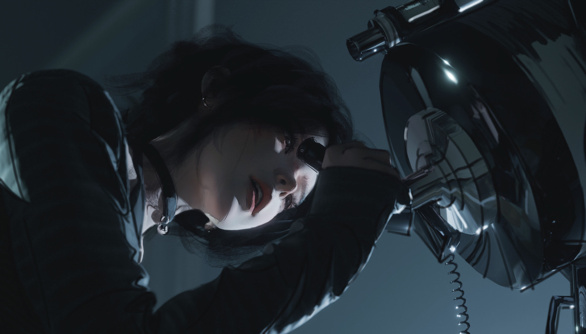

* **Lời thoại / Nội dung phát ra:**
  > *(Nguyệt Nha Nhi làm theo lời cậu, cúi đầu tìm kiếm, quả nhiên thấy một kính ngắm rất nhỏ ở bên hông. Cô bắt đầu thử theo hướng dẫn của cậu, khẽ nheo một bên mắt, đầu ngón tay bấm cần điều khiển, nhích từng chút từng chút một đổi hướng. Vầng trăng bên ngoài sáng đến kinh ngạc, chấm đỏ chậm rãi dịch chuyển trong bóng tối một hồi lâu, cuối cùng mới từ từ dừng lại ngay chính giữa mặt trăng. Cô cúi người xuống, ghé sát mắt vào thị kính, ngay giây tiếp theo, liền buột miệng thốt lên một tiếng “oa” khe khẽ.)*

---

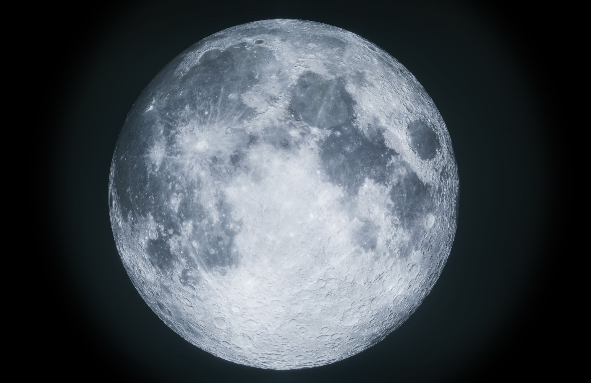

* **Lời thoại / Nội dung phát ra:**
  > *(Mặt trăng bỗng chốc gần đến kinh ngạc, lạnh lùng, trắng bệch, tĩnh lặng, vầng sáng khổng lồ nổi bật sắc nét trên nền trời đêm tăm tối. Bề mặt gồ ghề thô ráp, bóng tối của các miệng núi lửa hình khuyên, những biển trăng sâu thẳm, tất cả đều hiện lên rõ mồn một nơi đó, tĩnh lặng đến mức gần như trang nghiêm, tựa như một gương mặt cổ xưa và nhợt nhạt. Nguyệt Nha Nhi cứ ghé mắt nhìn qua thị kính như vậy hồi lâu, rồi mới khẽ hỏi:)*
  > 
  > **[Nguyệt Nha Nhi]** "Có phải nó luôn chỉ quay một mặt này về phía chúng ta không?"
  > 
  > *(Giọng Hi Dương từ phía sau lưng truyền tới, bình thản và ngắn gọn:)*
  > 
  > **[Hi Dương]** "Đúng vậy. Bởi vì chu kỳ quay quanh Trái Đất và chu kỳ tự quay của Mặt Trăng là như nhau, nó quay quanh Trái Đất một vòng thì bản thân nó cũng vừa vặn tự quay hết một vòng, cho nên hướng về phía chúng ta vĩnh viễn luôn luôn chỉ là một mặt này mà thôi."
  > 
  > *(Nguyệt Nha Nhi yên lặng lắng nghe, dường như đang ngẫm nghĩ lại điều này trong đầu, sau đó lại hỏi:)*
  > 
  > **[Nguyệt Nha Nhi]** "Đây là chuyện trùng hợp ngẫu nhiên sao?"
  > 
  > **[Hi Dương]** "Cũng không hẳn là trùng hợp. Về chuyện này có hai cách giải thích, xem cậu thích cách nào hơn."
  > 
  > *(Nguyệt Nha Nhi hơi dời mắt khỏi thị kính một chút.)*
  > 
  > **[Nguyệt Nha Nhi]** "Hai cách nào?"

---

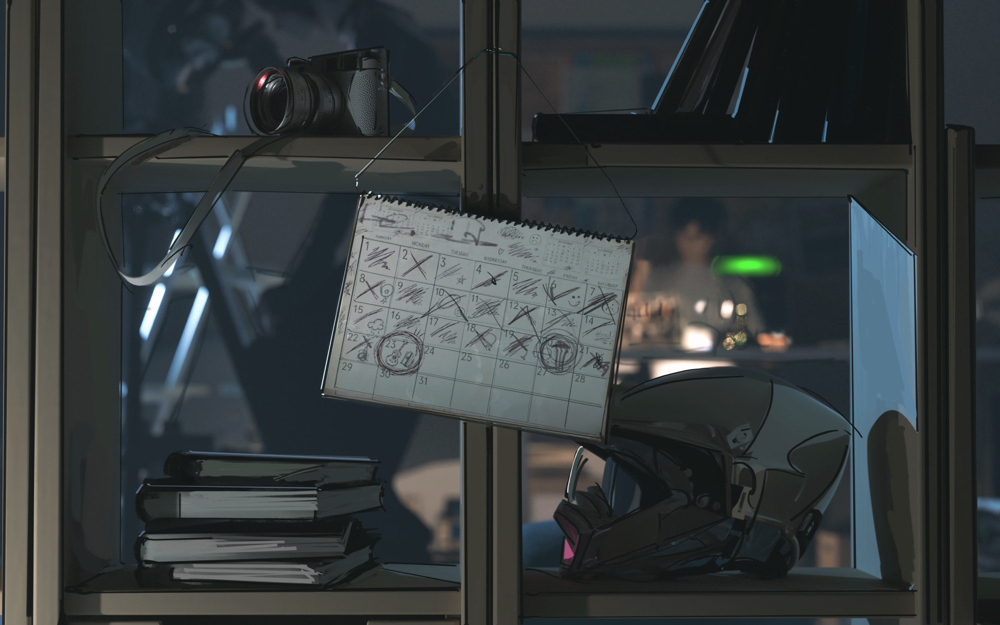

* **Lời thoại / Nội dung phát ra:**
  > **[Hi Dương]** "Cách thứ nhất: Khi Mặt Trăng mới hình thành, chuyển động quay quanh quỹ đạo và chuyển động tự quay không hề đồng bộ với nhau. Nhưng trong suốt quãng thời gian đằng đẵng, Trái Đất tác động lực thủy triều lên nó, từ từ triệt tiêu đi sự chênh lệch trong tốc độ tự quay, cuối cùng khóa chặt nó lại. Trạng thái này hiện nay chúng ta gọi là 'Khóa Thủy Triều' (Tidal locking)."
  > 
  > *(Nguyệt Nha Nhi gật đầu như đã hiểu, rồi thuận miệng hỏi tiếp:)*
  > 
  > **[Nguyệt Nha Nhi]** "Thế còn cách thứ hai?"
  > 
  > *(Hi Dương ngừng lại một nhịp, ánh mắt rơi xuống cây đàn bass màu trắng của cô, rồi mới nhàn nhạt nói:)*
  > 
  > **[Hi Dương]** "Cách thứ hai thì đơn giản hơn nhiều. Bởi vì Mặt Trăng không muốn để người khác nhìn thấy mặt còn lại của mình."
  > 
  > *(Nguyệt Nha Nhi thoáng ngẩn người, rất nhanh đã hiểu ra ngụ ý sâu xa trong lời nói ấy. Cô không tiếp lời câu nói đó, chỉ hướng mắt nhìn về vầng trăng thêm một lúc, hồi lâu sau mới khẽ nói:)*
  > 
  > **[Nguyệt Nha Nhi]** "Hóa ra tận mắt ngắm nhìn Mặt Trăng như thế này lại mang lại cảm giác này. Trước đây tôi chỉ thấy nó trên sách báo và màn hình, luôn nghĩ nó chỉ là một mẩu màu trắng treo lơ lửng nơi xa xăm. Đến giờ mới phát hiện, nó to lớn hơn và cũng sáng hơn rất nhiều so với tưởng tượng của tôi."

---

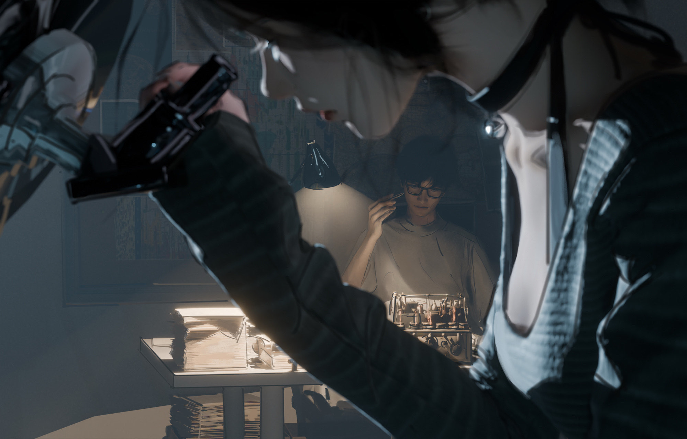

* **Lời thoại / Nội dung phát ra:**
  > *(Cô ngập ngừng một chút, rồi lại khẽ bồi thêm một câu:)*
  > 
  > **[Nguyệt Nha Nhi]** "Nhưng những ánh sáng này vốn dĩ cũng đâu phải của riêng nó, mà là ánh sáng từ Mặt Trời phản chiếu lại thôi."
  > 
  > *(Hi Dương khẽ gật đầu.)*
  > 
  > **[Nguyệt Nha Nhi]** "Thế giữa Mặt Trời và Mặt Trăng... cách nhau bao xa?"
  > 
  > *(Hi Dương ngồi trên chiếc ghế cũ, nét mặt vẫn bình lặng như trước, chỉ là trong sự bình lặng ấy dường như thoáng rơi vào một tầng cảm xúc sâu lắng hơn. Một lúc sau, cậu mới trầm giọng đáp:)*
  > 
  > **[Hi Dương]** "Ánh sáng phải mất tám phút rưỡi để đi tới."
  > 
  > **[Nguyệt Nha Nhi]** "Tám phút rưỡi? Nghe qua có vẻ không xa lắm nhỉ."
  > 
  > *(Hi Dương không tiếp lời. Khoảnh khắc ấy, Nguyệt Nha Nhi cảm thấy cậu dường như muốn nói điều gì đó, nhưng cuối cùng lại thôi không nói nữa. Cô cũng không gặng hỏi thêm, chỉ đưa mắt nhìn lại vầng trăng. Gió đêm từ khe cửa sổ chầm chậm lùa vào, thổi tấm rèm vải màu lam nhạt khẽ lay động. Yên lặng một lúc, cô bỗng nhiên lại hỏi:)*
  > 
  > **[Nguyệt Nha Nhi]** "Tại sao hễ cứ nhắc đến khoảng cách trong vũ trụ, người ta lại luôn lấy ánh sáng ra để tính toán thế?"
  > 
  > **[Hi Dương]** "Bởi vì tốc độ ánh sáng chính là quy luật nền tảng sâu xa nhất của vũ trụ này. Tốc độ giới hạn của mọi thông tin có trật tự đều là tốc độ ánh sáng. Chỉ cần cậu vẫn còn nằm trong quy luật này, thì vĩnh viễn không có bất cứ thứ gì có thể thực sự vượt qua nó để chạm tới 'Ngoài Nón Ánh Sáng'."
  > 
  > **[Nguyệt Nha Nhi]** "'Ngoài Nón Ánh Sáng' ư?"
  > 
  > *(Nghe thấy bốn chữ "Ngoài Nón Ánh Sáng", cả người Nguyệt Nha Nhi bỗng chốc cảnh giác cao độ.)*
  > 
  > **[Nguyệt Nha Nhi]** "Trương Lương ngày hôm đó từng nói, chúng ta đang ở 'Ngoài Nón Ánh Sáng'. Rốt cuộc điều đó có nghĩa là gì? Thế nào gọi là Nón Ánh Sáng? Và ngoài nón ánh sáng rốt cuộc là nơi nào?"

---

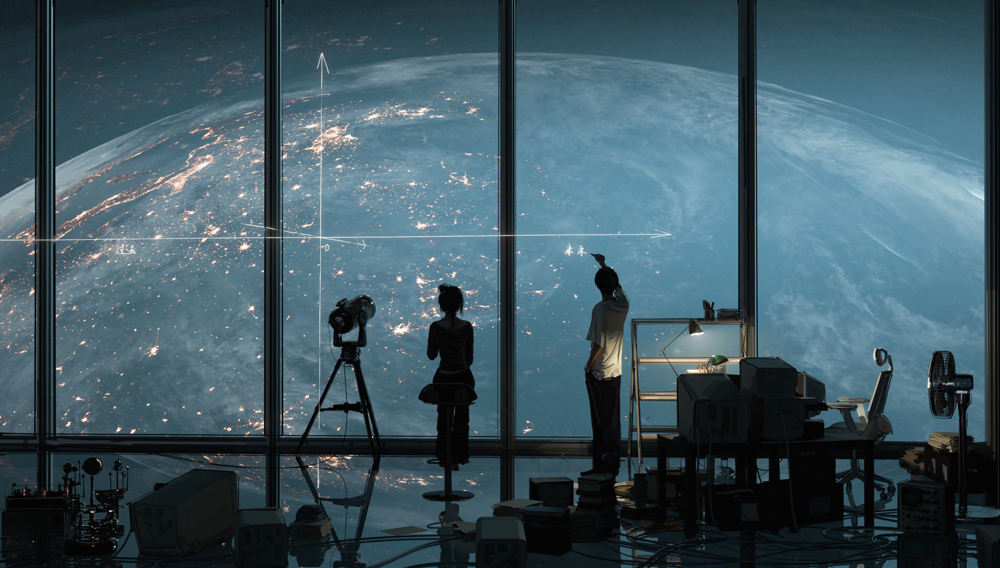

* **Lời thoại / Nội dung phát ra:**
  > **[Hi Dương]** "Lại đây, tôi giải thích cho cậu."
  > 
  > *(Hi Dương đã đứng dậy, cầm lấy cây bút trên bàn, bước tới trước khung cửa sổ sát đất, giơ tay vẽ một đường nằm ngang lên mặt kính, rồi lại vẽ thêm một đường thẳng đứng. Đầu bút miết qua mặt kính, phát ra tiếng ma sát thật khẽ.)*

---

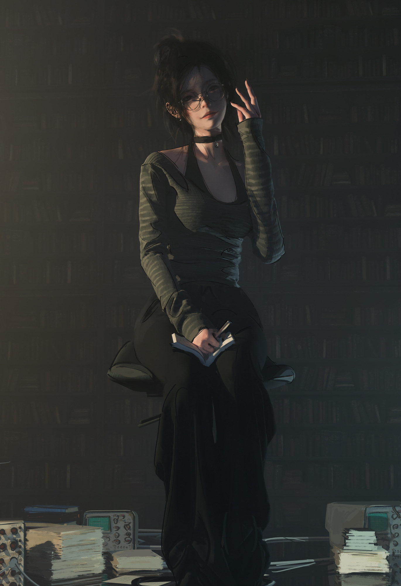

* **Lời thoại / Nội dung phát ra:**
  > *(Nguyệt Nha Nhi chẳng biết mò đâu ra một chiếc kính gọng tròn đeo lên mắt, ngồi lên chiếc ghế đẩu cao, ngẩng đầu nhìn cậu đầy vẻ nghiêm túc đứng đắn:)*
  > 
  > **[Nguyệt Nha Nhi]** "Vậy thầy Hi Dương, bắt đầu tiết học vật lý của thầy đi nào."
  > 
  > *(Hi Dương bị lời trêu chọc của cô làm cho có chút lúng túng luống cuống, chỉ đành quay đầu lại bấm bụng tiếp tục vẽ hai trục tọa độ kia lên mặt kính.)*
  > 
  > **[Hi Dương]** "Trục hoành này đại diện cho thời gian. Sang phải là tương lai, sang trái là quá khứ. Gốc tọa độ—— chính là hiện tại."

---

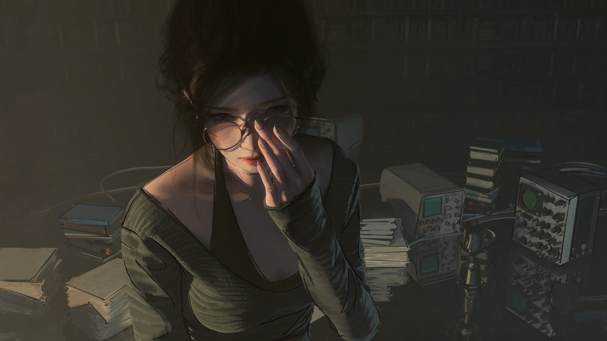

* **Lời thoại / Nội dung phát ra:**
  > *(Nguyệt Nha Nhi đẩy đẩy gọng kính, nghiêm túc gật đầu:)*
  > 
  > **[Nguyệt Nha Nhi]** "Hiểu rồi. Hiện tại, gốc tọa độ."
  > 
  > **[Hi Dương]** "Trục tung cùng một trục khác mà hiện tại cậu chưa nhìn thấy, cùng nhau tạo thành không gian, tức là khoảng cách. Hệ trục tọa độ này, chính là tọa độ thời - không."
  > 
  > **[Nguyệt Nha Nhi]** "Được. Tọa độ thời - không."

---

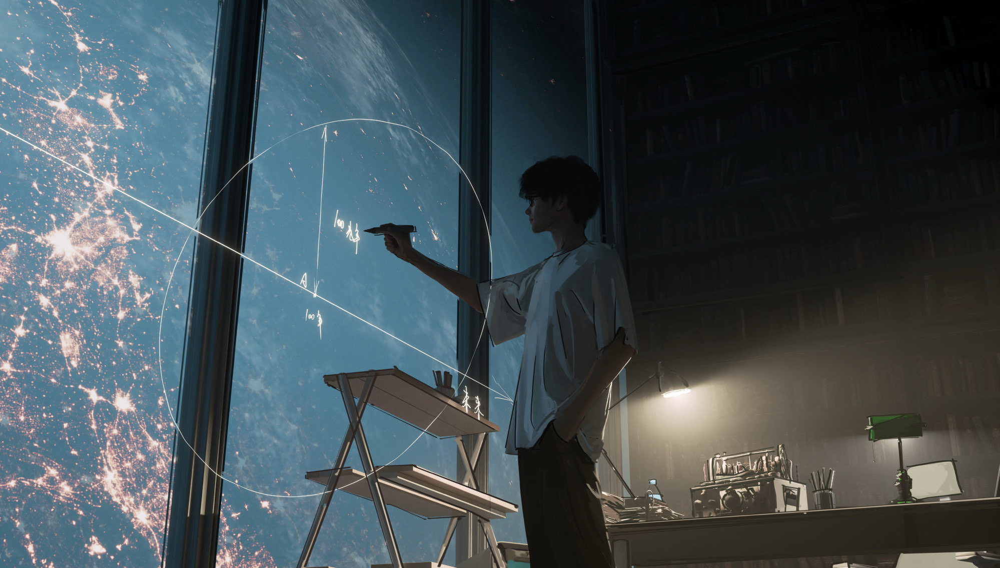

* **Chữ trong ảnh:** Sơ đồ hệ tọa độ không-thời gian vẽ bằng bút dạ trên mặt kính: Điểm A cách gốc tọa độ 100 năm thời gian và 100 năm ánh sáng không gian.
* **Lời thoại / Nội dung phát ra:**
  > **[Hi Dương]** "Giả sử vị trí thời - không lúc cậu sinh ra là gốc tọa độ. Còn đây, là thời điểm một trăm năm sau trên trục thời gian, chúng ta gọi nó là điểm A. Sau đó lấy điểm A này làm tâm, vẽ một hình tròn có bán kính một trăm năm ánh sáng trên mặt phẳng không gian. Hình tròn này, chính là ranh giới trên lý thuyết mà cậu có thể chạm tới sau một trăm năm."
  > 
  > *(Nguyệt Nha Nhi rất nhanh đã hiểu ra vấn đề.)*
  > 
  > **[Nguyệt Nha Nhi]** "Bởi vì nhanh nhất cũng không thể vượt quá tốc độ ánh sáng, cho nên nếu là một trăm năm sau, trên lý thuyết xa nhất cũng chỉ có thể đến được nơi cách một trăm năm ánh sáng."
  > 
  > **[Hi Dương]** "Đúng vậy. Nối hình tròn này lại với gốc tọa độ, cậu xem nó giống hình gì?"

---

<video src="./media/light-cone-wall.mp4" controls loop muted playsinline width="100%"></video>

*(Ảnh tĩnh: 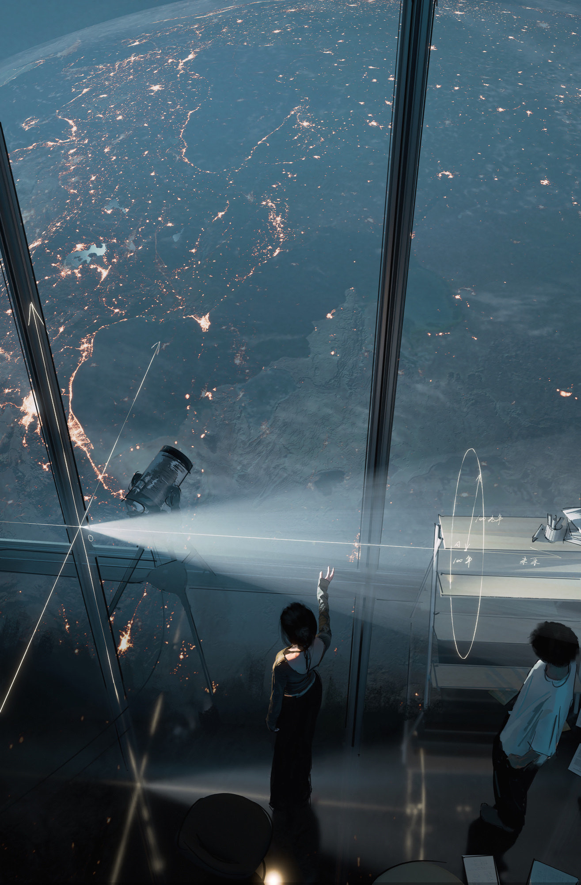)*

* **Chữ trong ảnh:** Đồ thị mô phỏng 3D bức tường Nón Ánh Sáng (Light Cone) mở rộng từ gốc tọa độ.
* **Lời thoại / Nội dung phát ra:**
  > *(Nguyệt Nha Nhi nheo mắt nhìn một hồi.)*
  > 
  > **[Nguyệt Nha Nhi]** "Một hình nón."
  > 
  > **[Hi Dương]** "Đúng. Đây chính là Nón Ánh Sáng thuộc về riêng cậu. Mọi thông tin liên quan đến cậu chỉ có thể tồn tại bên trong phạm vi này. Bởi vì mọi thông tin có trật tự đều không thể vượt quá vận tốc ánh sáng, cho nên chúng vĩnh viễn không thể phá vỡ bức tường nón ánh sáng này. Sự tồn tại của cậu, tầm ảnh hưởng của cậu, nơi chốn cậu có thể tới, những điều cậu có thể cho người khác biết—— đều bị giam cầm trong phạm vi này. Đối với bất kỳ điểm nào nằm ở ngoài nón ánh sáng, thông tin về cậu đều không thể truyền tới đó, vì vậy dưới góc nhìn của nó, cậu hoàn toàn không tồn tại."

---

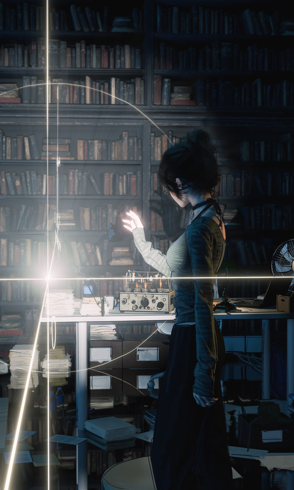

* **Lời thoại / Nội dung phát ra:**
  > *(Nguyệt Nha Nhi đứng dậy, vươn tay về phía trước, tựa như muốn chạm vào bức tường nón ánh sáng vô hình ấy.)*
  > 
  > **[Nguyệt Nha Nhi khẽ thầm thì]** "Một chiếc lồng giam."
  > 
  > *(Hi Dương không lên tiếng. Cô nhìn chăm chú vào những ngón tay đang khẽ đung đưa của mình, dường như nhìn thấy số phận đang chảy qua kẽ tay, buốt nhói mà mát lạnh.)*
  > 
  > **[Nguyệt Nha Nhi]** "Một chiếc lồng giam hình nón, nhốt trọn cả cuộc đời chúng ta bên trong. Cả đời này, chúng ta vĩnh viễn không bao giờ bước ra được bên ngoài nó."

---

<video src="./media/falling-sand.mp4" controls loop muted playsinline width="100%"></video>

*(Ảnh tĩnh: 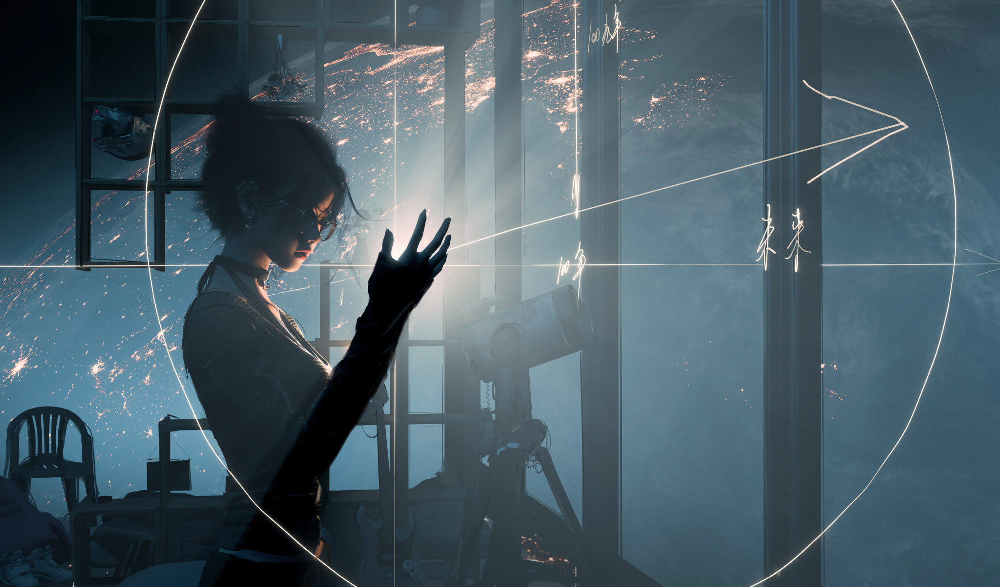)*

* **Chữ trong ảnh:** Video cát thời gian rơi xuống xuyên qua trục nón định mệnh.
* **Lời thoại / Nội dung phát ra:**
  > *(Ngoài cửa sổ sát đất, ánh trăng lạnh lẽo rọi lên mặt kính, những đường nét và chữ viết vừa vẽ lên được ánh trăng phản chiếu ánh lên tia sáng mờ ảo, bóng đổ xiên xiên phủ lên người hai người họ, tựa như một trật tự vô hình đang âm thầm bao trùm xuống.*
  > *Một lúc sau, cô như chợt ngộ ra điều gì, ngẩng đầu hỏi cậu:)*
  > 
  > **[Nguyệt Nha Nhi]** "Nhưng ban nãy cậu nói, tốc độ giới hạn của 'thông tin có trật tự' là tốc độ ánh sáng. Vậy điều đó có nghĩa là, còn có một thứ gọi là 'thông tin vô trật tự' có thể bứt phá giới hạn tốc độ ánh sáng sao?"
  > 
  > *(Hi Dương cuối cùng cũng mỉm cười. Quả nhiên, với sự nhạy bén của cô, rất nhanh đã nắm bắt được manh mối then chốt này.)*
  > 
  > **[Hi Dương]** "Đúng. Thông tin vô trật tự."
  > 
  > *(Nguyệt Nha Nhi dán chặt mắt vào cậu, tia sáng trong mắt từ từ bừng lên.)*

---

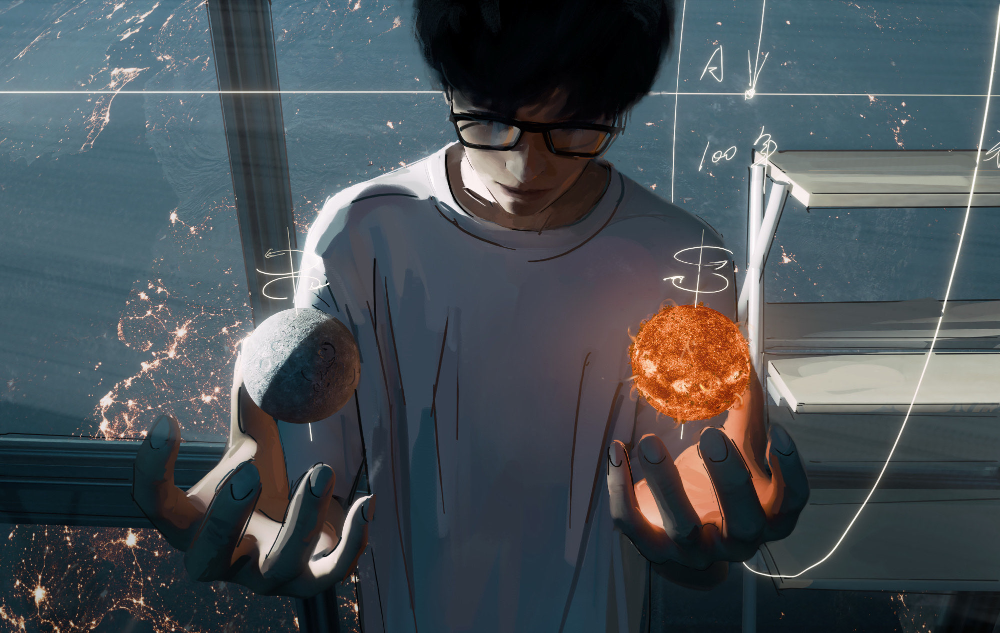

* **Lời thoại / Nội dung phát ra:**
  > **[Hi Dương]** "Cậu có thể tạm hiểu đơn giản thế này. Giả sử trong tay tôi có hai hạt cơ bản, chúng đều đang tự quay (spin), hơn nữa là quay thuận, quay nghịch một cách hoàn toàn ngẫu nhiên, không theo quy luật cố định nào. Sau đó qua một sự ràng buộc vật lý nào đó, chúng sẽ tiến vào một trạng thái vô cùng đặc biệt—— bất luận cách nhau bao xa, biến đổi của chúng đều duy trì sự đồng bộ tức thời, một hạt quay thế nào thì hạt kia cũng quay y như thế."
  > 
  > *(Nguyệt Nha Nhi nhanh chóng tiếp lời:)*
  > 
  > **[Nguyệt Nha Nhi]** "Rối lượng tử (Quantum Entanglement)?"
  > 
  > **[Hi Dương]** "Đúng. Cậu có thể tạm hiểu nó như một mô hình rối lượng tử đơn giản nhất."

---

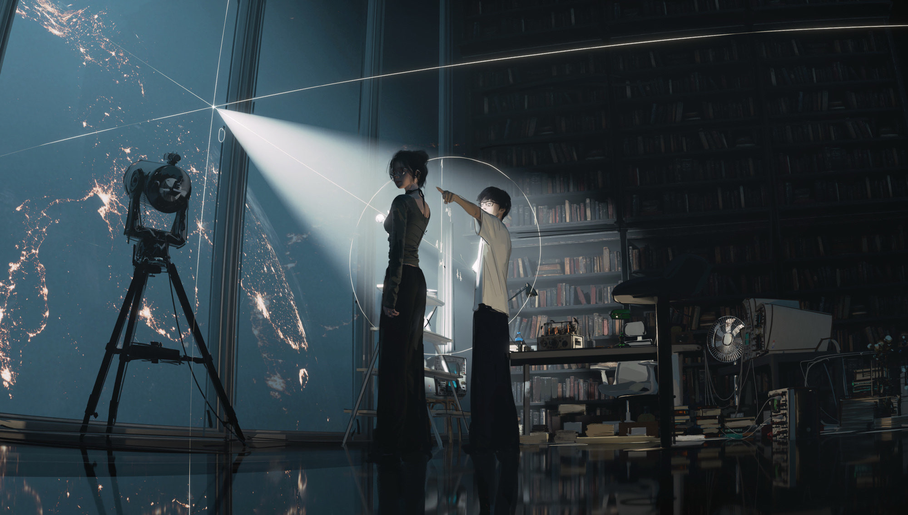

* **Lời thoại / Nội dung phát ra:**
  > *(Cậu chỉ tay về phía bên trái của trục thời gian, như thể đang chỉ về một nơi chốn xa xôi vô tận.)*
  > 
  > **[Hi Dương]** "Bây giờ, tôi đưa một trong hai hạt đó tới một nơi rất xa, rất xa. Đưa tới nơi cách đây một trăm triệu năm ánh sáng, hoặc là——"
  > 
  > *(Cậu khựng lại một nhịp.)*

---

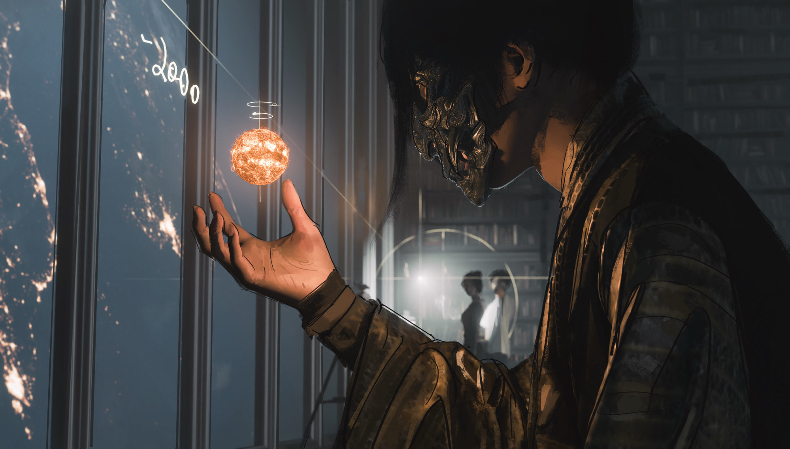

* **Lời thoại / Nội dung phát ra:**
  > **[Hi Dương]** "—— Đưa về hai ngàn năm trước, đặt vào tay Trương Lương."
  > 
  > *(Ánh mắt Nguyệt Nha Nhi khẽ thắt lại.)*
  > 
  > **[Hi Dương]** "Hai vị trí này, bất luận là xét về không gian hay thời gian, đối với chúng ta hiện tại đều là 'Ngoài Nón Ánh Sáng'."

---

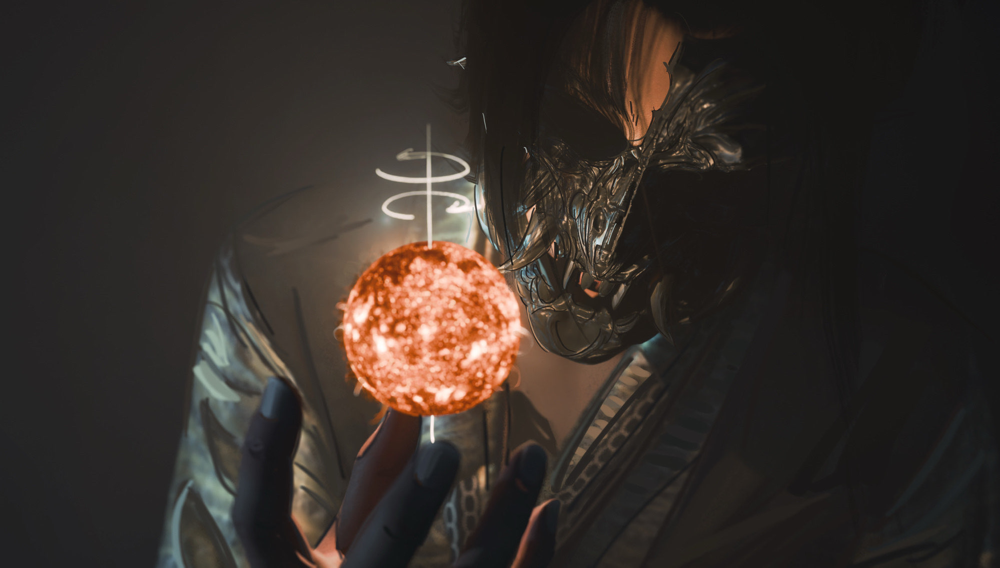

* **Lời thoại / Nội dung phát ra:**
  > **[Hi Dương]** "Nhưng nếu hai hạt này vẫn duy trì trạng thái vướng víu lượng tử, khi Trương Lương nhìn thấy hạt trong tay ông ấy xuất hiện chuỗi spin thuận, nghịch, thuận, thì ông ấy sẽ biết hạt trong tay tôi lúc này cũng xuất hiện chuỗi tương tự."
  > 
  > **[Nguyệt Nha Nhi khẽ nói]** "Nói cách khác... thông tin đó đã được truyền về hai ngàn năm trước."
  > 
  > **[Hi Dương]** "Đúng. Thông tin đó đã vượt qua tốc độ ánh sáng, chạm tới ngoài nón ánh sáng."

---

<video src="./media/cloudinsect-home-bg-v2.mp4" controls loop muted playsinline width="100%"></video>

*(Ảnh tĩnh: 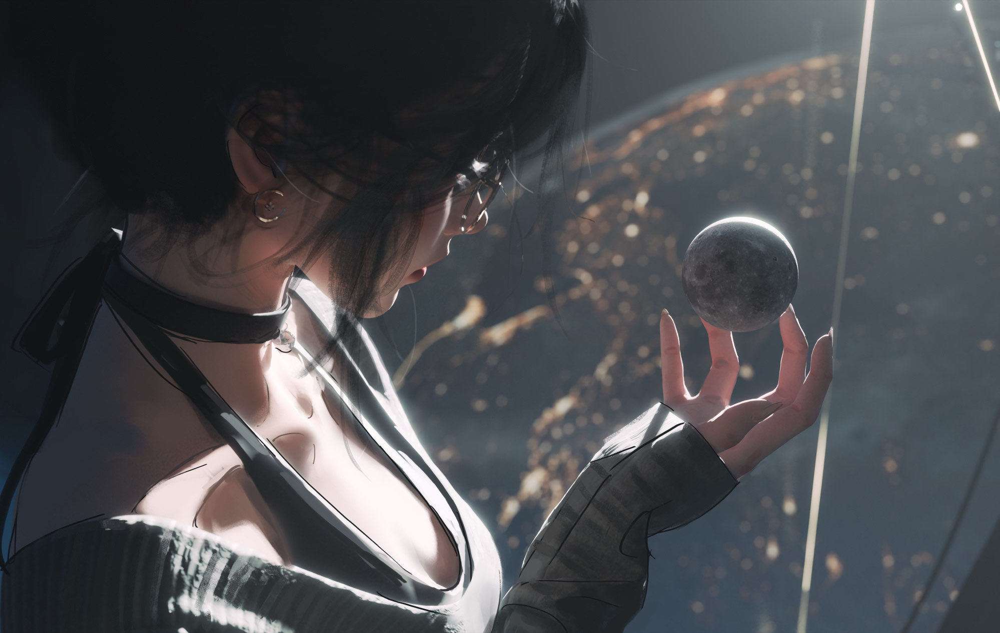)*

* **Lời thoại / Nội dung phát ra:**
  > *(Nguyệt Nha Nhi cau mày:)*
  > 
  > **[Nguyệt Nha Nhi]** "Tôi chỉ nghe nói đến rối lượng tử trong không gian, chiều thời gian cũng có thể rối được sao?"
  > 
  > **[Hi Dương]** "Đúng. Dựa vào entropy vướng víu trên bình diện toán học hoàn toàn có thể suy ra được, theo trục thời gian cũng tồn tại hiện tượng vướng víu lượng tử."
  > 
  > **[Nguyệt Nha Nhi]** "Thế chẳng phải về mặt lý thuyết, dựa vào rối lượng tử chúng ta có thể liên lạc tức thời với nơi cách xa mấy năm ánh sáng, thậm chí vượt qua không-thời gian để truyền tin tức sao?"
  > 
  > *(Hi Dương lắc đầu.)*
  > 
  > **[Hi Dương]** "Không thể."
  > 
  > **[Nguyệt Nha Nhi]** "Tại sao?"
  > 
  > **[Hi Dương]** "Cái bẫy ma quỷ nằm chính ở chỗ này. Bởi vì đó là một chuỗi thông tin vô trật tự. Nó tuy đồng bộ, nhưng bản thân nó lại mang tính ngẫu nhiên. Cả cậu và Trương Lương đều không thể quyết định lần tiếp theo nó sẽ quay thuận hay quay nghịch. Chúng ta chỉ có thể thấy nó đã xảy ra chuyện gì, chứ không thể kiểm soát được nó sẽ xảy ra chuyện gì."
  > 
  > *(Nguyệt Nha Nhi ngẫm nghĩ một hồi, rồi lại gặng hỏi:)*
  > 
  > **[Nguyệt Nha Nhi]** "Nếu như có một công nghệ nào đó có thể khống chế được hướng quay của nó thì sao?"

---

<video src="./media/turn.mp4" controls loop muted playsinline width="100%"></video>

*(Ảnh tĩnh: 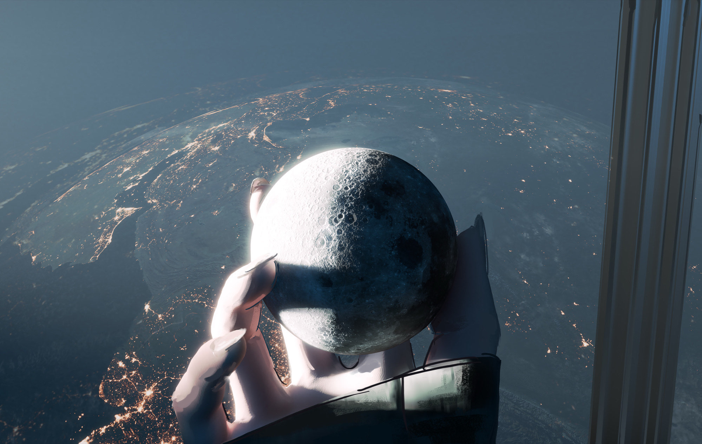)*

* **Chữ trong ảnh:** Video xoay hạt lượng tử và sự sụp đổ hàm sóng khi cố tình can thiệp thông tin có trật tự.
* **Lời thoại / Nội dung phát ra:**
  > *(Giọng Hi Dương chậm rãi hẳn lại:)*
  > 
  > **[Hi Dương]** "Nếu bây giờ cậu giơ tay tóm lấy hạt này, cưỡng ép nó quay theo cách mà cậu mong muốn: Nghịch, thuận, nghịch, nghịch—— khắc một chuỗi mang ý nghĩa vào đó, mượn nó để báo cho Trương Lương biết: Tần Vương ngồi ở xe sau."
  > 
  > *(Hơi thở của Nguyệt Nha Nhi khẽ nghẹn lại.)*
  > 
  > **[Nguyệt Nha Nhi]** "Thế thì sẽ xảy ra chuyện gì?"
  > 
  > *(Hi Dương đặt đầu bút dừng lại giữa hai điểm đó, khẽ vạch một đường, như thể vừa cắt đứt một sợi dây vốn dĩ vô hình.)*
  > 
  > **[Hi Dương]** "Thông tin này sẽ không còn là vô trật tự nữa. Mà một khi nó biến thành thông tin có trật tự bị quan sát thấy ở ngoài nón ánh sáng, trạng thái vướng víu sẽ lập tức sụp đổ (wave function collapse), mối liên kết giữa hai hạt này sẽ đứt gãy ngay tức khắc, không bao giờ có thể duy trì sự đồng bộ được nữa."
  > 
  > **[Nguyệt Nha Nhi]** "Cho nên, thông tin ấy vĩnh viễn không thể truyền tới tay Trương Lương."
  > 
  > **[Hi Dương]** "Vĩnh viễn không bao giờ."
  > 
  > *(Hi Dương dừng lại một chút, như thể cố ý chừa cho cô chút thời gian để suy ngẫm.)*
  > 
  > **[Hi Dương]** "Cậu còn nhớ lần đầu tiên chúng ta gặp Công Tôn Ưởng, chúng ta bị truyền tống đi vào thời điểm nào không?"
  > 
  > *(Nguyệt Nha Nhi lần theo lời cậu nhớ lại một hồi, rồi chậm rãi nói:)*
  > 
  > **[Nguyệt Nha Nhi]** "Là vào lúc tôi vừa gọi ông ấy là Thương Ưởng."
  > 
  > **[Hi Dương]** "Đúng. Bởi vì vào lúc đó, ông ấy vẫn chưa phải là Thương Ưởng, mà chỉ là Công Tôn Ưởng. Phải đến sau này biến pháp thành công, được phong đất ở đất Thương, ông ấy mới có cái tên 'Thương Ưởng'. Câu nói đó của cậu, đối với ông ấy chính là một thông tin có trật tự đến từ hậu thế. Đó đã không còn là cuộc trò chuyện thông thường nữa, mà là đang thay đổi nhận thức của ông ấy về số phận của chính mình. Một khi thông tin như vậy thốt ra khỏi miệng, đường hầm thời-không sẽ lập tức bị ngắt kết nối ngay tức khắc."

---

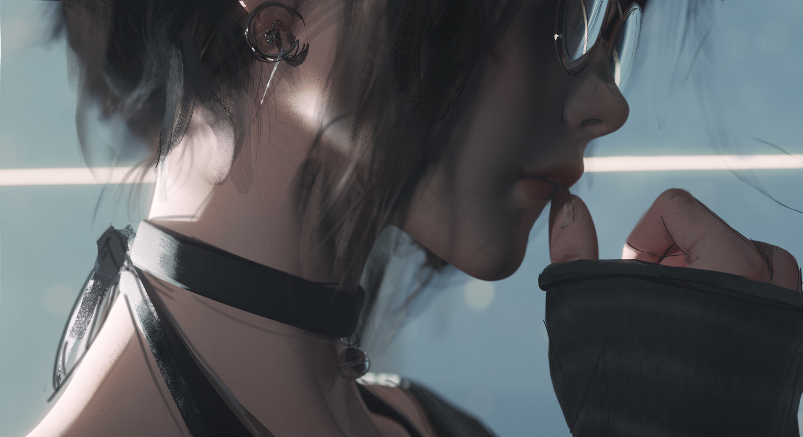

* **Lời thoại / Nội dung phát ra:**
  > *(Cô nhìn chằm chằm vào những đường nét trên mặt kính, cảm thấy sau lưng từ từ dâng lên một luồng ớn lạnh. Tựa như vô số mảnh ghép vốn dĩ phân tán rải rác, mãi cho đến tận khoảnh khắc này mới thực sự khớp chặt vào nhau.)*
  > 
  > **[Nguyệt Nha Nhi]** "Hóa ra thảo nào lúc đó tôi vừa định nói cho Trương Lương biết Tần Vương ngồi ở cỗ xe nào thì cậu đã lập tức ngắt lời tôi. Cậu không phải sợ tôi làm thay đổi lịch sử, mà là——"
  > 
  > *(Đột nhiên, Nguyệt Nha Nhi như sực nhớ ra điều gì kinh thiên động địa, cả người bật dậy khỏi ghế.)*
  > 
  > **[Nguyệt Nha Nhi thảng thốt]** "Thảo nào……"
  > 
  > *(Hi Dương ngước mắt lên.)*
  > 
  > **[Hi Dương]** "Cái gì cơ?"
  > 
  > *(Nguyệt Nha Nhi nhìn cậu, thần sắc từng chút từng chút một trở nên vô cùng phức tạp.)*
  > 
  > **[Nguyệt Nha Nhi]** "Thảo nào…… Hán Quang Vũ Đế——"

---

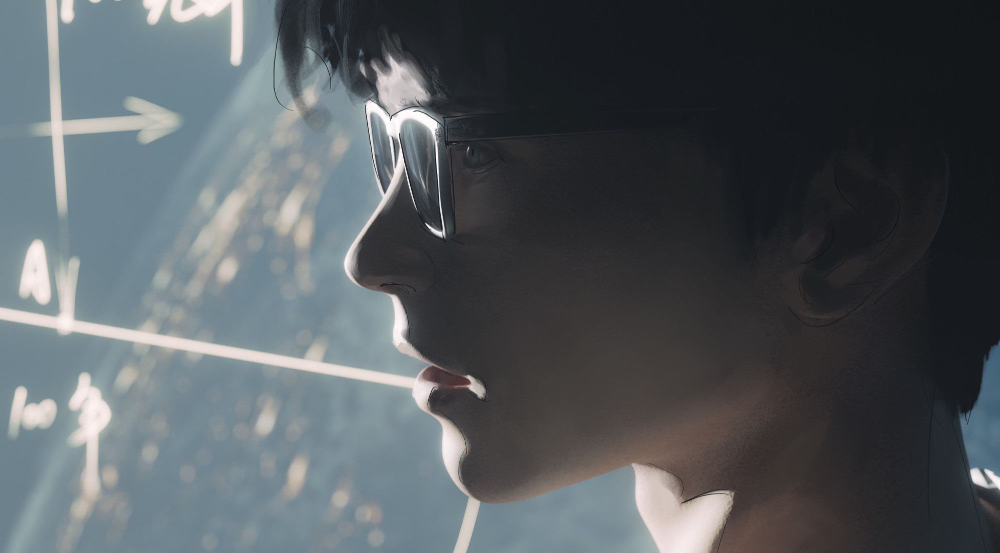

* **Lời thoại / Nội dung phát ra:**
  > *(Hi Dương sững sờ.)*
  > 
  > **[Hi Dương]** "Hán Quang Vũ Đế?"
  > 
  > *(Nguyệt Nha Nhi không lập tức giải thích, chỉ cau mày, như thể đang chắp vá lại một đoạn ký ức rất xa xưa trong tâm trí mà bấy lâu nay cô vẫn ngỡ chỉ là ảo giác.)*
  > 
  > **[Nguyệt Nha Nhi trầm giọng]** "Trước đây…… hình như tôi cũng từng gặp một lần."
  > 
  > *(Vẻ mặt Hi Dương hiếm khi trở nên nghiêm trọng ngưng trọng đến thế.)*
  > 
  > **[Hi Dương]** "Khi nào cơ?"
  > 
  > **[Nguyệt Nha Nhi]** "Ở Tây Tạng. Lần tôi đạp xe đuổi theo con Vân Trùng Bàn Cổ."
  > 
  > *(Cô dừng lại một thoáng, như thể đang hồi tưởng lại làn gió và không khí trên cao nguyên buốt giá.)*
  > 
  > **[Nguyệt Nha Nhi]** "Lúc đó tôi cứ ngỡ là do phản ứng say độ cao, hoặc do thiếu dưỡng khí, cứ nghĩ bản thân vừa trải qua một giấc mơ rất dài và kỳ quặc."

---

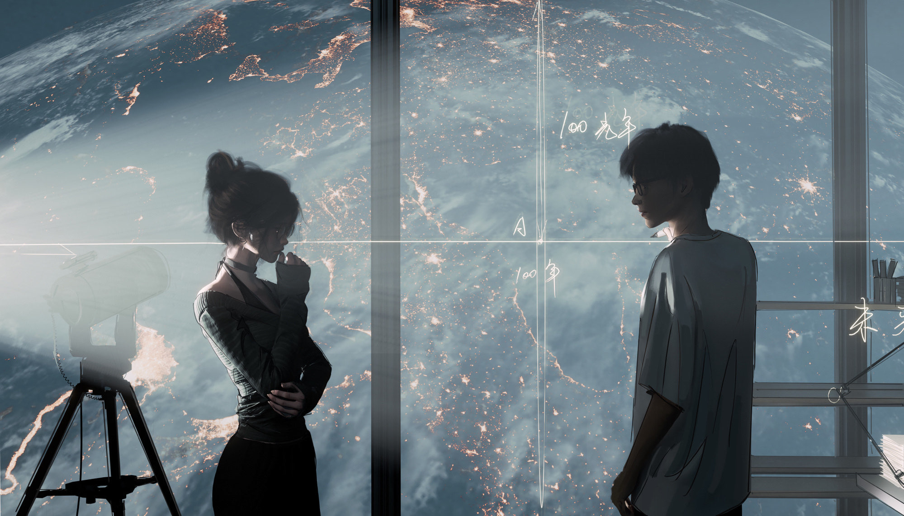

* **Lời thoại / Nội dung phát ra:**
  > *(Bàn tay Hi Dương khựng lại giữa không trung, ánh mắt gắt gao dán chặt lên gương mặt cô.)*
  > 
  > **[Hi Dương nín thở]** "Cậu đã nhìn thấy ai?"
  > 
  > *(Nguyệt Nha Nhi im lặng một hồi lâu. Vầng trăng ngoài cửa sổ vẫn treo lơ lửng nơi ấy, tĩnh lặng và trắng bệch. Cô cúi đầu, dường như cuối cùng đã chạm tới cái tên ấy từ nơi sâu thẳm nhất của ký ức.)*
  > 
  > **[Nguyệt Nha Nhi]** "Hạng Vũ."
  > 
  > *(Cô nói xong ngước mắt lên nhìn Hi Dương, ánh mắt sâu thẳm, tựa như còn đè nén một cái tên khác chưa từng thốt ra thành lời.)*
