# Vân Trùng / CloudInsect - Chương 4: Nón Định Mệnh · II (第四章 命运之锥 · 二)

---

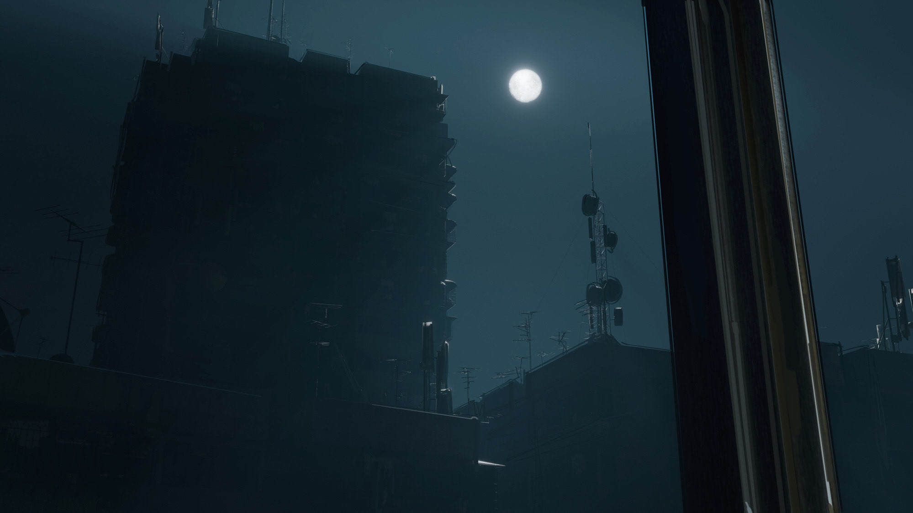

**VI**: Đêm đã khuya lắm rồi.

**ZH**: 夜已经很深了。

**EN**: It was already deep into the night.

**VI**: Trong phòng chỉ còn bật một ngọn đèn nhỏ, ánh sáng vàng mờ rọi xuống góc bàn, phủ lên những trang sách mở rộng và đống giấy nháp chi chít phép tính. Ngoài khung cửa sổ sát đất, ánh đèn đô thị đã thưa thớt dần, xa xa thi thoảng có vài vệt xe cộ lướt qua trong câm lặng, chếch lên trên chỉ còn lại cả một bầu trời đen thẳm, vầng trăng treo lơ lửng trên cao, trắng bệch đến mức gần như vô tình lãnh đạm.

**ZH**: 屋里只留着一盏小灯，昏黄的光落在桌角，也落在摊开的书页和演算纸上。落地窗外，城市的灯火已经稀疏下去，远处偶尔还有车流无声掠过，再往上便只剩一整片深黑的天，月亮悬得很高，白得几乎有些不近人情。

**EN**: Only a small lamp was still on in the room, its dim yellow light falling across the corner of the desk, over the open books and sheets of calculations. Outside the floor-to-ceiling window, the city lights had thinned. Now and then, traffic slipped soundlessly past in the distance. Above them, there was only a vast black sky. The moon hung very high, so white it almost seemed inhuman.

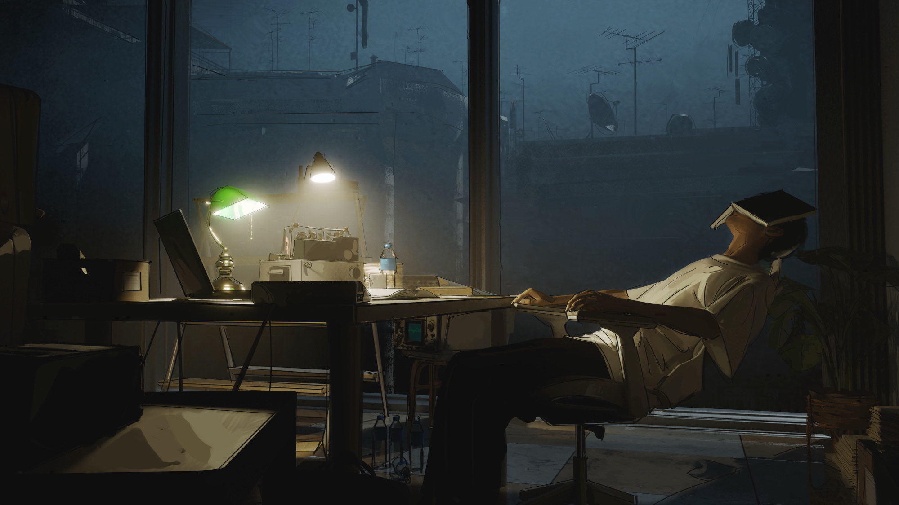

**VI**: Hi Dương tựa lưng vào ghế, một cuốn sách úp ngược lên mặt, tựa hồ ban nãy đang đọc dở thì bị dòng suy nghĩ cuốn trôi đi mất. Trên bàn cậu trải la liệt mấy cuốn sách về lý thuyết trường, thuyết tương đối và các bản ghi quan trắc trường Vân Trùng, các trang giấy xếp dày đặc san sát nhau.

**ZH**: 希扬躺在椅子里，一本书倒扣在脸上，像是方才还在看书，看到一半便被思绪拖住了。他桌上摊着几本场论、相对论和云虫场观测记录，纸页密密麻麻地铺开。

**EN**: Suvan lay back in the chair, a book turned facedown over his face, as if he had been reading and had been dragged away by his thoughts halfway through. Several books on field theory, relativity, and CloudInsect field observations lay open across his desk, their pages spread in dense layers.

**VI**: “Buổi diễn thuận lợi chứ?”

**ZH**: “演出还顺利么？”

**EN**: “Did the show go well?”

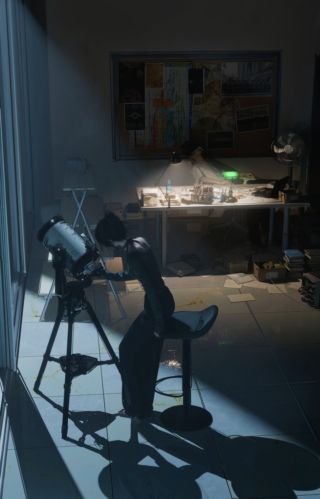

**VI**: “Cũng tàm tạm, vẫn như mọi khi, khá là náo nhiệt.”

**ZH**: “还行吧，老样子，挺热闹的。”

**EN**: “It was fine. Same as usual. Pretty lively.”

**VI**: Nguyệt Nha Nhi vừa lơ đãng đáp lời, vừa táy máy chiếc kính thiên văn kia. Rõ ràng đây là lần đầu tiên cô chạm vào thứ đồ chơi này, cúi đầu nghiên cứu hồi lâu, trong từng cử động mang theo chút tò mò mới mẻ, lại phảng phất cả sự bướng bỉnh không chịu thua. Khung kim loại đã rỉ sét của kính thiên văn khẽ phát ra tiếng cọt kẹt, thị kính từ từ nâng cao lên, nhắm chuẩn vào vầng trăng sáng dị thường trên bầu trời đêm.

**ZH**: 月牙儿一边漫不经心的答着，一边摆弄那架天文望远镜。她显然是第一次碰这种东西，低着头研究了半天，动作里带着一点新鲜，也带着一点不服气。生锈的望远镜的金属支架轻轻作响，目镜缓缓抬高，对准夜空里那轮异常明亮的月亮。

**EN**: Mahina answered absently while fiddling with the astronomical telescope. It was clearly her first time handling such a thing. She lowered her head and studied it for a long while, her movements carrying both curiosity and a trace of stubbornness. The rusty metal stand creaked softly as the eyepiece slowly rose, aiming toward the unusually bright moon in the night sky.

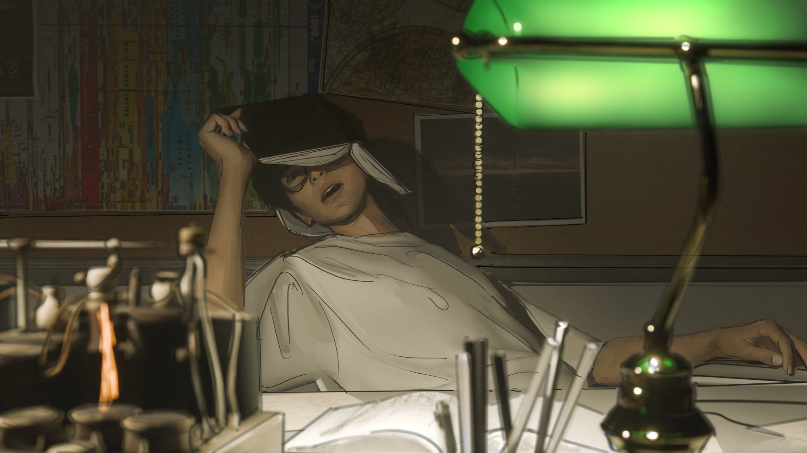

**VI**: Hi Dương lật một góc cuốn sách đang che trên mặt lên, nghiêng đầu liếc nhìn cô một cái, mở lời:

**ZH**: 希扬翻起盖在脸上的书的一角，偏头看了她一眼，开口道：

**EN**: Suvan lifted one corner of the book covering his face, turned his head to glance at her, and said:

**VI**: “Khoan vội nhìn qua thị kính.”

**ZH**: “先别急着从目镜里看。”

**EN**: “Don’t look through the main eyepiece yet.”

**VI**: Nguyệt Nha Nhi khựng lại, nhìn sang phía cậu.

**ZH**: 月牙儿停了停，朝他那边望过去。

**EN**: Mahina paused and looked over at him.

**VI**: Hi Dương giơ tay chỉ chỉ vào cạnh bên của kính thiên văn.

**ZH**: 希扬抬手朝望远镜侧边点了点。

**EN**: Suvan raised a hand and pointed toward the side of the telescope.

**VI**: “Có thấy kính ngắm chấm đỏ ở bên cạnh không? Dùng cần gạt điều chỉnh từ từ trước, để chấm đỏ bên trong nhắm đúng vào điểm cậu muốn nhìn, rồi hẵng chỉnh kính chính, nếu không cậu rất khó định vị được đâu.”

**ZH**: “看到旁边那个红点寻星镜没有？先拿手柄慢慢调，让里面的红点对准你想看的地方，再去调主镜，不然你很难定位。”

**EN**: “See that little red-dot finder on the side? Move it slowly with the controller first. Put the red dot on whatever you want to look at, then adjust the main scope. Otherwise it’s hard to find anything.”

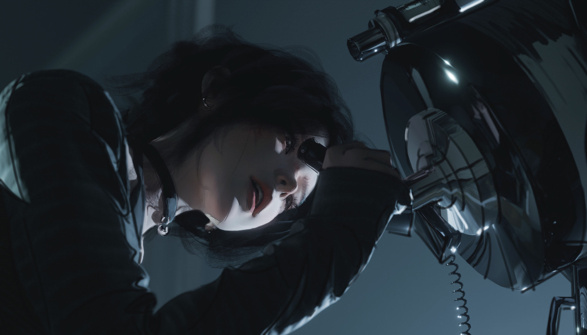

**VI**: Nguyệt Nha Nhi làm theo lời cậu, cúi đầu tìm kiếm, quả nhiên thấy một kính ngắm rất nhỏ ở bên hông. Cô bắt đầu thử theo hướng dẫn của cậu, khẽ nheo một bên mắt, đầu ngón tay bấm cần điều khiển, nhích từng chút từng chút một đổi hướng. Vầng trăng bên ngoài sáng đến kinh ngạc, chấm đỏ chậm rãi dịch chuyển trong bóng tối một hồi lâu, cuối cùng mới từ từ dừng lại ngay chính giữa mặt trăng.

**ZH**: 月牙儿顺着他说的低头找了找，果然在侧边看见一个很小的瞄准镜。她照着他的意思开始尝试，微微眯起眼，指尖按着操控器，一点一点移动方向。外面的月亮亮得惊人，红点在黑暗里轻轻挪动了很久，才终于慢慢落到月面正中。

**EN**: Mahina followed his instructions and lowered her head to search. Sure enough, she found a tiny sight on the side. She began trying it his way, narrowing one eye slightly, her fingertips pressing the controller as she moved it bit by bit. The moon outside was startlingly bright. The red dot drifted through the dark for a long while before finally settling at the center of the lunar surface.

**VI**: Cô cúi người xuống, ghé sát mắt vào thị kính, ngay giây tiếp theo, liền buột miệng thốt lên một tiếng “oa” khe khẽ.

**ZH**: 她俯下身，把眼睛凑近目镜，下一秒，便低低地“哇”了一声。

**EN**: She bent down and brought her eye close to the eyepiece. The next second, she let out a soft “wow.”

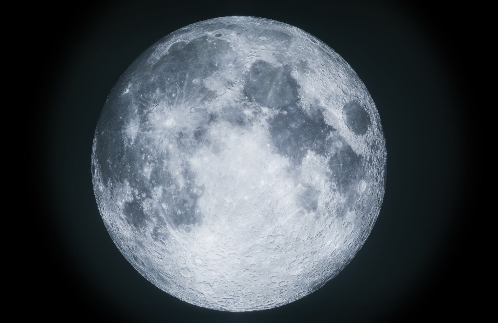

**VI**: Mặt trăng bỗng chốc cận kề đến ngỡ ngàng, trắng lạnh, tĩnh lặng, đường viền khổng lồ nổi bật sắc lẹm trên nền trời đêm tăm tối. Những đường vân thô ráp trên bề mặt, bóng đổ của các miệng hố va chạm, các biển mặt trăng sâu thẳm, tất cả đều hiện lên rõ mồn một nơi đó, tĩnh mịch đến mức gần như trang nghiêm, tựa như một gương mặt cổ xưa và nhợt nhạt.

**ZH**: 月亮一下子近得惊人，冷白，安静，巨大的轮廓在黑暗的夜空中显得异常锋利。表面粗粝的纹理、环形山的阴影、深邃的月海，全都分明地浮在那里，安静得近乎庄严，像一张苍白又古老的脸。

**EN**: The moon was suddenly astonishingly close: cold white, silent, its huge outline unnaturally sharp against the dark sky. The rough texture of its surface, the shadows of craters, the deep lunar maria all floated there in clear detail, so quiet it was almost solemn, like a pale and ancient face.

**VI**: Nguyệt Nha Nhi cứ thế nhìn qua thị kính rất lâu, rồi mới khẽ hỏi:

**ZH**: 月牙儿就这样对着目镜看了很久，才轻声问道：

**EN**: Mahina looked through the eyepiece for a long time before asking softly:

**VI**: “Có phải nó luôn chỉ quay mặt này về phía chúng ta không?”

**ZH**: “它是不是一直只拿这一面对着我们？”

**EN**: “Does it always show us only this side?”

**VI**: Giọng Hi Dương từ phía sau truyền tới, bình thản và ngắn gọn:

**ZH**: 希扬的声音从身后传来，平静而简短：

**EN**: Suvan’s voice came from behind her, calm and brief:

**VI**: “Đúng vậy. Bởi vì chu kỳ quay quanh quỹ đạo và chu kỳ tự quay của mặt trăng là như nhau, nó quay quanh Trái Đất một vòng thì bản thân nó cũng vừa vặn tự quay hết một vòng, thế nên mặt hướng về phía chúng ta mãi mãi là mặt này.”

**ZH**: “对。因为月亮的公转周期和自转周期是一样的，它绕着地球转一圈，自己也刚好转完一圈，所以朝着我们的，永远都是这一面。”

**EN**: “Yes. Because the Moon’s orbital period and rotation period are the same. It circles Earth once, and in that same time it turns once on its own axis. So the side facing us is always the same side.”

**VI**: Nguyệt Nha Nhi im lặng lắng nghe, tựa hồ đang nghiền ngẫm điều này trong đầu, rồi lại hỏi:

**ZH**: 月牙儿安静地听着，像是在脑子里把这件事转了一遍，随后又问：

**EN**: Mahina listened quietly, as if turning the fact over in her mind. Then she asked:

**VI**: “Đây là sự trùng hợp ngẫu nhiên sao?”

**ZH**: “这是巧合吗？”

**EN**: “Is that a coincidence?”

**VI**: “Cũng không hẳn là trùng hợp.” Hi Dương nói, “Về chuyện này có hai cách giải thích, xem cậu thích cách nào hơn.”

**ZH**: “也不能算巧合。” 希扬说， “关于这件事，有两种解释，看你更喜欢哪一种。”

**EN**: “Not exactly,”  Suvan said.  “There are two explanations. It depends which one you prefer.”

**VI**: Nguyệt Nha Nhi hơi dời mắt khỏi thị kính một chút.

**ZH**: 月牙儿把眼睛从目镜前稍稍挪开一点。

**EN**: Mahina moved her eye slightly away from the eyepiece.

**VI**: “Hai cách nào?”

**ZH**: “哪两种？”

**EN**: “What are they?”

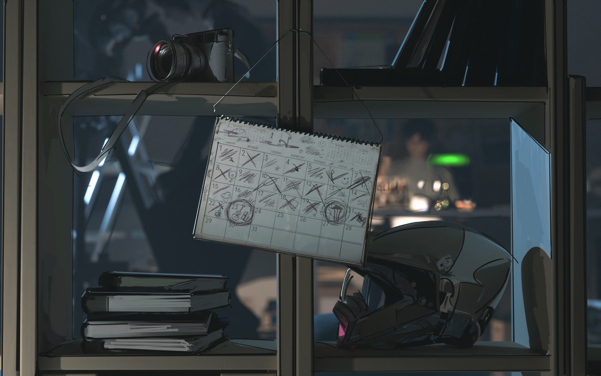

**VI**: “Cách thứ nhất,” Cậu xoay xoay cây bút trong tay trên mặt bàn, chậm rãi nói,

**ZH**: “第一种，” 他把手里的笔在桌上转了一圈，慢慢说道，

**EN**: “The first,”  he said slowly, twirling the pen in his hand once on the desk,

**VI**: “Khi mặt trăng mới hình thành, chuyển động quay quanh quỹ đạo và tự quay vốn không đồng bộ. Nhưng trải qua khoảng thời gian đằng đẵng, Trái Đất đã tác dụng lực thủy triều lên nó, dần dần triệt tiêu đi độ chênh lệch của chuyển động tự quay, cuối cùng khóa chặt nó lại. Trạng thái này ngày nay chúng ta gọi là khóa thủy triều.”

**ZH**: “月亮刚形成的时候，公转和自转并不是同步的。但在很漫长的时间里，地球对它施加潮汐力，慢慢消耗掉了它自转的差异，最后就把它锁住了。我们现在把这种状态叫潮汐锁定。”

**EN**: “is that when the Moon first formed, its orbit and rotation were not synchronized. But over a very long time, Earth exerted tidal forces on it, gradually wearing away the difference in its rotation, until it was finally locked. We call that state tidal locking.”

**VI**: Nguyệt Nha Nhi gật đầu, như đã hiểu ra, thuận miệng hỏi thêm một câu:

**ZH**: 月牙儿点了点头，像是听明白了，顺势又问了一句：

**EN**: Mahina nodded, as if she understood, and naturally asked another question:

**VI**: “Thế còn cách thứ hai?”

**ZH**: “那另一种呢？”

**EN**: “And the other one?”

**VI**: Hi Dương ngập ngừng một lát, mới nhàn nhạt nói:

**ZH**: 希扬停了一下，才淡淡道：

**EN**: Suvan paused before saying lightly:

**VI**: “Cách thứ hai thì đơn giản hơn nhiều.” Ánh mắt Hi Dương dừng lại trên cây đàn bass màu trắng của cô, “Bởi vì mặt trăng không muốn để người khác nhìn thấy mặt còn lại của mình.”

**ZH**: “第二种就简单多了。” 希扬的目光落到了她那把白色的贝斯上， “因为月亮不想让别人看见她的另一面。”

**EN**: “The second is much simpler.”  Suvan’s gaze fell on her white bass.  “Because the Moon doesn’t want anyone to see her other side.”

**VI**: Nguyệt Nha Nhi sững lại, lập tức hiểu ra ý vị sâu xa ẩn giấu bên trong câu nói.

**ZH**: 月牙儿一愣，很快就明白了话里的弦外之音。

**EN**: Mahina froze for a moment, then quickly understood the meaning beneath his words.

**VI**: Cô không tiếp lời câu nói đó, chỉ quay lại nhìn vầng trăng kia thêm một lúc, hồi lâu sau mới khẽ thốt lên:

**ZH**: 她没有把这句话接下去，只重新对着那轮月亮看了一会儿，过了很久才轻声道：

**EN**: She did not answer. She only looked at the moon again for a while. After a long time, she said softly:

**VI**: “Hóa ra tận mắt ngắm nhìn mặt trăng thế này lại có cảm giác như vậy. Trước đây tôi chỉ thấy nó trong sách vở và trên màn hình, cứ ngỡ nó chỉ là một mảng trắng nhỏ xíu treo tít tắp trên trời cao. Bây giờ mới nhận ra, nó lớn hơn tôi tưởng tượng nhiều, và cũng sáng hơn nhiều.”

**ZH**: “原来亲眼这样看月亮，是这种感觉。我以前只在书上和屏幕上见过它，总觉得它只是远远挂在天上的一小块白。现在才发现，它比我想象里更大，也更亮。”

**EN**: “So this is what it feels like to see the moon with your own eyes. I had only seen it in books and on screens before. I always thought it was just a small white patch hanging far away in the sky. Now I realize it is larger than I imagined, and brighter too.”

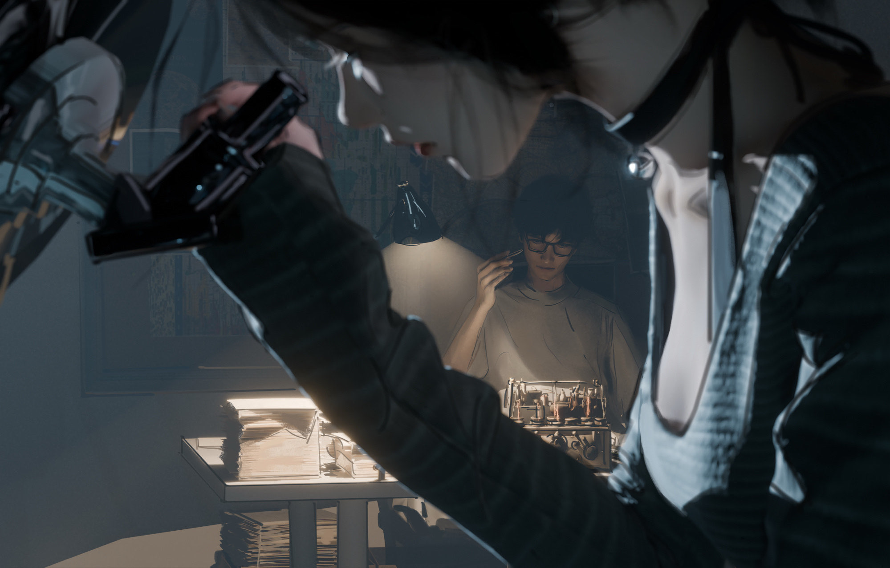

**VI**: Cô ngừng lại một chút, rồi bồi thêm một câu rất khẽ:

**ZH**: 她顿了顿，又很轻地补了一句：

**EN**: She paused, then added in an even lighter voice:

**VI**: “Thế nhưng thứ ánh sáng này cũng đâu phải của chính nó, là ánh sáng của mặt trời.”

**ZH**: “可这些光，也不是它自己的吧，是太阳的光。”

**EN**: “But this light isn’t really its own, is it? It’s sunlight.”

**VI**: Hi Dương khẽ gật đầu.

**ZH**: 希扬轻轻点了点头。

**EN**: Suvan nodded gently.

**VI**: “Vậy giữa mặt trời và mặt trăng, cách nhau bao xa?” Nguyệt Nha Nhi dường như đang suy nghĩ điều gì, đột nhiên lại hỏi.

**ZH**: “那太阳和月亮之间，隔了多远？” 月牙儿像是在想着什么，忽然又问。

**EN**: “Then how far is the Sun from the Moon?”  Mahina suddenly asked, as if thinking of something.

**VI**: Hi Dương ngồi trên chiếc ghế cũ, nét mặt vẫn bình thản, chỉ là bên trong sự bình thản ấy, tựa như bỗng chốc lắng xuống một tầng cảm xúc sâu xa hơn.

**ZH**: 希扬坐在那张旧椅子里，神情依旧平静，只是那平静里，像忽然落进了一层更深的东西。

**EN**: Suvan sat in the old chair, his expression still calm, though something deeper seemed to settle inside that calm.

**VI**: Một lúc sau, cậu mới trầm giọng nói:

**ZH**: 过了片刻，他才低声道：

**EN**: After a moment, he said in a low voice:

**VI**: “Ánh sáng phải đi mất tám phút rưỡi.”

**ZH**: “光要走八分半。”

**EN**: “Light takes eight and a half minutes.”

**VI**: “Tám phút rưỡi? Nghe qua thì đâu có xa lắm.”

**ZH**: “八分半？听起来并不远。”

**EN**: “Eight and a half minutes? That doesn’t sound very far.”

**VI**: Hi Dương không đáp lời.

**ZH**: 希扬没有接话。

**EN**: Suvan did not answer.

**VI**: Khoảnh khắc ấy, Nguyệt Nha Nhi cảm thấy dường như cậu muốn nói điều gì đó, nhưng cuối cùng vẫn không nói ra miệng. Cô cũng không gặng hỏi tiếp, chỉ đưa mắt nhìn lại vầng trăng. Gió đêm len qua khe cửa sổ thổi vào chầm chậm, lay động tấm rèm vải màu xanh nhạt khẽ lay.

**ZH**: 那一瞬间，月牙儿觉得他像是想说什么，却最终还是没有说出口。她也没有追问，只把目光重新落回月亮上。夜风从窗缝里慢慢漏进来，吹得那道淡蓝色的布帘轻轻动了一下。

**EN**: In that instant, Mahina felt as if he wanted to say something, but in the end he did not. She did not press him either. She only lowered her gaze back to the moon. The night wind leaked slowly through the gap in the window, stirring the pale blue curtain ever so slightly.

**VI**: Yên lặng một hồi, cô bỗng nhiên lại hỏi:

**ZH**: 安静了一会儿，她忽然又问：

**EN**: After a while of silence, she suddenly asked again:

**VI**: “Tại sao hễ cứ nhắc đến khoảng cách, người ta lại luôn dùng ánh sáng để tính toán?”

**ZH**: “为什么一说到距离，总要拿光来算？”

**EN**: “Why do people always use light to measure distance?”

**VI**: “Bởi vì tốc độ ánh sáng là quy luật tầng sâu nhất của vũ trụ này.” Cậu nói, “Tốc độ giới hạn của mọi thông tin có trật tự đều là tốc độ ánh sáng. Chỉ cần cậu còn ở trong phạm vi quy luật này, thì không có bất cứ thứ gì có thể thực sự vượt qua nó để đến ngoài nón ánh sáng.”

**ZH**: “因为光速，是这个宇宙最底层的法则。” 他说， “一切有序信息的极限速度，都是光速。只要你还在这个法则之内，就没有任何东西能真正越过它，到达光锥之外。”

**EN**: “Because the speed of light is one of the most fundamental laws of this universe,”  he said.  “The speed of light is the limit for all ordered information. As long as you remain inside that law, nothing can truly cross it and arrive beyond the light cone.”

**VI**: “Ngoài nón ánh sáng?”

**ZH**: “光锥之外？”

**EN**: “Beyond the Light Cone?”

**VI**: Nguyệt Nha Nhi vừa nghe thấy ba chữ “ngoài nón ánh sáng”, cả người liền lập tức cảnh giác lên.

**ZH**: 月牙儿听到“光锥之外”这个词，整个人都警觉起来。

**EN**: When Mahina heard the phrase “beyond the light cone,” her whole body grew alert.

**VI**: “Trương Lương ngày hôm đó từng nói, chúng ta đang ở ngoài nón ánh sáng.” Cô nhìn cậu, “Rốt cuộc câu đó có ý nghĩa gì? Thế nào gọi là nón ánh sáng? Ngoài nón ánh sáng lại là nơi chốn thế nào?”

**ZH**: “张良那天说，我们在光锥之外。” 她看着他， “这到底是什么意思？什么叫光锥？光锥之外又是什么地方？”

**EN**: “Zhang Liang said that day that we were beyond the light cone.”  She looked at him.  “What does that mean? What is a light cone? What kind of place is beyond it?”

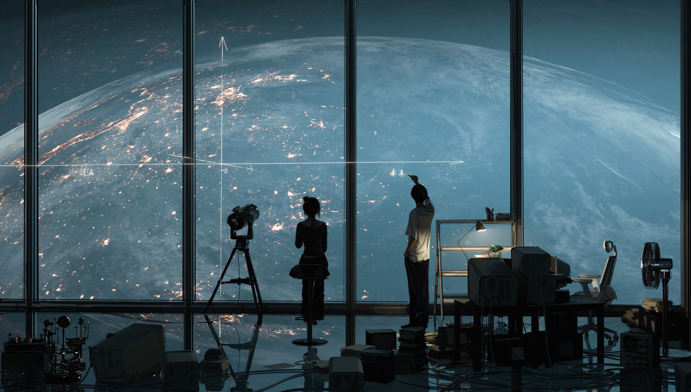

**VI**: “Lại đây, tôi giải thích cho cậu.”

**ZH**: “来，我给你解释。”

**EN**: “Come here. I’ll explain.”

**VI**: Hi Dương đã đứng dậy, cầm lấy cây bút trên bàn, bước tới trước khung cửa sổ sát đất, giơ tay vẽ một đường nằm ngang lên mặt kính, rồi lại vẽ thêm một đường thẳng đứng. Đầu bút miết qua mặt kính, phát ra tiếng ma sát thật khẽ.

**ZH**: 希扬已经站起身，拿起桌上的笔，走到落地窗前，抬手在玻璃上画了一条横线，又画了一条竖线。笔尖划过玻璃，发出很轻的摩擦声。

**EN**: Suvan had already stood up. He picked up the pen from the desk, walked to the floor-to-ceiling window, and drew a horizontal line on the glass, then a vertical one. The pen tip scraped lightly across the surface.

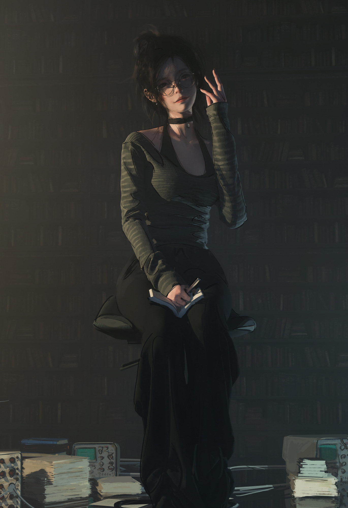

**VI**: Nguyệt Nha Nhi chẳng biết mò đâu ra một chiếc kính gọng tròn đeo lên mắt, ngồi lên chiếc ghế đẩu cao, ngẩng đầu nhìn cậu đầy vẻ nghiêm túc đứng đắn:

**ZH**: 月牙儿不知从哪儿摸出一副圆框眼镜戴上，坐上高脚凳，一本正经地抬头望着他：

**EN**: From somewhere, Mahina produced a pair of round-framed glasses and put them on. Sitting on the high stool, she looked up at him with mock seriousness:

**VI**: “Vậy thầy Hi Dương, bắt đầu tiết học vật lý của thầy đi nào.”

**ZH**: “那希扬老师，开始你的物理课吧。”

**EN**: “Then, Teacher Suvan, please begin your physics lesson.”

**VI**: Hi Dương bị lời trêu chọc của cô làm cho có chút lúng túng luống cuống, chỉ đành quay đầu lại bấm bụng tiếp tục vẽ hai trục tọa độ kia lên mặt kính.

**ZH**: 希扬被她调侃得有点不知所措，只能回头硬着头皮继续在玻璃上画那两条轴线。

**EN**: Suvan was flustered enough by her teasing that he could only turn back and continue drawing the two axes on the glass.

**VI**: “Trục hoành này đại diện cho thời gian. Sang phải là tương lai, sang trái là quá khứ. Gốc tọa độ——chính là hiện tại.”

**ZH**: “这条横轴，代表时间。往右是未来，往左是过去。原点——就是现在。”

**EN**: “This horizontal axis represents time. To the right is the future, to the left is the past. The origin is now.”

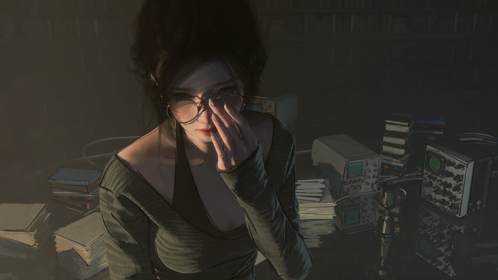

**VI**: Nguyệt Nha Nhi đẩy đẩy gọng kính, nghiêm túc gật đầu:

**ZH**: 月牙儿扶了扶眼镜，认真地点头道：

**EN**: Mahina adjusted her glasses and nodded seriously.

**VI**: “Hiểu rồi. Hiện tại, gốc tọa độ.”

**ZH**: “明白。现在，原点。”

**EN**: “Understood. Now. The origin.”

**VI**: “Trục tung cùng một trục khác mà hiện tại cậu chưa nhìn thấy, cùng nhau tạo thành không gian, tức là khoảng cách. Hệ trục tọa độ này, chính là tọa độ thời - không.”

**ZH**: “竖轴和另一个你现在看不见的轴，一起构成空间，也就是距离。这个坐标系，就是时空坐标。”

**EN**: “The vertical axis, together with another axis you cannot see right now, forms space, or distance. This coordinate system is a spacetime coordinate system.”

**VI**: “Được.” Nguyệt Nha Nhi nói, “Tọa độ thời - không.”

**ZH**: “好。” 月牙儿说， “时空坐标。”

**EN**: “Good,”  Mahina said.  “Spacetime coordinates.”

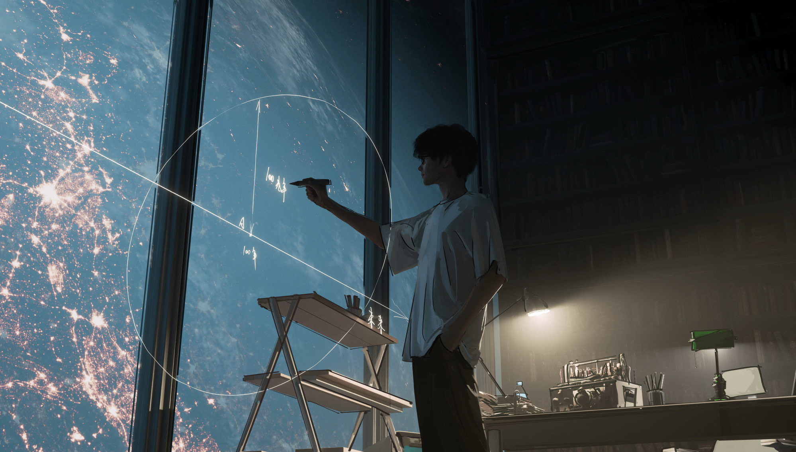

**VI**: “Giả sử vị trí thời - không lúc cậu sinh ra là gốc tọa độ.” Hi Dương tiếp tục dịch sang bên phải, chấm một điểm trên trục thời gian, “Còn đây, là thời điểm một trăm năm sau trên trục thời gian, chúng ta gọi nó là điểm A. Sau đó lấy điểm A này làm tâm, vẽ một hình tròn có bán kính một trăm năm ánh sáng trên mặt phẳng không gian. Hình tròn này, chính là ranh giới trên lý thuyết mà cậu có thể chạm tới sau một trăm năm.”

**ZH**: “假设你出生的时空位置是原点。” 希扬继续往右，在横轴上取了一个点， “而这里，是时间轴上的一百年后，我们把它叫作A点。然后以这个A点为圆心，在空间平面上画一个半径为一百光年的圆。这个圆，就是你在一百年后理论上能抵达的边界。”

**EN**: “Suppose the spacetime position where you were born is the origin.”  Suvan moved to the right and marked a point on the time axis.  “And here is one hundred years later on the time axis. We’ll call it point A. Then, using point A as the center, draw a circle in the spatial plane with a radius of one hundred light-years. That circle is the theoretical boundary of where you can reach after one hundred years.”

**VI**: Nguyệt Nha Nhi rất nhanh đã hiểu ra vấn đề.

**ZH**: 月牙儿很快听明白了。

**EN**: Mahina understood quickly.

**VI**: “Bởi vì nhanh nhất cũng không thể vượt quá tốc độ ánh sáng, cho nên nếu là một trăm năm sau, trên lý thuyết xa nhất cũng chỉ có thể đến được nơi cách một trăm năm ánh sáng.”

**ZH**: “因为最快也不能超过光速，所以如果是一百年后，理论上最远也只能到一百光年的地方。”

**EN**: “Because nothing can move faster than light. So after one hundred years, the farthest you could theoretically reach would be one hundred light-years away.”

**VI**: “Đúng vậy.” Hi Dương nói, “Nối hình tròn này lại với gốc tọa độ, cậu xem nó giống hình gì?”

**ZH**: “对。” 希扬说， “再把这个圆和原点连起来，你看它像什么？”

**EN**: “Right,”  Suvan said.  “Now connect that circle back to the origin. What does it look like?”

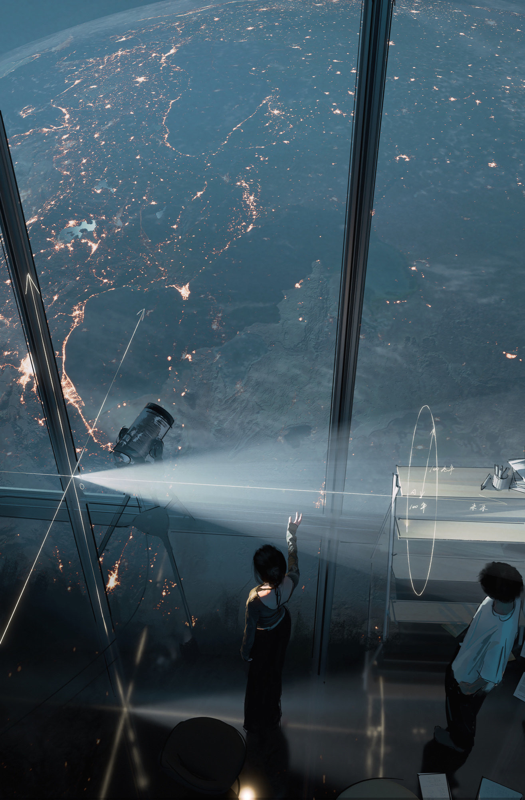

*(Xem video chuyển động: [`light-cone-wall.mp4`](./media/light-cone-wall.mp4))*

**VI**: Nguyệt Nha Nhi nheo mắt nhìn một hồi.

**ZH**: 月牙儿眯着眼看了一会儿。

**EN**: Mahina narrowed her eyes and looked for a while.

**VI**: “Một hình nón.”

**ZH**: “一个圆锥体。”

**EN**: “A cone.”

**VI**: “Đúng vậy.” Hi Dương nói, “Đây chính là nón ánh sáng thuộc về cậu. Mọi thông tin liên quan đến cậu đều chỉ có thể tồn tại bên trong phạm vi này. Bởi vì tất cả thông tin có trật tự đều không thể vượt quá vận tốc ánh sáng, cho nên chúng vĩnh viễn không thể đâm xuyên qua bức tường nón ánh sáng này. Sự tồn tại của cậu, ảnh hưởng của cậu, những nơi cậu có thể đặt chân tới, những điều cậu có thể cho người khác biết——đều bị giam cầm bên trong phạm vi này. Đối với bất kỳ điểm nào nằm ngoài nón ánh sáng, thông tin về cậu đều không thể truyền tới đó, vì thế dưới góc nhìn của nó, cậu hoàn toàn không tồn tại.”

**ZH**: “对。” 希扬说， “这就是属于你的光锥。关于你的一切信息，都只能存在在这个范围之内。因为一切有序信息都不可能超过光速，所以它们永远不可能突破这个光锥之壁。你的存在、你的影响，你能到达的地方，你能让别人知道的事——都被关在这个范围里。对光锥之外的任何一个点来说，关于你的信息都到不了那里，所以从它的角度看，你是不存在的。”

**EN**: “Right,”  Suvan said.  “This is your light cone. All information about you can only exist within this range. Because ordered information can never exceed the speed of light, it can never break through the wall of this cone. Your existence, your influence, the places you can reach, the things you can make others know, all of it is confined within this range. For any point outside the light cone, information about you can never arrive. So from its perspective, you do not exist.”

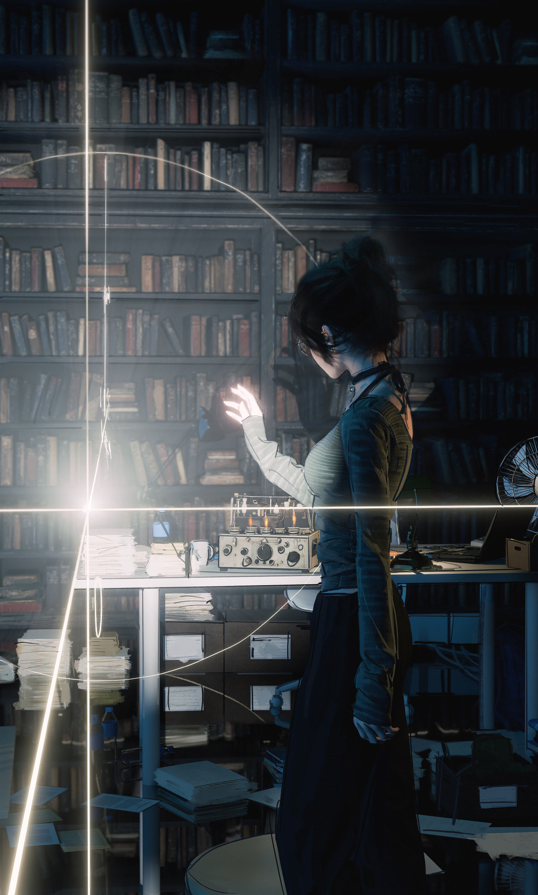

**VI**: Nguyệt Nha Nhi đứng dậy, vươn tay dò dẫm về phía trước, tựa như muốn chạm vào bức tường nón ánh sáng vô hình kia.

**ZH**: 月牙儿站起身，伸出手前探，仿佛想去触摸那看不见的光锥之壁。

**EN**: Mahina stood up and reached forward, as if trying to touch the invisible wall of the light cone.

**VI**: “Một chiếc lồng giam.” Cô khẽ lẩm bẩm.

**ZH**: “一个囚笼。” 她轻声道。

**EN**: “A prison,”  she said softly.

**VI**: Hi Dương không lên tiếng.

**ZH**: 希扬没有出声。

**EN**: Suvan said nothing.

**VI**: Cô chăm chú nhìn những ngón tay đang khẽ múa lượn của mình, tựa như nhìn thấy số phận đang chảy trôi qua từng kẽ tay, nhói buốt, lại lành lạnh tê dại.

**ZH**: 她盯着自己轻轻舞动着的手指，仿佛看到命运从指缝间流过，刺痛，而又微凉。

**EN**: She stared at her own gently moving fingers, as if seeing fate flowing between them, sharp and faintly cold.

**VI**: “Một chiếc lồng giam hình nón, nhốt cả cuộc đời chúng ta bên trong. Chúng ta dành trọn cả kiếp người, cũng vĩnh viễn không bao giờ bước ra được bên ngoài nó.”

**ZH**: “一个锥形的囚笼，把我们的一生都关在里面了。我们终其一生，永远都到不了它外面。”

**EN**: “A cone-shaped prison, locking our entire lives inside it. No matter how long we live, we can never reach the outside.”

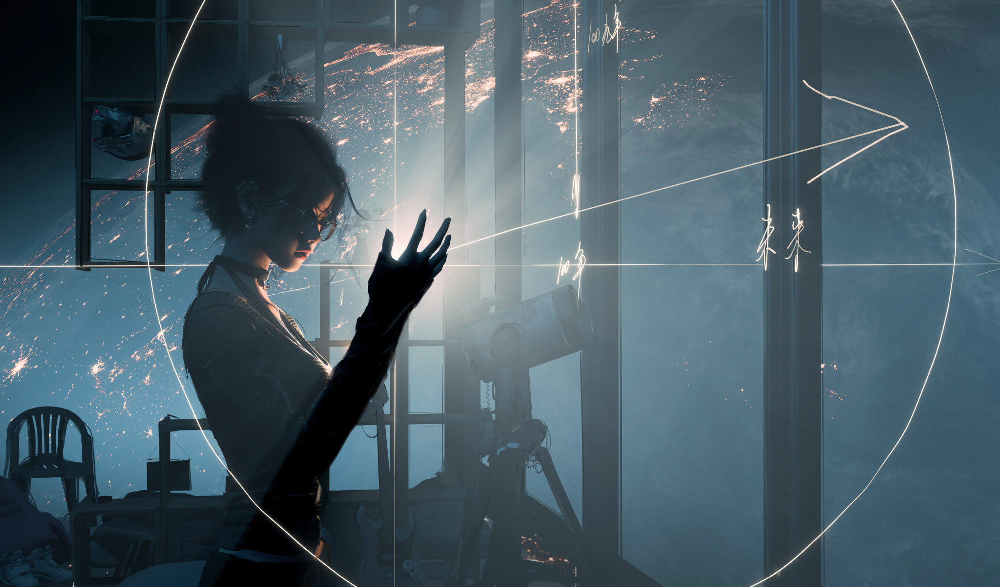

*(Xem video chuyển động: [`falling-sand.mp4`](./media/falling-sand.mp4))*

**VI**: Bên ngoài cửa sổ sát đất, ánh trăng lạnh lẽo rọi lên mặt kính, những đường nét và con chữ vừa mới viết lên được ánh trăng soi rọi khẽ phát sáng, bóng hình nghiêng nghiêng đổ xuống, phủ lên người cả hai, tựa như một trật tự vô thanh đang giáng xuống trần gian.

**ZH**: 落地窗外，月亮的冷光落在玻璃上，那些刚写上去的线条和字迹被月光映得微微发亮，影子斜斜投下来，落在两个人身上，像某种无声覆盖下来的秩序。

**EN**: Outside the floor-to-ceiling window, the moon’s cold light fell on the glass. The lines and words freshly written there glimmered faintly in the moonlight, their shadows slanting down over the two of them, like some silent order descending upon them.

**VI**: Một lúc sau, cô như chợt ngộ ra điều gì, ngẩng đầu hỏi cậu:

**ZH**: 过了一会儿，她像是忽然抓住了什么，抬头问他：

**EN**: After a while, as if suddenly catching hold of something, she looked up and asked him:

**VI**: “Nhưng vừa rồi cậu nói, giới hạn tốc độ của thông tin có trật tự là tốc độ ánh sáng. Vậy điều đó có nghĩa là, vẫn còn một thứ gọi là thông tin vô trật tự, có thể bứt phá khỏi vận tốc ánh sáng sao?”

**ZH**: “可你刚才说的是，有序信息的极限速度是光速。那是不是意味着，还有一种叫无序信息的东西，可以突破光速？”

**EN**: “But what you just said was that ordered information has the speed of light as its limit. Does that mean there is another kind of thing called unordered information that can break past light speed?”

**VI**: Hi Dương cuối cùng cũng mỉm cười. Quả nhiên, với sự nhạy bén của cô, rất nhanh đã nắm bắt được manh mối này.

**ZH**: 希扬终于笑了笑。果然，以她的敏锐，很快就能抓到这条线。

**EN**: Suvan finally smiled. As expected, with her sharpness, she had quickly caught that thread.

**VI**: “Đúng vậy.” Cậu nói, “Thông tin vô trật tự.”

**ZH**: “对。” 他说， “无序信息。”

**EN**: “Yes,”  he said.  “Unordered information.”

**VI**: Nguyệt Nha Nhi nhìn chằm chằm vào cậu, ánh sáng trong đôi mắt dần dần bừng sáng.

**ZH**: 月牙儿盯着他，眼睛里的光慢慢亮起来。

**EN**: Mahina stared at him, the light in her eyes slowly brightening.

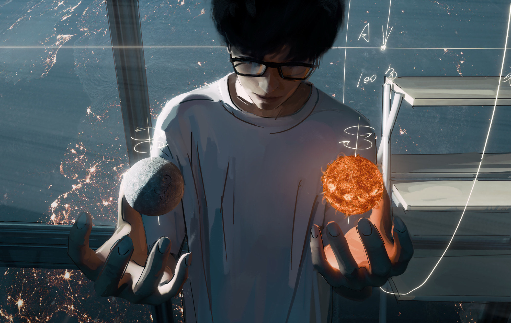

**VI**: “Trước tiên cậu có thể hiểu đơn giản thế này. Giả sử trong tay tôi có hai hạt cơ bản, chúng đều đang tự quay (spin), hơn nữa là xoay thuận và xoay nghịch hoàn toàn ngẫu nhiên, không có quy luật cố định nào. Sau đó thông qua một sự liên kết vật lý đặc biệt nào đó, chúng sẽ bước vào một trạng thái vô cùng kỳ lạ——bất kể cách nhau bao xa, biến đổi của chúng đều duy trì đồng bộ tức thời, một hạt xoay thế nào thì hạt kia cũng xoay y như vậy.”

**ZH**: “你可以先简单理解成这样。假设我手里有两个基本粒子，它们都在做自旋，而且是随机地正旋、反旋，没有固定规律。之后经过某种物理上的绑定，它们会进入一种很特殊的状态——无论相隔多远，它们的变化都会保持瞬时同步，一个怎样旋转，另一个也怎样。”

**EN**: “You can understand it like this for now. Suppose I have two elementary particles in my hand. Both are spinning, randomly clockwise or counterclockwise, with no fixed pattern. After some kind of physical binding, they enter a very special state. No matter how far apart they are, their changes remain instantaneously synchronized. However one spins, the other spins the same way.”

**VI**: Nguyệt Nha Nhi rất nhanh đã tiếp lời:

**ZH**: 月牙儿很快接了上去：

**EN**: Mahina caught on quickly:

**VI**: “Vướng víu lượng tử?”

**ZH**: “量子纠缠？”

**EN**: “Quantum entanglement?”

**VI**: “Đúng.” Hi Dương gật đầu, “Cậu có thể hiểu nó như một mô hình vướng víu lượng tử đơn giản nhất.”

**ZH**: “对。” 希扬点头， “你可以先把它理解成一个最简单的量子纠缠模型。”

**EN**: “Yes.”  Suvan nodded.  “You can understand it first as the simplest model of quantum entanglement.”

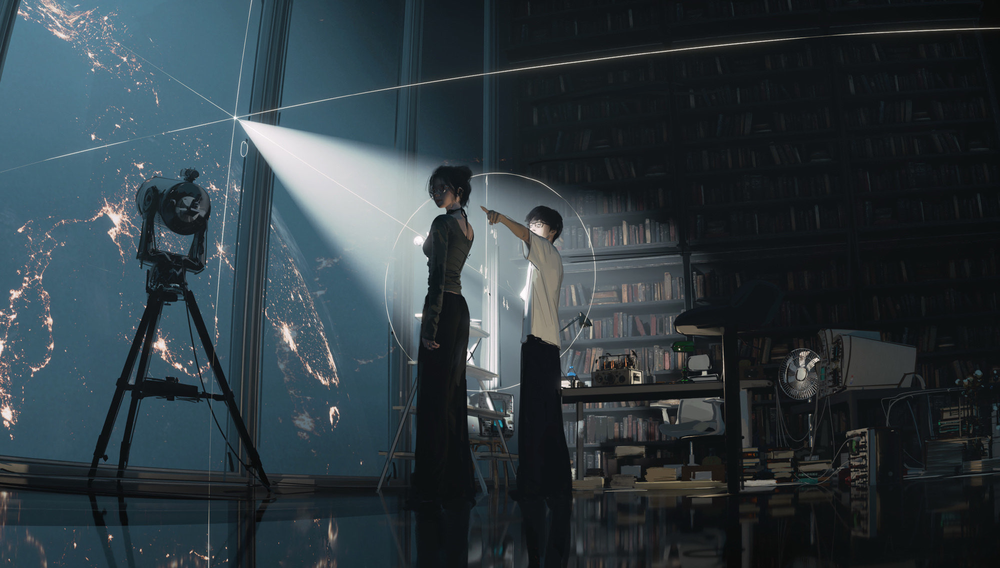

**VI**: Cậu chỉ về phía bên trái của trục thời gian, như thể đang chỉ về một nơi chốn vô cùng xa xôi.

**ZH**: 他指向时间轴的左方，像是在指着某个极远的地方。

**EN**: He pointed toward the left side of the time axis, as if pointing toward some extremely distant place.

**VI**: “Bây giờ, tôi đưa một trong hai hạt đó tới một nơi rất xa, rất xa. Đưa tới nơi cách xa một trăm triệu năm ánh sáng, hoặc là——”

**ZH**: “现在，我把其中一个粒子送到很远很远的地方。送到一亿光年之外，或者——”

**EN**: “Now I send one of the particles somewhere very, very far away. A hundred million light-years away, or—”

**VI**: Cậu khựng lại một nhịp.

**ZH**: 他顿了一下。

**EN**: He paused.

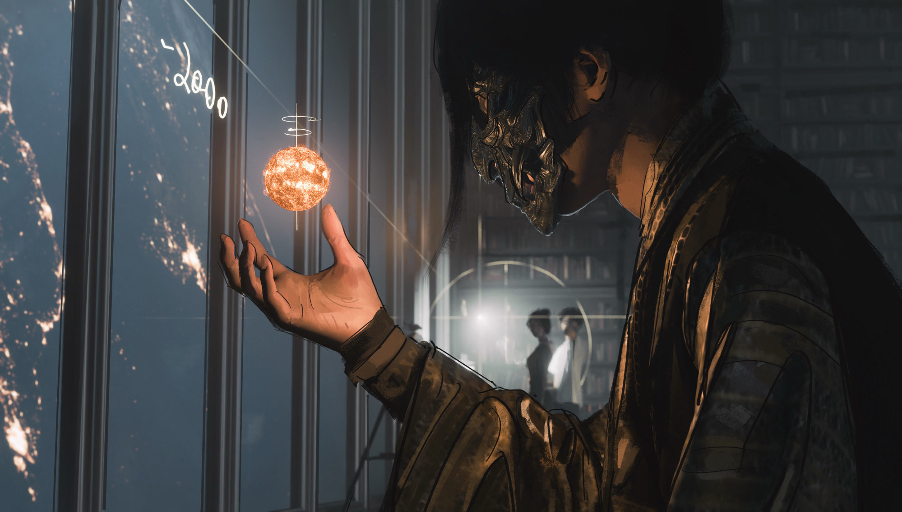

**VI**: “Đưa về hai nghìn năm trước, vào tận tay Trương Lương.”

**ZH**: “送到两千年前，张良手里。”

**EN**: “To Zhang Liang’s hand, two thousand years ago.”

**VI**: Ánh mắt Nguyệt Nha Nhi khẽ thắt lại.

**ZH**: 月牙儿的目光微微一紧。

**EN**: Mahina’s gaze tightened slightly.

**VI**: “Hai vị trí này, bất kể là trên phương diện không gian hay thời gian, đối với chúng ta hiện tại, đều là ngoài nón ánh sáng.

**ZH**: “这两个位置，无论是空间上还是时间上，对现在的我们来说，都是光锥之外。

**EN**: “Both of these positions, whether in space or in time, are beyond the light cone for us now.

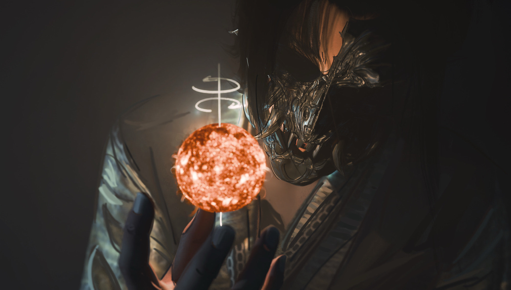

**VI**: Thế nhưng nếu hai hạt này vẫn duy trì trạng thái vướng víu, khi Trương Lương nhìn thấy hạt trong tay mình xuất hiện chuỗi xoay thuận, xoay nghịch, xoay thuận, thì ông ấy sẽ biết hạt trong tay tôi, ngay vào khoảnh khắc này cũng xuất hiện một chuỗi y hệt như thế.”

**ZH**: 可如果这两个粒子仍旧保持纠缠，当张良看到他手里的粒子出现正、反、正这样的自旋序列时，他就知道我手里的这一颗，在这一刻也出现了同样的序列。”

**EN**: And if these two particles remain entangled, then when Zhang Liang sees the particle in his hand produce a spin sequence of clockwise, counterclockwise, clockwise, he will know that the one in my hand has produced the same sequence at this very moment.”

**VI**: “Nói cách khác,” Nguyệt Nha Nhi khẽ tiếp lời, “thông tin này đã truyền tới hai nghìn năm trước.”

**ZH**: “也就是说，” 月牙儿轻声接道， “这条信息传到了两千年前。”

**EN**: “In other words,”  Mahina said softly,  “this information reached two thousand years into the past.”

**VI**: “Đúng vậy.” Hi Dương nói, “Thông tin này đã vượt qua tốc độ ánh sáng, chạm tới ngoài nón ánh sáng.”

**ZH**: “对。” 希扬说， “这条信息已经越过了光速，到达了光锥之外。”

**EN**: “Yes,”  Suvan said.  “This information has already crossed the speed of light and arrived beyond the light cone.”

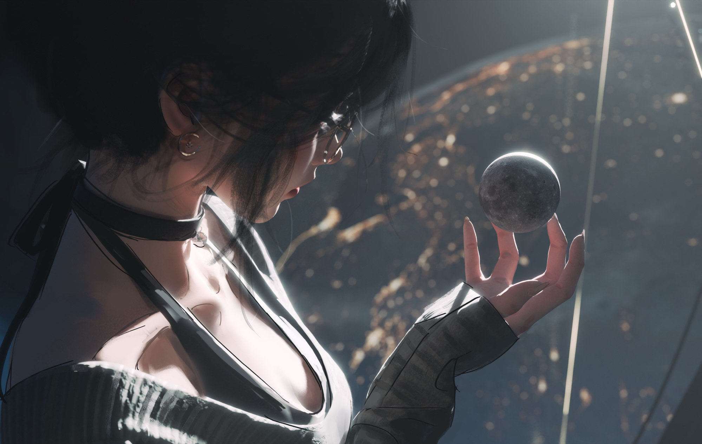

*(Xem video chuyển động: [`cloudinsect-home-bg-v2.mp4`](./media/cloudinsect-home-bg-v2.mp4))*

**VI**: Nguyệt Nha Nhi nhíu mày:

**ZH**: 月牙儿皱起了眉：

**EN**: Mahina frowned.

**VI**: “Tôi chỉ từng nghe nói đến vướng víu lượng tử trong không gian, chiều thời gian cũng có thể vướng víu được sao?”

**ZH**: “我只听说空间上的量子纠缠，时间维度也能纠缠？”

**EN**: “I’ve only heard of quantum entanglement across space. Can it happen across time too?”

**VI**: “Đúng. Dựa vào thương số vướng víu trên bình diện toán học là có thể suy ra được, trên trục thời gian cũng tồn tại hiện tượng vướng víu.”

**ZH**: “对。靠纠缠商在数学层面上就可以推算出，时间轴向也存在纠缠。”

**EN**: “Yes. At the mathematical level, the entanglement quotient can be used to infer that entanglement also exists along the time axis.”

**VI**: “Vậy chẳng phải có nghĩa là, trên lý thuyết dựa vào vướng víu lượng tử, chúng ta có thể liên lạc thời gian thực với nơi cách xa mấy năm ánh sáng, thậm chí truyền tải thông tin xuyên việt thời không?”

**ZH**: “那是不是说，理论上靠量子纠缠，我们能和几光年外的地方进行实时通信，甚至超越时空传递信息？”

**EN**: “So does that mean, in theory, by relying on quantum entanglement, we could communicate in real time with places several light-years away, even transmit information beyond spacetime?”

**VI**: Hi Dương lắc đầu.

**ZH**: 希扬摇了摇头。

**EN**: Suvan shook his head.

**VI**: “Không thể.”

**ZH**: “不能。”

**EN**: “No.”

**VI**: “Tại sao?”

**ZH**: “为什么？”

**EN**: “Why?”

**VI**: “Ác quỷ nằm ở chính chỗ này. Bởi vì đó là một thông tin vô trật tự.” Hi Dương nói, “Tuy rằng nó đồng bộ, nhưng bản thân nó lại là ngẫu nhiên. Cả cậu lẫn Trương Lương đều không thể quyết định lần tiếp theo nó sẽ xoay thuận hay xoay nghịch. Chúng ta chỉ có thể nhìn thấy điều gì đã xảy ra, chứ không thể kiểm soát được điều gì sẽ xảy ra.”

**ZH**: “魔鬼就在这里。因为那是一条无序信息。” 希扬说， “它虽然同步，但本身是随机的。你和张良谁都不能决定下一次它是正旋还是反旋。我们只能看见它发生了什么，却无法控制它发生什么。”

**EN**: “That is the catch. Because it is unordered information,”  Suvan said.  “It is synchronized, but it is random in itself. Neither you nor Zhang Liang can decide whether the next spin will be clockwise or counterclockwise. We can only see what happens. We cannot control what happens.”

**VI**: Nguyệt Nha Nhi suy nghĩ một lát, lại gặng hỏi:

**ZH**: 月牙儿想了一会儿，又追问：

**EN**: Mahina thought for a moment, then asked again:

**VI**: “Nếu như có một loại công nghệ có thể kiểm soát chiều quay của nó thì sao?”

**ZH**: “如果有一种技术，可以控制它旋转呢？”

**EN**: “What if there were a technology that could control its spin?”

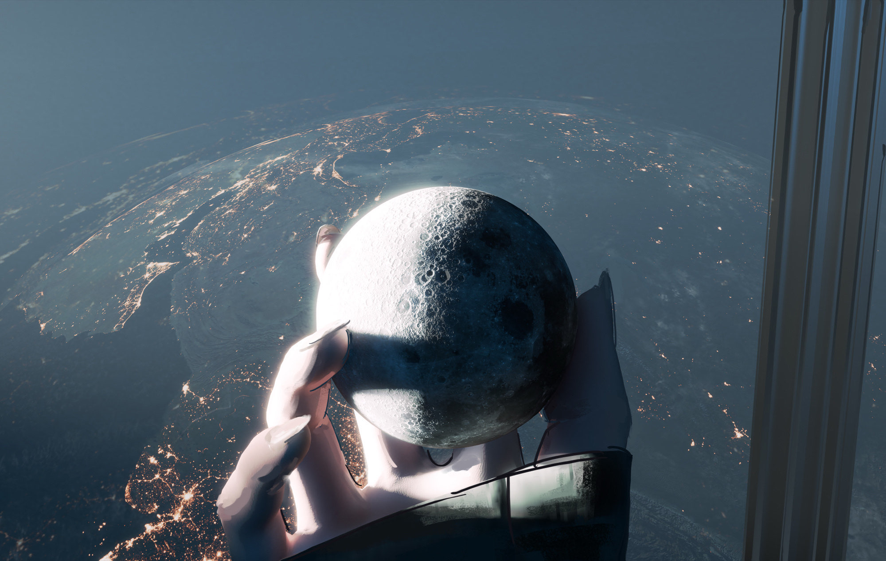

*(Xem video chuyển động: [`turn.mp4`](./media/turn.mp4))*

**VI**: Giọng của Hi Dương chậm lại.

**ZH**: 希扬的声音慢了下来。

**EN**: Suvan’s voice slowed.

**VI**: “Nếu như bây giờ cậu vươn tay tóm lấy hạt này, cưỡng ép nó xoay theo cách cậu mong muốn. Nghịch, thuận, nghịch, nghịch——khắc một chuỗi có ý nghĩa vào bên trong, mượn nó để nói với Trương Lương: Tần Vương ngồi ở xe sau.”

**ZH**: “如果你现在伸手去抓住这颗粒子，强行让它按你想要的方式旋转。反、正、反、反——把一个有意义的序列刻进去，借它告诉张良：秦王在后车。”

**EN**: “If you reached out now and seized this particle, forcing it to spin the way you wanted. Counterclockwise, clockwise, counterclockwise, counterclockwise. If you carved a meaningful sequence into it and used it to tell Zhang Liang: the King of Qin is in the rear carriage.”

**VI**: Hơi thở của Nguyệt Nha Nhi khẽ nghẹn lại.

**ZH**: 月牙儿的呼吸轻轻一滞。

**EN**: Mahina’s breath caught softly.

**VI**: “Thế thì sẽ xảy ra chuyện gì?”

**ZH**: “那会怎么样？”

**EN**: “What would happen?”

**VI**: Hi Dương dừng đầu bút lại giữa hai điểm đó, khẽ gạch một đường, tựa như cắt đứt một sợi dây vốn dĩ vô hình.

**ZH**: 希扬把笔尖停在那两个点之间，轻轻一划，像切断了一根本来看不见的线。

**EN**: Suvan stopped the pen tip between those two points and drew a light stroke, as if cutting an invisible thread.

**VI**: “Thông tin này sẽ không còn là vô trật tự nữa. Mà một khi nó biến thành thông tin có trật tự và bị quan sát ngoài nón ánh sáng, sự vướng víu sẽ sụp đổ, mối liên kết giữa hai hạt này sẽ lập tức đứt gãy, không còn duy trì được sự đồng bộ nữa.”

**ZH**: “这条信息就不再是无序的了。而一旦它变成有序信息在光锥之外被观测到，纠缠就会坍缩，这两个粒子之间的联系会立刻断裂，再也无法保持同步。”

**EN**: “Then this information would no longer be unordered. And once it becomes ordered information and is observed beyond the light cone, the entanglement collapses. The connection between the two particles breaks at once, and synchronization can no longer be maintained.”

**VI**: “Cho nên, thông tin này vĩnh viễn không bao giờ có thể đến được tay Trương Lương.”

**ZH**: “所以，这条信息永远也不可能到张良手里。”

**EN**: “So this information can never reach Zhang Liang’s hand.”

**VI**: “Vĩnh viễn không thể.”

**ZH**: “永远不可能。”

**EN**: “Never.”

**VI**: Hi Dương dừng lại một chút, dường như cố ý để lại cho cô một chút thời gian suy ngẫm.

**ZH**: 希扬停了停，似乎是故意想留给她一点思考的时间。

**EN**: Suvan paused, as if deliberately leaving her some time to think.

**VI**: “Cậu còn nhớ không, lần đầu tiên chúng ta gặp Công Tôn Ưởng, chúng ta bị dịch chuyển đi là vào lúc nào?”

**ZH**: “你还记不记得，我们第一次遇见公孙鞅的时候，是在什么时候被传走的？”

**EN**: “Do you remember when we were transported away the first time we met Gongsun Yang?”

**VI**: Nguyệt Nha Nhi theo lời cậu nhớ lại một hồi, chậm rãi nói:

**ZH**: 月牙儿顺着他的话回想了一会儿，慢慢道：

**EN**: Mahina followed his words back through her memory, then slowly said:

**VI**: “Là vào lúc tôi gọi ông ấy là Thương Ưởng.”

**ZH**: “是在我叫他商鞅的时候。”

**EN**: “It was when I called him Shang Yang.”

**VI**: “Đúng vậy.” Hi Dương nói, “Bởi vì vào thời điểm đó, ông ấy vẫn chưa phải là Thương Ưởng, mà chỉ là Công Tôn Ưởng. Phải đến sau này biến pháp thành công, được phong đất ở đất Thương, ông ấy mới có cái tên ‘Thương Ưởng’. Một câu nói đó của cậu, đối với ông ấy chính là một thông tin có trật tự đến từ hậu thế. Đó đã không còn là cuộc trò chuyện thông thường nữa, mà là đang làm thay đổi nhận thức của ông ấy về số phận của chính mình. Loại thông tin như thế một khi thốt ra, thông đạo sẽ lập tức bị gián đoạn.”

**ZH**: “对。” 希扬说， “因为那个时候，他还不是商鞅，只是公孙鞅。是在后来变法成功、被封到商地之后，他才有了‘商鞅’这个名字。你那一句话，对他来说就是一条来自后世的有序信息。那已经不是普通的交谈了，而是在改动他对自己命运的认知。这样的信息一旦出口，通道就会立刻中断。”

**EN**: “Right,”  Suvan said.  “Because at that time, he was not Shang Yang yet. He was only Gongsun Yang. Only later, after his reforms succeeded and he was enfeoffed in the land of Shang, did he receive the name ‘Shang Yang.’ That sentence of yours was ordered information from later generations. It was no longer ordinary conversation. It was changing his understanding of his own fate. Once information like that is spoken, the passage immediately cuts off.”

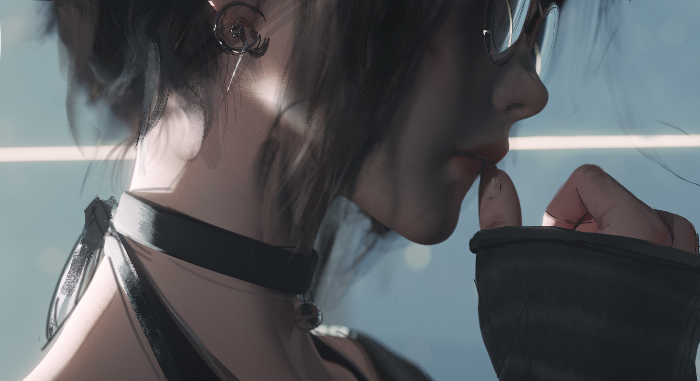

**VI**: Cô chỉ lặng nhìn những đường nét trên mặt kính, cảm thấy sau lưng từ từ dâng lên một luồng ớn lạnh. Tựa như rất nhiều mảnh vụn vốn dĩ tản mác, cho đến tận giây phút này, cuối cùng mới khớp chặt vào nhau.

**ZH**: 她只是看着窗上的那些线条，觉得背后慢慢起了一层凉意。像是许多原本散落的碎片，直到这一刻，才终于彼此咬合。

**EN**: She only looked at the lines on the window, feeling a chill slowly rise along her back. It was as if many scattered fragments had finally locked together at that moment.

**VI**: “Hèn chi lúc đó tôi muốn nói cho Trương Lương biết Tần Vương ngồi ở xe nào, cậu liền lập tức ngắt lời tôi. Cậu không phải sợ tôi làm thay đổi lịch sử, mà là——”

**ZH**: “怪不得那时候我想告诉张良秦王在哪一辆车上，你一下就把我打断了。你不是怕我改变历史，而是——”

**EN**: “No wonder, when I wanted to tell Zhang Liang which carriage the King of Qin was in, you stopped me at once. You weren’t afraid I would change history. You were—”

**VI**: Đột nhiên, Nguyệt Nha Nhi như sực nhớ ra điều gì, cả người bật nảy dậy.

**ZH**: 突然，月牙儿像是想起了什么，整个人弹了起来。

**EN**: Suddenly, as if remembering something, Mahina jolted upright.

**VI**: “Hèn chi……”

**ZH**: “怪不得……”

**EN**: “No wonder...”

**VI**: Hi Dương ngước mắt lên.

**ZH**: 希扬抬起眼。

**EN**: Suvan raised his eyes.

**VI**: “Sao thế?”

**ZH**: “什么？”

**EN**: “What?”

**VI**: Nguyệt Nha Nhi nhìn cậu, vẻ mặt từng chút từng chút trở nên phức tạp.

**ZH**: 月牙儿看着他，神情一点点复杂起来。

**EN**: Mahina looked at him, her expression growing complicated little by little.

**VI**: “Hèn chi…… Hán Quang Vũ Đế——”

**ZH**: “怪不得……汉光武帝——”

**EN**: “No wonder... Emperor Guangwu of Han—”

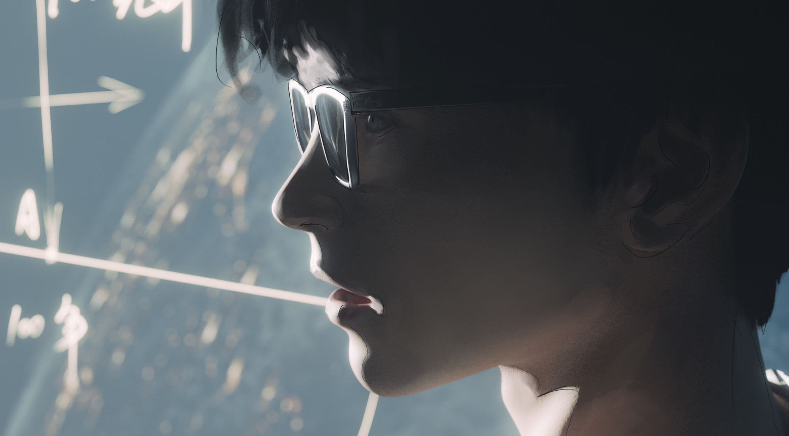

**VI**: Hi Dương ngẩn người ra một thoáng.

**ZH**: 希扬愣了一下。

**EN**: Suvan froze for a moment.

**VI**: “Hán Quang Vũ Đế?”

**ZH**: “汉光武帝？”

**EN**: “Emperor Guangwu of Han?”

**VI**: Nguyệt Nha Nhi không giải thích ngay, chỉ nhíu chặt mày, tựa như đang chắp vá lại trong đầu một đoạn ký ức rất xưa cũ, rất xa xôi, vốn dĩ bấy lâu nay vẫn bị cô coi là ảo giác.

**ZH**: 月牙儿没有立刻解释，只是皱着眉，像是在拼接脑子里一段很旧、很远、原本一直被她当成幻觉的记忆。

**EN**: Mahina did not explain at once. She only frowned, as if piecing together an old and distant memory she had always taken for a hallucination.

**VI**: “Trước đây…… dường như tôi cũng từng gặp một lần.”

**ZH**: “我以前……似乎也遇见过一次。”

**EN**: “I think... I may have encountered it once before.”

**VI**: Nét mặt Hi Dương trở nên nghiêm trọng hiếm thấy.

**ZH**: 希扬的神情少见地凝重了起来。

**EN**: Suvan’s expression turned unusually grave.

**VI**: “Vào khi nào?”

**ZH**: “什么时候？”

**EN**: “When?”

**VI**: “Ở Tây Tạng.” Nguyệt Nha Nhi trầm giọng nói, “Lần đó tôi đi đuổi theo Vân Trùng Bàn Cổ.”

**ZH**: “在西藏。” 月牙儿低声说， “那次我去追盘古云虫的时候。”

**EN**: “In Tibet,”  Mahina said quietly.  “That time I went chasing after the Pangu CloudInsect.”

**VI**: Cô ngập ngừng, như đang hồi tưởng lại bầu không khí và ngọn gió nơi vùng cao nguyên ấy.

**ZH**: 她顿了顿，像是在回想那片高原的空气与风。

**EN**: She paused, as if recalling the air and wind of the plateau.

**VI**: “Lúc đó tôi vẫn luôn nghĩ là do say độ cao, hoặc do thiếu oxy, cứ ngỡ mình chỉ vừa trải qua một giấc mơ rất dài và kỳ quái.”

**ZH**: “那时候我一直以为是高原反应，或者缺氧，以为自己只是做了一个很长很奇怪的梦。”

**EN**: “At the time, I always thought it was altitude sickness, or lack of oxygen. I thought I had only had a long, strange dream.”

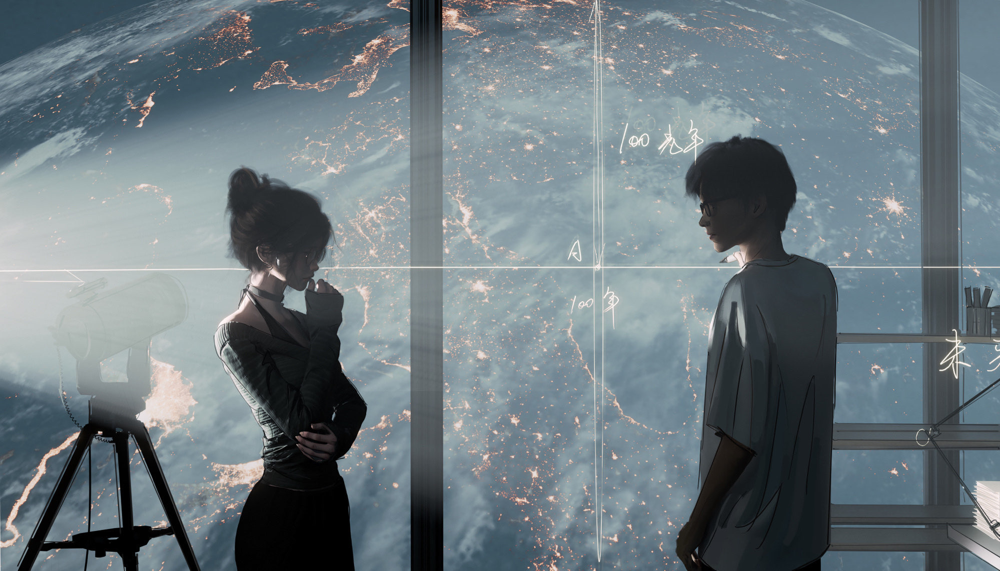

**VI**: Bàn tay Hi Dương khựng lại giữa không trung, ánh mắt gắt gao dừng lại trên gương mặt cô.

**ZH**: 希扬的手僵在半空，目光紧紧落在她脸上。

**EN**: Suvan’s hand froze in midair, his gaze fixed tightly on her face.

**VI**: “Cậu đã nhìn thấy ai?”

**ZH**: “你看见了谁？”

**EN**: “Who did you see?”

**VI**: Nguyệt Nha Nhi im lặng một hồi.

**ZH**: 月牙儿沉默了一会儿。

**EN**: Mahina was silent for a while.

**VI**: Vầng trăng ngoài cửa sổ vẫn treo lơ lửng nơi đó, tĩnh mịch và nhợt nhạt. Cô cúi đầu, dường như cuối cùng cũng chạm tới cái tên đó từ nơi sâu thẳm của ký ức.

**ZH**: 窗外的月亮依旧悬在那里，安静而苍白。她低着头，像是终于从记忆深处摸到了那个名字。

**EN**: Outside the window, the moon still hung there, quiet and pale. She lowered her head, as if finally touching that name from the depths of memory.

**VI**: “Hạng Vũ.”

**ZH**: “项羽。”

**EN**: “Xiang Yu.”

**VI**: Cô nói xong liền ngước mắt lên nhìn Hi Dương, ánh mắt sâu thẳm, tựa như vẫn còn đang nén lại một cái tên khác chưa kịp nói ra miệng.

**ZH**: 她说完抬起眼，看向希扬，眼神很深，像还压着另一个没有说出口的名字。

**EN**: When she finished speaking, she raised her eyes to Suvan. Her gaze was deep, as if it still held another name she had not said aloud.
