# 云虫 - 第四章 命运之锥 · 二

---

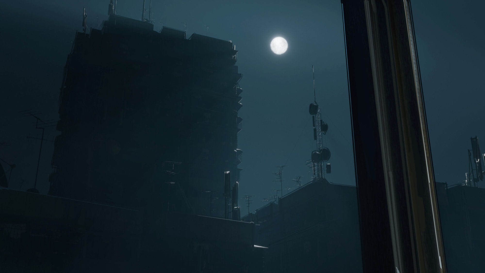

> 夜已经很深了。

> 屋里只留着一盏小灯，昏黄的光落在桌角，也落在摊开的书页和演算纸上。落地窗外，城市的灯火已经稀疏下去，远处偶尔还有车流无声掠过，再往上便只剩一整片深黑的天，月亮悬得很高，白得几乎有些不近人情。

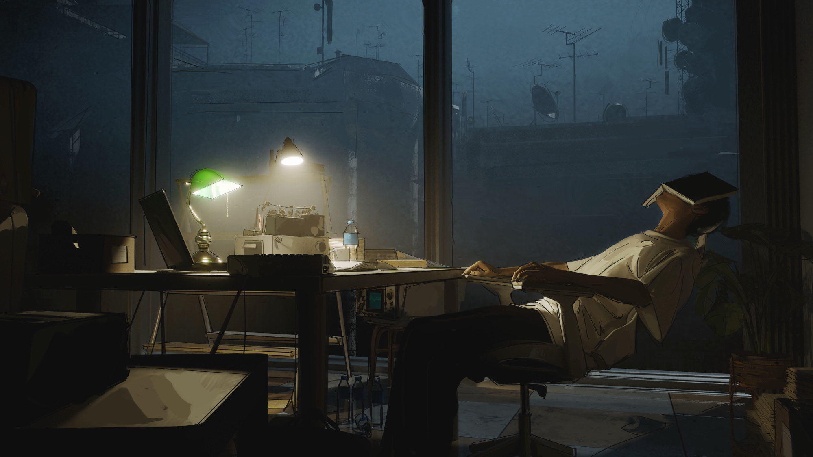

> 希扬躺在椅子里，一本书倒扣在脸上，像是方才还在看书，看到一半便被思绪拖住了。他桌上摊着几本场论、相对论和云虫场观测记录，纸页密密麻麻地铺开。

> “演出还顺利么？”

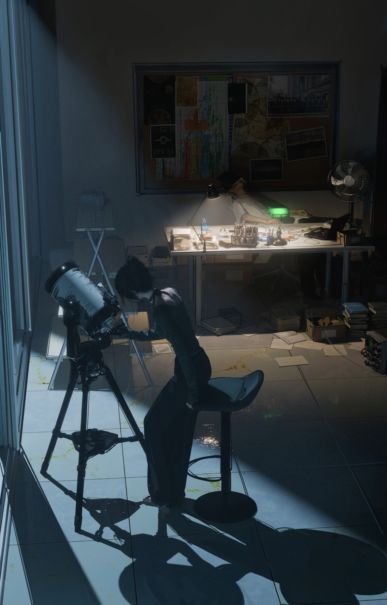

> “还行吧，老样子，挺热闹的。”

> 月牙儿一边漫不经心的答着，一边摆弄那架天文望远镜。她显然是第一次碰这种东西，低着头研究了半天，动作里带着一点新鲜，也带着一点不服气。生锈的望远镜的金属支架轻轻作响，目镜缓缓抬高，对准夜空里那轮异常明亮的月亮。

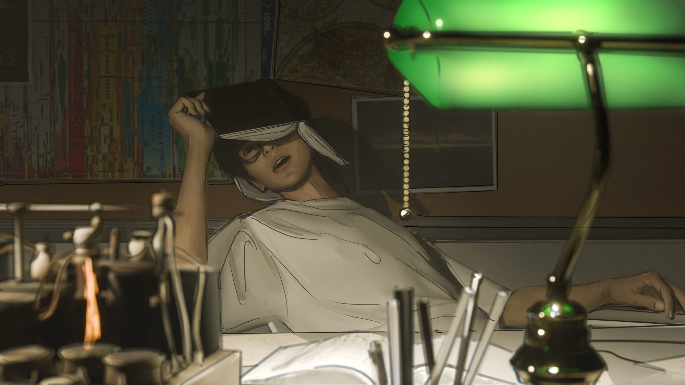

> 希扬翻起盖在脸上的书的一角，偏头看了她一眼，开口道：

> “先别急着从目镜里看。”

> 月牙儿停了停，朝他那边望过去。

> 希扬抬手朝望远镜侧边点了点。

> “看到旁边那个红点寻星镜没有？先拿手柄慢慢调，让里面的红点对准你想看的地方，再去调主镜，不然你很难定位。”

> 月牙儿顺着他说的低头找了找，果然在侧边看见一个很小的瞄准镜。她照着他的意思开始尝试，微微眯起眼，指尖按着操控器，一点一点移动方向。外面的月亮亮得惊人，红点在黑暗里轻轻挪动了很久，才终于慢慢落到月面正中。

> 她俯下身，把眼睛凑近目镜，下一秒，便低低地“哇”了一声。

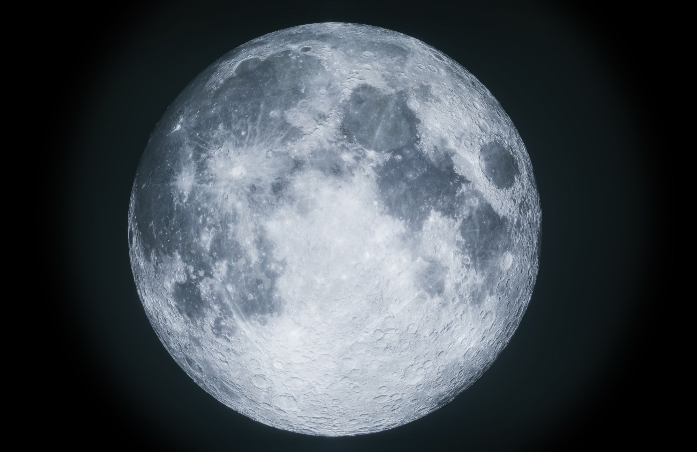

> 月亮一下子近得惊人，冷白，安静，巨大的轮廓在黑暗的夜空中显得异常锋利。表面粗粝的纹理、环形山的阴影、深邃的月海，全都分明地浮在那里，安静得近乎庄严，像一张苍白又古老的脸。

> 月牙儿就这样对着目镜看了很久，才轻声问道：

> “它是不是一直只拿这一面对着我们？”

> 希扬的声音从身后传来，平静而简短：

> “对。因为月亮的公转周期和自转周期是一样的，它绕着地球转一圈，自己也刚好转完一圈，所以朝着我们的，永远都是这一面。”

> 月牙儿安静地听着，像是在脑子里把这件事转了一遍，随后又问：

> “这是巧合吗？”

> “也不能算巧合。” 希扬说， “关于这件事，有两种解释，看你更喜欢哪一种。”

> 月牙儿把眼睛从目镜前稍稍挪开一点。

> “哪两种？”

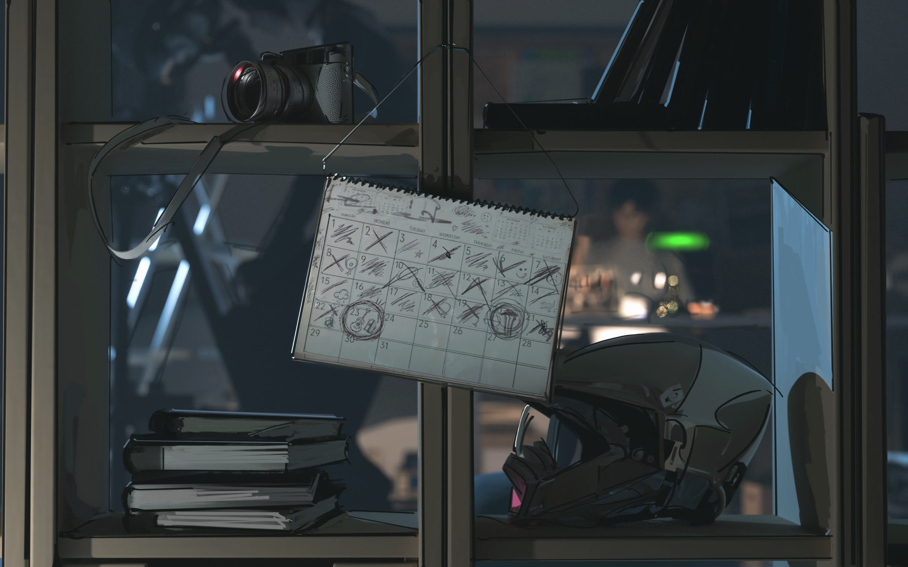

> “第一种，” 他把手里的笔在桌上转了一圈，慢慢说道，

> “月亮刚形成的时候，公转和自转并不是同步的。但在很漫长的时间里，地球对它施加潮汐力，慢慢消耗掉了它自转的差异，最后就把它锁住了。我们现在把这种状态叫潮汐锁定。”

> 月牙儿点了点头，像是听明白了，顺势又问了一句：

> “那另一种呢？”

> 希扬停了一下，才淡淡道：

> “第二种就简单多了。” 希扬的目光落到了她那把白色的贝斯上， “因为月亮不想让别人看见她的另一面。”

> 月牙儿一愣，很快就明白了话里的弦外之音。

> 她没有把这句话接下去，只重新对着那轮月亮看了一会儿，过了很久才轻声道：

> “原来亲眼这样看月亮，是这种感觉。我以前只在书上和屏幕上见过它，总觉得它只是远远挂在天上的一小块白。现在才发现，它比我想象里更大，也更亮。”

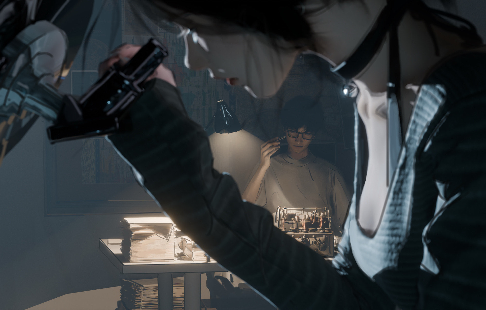

> 她顿了顿，又很轻地补了一句：

> “可这些光，也不是它自己的吧，是太阳的光。”

> 希扬轻轻点了点头。

> “那太阳和月亮之间，隔了多远？” 月牙儿像是在想着什么，忽然又问。

> 希扬坐在那张旧椅子里，神情依旧平静，只是那平静里，像忽然落进了一层更深的东西。

> 过了片刻，他才低声道：

> “光要走八分半。”

> “八分半？听起来并不远。”

> 希扬没有接话。

> 那一瞬间，月牙儿觉得他像是想说什么，却最终还是没有说出口。她也没有追问，只把目光重新落回月亮上。夜风从窗缝里慢慢漏进来，吹得那道淡蓝色的布帘轻轻动了一下。

> 安静了一会儿，她忽然又问：

> “为什么一说到距离，总要拿光来算？”

> “因为光速，是这个宇宙最底层的法则。” 他说， “一切有序信息的极限速度，都是光速。只要你还在这个法则之内，就没有任何东西能真正越过它，到达光锥之外。”

> “光锥之外？”

> 月牙儿听到“光锥之外”这个词，整个人都警觉起来。

> “张良那天说，我们在光锥之外。” 她看着他， “这到底是什么意思？什么叫光锥？光锥之外又是什么地方？”

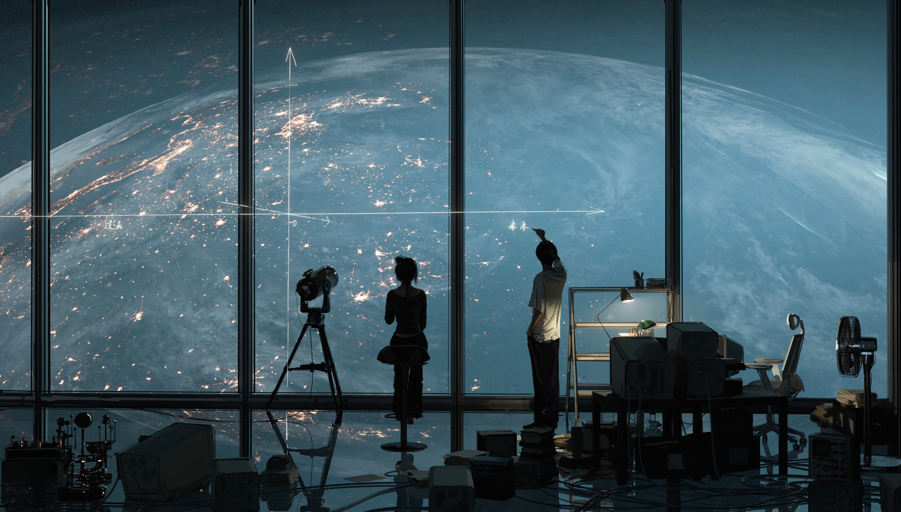

> “来，我给你解释。”

> 希扬已经站起身，拿起桌上的笔，走到落地窗前，抬手在玻璃上画了一条横线，又画了一条竖线。笔尖划过玻璃，发出很轻的摩擦声。

> 月牙儿不知从哪儿摸出一副圆框眼镜戴上，坐上高脚凳，一本正经地抬头望着他：

> “那希扬老师，开始你的物理课吧。”

> 希扬被她调侃得有点不知所措，只能回头硬着头皮继续在玻璃上画那两条轴线。

> “这条横轴，代表时间。往右是未来，往左是过去。原点——就是现在。”

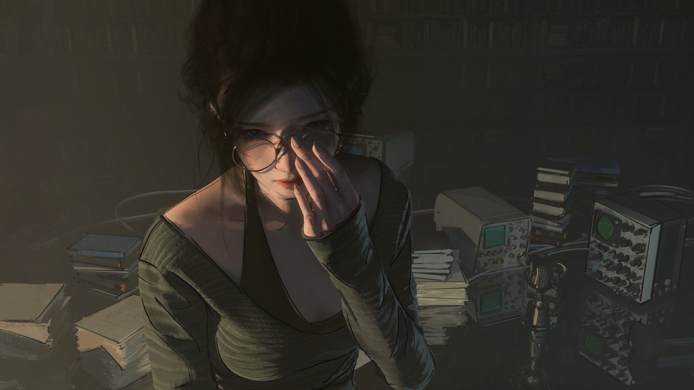

> 月牙儿扶了扶眼镜，认真地点头道：

> “明白。现在，原点。”

> “竖轴和另一个你现在看不见的轴，一起构成空间，也就是距离。这个坐标系，就是时空坐标。”

> “好。” 月牙儿说， “时空坐标。”

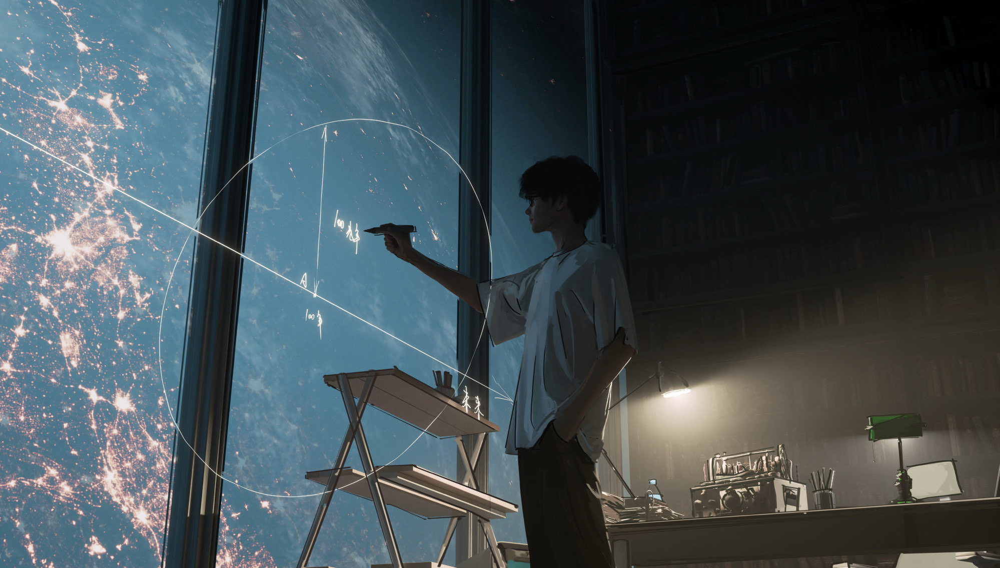

> “假设你出生的时空位置是原点。” 希扬继续往右，在横轴上取了一个点， “而这里，是时间轴上的一百年后，我们把它叫作A点。然后以这个A点为圆心，在空间平面上画一个半径为一百光年的圆。这个圆，就是你在一百年后理论上能抵达的边界。”

> 月牙儿很快听明白了。

> “因为最快也不能超过光速，所以如果是一百年后，理论上最远也只能到一百光年的地方。”

> “对。” 希扬说， “再把这个圆和原点连起来，你看它像什么？”

<video src="./media/light-cone-wall.mp4" controls loop muted playsinline width="100%"></video>

*(Ảnh tĩnh: 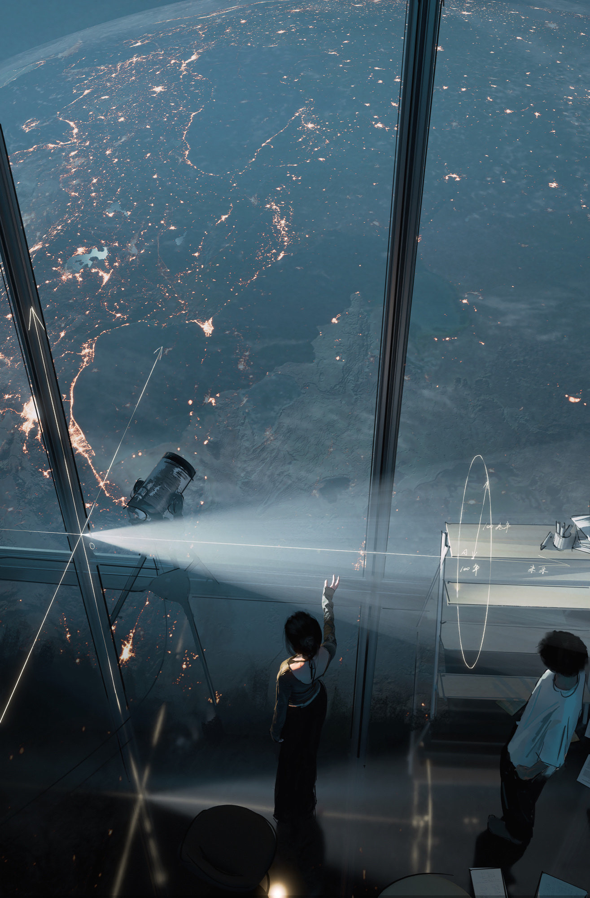)*

> 月牙儿眯着眼看了一会儿。

> “一个圆锥体。”

> “对。” 希扬说， “这就是属于你的光锥。关于你的一切信息，都只能存在在这个范围之内。因为一切有序信息都不可能超过光速，所以它们永远不可能突破这个光锥之壁。你的存在、你的影响，你能到达的地方，你能让别人知道的事——都被关在这个范围里。对光锥之外的任何一个点来说，关于你的信息都到不了那里，所以从它的角度看，你是不存在的。”

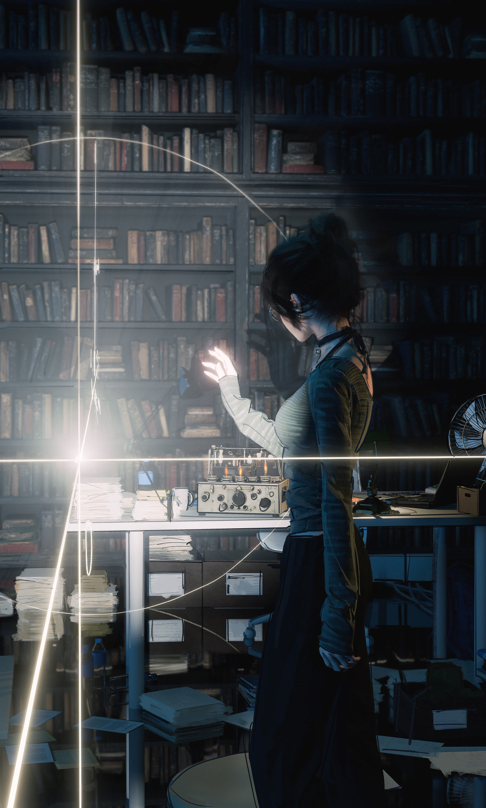

> 月牙儿站起身，伸出手前探，仿佛想去触摸那看不见的光锥之壁。

> “一个囚笼。” 她轻声道。

> 希扬没有出声。

> 她盯着自己轻轻舞动着的手指，仿佛看到命运从指缝间流过，刺痛，而又微凉。

> “一个锥形的囚笼，把我们的一生都关在里面了。我们终其一生，永远都到不了它外面。”

<video src="./media/falling-sand.mp4" controls loop muted playsinline width="100%"></video>

*(Ảnh tĩnh: 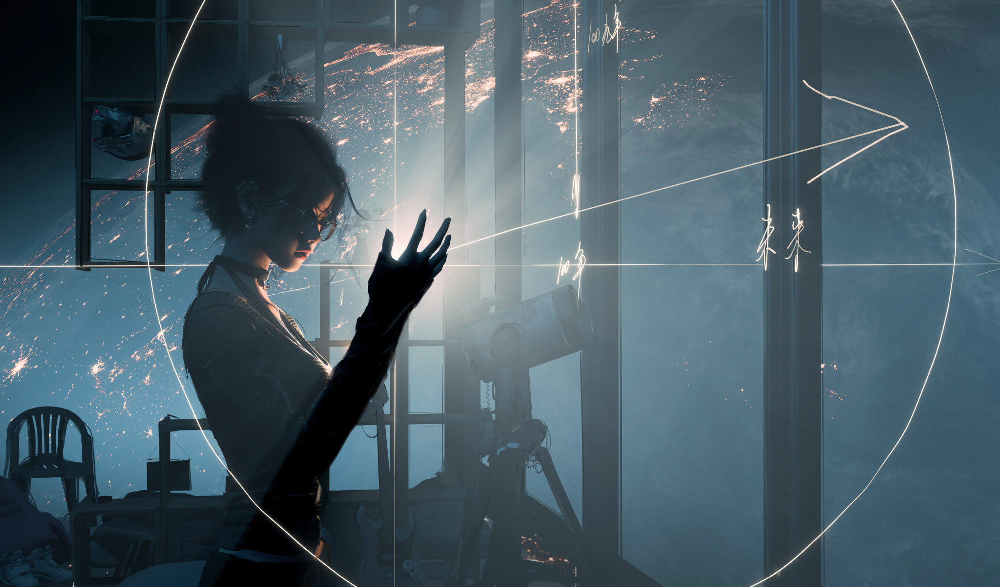)*

> 落地窗外，月亮的冷光落在玻璃上，那些刚写上去的线条和字迹被月光映得微微发亮，影子斜斜投下来，落在两个人身上，像某种无声覆盖下来的秩序。

> 过了一会儿，她像是忽然抓住了什么，抬头问他：

> “可你刚才说的是，有序信息的极限速度是光速。那是不是意味着，还有一种叫无序信息的东西，可以突破光速？”

> 希扬终于笑了笑。果然，以她的敏锐，很快就能抓到这条线。

> “对。” 他说， “无序信息。”

> 月牙儿盯着他，眼睛里的光慢慢亮起来。

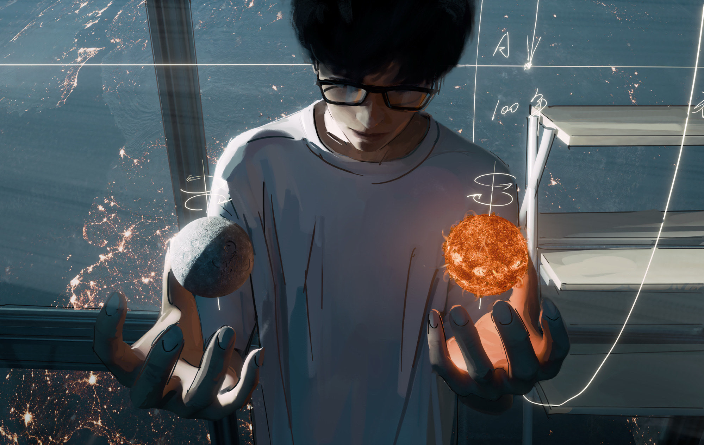

> “你可以先简单理解成这样。假设我手里有两个基本粒子，它们都在做自旋，而且是随机地正旋、反旋，没有固定规律。之后经过某种物理上的绑定，它们会进入一种很特殊的状态——无论相隔多远，它们的变化都会保持瞬时同步，一个怎样旋转，另一个也怎样。”

> 月牙儿很快接了上去：

> “量子纠缠？”

> “对。” 希扬点头， “你可以先把它理解成一个最简单的量子纠缠模型。”

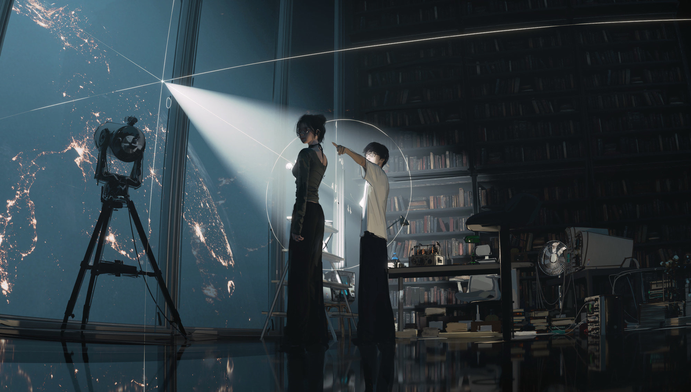

> 他指向时间轴的左方，像是在指着某个极远的地方。

> “现在，我把其中一个粒子送到很远很远的地方。送到一亿光年之外，或者——”

> 他顿了一下。

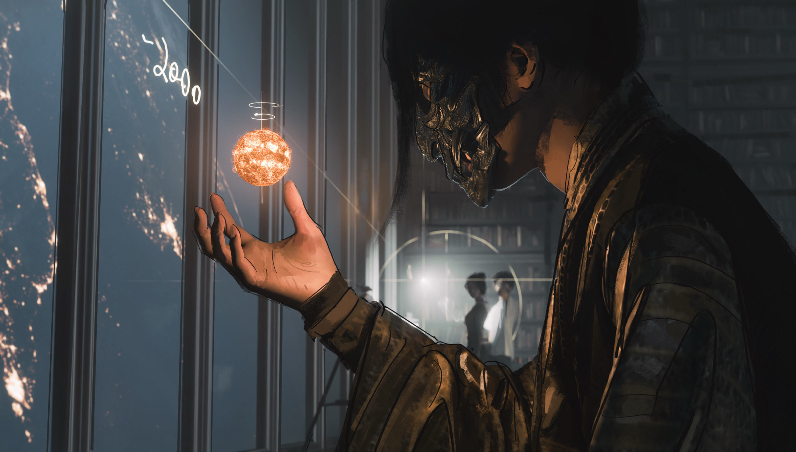

> “送到两千年前，张良手里。”

> 月牙儿的目光微微一紧。

> “这两个位置，无论是空间上还是时间上，对现在的我们来说，都是光锥之外。

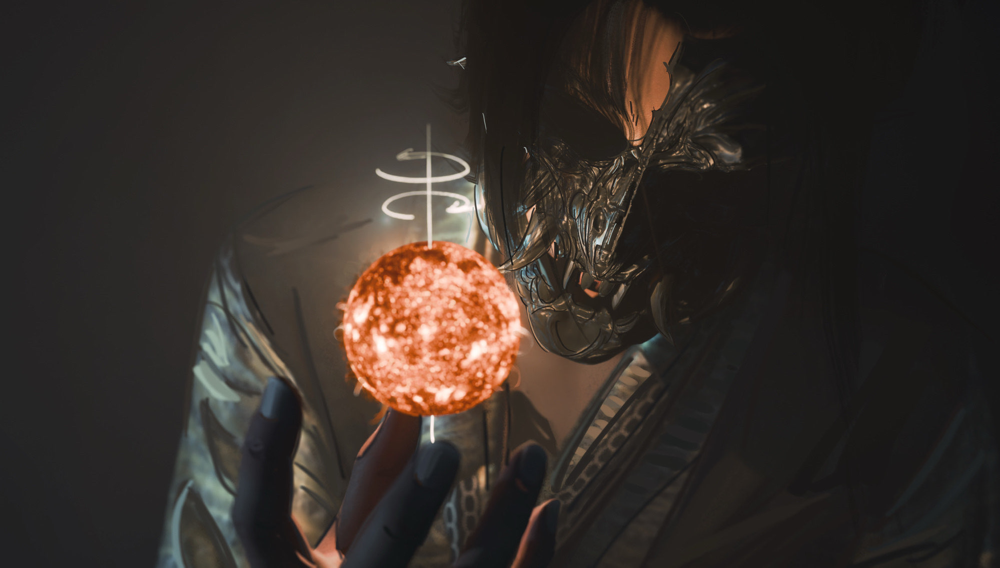

> 可如果这两个粒子仍旧保持纠缠，当张良看到他手里的粒子出现正、反、正这样的自旋序列时，他就知道我手里的这一颗，在这一刻也出现了同样的序列。”

> “也就是说，” 月牙儿轻声接道， “这条信息传到了两千年前。”

> “对。” 希扬说， “这条信息已经越过了光速，到达了光锥之外。”

<video src="./media/cloudinsect-home-bg-v2.mp4" controls loop muted playsinline width="100%"></video>

*(Ảnh tĩnh: 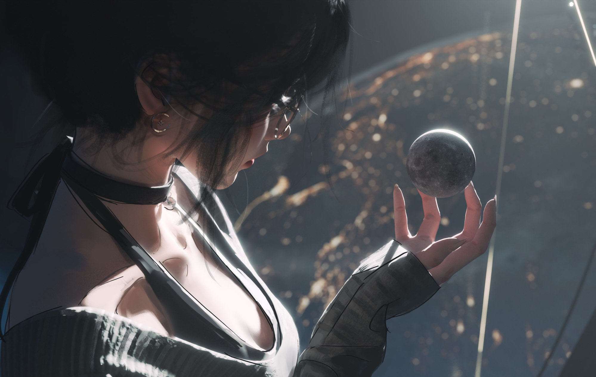)*

> 月牙儿皱起了眉：

> “我只听说空间上的量子纠缠，时间维度也能纠缠？”

> “对。靠纠缠商在数学层面上就可以推算出，时间轴向也存在纠缠。”

> “那是不是说，理论上靠量子纠缠，我们能和几光年外的地方进行实时通信，甚至超越时空传递信息？”

> 希扬摇了摇头。

> “不能。”

> “为什么？”

> “魔鬼就在这里。因为那是一条无序信息。” 希扬说， “它虽然同步，但本身是随机的。你和张良谁都不能决定下一次它是正旋还是反旋。我们只能看见它发生了什么，却无法控制它发生什么。”

> 月牙儿想了一会儿，又追问：

> “如果有一种技术，可以控制它旋转呢？”

<video src="./media/turn.mp4" controls loop muted playsinline width="100%"></video>

*(Ảnh tĩnh: 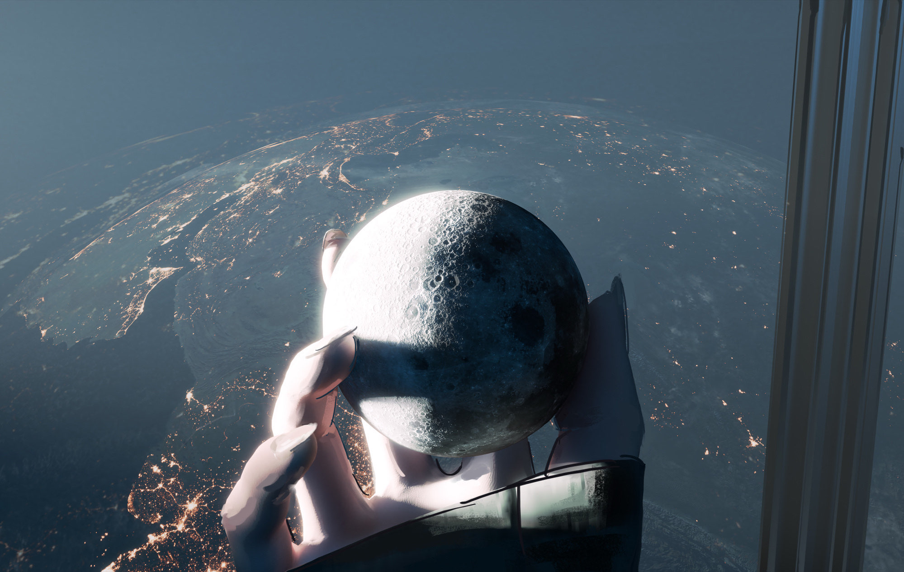)*

> 希扬的声音慢了下来。

> “如果你现在伸手去抓住这颗粒子，强行让它按你想要的方式旋转。反、正、反、反——把一个有意义的序列刻进去，借它告诉张良：秦王在后车。”

> 月牙儿的呼吸轻轻一滞。

> “那会怎么样？”

> 希扬把笔尖停在那两个点之间，轻轻一划，像切断了一根本来看不见的线。

> “这条信息就不再是无序的了。而一旦它变成有序信息在光锥之外被观测到，纠缠就会坍缩，这两个粒子之间的联系会立刻断裂，再也无法保持同步。”

> “所以，这条信息永远也不可能到张良手里。”

> “永远不可能。”

> 希扬停了停，似乎是故意想留给她一点思考的时间。

> “你还记不记得，我们第一次遇见公孙鞅的时候，是在什么时候被传走的？”

> 月牙儿顺着他的话回想了一会儿，慢慢道：

> “是在我叫他商鞅的时候。”

> “对。” 希扬说， “因为那个时候，他还不是商鞅，只是公孙鞅。是在后来变法成功、被封到商地之后，他才有了‘商鞅’这个名字。你那一句话，对他来说就是一条来自后世的有序信息。那已经不是普通的交谈了，而是在改动他对自己命运的认知。这样的信息一旦出口，通道就会立刻中断。”

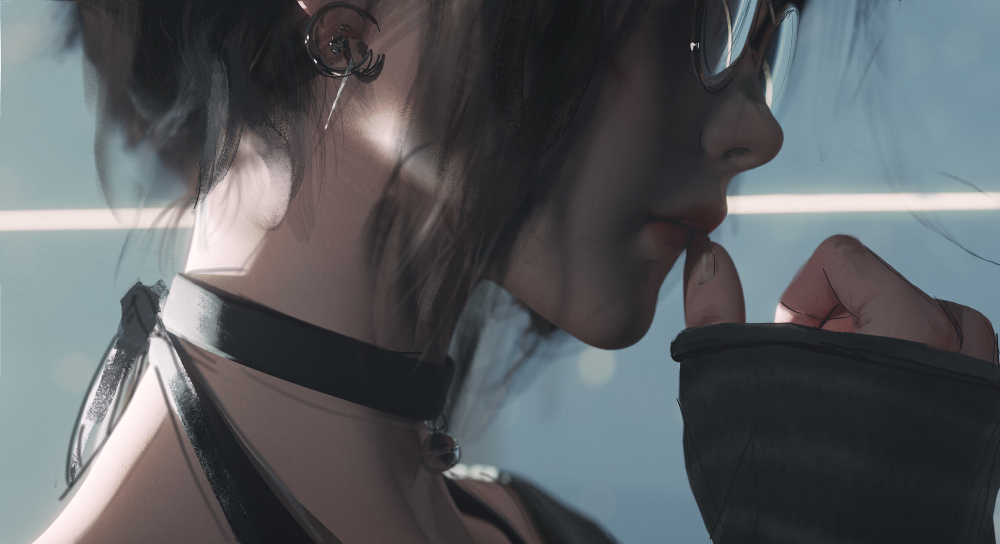

> 她只是看着窗上的那些线条，觉得背后慢慢起了一层凉意。像是许多原本散落的碎片，直到这一刻，才终于彼此咬合。

> “怪不得那时候我想告诉张良秦王在哪一辆车上，你一下就把我打断了。你不是怕我改变历史，而是——”

> 突然，月牙儿像是想起了什么，整个人弹了起来。

> “怪不得……”

> 希扬抬起眼。

> “什么？”

> 月牙儿看着他，神情一点点复杂起来。

> “怪不得……汉光武帝——”

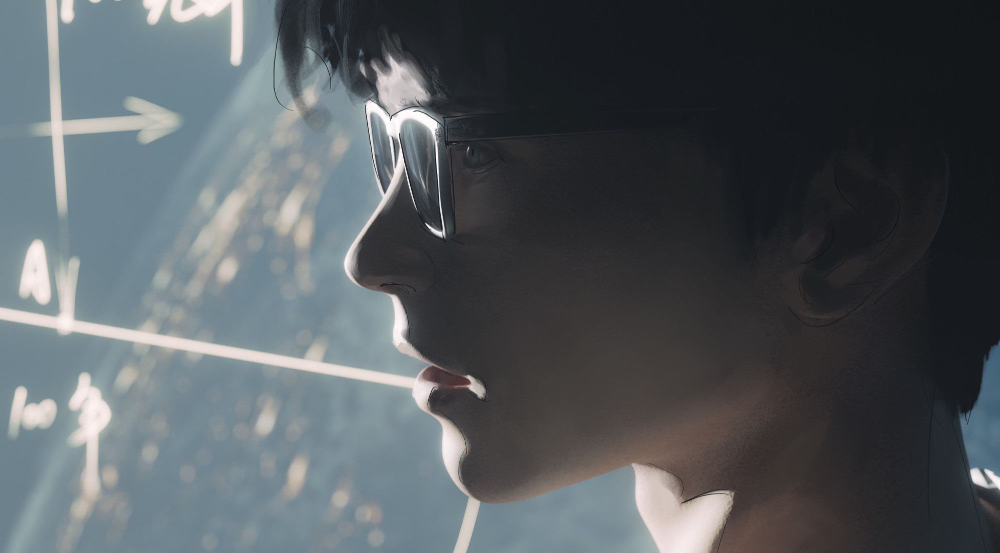

> 希扬愣了一下。

> “汉光武帝？”

> 月牙儿没有立刻解释，只是皱着眉，像是在拼接脑子里一段很旧、很远、原本一直被她当成幻觉的记忆。

> “我以前……似乎也遇见过一次。”

> 希扬的神情少见地凝重了起来。

> “什么时候？”

> “在西藏。” 月牙儿低声说， “那次我去追盘古云虫的时候。”

> 她顿了顿，像是在回想那片高原的空气与风。

> “那时候我一直以为是高原反应，或者缺氧，以为自己只是做了一个很长很奇怪的梦。”

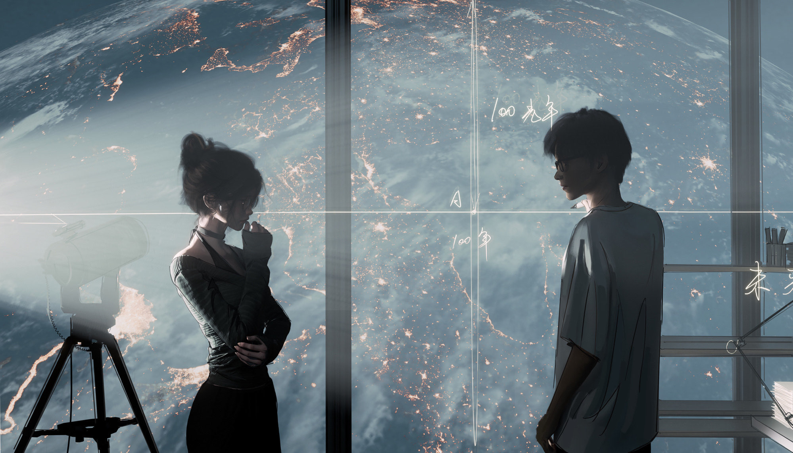

> 希扬的手僵在半空，目光紧紧落在她脸上。

> “你看见了谁？”

> 月牙儿沉默了一会儿。

> 窗外的月亮依旧悬在那里，安静而苍白。她低着头，像是终于从记忆深处摸到了那个名字。

> “项羽。”

> 她说完抬起眼，看向希扬，眼神很深，像还压着另一个没有说出口的名字。

