# 云虫 / CloudInsect - 第五章 乌骓 · 一 (Chapter 5: Wuzhui · Part 1)

---

<video src="./media/pro/boat-web-720p.mp4" controls loop muted playsinline width="100%"></video>

**ZH**: 月牙儿是被水声唤醒的。

**EN**: The sound of water woke Mahina.

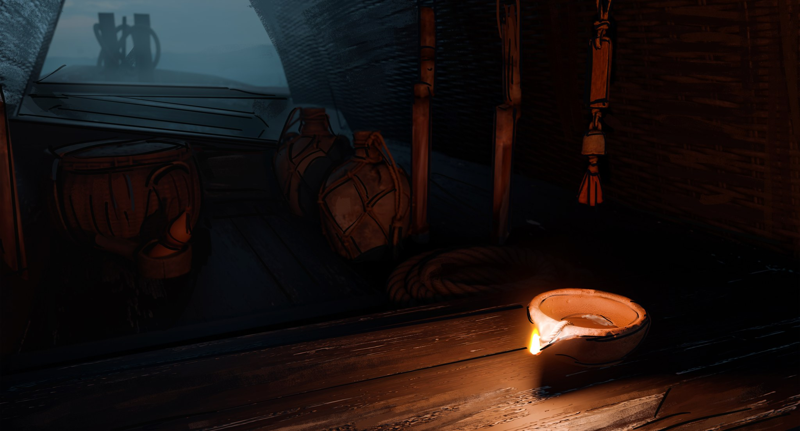

**ZH**: 睁开眼时，头顶是一弯熏黑的竹篷。船身随水波轻轻摇晃，空气里浮着水汽和旧木头的闷味。她低头看自己，一身粗布交领衣裳，袖口磨得起毛。不是她的衣服。

**EN**: When she opened her eyes, a smoke-blackened bamboo canopy arched above her. The boat rocked gently with the current; the damp, close smell of old timber hung in the air. She looked down. She was dressed in a coarse, cross-collared robe, its cuffs worn fuzzy. The clothes were not hers.

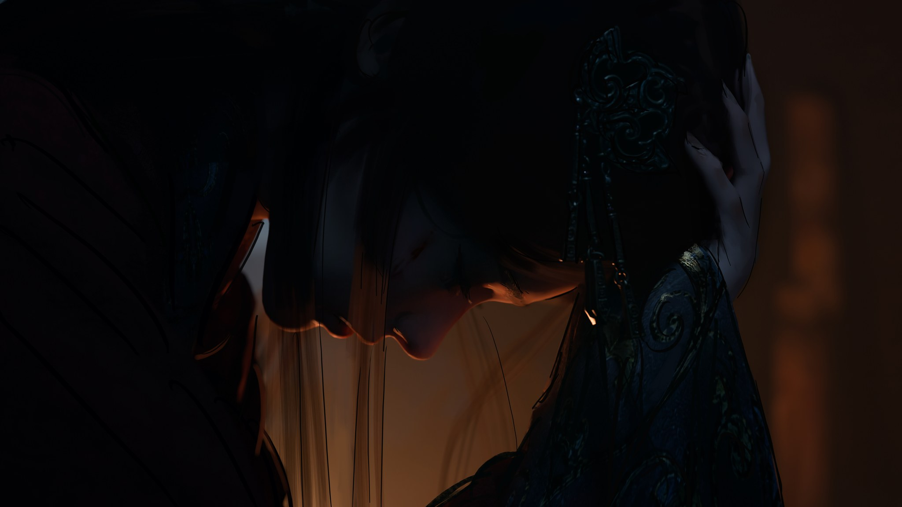

**ZH**: 她觉得自己做了一个很长的梦，好像去过很多地方，见过很多人，可真要去想，却又什么都抓不住，只剩一种昏昏沉沉的疲惫压在身上。

**EN**: She felt as though she had dreamed a very long dream—traveled to many places, met many people. Yet whenever she reached for a memory, there was nothing to grasp. Only a leaden weariness remained, pressing down on her body.

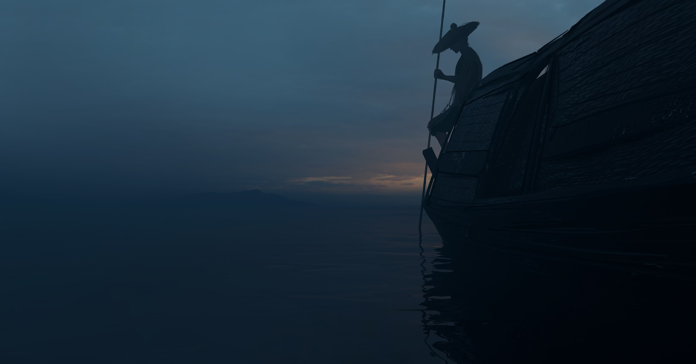

**ZH**: 江面浮着晨雾，对岸山影淡得像没干透的墨。没有桥，没有电线，没有任何属于她那个世界的东西。

**EN**: Morning mist drifted over the river. The mountains on the opposite bank were pale as ink not yet dry. No bridge. No power lines. Nothing that belonged to her world.

**ZH**: 船头立着一个青年，背对着她，握着一根长竹篙。短褐，肩上打着补丁，裤腿挽到膝盖，小腿沾着干泥，皮肤晒得黝黑。握篙的手指节宽大，结着厚茧，是一双常年同土地和力气打交道的手。他立在船头望着岸上，一动不动，竹篙斜插进江底，船檥在滩边，随时可以离岸。

**EN**: A young man stood at the bow with his back to her, a long bamboo pole in his hands. His coarse jacket was patched at the shoulder; his trousers were rolled to the knees, his shins caked with dry mud, his skin darkened by the sun. The knuckles around the pole were broad and thick with calluses—the hands of someone long accustomed to earth and hard labor. He stood motionless, watching the shore. The pole slanted into the riverbed, the boat moored against the shoal, ready to cast off at any moment.

<video src="./media/web/boat2-web-720p.mp4" controls loop muted playsinline width="100%"></video>

**ZH**: 雾越来越浓，一团一团从江面推过来，天光灰白，辨不出时辰。风从岸那边吹来，带着很浓的血腥味，混着烟和马汗的气息。雾的深处隐隐有声音，极远极钝，像几万只马蹄和喊杀被距离磨成一片低低的轰鸣。

**EN**: The mist thickened, mass upon mass rolling in from the river. The light was ashen; there was no telling the hour. Wind came off the bank, heavy with blood, smoke, and horse sweat. Somewhere deep in the fog, a sound gathered—distant and dull, as though tens of thousands of hooves and battle cries had been ground by distance into a single low thunder.

**ZH**: 青年还在等，目光定定的，像已经等了很久，也不在乎再等多久。

**EN**: The young man kept waiting, his gaze fixed. He looked as if he had already waited a very long time, and would not mind waiting longer.

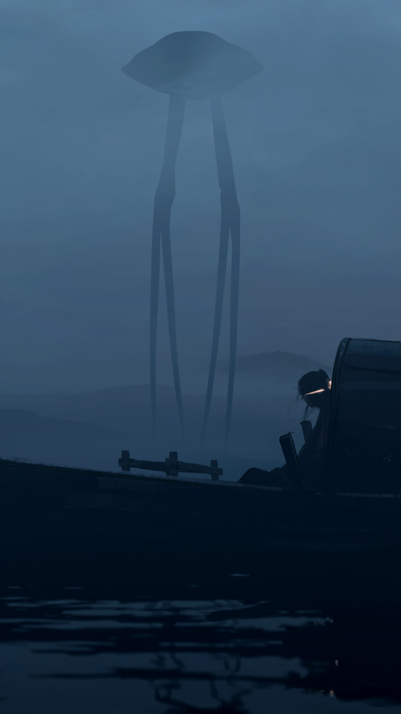

**ZH**: 月牙儿望向乌篷外的江面，起初只有雾。风把雾扯开一道口子的时候，她看见很远的地方立着一个巨大的影子，像山，又不是山。那灰黑的身影几乎和雾融在一起，庞大，沉默，一动不动地立在天地之间，俯瞰着这片江岸，宛若神明。

**EN**: Mahina looked past the black canopy toward the river. At first there was only fog. Then the wind tore a rent in it, and far away she saw an immense shadow standing there—like a mountain, yet not a mountain. The gray-black form had nearly merged with the mist: vast, silent, unmoving between heaven and earth, looking down upon the riverbank like a god.

**ZH**: 云虫。

**EN**: CloudInsect.

**ZH**: 在这个连年代都不知道的地方，她唯一认得的，只有它。它不靠近，也不出声，只是立在那里，像在等着记下即将发生的一切。

**EN**: In a place where she did not even know the century, it was the only thing she recognized. It neither approached nor made a sound. It simply stood there, as though waiting to record everything about to happen.

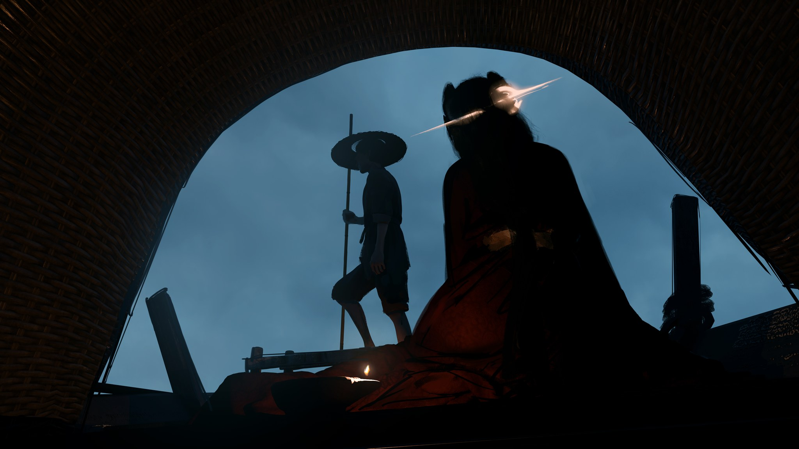

**ZH**: 不知过了多久，月牙儿才找回自己的声音。

**EN**: A long time passed before Mahina found her voice.

**ZH**: “请问……这是哪里？”

**EN**: “Excuse me… where are we?”

**ZH**: 太阳穴一跳一跳地疼。她明明觉得自己经历了很多事，见过很多人，可一件也想不起来，能问出口的，只有这一句。

**EN**: Pain pulsed at her temples. She knew she had lived through many things and met many people, yet she could recall none of them. This was the only question she could manage.

**ZH**: 青年瞥了她一眼，目光又回到岸上。对船里多出来一个人，他似乎并不意外。

**EN**: The young man glanced at her, then turned his eyes back to the shore. He did not seem surprised that someone else had appeared in his boat.

**ZH**: “乌江。” 他说， “我们在这儿接一个人。”

**EN**: “Wujiang.” he said. “We’re here to pick someone up.”

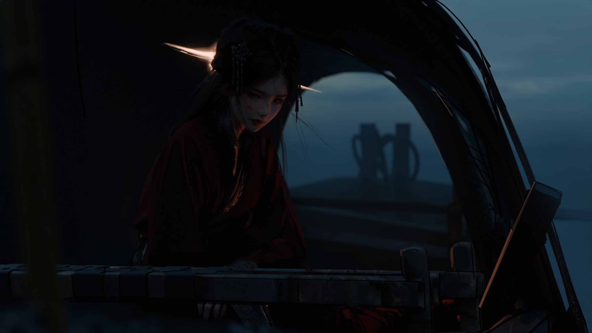

**ZH**: “乌江？接人？”

**EN**: “Wujiang? Picking someone up?”

**ZH**: 月牙儿失笑了一声。太离谱了。

**EN**: Mahina gave a short, incredulous laugh. It was absurd.

**ZH**: “……难不成，是项羽？”

**EN**: “…Don’t tell me it’s Xiang Yu.”

**ZH**: “对。”

**EN**: “Yes.”

**ZH**: “那……他不会上船的。” 月牙儿不假思索地接了一句。

**EN**: “Then… he won’t get on the boat.” The answer escaped Mahina before she had time to think.

**ZH**: “我知道。”

**EN**: “I know.”

**ZH**: 他接得更快，平静得像在说今日有雾。

**EN**: His reply came even faster, as calmly as if he were remarking on the fog.

**ZH**: “你怎么知道？” 月牙儿问。

**EN**: “How do you know?” Mahina asked.

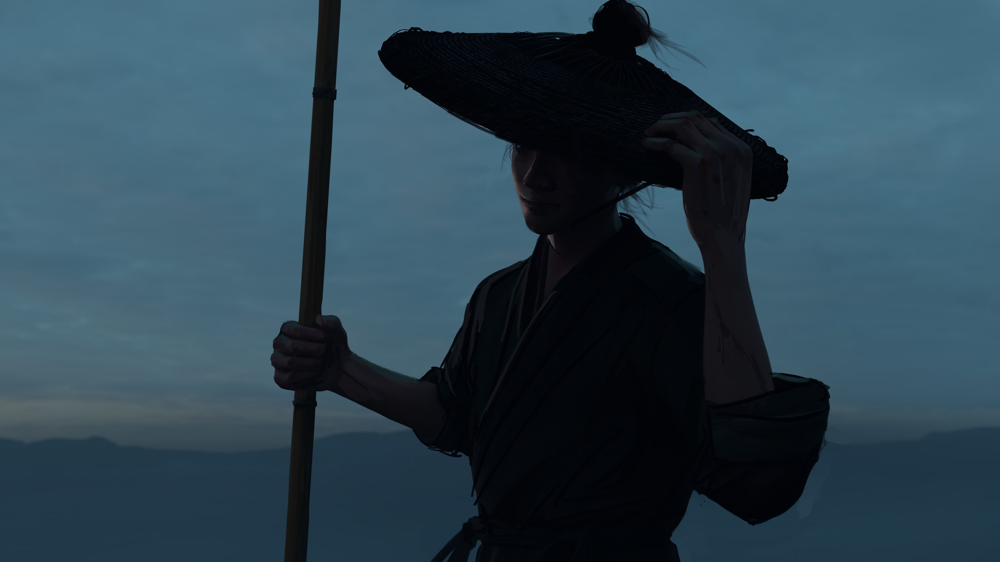

**ZH**: 青年这才回过头来，看了她一眼，微微笑了笑。那笑不是不屑，倒像是早已料到她会这么问。

**EN**: Only then did the young man turn. He looked at her and smiled faintly—not with contempt, but as if he had known all along that she would ask.

**ZH**: “姑娘，这世上，又不是只有你一个云中人。”

**EN**: “Young lady, you are not the only Cloud Dweller in this world.”

**ZH**: “……云中人？” 月牙儿皱起眉头。

**EN**: “…Cloud Dweller?” Mahina frowned.

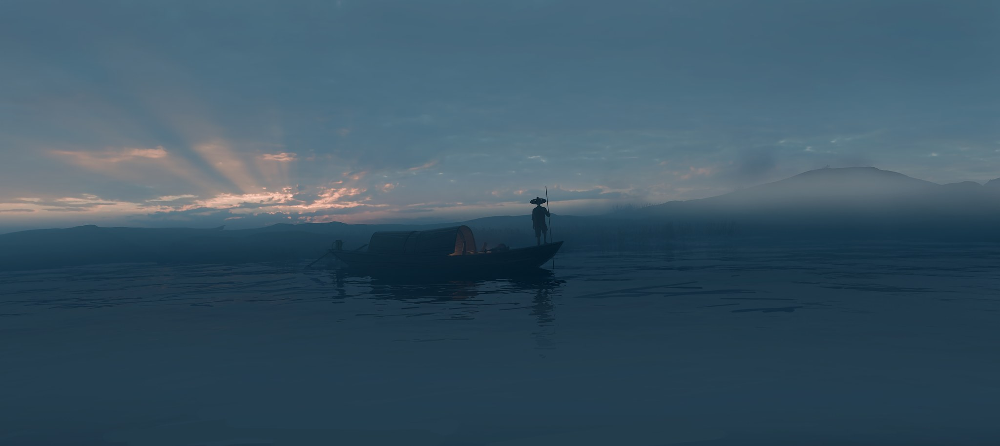

**ZH**: 就在这时，岸上有了动静。

**EN**: At that moment, something stirred on the shore.

**ZH**: 青年脸色一肃，朝她做了个噤声的手势，声音压得极低：

**EN**: The young man’s expression sharpened. He raised a finger to his lips and dropped his voice to a whisper:

**ZH**: “别出声。他来了。”

**EN**: “Not a sound. He’s here.”

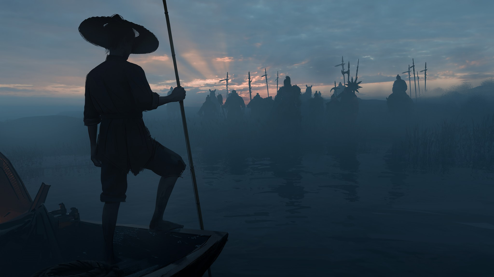

**ZH**: 雾里的芦苇荡先响了一阵，接着，一些身影骑着马，从苇丛中冒了出来。

**EN**: The reeds rustled first. Then riders began to emerge from the fog, one shadow after another pushing through the marsh.

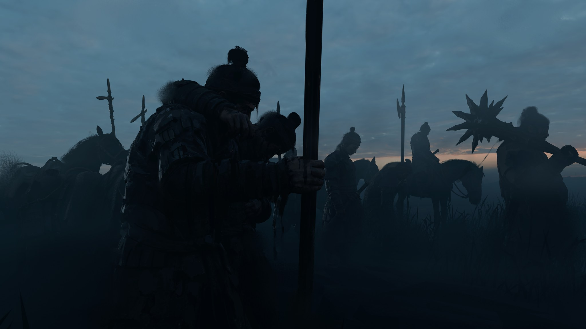

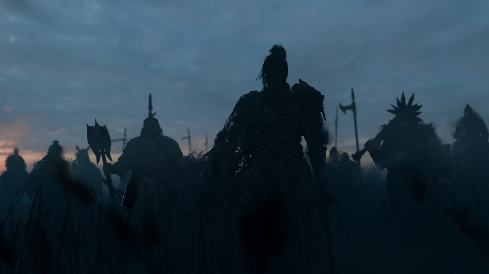

**ZH**: 二十几个士兵，人人带伤，甲胄上满是血污，有人的血还在往下滴，一看就是刚从万军之中杀出来的。为首的是一个异常高大魁梧的身影。断裂的铠甲挂在身上，满脸血污，束发散乱。隔着雾，月牙儿看不清他的容貌，只能望见那道高大而疲惫的轮廓。可那股久经杀伐的压迫感，依旧顺着他手中的战刃穿透雾气，让人心悸。

**EN**: There were more than twenty soldiers, every one of them wounded. Their armor was black with blood; some were still bleeding. They looked as though they had just carved their way out of an army. At their head stood an extraordinarily tall, powerfully built man. Broken armor hung from his body. His face was streaked with blood, his bound hair torn loose. Through the fog, Mahina could not make out his features, only the huge, exhausted outline. Yet that oppressive presence, honed through years of bloodshed, still traveled along the blade in his hand, pierced the fog, and made the heart quail.

**ZH**: 她瞬间屏住了呼吸。不用任何人告诉她，她已经知道了这个人是谁。

**EN**: Her breath stopped. No one had to tell her who he was. She already knew.

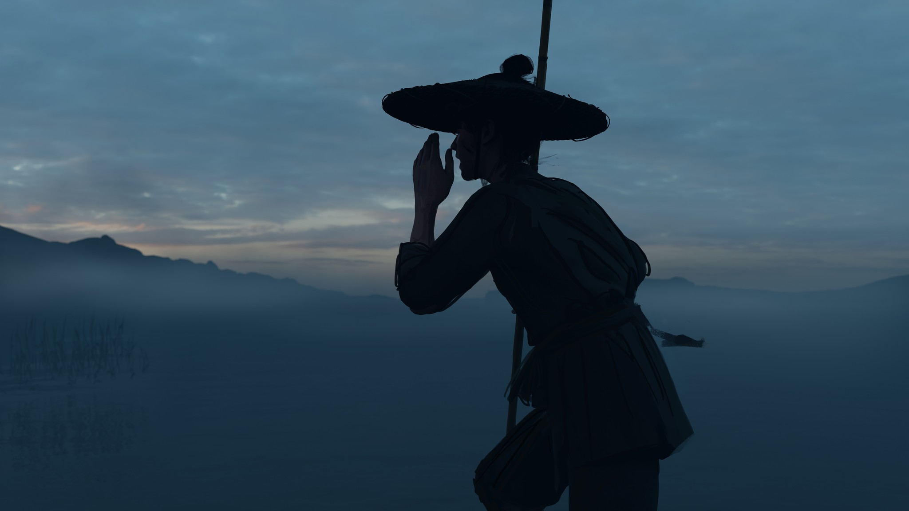

**ZH**: 这时，船头的青年高声喊道：

**EN**: The young man at the bow called out:

**ZH**: “项王！臣乃乌江亭长，愿渡大王过江。江东虽小，亦有千里之地、数十万百姓，足供大王重整旗鼓！”

**EN**: “King Xiang! I am the Chief of Wujiang Pavilion. Allow me to ferry Your Majesty across the river. Jiangdong may be small, yet it holds a thousand li of land and hundreds of thousands of people—enough for Your Majesty to raise your banners again!”

**ZH**: “如今江上唯有臣这一条船。请大王速速上船——若汉军追至，便再难渡江了!”

**EN**: “Mine is the only boat upon the river. Your Majesty must board at once—if the Han army catches up, there will be no crossing!”

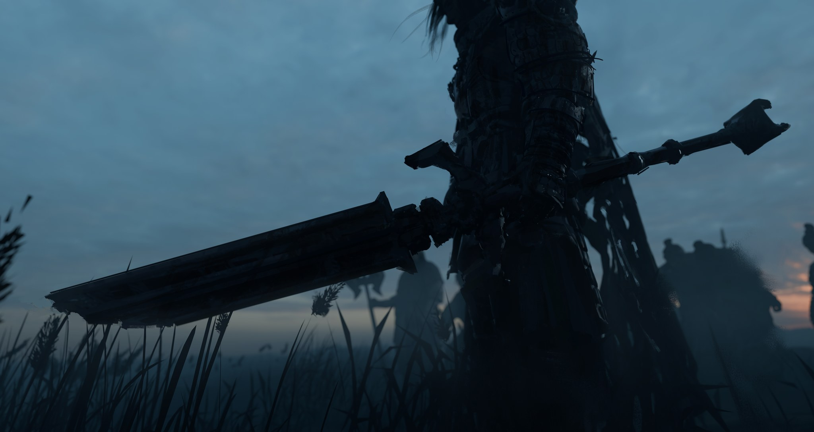

**ZH**: 项羽立在岸边，像是不敢相信这江上竟还有一条渡船。他沉默了很久，才沉沉开口。

**EN**: Xiang Yu stood at the water’s edge as if he could scarcely believe there was still a ferry on the river. He was silent for a long while before his deep voice came through the mist.

**ZH**: “当年，籍与八千江东子弟渡江而西。” 他望着江水，声音不高， “今日，归者无一。”

**EN**: “In years past, I, Ji, crossed westward with eight thousand sons of Jiangdong.” He looked at the river, his voice low. “Today, not one returns.”

**ZH**: “纵使江东父兄仍怜我、奉我为王，我有何面目复见之？”

**EN**: “Even if the fathers and elders of Jiangdong still pity me and would make me their king, with what face could I ever meet them again?”

<video src="./media/pro/Mahina_boat-web-720p.mp4" controls loop muted playsinline width="100%"></video>

*(Ảnh tĩnh: 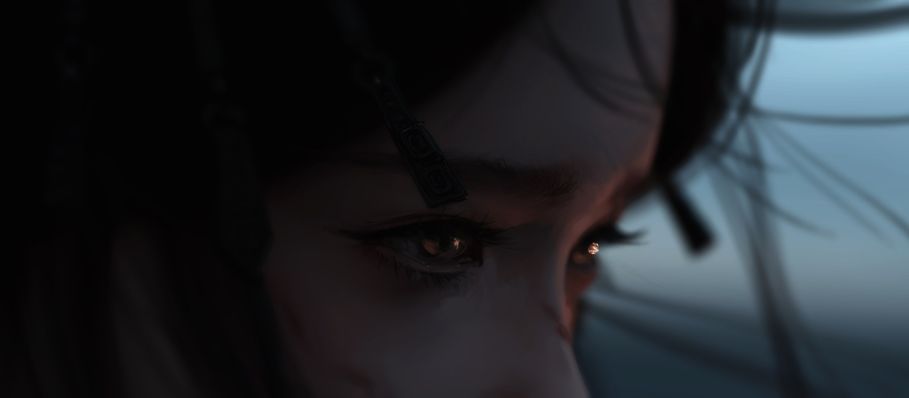)*

**ZH**: 月牙儿从乌篷里探出半个身子，一直望着岸上。不知是哪里来的胆子，她忽然朝岸上喊了一句：

**EN**: Mahina leaned halfway out from beneath the canopy, watching the shore. She did not know where the courage came from, but suddenly she shouted:

**ZH**: “项王!他们都是以追随你为荣的，连战死沙场，都引以为荣。他们的父母，怎么会怪罪你呢?”

**EN**: “King Xiang! They were proud to follow you. They were proud even to die beside you in battle. How could their parents blame you?”

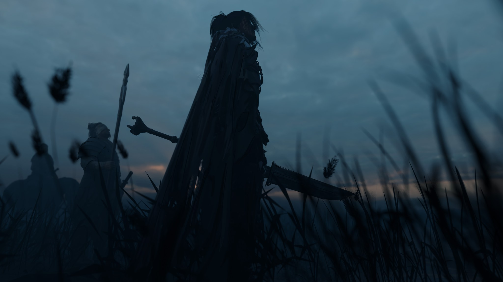

**ZH**: 项羽循声望向渡船。看清出声的竟是一个年轻少女，他眼中掠过一丝意外。可那惊讶只停了一瞬，便化作一种面对命运的释然。

**EN**: Xiang Yu turned toward the ferry. Surprise flickered in his eyes when he saw that the voice belonged to a young woman. It lasted only an instant, then gave way to the serenity of a man who had accepted his fate.

**ZH**: “纵使他们不怪罪，” 他说， “我又岂能问心无愧？”

**EN**: “Even if they do not blame me,” he said, “how could I be without shame before my own heart?”

**ZH**: 一切都在意料之中。但船头的青年显然不满意这个答案。

**EN**: Everything had unfolded as expected. But the young man at the bow was plainly dissatisfied with the answer.

**ZH**: “项王，恕臣直言。” 他说， “大王自万军之中冒死杀至此处，求的，不就是一线生机么？如今船在眼前，江东在对岸。为何偏偏不肯上船？”

**EN**: “King Xiang, forgive my bluntness.” he said. “Your Majesty fought through an entire army to reach this place. Was it not for one last chance to live? The boat is before you; Jiangdong lies across the river. Why refuse to board now?”

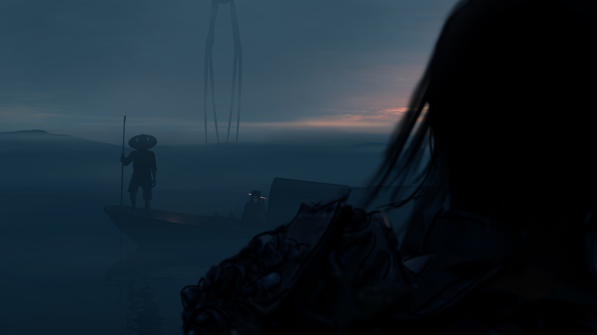

**ZH**: 项羽没有立刻回答。

**EN**: Xiang Yu did not answer at once.

**ZH**: 他望向浓雾中那道巨大的身影，片刻后才收回目光，视线掠过船头的青年，最终落在从乌篷里探出半个身子的月牙儿身上。他的重瞳里没有怒意，只有一种近乎冰冷的清明。

**EN**: He looked toward the immense shape in the fog. Only after a moment did he turn away. His gaze passed over the young man at the bow and came to rest on Mahina, half-emerged from beneath the canopy. There was no anger in his double pupils, only an almost glacial clarity.

<video src="./media/xiang-yu-riverside-home-bg-seamless-10s.mp4" controls loop muted playsinline width="100%"></video>

*(Ảnh tĩnh: 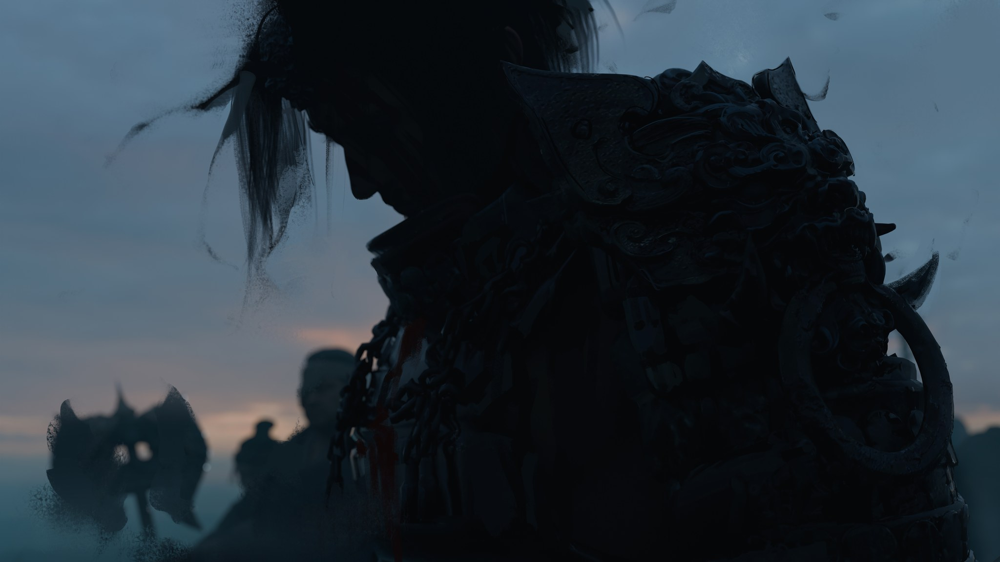)*

**ZH**: “吾自阴陵迷道，” 他缓缓道， “田父绐我，陷于大泽。大雾锁江，芦苇没人，断断续续，不辨南北，连走到了乌江哪一段，亦不自知。”

**EN**: “I lost my way at Yinling,” he said slowly. “A farmer deceived me and led me into the great marsh. Fog sealed the river; reeds rose over a man’s head. I wandered on, unable to tell north from south. I do not even know upon which reach of the Wujiang I now stand.”

**ZH**: “可你，却似早知我今日必至，驾着这江上唯一一条渡船，正正候在我脚下这片滩头。”

**EN**: “Yet you appear to have known that I would come today. You brought the only ferry on this river and waited upon the very shoal at my feet.”

**ZH**: “你来告诉我，这是为何？”

**EN**: “Tell me—why?”

**ZH**: 青年语塞了。他张了张口，一个字也答不出来。

**EN**: The young man was struck speechless. His mouth opened, but not a word came out.

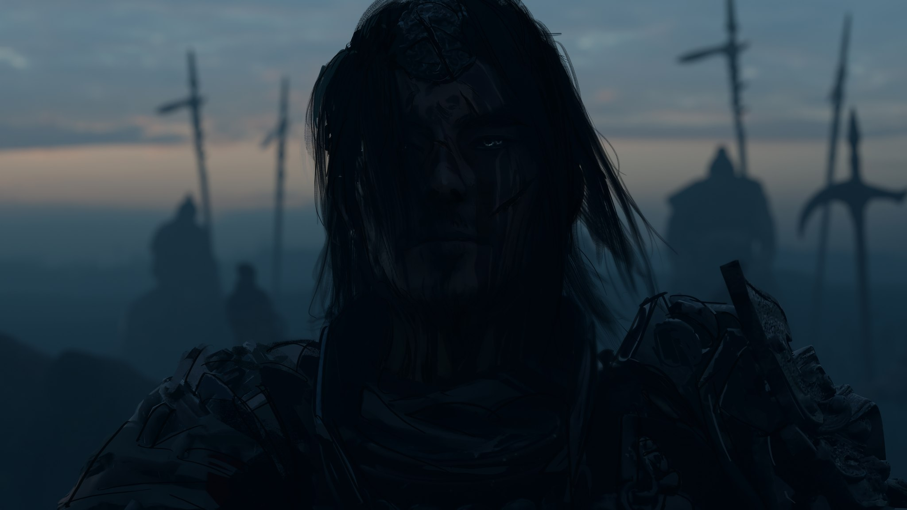

**ZH**: 项羽看着他，忽然大笑出声。

**EN**: Xiang Yu looked at him and suddenly burst into laughter.

**ZH**: “籍，亦非愚钝之人。” 他道， “这乌江之上，何来的亭长？又何来的渡船？”

**EN**: “I, Ji, am no fool.” he said. “What pavilion chief could there be upon the Wujiang? What ferry could there be?”

**ZH**: “天意要亡我。尔等云中之人，又何意来渡我?”

**EN**: “Heaven wills my death. And you Cloud Dwellers—what purpose brings you here to ferry me across?”

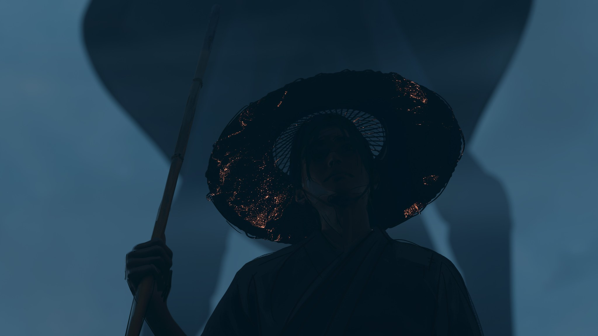

**ZH**: 雾从江面上滚过。无人答话。从走出芦苇荡、看见这条船的那一刻起，他就全知道了。

**EN**: Fog rolled over the river. No one answered. From the moment he had stepped out of the reeds and seen the boat, he had understood everything.

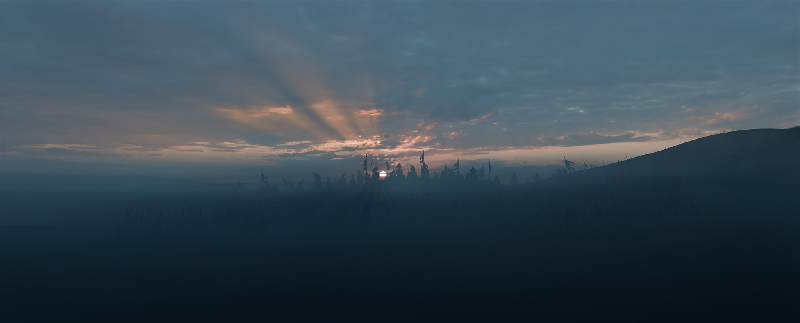

**ZH**: 隆隆的马蹄声由远及近。芦苇荡外影影绰绰，已经望得见骑兵的影子，汉军赤色的战旗在雾中时隐时现。

**EN**: The thunder of hooves drew nearer. Beyond the reeds, cavalry shadows had begun to show; the red battle standards of the Han army appeared and vanished in the mist.

**ZH**: 有人在远处高声喊着，声音被风撕得断断续续：

**EN**: Someone shouted in the distance, the wind tearing the words to pieces:

**ZH**: “汉王有令——得项羽头者，赏千金，邑万户——！”

**EN**: “By decree of the King of Han—whoever takes Xiang Yu’s head shall receive a thousand pieces of gold and a fief of ten thousand households—!”

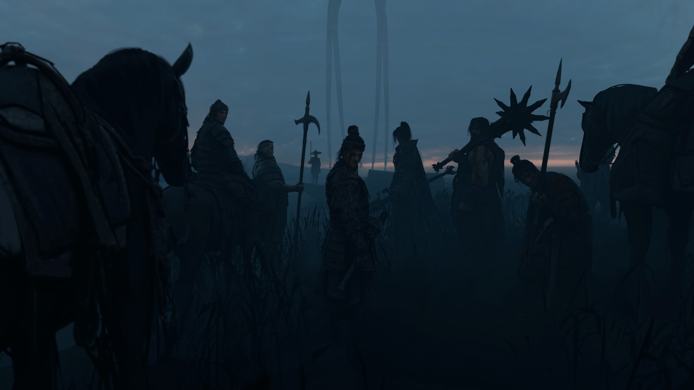

**ZH**: 结局到了。这一刻，江边所有人都知道。

**EN**: The end had arrived. Everyone on the riverbank knew it.

