# CloudInsect - Chapter 5: Wuzhui · Part 1

*Original Title: 第五章 乌骓 · 一*

---

<video src="./media/pro/boat-web-720p.mp4" controls loop muted playsinline width="100%"></video>

> The sound of water woke Mahina.

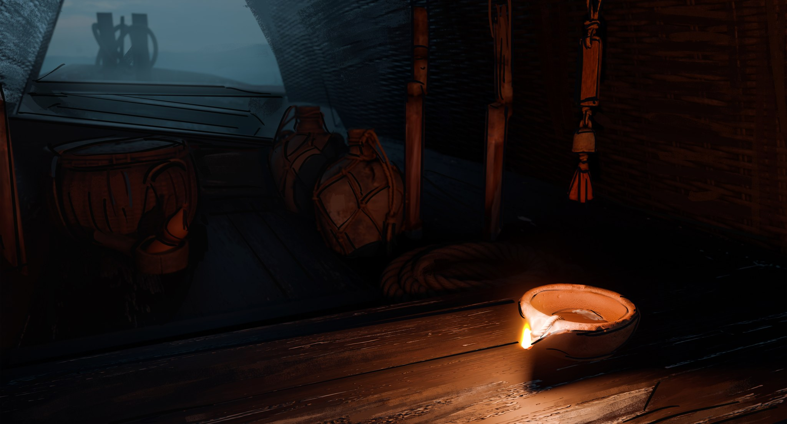

> When she opened her eyes, a smoke-blackened bamboo canopy arched above her. The boat rocked gently with the current; the damp, close smell of old timber hung in the air. She looked down. She was dressed in a coarse, cross-collared robe, its cuffs worn fuzzy. The clothes were not hers.

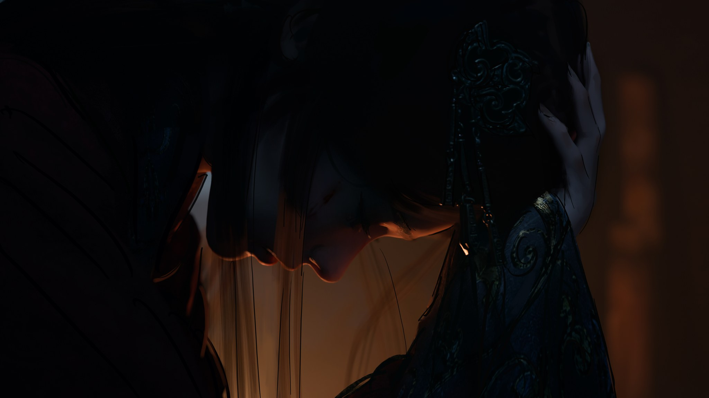

> She felt as though she had dreamed a very long dream—traveled to many places, met many people. Yet whenever she reached for a memory, there was nothing to grasp. Only a leaden weariness remained, pressing down on her body.

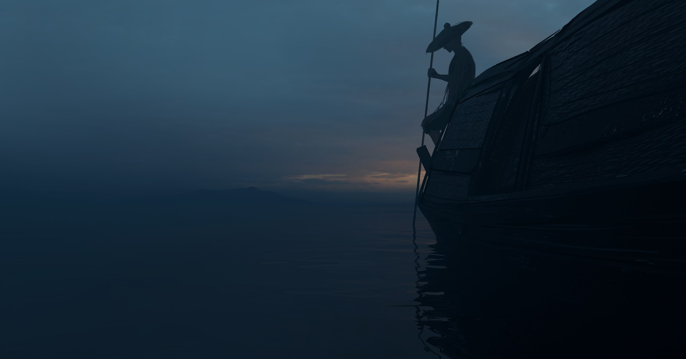

> Morning mist drifted over the river. The mountains on the opposite bank were pale as ink not yet dry. No bridge. No power lines. Nothing that belonged to her world.

> A young man stood at the bow with his back to her, a long bamboo pole in his hands. His coarse jacket was patched at the shoulder; his trousers were rolled to the knees, his shins caked with dry mud, his skin darkened by the sun. The knuckles around the pole were broad and thick with calluses—the hands of someone long accustomed to earth and hard labor. He stood motionless, watching the shore. The pole slanted into the riverbed, the boat moored against the shoal, ready to cast off at any moment.

<video src="./media/web/boat2-web-720p.mp4" controls loop muted playsinline width="100%"></video>

> The mist thickened, mass upon mass rolling in from the river. The light was ashen; there was no telling the hour. Wind came off the bank, heavy with blood, smoke, and horse sweat. Somewhere deep in the fog, a sound gathered—distant and dull, as though tens of thousands of hooves and battle cries had been ground by distance into a single low thunder.

> The young man kept waiting, his gaze fixed. He looked as if he had already waited a very long time, and would not mind waiting longer.

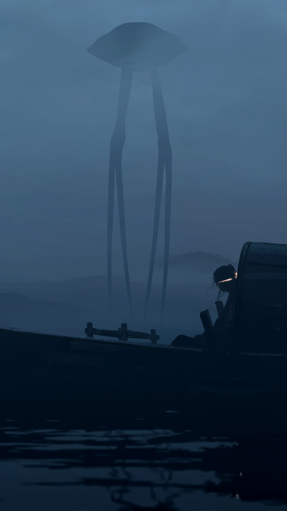

> Mahina looked past the black canopy toward the river. At first there was only fog. Then the wind tore a rent in it, and far away she saw an immense shadow standing there—like a mountain, yet not a mountain. The gray-black form had nearly merged with the mist: vast, silent, unmoving between heaven and earth, looking down upon the riverbank like a god.

> CloudInsect.

> In a place where she did not even know the century, it was the only thing she recognized. It neither approached nor made a sound. It simply stood there, as though waiting to record everything about to happen.

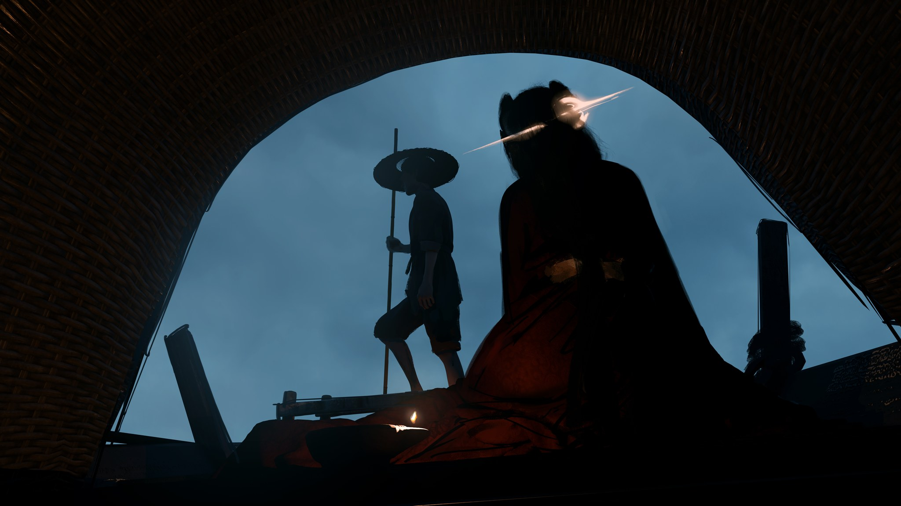

> A long time passed before Mahina found her voice.

> “Excuse me… where are we?”

> Pain pulsed at her temples. She knew she had lived through many things and met many people, yet she could recall none of them. This was the only question she could manage.

> The young man glanced at her, then turned his eyes back to the shore. He did not seem surprised that someone else had appeared in his boat.

> “Wujiang.” he said. “We’re here to pick someone up.”

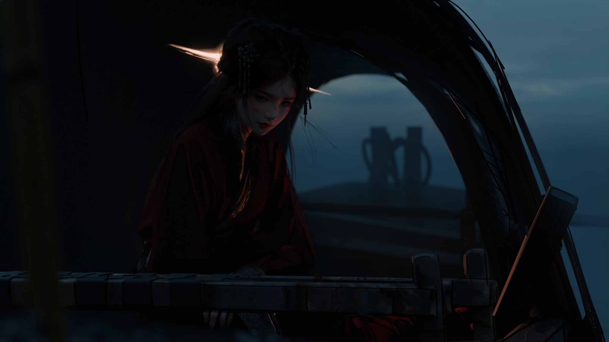

> “Wujiang? Picking someone up?”

> Mahina gave a short, incredulous laugh. It was absurd.

> “…Don’t tell me it’s Xiang Yu.”

> “Yes.”

> “Then… he won’t get on the boat.” The answer escaped Mahina before she had time to think.

> “I know.”

> His reply came even faster, as calmly as if he were remarking on the fog.

> “How do you know?” Mahina asked.

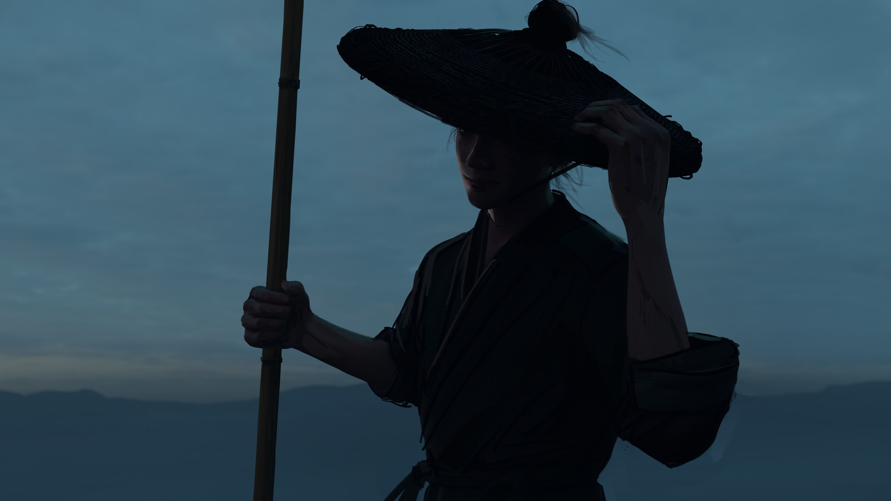

> Only then did the young man turn. He looked at her and smiled faintly—not with contempt, but as if he had known all along that she would ask.

> “Young lady, you are not the only Cloud Dweller in this world.”

> “…Cloud Dweller?” Mahina frowned.

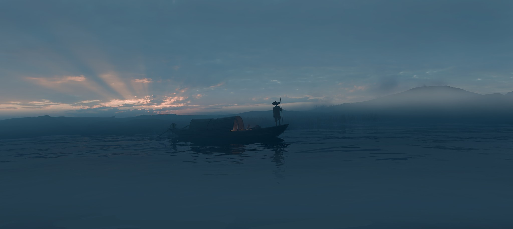

> At that moment, something stirred on the shore.

> The young man’s expression sharpened. He raised a finger to his lips and dropped his voice to a whisper:

> “Not a sound. He’s here.”

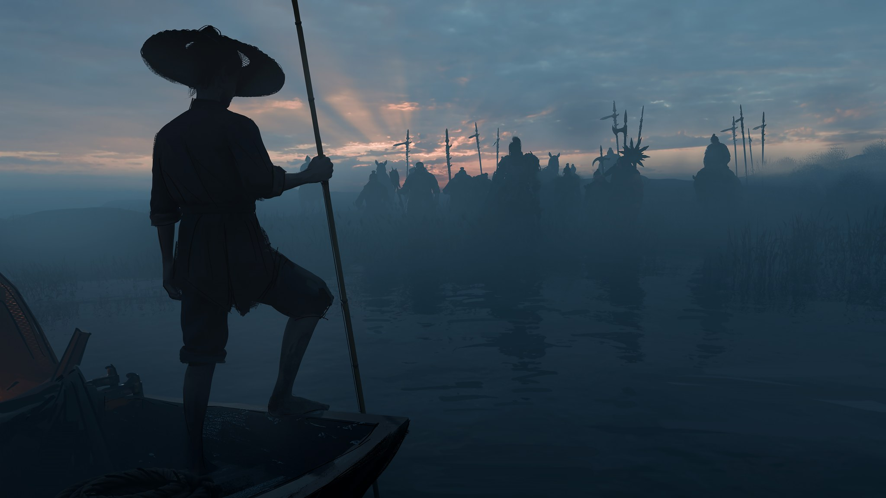

> The reeds rustled first. Then riders began to emerge from the fog, one shadow after another pushing through the marsh.

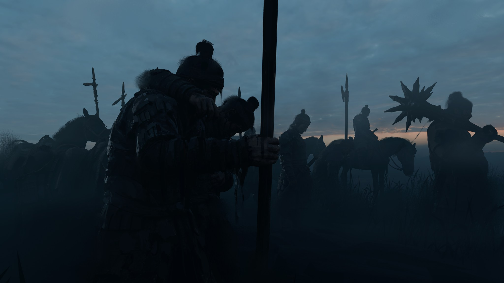

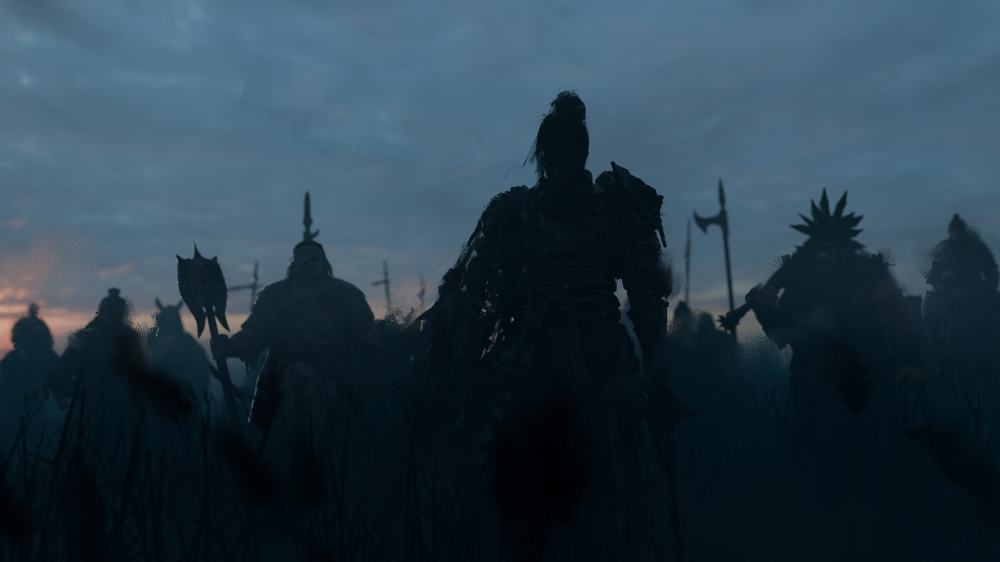

> There were more than twenty soldiers, every one of them wounded. Their armor was black with blood; some were still bleeding. They looked as though they had just carved their way out of an army. At their head stood an extraordinarily tall, powerfully built man. Broken armor hung from his body. His face was streaked with blood, his bound hair torn loose. Through the fog, Mahina could not make out his features, only the huge, exhausted outline. Yet that oppressive presence, honed through years of bloodshed, still traveled along the blade in his hand, pierced the fog, and made the heart quail.

> Her breath stopped. No one had to tell her who he was. She already knew.

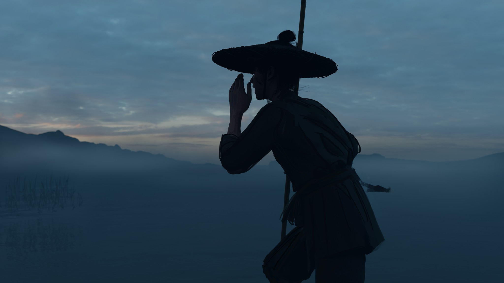

> The young man at the bow called out:

> “King Xiang! I am the Chief of Wujiang Pavilion. Allow me to ferry Your Majesty across the river. Jiangdong may be small, yet it holds a thousand li of land and hundreds of thousands of people—enough for Your Majesty to raise your banners again!”

> “Mine is the only boat upon the river. Your Majesty must board at once—if the Han army catches up, there will be no crossing!”

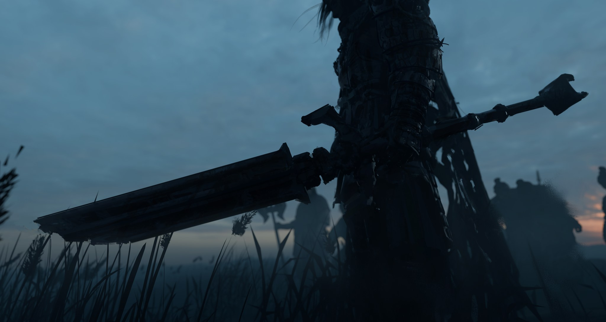

> Xiang Yu stood at the water’s edge as if he could scarcely believe there was still a ferry on the river. He was silent for a long while before his deep voice came through the mist.

> “In years past, I, Ji, crossed westward with eight thousand sons of Jiangdong.” He looked at the river, his voice low. “Today, not one returns.”

> “Even if the fathers and elders of Jiangdong still pity me and would make me their king, with what face could I ever meet them again?”

<video src="./media/pro/Mahina_boat-web-720p.mp4" controls loop muted playsinline width="100%"></video>

*(Ảnh tĩnh: 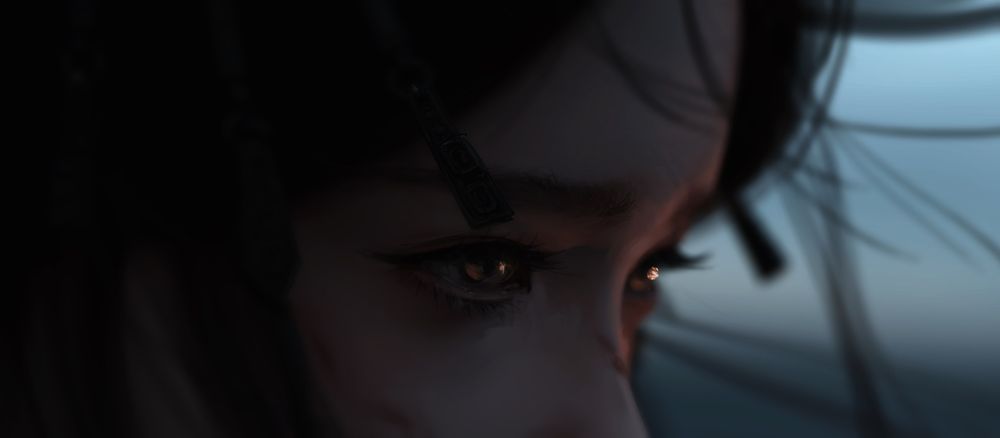)*

> Mahina leaned halfway out from beneath the canopy, watching the shore. She did not know where the courage came from, but suddenly she shouted:

> “King Xiang! They were proud to follow you. They were proud even to die beside you in battle. How could their parents blame you?”

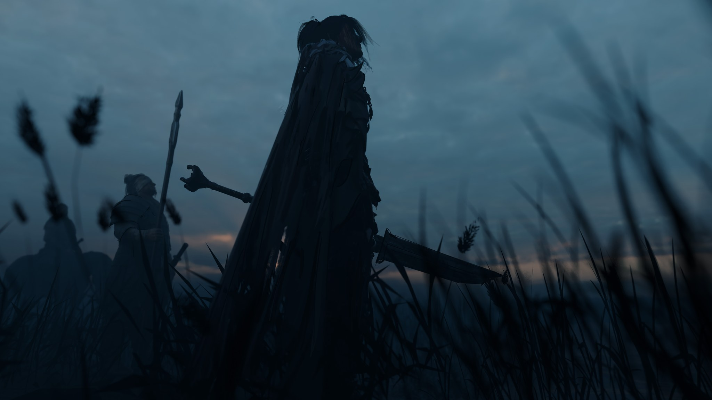

> Xiang Yu turned toward the ferry. Surprise flickered in his eyes when he saw that the voice belonged to a young woman. It lasted only an instant, then gave way to the serenity of a man who had accepted his fate.

> “Even if they do not blame me,” he said, “how could I be without shame before my own heart?”

> Everything had unfolded as expected. But the young man at the bow was plainly dissatisfied with the answer.

> “King Xiang, forgive my bluntness.” he said. “Your Majesty fought through an entire army to reach this place. Was it not for one last chance to live? The boat is before you; Jiangdong lies across the river. Why refuse to board now?”

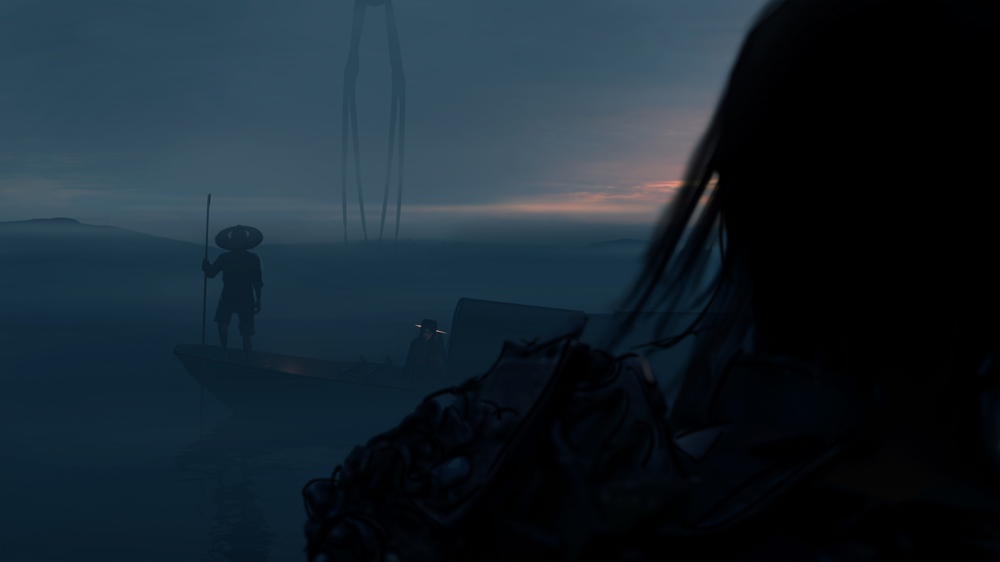

> Xiang Yu did not answer at once.

> He looked toward the immense shape in the fog. Only after a moment did he turn away. His gaze passed over the young man at the bow and came to rest on Mahina, half-emerged from beneath the canopy. There was no anger in his double pupils, only an almost glacial clarity.

<video src="./media/xiang-yu-riverside-home-bg-seamless-10s.mp4" controls loop muted playsinline width="100%"></video>

*(Ảnh tĩnh: 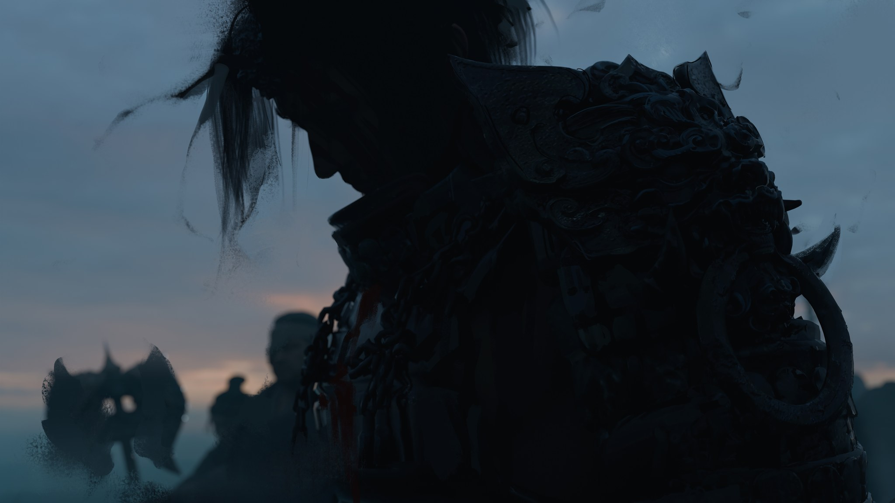)*

> “I lost my way at Yinling,” he said slowly. “A farmer deceived me and led me into the great marsh. Fog sealed the river; reeds rose over a man’s head. I wandered on, unable to tell north from south. I do not even know upon which reach of the Wujiang I now stand.”

> “Yet you appear to have known that I would come today. You brought the only ferry on this river and waited upon the very shoal at my feet.”

> “Tell me—why?”

> The young man was struck speechless. His mouth opened, but not a word came out.

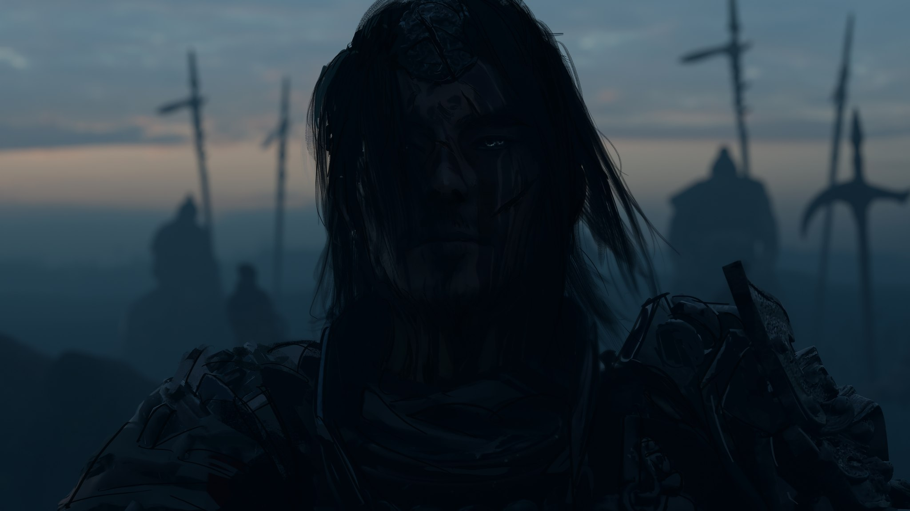

> Xiang Yu looked at him and suddenly burst into laughter.

> “I, Ji, am no fool.” he said. “What pavilion chief could there be upon the Wujiang? What ferry could there be?”

> “Heaven wills my death. And you Cloud Dwellers—what purpose brings you here to ferry me across?”

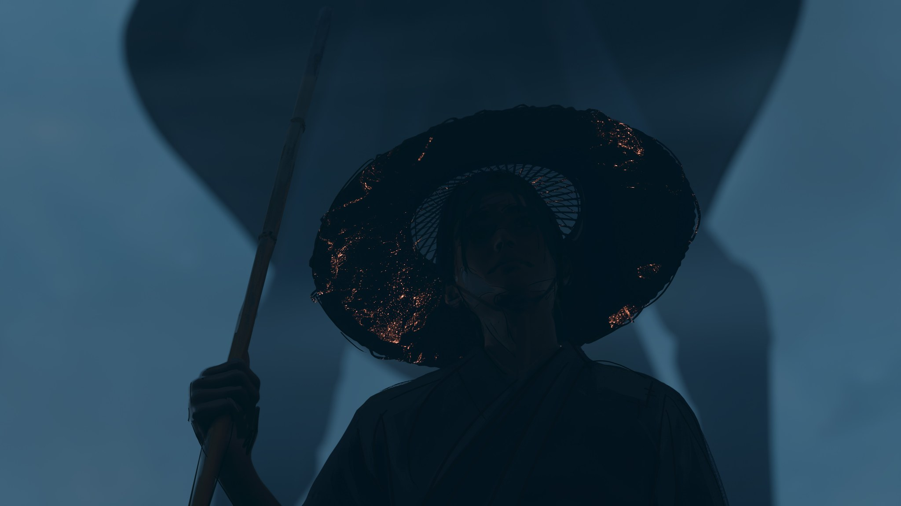

> Fog rolled over the river. No one answered. From the moment he had stepped out of the reeds and seen the boat, he had understood everything.

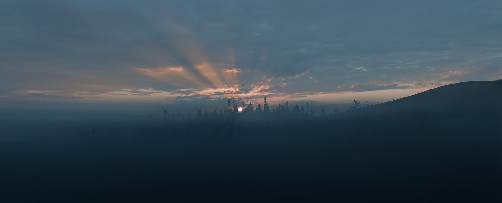

> The thunder of hooves drew nearer. Beyond the reeds, cavalry shadows had begun to show; the red battle standards of the Han army appeared and vanished in the mist.

> Someone shouted in the distance, the wind tearing the words to pieces:

> “By decree of the King of Han—whoever takes Xiang Yu’s head shall receive a thousand pieces of gold and a fief of ten thousand households—!”

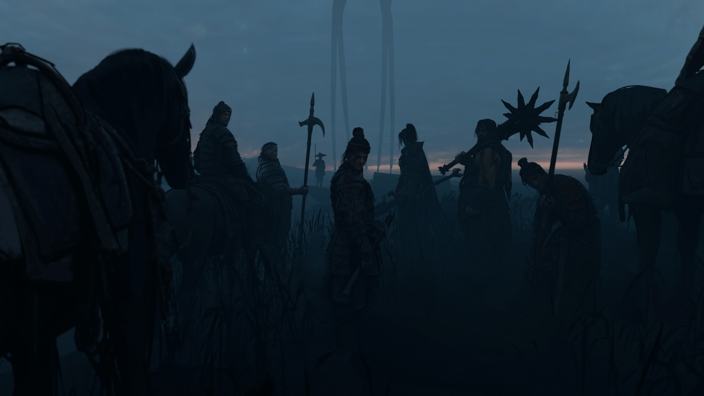

> The end had arrived. Everyone on the riverbank knew it.

