# Vân Trùng - Chương 5: Ô Chuy · I

---

<video controls width="100%" src="./media/pro/boat-web-720p.mp4"></video>

Nguyệt Nha Nhi bị đánh thức bởi tiếng nước chảy.

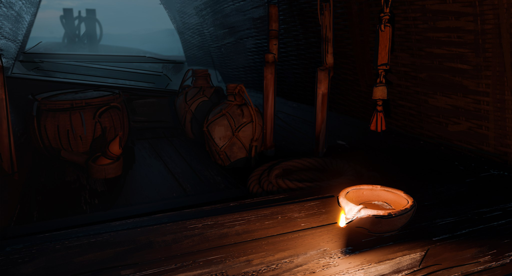

Khi mở mắt ra, phía trên đỉnh đầu là một vòm mui thuyền bằng tre hun khói đen sì. Thân thuyền khẽ lắc lư theo từng con sóng, trong không khí phảng phất hơi nước ẩm ướt và mùi ẩm mốc của gỗ cũ. Cô cúi đầu nhìn lại mình, trên người là một bộ y phục vải thô cổ chéo, cổ tay áo sờn xơ cả lông. Đây không phải quần áo của cô.

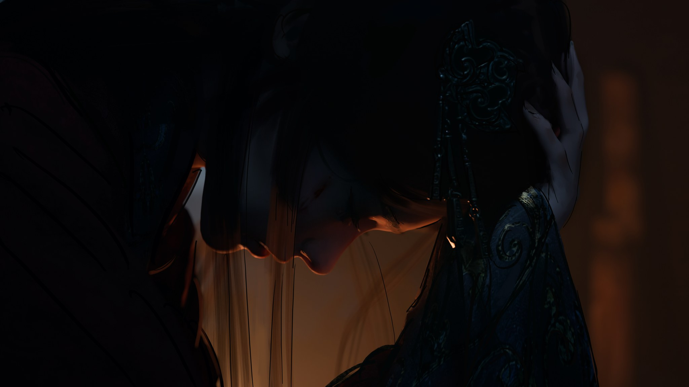

Cô cảm thấy mình vừa trải qua một giấc mộng rất dài, dường như đã đi qua rất nhiều nơi, gặp gỡ rất nhiều người, nhưng hễ cứ cố nhớ lại thì chẳng thể nắm bắt được điều gì, chỉ còn lại nỗi mệt mỏi trĩu nặng đè lên thân thể mê man.

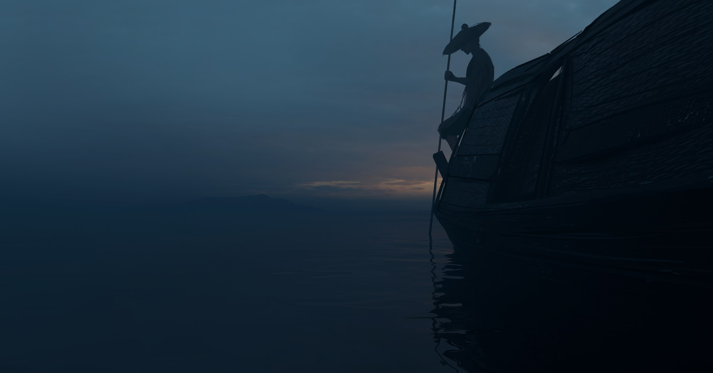

Mặt sông phủ đầy sương sớm, bóng núi bờ bên kia mờ nhạt tựa như vệt mực chưa ráo nước. Không có cầu, không có dây điện, không có bất cứ thứ gì thuộc về thế giới của cô.

Nơi mũi thuyền có một thanh niên đang đứng, quay lưng về phía cô, tay nắm một cây sào tre dài. Chàng mặc áo vải thô ngắn tay, trên vai đơm miếng vá, ống quần xắn cao đến đầu gối, bắp chân dính đầy bùn khô, làn da rám nắng sạm đen. Những khớp ngón tay nắm chặt cây sào to bè, đóng lớp chai dày cộm, đó là đôi bàn tay quanh năm gắn liền với đất đai và sức lực lao động. Chàng đứng thẳng nơi đầu thuyền đăm đăm nhìn lên bờ, bất động như tượng, cây sào tre cắm nghiêng vào lòng sông, con thuyền ghé sát mép bãi bồi, sẵn sàng rời bến bất cứ lúc nào.

<video controls width="100%" src="./media/web/boat2-web-720p.mp4"></video>

Sương mù mỗi lúc một dày đặc, từng cụm từng cụm cuồn cuộn tràn qua từ mặt sông, sắc trời xám xịt chẳng rõ giờ khắc nào. Gió từ bờ bên kia thổi tới, mang theo mùi máu tanh nồng nặc, lẫn vào khói lửa và mùi mồ hôi ngựa ngai ngái. Nơi sâu thẳm trong màn sương mơ hồ vọng lại âm thanh, xa xôi mà trầm đục, tựa như tiếng vó ngựa của vạn quân và tiếng hò reo chém giết bị khoảng cách nghiền nát thành một tràng ầm ì rền rĩ.

Chàng thanh niên vẫn đang kiên nhẫn đợi, ánh mắt chăm chú bất động, tựa hồ đã đứng đợi từ rất lâu, và cũng chẳng màng việc phải đợi thêm bao lâu nữa.

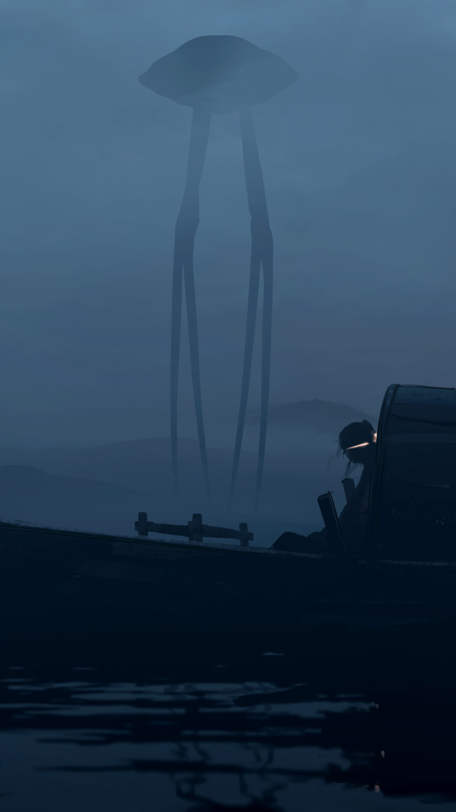

Nguyệt Nha Nhi nhìn ra mặt sông bên ngoài mui thuyền, thoạt đầu chỉ thấy một màn sương mịt mù. Đến khi gió xé toạc sương mù ra một khe hở, cô mới nhìn thấy ở nơi rất xa có một bóng hình khổng lồ sừng sững, tựa như một ngọn núi, nhưng lại không phải núi. Dáng hình xám đen ấy gần như hòa làm một với làn sương khói, đồ sộ, lặng câm, đứng sừng sững bất động giữa đất trời, nhìn xuống dải bờ sông này tựa như một vị thần minh.

Vân Trùng.

Ở một nơi chốn đến cả niên đại cũng chẳng hề hay biết này, thứ duy nhất cô nhận ra, chỉ có nó. Nó không tiến lại gần, cũng chẳng phát ra tiếng động, chỉ đứng yên nơi đó, tựa như đang đợi để ghi chép lại toàn bộ những gì sắp sửa xảy ra.

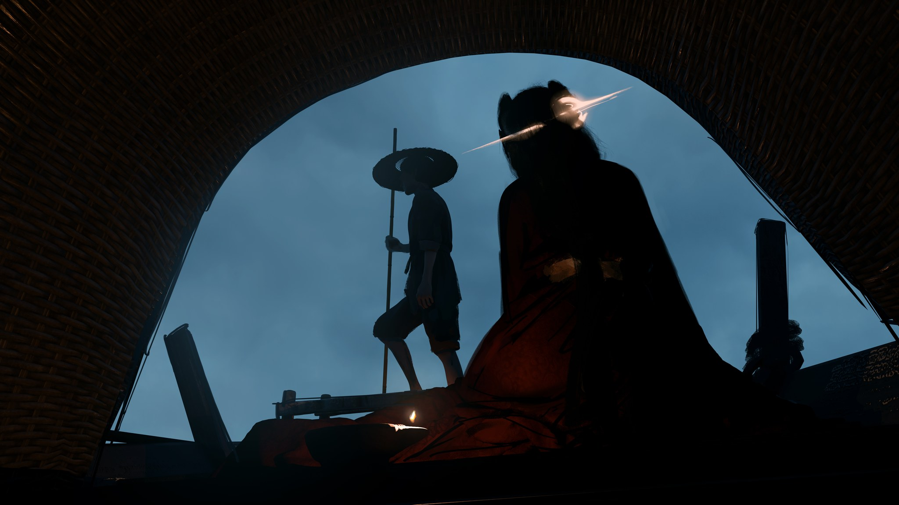

Không biết đã trôi qua bao lâu, Nguyệt Nha Nhi mới tìm lại được giọng nói của mình.

“Xin hỏi…… đây là đâu?”

Hai bên thái dương đau giật từng cơn. Cô rõ ràng cảm thấy mình đã trải qua rất nhiều chuyện, gặp gỡ rất nhiều người, nhưng một chuyện cũng chẳng nhớ nổi, câu duy nhất có thể thốt ra thành lời lúc này chỉ có câu đó.

Chàng thanh niên liếc nhìn cô một cái, rồi ánh mắt lại quay về phía bờ sông. Đối với việc trong thuyền bỗng dưng xuất hiện thêm một người, chàng dường như chẳng hề ngạc nhiên.

“Ô Giang.” Chàng nói, “Chúng ta ở đây để đón một người.”

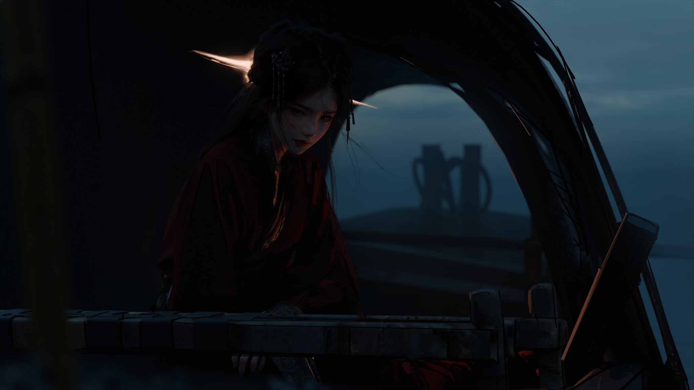

“Ô Giang? Đón người?”

Nguyệt Nha Nhi bật cười một tiếng. Thật quá mức hoang đường.

“……Chẳng lẽ lại là…… Hạng Vũ?”

“Đúng vậy.”

“Thế nhưng…… ông ấy sẽ không lên thuyền đâu.” Nguyệt Nha Nhi buột miệng nói theo bản năng.

“Ta biết.”

Chàng đáp lại còn nhanh hơn, bình thản như thể đang nói về chuyện hôm nay trời có sương mù.

“Sao anh lại biết?” Nguyệt Nha Nhi hỏi.

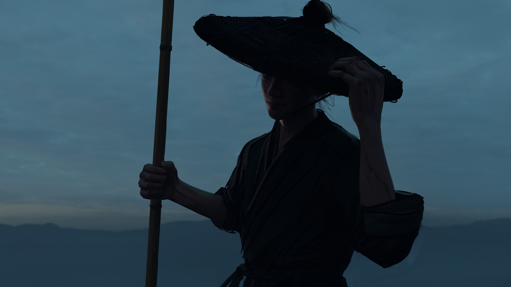

Lúc này chàng thanh niên mới quay đầu lại, nhìn cô, khẽ mỉm cười. Nụ cười ấy không hề mang vẻ khinh khi, mà như thể đã sớm liệu trước được cô sẽ hỏi câu này.

“Cô nương, thế gian này đâu phải chỉ có mình cô là người trong mây.”

“……Người trong mây?” Nguyệt Nha Nhi nhíu mày.

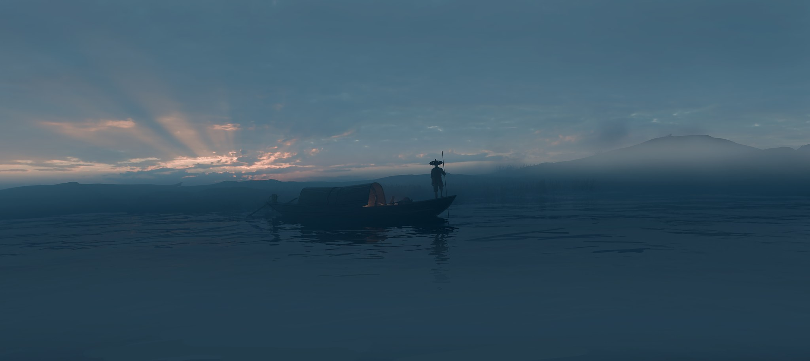

Đúng lúc ấy, trên bờ bắt đầu có động tĩnh.

Sắc mặt chàng thanh niên lập tức trở nên nghiêm nghị, ra hiệu suỵt tay lên môi với cô, hạ giọng thật thấp:

“Đừng lên tiếng. Ông ấy tới rồi.”

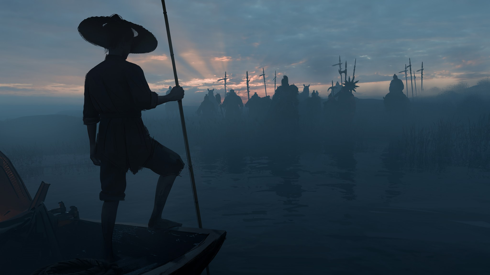

Đầm lau sậy trong màn sương rào rào xao động trước, kế đó, vài bóng người cưỡi ngựa từ trong bụi rậm dần dần hiện ra.

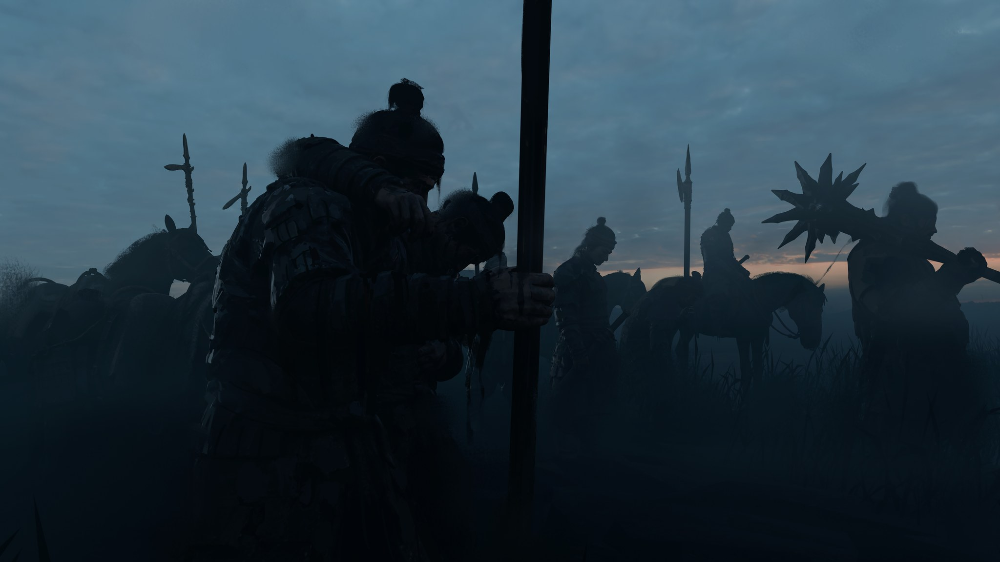

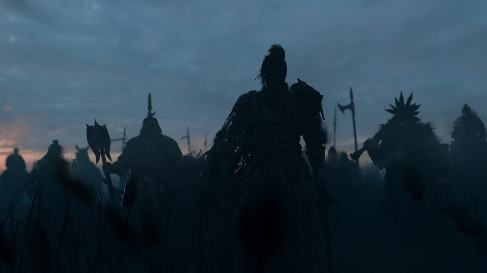

Hơn hai mươi kỵ binh, người nào người nấy đều mang đầy thương tích, giáp trụ bê bết máu me dơ bẩn, máu của vài người vẫn còn đang nhỏ tong tỏng xuống đất, nhìn qua là biết vừa từ giữa muôn trùng vòng vây quân thù liều mạng chém giết xông ra. Đi đầu là một thân hình cao lớn vạm vỡ dị thường. Tấm chiến bào giáp trụ rách nát khoác hờ trên thân thể, mặt mũi đầy vết máu, tóc búi xõa tung rối bời. Cách một lớp sương mù, Nguyệt Nha Nhi không thể nhìn rõ dung mạo của ông, chỉ có thể thấy được đường nét cao lớn mà mệt mỏi rã rời kia. Thế nhưng khí thế áp bức tôi luyện qua muôn vàn trận mạc chém giết vẫn thuận theo lưỡi chiến đao trong tay ông đâm xuyên qua màn sương, khiến lòng người không khỏi run rẩy kinh hoàng.

Cô nín bặt hơi thở ngay tức khắc. Không cần bất cứ ai nói cho cô biết, cô cũng đã tự hiểu người này là ai.

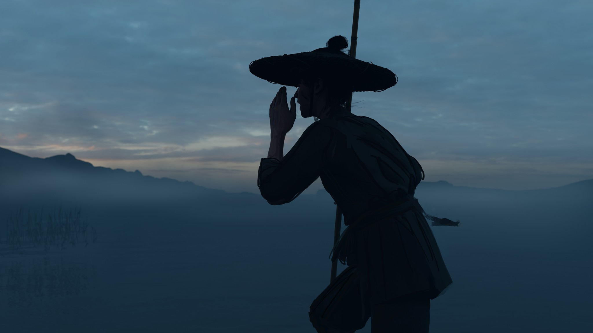

Lúc này, chàng thanh niên ở đầu thuyền cất cao giọng hô to:

“Hạng Vương! Thần là đình trưởng Ô Giang, nguyện chở Đại Vương sang sông! Giang Đông tuy nhỏ, nhưng cũng có dải đất ngàn dặm, mấy chục vạn bách tính, đủ để Đại Vương gây dựng lại cơ đồ!”

“Nay trên sông duy chỉ có một chiếc thuyền này của thần. Xin Đại Vương mau mau lên thuyền——nếu quân Hán đuổi tới nơi, e rằng khó lòng vượt sông được nữa!”

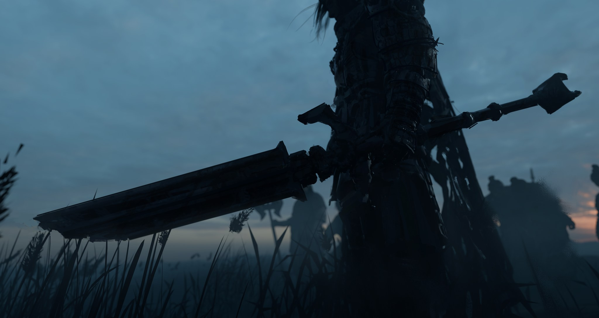

Hạng Vũ đứng lặng bên mép sông, tựa hồ không dám tin trên khúc sông này lại vẫn còn một chiếc thuyền đò. Ông im lặng hồi lâu, rồi mới trầm giọng mở lời.

“Năm xưa, Tịch này cùng tám ngàn con em Giang Đông vượt sông sang phía tây.” Ông nhìn dòng nước cuộn chảy, giọng trầm buồn, “Ngày nay, chẳng một ai trở về.”

“Dẫu cho các bậc cha anh đất Giang Đông còn thương xót ta, tôn ta làm vương, ta còn mặt mũi nào để nhìn lại họ nữa đây?”

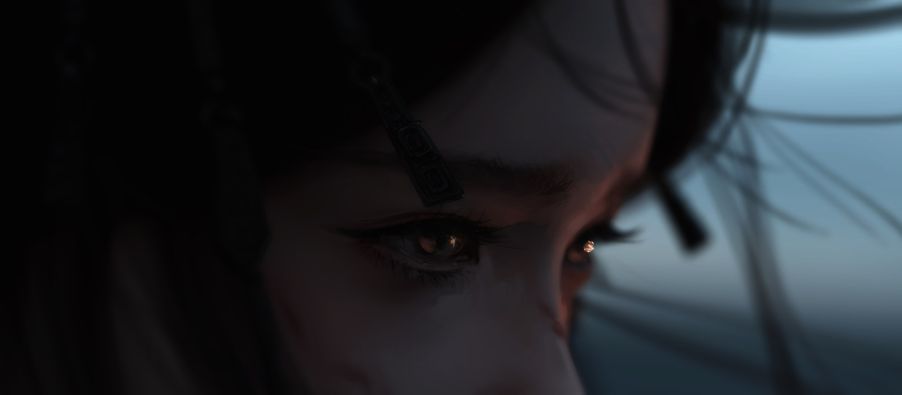

*(Xem video chuyển động: [`Mahina_boat-web-720p.mp4`](./media/pro/Mahina_boat-web-720p.mp4))*

Nguyệt Nha Nhi nhoài nửa người ra khỏi mui thuyền tre, đăm đăm nhìn lên bờ. Chẳng biết dũng khí từ đâu ập tới, cô bỗng cất tiếng hét lớn về phía bờ sông:

“Hạng Vương! Bọn họ đều lấy việc được đi theo ngài làm niềm vinh dự, cho dù da ngựa bọc thây nơi sa trường cũng lấy làm hãnh diện! Cha mẹ của họ, sao có thể trách tội ngài được chứ?”

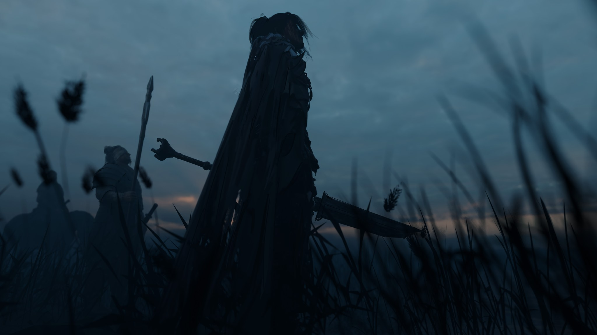

Hạng Vũ men theo tiếng gọi nhìn về phía thuyền đò. Nhận ra người vừa lên tiếng lại là một thiếu nữ trẻ tuổi, trong đáy mắt ông thoáng qua một tia ngạc nhiên. Nhưng nỗi kinh ngạc ấy chỉ đọng lại trong tích tắc, rồi hóa thành một sự thanh thản khi đối diện với số phận.

“Dẫu cho họ không trách cứ,” Ông nói, “nhưng lòng ta há có thể không thẹn với lương tâm?”

Mọi chuyện đều diễn ra đúng như dự liệu. Thế nhưng chàng thanh niên ở mũi thuyền rõ ràng không cam lòng với câu trả lời này.

“Hạng Vương, thứ cho thần nói thẳng.” Chàng nói, “Đại Vương từ trong muôn trùng vây hãm liều chết xông tới tận đây, cầu mong chẳng phải là một tia hy vọng sống sót sao? Nay thuyền ở ngay trước mắt, Giang Đông ở bờ bên kia. Vì cớ gì lại nhất quyết không chịu lên thuyền?”

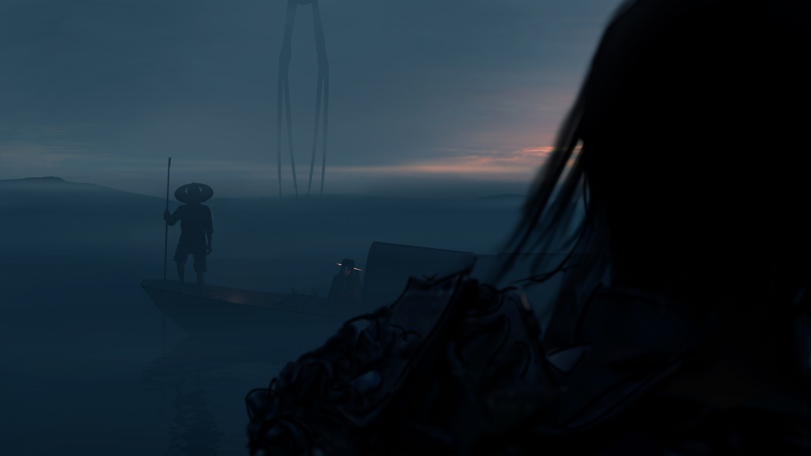

Hạng Vũ không trả lời ngay.

Ông ngước nhìn về phía bóng hình khổng lồ trong làn sương mù dày đặc, một lát sau mới thu hồi ánh mắt, tầm nhìn lướt qua chàng thanh niên ở mũi thuyền, cuối cùng dừng lại trên người Nguyệt Nha Nhi đang nhoài nửa thân mình ra khỏi mui thuyền. Trong đôi con ngươi kép (trùng đồng) của ông không hề có chút giận dữ, chỉ có một sự sáng suốt tỉnh táo đến mức gần như lạnh buốt.

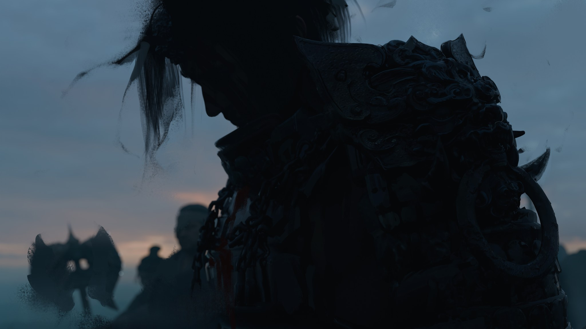

*(Xem video chuyển động: [`xiang-yu-riverside-home-bg-seamless-10s.mp4`](./media/xiang-yu-riverside-home-bg-seamless-10s.mp4))*

“Ta từ Âm Lăng lạc bước lầm đường,” Ông chậm rãi nói, “bị lão nông lừa gạt, sa vào chốn đầm lầy lớn. Sương mù dày đặc vây kín sông, lau sậy cao ngập đầu người, quanh co đứt đoạn, chẳng phân biệt nổi bắc nam, đến mức đi tới khúc nào của Ô Giang này, bản thân ta cũng chẳng hề hay biết.”

“Thế nhưng ngươi, lại như thể từ sớm đã biết hôm nay ta tất sẽ đến đây, chèo con thuyền duy nhất trên khúc sông này, đợi sẵn ngay đúng bãi bồi dưới chân ta.”

“Ngươi hãy nói cho ta hay, rốt cuộc là vì cớ làm sao?”

Chàng thanh niên nghẹn lời. Chàng hé môi, nhưng không thể thốt ra nổi một chữ.

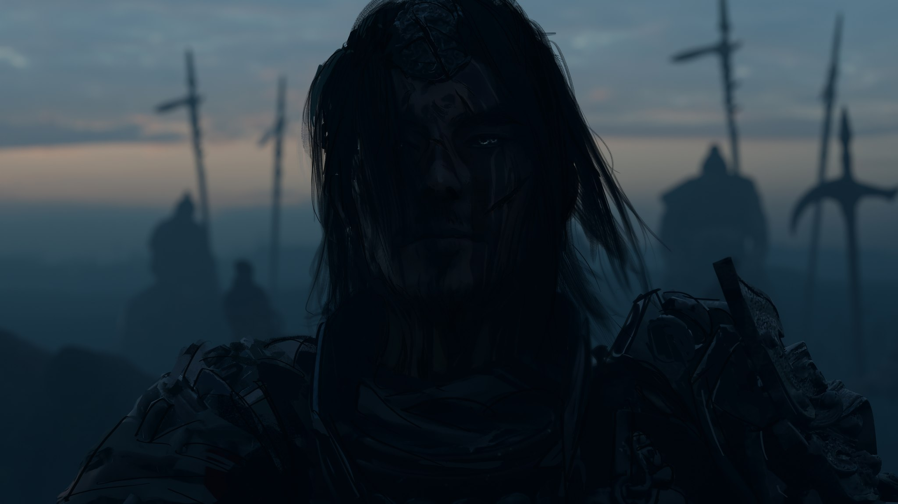

Hạng Vũ nhìn chàng, bỗng nhiên cất tiếng cười vang dội.

“Tịch này, há phải là kẻ ngu đần mông muội.” Ông nói, “Khúc Ô Giang hoang vu này, làm gì có đình trưởng nào? Lại làm gì có thuyền đò nào?”

“Ý trời muốn diệt ta. Đám người trong mây các ngươi, hà cớ gì lại đến để độ ta?”

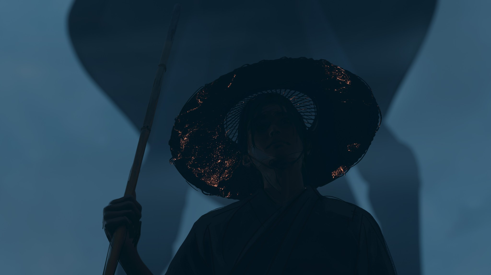

Sương mù cuồn cuộn tràn qua mặt sông. Không một ai cất lời đáp lại. Kể từ khoảnh khắc bước chân ra khỏi đầm lau sậy và nhìn thấy con thuyền này, ông đã thấu tỏ tất cả mọi sự.

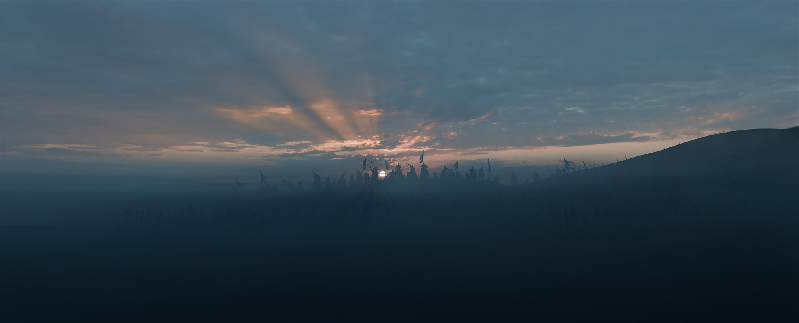

Tiếng vó ngựa ầm ầm từ xa ùa tới gần. Bên ngoài đầm lau sậy bóng người chập chờn, đã có thể nhìn thấy bóng dáng của kỵ binh, những lá chiến cờ đỏ rực của quân Hán thoắt ẩn thoắt hiện trong làn sương khói.

Có tiếng người từ đằng xa hô lớn gầm vang, thanh âm bị gió xé thành từng mảnh đứt quãng:

“Hán Vương có lệnh——Kẻ nào lấy được đầu Hạng Vũ, thưởng ngàn lượng vàng, phong ấp vạn hộ——!”

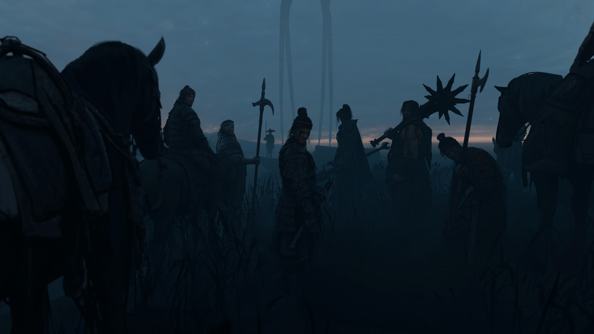

Hồi kết đã điểm. Vào khoảnh khắc này, tất cả mọi người bên bờ sông đều thấu hiểu.
