# 云虫 - 第五章 乌骓 · 一

---

<video src="./media/pro/boat-web-720p.mp4" controls loop muted playsinline width="100%"></video>

> 月牙儿是被水声唤醒的。

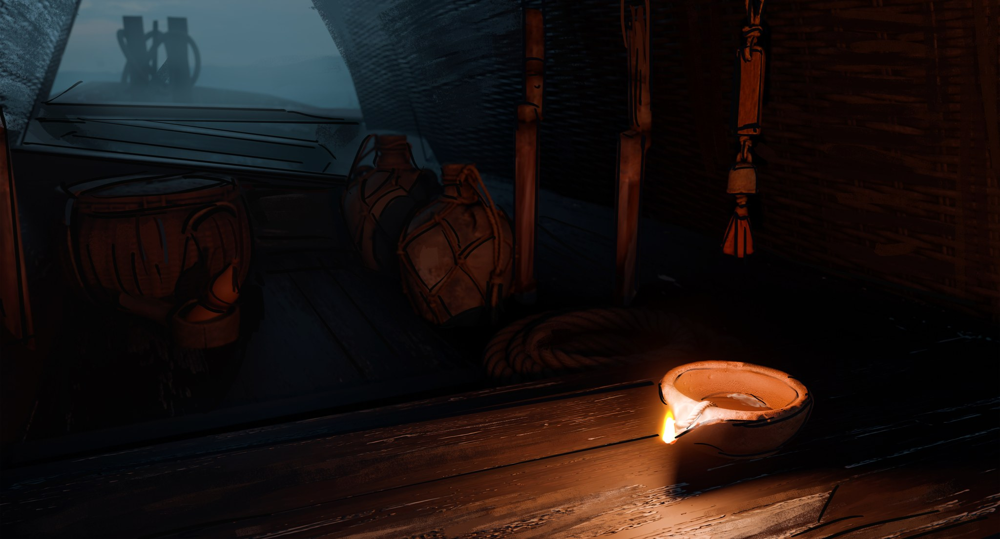

> 睁开眼时，头顶是一弯熏黑的竹篷。船身随水波轻轻摇晃，空气里浮着水汽和旧木头的闷味。她低头看自己，一身粗布交领衣裳，袖口磨得起毛。不是她的衣服。

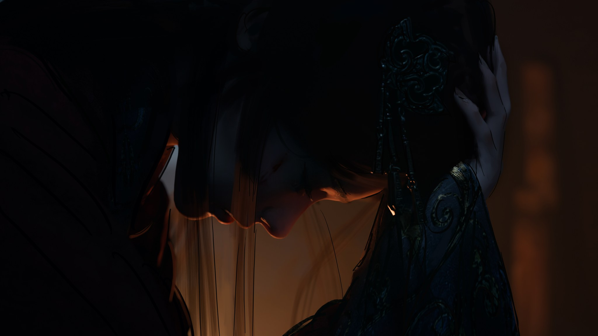

> 她觉得自己做了一个很长的梦，好像去过很多地方，见过很多人，可真要去想，却又什么都抓不住，只剩一种昏昏沉沉的疲惫压在身上。

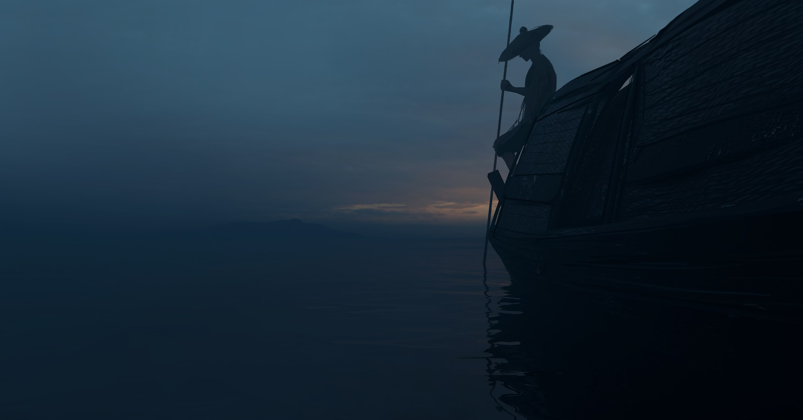

> 江面浮着晨雾，对岸山影淡得像没干透的墨。没有桥，没有电线，没有任何属于她那个世界的东西。

> 船头立着一个青年，背对着她，握着一根长竹篙。短褐，肩上打着补丁，裤腿挽到膝盖，小腿沾着干泥，皮肤晒得黝黑。握篙的手指节宽大，结着厚茧，是一双常年同土地和力气打交道的手。他立在船头望着岸上，一动不动，竹篙斜插进江底，船檥在滩边，随时可以离岸。

<video src="./media/web/boat2-web-720p.mp4" controls loop muted playsinline width="100%"></video>

> 雾越来越浓，一团一团从江面推过来，天光灰白，辨不出时辰。风从岸那边吹来，带着很浓的血腥味，混着烟和马汗的气息。雾的深处隐隐有声音，极远极钝，像几万只马蹄和喊杀被距离磨成一片低低的轰鸣。

> 青年还在等，目光定定的，像已经等了很久，也不在乎再等多久。

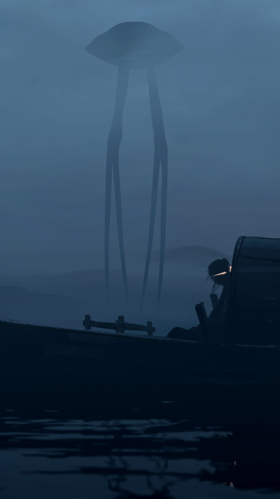

> 月牙儿望向乌篷外的江面，起初只有雾。风把雾扯开一道口子的时候，她看见很远的地方立着一个巨大的影子，像山，又不是山。那灰黑的身影几乎和雾融在一起，庞大，沉默，一动不动地立在天地之间，俯瞰着这片江岸，宛若神明。

> 云虫。

> 在这个连年代都不知道的地方，她唯一认得的，只有它。它不靠近，也不出声，只是立在那里，像在等着记下即将发生的一切。

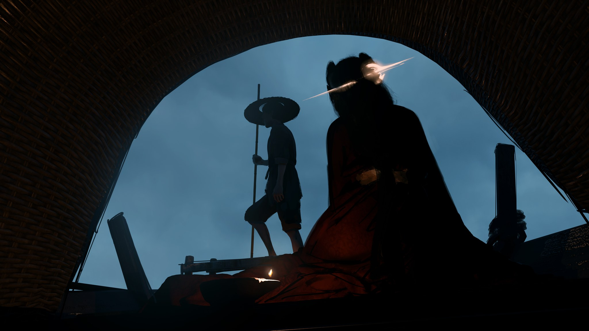

> 不知过了多久，月牙儿才找回自己的声音。

> “请问……这是哪里？”

> 太阳穴一跳一跳地疼。她明明觉得自己经历了很多事，见过很多人，可一件也想不起来，能问出口的，只有这一句。

> 青年瞥了她一眼，目光又回到岸上。对船里多出来一个人，他似乎并不意外。

> “乌江。” 他说， “我们在这儿接一个人。”

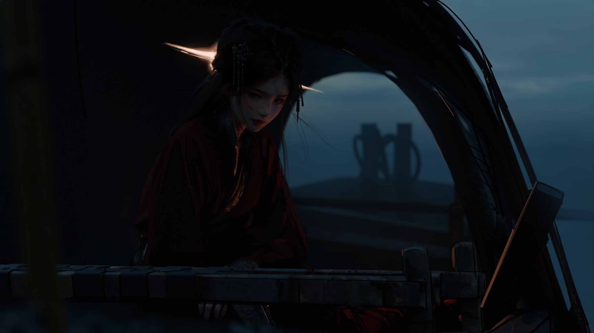

> “乌江？接人？”

> 月牙儿失笑了一声。太离谱了。

> “……难不成，是项羽？”

> “对。”

> “那……他不会上船的。” 月牙儿不假思索地接了一句。

> “我知道。”

> 他接得更快，平静得像在说今日有雾。

> “你怎么知道？” 月牙儿问。

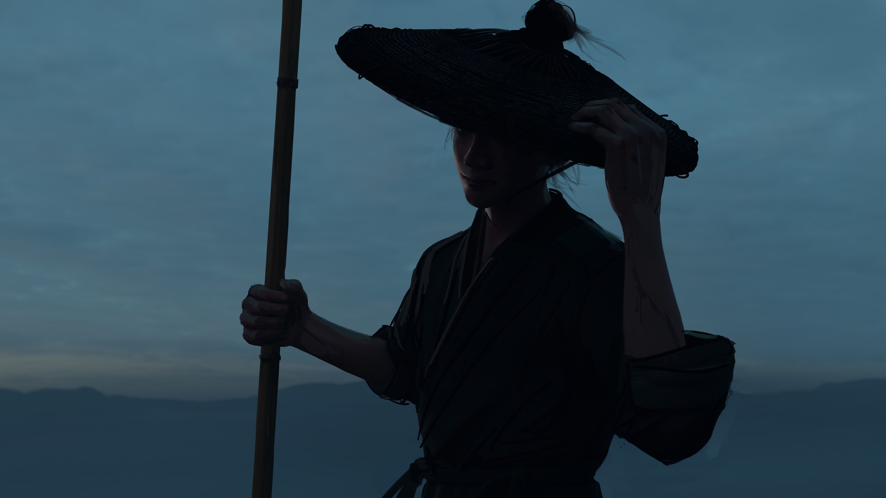

> 青年这才回过头来，看了她一眼，微微笑了笑。那笑不是不屑，倒像是早已料到她会这么问。

> “姑娘，这世上，又不是只有你一个云中人。”

> “……云中人？” 月牙儿皱起眉头。

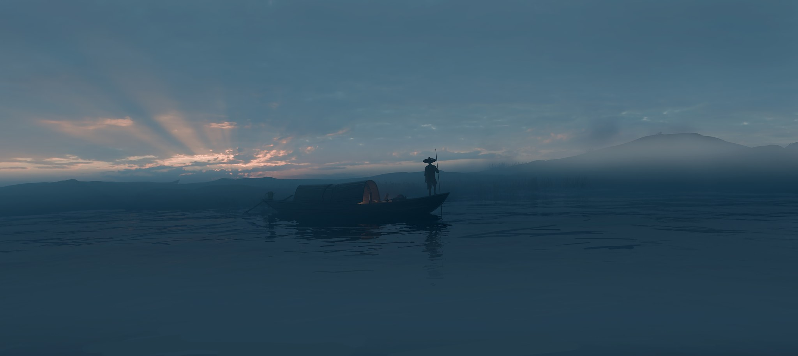

> 就在这时，岸上有了动静。

> 青年脸色一肃，朝她做了个噤声的手势，声音压得极低：

> “别出声。他来了。”

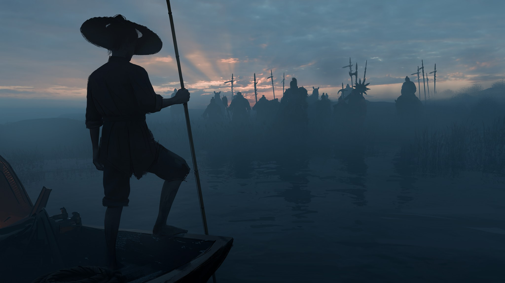

> 雾里的芦苇荡先响了一阵，接着，一些身影骑着马，从苇丛中冒了出来。

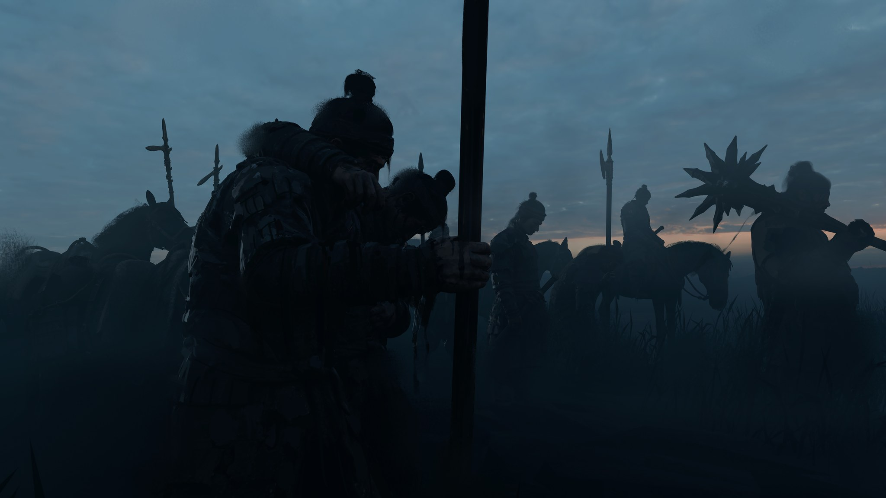

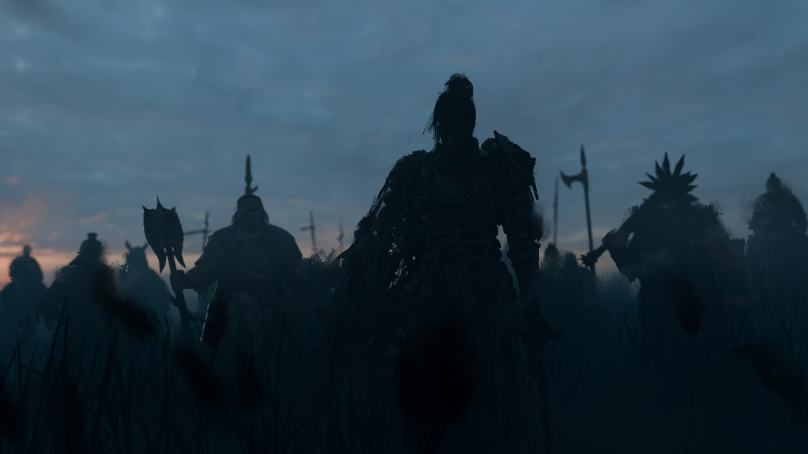

> 二十几个士兵，人人带伤，甲胄上满是血污，有人的血还在往下滴，一看就是刚从万军之中杀出来的。为首的是一个异常高大魁梧的身影。断裂的铠甲挂在身上，满脸血污，束发散乱。隔着雾，月牙儿看不清他的容貌，只能望见那道高大而疲惫的轮廓。可那股久经杀伐的压迫感，依旧顺着他手中的战刃穿透雾气，让人心悸。

> 她瞬间屏住了呼吸。不用任何人告诉她，她已经知道了这个人是谁。

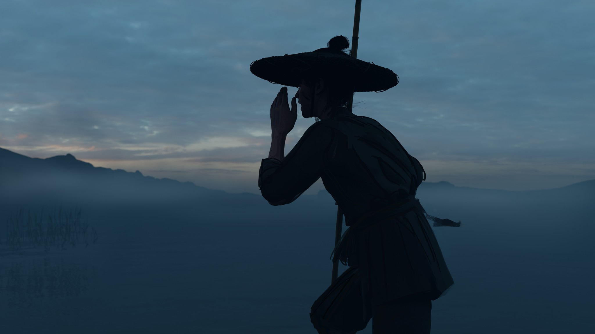

> 这时，船头的青年高声喊道：

> “项王！臣乃乌江亭长，愿渡大王过江。江东虽小，亦有千里之地、数十万百姓，足供大王重整旗鼓！”

> “如今江上唯有臣这一条船。请大王速速上船——若汉军追至，便再难渡江了!”

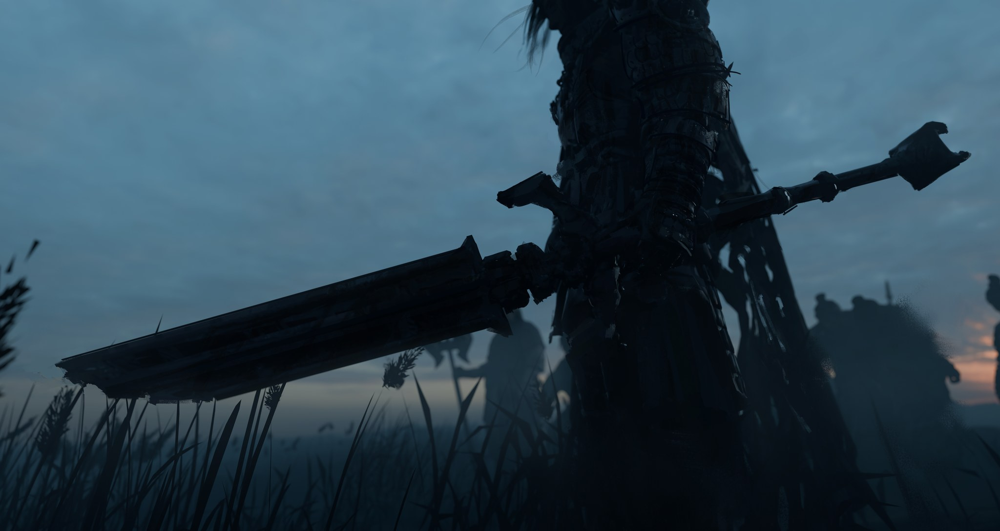

> 项羽立在岸边，像是不敢相信这江上竟还有一条渡船。他沉默了很久，才沉沉开口。

> “当年，籍与八千江东子弟渡江而西。” 他望着江水，声音不高， “今日，归者无一。”

> “纵使江东父兄仍怜我、奉我为王，我有何面目复见之？”

<video src="./media/pro/Mahina_boat-web-720p.mp4" controls loop muted playsinline width="100%"></video>

*(Ảnh tĩnh: 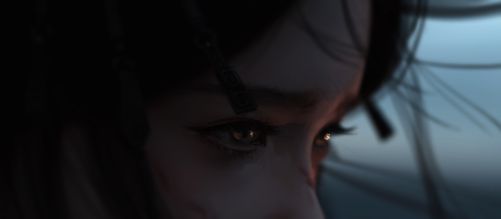)*

> 月牙儿从乌篷里探出半个身子，一直望着岸上。不知是哪里来的胆子，她忽然朝岸上喊了一句：

> “项王!他们都是以追随你为荣的，连战死沙场，都引以为荣。他们的父母，怎么会怪罪你呢?”

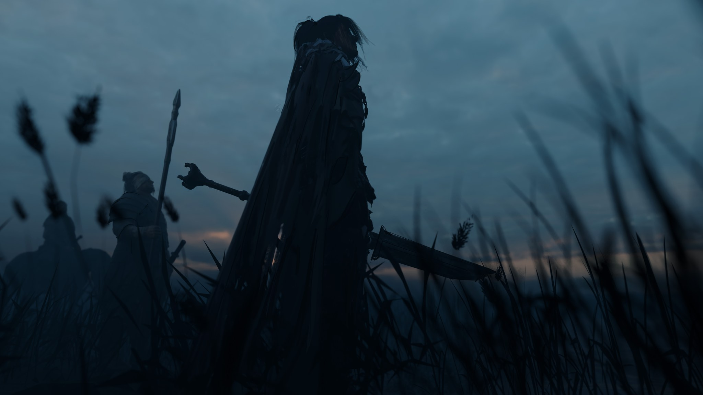

> 项羽循声望向渡船。看清出声的竟是一个年轻少女，他眼中掠过一丝意外。可那惊讶只停了一瞬，便化作一种面对命运的释然。

> “纵使他们不怪罪，” 他说， “我又岂能问心无愧？”

> 一切都在意料之中。但船头的青年显然不满意这个答案。

> “项王，恕臣直言。” 他说， “大王自万军之中冒死杀至此处，求的，不就是一线生机么？如今船在眼前，江东在对岸。为何偏偏不肯上船？”

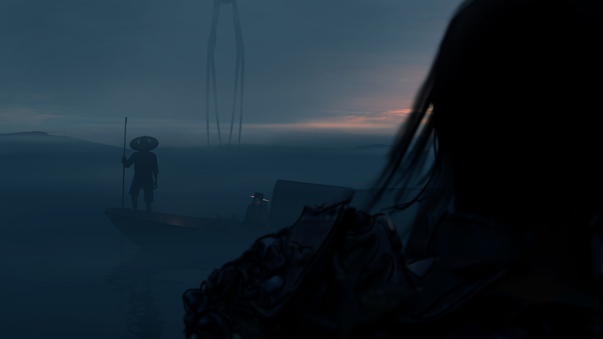

> 项羽没有立刻回答。

> 他望向浓雾中那道巨大的身影，片刻后才收回目光，视线掠过船头的青年，最终落在从乌篷里探出半个身子的月牙儿身上。他的重瞳里没有怒意，只有一种近乎冰冷的清明。

<video src="./media/xiang-yu-riverside-home-bg-seamless-10s.mp4" controls loop muted playsinline width="100%"></video>

*(Ảnh tĩnh: 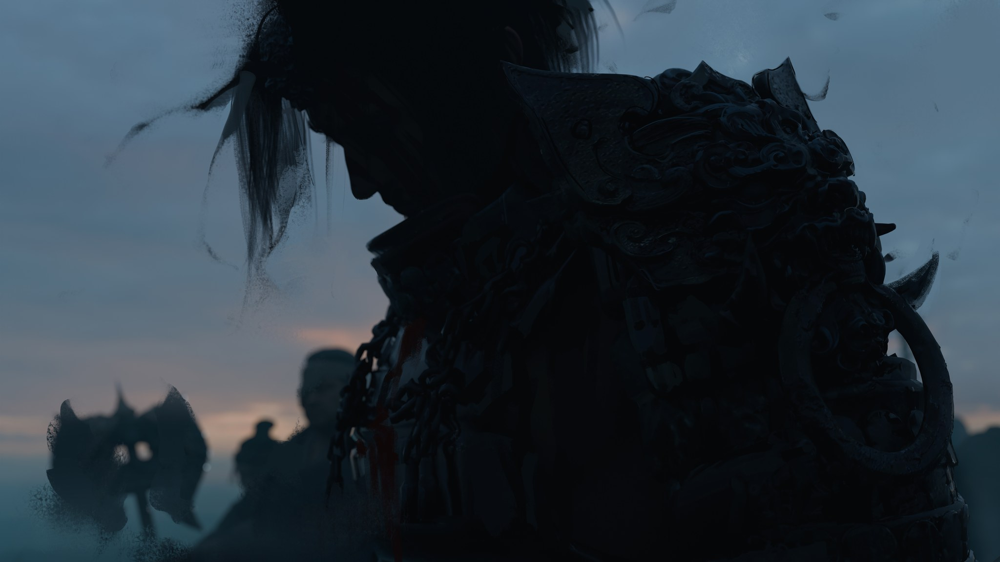)*

> “吾自阴陵迷道，” 他缓缓道， “田父绐我，陷于大泽。大雾锁江，芦苇没人，断断续续，不辨南北，连走到了乌江哪一段，亦不自知。”

> “可你，却似早知我今日必至，驾着这江上唯一一条渡船，正正候在我脚下这片滩头。”

> “你来告诉我，这是为何？”

> 青年语塞了。他张了张口，一个字也答不出来。

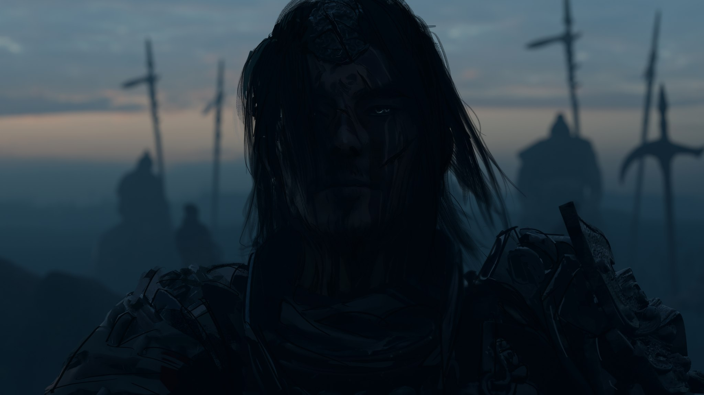

> 项羽看着他，忽然大笑出声。

> “籍，亦非愚钝之人。” 他道， “这乌江之上，何来的亭长？又何来的渡船？”

> “天意要亡我。尔等云中之人，又何意来渡我?”

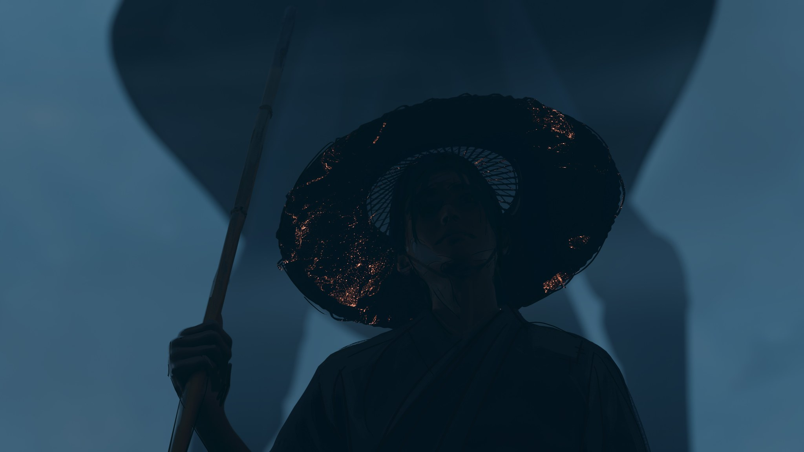

> 雾从江面上滚过。无人答话。从走出芦苇荡、看见这条船的那一刻起，他就全知道了。

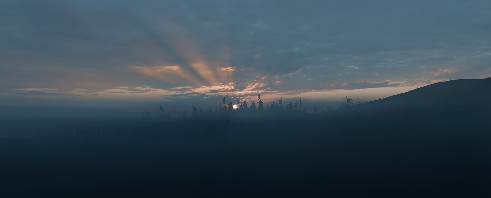

> 隆隆的马蹄声由远及近。芦苇荡外影影绰绰，已经望得见骑兵的影子，汉军赤色的战旗在雾中时隐时现。

> 有人在远处高声喊着，声音被风撕得断断续续：

> “汉王有令——得项羽头者，赏千金，邑万户——！”

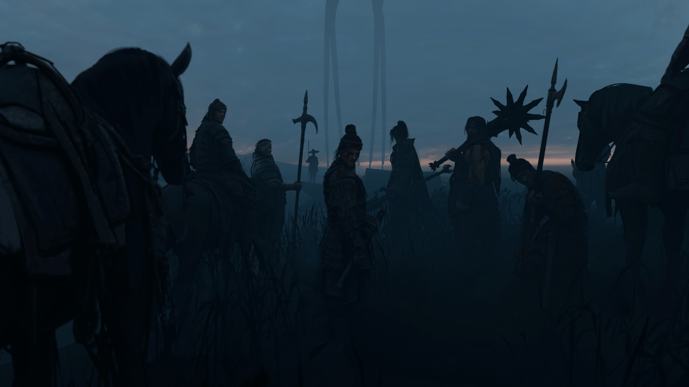

> 结局到了。这一刻，江边所有人都知道。

