# 云虫 / CloudInsect - 第五章 乌骓 · 二 (Chapter 5: Wuzhui · Part 2)

---

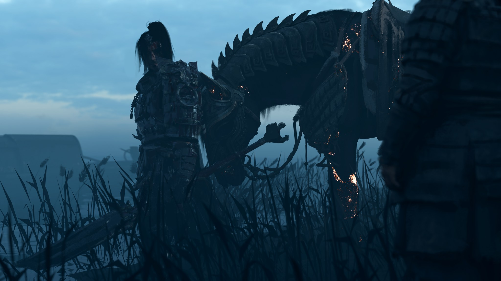

**ZH**: 忽然，一声马嘶。

**EN**: Suddenly, a horse neighed.

**ZH**: 那匹黑马不知何时已靠了上来，头抵着项羽的后背，轻轻摩挲，声音里有种说不出的不舍。雾里，它的皮毛间泛起一层细碎的光，明明灭灭，宛若星空。

**EN**: At some point the black horse had drawn close. It pressed its head against Xiang Yu’s back and nuzzled him gently, its voice carrying a reluctance to part that no words could name. In the fog, tiny lights shimmered through its coat, kindling and fading like a field of stars.

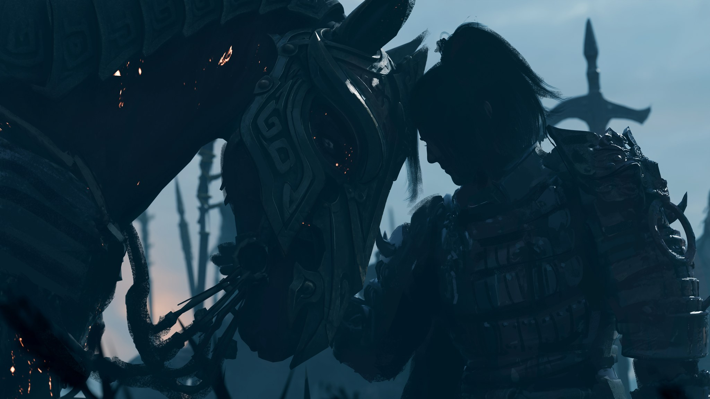

**ZH**: 项羽回过头，轻轻抚摸着自己的战马，与它额头相抵，像是在安抚，也似是在告别。过了片刻，他才转向船头，说道： “此马名乌骓，随我征战多年。我不忍它同死于此。若尔等还愿替我做一件事，便善待它。”

**EN**: Xiang Yu turned and gently stroked his warhorse, resting his forehead against its own, as though to soothe it, or to say goodbye. Only after a while did he turn toward the bow and speak:  “This horse is called Wuzhui. He has followed me through years of war. I cannot bear to let him die here with me. If you would do one last thing for me, treat him well.”

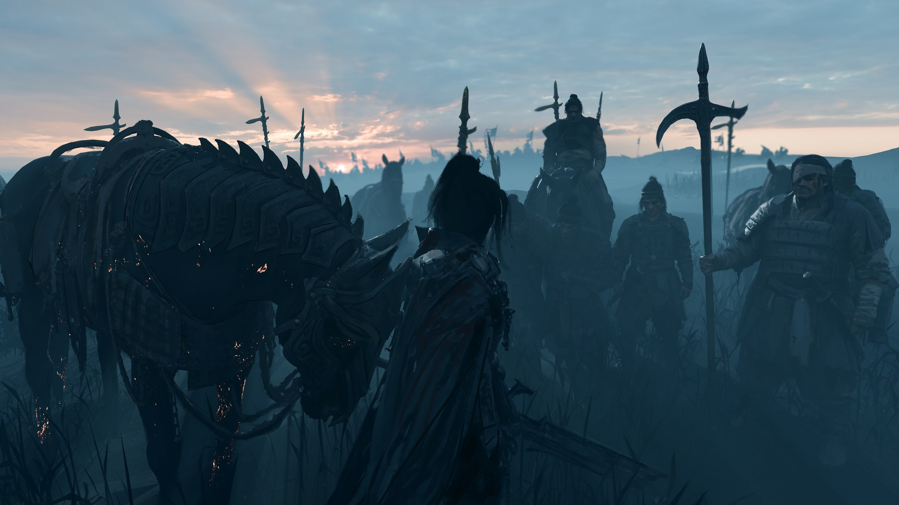

**ZH**: 说罢，他转身面向自己的将士。

**EN**: With that, he turned to face his soldiers.

**ZH**: “你们也走吧。汉军要的，只是籍一人之头。趁雾未散，沿江而去，不会有人追。”

**EN**: “You should go too. The Han army wants only my head. Follow the river while the fog still holds. No one will pursue you.”

**ZH**: 他说着，便穿过身后的队伍，独自迎着雾中传来的喊杀声走去。

**EN**: As he spoke, he passed through the men behind him and walked alone toward the cries of battle coming through the fog.

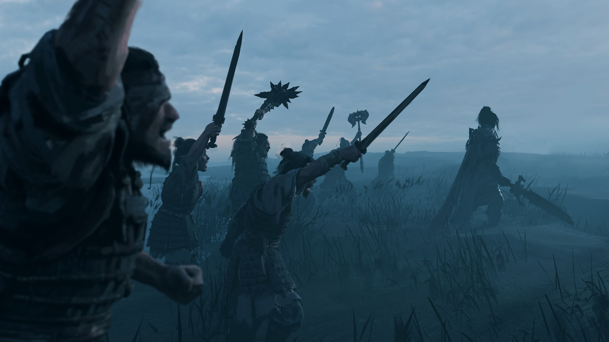

**ZH**: 没有人离去。

**EN**: No one left.

**ZH**: 二十余人或翻身下马，或拔出短刃。他们默然跟上，在项羽身后一字排开。不知是谁先喊了一声，接着所有人都喊了起来：

**EN**: The twenty-odd men dismounted or drew their short blades. Silently they followed, forming a line behind Xiang Yu. Someone shouted first; then they were all shouting:

**ZH**: “誓死追随项王！”

**EN**: “We follow King Xiang to the death!”

**ZH**: “誓死追随项王——！”

**EN**: “We follow King Xiang to the death—!”

**ZH**: 喊声撞进浓雾里，惊起满滩水鸟。

**EN**: Their cries struck the thick fog, startling waterbirds into flight all along the shore.

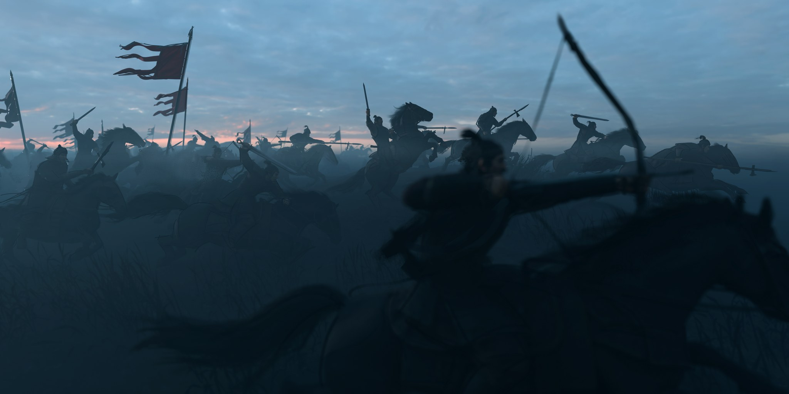

**ZH**: 汉军到了。

**EN**: The Han army had arrived.

**ZH**: 骑兵从雾里涌了出来，如狂风席卷而至，转瞬之间，已近在咫尺。

**EN**: Cavalry poured out of the fog, sweeping toward them like a gale. In an instant they were almost upon them.

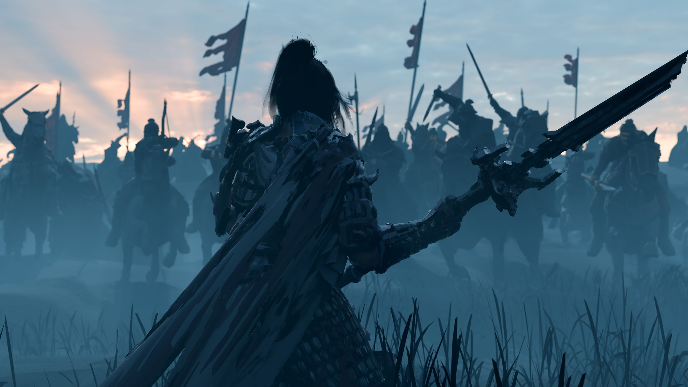

**ZH**: 项羽缓缓提起手中那柄折断的巨刃，迈着沉稳的步子，迎向奔涌而来的汉军。一步一步，走进了自己故事的终章。

**EN**: Xiang Yu slowly raised the great broken blade in his hand and walked with steady steps to meet the oncoming Han army. Step by step, he entered the final chapter of his own story.

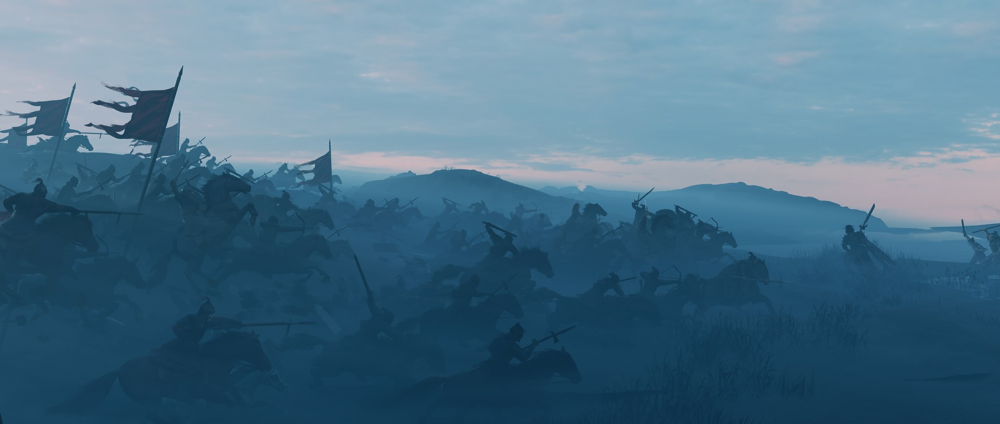

**ZH**: 汉军像决了堤的黑潮，转眼漫过滩头。那二十几道身影在潮水里站了片刻，便被吞没了。

**EN**: The Han army broke over the shore like a black tide through a breached embankment. Those twenty-odd figures stood within it for a moment, then were swallowed.

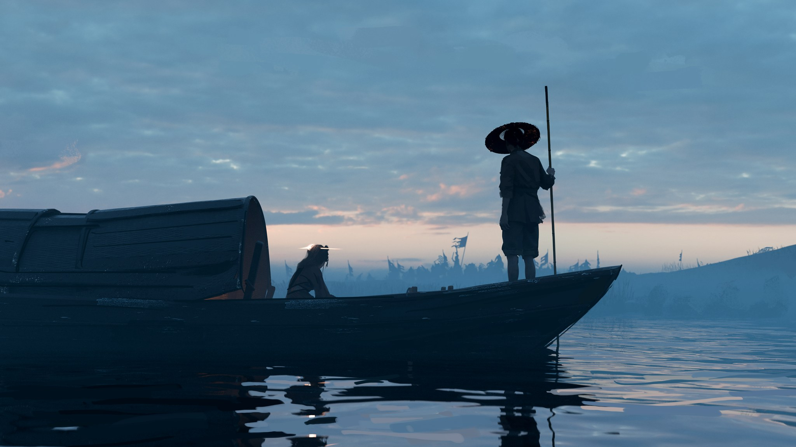

**ZH**: 短兵相接的声音，远没有月牙儿想象中那样清脆响亮。沉闷的撞击声混着嘶哑的嚎叫，血腥而残酷。过了一会儿，岸上的喊杀声渐渐变了味，变成争抢，变成狂欢。风把那些声音一阵阵送过江面：

**EN**: The sound of blades meeting was nothing like the clear, ringing clash Mahina had imagined. Dull impacts mingled with hoarse howls, bloody and brutal. After a while, the cries on shore began to change: into a scramble, into a frenzy of celebration. The wind carried their voices across the river in gusts:

**ZH**: “在这儿！这块是我的——！”

**EN**: “Here! This piece is mine—!”

**ZH**: “分我一块！”

**EN**: “Give me a piece!”

**ZH**: 月牙儿别过头去,不忍再看。

**EN**: Mahina turned her head away. She could not bear to watch.

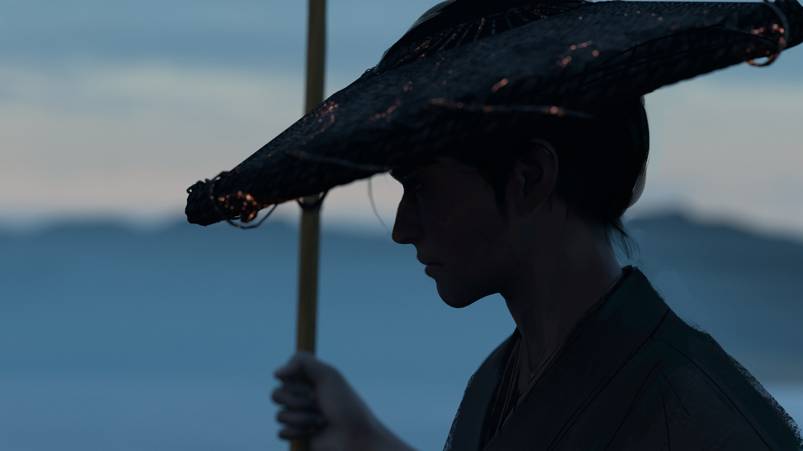

**ZH**: 青年依旧立在那里,神色平静,一动不动地望着岸上。

**EN**: The young man still stood there, his face calm, gazing at the shore without moving.

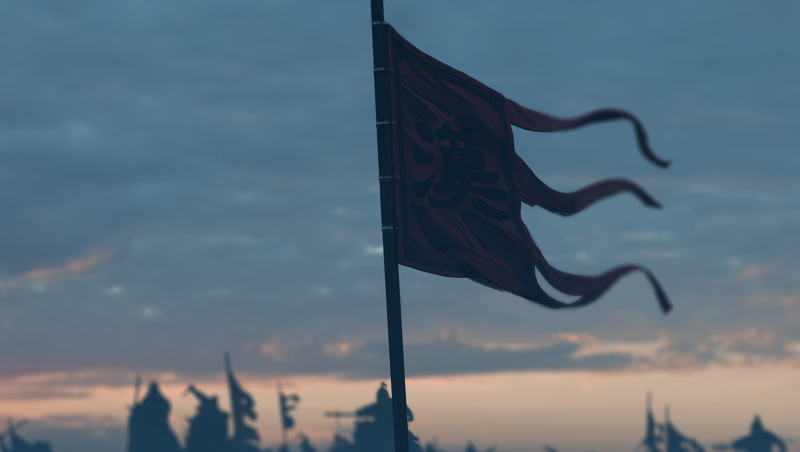

**ZH**: 顺着他的目光,月牙儿发现他盯着的不是那片混乱,而是那面在雾中起伏的“汉”字大旗。他看了很久,很久。

**EN**: Following his gaze, Mahina realized that he was watching not the chaos, but the great banner bearing the character for Han as it rose and fell in the fog. He watched for a long, long time.

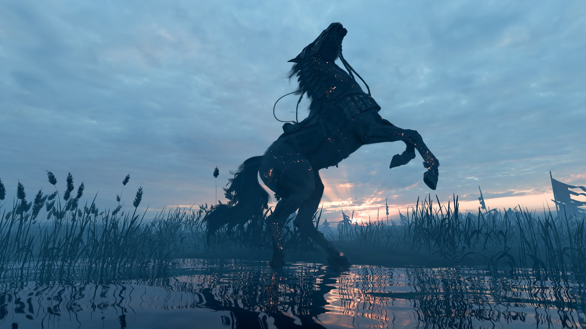

**ZH**: 滩头上，乌骓还在。

**EN**: Wuzhui was still on the shore.

**ZH**: 它没有上船，也不肯走，只是朝着主人消失的方向扬起前蹄，一声又一声地长嘶，久久不去。雾的尽头，天边那个巨大的影子突然发出一声沉闷的虫鸣，像一声绵长的叹息，正正落在马嘶的间隙里。

**EN**: He had not boarded the boat, and would not leave. He only reared toward the place where his master had vanished, neighing again and again, lingering there. Beyond the fog, the immense shadow on the horizon suddenly gave a low insect cry, like a long sigh, falling precisely into the silence between the horse’s calls.

**ZH**: 一声马嘶，一声虫鸣。一应，一答。

**EN**: A horse’s neigh. An insect’s cry. A call, an answer.

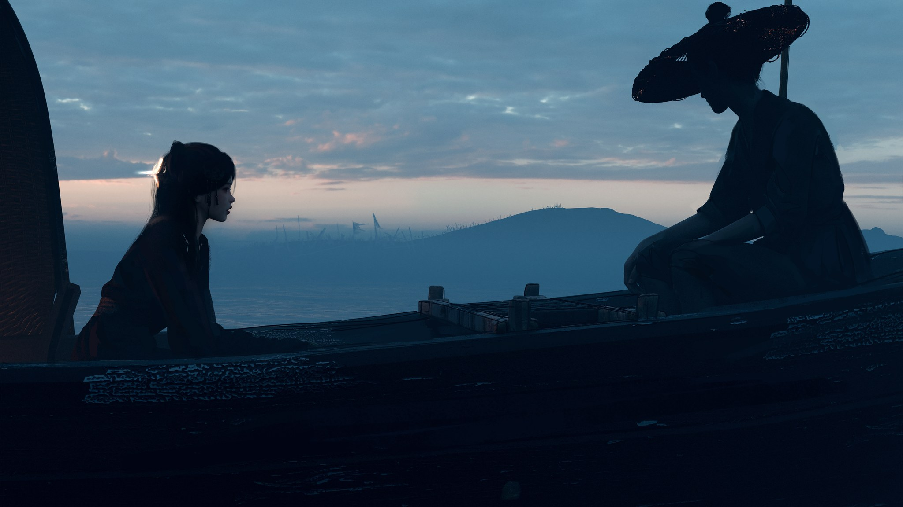

**ZH**: 天光渐渐放亮，江上的雾气也缓缓散去。年轻的船夫坐在船头，安静得像一尊塑像。

**EN**: The sky was growing light, and the fog over the river slowly thinned. The young boatman sat at the bow, as still as a statue.

**ZH**: “……你叫什么名字？” 月牙儿轻声问，似乎只是想打破船上的沉默。

**EN**: “…What’s your name?”  Mahina asked softly, as if she wanted only to break the silence on the boat.

**ZH**: 青年没有回答。他仍望着那面汉旗，像是自言自语，又像是在问她：

**EN**: The young man did not answer. Still watching the Han banner, he spoke as if to himself, or as if asking her:

**ZH**: “既然天意不可违，命运又为何要指引我们来窥探命运？”

**EN**: “If Heaven’s will cannot be defied, why does fate lead us here to glimpse fate itself?”

**ZH**: 过了好一会儿，他才回过头，看见她一脸茫然的样子，忽然淡淡一笑。

**EN**: Only after a long while did he turn. Seeing her bewildered face, he suddenly gave a faint smile.

**ZH**: “看来，你是头一回于云中行走。”

**EN**: “It seems this is your first walk through the clouds.”

**ZH**: 他叹了口气。

**EN**: He sighed.

**ZH**: “我也不过是一介草民。汉家天下倾覆之后，乱世里的一个农夫罢了。也不知为何偏偏是我有此荣幸，能以云中人之身，来这乌江边，见一见楚霸王。”

**EN**: “I am only a common man myself. A farmer in a time of turmoil, after the fall of the Han. I do not know why I, of all people, should have the honor of coming as a Cloud Dweller to the banks of the Wujiang, to see the Hegemon-King of Chu.”

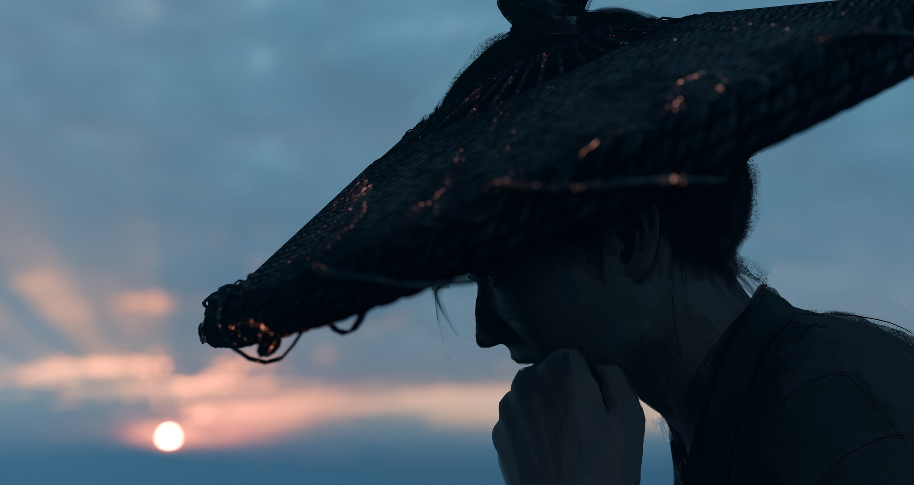

**ZH**: “在下姓刘，名秀，字文叔。”

**EN**: “My family name is Liu, my given name Xiu. My courtesy name is Wenshu.”

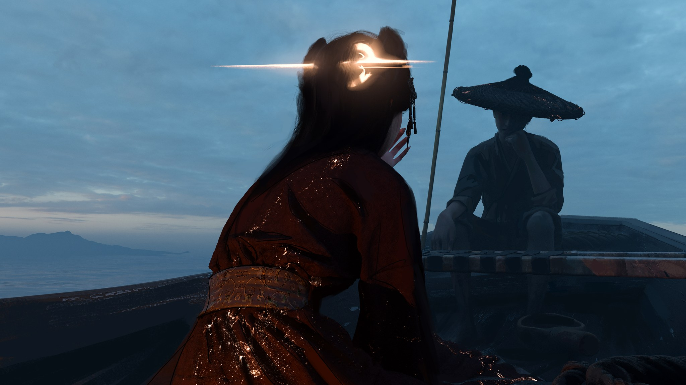

**ZH**: “刘秀？！” 月牙儿大惊， “汉光武——！”

**EN**: “Liu Xiu?!”  Mahina exclaimed, startled.  “Guangwu of Han—!”

**ZH**: 话音扬起的一瞬,世界黑了。

**EN**: The instant her voice rose, the world went black.

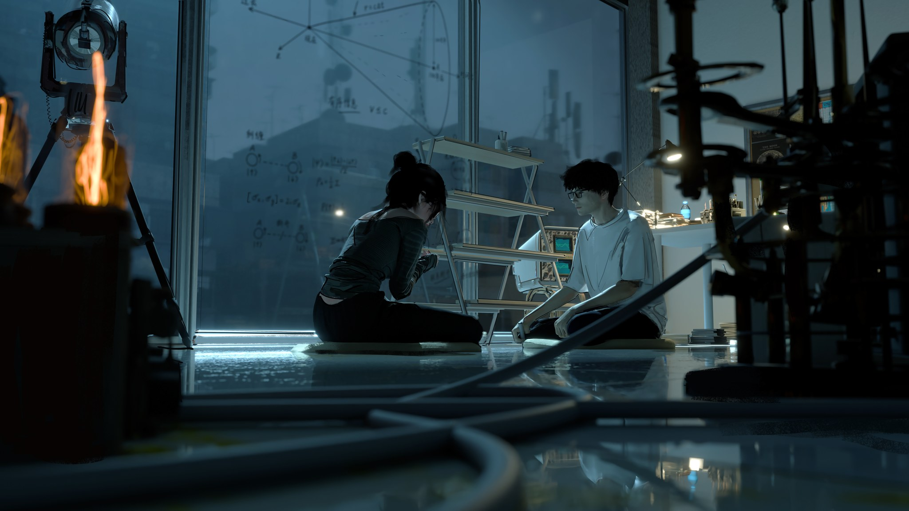

**ZH**: “——然后，就全黑了。”

**EN**: “—And then everything went black.”

**ZH**: 工厦的夜很静，小灯昏黄。希扬留在玻璃窗上的光锥手稿，在月光下泛着奇异的光泽，仿佛有了生命。

**EN**: Night lay quiet in the industrial building. The little lamp cast a dim yellow light. On the window, Suvan’s sketches of light cones gleamed strangely in the moonlight, as though they had come alive.

**ZH**: “我醒过来的时候，” 月牙儿说， “人还趴在观测台上，手里还拿着相机，天就暗了一点。好像我根本没有离开过。”

**EN**: “When I came to,”  Mahina said,  “I was still slumped over the observation platform, still holding my camera. The sky was just a little darker. It was as if I’d never left.”

**ZH**: 她顿了顿。

**EN**: She paused.

**ZH**: “那时候我什么都不记得，只觉得自己失了一阵神。后来想起来一点，也一直当它是缺氧时的幻觉。直到今天你讲光锥，讲有序信息，我才把这些事全拼上了。”

**EN**: “At the time, I didn’t remember anything. I just thought I’d blanked out for a while. Even when a little of it came back later, I kept putting it down to hallucinations from lack of oxygen. It wasn’t until today, when you talked about light cones and ordered information, that I finally pieced it all together.”

**ZH**: 希扬沉默了一会儿，点了点头。

**EN**: Suvan was silent for a moment, then nodded.

**ZH**: “所以，你当着刘秀的面，喊出了他的谥号。”

**EN**: “So you shouted Liu Xiu’s posthumous title right in front of him.”

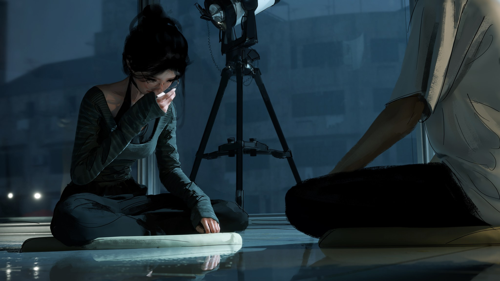

**ZH**: 月牙儿抿着嘴看着希扬，两人一时都没说话。忽然，几乎同时扑哧一声笑了出来。

**EN**: Mahina pressed her lips together and looked at Suvan. Neither spoke for a moment. Then, almost at once, they both burst out laughing.

**ZH**: “哎呀，我那时候哪知道嘛。” 月牙儿低下头，嘴角却还没收住， “一听是刘秀，我就……一激动，喊出来了。”

**EN**: “Oh, how was I supposed to know?”  Mahina lowered her head, still unable to quite suppress her smile.  “As soon as I heard he was Liu Xiu, I just… got excited and blurted it out.”

**ZH**: “他那时候还只是个种地的，连自己以后会当皇帝都不知道。你倒好，连谥号都替他安排上了。”

**EN**: “He was still just a farmer. He didn’t even know he’d become an emperor, and there you were, arranging his posthumous title for him.”

**ZH**: “你就别笑我了。” 月牙儿轻声埋怨着，却还捂着嘴，眉眼弯弯。

**EN**: “Stop laughing at me.”  Mahina’s complaint was soft, but her hand still covered her mouth, her eyes curved with laughter.

**ZH**: 希扬望着她，等她稍稍收住了笑，才接着说： “所以，那声‘汉光武帝’……”

**EN**: Suvan watched her, waiting for her laughter to subside a little before he went on:  “So, that cry of ‘Emperor Guangwu of Han’…”

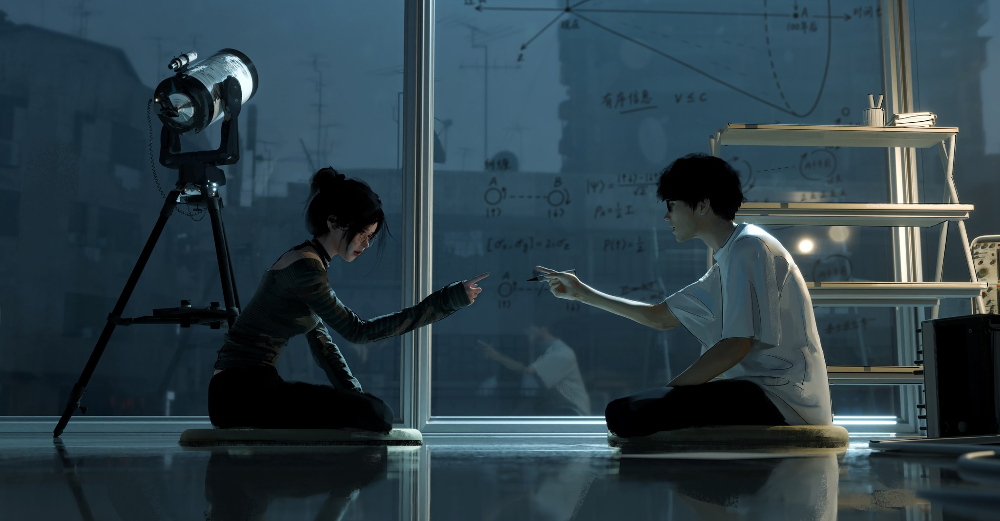

**ZH**: 话到这里，两人的目光恰好碰在一处，余下的半句几乎同时脱口而出：

**EN**: Their eyes happened to meet, and the rest slipped out almost in unison:

**ZH**: “——有序信息！”

**EN**: “—Ordered information!”

**ZH**: “——有序信息！”

**EN**: “—Ordered information!”

**ZH**: 两个声音叠在一起，月牙儿才收住的笑意便又漾了开来。希扬也跟着笑了，一时谁都没有急着往下说。

**EN**: As their voices overlapped, the smile Mahina had only just subdued spread across her face again. Suvan laughed too. For a while, neither was in any hurry to go on.

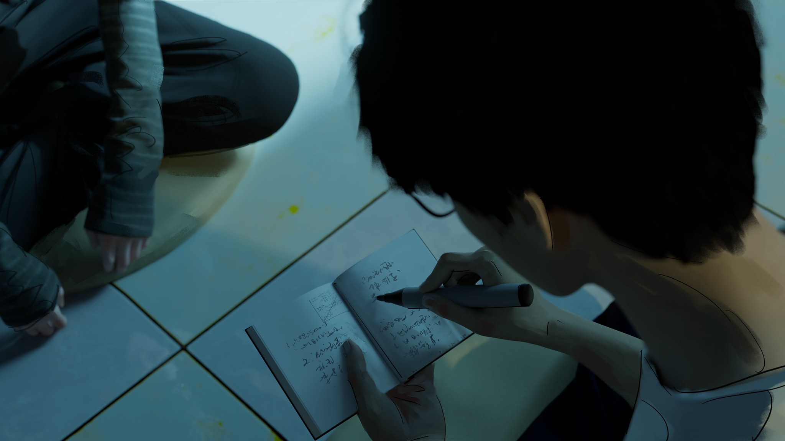

**ZH**: 希扬翻开手边的本子。刚才的笑声渐渐歇了，灯下响起细微的落笔声。

**EN**: Suvan opened the notebook beside him. Their laughter slowly faded, and under the lamplight came the faint sound of pen touching paper.

**ZH**: “所以，云中人散落在不同的年代。我们在这里，刘秀在两千年前。可在云中行走时，漫长的岁月也不再是无法跨越的阻隔。你们来到乌江，乘着同一条船，望着同一片江岸，看着项羽走完最后一程。”

**EN**: “So Cloud Dwellers are scattered across different eras. We’re here; Liu Xiu was two thousand years ago. But when you walk through the clouds, even all those years cease to be an impassable barrier. You came to the Wujiang, rode in the same boat, looked toward the same stretch of shore, and watched Xiang Yu take the last steps of his journey.”

**ZH**: 笔尖在纸上稍停。

**EN**: The pen paused briefly on the page.

**ZH**: “但相逢，并不意味着可以说破彼此的命运。刘秀本身毕竟也在你的光锥之外。‘汉光武帝’，是后人写进史书的名字，船上的刘秀却还没有走到那一页。你的那一声惊呼，会让他提前知道自己的未来。于是，你们两个人那次的云中行走，就在那里中断了。”

**EN**: “But meeting doesn’t mean you can reveal each other’s fate. Liu Xiu himself is outside your light cone, after all. ‘Emperor Guangwu of Han’ is a name later generations wrote into the histories. The Liu Xiu on that boat hadn’t reached that page yet. That cry of yours would have let him learn his own future before its time. So that was where your walk through the clouds ended—for both of you.”

**ZH**: 月牙儿抱着膝，安静地望着他。他把刚写下的一句话划去，在旁边重新补写。灯下，那段离奇的往事正被他一字一句，郑重地记在纸上。

**EN**: Mahina hugged her knees and watched him quietly. He crossed out a sentence he had just written and wrote it anew beside it. There beneath the lamp, he was carefully committing that strange passage of her past to paper, word by word.

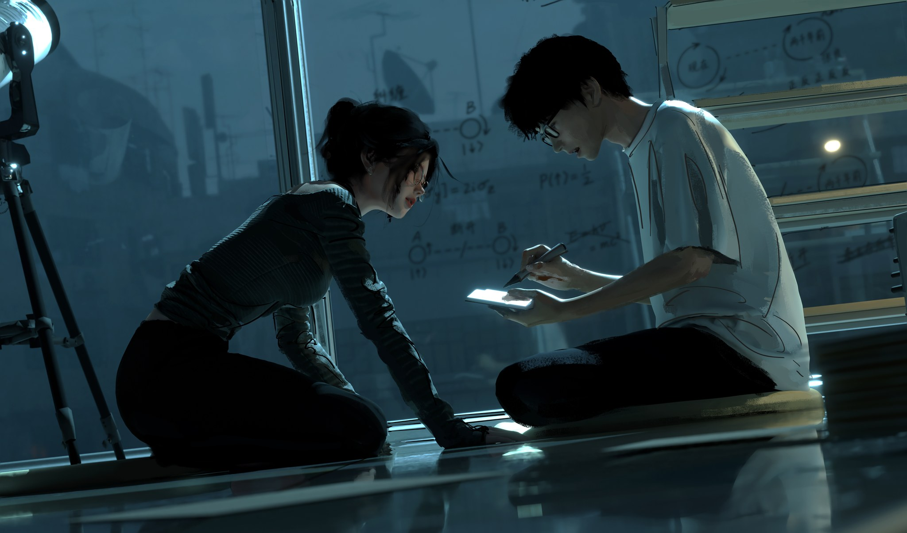

**ZH**: “哎。”

**EN**: “Hey.”

**ZH**: “嗯？”

**EN**: “Hm?”

**ZH**: “这么离谱的事，我说，你就信啊？”

**EN**: “Something this absurd, and you believe it just because I tell you?”

**ZH**: 月牙儿撑着手悄悄凑近，歪着头，仰起脸去寻他镜片后的目光。

**EN**: Bracing herself on her hands, Mahina edged closer. She tilted her head and lifted her face, seeking his eyes behind the lenses.

**ZH**: “不怕是我瞎编出来逗你的？”

**EN**: “Aren’t you worried I made it all up just to tease you?”

**ZH**: 希扬只弯了弯嘴角，笔下未停。

**EN**: Suvan only let the corners of his mouth lift a little. His pen did not stop.

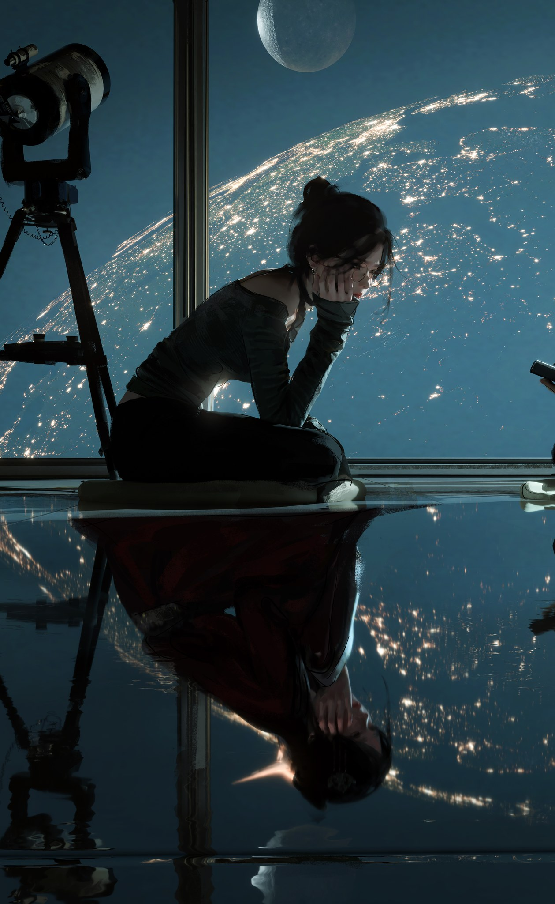

**ZH**: 月牙儿似乎还想说什么，话到嘴边却又咽下，便轻轻收回身子，坐了回去。

**EN**: Mahina seemed about to say something more, then swallowed the words. Gently, she drew back and settled into her place.

**ZH**: 城市的夜在云虫来临前显得格外安静。窗上的数学符号在银白的月光里，像一群无声跃动的精灵。她忽然有些恍惚，仿佛正坐在一片悬于虚空的湖面上，又像回到了两千年前，身在乌江的那条船上。

**EN**: The city’s night seemed especially quiet before the CloudInsects arrived. In the silver-white moonlight, the mathematical symbols on the window were like a gathering of spirits leaping without a sound. For a moment she felt unmoored, as though she were sitting on a lake suspended in empty space, or had returned to that boat on the Wujiang two thousand years before.

**ZH**: 记忆里父母无休止的争吵、同龄人的嘲讽与不解、酒吧里轻佻暧昧的目光——那些曾经与她有关的喧闹，在这一刻都遥远得像发生在前世。

**EN**: Her parents’ endless quarrels, the mockery and incomprehension of people her own age, the flippant, suggestive looks in bars—all the noise that had once belonged to her life now seemed as distant as something from a previous existence.

**ZH**: 身旁只有笔尖划过纸面的沙沙声。月牙托着腮，安静地看着希扬手中的那支笔，一点一点放缓自己的呼吸。她只希望这一刻能停留得再久一点，盼着他面前的那一页纸，永远也写不完。

**EN**: Beside her there was only the soft scratch of the pen across the paper. Mahina rested her chin on her hand and quietly watched the pen in Suvan’s fingers, letting her breathing slow little by little. She only wished this moment could last a little longer, that the page before him might never be filled.

**ZH**: 夜更深了。远处九号云虫的虫鸣隐隐传来，低沉而又绵长，和两千年前乌江边的那一声慢慢地叠在了一起。

**EN**: The night deepened. Far away, the faint cry of CloudInsect No. 9 sounded, low and long, slowly merging with that other cry on the banks of the Wujiang two thousand years before.

**ZH**: 《史记·项羽本纪》 — 司马迁

**EN**: Records of the Grand Historian, “The Basic Annals of Xiang Yu” — Sima Qian

**ZH**: 于是项王乃欲东渡乌江。乌江亭长檥船待，谓项王曰：“江东虽小，地方千里，众数十万人，亦足王也。愿大王急渡。今独臣有船，汉军至，无以渡。”项王笑曰：“天之亡我，我何渡为！且籍与江东子弟八千人渡江而西，今无一人还，纵江东父兄怜而王我，我何面目见之？纵彼不言，籍独不愧于心乎？”乃谓亭长曰：“吾知公长者。吾骑此马五岁，所当无敌，尝一日行千里，不忍杀之，以赐公。”

**EN**: Then King Xiang wished to cross the Wujiang eastward. The headman of Wujiang had moored a boat and was waiting. He said to King Xiang, “Though the land east of the river is small, it extends a thousand li and has several hundred thousand people. It is enough for you to rule as king. I beg Your Majesty to cross at once. Only I have a boat here. When the Han army arrives, they will have no means to cross.” King Xiang laughed and said, “Heaven is destroying me. Why should I cross? I crossed the river westward with eight thousand sons of the land east of the river, and now not one has returned. Even if their fathers and brothers took pity on me and made me king, how could I face them? Even if they said nothing, would I not feel shame in my own heart?” Then he said to the headman, “I know you are an honorable man. I have ridden this horse for five years, and none who stood against him could prevail. Once he traveled a thousand li in a single day. I cannot bear to kill him, and so I give him to you.”

**ZH**: ……乃自刎而死。王翳取其头，余骑相蹂践争项王，相杀者数十人。最其后，郎中骑杨喜、骑司马吕马童、郎中吕胜、杨武各得其一体。五人共会其体，皆赐爵列侯。

**EN**: …Then he cut his own throat and died. Wang Yi took his head. The other horsemen trampled one another in their struggle for King Xiang’s body, and dozens killed one another. At last, the palace cavalryman Yang Xi, the cavalry commander Lü Matong, and the palace attendants Lü Sheng and Yang Wu each obtained a part of his body. The five men brought the parts together, and all were granted the rank of marquis.

**ZH**: 项羽（前232年—前202年）

**EN**: Xiang Yu (232–202 BCE)

**ZH**: 名籍，字羽，下相人。秦末随叔父项梁起兵，巨鹿一战破釜沉舟，歼灭秦军主力，分封天下，自号西楚霸王。楚汉相争五年，垓下被围，四面楚歌，率残骑突围至乌江，不肯过江，自刎而死，年三十。太史公论曰：“位虽不终，近古以来未尝有也。”

**EN**: Given name Ji, courtesy name Yu; a native of Xiaxiang. At the end of the Qin dynasty, he joined his uncle Xiang Liang in rebellion. At the Battle of Julu, he broke his cooking pots and sank his boats, destroying the main force of the Qin army. He divided the realm into fiefs and proclaimed himself Hegemon-King of Western Chu. After five years of war between Chu and Han, he was surrounded at Gaixia, with songs of Chu rising on every side. Leading his remaining horsemen, he broke out and reached the Wujiang. Refusing to cross, he cut his own throat and died at thirty. The Grand Historian wrote: “Though his rule did not endure, nothing like it had been seen since antiquity.”

**ZH**: 刘秀（前5年—57年）

**EN**: Liu Xiu (5 BCE–57 CE)

**ZH**: 字文叔，南阳蔡阳人，汉高祖九世孙。王莽篡汉，家道中落，微时躬耕于田亩，史称“性勤于稼穑”。后于乱世起兵，昆阳之战以数千敢死之士破新莽四十二万大军，扫平群雄，重建汉室，定都洛阳，史称东汉。在位三十三年，轻徭薄赋，息兵养民，后世谓之“光武中兴”。谥光武皇帝，庙号世祖。

**EN**: Courtesy name Wenshu; a native of Caiyang in Nanyang and a ninth-generation descendant of Emperor Gaozu of Han. After Wang Mang usurped the Han throne, his family’s fortunes declined. In his humble early years he worked the fields himself; the histories record that he was “by nature diligent in farming.” He later raised an army amid the turmoil. At the Battle of Kunyang, a few thousand men prepared to fight to the death defeated the 420,000-strong army of Wang Mang’s Xin dynasty. He subdued the rival warlords, restored the Han dynasty, and established his capital at Luoyang. His dynasty is known to history as the Eastern Han. During his thirty-three-year reign, he reduced labor levies and taxes, ended warfare, and allowed the people to recover. Later generations called this the “Guangwu Restoration.” His posthumous title was Emperor Guangwu; his temple name, Shizu.

