# CloudInsect - Chapter 5: Wuzhui · Part 2

*Original Title: 第五章 乌骓 · 二*

---

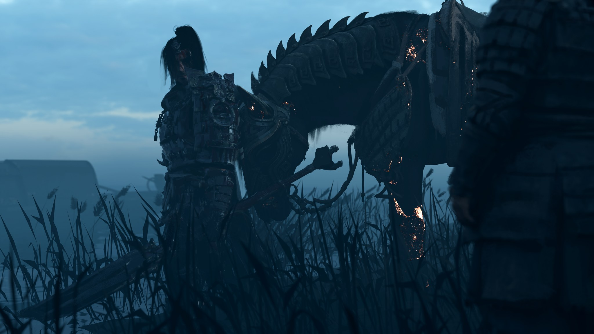

> Suddenly, a horse neighed.

> At some point the black horse had drawn close. It pressed its head against Xiang Yu’s back and nuzzled him gently, its voice carrying a reluctance to part that no words could name. In the fog, tiny lights shimmered through its coat, kindling and fading like a field of stars.

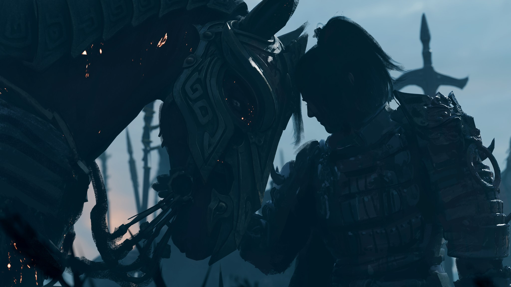

> Xiang Yu turned and gently stroked his warhorse, resting his forehead against its own, as though to soothe it, or to say goodbye. Only after a while did he turn toward the bow and speak:  “This horse is called Wuzhui. He has followed me through years of war. I cannot bear to let him die here with me. If you would do one last thing for me, treat him well.”

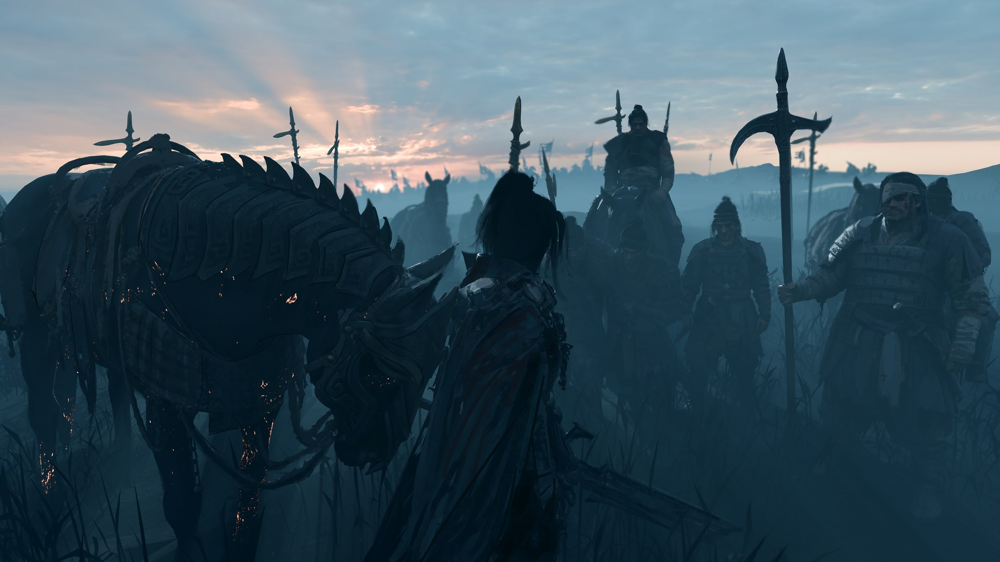

> With that, he turned to face his soldiers.

> “You should go too. The Han army wants only my head. Follow the river while the fog still holds. No one will pursue you.”

> As he spoke, he passed through the men behind him and walked alone toward the cries of battle coming through the fog.

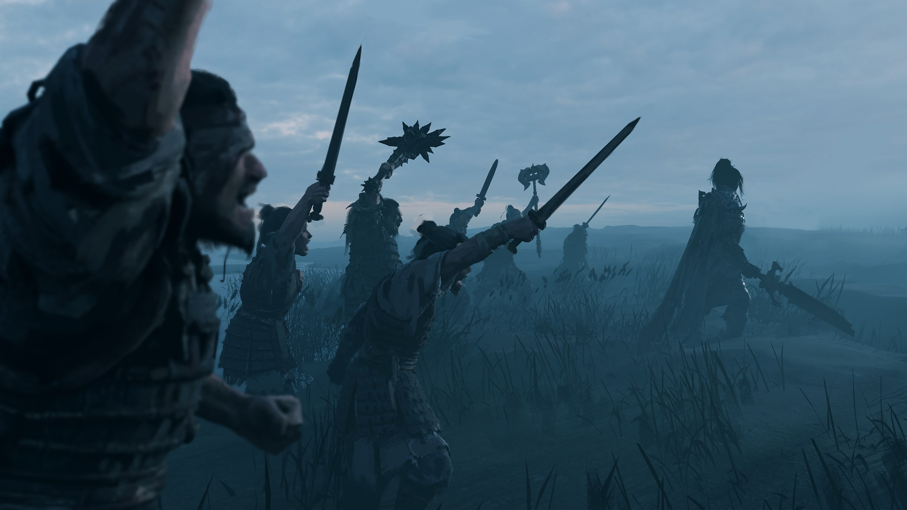

> No one left.

> The twenty-odd men dismounted or drew their short blades. Silently they followed, forming a line behind Xiang Yu. Someone shouted first; then they were all shouting:

> “We follow King Xiang to the death!”

> “We follow King Xiang to the death—!”

> Their cries struck the thick fog, startling waterbirds into flight all along the shore.

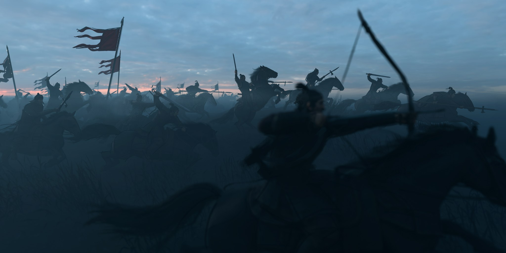

> The Han army had arrived.

> Cavalry poured out of the fog, sweeping toward them like a gale. In an instant they were almost upon them.

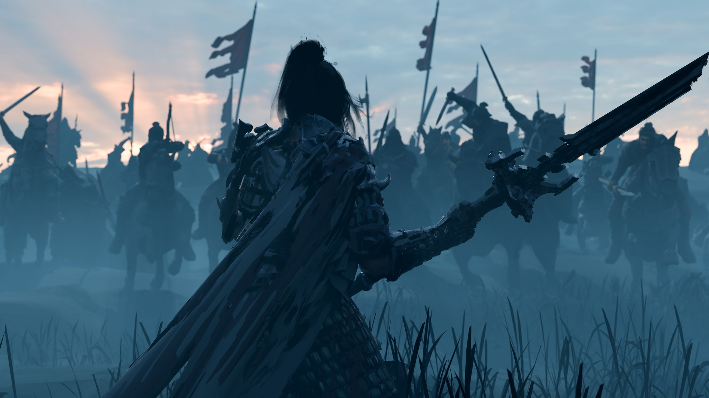

> Xiang Yu slowly raised the great broken blade in his hand and walked with steady steps to meet the oncoming Han army. Step by step, he entered the final chapter of his own story.

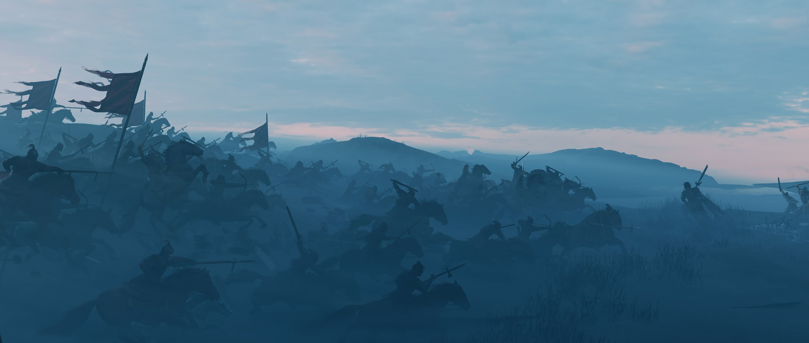

> The Han army broke over the shore like a black tide through a breached embankment. Those twenty-odd figures stood within it for a moment, then were swallowed.

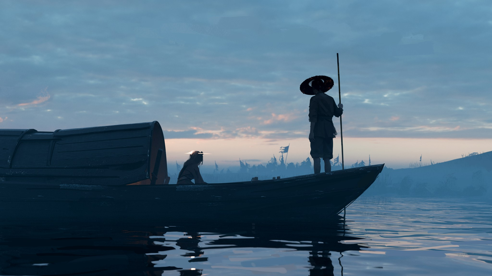

> The sound of blades meeting was nothing like the clear, ringing clash Mahina had imagined. Dull impacts mingled with hoarse howls, bloody and brutal. After a while, the cries on shore began to change: into a scramble, into a frenzy of celebration. The wind carried their voices across the river in gusts:

> “Here! This piece is mine—!”

> “Give me a piece!”

> Mahina turned her head away. She could not bear to watch.

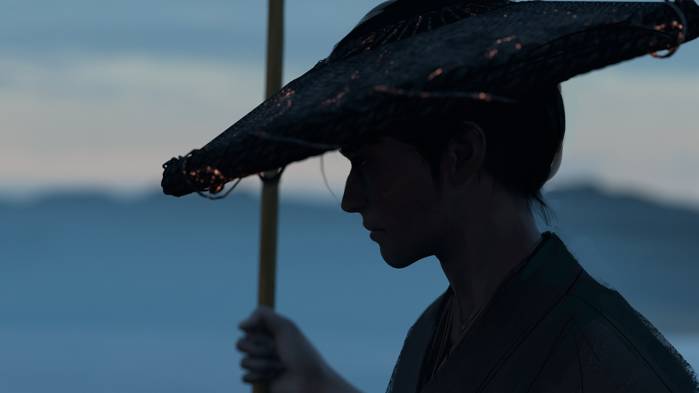

> The young man still stood there, his face calm, gazing at the shore without moving.

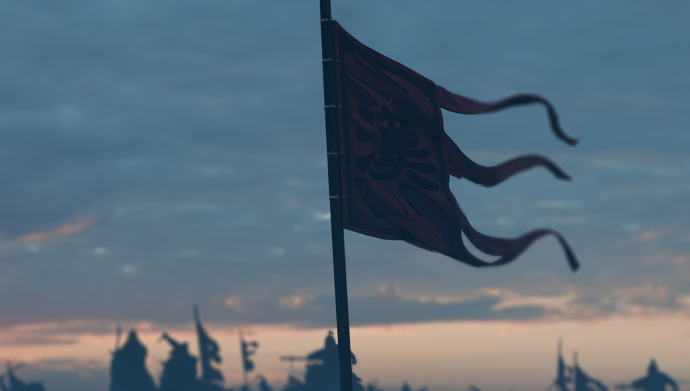

> Following his gaze, Mahina realized that he was watching not the chaos, but the great banner bearing the character for Han as it rose and fell in the fog. He watched for a long, long time.

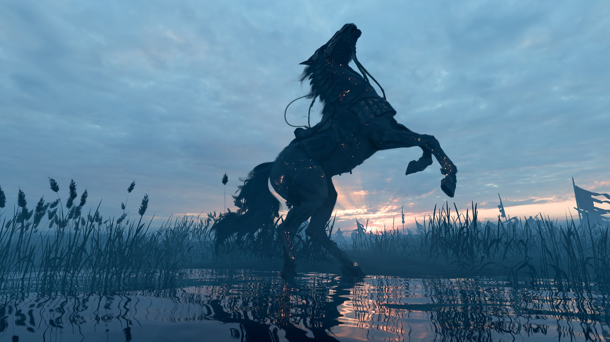

> Wuzhui was still on the shore.

> He had not boarded the boat, and would not leave. He only reared toward the place where his master had vanished, neighing again and again, lingering there. Beyond the fog, the immense shadow on the horizon suddenly gave a low insect cry, like a long sigh, falling precisely into the silence between the horse’s calls.

> A horse’s neigh. An insect’s cry. A call, an answer.

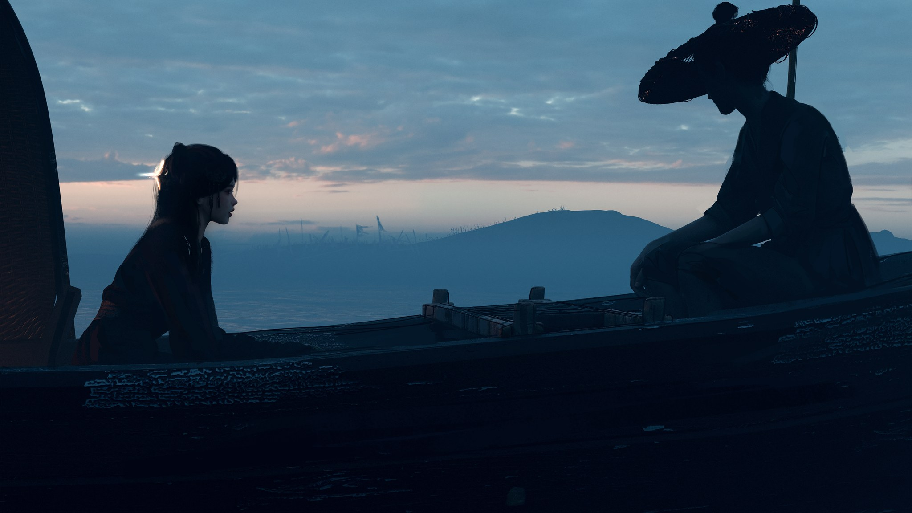

> The sky was growing light, and the fog over the river slowly thinned. The young boatman sat at the bow, as still as a statue.

> “…What’s your name?”  Mahina asked softly, as if she wanted only to break the silence on the boat.

> The young man did not answer. Still watching the Han banner, he spoke as if to himself, or as if asking her:

> “If Heaven’s will cannot be defied, why does fate lead us here to glimpse fate itself?”

> Only after a long while did he turn. Seeing her bewildered face, he suddenly gave a faint smile.

> “It seems this is your first walk through the clouds.”

> He sighed.

> “I am only a common man myself. A farmer in a time of turmoil, after the fall of the Han. I do not know why I, of all people, should have the honor of coming as a Cloud Dweller to the banks of the Wujiang, to see the Hegemon-King of Chu.”

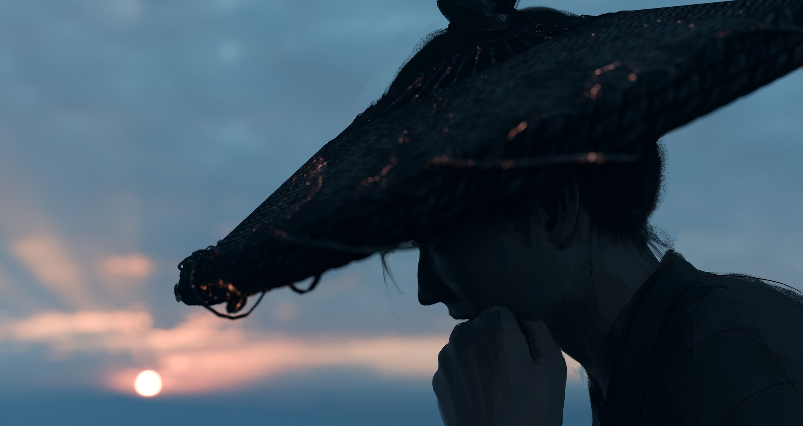

> “My family name is Liu, my given name Xiu. My courtesy name is Wenshu.”

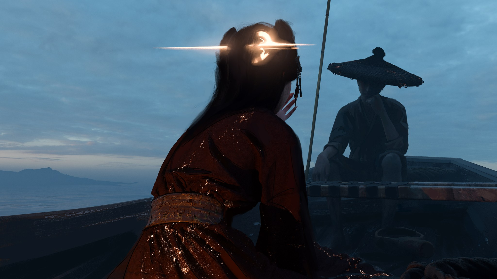

> “Liu Xiu?!”  Mahina exclaimed, startled.  “Guangwu of Han—!”

> The instant her voice rose, the world went black.

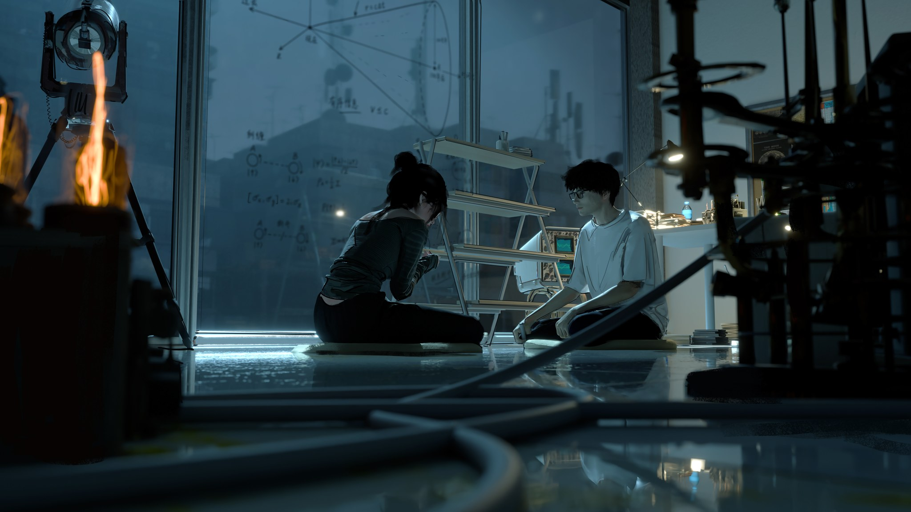

> “—And then everything went black.”

> Night lay quiet in the industrial building. The little lamp cast a dim yellow light. On the window, Suvan’s sketches of light cones gleamed strangely in the moonlight, as though they had come alive.

> “When I came to,”  Mahina said,  “I was still slumped over the observation platform, still holding my camera. The sky was just a little darker. It was as if I’d never left.”

> She paused.

> “At the time, I didn’t remember anything. I just thought I’d blanked out for a while. Even when a little of it came back later, I kept putting it down to hallucinations from lack of oxygen. It wasn’t until today, when you talked about light cones and ordered information, that I finally pieced it all together.”

> Suvan was silent for a moment, then nodded.

> “So you shouted Liu Xiu’s posthumous title right in front of him.”

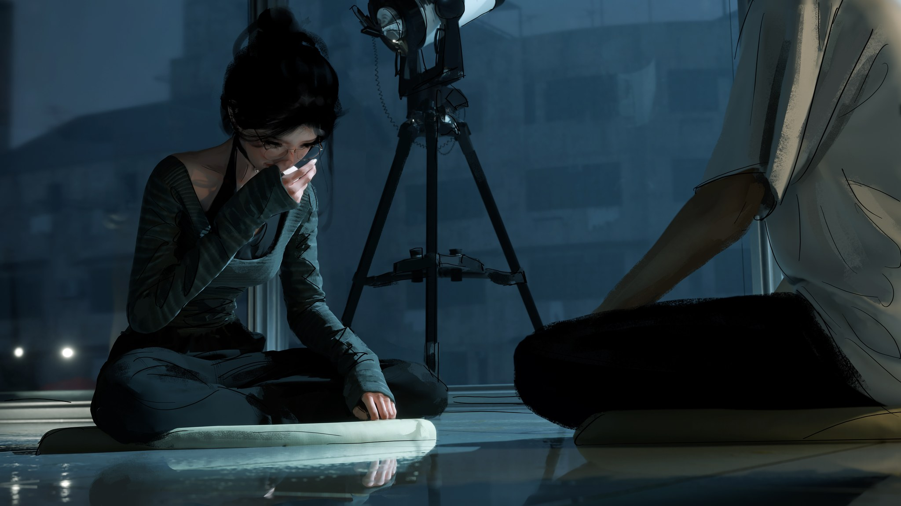

> Mahina pressed her lips together and looked at Suvan. Neither spoke for a moment. Then, almost at once, they both burst out laughing.

> “Oh, how was I supposed to know?”  Mahina lowered her head, still unable to quite suppress her smile.  “As soon as I heard he was Liu Xiu, I just… got excited and blurted it out.”

> “He was still just a farmer. He didn’t even know he’d become an emperor, and there you were, arranging his posthumous title for him.”

> “Stop laughing at me.”  Mahina’s complaint was soft, but her hand still covered her mouth, her eyes curved with laughter.

> Suvan watched her, waiting for her laughter to subside a little before he went on:  “So, that cry of ‘Emperor Guangwu of Han’…”

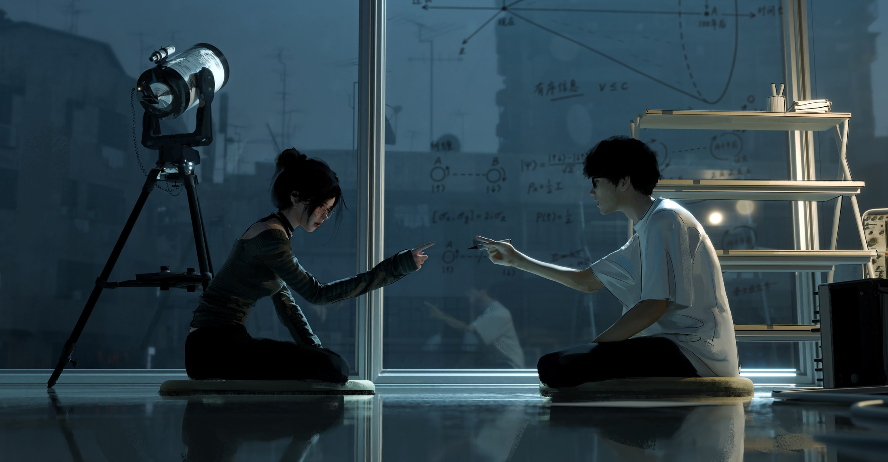

> Their eyes happened to meet, and the rest slipped out almost in unison:

> “—Ordered information!”

> “—Ordered information!”

> As their voices overlapped, the smile Mahina had only just subdued spread across her face again. Suvan laughed too. For a while, neither was in any hurry to go on.

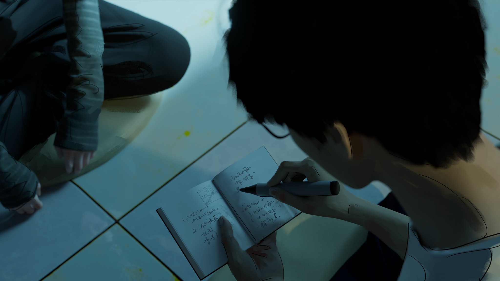

> Suvan opened the notebook beside him. Their laughter slowly faded, and under the lamplight came the faint sound of pen touching paper.

> “So Cloud Dwellers are scattered across different eras. We’re here; Liu Xiu was two thousand years ago. But when you walk through the clouds, even all those years cease to be an impassable barrier. You came to the Wujiang, rode in the same boat, looked toward the same stretch of shore, and watched Xiang Yu take the last steps of his journey.”

> The pen paused briefly on the page.

> “But meeting doesn’t mean you can reveal each other’s fate. Liu Xiu himself is outside your light cone, after all. ‘Emperor Guangwu of Han’ is a name later generations wrote into the histories. The Liu Xiu on that boat hadn’t reached that page yet. That cry of yours would have let him learn his own future before its time. So that was where your walk through the clouds ended—for both of you.”

> Mahina hugged her knees and watched him quietly. He crossed out a sentence he had just written and wrote it anew beside it. There beneath the lamp, he was carefully committing that strange passage of her past to paper, word by word.

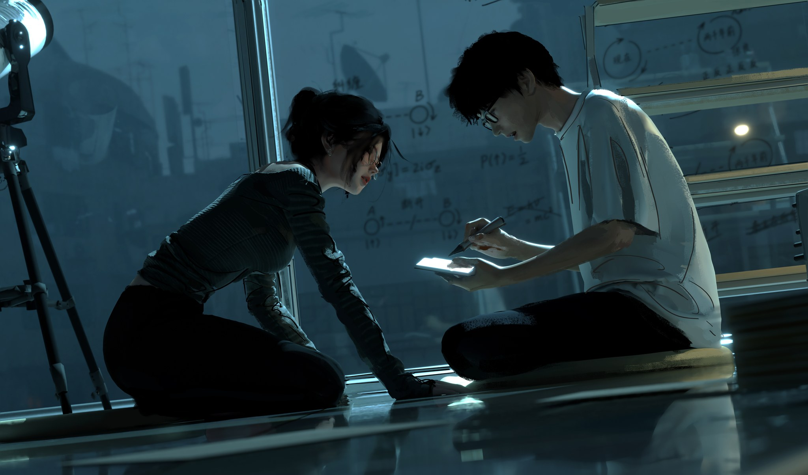

> “Hey.”

> “Hm?”

> “Something this absurd, and you believe it just because I tell you?”

> Bracing herself on her hands, Mahina edged closer. She tilted her head and lifted her face, seeking his eyes behind the lenses.

> “Aren’t you worried I made it all up just to tease you?”

> Suvan only let the corners of his mouth lift a little. His pen did not stop.

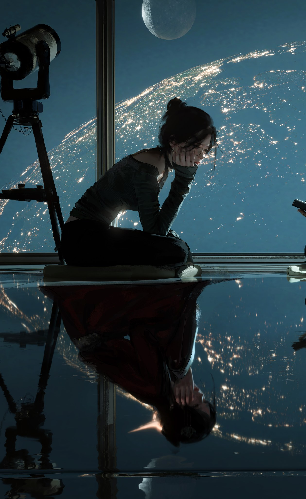

> Mahina seemed about to say something more, then swallowed the words. Gently, she drew back and settled into her place.

> The city’s night seemed especially quiet before the CloudInsects arrived. In the silver-white moonlight, the mathematical symbols on the window were like a gathering of spirits leaping without a sound. For a moment she felt unmoored, as though she were sitting on a lake suspended in empty space, or had returned to that boat on the Wujiang two thousand years before.

> Her parents’ endless quarrels, the mockery and incomprehension of people her own age, the flippant, suggestive looks in bars—all the noise that had once belonged to her life now seemed as distant as something from a previous existence.

> Beside her there was only the soft scratch of the pen across the paper. Mahina rested her chin on her hand and quietly watched the pen in Suvan’s fingers, letting her breathing slow little by little. She only wished this moment could last a little longer, that the page before him might never be filled.

> The night deepened. Far away, the faint cry of CloudInsect No. 9 sounded, low and long, slowly merging with that other cry on the banks of the Wujiang two thousand years before.

> Records of the Grand Historian, “The Basic Annals of Xiang Yu” — Sima Qian

> Then King Xiang wished to cross the Wujiang eastward. The headman of Wujiang had moored a boat and was waiting. He said to King Xiang, “Though the land east of the river is small, it extends a thousand li and has several hundred thousand people. It is enough for you to rule as king. I beg Your Majesty to cross at once. Only I have a boat here. When the Han army arrives, they will have no means to cross.” King Xiang laughed and said, “Heaven is destroying me. Why should I cross? I crossed the river westward with eight thousand sons of the land east of the river, and now not one has returned. Even if their fathers and brothers took pity on me and made me king, how could I face them? Even if they said nothing, would I not feel shame in my own heart?” Then he said to the headman, “I know you are an honorable man. I have ridden this horse for five years, and none who stood against him could prevail. Once he traveled a thousand li in a single day. I cannot bear to kill him, and so I give him to you.”

> …Then he cut his own throat and died. Wang Yi took his head. The other horsemen trampled one another in their struggle for King Xiang’s body, and dozens killed one another. At last, the palace cavalryman Yang Xi, the cavalry commander Lü Matong, and the palace attendants Lü Sheng and Yang Wu each obtained a part of his body. The five men brought the parts together, and all were granted the rank of marquis.

> Xiang Yu (232–202 BCE)

> Given name Ji, courtesy name Yu; a native of Xiaxiang. At the end of the Qin dynasty, he joined his uncle Xiang Liang in rebellion. At the Battle of Julu, he broke his cooking pots and sank his boats, destroying the main force of the Qin army. He divided the realm into fiefs and proclaimed himself Hegemon-King of Western Chu. After five years of war between Chu and Han, he was surrounded at Gaixia, with songs of Chu rising on every side. Leading his remaining horsemen, he broke out and reached the Wujiang. Refusing to cross, he cut his own throat and died at thirty. The Grand Historian wrote: “Though his rule did not endure, nothing like it had been seen since antiquity.”

> Liu Xiu (5 BCE–57 CE)

> Courtesy name Wenshu; a native of Caiyang in Nanyang and a ninth-generation descendant of Emperor Gaozu of Han. After Wang Mang usurped the Han throne, his family’s fortunes declined. In his humble early years he worked the fields himself; the histories record that he was “by nature diligent in farming.” He later raised an army amid the turmoil. At the Battle of Kunyang, a few thousand men prepared to fight to the death defeated the 420,000-strong army of Wang Mang’s Xin dynasty. He subdued the rival warlords, restored the Han dynasty, and established his capital at Luoyang. His dynasty is known to history as the Eastern Han. During his thirty-three-year reign, he reduced labor levies and taxes, ended warfare, and allowed the people to recover. Later generations called this the “Guangwu Restoration.” His posthumous title was Emperor Guangwu; his temple name, Shizu.

