# Vân Trùng - Chương 5: Ô Chuy · II

---

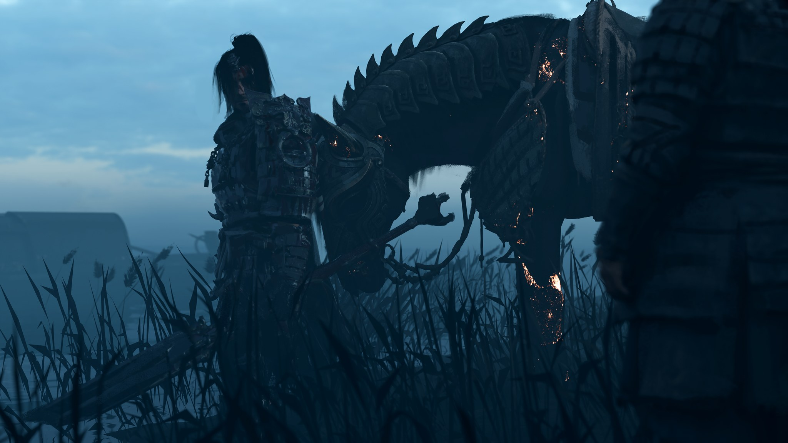

* **Lời thoại / Nội dung phát ra:**
  > *(Bất chợt, một tiếng ngựa hí xé toang không gian.)*
  > 
  > *(Con chiến mã đen nhánh chẳng biết tự khi nào đã tiến lại gần. Nó áp đầu vào lưng Hạng Vũ, khẽ cọ xát, trong tiếng hí ngân vang ẩn chứa một nỗi lưu luyến khôn cùng chẳng thốt nên lời. Giữa làn sương mờ mịt, lớp lông trên mình nó ánh lên từng đốm sáng li ti, lúc tỏ lúc mờ, tựa hồ cả một dải ngân hà rực rỡ.)*

---

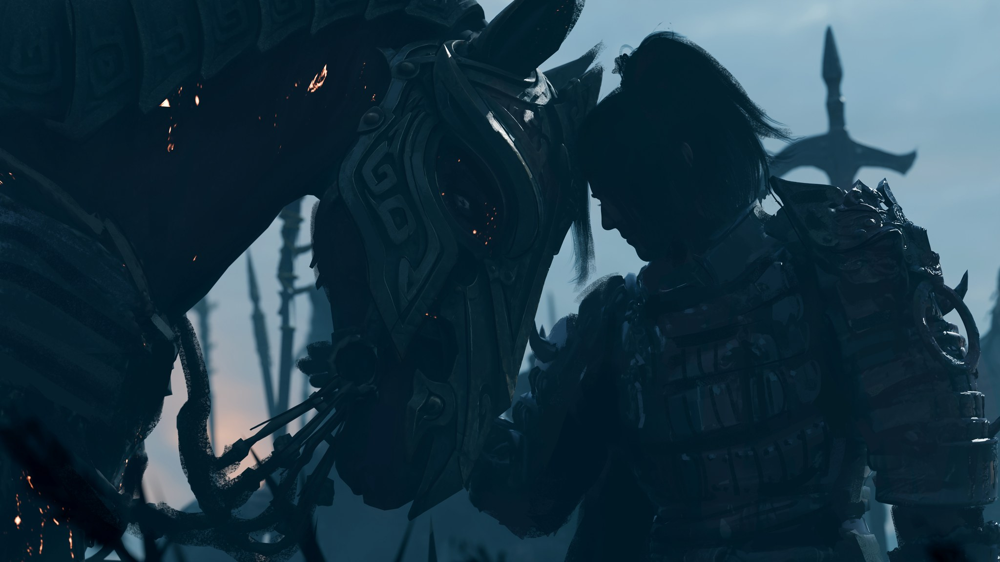

* **Lời thoại / Nội dung phát ra:**
  > *(Hạng Vũ ngoảnh đầu lại, dịu dàng vuốt ve con chiến mã của mình. Chàng áp trán vào trán nó, tựa như đang vỗ về ủi an, lại dường như đang nói lời vĩnh biệt. Lặng đi một thoáng, chàng mới quay về phía mũi thuyền, cất tiếng:)*
  > 
  > **[Hạng Vũ]** "Con ngựa này tên là Ô Chuy, theo ta chinh chiến sa trường đã bấy nhiêu năm. Ta không nỡ để nó cùng vùi thây nơi đây. Nếu các ngươi còn niệm tình muốn vì ta làm một việc sau cuối, xin hãy đối đãi tử tế với nó."

---

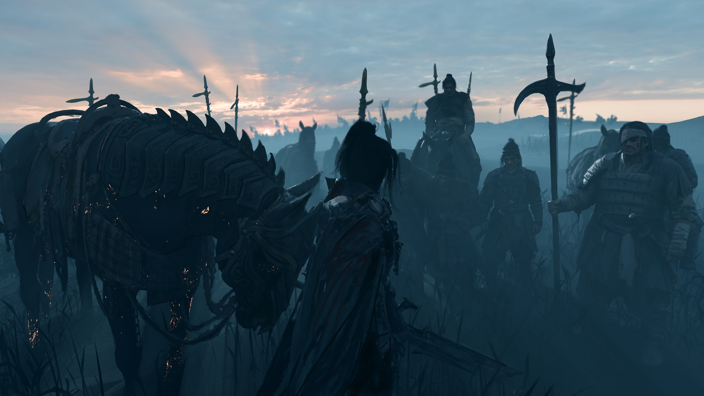

* **Lời thoại / Nội dung phát ra:**
  > *(Dứt lời, chàng quay người đối diện với những tướng sĩ còn lại của mình.)*
  > 
  > **[Hạng Vũ]** "Các ngươi cũng đi đi. Quân Hán muốn, cũng chỉ là cái đầu của một mình Hạng Tịch này mà thôi. Thừa lúc sương chưa tan, hãy men theo bờ sông mà rút lui, sẽ không có ai đuổi theo đâu."
  > 
  > *(Vừa dứt lời, chàng sải bước xuyên qua hàng quân phía sau lưng, một mình tiến thẳng về phía tiếng hò reo chém giết đang rền vang trong sương mù.)*

---

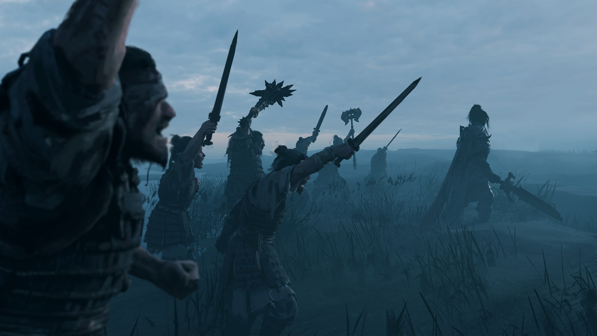

* **Lời thoại / Nội dung phát ra:**
  > *(Tuyệt nhiên không một ai rời đi.)*
  > 
  > *(Hơn hai mươi dũng sĩ, kẻ tung mình xuống ngựa, người rút đoản đao sắc lẹm. Họ lặng lẽ theo sau, dàn thành một hàng dài sau lưng Hạng Vũ. Chẳng rõ là ai đã cất tiếng hô trước tiên, nhưng rồi ngay sau đó, tất cả đồng thanh gầm thét:)*
  > 
  > **[Tướng sĩ quân Sở]** "Thề chết đi theo Hạng Vương!"
  > 
  > **[Tướng sĩ quân Sở]** "Thề chết đi theo Hạng Vương——!"
  > 
  > *(Tiếng thét dội thẳng vào màn sương dày đặc, làm kinh động bầy chim nước bay túa lên rợp cả bãi bồi.)*

---

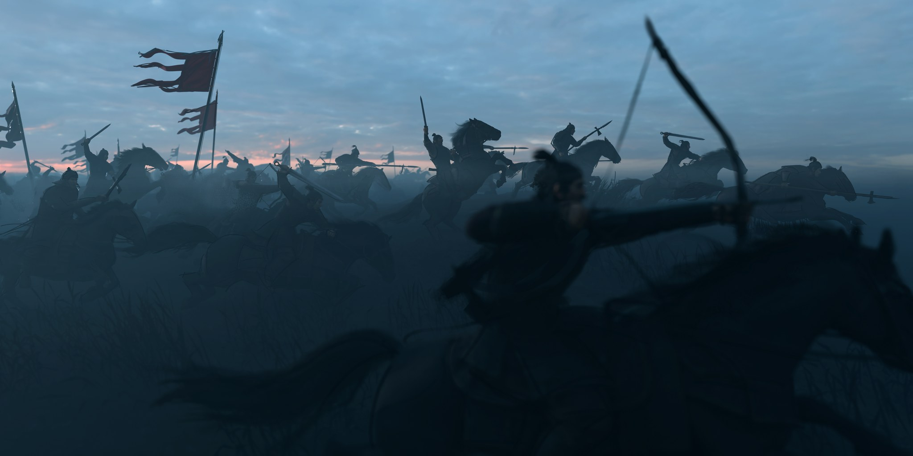

* **Lời thoại / Nội dung phát ra:**
  > *(Quân Hán đã ập tới.)*
  > 
  > *(Kỵ binh xé toạc màn sương ào ạt tràn ra, tựa như cuồng phong bão táp quét ngang trời đất, chỉ trong chớp mắt đã áp sát ngay trước mặt.)*

---

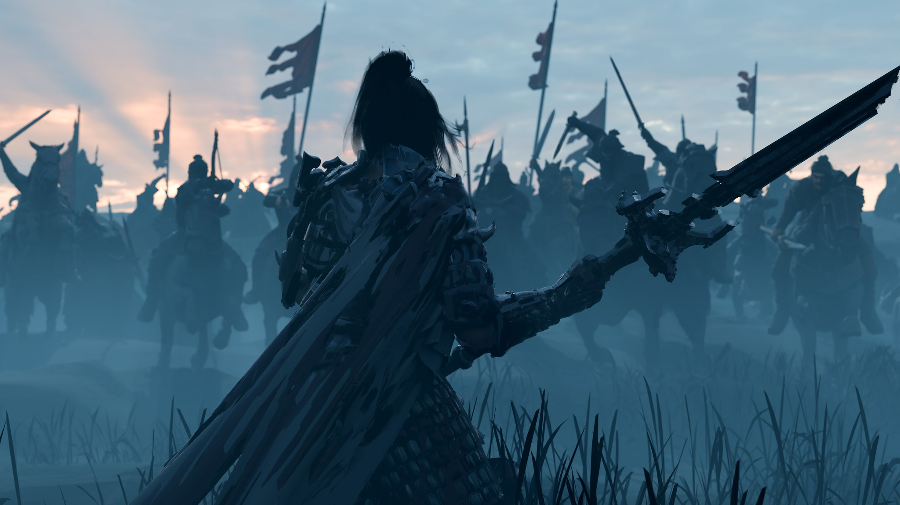

* **Lời thoại / Nội dung phát ra:**
  > *(Hạng Vũ chậm rãi nâng thanh cự đao gãy nát trong tay lên, cất từng bước chân vững chãi như núi thái sơn, nghênh đón đại quân Hán đang cuồn cuộn ùa tới. Từng bước, từng bước một, chàng ung dung bước vào chương cuối cùng của thiên anh hùng ca đời mình.)*

---

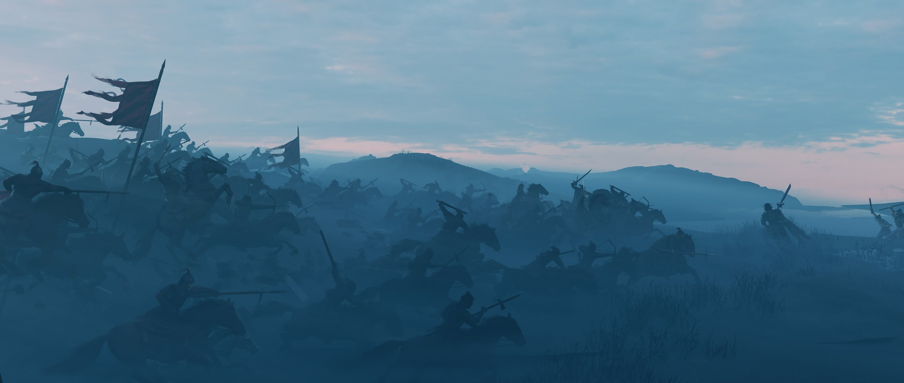

* **Lời thoại / Nội dung phát ra:**
  > *(Quân Hán tựa như một cơn thủy triều đen ngòm vỡ đê, trong chớp mắt đã tràn ngập bãi bồi ven sông. Hơn hai mươi bóng hình cô độc ấy sừng sững giữa triều dâng trong thoáng chốc, rồi vĩnh viễn bị nhấn chìm.)*

---

* **Lời thoại / Nội dung phát ra:**
  > *(Âm thanh của đao kiếm chạm nhau nơi giáp trận cận chiến chẳng hề vang rền đanh thép như Nguyệt Nha Nhi từng tưởng tượng. Chỉ có những tiếng va đập trầm đục lẫn trong tiếng gầm rú khản đặc, tanh nồng mùi máu và tàn khốc khôn cùng. Lát sau, tiếng chém giết trên bờ dần dần biến sắc, chuyển thành cảnh tranh giành xâu xé, biến thành một bữa tiệc cuồng hoan man rợ. Gió cuốn từng đợt thanh âm hỗn loạn ấy thốc qua mặt sông:)*
  > 
  > **[Binh lính quân Hán]** "Ở đây! Mảnh này là của tao——!"
  > 
  > **[Binh lính quân Hán]** "Chia cho tao một phần!"
  > 
  > *(Nguyệt Nha Nhi quay mặt đi nơi khác, không nỡ và cũng không thể đành lòng nhìn tiếp.)*

---

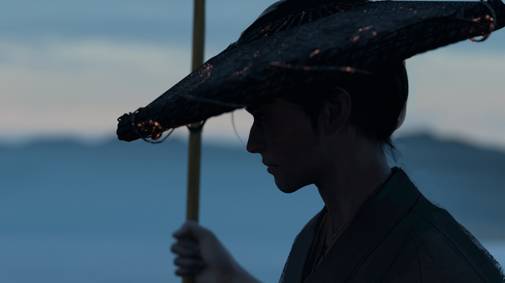

* **Lời thoại / Nội dung phát ra:**
  > *(Chàng thanh niên lái đò vẫn đứng yên nơi mũi thuyền, sắc mặt phẳng lặng như tờ, đăm đăm nhìn về phía bờ bên kia mà chẳng hề lay động.)*

---

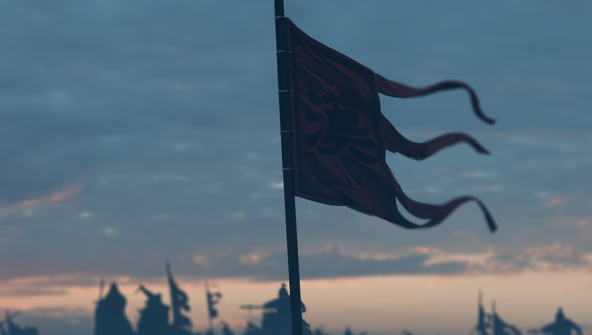

* **Chữ trong ảnh:** Chữ trên lá đại kỳ quân đội tung bay giữa sương mù: **"HÁN"** (漢).
* **Lời thoại / Nội dung phát ra:**
  > *(Dõi theo ánh mắt chàng, Nguyệt Nha Nhi mới nhận ra thứ mà chàng đang nhìn chằm chằm không phải là cảnh hỗn chiến tàn khốc kia, mà là đại kỳ mang chữ "HÁN" đang nhấp nhô lay động giữa màn sương. Chàng đứng nhìn lá cờ ấy rất lâu, rất lâu.)*

---

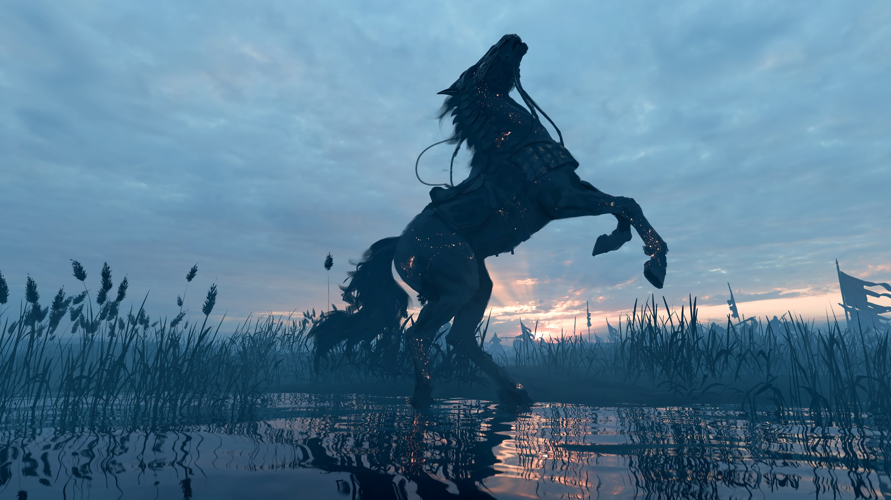

* **Lời thoại / Nội dung phát ra:**
  > *(Nơi bãi bồi ven sông, Ô Chuy vẫn còn ở đó.)*
  > 
  > *(Nó không hề bước lên thuyền, cũng chẳng chịu rời đi, chỉ ngẩng cao hai vó trước hướng về nơi chủ nhân vừa ngã xuống, cất lên từng hồi hí dài thảm thiết, quẩn quanh mãi chẳng dứt. Nơi tận cùng của làn sương, bóng đen khổng lồ nơi chân trời bỗng nhiên phát ra một tiếng trùng minh trầm đục, tựa như một tiếng thở dài trầm lắng miên man, rơi trúng vào khoảng lặng giữa những tiếng ngựa hí.)*
  > 
  > *(Một tiếng ngựa hí, một tiếng trùng minh. Một tiếng thảng thốt, một lời đáp hồi.)*

---

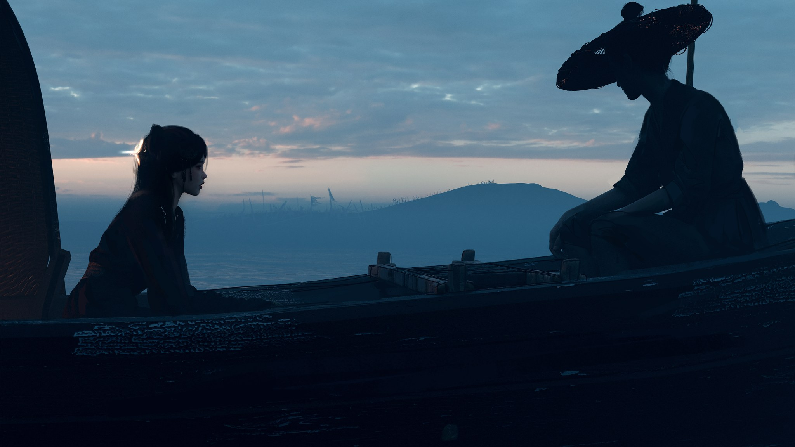

* **Lời thoại / Nội dung phát ra:**
  > *(Trời rạng sáng dần, màn sương trên mặt sông cũng từ từ tan biến. Chàng phu đò trẻ tuổi ngồi nơi mũi thuyền, tĩnh lặng tựa như một pho tượng tạc.)*
  > 
  > **[Nguyệt Nha Nhi khẽ hỏi]** "……Anh tên là gì thế?"
  > 
  > *(Cô hỏi rất khẽ, dường như chỉ cốt để phá tan bầu không khí tĩnh mịch ngột ngạt trên con thuyền. Chàng thanh niên không đáp ngay. Chàng vẫn nhìn chằm chằm vào lá cờ Hán phía xa, cất lời như đang tự nhủ với chính mình, lại dường như đang hỏi cô:)*
  > 
  > **[Chàng phu đò]** "Nếu đã là ý trời không thể trái, cớ sao định mệnh lại dẫn dắt chúng ta đến đây để dòm ngó định mệnh?"
  > 
  > *(Mãi một lúc lâu sau, chàng mới ngoảnh đầu lại. Thấy vẻ mặt ngơ ngác đầy mờ mịt của cô, chàng bỗng nở một nụ cười nhàn nhạt:)*
  > 
  > **[Chàng phu đò]** "Xem ra, đây là lần đầu tiên cô nương hành tẩu giữa những tầng mây."
  > 
  > *(Chàng thở dài một tiếng:)*
  > 
  > **[Chàng phu đò]** "Ta cũng chỉ là một kẻ thảo dân áo vải. Sau khi giang sơn nhà Hán sụp đổ, ta cũng chỉ là một gã nông phu cày cấy giữa thời loạn lạc mà thôi. Chẳng rõ vì sao lại có được vinh hạnh này, có thể mang thân phận Người Trong Mây, đến tận bến Ô Giang này để được tận mắt trông thấy Tây Sở Bá Vương."

---

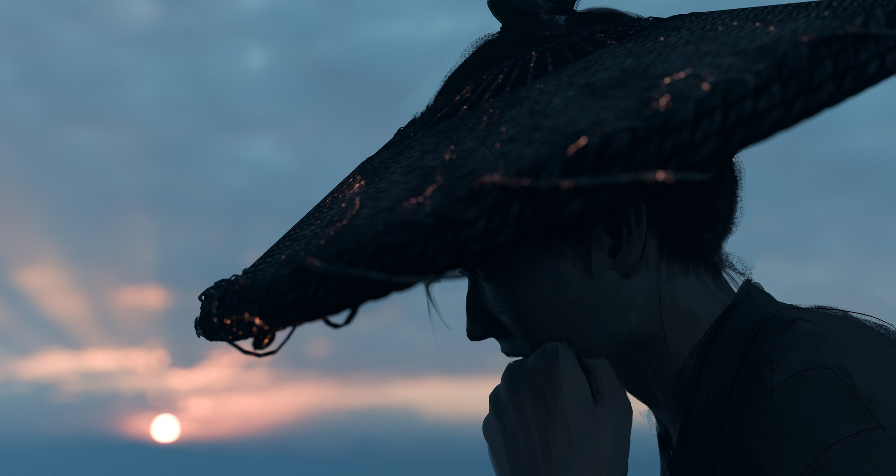

* **Chữ trong ảnh:** *(Thẻ nhân vật lịch sử tương tác đính kèm trên ảnh)*
  * **Hán Quang Vũ Đế**
  * **Lưu Tú (刘秀) · Tự Văn Thúc (字文叔)**
  * *Tiểu sử:* Tự Văn Thúc, người Thái Dương quận Nam Dương. Thuở thiếu thời từng tự mình cày bừa nơi ruộng đồng, sau dấy binh khởi nghĩa giữa thời loạn lạc, phục hưng Hán thất, định đô tại Lạc Dương, sử gọi là Đông Hán. Thụy hiệu Quang Vũ Hoàng Đế, miếu hiệu Thế Tổ.
* **Lời thoại / Nội dung phát ra:**
  > **[Lưu Tú]** "Tại hạ họ Lưu, tên Tú, tự Văn Thúc."

---

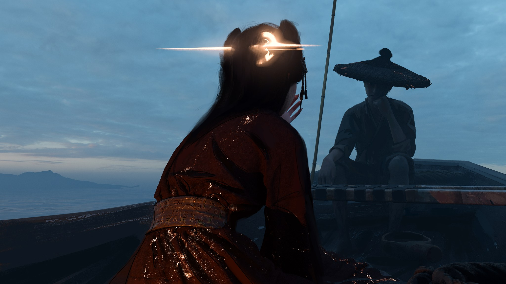

* **Lời thoại / Nội dung phát ra:**
  > **[Nguyệt Nha Nhi kinh hãi thốt lên]** "Lưu Tú?! Hán Quang Vũ——!"
  > 
  > *(Đúng khoảnh khắc tiếng thốt nghẹn ngào vừa cất lên, cả thế giới tức thì chìm vào bóng tối mịt mùng.)*

---

* **Chữ trong ảnh:** Các công thức vật lý và sơ đồ nón ánh sáng phác thảo trên cửa kính: đồ thị không-thời gian nón ánh sáng ($r \le ct$), phương trình rối lượng tử, cùng ghi chú chữ Hán "有序信息" (Thông tin có trật tự).
* **Lời thoại / Nội dung phát ra:**
  > **[Nguyệt Nha Nhi]** "——Rồi sau đó, tất cả tối sầm lại."
  > 
  > *(Đêm nơi tòa nhà công xưởng tĩnh lặng như tờ, ngọn đèn nhỏ hắt ra ánh sáng vàng vọt lờ mờ. Những bản thảo phác họa nón ánh sáng do Hi Dương vẽ trên khung cửa kính phản chiếu ánh trăng, ánh lên thứ quang sắc kỳ dị như đang mang một sinh mệnh sống động.)*
  > 
  > **[Nguyệt Nha Nhi]** "Lúc tôi tỉnh lại, người vẫn đang gục trên đài quan sát, tay vẫn cầm máy ảnh, bầu trời chỉ hơi tối đi một chút. Cảm giác như thể tôi chưa từng rời đi vậy."
  > 
  > *(Cô ngập ngừng một lát rồi nói tiếp:)*
  > 
  > **[Nguyệt Nha Nhi]** "Khi đó tôi chẳng nhớ được gì, chỉ nghĩ là mình vừa thất thần một thoáng. Mãi sau này nhớ lại được đôi chút, tôi cũng chỉ ngỡ đó là ảo giác do thiếu dưỡng khí trên cao nguyên mà thôi. Cho đến tận hôm nay, nghe anh giảng giải về nón ánh sáng, về 'thông tin có trật tự', tôi mới xâu chuỗi được toàn bộ những manh mối này lại với nhau."
  > 
  > *(Hi Dương trầm ngâm giây lát, rồi khẽ gật đầu:)*
  > 
  > **[Hi Dương]** "Nói vậy là, em đã đứng ngay trước mặt Lưu Tú mà hô to thụy hiệu của ông ấy."

---

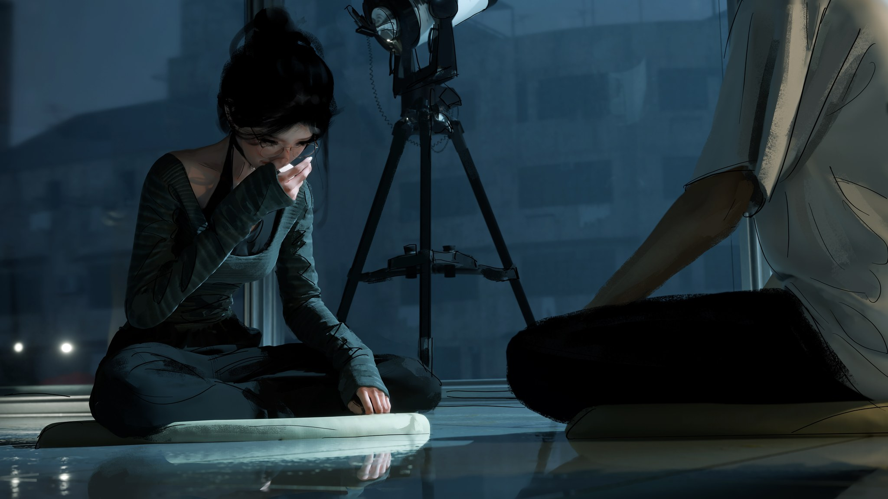

* **Lời thoại / Nội dung phát ra:**
  > *(Nguyệt Nha Nhi mím chặt môi nhìn Hi Dương, cả hai im lặng nhìn nhau trong giây lát. Bất chợt, gần như cùng một lúc, cả hai phì cười thành tiếng.)*
  > 
  > **[Nguyệt Nha Nhi ngượng ngùng cúi đầu]** "Trời đất, lúc đó sao tôi biết được chứ! Vừa nghe đến cái tên Lưu Tú là tôi…… xúc động quá nên buột miệng kêu lên thôi."
  > 
  > **[Hi Dương bật cười]** "Lúc đó người ta vẫn còn là một anh nông dân áo vải cày ruộng, đến bản thân sau này sẽ làm hoàng đế cũng chẳng hề hay biết. Em thì hay rồi, định sẵn luôn cả thụy hiệu sau khi mất cho người ta."
  > 
  > **[Nguyệt Nha Nhi]** "Anh đừng có cười tôi nữa mà!" *(Cô khẽ hờn dỗi than trách, nhưng tay vẫn che miệng, đuôi mắt cong cong ý cười.)*
  > 
  > *(Hi Dương nhìn cô, đợi cho cô dịu bớt cơn cười mới tiếp tục nói:)*
  > 
  > **[Hi Dương]** "Cho nên, tiếng gọi 'Hán Quang Vũ Đế' ấy……"

---

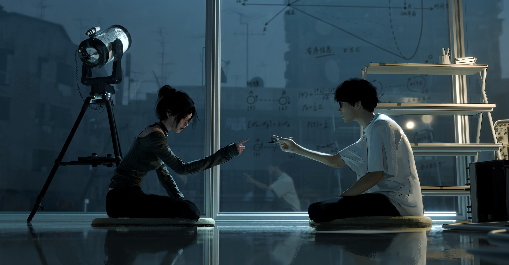

* **Lời thoại / Nội dung phát ra:**
  > *(Nói đến đây, ánh mắt hai người bất giác chạm nhau, nửa câu sau gần như cùng một lúc bật thốt ra khỏi miệng:)*
  > 
  > **[Hi Dương & Nguyệt Nha Nhi]** "—— Thông tin có trật tự!"
  > 
  > **[Hi Dương & Nguyệt Nha Nhi]** "—— Thông tin có trật tự!"
  > 
  > *(Hai thanh âm hòa quyện làm một. Nụ cười vừa kịp nén lại của Nguyệt Nha Nhi lại một lần nữa lan tỏa rạng rỡ. Hi Dương cũng mỉm cười theo, trong giây lát, chẳng ai vội vã nói thêm lời nào.)*

---

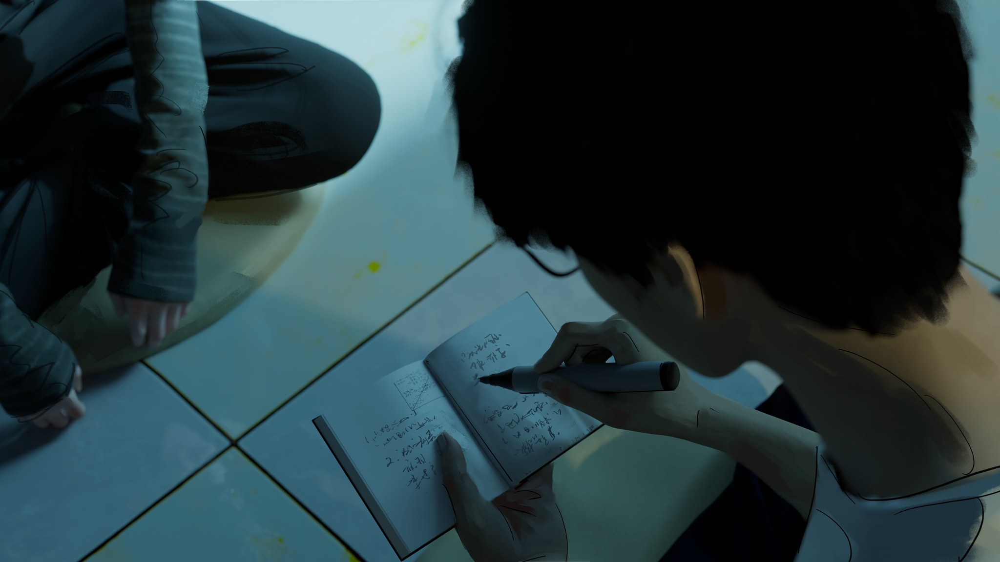

* **Chữ trong ảnh:** Các dòng ghi chép và sơ đồ nón ánh sáng giao thoa trong cuốn sổ tay nghiên cứu của Hi Dương.
* **Lời thoại / Nội dung phát ra:**
  > *(Hi Dương lật mở cuốn sổ tay bên cạnh. Tiếng cười đùa ban nãy dần lắng xuống, dưới ánh đèn vàng vang lên tiếng ngòi bút sột soạt cọ trên trang giấy.)*
  > 
  > **[Hi Dương]** "Bởi vậy, những Người Trong Mây phân tán ở khắp các niên đại khác nhau. Chúng ta ở thời đại này, còn Lưu Tú lại ở hai nghìn năm trước. Nhưng khi hành tẩu giữa những tầng mây, tháng năm đằng đẵng muôn trùng cũng không còn là rào cản bất khả vượt qua nữa. Hai người cùng đến bờ Ô Giang, cùng ngồi chung một con thuyền, cùng dõi mắt trông về một dải bờ bãi, chứng kiến Hạng Vũ đi trọn đoạn đường cuối cùng của cuộc đời."
  > 
  > *(Đầu bút khẽ khựng lại trên mặt giấy.)*
  > 
  > **[Hi Dương]** "Thế nhưng gặp gỡ, không đồng nghĩa với việc có thể nói toạc ra vận mệnh của nhau. Bản thân Lưu Tú dẫu sao cũng nằm bên ngoài nón ánh sáng của em. 'Hán Quang Vũ Đế' là cái tên do hậu thế ghi vào sử sách, còn Lưu Tú trên con thuyền thuở ấy vẫn chưa lật tới trang sách đó. Tiếng thốt kinh ngạc của em sẽ khiến ông ấy biết trước tương lai của chính mình. Thế là, chuyến hành tẩu giữa mây ngàn lần đó của hai người đành phải đứt đoạn ngay tại giây phút ấy."
  > 
  > *(Nguyệt Nha Nhi ôm lấy đầu gối, lặng lẽ ngắm nhìn anh. Hi Dương gạch bỏ một câu vừa viết, nắn nót viết lại bên cạnh. Dưới ánh đèn đêm, đoạn dĩ vãng ly kỳ chấn động ấy đang được anh cẩn trọng ghi lại trên trang giấy, từng câu từng chữ một.)*

---

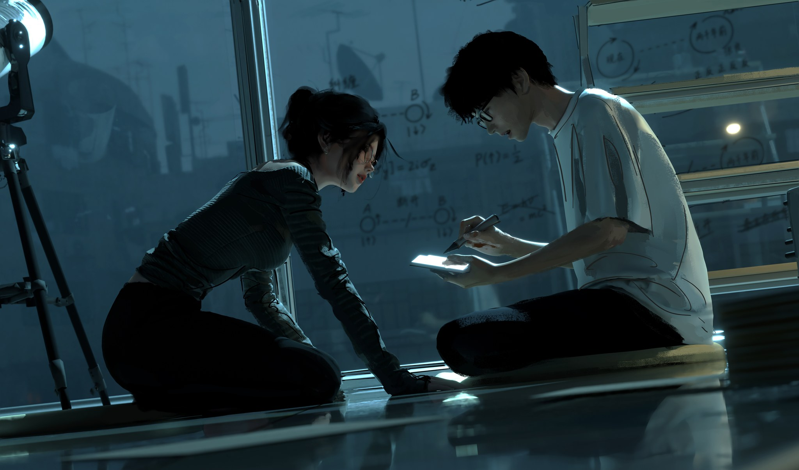

* **Lời thoại / Nội dung phát ra:**
  > **[Nguyệt Nha Nhi]** "Này."
  > 
  > **[Hi Dương]** "Hửm?"
  > 
  > **[Nguyệt Nha Nhi]** "Chuyện hoang đường không tưởng đến mức này, tôi nói thế nào là anh tin ngay thế đó à?"
  > 
  > *(Nguyệt Nha Nhi chống tay lặng lẽ nhích lại gần, nghiêng đầu ngước gương mặt thanh tú lên tìm kiếm ánh mắt anh lấp lánh sau tròng kính.)*
  > 
  > **[Nguyệt Nha Nhi]** "Anh không sợ là tôi tự bịa ra để trêu chọc anh à?"
  > 
  > *(Hi Dương chỉ khẽ cong khóe môi mỉm cười, nét bút trên tay vẫn chẳng hề ngơi nghỉ.)*

---

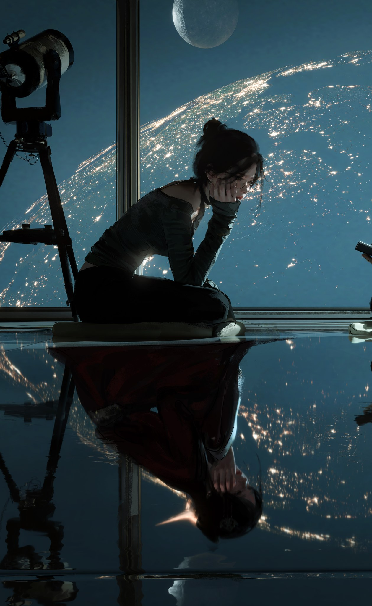

* **Chữ trong ảnh:** Ký hiệu toán học và đồ thị nón ánh sáng vẽ trên vách kính phản chiếu ánh trăng bạc; dưới sàn bóng loáng in hình ảnh phản chiếu của Nguyệt Nha Nhi trong trang phục cổ phong trên chiếc thuyền bên bờ Ô Giang hai ngàn năm trước.
* **Lời thoại / Nội dung phát ra:**
  > *(Nguyệt Nha Nhi dường như còn muốn nói điều chi nữa, nhưng lời đến bên môi lại nuốt ngược vào trong. Cô khẽ thu người lại, ngồi ngay ngắn về chỗ cũ.)*
  > 
  > *(Đêm đô thị trước khi Vân Trùng giáng lâm chìm trong một sự tĩnh lặng lạ thường. Những ký hiệu toán học trên khung cửa kính dưới ánh trăng bàng bạc tựa như một đàn tinh linh đang nhảy múa không một tiếng động. Cô bỗng thấy lòng mình bảng lảng chơi vơi, ngỡ như bản thân đang ngồi trên một mặt hồ lơ lửng giữa hư không vô tận, lại ngỡ như đã ngược dòng thời gian hai ngàn năm trước, trở về ngồi trên con thuyền trôi giữa dòng Ô Giang năm ấy.)*
  > 
  > *(Những trận cãi vã triền miên bất tận của cha mẹ trong ký ức, những lời chế giễu và ánh mắt lạnh lùng khó hiểu của bạn bè đồng trang lứa, những ánh nhìn cợt nhả suồng sã nơi quán bar tối đèn——tất cả những huyên náo hỗn tạp từng bủa vây lấy đời cô, ngay vào thời khắc này bỗng trở nên xa xăm diệu vợi, ngỡ như câu chuyện từ tiền kiếp.)*
  > 
  > *(Bên cạnh cô lúc này, chỉ còn lại tiếng ngòi bút sột soạt lướt nhẹ trên mặt giấy. Nguyệt Nha Nhi chống cằm, lặng lẽ ngắm nhìn cây bút trong tay Hi Dương, hơi thở từ từ lắng lại chậm rãi. Cô chỉ ước ao sao khoảnh khắc này có thể ngừng đọng lại thêm một chút nữa, mong sao trang giấy trước mặt anh vĩnh viễn chẳng thể viết hết.)*
  > 
  > *(Đêm mỗi lúc một thâm u. Đằng xa, tiếng trùng minh của Vân Trùng Số 9 văng vẳng vọng lại, trầm đục và miên man, chầm chậm hòa quyện vào làm một với tiếng rền vang bên bờ Ô Giang hai ngàn năm trước.)*
  > 
  > ---
  > 
  > ### Trích lục lịch sử
  > 
  > #### 《Sử Ký · Hạng Vũ Bản Kỷ》 — Tư Mã Thiên
  > 
  > *"Thế rồi Hạng Vương muốn sang đông qua bến Ô Giang. Đình trưởng Ô Giang đã neo thuyền chờ sẵn, nói với Hạng Vương rằng: 'Đất Giang Đông tuy nhỏ, nhưng đất đai ngàn dặm, dân số mấy mươi vạn, cũng đủ để xưng vương. Cầu xin Đại vương mau mau qua sông. Nay chỉ một mình thần có thuyền, quân Hán có đuổi tới cũng chẳng lấy gì mà qua.'*
  > 
  > *Hạng Vương cười đáp: 'Trời muốn diệt ta, ta qua sông làm chi nữa! Huống hồ năm xưa Tịch này cùng tám ngàn đệ tử Giang Đông vượt sông sang tây, nay chẳng một ai còn sống trở về. Dẫu cho các bậc phụ huynh chốn Giang Đông có xót thương mà tôn ta làm vương, ta còn mặt mũi nào để nhìn họ nữa? Dẫu miệng họ chẳng nói ra, lòng Hạng Tịch này há chẳng thấy hổ thẹn với lương tâm hay sao?'*
  > 
  > *Đoạn quay sang bảo người đình trưởng: 'Ta biết ngài là bậc trưởng giả trung hậu. Ta cưỡi con ngựa này đã năm năm, xông pha trận mạc không ai địch nổi, từng một ngày đi được ngàn dặm, nay chẳng nỡ giết nó, xin tặng lại cho ngài.'*
  > 
  > *……Nói rồi chàng tự vẫn mà chết. Vương Ế đoạt lấy đầu chàng, tàn quân kỵ binh giẫm đạp lên nhau mà tranh cướp thi thể Hạng Vương, chém giết lẫn nhau đến mấy mươi người. Sau rốt, Lang trung kỵ Dương Hỷ, Kỵ tư mã Lữ Mã Đồng, Lang trung Lữ Thắng và Dương Vũ mỗi người đoạt được một phần thi thể. Năm người gom các phần lại với nhau, đều được Hán vương phong tước Liệt hầu."*
  > 
  > ---
  > 
  > #### Hạng Vũ (232 TCN — 202 TCN)
  > 
  > *Tên là Tịch, tự là Vũ, người Hạ Tương. Cuối thời nhà Tần theo chú là Hạng Lương dấy binh khởi nghĩa; trong trận Cự Lộc đã đập nồi dìm thuyền (phá phủ trầm chu), tiêu diệt toàn bộ quân chủ lực nhà Tần, phân chia chư hầu thiên hạ, tự xưng là Tây Sở Bá Vương. Tranh hùng Sở - Hán suốt năm năm; đến khi bị bao vây ở Cai Hạ, bốn bề vang vọng khúc ca nước Sở (tứ diện Sở ca), bèn dẫn tàn kỵ phá vòng vây chạy đến Ô Giang. Không chịu qua sông, tự vẫn mà chết khi mới ba mươi tuổi. Thái Sử Công bàn rằng: "Ngôi vị tuy không trọn vẹn, nhưng từ cổ chí kim chưa từng có người thứ hai."*
  > 
  > ---
  > 
  > #### Lưu Tú (5 TCN — 57 SCN)
  > 
  > *Tự Văn Thúc, người Thái Dương quận Nam Dương, là cháu đời thứ chín của Hán Cao Tổ. Vương Mãng soán ngôi nhà Hán khiến gia cảnh sa sút, thuở hàn vi từng tự mình cày cấy ruộng đồng, sử chép "tính tình siêng năng việc cày cấy canh tác". Về sau dấy binh giữa thời loạn lạc; trong trận Côn Dương đã thống lĩnh vài ngàn nghĩa sĩ cảm tử đập tan bốn mươi hai vạn đại quân Tân Mãng, quét sạch quần hùng, tái lập cơ nghiệp Hán thất, định đô ở Lạc Dương, sử xưng là Đông Hán. Tại vị ba mươi ba năm, giảm trừ sưu thuế, đình chỉ can qua, bồi dưỡng sức dân, hậu thế ngợi ca là thời kỳ "Quang Vũ trung hưng". Thụy hiệu là Quang Vũ Hoàng Đế, miếu hiệu Thế Tổ.*

---

### Dự báo chương tiếp theo
**Kính mời đón đọc**
**《Vân Trùng》Chương 6: Phán Xét Văn Minh**
