# 云虫 - 第五章 乌骓 · 二

---

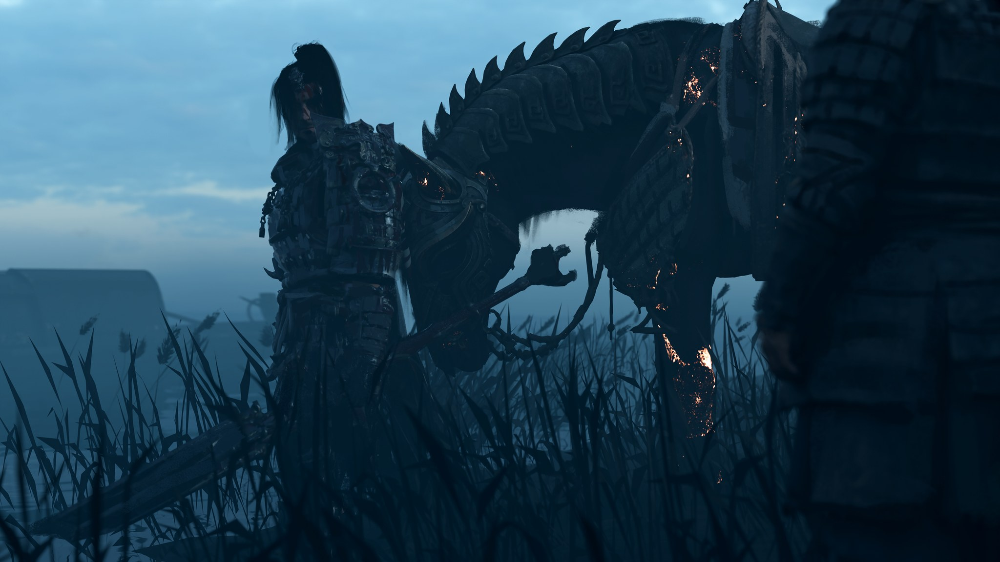

> 忽然，一声马嘶。

> 那匹黑马不知何时已靠了上来，头抵着项羽的后背，轻轻摩挲，声音里有种说不出的不舍。雾里，它的皮毛间泛起一层细碎的光，明明灭灭，宛若星空。

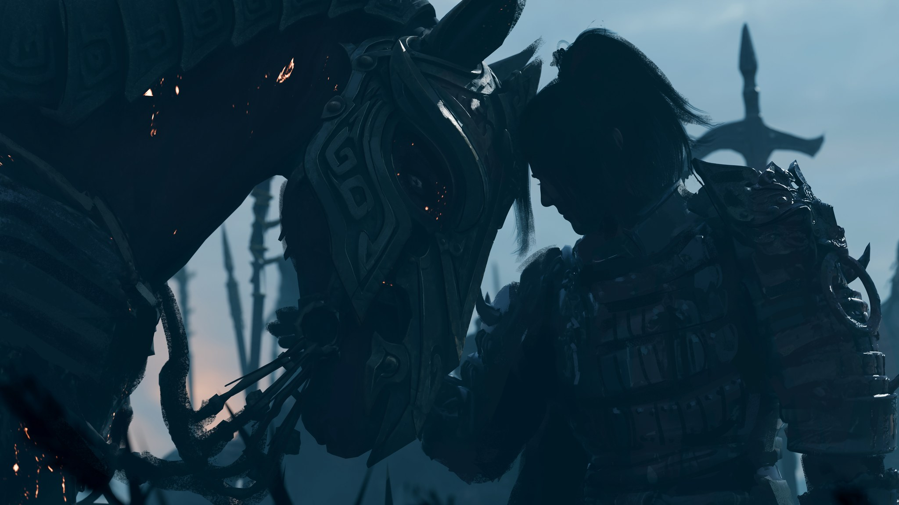

> 项羽回过头，轻轻抚摸着自己的战马，与它额头相抵，像是在安抚，也似是在告别。过了片刻，他才转向船头，说道： “此马名乌骓，随我征战多年。我不忍它同死于此。若尔等还愿替我做一件事，便善待它。”

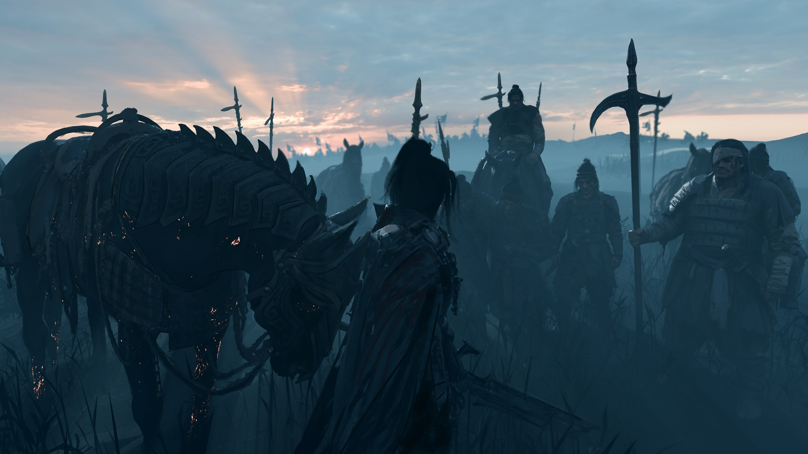

> 说罢，他转身面向自己的将士。

> “你们也走吧。汉军要的，只是籍一人之头。趁雾未散，沿江而去，不会有人追。”

> 他说着，便穿过身后的队伍，独自迎着雾中传来的喊杀声走去。

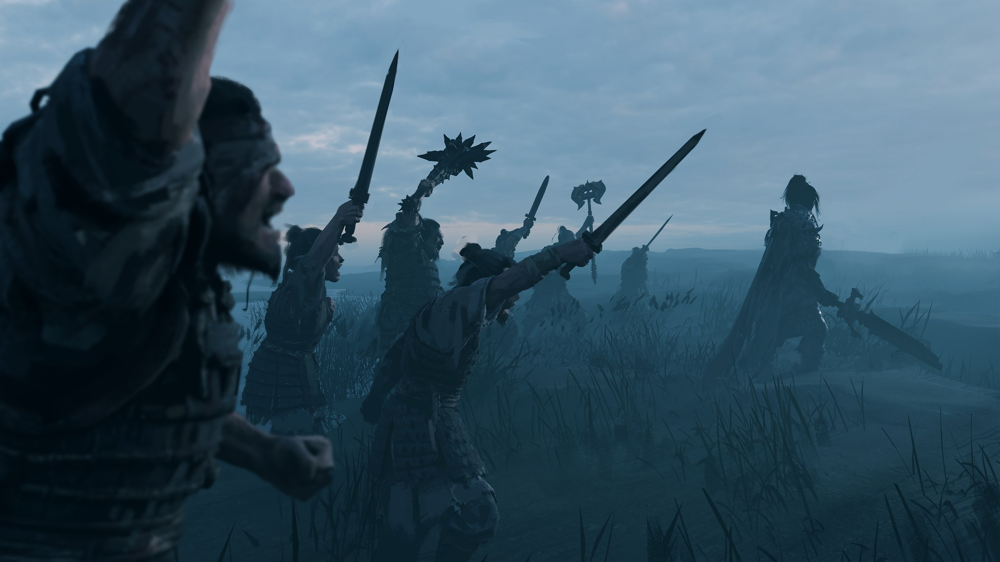

> 没有人离去。

> 二十余人或翻身下马，或拔出短刃。他们默然跟上，在项羽身后一字排开。不知是谁先喊了一声，接着所有人都喊了起来：

> “誓死追随项王！”

> “誓死追随项王——！”

> 喊声撞进浓雾里，惊起满滩水鸟。

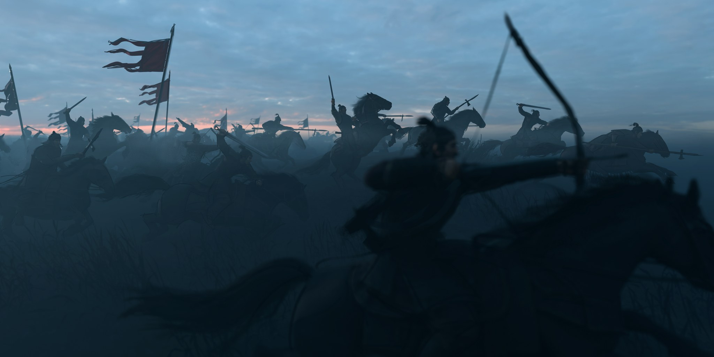

> 汉军到了。

> 骑兵从雾里涌了出来，如狂风席卷而至，转瞬之间，已近在咫尺。

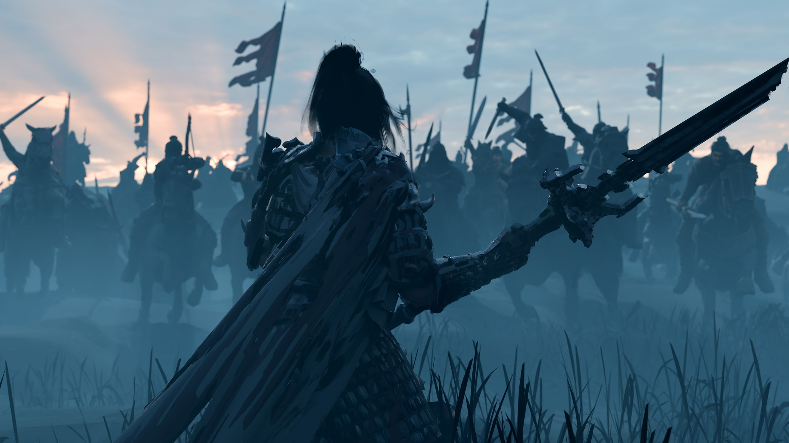

> 项羽缓缓提起手中那柄折断的巨刃，迈着沉稳的步子，迎向奔涌而来的汉军。一步一步，走进了自己故事的终章。

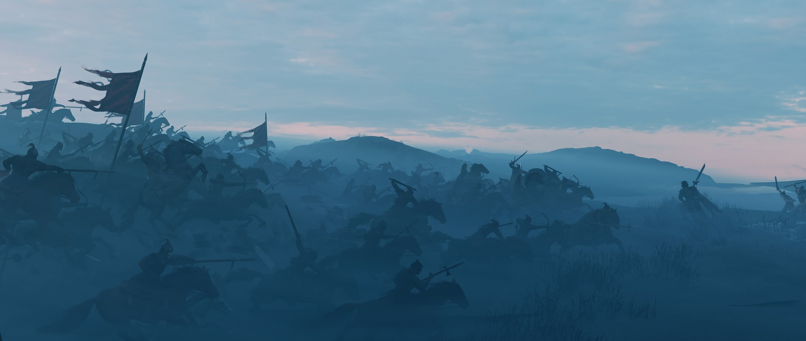

> 汉军像决了堤的黑潮，转眼漫过滩头。那二十几道身影在潮水里站了片刻，便被吞没了。

> 短兵相接的声音，远没有月牙儿想象中那样清脆响亮。沉闷的撞击声混着嘶哑的嚎叫，血腥而残酷。过了一会儿，岸上的喊杀声渐渐变了味，变成争抢，变成狂欢。风把那些声音一阵阵送过江面：

> “在这儿！这块是我的——！”

> “分我一块！”

> 月牙儿别过头去,不忍再看。

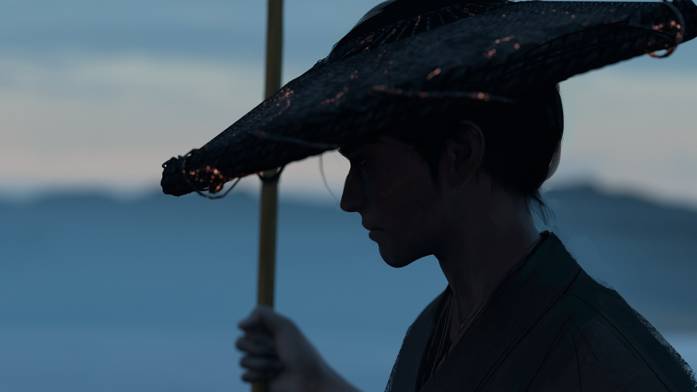

> 青年依旧立在那里,神色平静,一动不动地望着岸上。

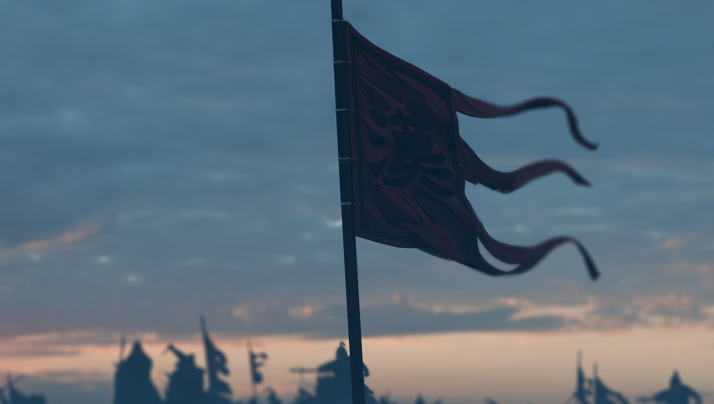

> 顺着他的目光,月牙儿发现他盯着的不是那片混乱,而是那面在雾中起伏的“汉”字大旗。他看了很久,很久。

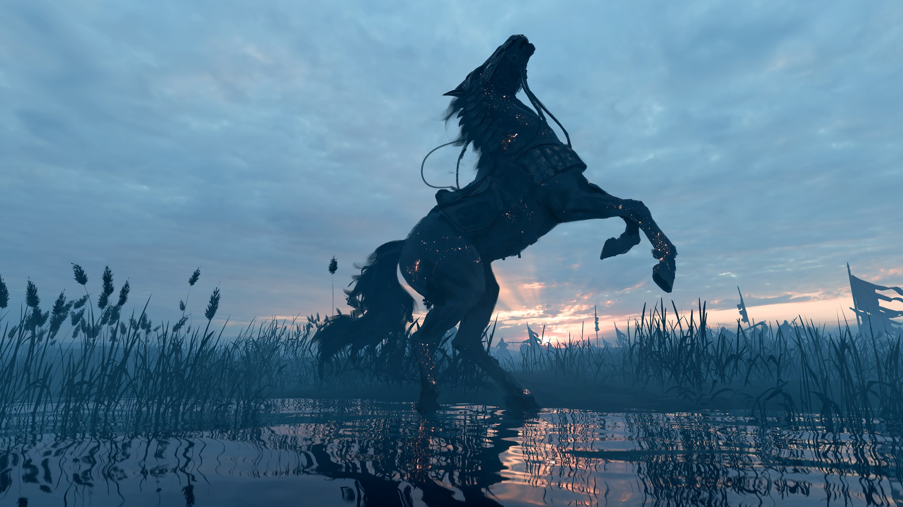

> 滩头上，乌骓还在。

> 它没有上船，也不肯走，只是朝着主人消失的方向扬起前蹄，一声又一声地长嘶，久久不去。雾的尽头，天边那个巨大的影子突然发出一声沉闷的虫鸣，像一声绵长的叹息，正正落在马嘶的间隙里。

> 一声马嘶，一声虫鸣。一应，一答。

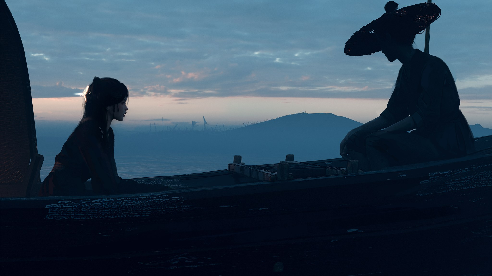

> 天光渐渐放亮，江上的雾气也缓缓散去。年轻的船夫坐在船头，安静得像一尊塑像。

> “……你叫什么名字？” 月牙儿轻声问，似乎只是想打破船上的沉默。

> 青年没有回答。他仍望着那面汉旗，像是自言自语，又像是在问她：

> “既然天意不可违，命运又为何要指引我们来窥探命运？”

> 过了好一会儿，他才回过头，看见她一脸茫然的样子，忽然淡淡一笑。

> “看来，你是头一回于云中行走。”

> 他叹了口气。

> “我也不过是一介草民。汉家天下倾覆之后，乱世里的一个农夫罢了。也不知为何偏偏是我有此荣幸，能以云中人之身，来这乌江边，见一见楚霸王。”

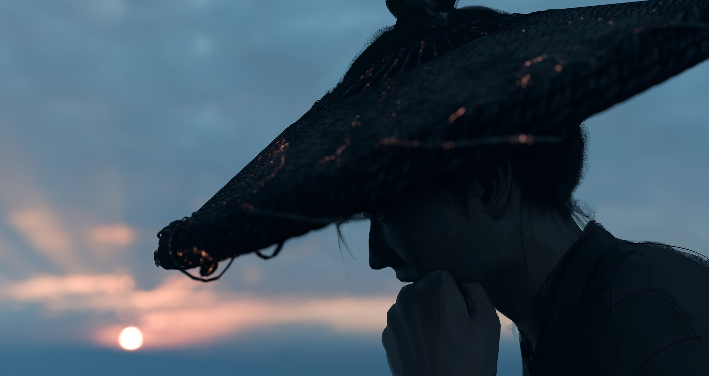

> “在下姓刘，名秀，字文叔。”

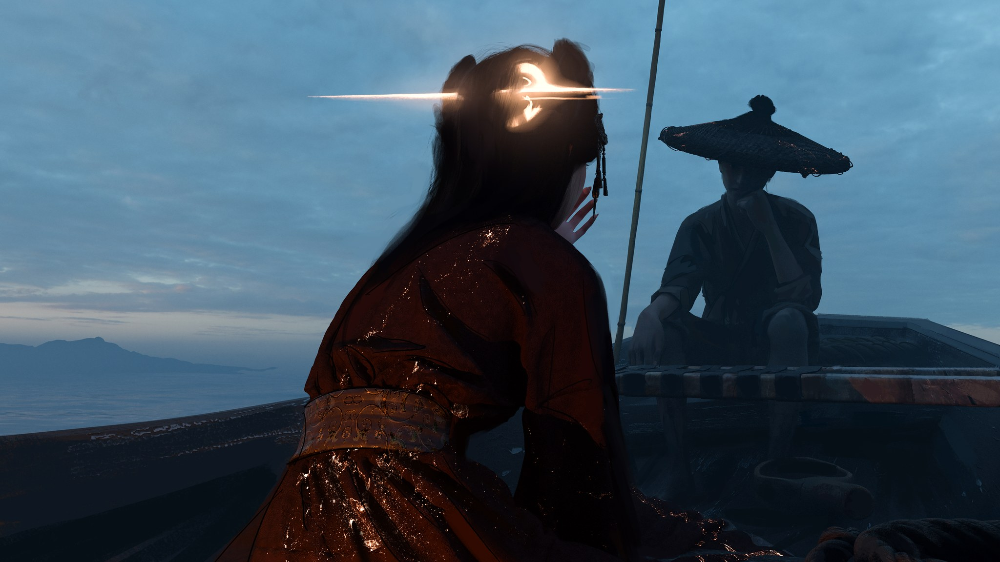

> “刘秀？！” 月牙儿大惊， “汉光武——！”

> 话音扬起的一瞬,世界黑了。

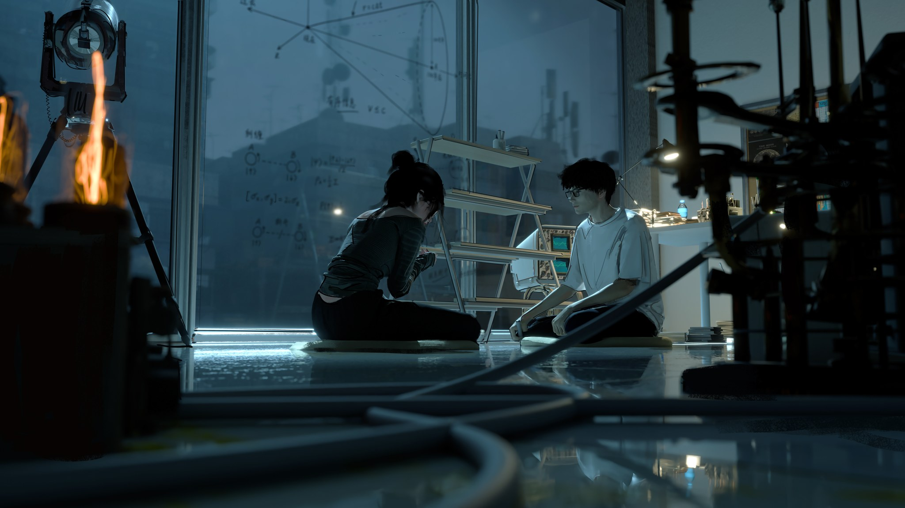

> “——然后，就全黑了。”

> 工厦的夜很静，小灯昏黄。希扬留在玻璃窗上的光锥手稿，在月光下泛着奇异的光泽，仿佛有了生命。

> “我醒过来的时候，” 月牙儿说， “人还趴在观测台上，手里还拿着相机，天就暗了一点。好像我根本没有离开过。”

> 她顿了顿。

> “那时候我什么都不记得，只觉得自己失了一阵神。后来想起来一点，也一直当它是缺氧时的幻觉。直到今天你讲光锥，讲有序信息，我才把这些事全拼上了。”

> 希扬沉默了一会儿，点了点头。

> “所以，你当着刘秀的面，喊出了他的谥号。”

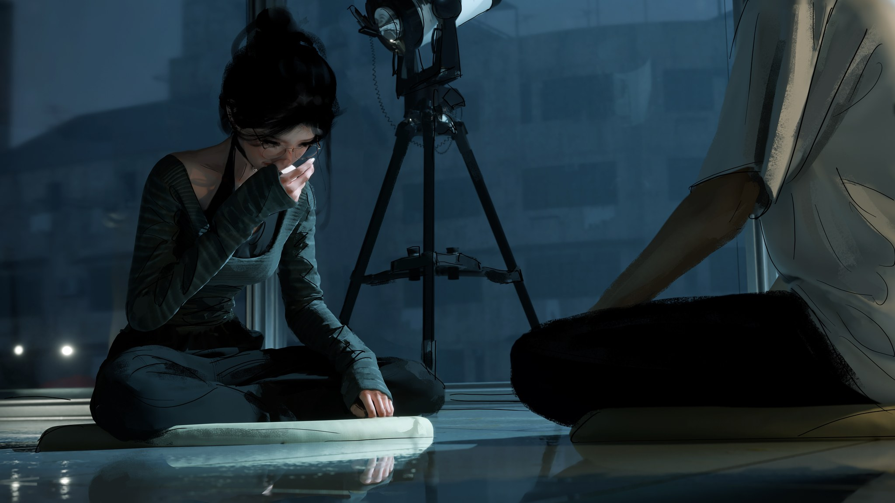

> 月牙儿抿着嘴看着希扬，两人一时都没说话。忽然，几乎同时扑哧一声笑了出来。

> “哎呀，我那时候哪知道嘛。” 月牙儿低下头，嘴角却还没收住， “一听是刘秀，我就……一激动，喊出来了。”

> “他那时候还只是个种地的，连自己以后会当皇帝都不知道。你倒好，连谥号都替他安排上了。”

> “你就别笑我了。” 月牙儿轻声埋怨着，却还捂着嘴，眉眼弯弯。

> 希扬望着她，等她稍稍收住了笑，才接着说： “所以，那声‘汉光武帝’……”

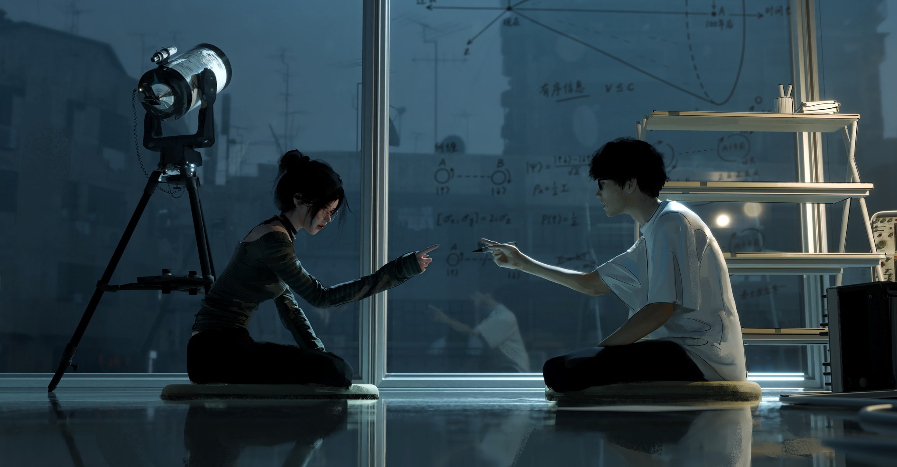

> 话到这里，两人的目光恰好碰在一处，余下的半句几乎同时脱口而出：

> “——有序信息！”

> “——有序信息！”

> 两个声音叠在一起，月牙儿才收住的笑意便又漾了开来。希扬也跟着笑了，一时谁都没有急着往下说。

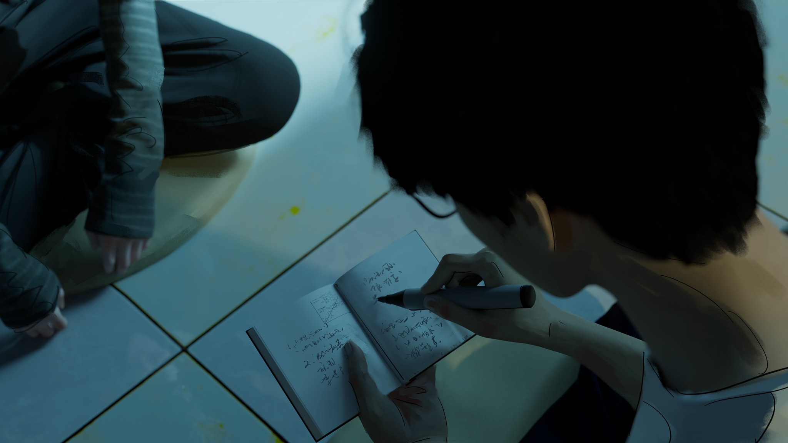

> 希扬翻开手边的本子。刚才的笑声渐渐歇了，灯下响起细微的落笔声。

> “所以，云中人散落在不同的年代。我们在这里，刘秀在两千年前。可在云中行走时，漫长的岁月也不再是无法跨越的阻隔。你们来到乌江，乘着同一条船，望着同一片江岸，看着项羽走完最后一程。”

> 笔尖在纸上稍停。

> “但相逢，并不意味着可以说破彼此的命运。刘秀本身毕竟也在你的光锥之外。‘汉光武帝’，是后人写进史书的名字，船上的刘秀却还没有走到那一页。你的那一声惊呼，会让他提前知道自己的未来。于是，你们两个人那次的云中行走，就在那里中断了。”

> 月牙儿抱着膝，安静地望着他。他把刚写下的一句话划去，在旁边重新补写。灯下，那段离奇的往事正被他一字一句，郑重地记在纸上。

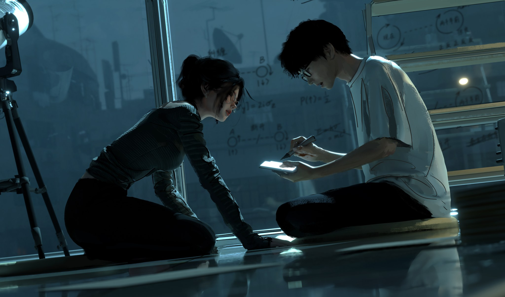

> “哎。”

> “嗯？”

> “这么离谱的事，我说，你就信啊？”

> 月牙儿撑着手悄悄凑近，歪着头，仰起脸去寻他镜片后的目光。

> “不怕是我瞎编出来逗你的？”

> 希扬只弯了弯嘴角，笔下未停。

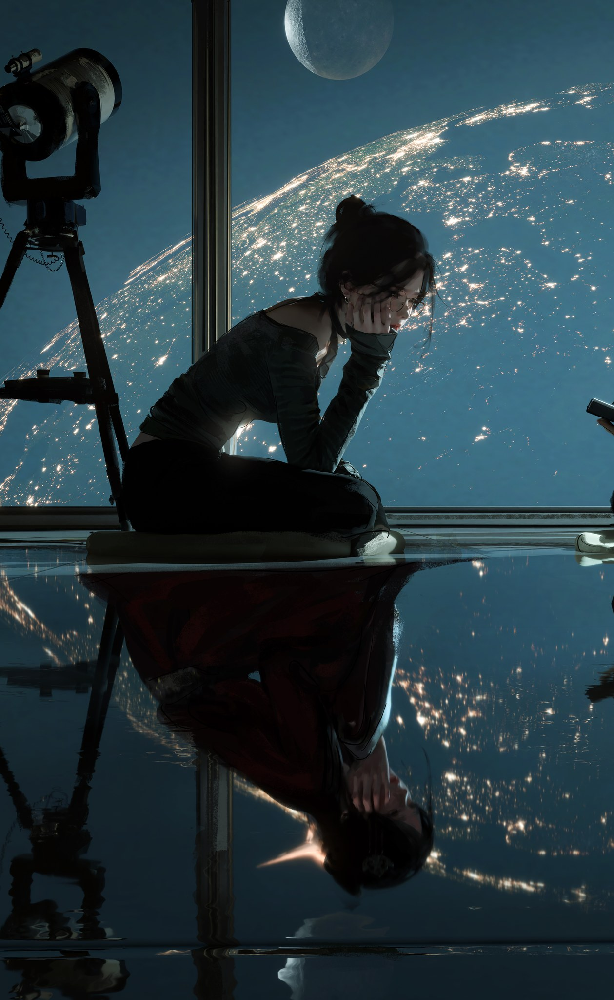

> 月牙儿似乎还想说什么，话到嘴边却又咽下，便轻轻收回身子，坐了回去。

> 城市的夜在云虫来临前显得格外安静。窗上的数学符号在银白的月光里，像一群无声跃动的精灵。她忽然有些恍惚，仿佛正坐在一片悬于虚空的湖面上，又像回到了两千年前，身在乌江的那条船上。

> 记忆里父母无休止的争吵、同龄人的嘲讽与不解、酒吧里轻佻暧昧的目光——那些曾经与她有关的喧闹，在这一刻都遥远得像发生在前世。

> 身旁只有笔尖划过纸面的沙沙声。月牙托着腮，安静地看着希扬手中的那支笔，一点一点放缓自己的呼吸。她只希望这一刻能停留得再久一点，盼着他面前的那一页纸，永远也写不完。

> 夜更深了。远处九号云虫的虫鸣隐隐传来，低沉而又绵长，和两千年前乌江边的那一声慢慢地叠在了一起。

> 《史记·项羽本纪》 — 司马迁

> 于是项王乃欲东渡乌江。乌江亭长檥船待，谓项王曰：“江东虽小，地方千里，众数十万人，亦足王也。愿大王急渡。今独臣有船，汉军至，无以渡。”项王笑曰：“天之亡我，我何渡为！且籍与江东子弟八千人渡江而西，今无一人还，纵江东父兄怜而王我，我何面目见之？纵彼不言，籍独不愧于心乎？”乃谓亭长曰：“吾知公长者。吾骑此马五岁，所当无敌，尝一日行千里，不忍杀之，以赐公。”

> ……乃自刎而死。王翳取其头，余骑相蹂践争项王，相杀者数十人。最其后，郎中骑杨喜、骑司马吕马童、郎中吕胜、杨武各得其一体。五人共会其体，皆赐爵列侯。

> 项羽（前232年—前202年）

> 名籍，字羽，下相人。秦末随叔父项梁起兵，巨鹿一战破釜沉舟，歼灭秦军主力，分封天下，自号西楚霸王。楚汉相争五年，垓下被围，四面楚歌，率残骑突围至乌江，不肯过江，自刎而死，年三十。太史公论曰：“位虽不终，近古以来未尝有也。”

> 刘秀（前5年—57年）

> 字文叔，南阳蔡阳人，汉高祖九世孙。王莽篡汉，家道中落，微时躬耕于田亩，史称“性勤于稼穑”。后于乱世起兵，昆阳之战以数千敢死之士破新莽四十二万大军，扫平群雄，重建汉室，定都洛阳，史称东汉。在位三十三年，轻徭薄赋，息兵养民，后世谓之“光武中兴”。谥光武皇帝，庙号世祖。

